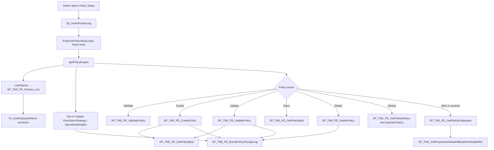
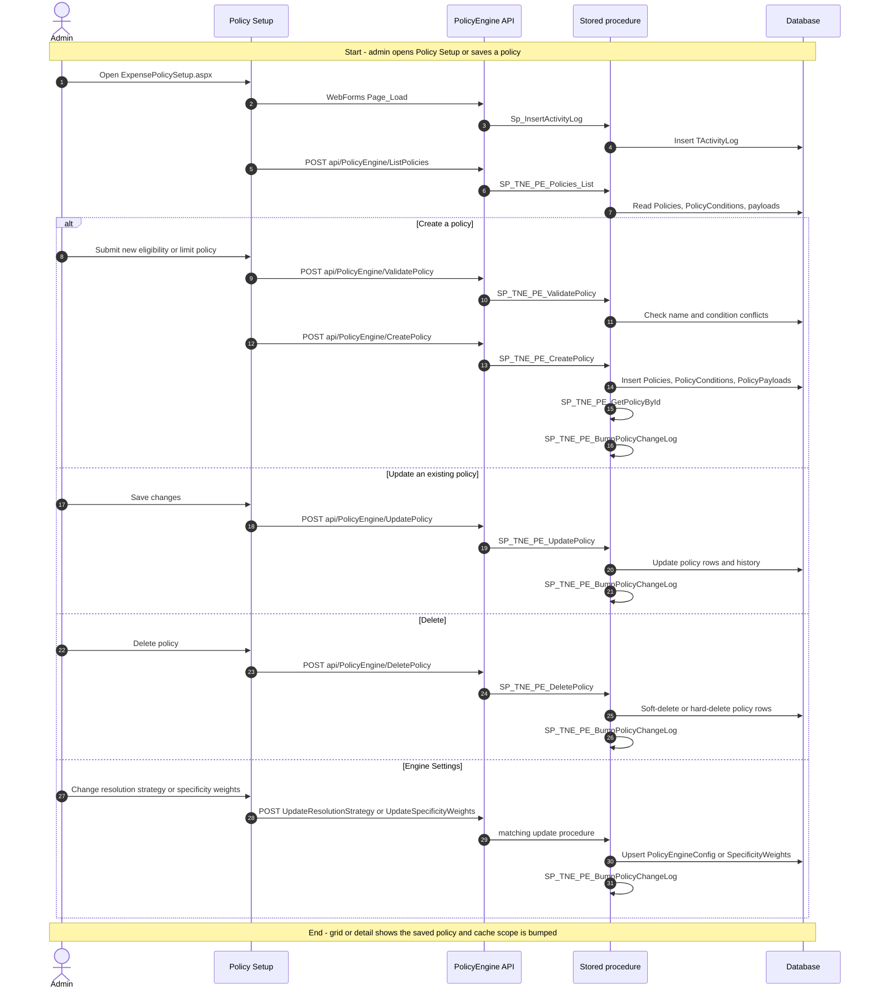
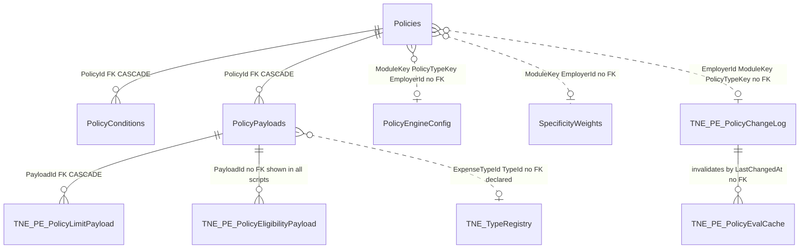

# Policy Setup

## Overview

An administrator opens **Admin Configuration → Travel and Expense → Policy Setup** to define which expense or advance types people may use and how much they may claim. The live host is `ExpensePolicySetup.aspx`. That page only stamps an activity log, loads the Travel & Expense webpack bundles, and puts the signed-in employee and employer into hidden fields for the React shell. Policy create, edit, delete, engine settings, and history are meant to go through the Travel & Expense **Policy Engine** Web API (`api/PolicyEngine/{action}`) into `HRMS_TRAVELNEXPENSE`.

A policy is a named rule for one employer, module (`expense`, `advance`, or travel-related keys), and policy type (`eligibility` or `limit`). Eligibility policies enable or disable expense or advance types for matching people. Limit policies set amount or period caps. Matching uses condition keys such as employee, business unit, designation, grade, location, employment type, and role. Engine Settings store the resolution strategy and specificity weights that decide which matching policy wins when several apply.

`TDataCatalog` names this screen for `Policies`, `PolicyConditions`, `PolicyPayloads`, and `PolicyEngineConfig`, including Eligibility Policy Setting, Limit Policy Setting, and Engine Settings. There is no SystemModel-2 workflow page for this screen. The React route for `ExpensePolicySetup.aspx` is not registered in the checked-in `Areas/routes.js`, so the SPA call sites are inferred from the Policy Engine controller and catalog, not from a Policy Setup React feature folder.

**Who's involved:**

- **HR / T&E administrator** — maintains eligibility and limit policies and engine settings for the employer.
- **Employee** — does not open this screen. Expense and advance request flows evaluate these policies at submit time through other Policy Engine endpoints.

## Workflow

Create, update, delete, resolution-strategy change, and specificity-weight change bump `TNE_PE_PolicyChangeLog` so employee evaluation cache rows self-invalidate on the next read. Runtime evaluation and audit endpoints on the same controller are not proven as calls from this setup page.

## Request journey

## Entry points

Menu DML registers menu id **1199** as **Expense Policy Setup** under Travel and Expense parent **95**, URL `~/HRM/TravelAndExpense/ExpensePolicySetup.aspx`. Left-nav label in product copy and this guide is **Policy Setup**.

| Entry | Purpose |
|---|---|
| `~/HRM/TravelAndExpense/ExpensePolicySetup.aspx` | Admin host. Activity log, session hidden fields, React bundle load. |
| `HRMS.TravelAndExpense.WebAPI` `PolicyEngineController` | JWT-authorized T&E API used for list, CRUD, engine settings, employee preview, and history. |

There is no WebForms postback that writes a policy. Checked-in `Areas/routes.js` has no route for this ASPX path.

## Code → database call chain

Travel & Expense DAL uses Dapper `CommandType.StoredProcedure` against `DBSource.TravelAndExpense` unless noted. Activity log uses Enterprise Library against HRMS.

| Entry | Method | Database |
|---|---|---|
| Every load, `ExpensePolicySetup.aspx.cs:35` | `CommonUtil.LogActivity` (`Common.cs:52`) → `LogUserActivity.LogActivity` → `ActivityHelper.LogActivity` (`ActivityHelper.cs:32`) | `Sp_InsertActivityLog` (HRMS). Activity type `ExpensePolicySetup` = 330 (`Enums.cs:273`). |
| List grid | `PolicyEngineController.ListPolicies` (`PolicyEngineController.cs:38`) → `PolicyEngineBLL.ListPolicies` (`PolicyEngineBLL.cs:104`) → `PolicyEngineDAL.ListPolicies` (`PolicyEngineDAL.cs:521`) | `SP_TNE_PE_Policies_List` (calls `Fn_GetEmployeeName`; dynamic sort via `sp_executesql`) |
| Open one policy | `GetPolicyById` (`PolicyEngineController.cs:598`) → `PolicyEngineBLL.GetPolicyById` (`:380`) → `PolicyEngineDAL.GetPolicyById` (`:849`) | `SP_TNE_PE_GetPolicyById` |
| Validate before save | `ValidatePolicy` (`PolicyEngineController.cs:747`) → `PolicyEngineBLL.ValidatePolicy` (`:488`) → `PolicyEngineDAL.ValidatePolicy` (`:1102`) | `SP_TNE_PE_ValidatePolicy` |
| Create | `CreatePolicy` (`PolicyEngineController.cs:542`) → `PolicyEngineBLL.CreatePolicy` (`:343`) → `PolicyEngineDAL.CreatePolicy` (`:772`) | `SP_TNE_PE_CreatePolicy` → nested `SP_TNE_PE_GetPolicyById`, `SP_TNE_PE_BumpPolicyChangeLog` |
| Update | `UpdatePolicy` (`PolicyEngineController.cs:570`) → `PolicyEngineBLL.UpdatePolicy` (`:361`) → `PolicyEngineDAL.UpdatePolicy` (`:829`) | `SP_TNE_PE_UpdatePolicy` → nested `SP_TNE_PE_GetPolicyById`, `SP_TNE_PE_BumpPolicyChangeLog` |
| Delete | `DeletePolicy` (`PolicyEngineController.cs:624`) → `PolicyEngineBLL.DeletePolicy` (`:394`) → `PolicyEngineDAL.DeletePolicy` (`:908`) | `SP_TNE_PE_DeletePolicy` → nested `SP_TNE_PE_BumpPolicyChangeLog` |
| Covered employees | `GetPolicyEmployees` (`PolicyEngineController.cs:717`) → `PolicyEngineBLL.GetPolicyEmployees` (`:471`) → `PolicyEngineDAL.GetPolicyEmployees` (`:1047`) | `SP_TNE_PE_GetPolicyEmployees` → nested `SP_TNE_GetEmployeesDetailedBasedOnMultipleBU` |
| Employee picker filters | `GetEmployeesDetailedBasedOnMultipleBU` (`PolicyEngineController.cs:687`) → BLL (`:437`) → DAL (`:1014`) | `SP_TNE_GetEmployeesDetailedBasedOnMultipleBU` (calls `Fn_GetEmployeeName`) |
| Employment types | `GetEmploymentTypeList` (`PolicyEngineController.cs:660`) → BLL (`:420`) → DAL (`:950`) | `SP_GetEmploymentTypeList` (HRMS procedure name; no TNE inventory copy found) |
| Resolution strategy | `GetResolutionStrategy` / `UpdateResolutionStrategy` (`PolicyEngineController.cs:123`, `:159`) → BLL (`:30`, `:45`) → DAL (`:182`, `:200`) | `SP_TNE_PE_GetResolutionStrategy`, `SP_TNE_PE_UpdateResolutionStrategy` (update bumps change log) |
| Specificity weights | `GetSpecificityWeights` / `UpdateSpecificityWeights` (`PolicyEngineController.cs:200`, `:227`) → BLL (`:69`, `:82`) → DAL (`:149`, `:167`) | `SP_TNE_PE_GetSpecificityWeights`, `SP_TNE_PE_UpdateSpecificityWeights` (update bumps change log and re-reads weights) |
| History | `GetPolicyHistory`, `GetEligibilityPolicyHistory`, `GetCombinedPolicyHistory` (`PolicyEngineController.cs:788`, `:817`, `:848`) → BLL/DAL history methods | `SP_TNE_PE_GetPolicyHistory`, `SP_TNE_PE_GetEligibilityPolicyHistory`, and for combined limit history `SP_TNE_PE_GetLimitPolicyHistory` |

## API endpoints

This screen is not a WebForms postback writer. After load, work is expected on the T&E Web API. Route template is `api/PolicyEngine/{action}` with `[ClaimsAuthorize("TnE", "HRMS")]`. Create, update, delete, and engine updates require a JWT employee id via `JwtEmployeeIdentity.TryGetEmployeeId`.

| Verb | Route | Parameters | Purpose | Source |
|---|---|---|---|---|
| POST | `api/PolicyEngine/ListPolicies` | body `ListPoliciesRequest` — `ModuleKey`, `PolicyTypeKey` required; `EmployerId`, `Search`, paging, sort optional | Paginated policy grid | `PolicyEngineController.cs:38` |
| GET | `api/PolicyEngine/GetPolicyById` | query `policyId` | Policy header, payloads, conditions | `:598` |
| POST | `api/PolicyEngine/ValidatePolicy` | body `PolicyValidationRequest` — module, type, name, dates, payloads, conditions | Pre-save conflict check | `:747` |
| POST | `api/PolicyEngine/CreatePolicy` | body `PolicyCreateRequest`; `CreatedBy` set from JWT | Insert policy | `:542` |
| POST | `api/PolicyEngine/UpdatePolicy` | body `PolicyUpdateRequest`; `UpdatedBy` from JWT | Update policy | `:570` |
| POST | `api/PolicyEngine/DeletePolicy` | body `PolicyDeleteRequest` — `PolicyId`, optional `HardDelete`; `DeletedBy` from JWT | Soft or hard delete | `:624` |
| POST | `api/PolicyEngine/GetPolicyEmployees` | body `GetPolicyEmployeesRequest` — `PolicyId` | Employees matching conditions | `:717` |
| POST | `api/PolicyEngine/GetEmployeesDetailedBasedOnMultipleBU` | body filter arrays + `EmployerId` | Employee picker | `:687` |
| POST | `api/PolicyEngine/GetEmploymentTypeList` | body `EmployerId` | Employment-type dropdown | `:660` |
| POST | `api/PolicyEngine/GetResolutionStrategy` | body module, policy type, employer | Read engine strategy | `:123` |
| POST | `api/PolicyEngine/UpdateResolutionStrategy` | body plus strategy; `UpdatedBy` from JWT | Write engine strategy | `:159` |
| POST | `api/PolicyEngine/GetSpecificityWeights` | body `ModuleKey`, `EmployerId` | Read weights | `:200` |
| POST | `api/PolicyEngine/UpdateSpecificityWeights` | body weights; `UpdatedBy` from JWT | Write weights | `:227` |
| POST | `api/PolicyEngine/GetPolicyHistory` | body `PolicyId` | Core history timeline | `:788` |
| POST | `api/PolicyEngine/GetEligibilityPolicyHistory` | body `PolicyId` | Eligibility payload history | `:817` |
| POST | `api/PolicyEngine/GetCombinedPolicyHistory` | body `PolicyId` | Core plus eligibility or limit payload history | `:848` |

The same controller also exposes evaluation, employee-limits, audit, type-registry sync, and type-mapping actions used by request runtime and ops. Those are not tied to a checked-in Policy Setup UI call.

## Stored procedures & tables involved

Objects below are the setup CRUD and engine path. Wiki citations use `TDataCatalog` rows for TravelNExpense policy tables when present; there is no `llm-wiki` domain page for Policy Engine in the synced tree used for this guide.

| Object | File | Purpose | Wiki / notes |
|---|---|---|---|
| [Sp_InsertActivityLog](/docs/database/hrms/Sp_InsertActivityLog) | `HRMS-DATABASE/HRMS/STOREPROCEDURE/Sp_InsertActivityLog.sql` | Page-open activity row | HRMS `TActivityLog` |
| [SP_TNE_PE_Policies_List](/docs/database/hrms-travelnexpense/SP_TNE_PE_Policies_List) | `HRMS-DATABASE/HRMS_TRAVELNEXPENSE/STOREPROCEDURE/SP_TNE_PE_Policies_List.sql` | Paginated active policies with resolved condition text | `TDataCatalog` `Policies` |
| [SP_TNE_PE_GetPolicyById](/docs/database/hrms-travelnexpense/SP_TNE_PE_GetPolicyById) | `.../SP_TNE_PE_GetPolicyById.sql` | One policy with payloads and conditions | same |
| [SP_TNE_PE_ValidatePolicy](/docs/database/hrms-travelnexpense/SP_TNE_PE_ValidatePolicy) | `.../SP_TNE_PE_ValidatePolicy.sql` | Duplicate name and overlapping payload/condition checks | same |
| [SP_TNE_PE_CreatePolicy](/docs/database/hrms-travelnexpense/SP_TNE_PE_CreatePolicy) | `.../SP_TNE_PE_CreatePolicy.sql` | Insert policy, payloads, conditions, history; bump change log | same |
| [SP_TNE_PE_UpdatePolicy](/docs/database/hrms-travelnexpense/SP_TNE_PE_UpdatePolicy) | `.../SP_TNE_PE_UpdatePolicy.sql` | Update policy graph; bump change log | same |
| [SP_TNE_PE_DeletePolicy](/docs/database/hrms-travelnexpense/SP_TNE_PE_DeletePolicy) | `.../SP_TNE_PE_DeletePolicy.sql` | Soft or hard delete; bump change log | same |
| [SP_TNE_PE_BumpPolicyChangeLog](/docs/database/hrms-travelnexpense/SP_TNE_PE_BumpPolicyChangeLog) | `.../SP_TNE_PE_BumpPolicyChangeLog.sql` | MERGE one `TNE_PE_PolicyChangeLog` row | cache DDL |
| [SP_TNE_PE_GetPolicyEmployees](/docs/database/hrms-travelnexpense/SP_TNE_PE_GetPolicyEmployees) | `.../SP_TNE_PE_GetPolicyEmployees.sql` | Resolve conditions then list employees | same |
| [SP_TNE_GetEmployeesDetailedBasedOnMultipleBU](/docs/database/hrms-travelnexpense/SP_TNE_GetEmployeesDetailedBasedOnMultipleBU) | `.../SP_TNE_GetEmployeesDetailedBasedOnMultipleBU.sql` | Filtered employee detail list | same |
| [SP_TNE_PE_GetResolutionStrategy](/docs/database/hrms-travelnexpense/SP_TNE_PE_GetResolutionStrategy) | `.../SP_TNE_PE_GetResolutionStrategy.sql` | Read `PolicyEngineConfig` | `TDataCatalog` `PolicyEngineConfig` |
| [SP_TNE_PE_UpdateResolutionStrategy](/docs/database/hrms-travelnexpense/SP_TNE_PE_UpdateResolutionStrategy) | `.../SP_TNE_PE_UpdateResolutionStrategy.sql` | Upsert strategy and bump change log | same |
| [SP_TNE_PE_GetSpecificityWeights](/docs/database/hrms-travelnexpense/SP_TNE_PE_GetSpecificityWeights) | `.../SP_TNE_PE_GetSpecificityWeights.sql` | Read `SpecificityWeights` | Engine Settings |
| [SP_TNE_PE_UpdateSpecificityWeights](/docs/database/hrms-travelnexpense/SP_TNE_PE_UpdateSpecificityWeights) | `.../SP_TNE_PE_UpdateSpecificityWeights.sql` | MERGE weights, bump both policy types, re-read | same |
| [SP_TNE_PE_GetPolicyHistory](/docs/database/hrms-travelnexpense/SP_TNE_PE_GetPolicyHistory) | `.../SP_TNE_PE_GetPolicyHistory.sql` | Core policy history | history tables |
| [SP_TNE_PE_GetEligibilityPolicyHistory](/docs/database/hrms-travelnexpense/SP_TNE_PE_GetEligibilityPolicyHistory) | `.../SP_TNE_PE_GetEligibilityPolicyHistory.sql` | Eligibility payload history | same |
| [SP_TNE_PE_GetLimitPolicyHistory](/docs/database/hrms-travelnexpense/SP_TNE_PE_GetLimitPolicyHistory) | `.../SP_TNE_PE_GetLimitPolicyHistory.sql` | Limit payload history used by combined history | same |
| [Fn_GetEmployeeName](/docs/database/hrms/Fn_GetEmployeeName) | HRMS function; TNE synonym | Display names on list and employee queries | HRMS |
| `Policies`, `PolicyConditions`, `PolicyPayloads` | `DDL/DDL_TNE_Policies.sql` and siblings | Policy graph | `TDataCatalog` |
| `TNE_PE_PolicyLimitPayload`, `TNE_PE_PolicyEligibilityPayload` | DDL under `HRMS_TRAVELNEXPENSE/DDL` | Normalized payload rows | same |
| `PolicyEngineConfig`, `SpecificityWeights` | DDL / seed DML | Engine Settings | same |
| `TNE_PE_PolicyChangeLog`, `TNE_PE_PolicyEvalCache` | `DDL_TNE_PE_PolicyCache.sql` | Invalidation and eval cache | same |
| `TNE_TypeRegistry` | TNE type registry | Expense/advance type ids on payloads | same |

## Table relationships

Foreign keys are taken from the TNE DDL scripts. Joins to HRMS master tables used when resolving condition labels are not declared FKs on the policy tables.

`PolicyConditions.PolicyId` and `PolicyPayloads.PolicyId` declare `ON DELETE CASCADE` to `Policies`. `TNE_PE_PolicyLimitPayload.PayloadId` declares cascade to `PolicyPayloads`. Baseline `Policies` has no FK to employer or employee masters.

## Known gaps

- **No React route for this ASPX.** `Areas/routes.js` and `routeConstants.js` omit `ExpensePolicySetup.aspx`. The host loads `travelandexpenses` bundles, but checked-in source has no Policy Setup container. API endpoints above are from `PolicyEngineController` and `TDataCatalog`, not from a traced JSX caller.
- **No SystemModel-2 page** for Policy Setup or Policy Engine admin.
- **`SP_GetEmploymentTypeList` is an HRMS procedure** used from the TNE DAL connection. No synonym or copy was found under `HRMS_TRAVELNEXPENSE`.
- **Built bundles are older than the ASPX.** `BuildJS` timestamps predate the Nov 2026 host page, so production UI may differ from this workspace.
- **Runtime evaluation SPs** (`SP_TNE_PE_EvaluatePolicy`, eligibility/limit employee APIs, audit reports, `SyncTypeRegistry`) live on the same controller and are out of scope for the setup call chain unless a UI source later proves otherwise.
- **CreatePolicy uses `sp_executesql`** for part of its work; that dynamic SQL is unresolved on the procedure page.
- **Menu DML title is `Expense Policy Setup`** while product catalog and this guide use **Policy Setup**.

## Reference

Confidence is medium because the ASPX host, Policy Engine controller/BLL/DAL, and TNE procedure scripts were read, but the Policy Setup React feature source is missing from the Travel & Expense routes tree.

### SourceCode

- `HRMS.Web/HRMS.Web/HRM/TravelAndExpense/ExpensePolicySetup.aspx`
- `HRMS.Web/HRMS.Web/HRM/TravelAndExpense/ExpensePolicySetup.aspx.cs`
- `HRMS.Web/HRMS.Web/HRM/TravelAndExpense/Areas/routes.js`
- `HRMS.Web/HRMS.Web/HRM/TravelAndExpense/Common/routeConstants.js`
- `HRMS.TravelAndExpense/HRMS.TravelAndExpense.WebAPI/Controllers/PolicyEngineController.cs`
- `HRMS.TravelAndExpense/HRMS.TravelAndExpense.BLL/PolicyEngine/PolicyEngineBLL.cs`
- `HRMS.TravelAndExpense/HRMS.TravelAndExpense.DAL/PolicyEngine/PolicyEngineDAL.cs`
- `HRMS.Shared/HRMS.Common/Common.cs`
- `HRMS.Shared/TDG.ActivityAuditLog/DAL/ActivityHelper.cs`
- `HRMS.Shared/HRMS.DataContract/Common/Enums.cs`
- `docs/SystemModels/SystemModel-2` has no page for this screen

### TDG HRMS DB

- `HRMS-DATABASE/HRMS/DML/ExpensePolicySetupNewMenuOption_DML.sql`
- `HRMS-DATABASE/HRMS/STOREPROCEDURE/Sp_InsertActivityLog.sql`
- `HRMS-DATABASE/HRMS_TRAVELNEXPENSE/STOREPROCEDURE/SP_TNE_PE_*.sql` and `SP_TNE_GetEmployeesDetailedBasedOnMultipleBU.sql`
- `HRMS-DATABASE/HRMS_TRAVELNEXPENSE/DDL/DDL_TNE_Policies.sql`
- `HRMS-DATABASE/HRMS_TRAVELNEXPENSE/DDL/DDL_TNE_PolicyConditions.sql`
- `HRMS-DATABASE/HRMS_TRAVELNEXPENSE/DDL/DDL_TNE_PolicyPayloads.sql`
- `HRMS-DATABASE/HRMS_TRAVELNEXPENSE/DDL/DDL_TNE_PolicyEngineConfig.sql`
- `HRMS-DATABASE/HRMS_TRAVELNEXPENSE/DDL/DDL_TNE_PE_PolicyLimitPayload.sql`
- `HRMS-DATABASE/HRMS_TRAVELNEXPENSE/DDL/DDL_TNE_PE_PolicyCache.sql`
- `HRMS-DATABASE/HRMS/DML/TDataCatalog_DML.sql` (`Policies`, `PolicyConditions`, `PolicyPayloads`, `PolicyEngineConfig`)
