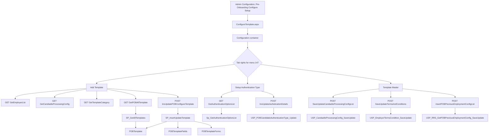
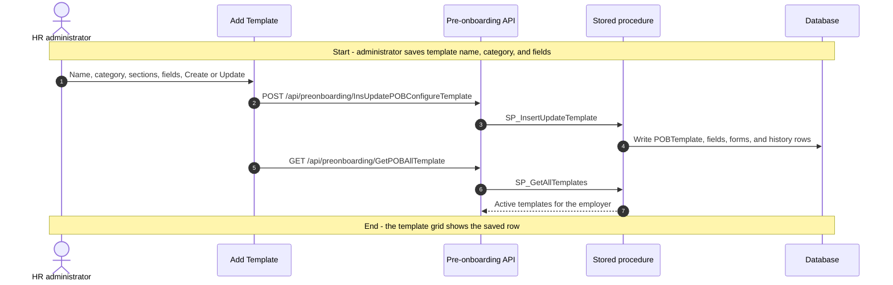
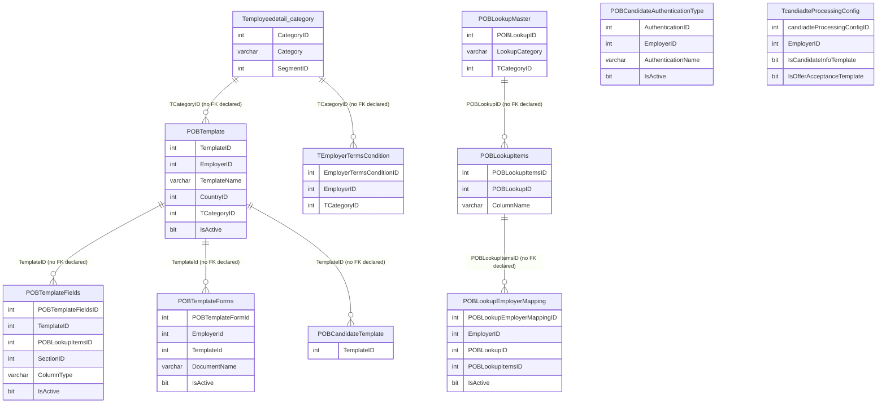

# Pre-Onboarding Configure Setup

## Overview

An HR administrator needs the field layout, authentication options, and processing flags that later screens use when a candidate is initiated into pre-onboarding. They open **Admin Configuration → Pre-Onboarding Configure Setup**. Role and user tab rights for menu 147 decide which of three tabs appear: **Add Template**, **Setup Authentication Type**, and **Template Master**.

On **Add Template** they pick an employer and country, choose a template category that the organisation processing config still allows, select sections and fields, optionally attach template forms, and create or update the template. Delete soft-deactivates a template that is not assigned to candidates. **Setup Authentication Type** maintains the login-method list for that employer. **Template Master** stores previous-employment document mappings, candidate-processing flags, and terms-and-conditions text by category.

SystemModel-2 does not name this screen. Table blurbs for `POBTemplate`, `POBTemplateFields`, `POBTemplateForms`, `POBLookupEmployerMapping`, `POBCandidateAuthenticationType`, and `TcandiadteProcessingConfig` are in `llm-wiki/reference/tables/hrms.md`.

**Who's involved:**

- **HR administrator** — builds templates and organisation processing settings for the employer they select.
- **Initiation and candidate screens** — later read these templates and flags; they do not own this save.
- **Pre-onboarding candidate** — never opens this page.

## Workflow

## Request journey

### HR administrator — create or update a template

Authentication and Template Master saves follow the same UI → API → procedure pattern on their own tabs. Soft-delete reuses `InsUpdatePOBConfigureTemplate` with `IsActive` 0 and empty field and form lists. The browser blocks delete when `AssignedTo` is greater than zero.

## Entry points

`ConfigureTemplate.aspx` is a host. It stamps session user values into hidden fields, loads `BuildJS/preonboarding.min.js`, and leaves `div#root`. `setupUser.js` loads customer web config, then `Areas/routes.js` matches `/HRM/PreOnBoarding/ConfigureTemplate.aspx` and renders `Configuration.js`. Code-behind only logs activity and fills the hidden fields; it does not post back business data.

| UI page | Purpose |
|---|---|
| `HRM/PreOnBoarding/ConfigureTemplate.aspx` | Host for the React screen |
| `Areas/Configuration/Containers/Configuration.js` | Tabs by role and user permission for menu 147 |
| `Areas/Configuration/Components/Template.js` | Add Template grid and form |
| `Areas/Configuration/Components/SetupAuthenticationType.js` | Authentication type list and save |
| `Areas/Configuration/Components/POBConfig.js` | Template Master processing, previous employment, and terms |

## Code → database call chain

Exported URL constants are the unversioned `/preonboarding/...` paths. `routeIndex.js` mounts those on `/api/preonboarding`. Country id for the organisation uses `/api/dashBoard/GetCountryId`.

| Entry | Method | Stored procedure |
|---|---|---|
| Customer web config (shell) | `getEmployerWebConfig` (`setupUser.js:43`) → `GetEmployerWebConfig` (`preOnBoardingController.js:21`) → `preOnBoardingDAL.js:107` | `SP_GetCustomerSettings` |
| Tab rights | `componentDidMount` (`Configuration.js:32`) → `GetPermissionRoleTabDetails` (`preOnBoardingController.js:1412`) → `preOnBoardingDAL.js:1928` | `Sp_AdminRoleM_GetTabRoleDet` |
| Tab rights | `componentDidMount` (`Configuration.js:44`) → `GetPermissionUserTabDetailsByuserId` (`preOnBoardingController.js:1303`) → `preOnBoardingDAL.js:1914` | `Sp_GetTabUserDetails` |
| Organisation country | `componentDidMount` (`Template.js:185`) → `GetCountryId` (`dashboardController.js:1793`) → `dashBoardDAL.js:2945` | `SP_CM_GetCountryID` |
| Country list | `getCountryOfEmployment` (`Template.js:205`) → `GetCountryOfEmployment` (`preOnBoardingController.js:1434`) → `preOnBoardingDAL.js:2168` | `SP_GetCountries` |
| Employer list | `populateEmployerList` (`Template.js:216`) → `GetEmployerList` (`preOnBoardingController.js:429`) → `preOnBoardingDAL.js:717` | `SP_GetEmployerList` |
| Processing flags (Add Template) | `getConfigurationDetails` (`Template.js:229`) → `GetCandiadteProcessingConfig` (`preOnBoardingController.js:1699`) → `preOnBoardingDAL.js:2699` | `USP_GetCandiadteProcessingConfig` |
| Template categories | `getTemplateCategory` (`Template.js:242`) → `GetTemplateCategory` (`preOnBoardingController.js:1542`) → `preOnBoardingDAL.js:2180` | `SP_GetTemplateCategory` |
| Field picker | `populateLookupItems` (`Template.js:269`) → `GetLookUpItems` (`preOnBoardingController.js:567`) → `preOnBoardingDAL.js:1112` | `SP_GetLookUpItems` |
| Template grid | `populateTemplateList` (`Template.js:405`) → `GetPOBAllTemplate` (`preOnBoardingController.js:578`) → `preOnBoardingDAL.js:1130` | `SP_GetAllTemplates` |
| Open one template | `populateTemplateInfo` (`Template.js:437`) → `GetViewTemplateDetails` (`preOnBoardingController.js:600`) → `preOnBoardingDAL.js:1211` and `1810` | `SP_GetTemplateDetailsByID`, `SP_GetAllPOBTemplateForms` |
| Sections for category | `getTemplateSections` (`Template.js:799`) → `GetTemplateSections` (`preOnBoardingController.js:1933`) → `preOnBoardingDAL.js:3133` | `SP_GetTemplateSections` |
| Create, update, soft-delete | `insertUpdateTemplateDetails` (`Template.js:717`) → `InsUpdatePOBConfigureTemplate` (`preOnBoardingController.js:589`) → `preOnBoardingDAL.js:1145` | `SP_InsertUpdateTemplate` |
| Auth list | `SetupAuthenticationType.js:81` → `GetAuthenticationOptionList` (`preOnBoardingController.js:647`) → `preOnBoardingDAL.js:1262` | `Sp_GetAuthenticationOptionList` |
| Auth save | `SetupAuthenticationType.js:194` → `InsUpdateAutheticationDetails` (`preOnBoardingController.js:1292`) → `preOnBoardingDAL.js:2140` | `USP_POBCandidateAuthenticationType_Update` |
| Previous-employment list | `POBConfig.js:132` → `GetPOBPreviousEmploymentConfigList` (`preOnBoardingController.js:1672`) → `preOnBoardingDAL.js:2713` | `USP_RRS_GetPOBPreviousEmploymentConfigList` |
| Previous-employment save | `POBConfig.js:252` → `InsertPOBPreviousEmploymentConfigList` (`preOnBoardingController.js:1681`) → `preOnBoardingDAL.js:2727` | `USP_RRS_GetPOBPreviousEmploymentConfig_SaveUpdate` |
| Previous-employment delete | `POBConfig.js:207` → `DeletePOBPreviousEmploymentConfigList` (`preOnBoardingController.js:1690`) → `preOnBoardingDAL.js:2780` | `USP_RRS_GetPOBPreviousEmploymentConfig_Delete` |
| Processing list (Template Master) | `POBConfig.js:81` → `GetCandiadteProcessingConfigList` (`preOnBoardingController.js:1736`) → `preOnBoardingDAL.js:2838` | `USP_CandiadteProcessingConfig_List` |
| Processing save | `POBConfig.js:286` → `SaveUpdateCandiadteProcessingConfigList` (`preOnBoardingController.js:1745`) → `preOnBoardingDAL.js:2852` | `USP_CandiadteProcessingConfig_SaveUpdate` |
| Terms list | `POBConfig.js:67` → `GetTermsAndConditions` (`preOnBoardingController.js:1754`) → `preOnBoardingDAL.js:2885` | `USP_EmployerTermsCondition_List` |
| Terms save | `POBConfig.js:405` → `SaveUpdateTermsAndConditions` (`preOnBoardingController.js:1763`) → `preOnBoardingDAL.js:2900` | `USP_EmployerTermsCondition_SaveUpdate` |

Template form file bytes go through `UPLOAD_CANDIDATE_DOCUMENT` in `TemplateForm.js`; that path stores a file and is not a stored-procedure call. Create, update, auth save, previous-employment save, processing save, and terms save begin a SQL transaction in the DAL and commit after the procedure returns.

## API endpoints

Most of these routes use `Authorize` in `PreOnBoardingRoutes.js`. `GetViewTemplateDetails`, `GetCountryOfEmployment`, `GetTemplateCategory`, `GetCandiadteProcessingConfig`, `GetTemplateSections`, and `GetEmployerWebConfig` are registered without `Authorize` on the unversioned router. Country id is on the dashboard router.

| Verb | Route | Parameters | Purpose | Source |
|---|---|---|---|---|
| GET | `/api/preonboarding/GetEmployerWebConfig` | `CustomerId` query | Customer settings for the shell | `PreOnBoardingRoutes.js:18`, `preOnBoardingController.js:21` |
| GET | `/api/preonboarding/GetPermissionRoleTabDetails` | `EmployerId`, `RoleId` query | Role tab rights for menu 147 | `PreOnBoardingRoutes.js:97`, `preOnBoardingController.js:1412` |
| GET | `/api/preonboarding/GetPermissionUserTabDetailsByuserId` | `EmployerId`, `UserId` query | User tab rights for menu 147 | `PreOnBoardingRoutes.js:96`, `preOnBoardingController.js:1303` |
| POST | `/api/dashBoard/GetCountryId` | JSON `employerId` | Organisation country id | `DashBoardRoutes.js:137`, `dashboardController.js:1793` |
| GET | `/api/preonboarding/GetCountryOfEmployment` | None | Country dropdown | `PreOnBoardingRoutes.js:107`, `preOnBoardingController.js:1434` |
| GET | `/api/preonboarding/GetEmployerList` | `employeeId` query | Employer dropdown | `PreOnBoardingRoutes.js:8`, `preOnBoardingController.js:429` |
| GET | `/api/preonboarding/GetCandiadteProcessingConfig` | `Employerid` query | Flags that gate template categories | `PreOnBoardingRoutes.js:129`, `preOnBoardingController.js:1699` |
| GET | `/api/preonboarding/GetTemplateCategory` | `EmployerId` query | Categories with `SegmentID` 3 | `PreOnBoardingRoutes.js:108`, `preOnBoardingController.js:1542` |
| GET | `/api/preonboarding/GetLookUpItems` | `employerid`, `countryId`, `categoryId` query | Field picker rows | `PreOnBoardingRoutes.js:15`, `preOnBoardingController.js:567` |
| GET | `/api/preonboarding/GetPOBAllTemplate` | `Employerid` query | Template grid | `PreOnBoardingRoutes.js:16`, `preOnBoardingController.js:578` |
| GET | `/api/preonboarding/GetViewTemplateDetails` | `employerid`, `Templateid` query | Template fields plus forms | `PreOnBoardingRoutes.js:17`, `preOnBoardingController.js:600` |
| GET | `/api/preonboarding/GetTemplateSections` | `employerId`, `categoryId` query | Section checklist | `PreOnBoardingRoutes.js:156`, `preOnBoardingController.js:1933` |
| POST | `/api/preonboarding/InsUpdatePOBConfigureTemplate` | JSON `TemplateID`, `EmployerID`, `CountryId`, `TemplateName`, `IsActive`, `LoginUserID`, `TemplateCategory`, `UDTPOBTemplateFields`, `TemplateFormList` | Create, update, or soft-delete | `PreOnBoardingRoutes.js:19`, `preOnBoardingController.js:589` |
| GET | `/api/preonboarding/GetAuthenticationOptionList` | `employerid` query | Auth type grid | `PreOnBoardingRoutes.js:22`, `preOnBoardingController.js:647` |
| POST | `/api/preonboarding/InsUpdateAutheticationDetails` | JSON auth fields | Insert or update auth type | `PreOnBoardingRoutes.js:95`, `preOnBoardingController.js:1292` |
| GET | `/api/preonboarding/getPOBPreviousEmploymentConfigList` | `EmployerId`, `LookupID` query | Previous-employment mappings | `PreOnBoardingRoutes.js:132`, `preOnBoardingController.js:1672` |
| POST | `/api/preonboarding/insertPOBPreviousEmploymentConfigList` | JSON `EmployerId`, `ConfigList`, `Createdby`, `UpdatedBy` | Save previous-employment rows | `PreOnBoardingRoutes.js:133`, `preOnBoardingController.js:1681` |
| DELETE | `/api/preonboarding/deletePOBPreviousEmploymentConfigList` | `POBLookupEmployerMappingID`, `UpdatedBy` query | Soft-deactivate one mapping | `PreOnBoardingRoutes.js:134`, `preOnBoardingController.js:1690` |
| GET | `/api/preonboarding/GetCandiadteProcessingConfigList` | `Employerid` query | Processing config for Template Master | `PreOnBoardingRoutes.js:139`, `preOnBoardingController.js:1736` |
| POST | `/api/preonboarding/SaveUpdateCandiadteProcessingConfigList` | JSON processing flags | Insert or update processing config | `PreOnBoardingRoutes.js:140`, `preOnBoardingController.js:1745` |
| GET | `/api/preonboarding/GetTermsAndConditions` | `Employerid` query | Terms text by category | `PreOnBoardingRoutes.js:141`, `preOnBoardingController.js:1754` |
| POST | `/api/preonboarding/SaveUpdateTermsAndConditions` | JSON terms fields | Insert or update terms | `PreOnBoardingRoutes.js:142`, `preOnBoardingController.js:1763` |

There is no WebForms postback for template data on this page.

## Stored procedures & tables involved

Pages for these objects are under `/docs/database/hrms/`. Nested history helpers used by the template save are linked from `SP_InsertUpdateTemplate`.

| Object | File | Purpose |
|---|---|---|
| [`SP_GetCustomerSettings`](/docs/database/hrms/SP_GetCustomerSettings) | `HRMS-DATABASE/HRMS/STOREPROCEDURE/SP_GetCustomerSettings.sql` | Customer web settings for the shell |
| [`Sp_AdminRoleM_GetTabRoleDet`](/docs/database/hrms/Sp_AdminRoleM_GetTabRoleDet) | `HRMS-DATABASE/HRMS/STOREPROCEDURE/Sp_AdminRoleM_GetTabRoleDet.sql` | Role tab rights |
| [`Sp_GetTabUserDetails`](/docs/database/hrms/Sp_GetTabUserDetails) | `HRMS-DATABASE/HRMS/STOREPROCEDURE/Sp_GetTabUserDetails.sql` | User tab rights |
| [`SP_CM_GetCountryID`](/docs/database/hrms/SP_CM_GetCountryID) | `HRMS-DATABASE/HRMS/STOREPROCEDURE/SP_CM_GetCountryID.sql` | Employer country id |
| [`SP_GetCountries`](/docs/database/hrms/SP_GetCountries) | `HRMS-DATABASE/HRMS/STOREPROCEDURE/SP_GetCountries.sql` | Country list |
| [`SP_GetEmployerList`](/docs/database/hrms/SP_GetEmployerList) | `HRMS-DATABASE/HRMS/STOREPROCEDURE/SP_GetEmployerList.sql` | Employers under the same root |
| [`USP_GetCandiadteProcessingConfig`](/docs/database/hrms/USP_GetCandiadteProcessingConfig) | `HRMS-DATABASE/HRMS/STOREPROCEDURE/USP_GetCandiadteProcessingConfig.sql` | Processing flags for Add Template |
| [`SP_GetTemplateCategory`](/docs/database/hrms/SP_GetTemplateCategory) | `HRMS-DATABASE/HRMS/STOREPROCEDURE/SP_GetTemplateCategory.sql` | Active categories with `SegmentID` 3 |
| [`SP_GetLookUpItems`](/docs/database/hrms/SP_GetLookUpItems) | `HRMS-DATABASE/HRMS/STOREPROCEDURE/SP_GetLookUpItems.sql` | Field picker for a category and country |
| [`SP_GetAllTemplates`](/docs/database/hrms/SP_GetAllTemplates) | `HRMS-DATABASE/HRMS/STOREPROCEDURE/SP_GetAllTemplates.sql` | Active templates and assignment counts |
| [`SP_GetTemplateDetailsByID`](/docs/database/hrms/SP_GetTemplateDetailsByID) | `HRMS-DATABASE/HRMS/STOREPROCEDURE/SP_GetTemplateDetailsByID.sql` | Fields for one template |
| [`SP_GetAllPOBTemplateForms`](/docs/database/hrms/SP_GetAllPOBTemplateForms) | `HRMS-DATABASE/HRMS/STOREPROCEDURE/SP_GetAllPOBTemplateForms.sql` | Active form files for one template |
| [`SP_GetTemplateSections`](/docs/database/hrms/SP_GetTemplateSections) | `HRMS-DATABASE/HRMS/STOREPROCEDURE/SP_GetTemplateSections.sql` | Sections for a category |
| [`SP_InsertUpdateTemplate`](/docs/database/hrms/SP_InsertUpdateTemplate) | `HRMS-DATABASE/HRMS/STOREPROCEDURE/SP_InsertUpdateTemplate.sql` | Create, update, soft-delete template and children |
| [`Sp_GetAuthenticationOptionList`](/docs/database/hrms/Sp_GetAuthenticationOptionList) | `HRMS-DATABASE/HRMS/STOREPROCEDURE/Sp_GetAuthenticationOptionList.sql` | Auth types for an employer |
| [`USP_POBCandidateAuthenticationType_Update`](/docs/database/hrms/USP_POBCandidateAuthenticationType_Update) | `HRMS-DATABASE/HRMS/STOREPROCEDURE/USP_POBCandidateAuthenticationType_Update.sql` | Insert or update auth type |
| [`USP_RRS_GetPOBPreviousEmploymentConfigList`](/docs/database/hrms/USP_RRS_GetPOBPreviousEmploymentConfigList) | `HRMS-DATABASE/HRMS/STOREPROCEDURE/USP_RRS_GetPOBPreviousEmploymentConfigList.sql` | Previous-employment mappings |
| [`USP_RRS_GetPOBPreviousEmploymentConfig_SaveUpdate`](/docs/database/hrms/USP_RRS_GetPOBPreviousEmploymentConfig_SaveUpdate) | `HRMS-DATABASE/HRMS/STOREPROCEDURE/USP_RRS_GetPOBPreviousEmploymentConfig_SaveUpdate.sql` | Save previous-employment mappings |
| [`USP_RRS_GetPOBPreviousEmploymentConfig_Delete`](/docs/database/hrms/USP_RRS_GetPOBPreviousEmploymentConfig_Delete) | `HRMS-DATABASE/HRMS/STOREPROCEDURE/USP_RRS_GetPOBPreviousEmploymentConfig_Delete.sql` | Soft-deactivate one mapping |
| [`USP_CandiadteProcessingConfig_List`](/docs/database/hrms/USP_CandiadteProcessingConfig_List) | `HRMS-DATABASE/HRMS/STOREPROCEDURE/USP_CandiadteProcessingConfig_List.sql` | Processing config list |
| [`USP_CandiadteProcessingConfig_SaveUpdate`](/docs/database/hrms/USP_CandiadteProcessingConfig_SaveUpdate) | `HRMS-DATABASE/HRMS/STOREPROCEDURE/USP_CandiadteProcessingConfig_SaveUpdate.sql` | Save processing config and history |
| [`USP_EmployerTermsCondition_List`](/docs/database/hrms/USP_EmployerTermsCondition_List) | `HRMS-DATABASE/HRMS/STOREPROCEDURE/USP_EmployerTermsCondition_List.sql` | Terms by employer |
| [`USP_EmployerTermsCondition_SaveUpdate`](/docs/database/hrms/USP_EmployerTermsCondition_SaveUpdate) | `HRMS-DATABASE/HRMS/STOREPROCEDURE/USP_EmployerTermsCondition_SaveUpdate.sql` | Save terms and history |

`POBTemplate`, `POBTemplateFields`, `POBTemplateForms`, `POBLookupEmployerMapping`, `POBLookupItems`, `POBLookupMaster`, `POBCandidateAuthenticationType`, `POBCandidateTemplate`, and `TcandiadteProcessingConfig` are described in `llm-wiki/reference/tables/hrms.md`. `TEmployerTermsCondition` and `Temployeedetail_category` are not in that catalog row list used here.

## Table relationships

No foreign key in the table scripts was required to map this page's joins. Assignment counts use `POBCandidateTemplate.TemplateID`. Field rows point at lookup items or employee-detail fields by id.

## Known gaps

- SystemModel-2 has no workflow page for this URL.
- V2 pre-onboarding URL constants are commented out; the live React constants use unversioned `/preonboarding/...`.
- `SP_InsertUpdateTemplate` calls `USP_SaveHistory` on insert of `POBTemplate`, but that procedure script is not present under `HRMS-DATABASE/HRMS/STOREPROCEDURE/` (only `USP_SaveHistory_MultiID` and `USP_SaveHistory_MultiFilter` are). History for multi-row field and form changes uses `USP_SaveHistory_MultiID`.
- Soft-delete from the UI sets `IsActive` 0 with empty TVPs. The procedure also deactivates child field rows when `@IsActive` is 0 on an existing template.
- `GetViewTemplateDetails` is unauthenticated on the unversioned router.
- Template form upload stores files through `uploadDocument`; metadata is saved only when the template POST includes `TemplateFormList`.
- `TEmployerTermsCondition` is not listed in the `llm-wiki/reference/tables/hrms.md` excerpt used for this guide.

## Reference

Confidence is high because the aspx host, React configuration tabs, unversioned pre-onboarding controller and DAL, dashboard country lookup, and the procedure scripts listed above were read.

### SourceCode

- `HRMS.Web/HRMS.Web/HRM/PreOnBoarding/ConfigureTemplate.aspx`
- `HRMS.Web/HRMS.Web/HRM/PreOnBoarding/ConfigureTemplate.aspx.cs`
- `HRMS.Web/HRMS.Web/HRM/PreOnBoarding/setupUser.js`
- `HRMS.Web/HRMS.Web/HRM/PreOnBoarding/Areas/routes.js`
- `HRMS.Web/HRMS.Web/HRM/PreOnBoarding/Areas/Configuration/Containers/Configuration.js`
- `HRMS.Web/HRMS.Web/HRM/PreOnBoarding/Areas/Configuration/Components/Template.js`
- `HRMS.Web/HRMS.Web/HRM/PreOnBoarding/Areas/Configuration/Components/SetupAuthenticationType.js`
- `HRMS.Web/HRMS.Web/HRM/PreOnBoarding/Areas/Configuration/Components/POBConfig.js`
- `HRMS.Web/HRMS.Web/HRM/PreOnBoarding/Areas/Configuration/Components/TemplateForm.js`
- `HRMS.Web/HRMS.Web/HRM/PreOnBoarding/Common/apiURLConstants.js`
- `HRMS.CoreAPI/HRMS.Core.WebAPI.Node/Routes/routeIndex.js`
- `HRMS.CoreAPI/HRMS.Core.WebAPI.Node/Routes/PreOnBoardingRoutes.js`
- `HRMS.CoreAPI/HRMS.Core.WebAPI.Node/Routes/DashBoardRoutes.js`
- `HRMS.CoreAPI/HRMS.Core.WebAPI.Node/Controllers/preOnBoardingController.js`
- `HRMS.CoreAPI/HRMS.Core.WebAPI.Node/Controllers/dashboardController.js`
- `HRMS.CoreAPI/HRMS.Core.WebAPI.Node/Core/DataAccessLayer/preOnBoardingDAL.js`
- `HRMS.CoreAPI/HRMS.Core.WebAPI.Node/Core/DataAccessLayer/dashBoardDAL.js`

### TDG HRMS DB

- `llm-wiki/reference/tables/hrms.md` (via Backstage content mirror)
- `HRMS-DATABASE/HRMS/STOREPROCEDURE/SP_InsertUpdateTemplate.sql`
- `HRMS-DATABASE/HRMS/STOREPROCEDURE/SP_GetAllTemplates.sql`
- `HRMS-DATABASE/HRMS/STOREPROCEDURE/SP_GetTemplateDetailsByID.sql`
- `HRMS-DATABASE/HRMS/STOREPROCEDURE/SP_GetLookUpItems.sql`
- `HRMS-DATABASE/HRMS/STOREPROCEDURE/SP_GetTemplateCategory.sql`
- `HRMS-DATABASE/HRMS/STOREPROCEDURE/SP_GetTemplateSections.sql`
- `HRMS-DATABASE/HRMS/STOREPROCEDURE/SP_GetEmployerList.sql`
- `HRMS-DATABASE/HRMS/STOREPROCEDURE/SP_CM_GetCountryID.sql`
- `HRMS-DATABASE/HRMS/STOREPROCEDURE/SP_GetAllPOBTemplateForms.sql`
- `HRMS-DATABASE/HRMS/STOREPROCEDURE/Sp_GetAuthenticationOptionList.sql`
- `HRMS-DATABASE/HRMS/STOREPROCEDURE/USP_POBCandidateAuthenticationType_Update.sql`
- `HRMS-DATABASE/HRMS/STOREPROCEDURE/USP_GetCandiadteProcessingConfig.sql`
- `HRMS-DATABASE/HRMS/STOREPROCEDURE/USP_CandiadteProcessingConfig_List.sql`
- `HRMS-DATABASE/HRMS/STOREPROCEDURE/USP_CandiadteProcessingConfig_SaveUpdate.sql`
- `HRMS-DATABASE/HRMS/STOREPROCEDURE/USP_EmployerTermsCondition_List.sql`
- `HRMS-DATABASE/HRMS/STOREPROCEDURE/USP_EmployerTermsCondition_SaveUpdate.sql`
- `HRMS-DATABASE/HRMS/STOREPROCEDURE/USP_RRS_GetPOBPreviousEmploymentConfigList.sql`
- `HRMS-DATABASE/HRMS/STOREPROCEDURE/USP_RRS_GetPOBPreviousEmploymentConfig_SaveUpdate.sql`
- `HRMS-DATABASE/HRMS/STOREPROCEDURE/USP_RRS_GetPOBPreviousEmploymentConfig_Delete.sql`
- `HRMS-DATABASE/HRMS/STOREPROCEDURE/USP_SaveHistory_MultiID.sql`
