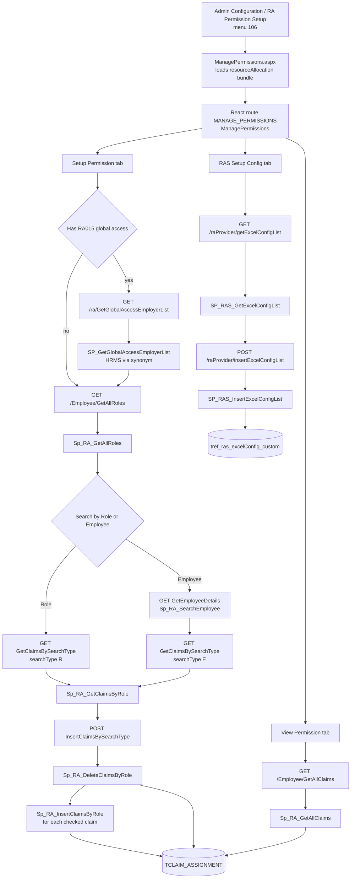
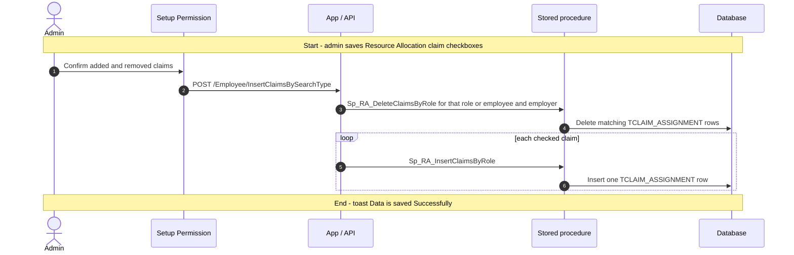
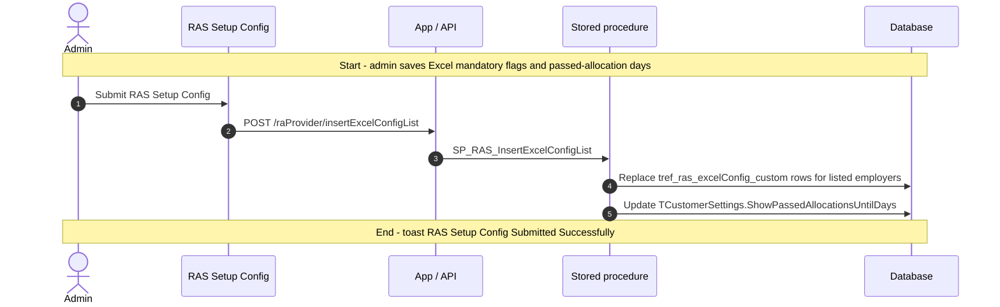
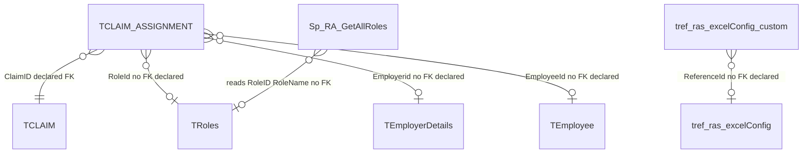

# RA Permission Setup

## Overview

An administrator needs Resource Allocation actions (view/create/edit allocations, RAS provider actions, global org pickers, and the rest of the RA claim catalog) granted by **role** or by **one employee**. On **Admin Configuration → RA Permission Setup** (menu node **106**) they open `ManagePermissions.aspx`, which seeds hidden session fields and loads the webpack Resource Allocation React app. The React route `MANAGE_PERMISSIONS` mounts **ManagePermissions** with three tabs: **Setup Permission**, **View Permission**, and **RAS Setup Config**.

On Setup Permission they pick an organisation when they hold claim `RA015` (global access), choose **Role** or **Employee**, tick Manage Allocation (`ModuleID` 0) / Manage Access (`ModuleID` 1) claim checkboxes, and save. Save deletes then re-inserts that role’s or employee’s rows in `TCLAIM_ASSIGNMENT` in the Resource Allocation database. View Permission lists every employee-scoped assignment for the employer tree. RAS Setup Config edits Excel field mandatory flags (`tref_ras_excelConfig_custom`) and `ShowPassedAllocationsUntilDays` on `TCustomerSettings`. This is **not** HRMS left-nav Access Right Management (`TRoles` / `TRolePagesMapping`); it is the RA claim catalog on `TCLAIM` / `TCLAIM_ASSIGNMENT`.

**Who's involved:**

- **Administrator** with the RA Permission Setup menu — grants or revokes RA claims for a role or one employee, and configures RAS Excel mandatory fields.
- **Global-access administrator** (claim `RA015`) — sees the organisation dropdown fed by `SP_GetGlobalAccessEmployerList`.
- **Employee** — never uses this screen; their effective RA claims are read elsewhere through `Sp_RA_GetUserClaims` (not called from this page).

There is no SystemModel-2 domain page for Resource Allocation permission setup. `TDataCatalog` maps `TCLAIM_ASSIGNMENT` in ResourceAllocation to this menu path.

## Workflow

## Request journey

### Save role or employee claims

### Save RAS Setup Config

## Entry points

> The live screen is the WebForms host `HRM/ResourceAllocation/ManagePermissions.aspx`. It does not post back for claim or config saves. Claim and config work go through the Resource Allocation Node Web API (`Employee` / `ra` / `raProvider` routes) against the Resource Allocation database. There is no React route outside this ASPX host. SourceCode SystemModel-2 has no Resource Allocation permission page.

| Entry point | Purpose | Live? |
|---|---|---|
| `~/HRM/ResourceAllocation/ManagePermissions.aspx` (`RouteConstants.MANAGE_PERMISSIONS`, menu **106**) | Host page; seeds employee/employer/role hidden fields; loads React | Yes |
| Setup Permission tab (`ManagePermissions` eventKey 1) | Role or employee claim grant UI | Yes |
| View Permission tab (`ManagePermissions` eventKey 2) | Read-only grid of employee claim assignments | Yes |
| RAS Setup Config tab (`ManagePermissions` eventKey 3) | Excel field mandatory flags + passed-allocation days | Yes |
| `CommonUtil.LogActivity(RAPermissionSetup)` on `Page_Load` | Activity type **333** | Yes |
| Legacy `GET getClaimsByRole` / `GET getRASClaims` | Older claim APIs still on `employeeController` | Not called from this React page |

## Code → database call chain

The React UI calls `APIHelper` → Resource Allocation Node API (active V1 constants in `apiURLConstants.js`). Reads go Controller → DAL. Claim save goes Controller → BLL (transaction) → DAL.

| Step | Entry point | App code | Stored procedure |
|---|---|---|---|
| Activity on open | `ManagePermissions.aspx.cs:19` | `CommonUtil.LogActivity` (`Common.cs:52`) | `Sp_InsertActivityLog` (HRMS; activity **333**) |
| Organisation list when `RA015` | `setupPermission.js:56` | `raController.GetGlobalAccessEmployerList` (`raController.js:225`) → `raDAL.GetGlobalAccessEmployerList` (`raDAL.js:509`) | `SP_GetGlobalAccessEmployerList` (HRMS object; synonym in ResourceAllocation) |
| Role dropdown | `setupPermission.js:73` | `employeeController.GetAllRoles` (`employeeController.js:50`) → `employeeDAL.GetAllRoles` (`employeeDAL.js:90`) | `Sp_RA_GetAllRoles` |
| Load role or employee claim checkboxes | `setupPermission.js:129` | `employeeController.GetClaimsBySearchType` (`employeeController.js:61`) → `employeeDAL.GetClaimsBySearchType` (`employeeDAL.js:126`) | `Sp_RA_GetClaimsByRole` |
| Employee search / select | `employeeSearch.js:69` | `employeeController.GetEmployeeDetails` (`employeeController.js:8`) → `employeeDAL.GetEmployeeDetails` (`employeeDAL.js:16`) | `Sp_RA_SearchEmployee` |
| Save claims | `setupPermission.js:157` | `employeeController.InsertClaimsBySearchType` (`employeeController.js:82`) → `employeeBLL.InsertClaimsBySearchType` (`employeeBLL.js:17`) → `DeleteClaimsBySearchType` (`employeeDAL.js:145`) then `InsertClaimsBySearchType` (`employeeDAL.js:163`) | `Sp_RA_DeleteClaimsByRole` then `Sp_RA_InsertClaimsByRole` per checked claim |
| View Permission grid | `viewPermission.js:24` | `employeeController.GetAllClaims` (`employeeController.js:92`) → `employeeDAL.GetAllClaims` (`employeeDAL.js:182`) | `Sp_RA_GetAllClaims` |
| RAS Excel config load | `RASSetupConfig.js:53` | `raProviderController.GetExcelConfigList` (`raProviderController.js:125`) → `raProviderDAL.GetExcelConfigList` (`raProviderDAL.js:247`) | `SP_RAS_GetExcelConfigList` |
| RAS Excel config save | `RASSetupConfig.js:92` | `raProviderController.InsertExcelConfigList` (`raProviderController.js:137`) → `raProviderDAL.InsertExcelConfigList` (`raProviderDAL.js:262`) | `SP_RAS_InsertExcelConfigList` |

## API endpoints

This screen is not a WebForms postback for claim or config data. The ASPX only loads the React shell. Traffic is HTTP to the Resource Allocation Node API (`APIHelper` base URL), with auth middleware on the Employee / ra / raProvider routers. Active URL constants are the V1 block at the bottom of `apiURLConstants.js` (V2/V3 blocks are commented out).

| Method | Path | Purpose | Caller | Handler |
|---|---|---|---|---|
| GET | `/ra/GetGlobalAccessEmployerList?employeeId=` | Organisations for global-access admins | `setupPermission.js` `populateOrganization`; `RASSetupConfig.js` `componentDidMount` | `raController.GetGlobalAccessEmployerList` |
| GET | `/Employee/GetAllRoles?employerId=` | Role dropdown | `setupPermission.js` `populateRoles` | `employeeController.GetAllRoles` |
| GET | `/Employee/GetClaimsBySearchType?roleId=&employerId=&searchType=&employeeId=` | Claim checkbox state. `searchType` `R` or `E` | `setupPermission.js` `loadClaims` | `employeeController.GetClaimsBySearchType` |
| GET | `/Employee/GetEmployeeDetails?...` | Employee picker rows | `employeeSearch.js` | `employeeController.GetEmployeeDetails` |
| POST | `/Employee/InsertClaimsBySearchType` | Replace role or employee assignments | `setupPermission.js` `saveFormData` | `employeeController.InsertClaimsBySearchType` |
| GET | `/Employee/GetAllClaims?employerId=` | View Permission grid | `viewPermission.js` `componentDidMount` | `employeeController.GetAllClaims` |
| GET | `/raProvider/getExcelConfigList?employerId=` | RAS Setup Config field list + days | `RASSetupConfig.js` `getExcelSetting` | `raProviderController.GetExcelConfigList` |
| POST | `/raProvider/insertExcelConfigList` | Save Excel mandatory flags + days | `RASSetupConfig.js` `submit` | `raProviderController.InsertExcelConfigList` |

## Stored procedures & tables involved

Inventory paths are under `HRMS-DATABASE/HRMS-RESOURCEALLOCATION/` unless noted. Procedure pages for Resource Allocation objects are under `/docs/database/hrms-resourceallocation/`. Shared HRMS objects keep the `hrms` slug.

| Object | File | Purpose | Database page |
|---|---|---|---|
| `Sp_RA_GetAllRoles` | `STOREPROCEDURE/Sp_RA_GetAllRoles.sql` | Role id/name for the employer (and default roles) | [Sp_RA_GetAllRoles](/docs/database/hrms-resourceallocation/Sp_RA_GetAllRoles) |
| `Sp_RA_GetClaimsByRole` | `STOREPROCEDURE/Sp_RA_GetClaimsByRole.sql` | Claim catalog plus existence flags for role or employee | [Sp_RA_GetClaimsByRole](/docs/database/hrms-resourceallocation/Sp_RA_GetClaimsByRole) |
| `Sp_RA_InsertClaimsByRole` | `STOREPROCEDURE/Sp_RA_InsertClaimsByRole.sql` | Insert one `TCLAIM_ASSIGNMENT` row | [Sp_RA_InsertClaimsByRole](/docs/database/hrms-resourceallocation/Sp_RA_InsertClaimsByRole) |
| `Sp_RA_DeleteClaimsByRole` | `STOREPROCEDURE/Sp_RA_DeleteClaimsByRole.sql` | Delete role- or employee-scoped assignments for an employer | [Sp_RA_DeleteClaimsByRole](/docs/database/hrms-resourceallocation/Sp_RA_DeleteClaimsByRole) |
| `Sp_RA_GetAllClaims` | `STOREPROCEDURE/Sp_RA_GetAllClaims.sql` | Employee-scoped assignment report for the root employer tree | [Sp_RA_GetAllClaims](/docs/database/hrms-resourceallocation/Sp_RA_GetAllClaims) |
| `Sp_RA_SearchEmployee` | `STOREPROCEDURE/Sp_RA_SearchEmployee.sql` | Employee search for the Employee mode picker | [Sp_RA_SearchEmployee](/docs/database/hrms-resourceallocation/Sp_RA_SearchEmployee) |
| `SP_RAS_GetExcelConfigList` | `STOREPROCEDURE/SP_RAS_GetExcelConfigList.sql` | Excel config rows + passed-allocation days | [SP_RAS_GetExcelConfigList](/docs/database/hrms-resourceallocation/SP_RAS_GetExcelConfigList) |
| `SP_RAS_InsertExcelConfigList` | `STOREPROCEDURE/SP_RAS_InsertExcelConfigList.sql` | Replace custom Excel config and update days | [SP_RAS_InsertExcelConfigList](/docs/database/hrms-resourceallocation/SP_RAS_InsertExcelConfigList) |
| `SP_GetGlobalAccessEmployerList` | `HRMS/STOREPROCEDURE/SP_GetGlobalAccessEmployerList.sql` (synonym in ResourceAllocation) | Global-access organisation list | [SP_GetGlobalAccessEmployerList](/docs/database/hrms/SP_GetGlobalAccessEmployerList) |

Tables these procedures read or write in Resource Allocation: `TCLAIM`, `TCLAIM_ASSIGNMENT`, `tref_ras_excelConfig`, `tref_ras_excelConfig_custom`. Synonym / cross-db reads include `TRoles`, `TEmployee`, `TEmployeeInfo`, `TORGChart`, `TEmployerDetails`, `TUsers` / `TUserEmployee` (via `SP_GetGlobalAccessEmployerList`), `TCustomerSettings`, plus name/encryption helpers. Declared FK `TCLAIM_ASSIGNMENT` → `TCLAIM`.

Direct nested callees (one level) already have HRMS pages: `Sp_OpenEncryptionKeys`, `SP_CloseEncryptionKey`, `Fn_GetEmployeeName`, `Fn_DecryptData`, `FN_LocationBU_GetEmployeeDetails`, `Sp_InsertActivityLog`, `SP_GetGlobalAccessEmployerList`.

## Table relationships

Declared foreign keys are labeled as such. Columns the procedures join without a foreign key are labeled **no FK declared**. Do not invent FKs for `RoleId`, `Employerid`, or `EmployeeId` on `TCLAIM_ASSIGNMENT` — the table script only declares `FK_ClaimAssm_Claim_Id`.

`TCLAIM.ModuleID` is an integer used by the UI as Manage Allocation Permissions `0` and Manage Access Permissions `1`. There is no foreign key from `ModuleID` to a module table in the ResourceAllocation `TCLAIM` script.

## Known gaps

- SourceCode `docs/SystemModels/SystemModel-2` has no Resource Allocation or RA Permission Setup domain page.
- `Sp_RA_GetUserClaims` loads a signed-in user’s effective claims elsewhere (`getRASClaims`). It is not called from this page.
- Legacy `GET getClaimsByRole` still exists on `employeeController` and still executes `Sp_RA_GetClaimsByRole`. This React page calls `GetClaimsBySearchType` instead (same SP).
- `employeeDAL.GetEmployeeDetails` passes `@IsInitiateReallocation`, but inventory `Sp_RA_SearchEmployee.sql` has no such parameter — live DB may differ from inventory.
- `Sp_RA_SearchEmployee` builds dynamic SQL (`Sp_executesql`) and nests encryption / name / location helpers; nested helpers documented one level only.
- `setupPermission.js` `roleChangeHandler` / `handleSearchType` reference undeclared `employerId` when global access is off (likely runtime `ReferenceError` on those paths).
- `raProviderDAL.InsertExcelConfigList` binds `@EmployeeId` from `request.employerId` instead of `request.employeeId`.
- Several RA scripts begin with `USE [ResourceAllocation]`.
- Page-open `Sp_InsertActivityLog` for activity **333** runs through shared HRMS logging, not a Resource Allocation procedure page beyond the existing HRMS page.
- V2/V3 API URL blocks in `apiURLConstants.js` are commented out; this guide documents the active V1 constants.

## Reference

High confidence on the React → Node API → DAL → Resource Allocation procedure chain for claims and RAS Excel config. Nested encryption and name helpers resolve through ResourceAllocation synonyms into HRMS.

### SourceCode

- `HRMS.Web/HRMS.Web/HRM/ResourceAllocation/ManagePermissions.aspx` and `ManagePermissions.aspx.cs`
- `HRMS.Web/HRMS.Web/HRM/ResourceAllocation/Areas/ManagePermissions/Containers/managePermissions.js`
- `HRMS.Web/HRMS.Web/HRM/ResourceAllocation/Areas/ManagePermissions/Components/setupPermission.js`
- `HRMS.Web/HRMS.Web/HRM/ResourceAllocation/Areas/ManagePermissions/Components/viewPermission.js`
- `HRMS.Web/HRMS.Web/HRM/ResourceAllocation/Areas/RASSetupConfig/RASSetupConfig.js`
- `HRMS.Web/HRMS.Web/HRM/ResourceAllocation/SharedComponent/UI/EmployeeSearch/employeeSearch.js`
- `HRMS.Web/HRMS.Web/HRM/ResourceAllocation/Common/apiURLConstants.js`, `apiHelper.js`, `routeConstants.js`, `claimConstants.js`
- `HRMS.Web/HRMS.Web/HRM/ResourceAllocation/Areas/routes.js`
- `HRMS.ResourceAllocation/HRMS.ResourceAllocation.WebAPI.Node/Controllers/employeeController.js`
- `HRMS.ResourceAllocation/HRMS.ResourceAllocation.WebAPI.Node/Controllers/raController.js`
- `HRMS.ResourceAllocation/HRMS.ResourceAllocation.WebAPI.Node/Controllers/raProviderController.js`
- `HRMS.ResourceAllocation/HRMS.ResourceAllocation.WebAPI.Node/Core/BusinessLogicLayer/employeeBLL.js`
- `HRMS.ResourceAllocation/HRMS.ResourceAllocation.WebAPI.Node/Core/DataAccessLayer/employeeDAL.js`
- `HRMS.ResourceAllocation/HRMS.ResourceAllocation.WebAPI.Node/Core/DataAccessLayer/raDAL.js`
- `HRMS.ResourceAllocation/HRMS.ResourceAllocation.WebAPI.Node/Core/DataAccessLayer/raProviderDAL.js`
- `HRMS.Shared/HRMS.DataContract/Common/Enums.cs` (`RAPermissionSetup = 333`)

### TDG HRMS DB

- `HRMS-DATABASE/HRMS-RESOURCEALLOCATION/TABLES/TCLAIM.sql`, `TCLAIM_ASSIGNMENT.sql`
- `HRMS-DATABASE/HRMS-RESOURCEALLOCATION/UDT/UDT_TRASExcelConfigList.sql`
- Procedure scripts listed in the table above
- `HRMS-DATABASE/HRMS/DML/Tmenudetails DML.sql` (RA Permission Setup node **106**)
