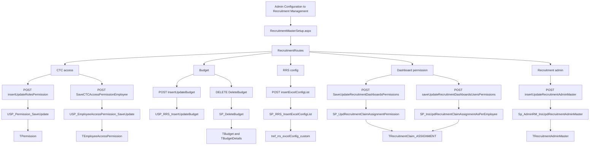
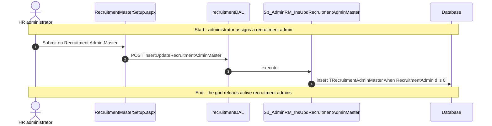
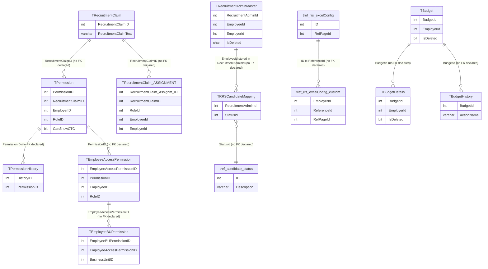

# Recruitment Management

## Overview

An HR administrator opens **Admin Configuration → Recruitment Management** (`~/HRM/Recruitment/RecruitmentMasterSetup.aspx`) to set up hiring for one organisation before anyone raises a requisition. The page is a host. `Page_Load` copies the signed-in employee into hidden fields and writes an activity row. The screen itself is the React bundle `recruitmentmanagement.min.js`, mounted on `#rmRoot` and routed only for this URL.

That bundle is the master setup, which is a different left-nav item from **Recruitment → Recruitment Dashboard**. Five panels live in `RecruitmentRoutes`:

- **CTC access** (tab id 337). Shown only when customer settings return `IsViewCTCPermissions`. The administrator grants a role the claim **Show CTC Detail**, then grants the same visibility to an employee and a set of business units. Turning the role flag off also deactivates that role's employee rows.
- **Budget** (tab id 338). The administrator files a budget for a business unit, cost centre, currency, and financial year, with position lines and optional documents. Submit is blocked in the browser when no workflow is mapped to page title `BudgetApproval`. A replacement-budget form sits on the same panel.
- **RRS config** (tab id 325). The administrator marks which requisition Excel columns (`RefPageId` 2) are selected and mandatory. The list drops reporting-manager columns when the customer uses manual approval, and drops asset columns when no administrator role has the Asset Management tab editable.
- **Dashboard permission** (tab id 340). The administrator assigns recruitment claims `TR001` and `TR002` to roles, and separately to employees with a custom business-unit list. This decides who may open the recruitment dashboards. It does not draw those dashboards.
- **Recruitment admin** (tab id 344). The administrator names employees who act as recruitment admins. Deactivate and delete refuse the change when that employee still owns a candidate mapping in a hiring or offer status.

SystemModel-2 does not describe this host. `behavior/state-transitions/request-lifecycles.md` covers the RRS dashboard approval spine, and `domain/contexts` has no recruitment-setup page. `llm-wiki/domain/employee-lifecycle.md` stops at the candidate stage and says the RRS internals were not extracted. Table one-liners for `TRecruitmentAdminMaster`, `tref_rrs_excelConfig`, and `TBudget` are in `llm-wiki/reference/tables/hrms.md`.

**Who's involved:**

- **HR administrator** — maintains CTC visibility, budget setup, RRS Excel columns, dashboard claims, and the recruitment-admin list for the organisation selected in the global-access header.
- **Workflow approver** — receives a submitted budget only after `BudgetApproval` is mapped. The insert procedure that would file that request is not in this database checkout.
- **Recruiter and hiring manager** — do not open this screen. Their later requisitions and dashboards use the rows saved here.

## Workflow

## Request journey

### HR administrator — assign a recruitment admin

When `RecruitmentAdminId` is already set and that employee still has a `TRRSCandidateMapping` in a hiring or offer status, the procedure returns `Code` 0 and leaves the row unchanged. The screen shows the in-use warning only when the administrator is turning the row inactive. Delete uses `Sp_AdminRM_DeleteRecruitmentAdminMaster`, which sets `IsDeleted` to `Y` under the same candidate-mapping check.

## Entry points

`index.js` renders into `#rmRoot`. `Routes.js` matches `/HRM/Recruitment/RecruitmentMasterSetup.aspx` and renders `RecruitmentRoutes`. The code-behind never assigns `ListOfRecMgmtTabs`, and no source file writes `sessionStorage.requestedRecruitmetPage`. With an empty hidden field, `RecruitmentRoutes` finds no tab right and hides `#rmRoot`. The five panels are still the only screens this bundle defines. `Areas/RecruitmentRoutes.jsx` is a second copy. `index.js` does not import it. The interview-template route in `Routes.js` is commented out.

| UI page | Purpose |
|---|---|
| `HRM/Recruitment/RecruitmentMasterSetup.aspx` | Host, hidden session fields, React mount |
| `HRM/recruitmentmanagement_react/src/features/RecruitmentRoutes.jsx` | Chooses CTC access, budget, RRS config, dashboard permission, or recruitment admin |
| `HRM/recruitmentmanagement_react/src/features/RecruitmentPermissionSetup/RecruitmentPermissionSetup.jsx` | CTC access accordions |
| `HRM/recruitmentmanagement_react/src/features/BudgetSetup/BudgetSetupContainer.jsx` | Budget details and utilization |
| `HRM/recruitmentmanagement_react/src/features/RRSConfig/RRSConfig.jsx` | Requisition Excel columns |
| `HRM/recruitmentmanagement_react/Areas/DashboardPermissions/DashboardPermission.jsx` | Role and employee dashboard claims |
| `HRM/recruitmentmanagement_react/src/features/RecruitmentAdminMaster/RecruitmentAdminMaster.jsx` | Recruitment admin list |

## Code → database call chain

Live URLs are the uncommented block in `apiURLConstants.js`. They hit `Routes/RecruitmentRoutes.js` and `Routes/DashBoardRoutes.js` (`Authorize` on those routers). V2 and V3 constant blocks in the same file are comments.

| Entry | Method | Stored procedure |
|---|---|---|
| CTC role dropdown | `GetRoleListRecruitmentCTCSetup` (`dashBoardDAL.js:4332`), `dashboardController.js:2945` | `USP_PermissionRoles_ActiveList` |
| CTC role grid | `GetPermissionRolesList` (`recruitmentDAL.js:8853`) | `USP_PermissionRoles_List` |
| CTC role history | `getPermissionRolesHistory` (`recruitmentDAL.js:8868`) | `USP_GetPermissionHistory` |
| CTC role save | `InsertUpdateRolesPermission` (`recruitmentDAL.js:8815`), `recruitmentController.js:3505` | `USP_Permission_SaveUpdate` |
| Role lookup for CTC | `GetRoleOfAccessPermission` (`recruitmentDAL.js:8839`) | `SP_AdminRoleM_GetRoleList` |
| CTC employee save | `SaveCTCAccessPermissionEmployee` (`dashBoardDAL.js:4365`), `dashboardController.js:2962` | `USP_EmployeeAccessPermission_SaveUpdate` |
| CTC employee grid | `GetCTCAccessEmployeeData` (`dashBoardDAL.js:4390`) | `USP_EmployeeAccessPermission_List` |
| CTC employee history | `GetCTCAccessEmployeeDataHistory` (`dashBoardDAL.js:4405`) | `USP_EmployeeAccessPermission_History_List` |
| CTC employee business units | `GetRoleWiseEmployeeBUList` (`dashBoardDAL.js:4347`) | `USP_PermissionRolesEmployeeBU_List` |
| Customer flag for CTC | `GetCustomerSettings` (`dashBoardDAL.js:457`) | `SP_GetCustomerSettings` |
| RRS column list | `GetExcelConfigList` (`recruitmentDAL.js:6882`), `recruitmentController.js:2642` | `SP_RRS_GetExcelConfigList` |
| RRS column save | `InsertExcelConfigList` (`recruitmentDAL.js:6897`), `recruitmentController.js:2651` | `SP_RRS_InsertExcelConfigList` |
| Manual-approval flag | `GetCustomerManualApprovalSettings` (`recruitmentDAL.js:8376`) | `USP_GetCustomerManualApprovalSettings` |
| Asset-menu check | `GetAssetMgmtMenuId` (`recruitmentDAL.js:8389`) | `USP_GetAssetMgmtMenuId` |
| Recruitment admin list | `GetRecruitmentAdminList` (`recruitmentDAL.js:9329`) | `Sp_AdminRM_GetRecruitmentAdminMaster` |
| Recruitment admin save | `InsertUpdateRecruitmentAdminMaster` (`recruitmentDAL.js:9345`), `recruitmentController.js:3606` | `Sp_AdminRM_InsUpdRecruitmentAdminMaster` |
| Recruitment admin delete | `DeleteRecruitmentAdminMasterData` (`recruitmentDAL.js:9368`), `recruitmentController.js:3616` | `Sp_AdminRM_DeleteRecruitmentAdminMaster` |
| Employee picker | `GetEmployeeListByOrganisation` (`recruitmentDAL.js:9305`) | `SP_AdminRM_GetEmployeeListByOrg` |
| Budget save | `InsertUpdateBudget` (`recruitmentDAL.js:8946`), `recruitmentController.js:3669` | `USP_RRS_InsertUpdateBudget` |
| Budget delete | `DeleteBudget` (`recruitmentDAL.js:9066`), `recruitmentController.js:3687` | `SP_DeleteBudget` |
| Budget workflow | `GetWorkFlowDetails` (`recruitmentDAL.js:155`) with page title `BudgetApproval` | `SP_CM_GetWorkflowTreeXmlDetailsByPageTitle` |
| Approver present | `GetApproverFlagExist` (`recruitmentDAL.js:10965`) | `USP_RRS_IsApproverSet` |
| Replacement budget save | `InsertReplacementBudget` (`recruitmentDAL.js:10797`), `recruitmentController.js:5258` | `USP_RRS_InsertReplacementBudget` |
| Budget document upload | `documentDAL.js` `SaveDocumentInfo` execute at line 48 | `SP_DOCUMENT_INS` |
| Budget document delete | `DeleteDocumentInfo` (`documentDAL.js:60`) | `SP_DOCUMENT_DEL` |
| Dashboard role list | `GetRecruitementDashboardsPermissionList` (`recruitmentDAL.js:9612`) | `SP_GetRecruitementDashboardsPermissionList` |
| Dashboard role save | `SaveUpdateRecruitmentDashboardsPermissions` (`recruitmentDAL.js:9626`), `recruitmentController.js:3857` | `SP_UpdRecruitmentClaimAssignmentPermission` |
| Dashboard user list | `GetRecruitmentDashboardsUsersPermissionList` (`recruitmentDAL.js:9672`) | `SP_GetRecruitementDashboardsPermissionListAsPerEmployee` |
| Dashboard user save | `SaveUpdateRecruitmentDashboardsUsersPermissions` (`recruitmentDAL.js:9686`), `recruitmentController.js:3875` | `SP_InsUpdRecruitmentClaimAssignmentAsPerEmployee` |
| Employer list | `GetAllEmployers` (`dashBoardDAL.js:882`) | `sp_GetAllEmployers` |

Budget list, details, history, utilization, charts, and replacement reads call further `USP_RRS_*` and `usp_rrs_*` names from `recruitmentDAL.js` (lines 9034, 9050, 9082, 9097, 9112, 9147, 9162, 10695, 10768, 10781, 10825, 10871, 10897, 10929, 10944, 10950). Those names are in the Known gaps section. `GetRoles` (`recruitmentDAL.js:31`) executes `SP_CM_GetTitle`. `GetBusinessUnits` (`recruitmentDAL.js:126`) executes `SP_TS_GetAllBusinessUnit`. `GetCostCenterList` (`recruitmentDAL.js:8908`) executes `SP_GetCostCenterDetails`. Currency uses `preOnBoardingDAL.js:225` → `SP_CM_GETCURRENCY`. The CTC module dropdown uses `ViolationsOccurrenceDAL.js:146` → `OV_ModuleMasterList`.

## API endpoints

The aspx file does not post back a form. The React bundle calls the Node API. Recruitment and dashboard routes use `Authorize`. `documentRoutes.js` registers upload and delete without `Authorize`.

| Verb | Route | Parameters | Purpose | Source |
|---|---|---|---|---|
| POST | `/recruitment/insertUpdateRolesPermission` | Body `EmployerID`, `PermissionID`, `ModuleID`, `RoleID`, `CanShowCTC`, `CreatedBy`, `IsActive` | Insert or update a role CTC grant | `RecruitmentRoutes.js:297`, `RecruitmentCTCPermission.jsx:250` |
| POST | `/dashboard/SaveCTCAccessPermissionEmployee` | Body `PermissionID`, `EmployeeAccessPermissionID`, `EmployerID`, `RoleID`, `EmployeeID`, `ModuleID`, `CanShowCTC`, `EmployeeBU`, `CreatedBy`, `IsActive` | Insert or update an employee CTC grant and its business units | `DashBoardRoutes.js:266`, `CtcPermissionToEmployee.jsx:431` |
| POST | `/recruitment/insertExcelConfigList` | Body `excelConfigList`, `employeeId`, `employerId`, `refPageId` (`2` for this screen) | Replace the employer's RRS Excel column overrides | `RecruitmentRoutes.js:228`, `RRSConfig.jsx:87` |
| GET | `/recruitment/getExcelConfigList` | Query `employerId`, `RefPageId` | Read column overrides, or the shared template when none exist | `RecruitmentRoutes.js:227` |
| GET | `/recruitment/GetCustomerManualApprovalSettings` | Query `employerId` | `IsManualApproval` from `TCustomerSettings` | `RecruitmentRoutes.js:278` |
| GET | `/recruitment/GetAssetMgmtMenuId` | Query `employerId` | Whether an administrator role can edit Asset Management | `RecruitmentRoutes.js:279` |
| POST | `/recruitment/InsertUpdateBudget` | Body `BudgetId`, `EmployerId`, `BusinessUnitId`, `CostCenter`, `BudgetDetails`, `AttachmentPath`, `CreatedBy`, `UDTBudgetDetails`, `StatusId`, `CurrencyId`, `FinancialYear`, `IsActive` | Save a budget. `StatusId` is 2 on submit when an approver flag is set, otherwise 1 | `RecruitmentRoutes.js:305`, `BudgetSetup.jsx:915` |
| DELETE | `/recruitment/DeleteBudget` | Query `employerId`, `employeeId`, `budgetId` | Soft-delete `TBudget` and `TBudgetDetails` | `RecruitmentRoutes.js:308` |
| POST | `/recruitment/InsertReplacementBudget` | Body `EmployerId`, `EmployeeId`, `BudgetId`, `BusinessUnitId`, `CTC`, `UnpaidCTC`, `UtilizedCTC`, `FinancialYear`, `PaidMonths`, `PositionTitleId`, `CreatedBy` | Save a replacement budget line | `recruitmentController.js:5258` |
| POST | `/document/upload` | Query `createdBy`, `documentURI` (`BudgetDetails`), file stream | Store the file and insert `TDOCUMENTS` | `documentRoutes.js:8` |
| DELETE | `/document/delete` | Query `documentId` | Delete the `TDOCUMENTS` row | `documentRoutes.js:17` |
| POST | `/recruitment/SaveUpdateRecruitmentDashboardsPermissions` | Body `data` (role rows), `employerId`, `employeeId`, `IsInsertUpdate` | Insert or update role claim assignments | `RecruitmentRoutes.js:349` |
| POST | `/recruitment/saveUpdateRecruitmentDashboardsUsersPermissions` | Body `data` (employee rows, including `CustomBU`), `employerId`, `employeeId`, `IsInsertUpdate` | Insert or update employee claim assignments | `RecruitmentRoutes.js:351` |
| POST | `/recruitment/insertUpdateRecruitmentAdminMaster` | Body `EmployeeId`, `EmployerId`, `CreatedBy`, `IsActive`, `RecruitmentAdminId` | Insert a recruitment admin, or update `IsActive` | `RecruitmentRoutes.js:322`, `RecruitmentAdminMaster.jsx:125` |
| POST | `/recruitment/deleteRecruitmentAdminMasterData` | Body `RecruitmentAdminId`, `EmployeeId`, `Updatedby` | Soft-delete when no in-flight candidate mapping exists | `RecruitmentRoutes.js:323`, `RecruitmentAdminMaster.jsx:204` |
| GET | `/dashBoard/GetCustomerSettings` | Query `CustomerId` | Includes `IsViewCTCPermissions` | `DashBoardRoutes.js:45` |
| GET | `/dashBoard/GetAllEmployers` | Query optional | Organisation list for the header | `DashBoardRoutes.js:62` |

`RecruitmentRoutes.js` registers `InsertUpdateBudget` and `DeleteBudget` a second time at lines 329 and 330. The React constants use `/Document/Upload` and `/dashboard/...`. The route file mounts `/document` and `/dashBoard`.

## Stored procedures & tables involved

Scripts below were read from `HRMS-DATABASE/HRMS/STOREPROCEDURE/`. `llm-wiki/reference/tables/hrms.md` has one-line descriptions for `TRecruitmentAdminMaster`, `tref_rrs_excelConfig`, `tref_rrs_excelConfig_custom`, and `TBudget`. There is no llm-wiki domain page for this setup.

| Object | File | Purpose |
|---|---|---|
| `USP_Permission_SaveUpdate` | `STOREPROCEDURE/USP_Permission_SaveUpdate.sql` | Insert or update `TPermission` for claim text `Show CTC Detail`, then history |
| `USP_EmployeeAccessPermission_SaveUpdate` | `STOREPROCEDURE/USP_EmployeeAccessPermission_SaveUpdate.sql` | Insert or update one employee CTC row and its business units |
| `USP_PermissionRoles_List` | `STOREPROCEDURE/USP_PermissionRoles_List.sql` | Role CTC grid for one employer |
| `USP_PermissionRoles_ActiveList` | `STOREPROCEDURE/USP_PermissionRoles_ActiveList.sql` | Active roles that can show CTC |
| `USP_GetPermissionHistory` | `STOREPROCEDURE/USP_GetPermissionHistory.sql` | History rows for one permission |
| `USP_EmployeeAccessPermission_List` | `STOREPROCEDURE/USP_EmployeeAccessPermission_List.sql` | Employee CTC grants and business-unit summary |
| `SP_RRS_GetExcelConfigList` | `STOREPROCEDURE/SP_RRS_GetExcelConfigList.sql` | Employer overrides, or the shared template |
| `SP_RRS_InsertExcelConfigList` | `STOREPROCEDURE/SP_RRS_InsertExcelConfigList.sql` | Replace overrides for one employer and page |
| `USP_GetCustomerManualApprovalSettings` | `STOREPROCEDURE/USP_GetCustomerManualApprovalSettings.sql` | `IsManualApproval` |
| `USP_GetAssetMgmtMenuId` | `STOREPROCEDURE/USP_GetAssetMgmtMenuId.sql` | Administrator edit right on Asset Management |
| `Sp_AdminRM_GetRecruitmentAdminMaster` | `STOREPROCEDURE/Sp_AdminRM_GetRecruitmentAdminMaster.sql` | Active recruitment admins, plus whether a RecruitmentAdmin role exists |
| `Sp_AdminRM_InsUpdRecruitmentAdminMaster` | `STOREPROCEDURE/Sp_AdminRM_InsUpdRecruitmentAdminMaster.sql` | Insert, or update when no in-flight mapping |
| `Sp_AdminRM_DeleteRecruitmentAdminMaster` | `STOREPROCEDURE/Sp_AdminRM_DeleteRecruitmentAdminMaster.sql` | Soft-delete under the same check |
| `SP_GetRecruitementDashboardsPermissionList` | `STOREPROCEDURE/SP_GetRecruitementDashboardsPermissionList.sql` | Roles and assignments for claims `TR001` and `TR002` |
| `SP_GetRecruitementDashboardsPermissionListAsPerEmployee` | `STOREPROCEDURE/SP_GetRecruitementDashboardsPermissionListAsPerEmployee.sql` | Employee assignments for those claims |
| `SP_UpdRecruitmentClaimAssignmentPermission` | `STOREPROCEDURE/SP_UpdRecruitmentClaimAssignmentPermission.sql` | Insert or update role rows in `TRecruitmentClaim_ASSIGNMENT` |
| `SP_InsUpdRecruitmentClaimAssignmentAsPerEmployee` | `STOREPROCEDURE/SP_InsUpdRecruitmentClaimAssignmentAsPerEmployee.sql` | Insert or update employee rows, including `CustomBU` |
| `SP_DeleteBudget` | `STOREPROCEDURE/SP_DeleteBudget.sql` | Set `IsDeleted` on `TBudget` and `TBudgetDetails`, then history |
| `SP_DOCUMENT_INS` | `STOREPROCEDURE/SP_DOCUMENT_INS.sql` | Insert one `TDOCUMENTS` row |
| `SP_DOCUMENT_DEL` | `STOREPROCEDURE/SP_DOCUMENT_DEL.sql` | Delete one `TDOCUMENTS` row |
| `SP_CM_GetWorkflowTreeXmlDetailsByPageTitle` | `STOREPROCEDURE/SP_CM_GetWorkflowTreeXmlDetailsByPageTitle.sql` | Workflow mapped to `BudgetApproval` |
| `SP_GetCustomerSettings` | `STOREPROCEDURE/SP_GetCustomerSettings.sql` | Returns `IsViewCTCPermissions` |

## Table relationships

The create scripts read for these tables declare primary keys and no foreign keys. The lines below are the columns the procedures join or copy.

## Known gaps

- `ListOfRecMgmtTabs` is never assigned, and `requestedRecruitmetPage` is never written. The bundle's tab gate therefore sees an empty right list.
- `SP_RRS_GetTabListRecrMgmt` reads menu 68 from `TRoleTabDetails` and `TUserTabDetails` and excludes tab ids 41 and 312. `GetTabListRecruitment` exists on the API. This aspx does not call it. The React gate looks for tab ids 337, 338, 325, 340, and 344.
- `USP_RRS_InsertUpdateBudget`, `USP_RRS_InsertReplacementBudget`, `USP_RRS_IsApproverSet`, and the `USP_RRS_Get*` / `usp_rrs_Get*` budget read procedures named by `recruitmentDAL.js` have no script under `HRMS-DATABASE`. The data catalog names `TRRSBudget` for this menu. The delete procedure that is in the checkout updates `TBudget` and `TBudgetDetails`.
- `SP_GetBudgetHistory`, `SP_AdminMstr_GetCategory`, `SP_CM_GetTitle`, `SP_TS_GetAllBusinessUnit`, `SP_GetCostCenterDetails`, `SP_Get_EmployeesList`, `SP_AdminRM_GetEmployeeListByOrg`, `SP_Get_DefaultRoles`, `SP_GetEmployeeListAsRoleType`, `SP_AdminRoleM_GetRoleList`, `USP_PermissionRolesEmployeeBU_List`, `USP_EmployeeAccessPermission_History_List`, `SP_GetCustomerSettings`, `sp_GetAllEmployers`, `SP_GetGlobalAccessEmployerList`, `SP_CM_GETCURRENCY`, and `OV_ModuleMasterList` are called from these panels and were not given new database pages here. `SP_CM_GetWorkflowTreeXmlDetailsByPageTitle` already has a page.
- `USP_EmployeeBUPermission_SaveUpdate` calls `USP_EmployeeBUPermission_SaveHistory`. That second-level procedure has no page in this pass.
- The recruitment-admin delete payload joins selected ids with a comma. `DeleteRecruitmentAdminMasterData` binds `RecruitmentAdminId` as `sql.Int`.
- Question-builder APIs exist on `RecruitmentRoutes.js`, and `SetInterviewTemplate.js` calls them. `Routes.js` does not mount that screen.
- `TABLES/tref_rrs_excelConfig_custom.sql` does not declare `CustomLabel` or `RefPageId`. The insert procedure and the data-migration script write both. `DDL/64448/TRecruitmentClaim_ASSIGNMENT-64448.sql` does not declare `CustomBU`. The employee-claim procedure writes it.

## Reference

Confidence is medium because the CTC, RRS-config, dashboard-claim, recruitment-admin, document, and budget-delete procedures were read, and the React save calls were traced to those names. The budget insert and the other `USP_RRS_*` budget scripts are absent, and the tab-right host field is unset in the page class.

### SourceCode

- `docs/SystemModels/SystemModel-2/behavior/state-transitions/request-lifecycles.md`
- `HRMS.Web/HRMS.Web/HRM/Recruitment/RecruitmentMasterSetup.aspx`
- `HRMS.Web/HRMS.Web/HRM/Recruitment/RecruitmentMasterSetup.aspx.cs`
- `HRMS.Web/HRMS.Web/HRM/recruitmentmanagement_react/src/index.js`
- `HRMS.Web/HRMS.Web/HRM/recruitmentmanagement_react/src/Routes.js`
- `HRMS.Web/HRMS.Web/HRM/recruitmentmanagement_react/src/features/RecruitmentRoutes.jsx`
- `HRMS.Web/HRMS.Web/HRM/recruitmentmanagement_react/src/common/apiURLConstants.js`
- `HRMS.Web/HRMS.Web/HRM/recruitmentmanagement_react/src/common/AppConstants.js`
- `HRMS.CoreAPI/HRMS.Core.WebAPI.Node/Routes/routeIndex.js`
- `HRMS.CoreAPI/HRMS.Core.WebAPI.Node/Routes/RecruitmentRoutes.js`
- `HRMS.CoreAPI/HRMS.Core.WebAPI.Node/Routes/DashBoardRoutes.js`
- `HRMS.CoreAPI/HRMS.Core.WebAPI.Node/Routes/documentRoutes.js`
- `HRMS.CoreAPI/HRMS.Core.WebAPI.Node/Core/DataAccessLayer/recruitmentDAL.js`
- `HRMS.CoreAPI/HRMS.Core.WebAPI.Node/Core/DataAccessLayer/dashBoardDAL.js`
- `HRMS.CoreAPI/HRMS.Core.WebAPI.Node/Core/DataAccessLayer/documentDAL.js`
- `HRMS.CoreAPI/HRMS.Core.WebAPI.Node/Core/DataAccessLayer/preOnBoardingDAL.js`
- `HRMS.CoreAPI/HRMS.Core.WebAPI.Node/Core/DataAccessLayer/ViolationsOccurrenceDAL.js`

### TDG HRMS DB

- `llm-wiki/domain/employee-lifecycle.md` (mirrored at `apps/backstage/content/llm-wiki/domain/employee-lifecycle.md`)
- `llm-wiki/reference/tables/hrms.md`
- `HRMS-DATABASE/HRMS/STOREPROCEDURE/USP_Permission_SaveUpdate.sql`
- `HRMS-DATABASE/HRMS/STOREPROCEDURE/USP_EmployeeAccessPermission_SaveUpdate.sql`
- `HRMS-DATABASE/HRMS/STOREPROCEDURE/SP_RRS_InsertExcelConfigList.sql`
- `HRMS-DATABASE/HRMS/STOREPROCEDURE/SP_RRS_GetExcelConfigList.sql`
- `HRMS-DATABASE/HRMS/STOREPROCEDURE/Sp_AdminRM_InsUpdRecruitmentAdminMaster.sql`
- `HRMS-DATABASE/HRMS/STOREPROCEDURE/Sp_AdminRM_DeleteRecruitmentAdminMaster.sql`
- `HRMS-DATABASE/HRMS/STOREPROCEDURE/Sp_AdminRM_GetRecruitmentAdminMaster.sql`
- `HRMS-DATABASE/HRMS/STOREPROCEDURE/SP_UpdRecruitmentClaimAssignmentPermission.sql`
- `HRMS-DATABASE/HRMS/STOREPROCEDURE/SP_InsUpdRecruitmentClaimAssignmentAsPerEmployee.sql`
- `HRMS-DATABASE/HRMS/STOREPROCEDURE/SP_DeleteBudget.sql`
- `HRMS-DATABASE/HRMS/STOREPROCEDURE/SP_GetRecruitementDashboardsPermissionList.sql`
- `HRMS-DATABASE/HRMS/STOREPROCEDURE/SP_GetRecruitementDashboardsPermissionListAsPerEmployee.sql`
- `HRMS-DATABASE/HRMS/STOREPROCEDURE/SP_RRS_GetTabListRecrMgmt.sql`
- `HRMS-DATABASE/HRMS/DDL/81378/TPermission.sql`
- `HRMS-DATABASE/HRMS/DDL/81378/TEmployeeAccessPermission.sql`
- `HRMS-DATABASE/HRMS/DDL/81378/TEmployeeBUPermission.sql`
- `HRMS-DATABASE/HRMS/DDL/64448/TRecruitmentClaim_ASSIGNMENT-64448.sql`
- `HRMS-DATABASE/HRMS/TABLES/TRecruitmentAdminMaster.sql`
- `HRMS-DATABASE/HRMS/TABLES/TBudget.sql`
- `HRMS-DATABASE/HRMS/TABLES/tref_rrs_excelConfig_custom.sql`
