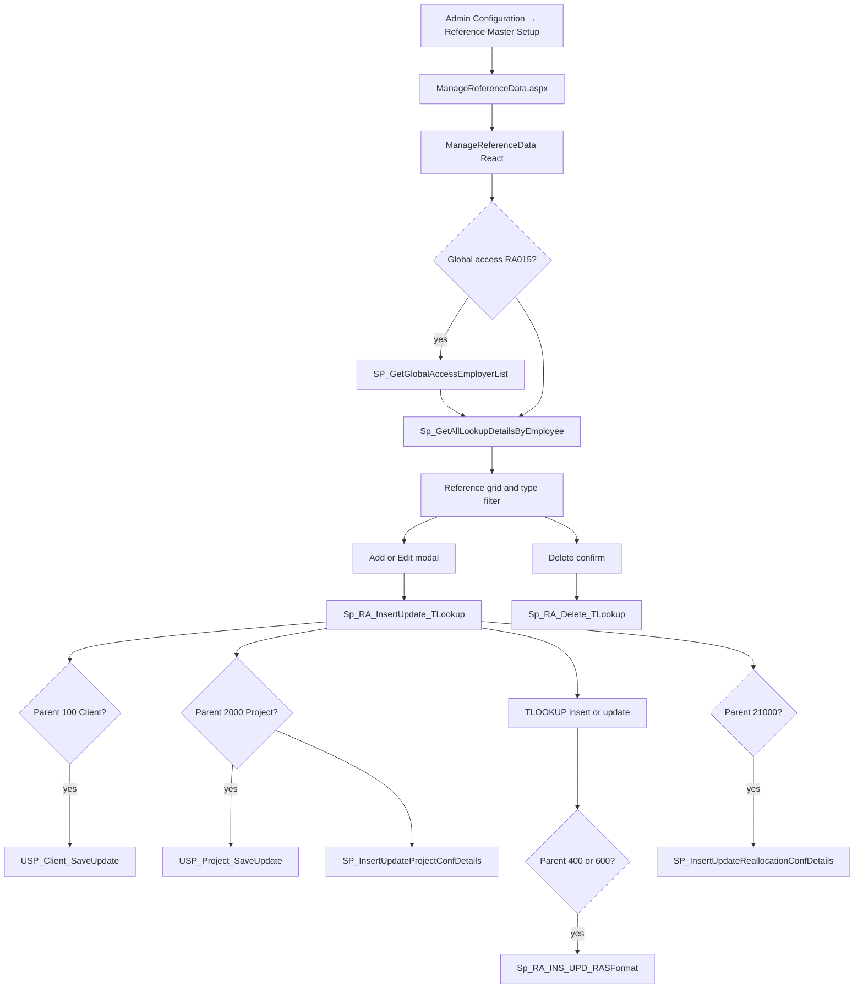
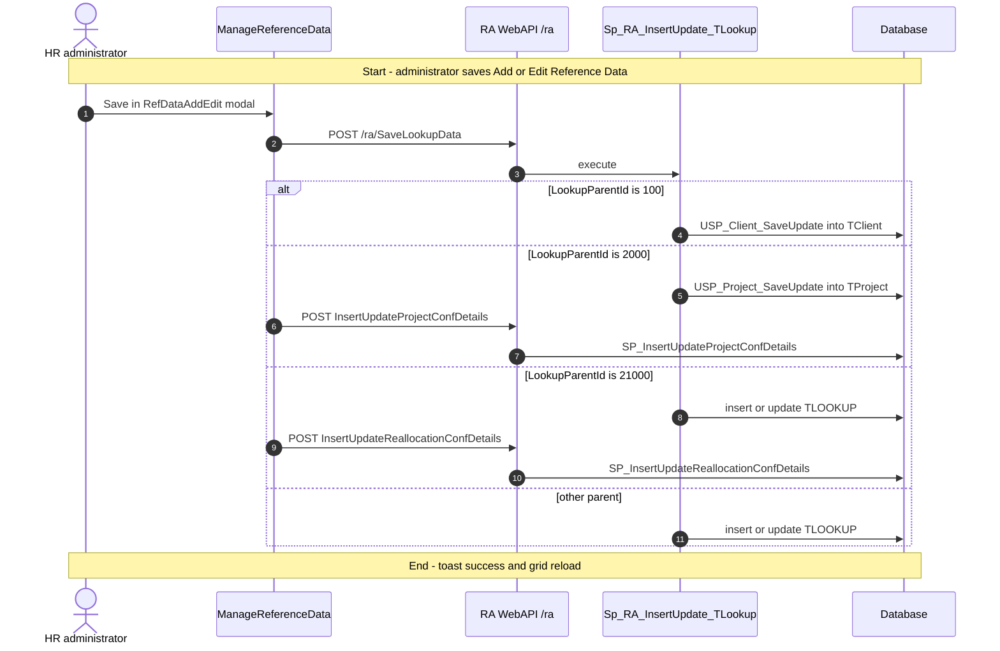
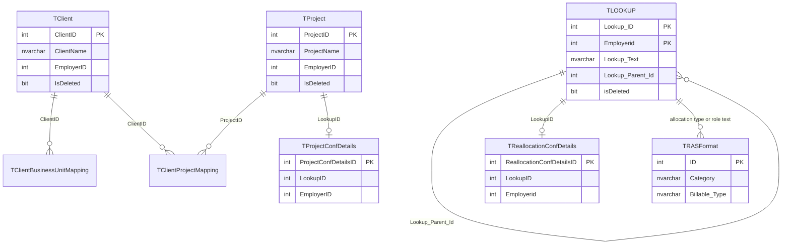

# Reference Master Setup

## Overview

An HR administrator maintains the Resource Allocation reference lists that other RA screens depend on — clients, projects, allocation types, roles, reallocation configuration, and related lookup rows. They open **Admin Configuration → Reference Master Setup** (`~/HRM/ResourceAllocation/ManageReferenceData.aspx`). The WebForms host stamps session employee context into hidden fields, logs activity `RAOptionsSetup`, and mounts the React surface `ManageReferenceData`.

On load the screen loads every lookup row for the organisation through `Sp_GetAllLookupDetailsByEmployee`, filtered so parents (`LookupParentId = 0`) fill the **Reference Type** dropdown and children fill the grid. A user with claim `RA015` (global access) can also pick another organisation from `SP_GetGlobalAccessEmployerList`. Adding or editing posts `Sp_RA_InsertUpdate_TLookup` (Resource Allocation API on the RA connection). Client (`LookupParentId = 100`) and project (`2000`) saves delegate to `USP_Client_SaveUpdate` / `USP_Project_SaveUpdate` on the core HRMS database via synonyms. Project and reallocation configuration then get a second core write (`SP_InsertUpdateProjectConfDetails` or `SP_InsertUpdateReallocationConfDetails`). Delete soft-deletes through `Sp_RA_Delete_TLookup`.

Employees do not open this screen. Allocation, reallocation, and RAS reporting later read the same client, project, and lookup values.

Table catalogue notes for RA live in `content/llm-wiki/reference/tables/resourceallocation.md`. Core `TLOOKUP`, `TProjectConfDetails`, and `TReallocationConfDetails` appear in `content/llm-wiki/reference/tables/hrms.md`. There is no llm-wiki domain page dedicated to this screen.

**Who's involved:**

- **HR administrator** — maintains RA reference data for the selected organisation. Needs claim `RA016` (`CNST_MANAGE_RA_REFERENCE_DATA`). Global-access users (`RA015`) can switch organisation.
- **Employee** — does not open this screen. Later RA and related modules consume the clients, projects, and lookup values created here.

## Workflow

## Request journey

### HR administrator — save a reference row

## Entry points

`~/HRM/ResourceAllocation/ManageReferenceData.aspx` is the live host. `Page_Load` logs `ActivityDescription.RAOptionsSetup` and copies `LoggedInEmployee` into hidden fields (`hdnEmpId`, `hdnEmployerId`, and related). The React bundle mounts at `#root` via `BuildJS/resourceAllocation.min.js`. Client route `RouteConstants.MANAGE_REFERENCEDATA` wraps the component with claim `RA016`.

The page breadcrumb label still says **RA Options Setup → Manage Reference Data**. Data-catalog UI path text and this guide use the left-nav name **Reference Master Setup**.

| UI page | Purpose |
|---|---|
| `HRM/ResourceAllocation/ManageReferenceData.aspx` | WebForms host and session stamp |
| `Areas/ManageReferenceData/manageReferenceData.js` | Grid, org picker, delete |
| `Areas/ManageReferenceData/refDataAddEdit.js` | Add/edit modal and save |

## Code → database call chain

Active `apiURLConstants.js` exports unversioned `/ra/...` and `/Employee/...` paths (V1). Controllers below are the V1 files mounted from `routeIndex.js`.

| Entry | Method | Stored procedure |
|---|---|---|
| Page load (global access) | `populateOrganization` (`manageReferenceData.js:69`) → `GetGlobalAccessEmployerList` (`raController.js:225`) → `GetGlobalAccessEmployerList` (`raDAL.js:509`) | `SP_GetGlobalAccessEmployerList` (core) |
| Page load / org change / after save | `fetchLookupData` (`manageReferenceData.js:89`) → `GetAllLookupDetailsByEmployee` (`raController.js:66`) → `GetAllLookupDetailsByEmployee` (`raDAL.js:478`) | `Sp_GetAllLookupDetailsByEmployee` (core connection) |
| Add/Edit Save | `saveFormData` (`refDataAddEdit.js:520`) → `SaveLookupData` (`raController.js:203`) → `SaveLookupData` (`raDAL.js:201`) | `Sp_RA_InsertUpdate_TLookup` (RA; may `EXEC` `USP_Client_SaveUpdate` / `USP_Project_SaveUpdate` / `Sp_RA_INS_UPD_RASFormat`) |
| Project save follow-up (`LookupParentId` 2000) | `saveFormData` (`refDataAddEdit.js:540`) → `InsertUpdateProjectConfDetails` (`raController.js:311` / `raDAL.js:712`) | `SP_InsertUpdateProjectConfDetails` (core) |
| Reallocation config follow-up (`LookupParentId` 21000) | `saveFormData` (`refDataAddEdit.js:572`) → `InsertUpdateReallocationConfDetails` (`raDAL.js:741`) | `SP_InsertUpdateReallocationConfDetails` (core) |
| Delete | `handleDataDelete` (`manageReferenceData.js:231`) → `DeleteLookupItem` (`raController.js:214`) → `DeleteLookupItem` (`raDAL.js:183`) | `Sp_RA_Delete_TLookup` (RA; may soft-delete `TClient`/`TProject` and `EXEC` history saves) |
| Add/Edit modal locations | `componentDidMount` (`refDataAddEdit.js:143`) → `GetWorkLocation` (`employeeController.js:103`) → `GetWorkLocation` (`employeeDAL.js:198`) | `SP_AdminWM_GetLocation` (core) |

## API endpoints

Not WebForms postback. The React host calls the Resource Allocation Node API (`/api` + paths below). Authorize middleware applies on these routes.

| Verb | Route | Parameters | Purpose | Source |
|---|---|---|---|---|
| GET | `/ra/GetGlobalAccessEmployerList` | `employeeId` query (V1 controller also accepts it; V3 uses `req.EID`) | Organisation dropdown for global access | `raRoutes.js:27`, `raController.js:225` |
| GET | `/ra/GetAllLookupDetailsByEmployee` | `employerId` (required), `employeeId` (required) | Load parents and children for the grid | `raRoutes.js:12`, `raController.js:66` |
| POST | `/ra/SaveLookupData` (route file registers `/saveLookupData`) | Body `LookupId`, `LookupText`, `LookupParentId`, `LookupBUs`, `SubParentId`, `AdditionalInfo`, `EmployerId`, `CreatedBy` | Insert or update reference row | `raRoutes.js:25`, `raController.js:203` |
| POST | `/ra/InsertUpdateProjectConfDetails` | Body project conf fields (`ProjectConfDetailsID`, `LookupID`, dates, location, allowance, …) | After project lookup save | `raRoutes.js:35`, `raController.js:311`, `raDAL.js:712` |
| POST | `/ra/InsertUpdateReallocationConfDetails` | Body reallocation conf fields | After reallocation-config lookup save | `raRoutes.js:36`, `raDAL.js:741` |
| DELETE | `/ra/DeleteLookupItem` (route file registers `/deleteLookupItem`) | `lookupId`, `employerId`, `lookupParentId`, `createdBy` query | Soft-delete reference row | `raRoutes.js:26`, `raController.js:214` |
| GET | `/Employee/GetWorkLocation` | `employerId`, `employeeId` query | Work-location dropdown on project edit | `employeeRoutes.js:16`, `employeeController.js:103` |

## Stored procedures & tables involved

| Object | File path | Purpose | llm-wiki |
|---|---|---|---|
| `Sp_GetAllLookupDetailsByEmployee` | `HRMS-DATABASE/HRMS/STOREPROCEDURE/Sp_GetAllLookupDetailsByEmployee.sql` | Union of clients, projects, and `TLOOKUP` rows for one employer, filtered by employee BU clients | `content/llm-wiki/reference/tables/hrms.md` |
| `Sp_RA_InsertUpdate_TLookup` | `HRMS-DATABASE/HRMS-RESOURCEALLOCATION/STOREPROCEDURE/Sp_RA_InsertUpdate_TLookup.sql` | Insert/update RA reference; routes client/project to USP helpers | `content/llm-wiki/reference/tables/resourceallocation.md` |
| `Sp_RA_Delete_TLookup` | `HRMS-DATABASE/HRMS-RESOURCEALLOCATION/STOREPROCEDURE/Sp_RA_Delete_TLookup.sql` | Soft-delete client, project, or `TLOOKUP` | same |
| `USP_Client_SaveUpdate` | `HRMS-DATABASE/HRMS/STOREPROCEDURE/USP_Client_SaveUpdate.sql` (RA synonym) | Persist `TClient` and BU mapping | `hrms.md` |
| `USP_Project_SaveUpdate` | `HRMS-DATABASE/HRMS/STOREPROCEDURE/USP_Project_SaveUpdate.sql` (RA synonym) | Persist `TProject` and client-project mapping | `hrms.md` |
| `Sp_RA_INS_UPD_RASFormat` | `HRMS-DATABASE/HRMS-RESOURCEALLOCATION/STOREPROCEDURE/Sp_RA_INS_UPD_RASFormat.sql` | Keep `TRASFormat` in sync when allocation type (400) or role (600) changes | `resourceallocation.md` (`TRASFormat`) |
| `SP_InsertUpdateProjectConfDetails` | `HRMS-DATABASE/HRMS/STOREPROCEDURE/SP_InsertUpdateProjectConfDetails.sql` | Project code, dates, location, site allowance | `hrms.md` (`TProjectConfDetails`) |
| `SP_InsertUpdateReallocationConfDetails` | `HRMS-DATABASE/HRMS/STOREPROCEDURE/SP_InsertUpdateReallocationConfDetails.sql` | Revocation day / beyond-% / passed-end-date flag | `hrms.md` (`TReallocationConfDetails`) |
| `SP_GetGlobalAccessEmployerList` | `HRMS-DATABASE/HRMS/STOREPROCEDURE/SP_GetGlobalAccessEmployerList.sql` | Employers for global-access picker | existing DB page |
| `SP_AdminWM_GetLocation` | `HRMS-DATABASE/HRMS/STOREPROCEDURE/SP_AdminWM_GetLocation.sql` | Work locations for project modal | existing DB page |
| `UFN_GetClientbyEmployeeBU` | `HRMS-DATABASE/HRMS/FUNCTIONS/UFN_GetClientbyEmployeeBU.sql` | Client filter for the list SP | — |

`ResourceAllocation.dbo.tlookup` and `TClient` are synonyms to the core HRMS tables. `TRASFormat` is native to Resource Allocation.

## Table relationships

Declared FKs are sparse; the diagram follows the joins and write targets in the procedures above (same style as other admin-configuration guides).

## Known gaps

- Active UI constants use `/ra/...` (V1). Commented V2/V3 constant blocks and `raRoutes_V3.js` / `employeeRoutes_V3.js` exist, but `routeIndex.js` only mounts `/ra` and `/V2/ra`. This guide documents the live V1 export.
- Several UI paths use PascalCase (`SaveLookupData`) while Express registers camelCase (`saveLookupData`). Production likely depends on a case-insensitive host; the mismatch is not resolved in `routeIndex.js`.
- Breadcrumb text on the React page still says **RA Options Setup / Manage Reference Data**; left-nav / data-catalog name is **Reference Master Setup**.
- Reallocation configuration (`LookupParentId` 21000) cannot be deleted from the UI; the handler shows a warning and returns.
- Parent lookup id `29000` is excluded from the type dropdown in both list and modal code without a documented business name in this pass.
- SystemModel-2 has no workflow page for this screen. No llm-wiki domain ER page covers RA reference masters end-to-end.
- Nested history procedures (`USP_ClientHistory_Save`, `USP_ProjectHistory_Save`) are documented one level deep; deeper callees were not expanded.

## Reference

Confidence is medium: the React → V1 RA WebAPI → procedure chain is clear in source, with cross-database synonyms for client/project/`TLOOKUP`. V2/V3 trees and Express casing leave some runtime ambiguity.

### SourceCode

- `HRMS.Web/HRMS.Web/HRM/ResourceAllocation/ManageReferenceData.aspx`
- `HRMS.Web/HRMS.Web/HRM/ResourceAllocation/ManageReferenceData.aspx.cs`
- `HRMS.Web/HRMS.Web/HRM/ResourceAllocation/Areas/ManageReferenceData/manageReferenceData.js`
- `HRMS.Web/HRMS.Web/HRM/ResourceAllocation/Areas/ManageReferenceData/refDataAddEdit.js`
- `HRMS.Web/HRMS.Web/HRM/ResourceAllocation/Common/apiURLConstants.js`
- `HRMS.Web/HRMS.Web/HRM/ResourceAllocation/Areas/routes.js`
- `HRMS.ResourceAllocation/HRMS.ResourceAllocation.WebAPI.Node/Routes/routeIndex.js`
- `HRMS.ResourceAllocation/HRMS.ResourceAllocation.WebAPI.Node/Routes/raRoutes.js`
- `HRMS.ResourceAllocation/HRMS.ResourceAllocation.WebAPI.Node/Controllers/raController.js`
- `HRMS.ResourceAllocation/HRMS.ResourceAllocation.WebAPI.Node/Core/DataAccessLayer/raDAL.js`
- `HRMS.ResourceAllocation/HRMS.ResourceAllocation.WebAPI.Node/Controllers/employeeController.js`
- `HRMS.ResourceAllocation/HRMS.ResourceAllocation.WebAPI.Node/Core/DataAccessLayer/employeeDAL.js`

### TDG HRMS DB

- `HRMS-DATABASE/HRMS-RESOURCEALLOCATION/STOREPROCEDURE/Sp_RA_InsertUpdate_TLookup.sql`
- `HRMS-DATABASE/HRMS-RESOURCEALLOCATION/STOREPROCEDURE/Sp_RA_Delete_TLookup.sql`
- `HRMS-DATABASE/HRMS-RESOURCEALLOCATION/STOREPROCEDURE/Sp_RA_INS_UPD_RASFormat.sql`
- `HRMS-DATABASE/HRMS/STOREPROCEDURE/Sp_GetAllLookupDetailsByEmployee.sql`
- `HRMS-DATABASE/HRMS/STOREPROCEDURE/USP_Client_SaveUpdate.sql`
- `HRMS-DATABASE/HRMS/STOREPROCEDURE/USP_Project_SaveUpdate.sql`
- `HRMS-DATABASE/HRMS/STOREPROCEDURE/SP_InsertUpdateProjectConfDetails.sql`
- `HRMS-DATABASE/HRMS/STOREPROCEDURE/SP_InsertUpdateReallocationConfDetails.sql`
- `content/llm-wiki/reference/tables/resourceallocation.md`
- `content/llm-wiki/reference/tables/hrms.md`
