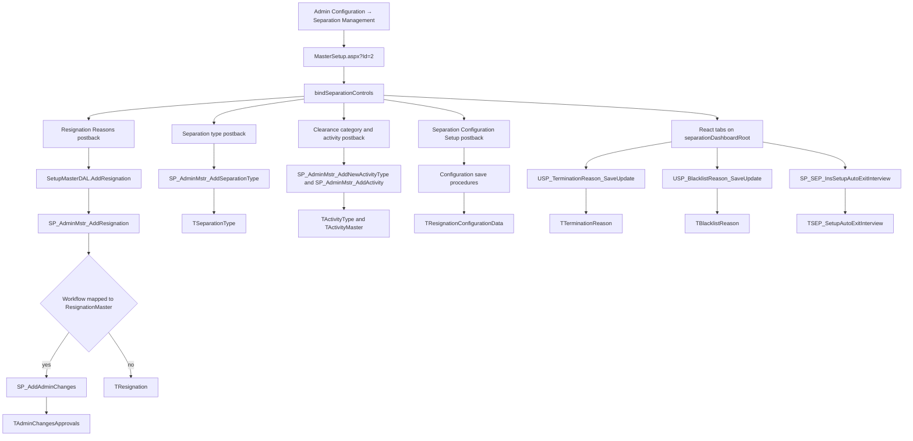
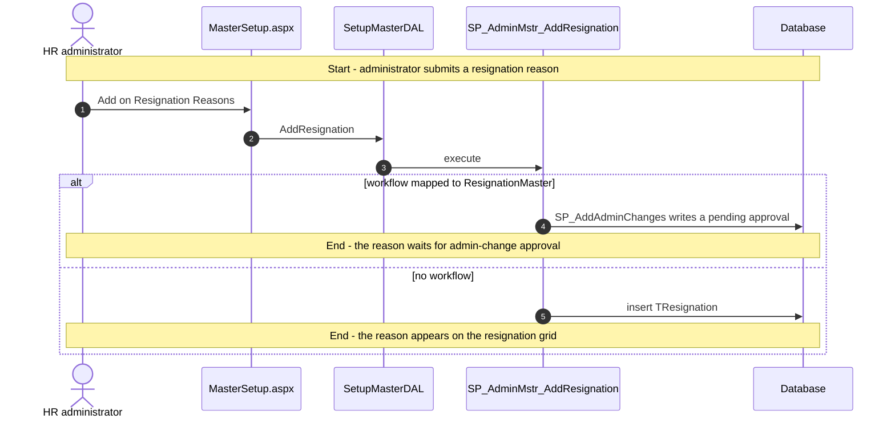
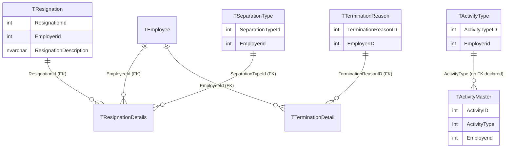

# Separation Management

## Overview

An HR administrator sets the masters that later resignation and termination cases use. They open **Admin Configuration → Separation Management**. The stored URL is `~/HRM/MasterSetup/MasterSetup.aspx?Id=2`, the same WebForms host as Setup Masters. `Id=2` is a different mode. `Page_Load` sets the title to Separation Management and `bindSeparationControls` loads the resignation, separation-type, clearance, and configuration data. `Id=1` sets the title to Setup Masters and calls `bindMasterControls` instead, which hides the separation tabs.

The story this guide follows is adding a **resignation reason**. The administrator types a name and an active flag and submits. `SP_AdminMstr_AddResignation` looks up a workflow for module page `ResignationMaster`. When one is mapped, the reason is not written yet. The procedure files a pending row through `SP_AddAdminChanges`. When none is mapped, it inserts `TResignation`. The same mode also lets them add a **separation type** (`TSeparationType`), a **clearance category** (`TActivityType`), a **clearance activity** (`TActivityMaster`), and the **separation configuration** rows in `TResignationConfigurationData` (resignation rules, termination rules, clearance rules, and notification reminders, stored as different `ConfigurationType` values).

Three tabs on this host mount the separation React bundle instead of posting back: Termination Reasons, Blacklist Reasons, and Setup Exit Interview. Saving a blacklist reason inserts `TBlacklistReason`. Saving a termination reason inserts `TTerminationReason`. Saving an exit-interview setup inserts `TSEP_SetupAutoExitInterview` and its mapping rows. Applying a blacklist to a person, recording a resignation, and deactivating an employee are the Separation menu (Separation Tasks), not this admin screen.

SystemModel-2 describes the blacklist reason master as menu 82 on this Master Setup tab in `domain/contexts/employee-blacklist.md`, and the exit-interview setup as the existing Setup Exit Interview tab in `domain/contexts/hr-core.md`. `content/llm-wiki/domain/employee-lifecycle.md` documents the exit tables and deactivation. That page calls `TResignation` a separation-type master. On this screen `TResignation` is the resignation-reason list and `TSeparationType` is the separation-type list.

**Who's involved:**

- **HR administrator** — maintains reasons, clearance masters, and separation configuration for the selected organisation. A global-access user can switch organisation in the page header.
- **Workflow approver** — when `ResignationMaster` is mapped in Workflow Management, a new resignation reason waits in admin-change approvals.
- **Employee** — does not open this screen. Their later resignation or termination uses these masters.

## Workflow

## Request journey

### HR administrator — add a resignation reason when no approval workflow is mapped

## Entry points

`Id=2` selects separation masters. `bindPageLoadData` calls `bindSeparationControls`, which hides tab indexes 0–3 and 12–21 (calendars, locations, employment types, bank details, and the later setup-master tabs through Background Verification) and hides `SetupMasterTables`. It does not hide every non-separation tab. Indexes that stay eligible include Temporary Access Card Reason, Asset Category, and the tabs from Separation Configuration Setup through Blacklist Reasons. `showHideTab` then keeps only tabs granted on menu `SEPARATION_MGMT` (menu id 82). The default tab is Setup Resignation Reasons.

`Id=1` calls `bindMasterControls`, titles the page Setup Masters, hides tab indexes 4–9, and hides the separation panel. That mode is Setup Masters, not this menu.

Selecting Termination Reasons, Setup Exit Interview, Deactivation Validation Setup, or Blacklist Reasons runs `showAssetTab`, which sets `sessionStorage.requestedPage` and clicks `#hiddenMasterBtn`. `Separation_React/routes.js` mounts `TerminationRoutes` for `/HRM/MasterSetup/MasterSetup.aspx`.

| UI page | Purpose |
|---|---|
| `HRM/MasterSetup/MasterSetup.aspx?Id=2` | Host. WebForms tabs for reasons, clearance, and configuration |
| `HRM/Separation_React/Areas/Termination/TerminationRoutes.js` | React tabs on the same URL: termination reasons, setup exit interview, deactivation validation, blacklist reasons |
| `HRM/Separation/ResignationDetails.aspx` | Separation Tasks (employee separation menu). Not this admin screen |

## Code → database call chain

| Entry | Method | Stored procedure |
|---|---|---|
| Resignation grid | `ResignationBLL.GetResignationByEmployer` (`ResignationBLL.cs:59`) → `ResignationDAL.GetResignationByEmployer` (`ResignationDAL.cs:96`) | `SP_SEP_GetResignation` |
| Resignation Reasons Add | `submitResignation` (`MasterSetup.aspx.cs:7839`) → `AddResignation` (`SetupMasterDAL.cs:1386`) | `SP_AdminMstr_AddResignation` |
| Resignation Reasons Update | `UpdateResignation` (`SetupMasterDAL.cs:1400`) | `SP_AdminMstr_UpdResignationType` |
| Resignation Reasons Delete | `DeleteResignation` (`SetupMasterDAL.cs:1375`) | `SP_AdminMstr_DelResignationType` |
| Separation type grid | `ResignationDAL.GetSeparationType` (`ResignationDAL.cs:105`) | `SP_SEP_GetSeparationType` |
| Separation type Add | `submitSeparation` (`MasterSetup.aspx.cs:8179`) → `AddSeparationType` (`SetupMasterDAL.cs:1054`) | `SP_AdminMstr_AddSeparationType` |
| Separation type Update | `UpdateSeparationType` (`SetupMasterDAL.cs:1068`) | `SP_AdminMstr_UpdSeperationType` |
| Separation type Delete | `DeleteSeparationType` (`SetupMasterDAL.cs:1041`) | `SP_AdminMstr_DelSeparationType` |
| Clearance category Add | `btnSubmitActivityType_Click` (`MasterSetup.aspx.cs:9606`) → `AddActivityType` (`SetupMasterDAL.cs:1135`) | `SP_AdminMstr_AddNewActivityType` |
| Clearance activity Add | `ShowCustomMessageOnUpdate` (`MasterSetup.aspx.cs:8759`) → `AddActivity` (`SetupMasterDAL.cs:1154`) | `SP_AdminMstr_AddActivity` |
| Configuration load | `GetResignationConfigurationData` (`SetupMasterDAL.cs:1678`) | `SP_AdminMstr_GetResignationConfigurationData` |
| Resignation configuration Submit | `btnSubmitConfig_Click` (`MasterSetup.aspx.cs:15750`) → `AddUpdateResignationConfigurationData` (`SetupMasterDAL.cs:1703`) | `SP_AdminMstr_ResignationConfigurationData_SaveUpdate` |
| Termination configuration Submit | `btnSubmitTerminationConfig_Click` (`MasterSetup.aspx.cs:17507`) → `AddUpdateTerminationConfigurationData` (`SetupMasterDAL.cs:1760`) | `SP_AdminMstr_TerminationConfigurationData_SaveUpdate` |
| Clearance configuration Submit | `btnSubmitClearanceConfig_Click` (`MasterSetup.aspx.cs:17434`) → `AddUpdateClearanceConfigurationData` (`SetupMasterDAL.cs:1781`) | `SP_AdminMstr_ClearanceConfigurationData_SaveUpdate` |
| Notification configuration Submit | `btnSubmitEmailReminderConfig_Click` (`MasterSetup.aspx.cs:17740`) → `AddUpdateEmailReminderConfiguration` (`SetupMasterDAL.cs:1818`) | `SP_AdminMstr_EmailReminderConfiguration_SaveUpdate` |
| Exit interview initiation (WebForms) | `btnSubmitAutoExit_Click` (`MasterSetup.aspx.cs:13893`) → `InsertUpdateExitInterviewIntitationType` (`MasterSetup.aspx.cs:14054`) → `AddUpdateExitInterviewInititationTypeConfigurationData` (`SetupMasterDAL.cs:1845`) | `SP_AdminMstr_ExitInterviewInitiationConfigurationData_SaveUpdate` |
| Termination reason save | `SaveUpdateTerminationReason` (`terminationController.js:68`) → `terminationDAL.js:104` | `USP_TerminationReason_SaveUpdate` |
| Blacklist reason save | `SaveUpdateBlacklistReason` (`terminationController.js:117`) → `terminationDAL.js:167` | `USP_BlacklistReason_SaveUpdate` |
| Setup Exit Interview save | `InsertSetupAutoExitInterview` (`separationController.js:3531`) → `separationDAL.js:2563` | `SP_SEP_InsSetupAutoExitInterview` |

WebForms calls use Enterprise Library `DBHelper.m_returnDbObject`. The React tabs use the Node `mssql` driver. Procedure name constants for the WebForms saves are in `HRMS.Shared/HRMS.DataAccessLayer/DBConstant.cs`.

## API endpoints

Resignation reasons, separation types, clearance masters, and the configuration postbacks do not call `HRMS.CoreAPI`.

The React tabs do. Routes are mounted at `/api` (`app.js`) and then `/termination` or `/separation` (`routeIndex.js`). `CreatedBy`, `UpdatedBy`, and `UserID` are set from the token by `setLoggedInEmployeeId`. `EmployerID` is checked by `assertEmployerAccess`.

| Verb | Route | Parameters | Purpose | Source |
|---|---|---|---|---|
| GET | `/api/termination/TerminationReasonList` | `EmployerID` query, required numeric. `TerminationReasonID` and `IsActive` are read by the DAL when present | List termination reasons | `TerminationRoutes.js:16`, validator `validateRequestData.js:1204` |
| POST | `/api/termination/SaveUpdateTerminationReason` | Body `TerminationReasonID`, `TerminationReason`, `IsActive`, `EmployerID`. `CreatedBy` and `UpdatedBy` from the token | Insert or update `TTerminationReason` | `TerminationRoutes.js:14`, `terminationDAL.js:95` |
| POST | `/api/termination/DeleteTerminationReason` | Body `TerminationReasonID`, `UpdatedBy` from the token | Delete a termination reason | `TerminationRoutes.js:15` |
| GET | `/api/termination/BlacklistReasonList` | `EmployerID` query, required numeric | List active-or-filtered blacklist reasons | `TerminationRoutes.js:18`, `validateRequestData.js:1213` |
| POST | `/api/termination/SaveUpdateBlacklistReason` | Body `BlacklistReasonID`, `BlacklistReason`, `IsActive`, `EmployerID`. `UserID` from the token | Insert or update `TBlacklistReason` | `TerminationRoutes.js:19`, `terminationDAL.js:156` |
| POST | `/api/termination/DeleteBlacklistReason` | Body `BlacklistReasonIDs`, `EmployerID`. `UserID` from the token | Delete reasons that are not in use | `TerminationRoutes.js:20` |
| POST | `/api/separation/InsertSetupAutoExitInterview` | Body fields bound in `separationDAL.js:2530` (`NoOfDays`, template id, mapping flags and id lists, `EmployerId`, `CreatedBy`, conduct-on, effective date, skip-reason ids) | Insert one exit-interview setup and its mappings | `separationRoutes.js:177` |
| POST | `/api/separation/AddUpdateExitInterviewInititationTypeConfigurationData` | Body `EmployerId`, `CreatedBy`, `ExitInterviewInititationType` | Write the initiation type onto the resignation configuration row | `separationRoutes.js:183`, `separationDAL.js:2688` |

## Stored procedures & tables involved

`SP_AdminMstr_AddResignation` is the only resignation-reason insert that forks to approval. Separation type, clearance, configuration, termination reason, and blacklist reason saves write their tables directly. `content/llm-wiki/domain/employee-lifecycle.md` covers `TResignation`, `TSeparationType`, `TActivityMaster`, and `TResignationDetails`.

| Object | File | Purpose |
|---|---|---|
| `SP_SEP_GetResignation` | `HRMS-DATABASE/HRMS/STOREPROCEDURE/SP_SEP_GetResignation.sql` | List resignation reasons for an employer |
| `SP_AdminMstr_AddResignation` | `HRMS-DATABASE/HRMS/STOREPROCEDURE/SP_AdminMstr_AddResignation.sql` | Insert a reason, or file it for approval |
| `SP_SEP_GetSeparationType` | `HRMS-DATABASE/HRMS/STOREPROCEDURE/SP_SEP_GetSeparationType.sql` | List separation types |
| `SP_AdminMstr_AddSeparationType` | `HRMS-DATABASE/HRMS/STOREPROCEDURE/SP_AdminMstr_AddSeparationType.sql` | Insert `TSeparationType` |
| `SP_AdminMstr_AddNewActivityType` | `HRMS-DATABASE/HRMS/STOREPROCEDURE/SP_AdminMstr_AddNewActivityType.sql` | Insert a clearance category |
| `SP_AdminMstr_AddActivity` | `HRMS-DATABASE/HRMS/STOREPROCEDURE/SP_AdminMstr_AddActivity.sql` | Insert a clearance activity |
| `SP_AdminMstr_ResignationConfigurationData_SaveUpdate` | `HRMS-DATABASE/HRMS/STOREPROCEDURE/SP_AdminMstr_ResignationConfigurationData_SaveUpdate.sql` | Save resignation rules (`ConfigurationType` `R`) |
| `SP_AdminMstr_TerminationConfigurationData_SaveUpdate` | `HRMS-DATABASE/HRMS/STOREPROCEDURE/SP_AdminMstr_TerminationConfigurationData_SaveUpdate.sql` | Save termination rules (`ConfigurationType` `T`) |
| `SP_AdminMstr_ClearanceConfigurationData_SaveUpdate` | `HRMS-DATABASE/HRMS/STOREPROCEDURE/SP_AdminMstr_ClearanceConfigurationData_SaveUpdate.sql` | Save clearance rules (`ConfigurationType` `C`) |
| `SP_AdminMstr_EmailReminderConfiguration_SaveUpdate` | `HRMS-DATABASE/HRMS/STOREPROCEDURE/SP_AdminMstr_EmailReminderConfiguration_SaveUpdate.sql` | Save notification reminders (`ConfigurationType` `E`) |
| `SP_AdminMstr_ExitInterviewInitiationConfigurationData_SaveUpdate` | `HRMS-DATABASE/HRMS/STOREPROCEDURE/SP_AdminMstr_ExitInterviewInitiationConfigurationData_SaveUpdate.sql` | Set the exit-interview initiation type on the `R` row |
| `USP_TerminationReason_SaveUpdate` | `HRMS-DATABASE/HRMS/STOREPROCEDURE/USP_TerminationReason_SaveUpdate.sql` | Insert or update a termination reason |
| `USP_BlacklistReason_SaveUpdate` | `HRMS-DATABASE/HRMS/STOREPROCEDURE/USP_BlacklistReason_SaveUpdate.sql` | Insert or update a blacklist reason |
| `SP_SEP_InsSetupAutoExitInterview` | `HRMS-DATABASE/HRMS/STOREPROCEDURE/SP_SEP_InsSetupAutoExitInterview.sql` | Insert an exit-interview setup |
| `SP_AddAdminChanges` | `HRMS-DATABASE/HRMS/STOREPROCEDURE/SP_AddAdminChanges.sql` | Pending admin-change request when a workflow is mapped |

## Table relationships

Declared foreign keys read from the table scripts, and the exit diagram in `content/llm-wiki/domain/employee-lifecycle.md`. `TResignation`, `TSeparationType`, `TActivityType`, and `TActivityMaster` declare a primary key and no foreign key. `TActivityMaster.ActivityType` stores `TActivityType.ActivityTypeID` with no FK. `TTerminationDetail` declares FKs to `TEmployee` and `TTerminationReason`. No `CREATE TABLE` for `TResignationConfigurationData` or `TBlacklistReason` is in `HRMS-DATABASE/HRMS/TABLES`, so those two are not drawn as related.

## Known gaps

- Update and delete procedures for resignation reasons, separation types, clearance categories, and clearance activities are called from this page and do not have database pages in this pass (`SP_AdminMstr_UpdResignationType`, `SP_AdminMstr_DelResignationType`, `SP_AdminMstr_UpdSeperationType`, `SP_AdminMstr_DelSeparationType`, `SP_AdminMstr_UpdActivityType`, `SP_AdminMstr_DelActivityType`, `SP_AdminMstr_UpdActivity`, `SP_AdminMstr_RemoveActivityById`).
- `SP_AdminMstr_GetResignationConfigurationData` loads the configuration tab and was not given a page.
- `USP_SaveHistory` is executed by the insert procedures. Its script is not in `HRMS-DATABASE` (only `USP_SaveHistory_MultiID` and `USP_SaveHistory_MultiFilter` are). No page was written for it.
- `USP_TerminationReason_List`, `USP_TerminationReason_Delete`, `USP_BlacklistReason_List`, `USP_BlacklistReason_Delete`, and `SP_SEP_UPDSetupAutoExitInterview` are used by the React tabs and were not given pages. `USP_BlacklistReason_List` calls `FN_SEP_BlacklistReasonUsage`, which is one level under the list, not under the save.
- Setup Clearance Form (`btnSubmitAutoClearance_Click`) and Deactivation Validation Setup were not traced to procedures. Clearance Approver (Secondary) and Exit Interview Template are `Visible="false"` in the markup.
- `content/llm-wiki/domain/employee-lifecycle.md` labels `TResignation` as the separation-type master. This screen stores resignation reasons there and separation types in `TSeparationType`.
- SystemModel-2 `employee-blacklist.md` says the registry table names were not in the repository at the time it was written. `USP_BlacklistReason_SaveUpdate` now shows `TBlacklistReason`. The registry procedures (`USP_EmployeeBlacklist_GetByEmployee` and the rest) belong to Separation Tasks.

## Reference

Confidence is medium because the `Id=2` branch, the WebForms save methods, the React reason and exit-interview saves, and the procedure bodies for those saves were read. Update, delete, clearance-form, and deactivation-validation procedures were not.

### SourceCode

- `docs/SystemModels/SystemModel-2/domain/contexts/employee-blacklist.md`
- `docs/SystemModels/SystemModel-2/domain/contexts/hr-core.md`
- `HRMS.Web/HRMS.Web/HRM/MasterSetup/MasterSetup.aspx`
- `HRMS.Web/HRMS.Web/HRM/MasterSetup/MasterSetup.aspx.cs`
- `HRMS.Shared/HRMS.DataAccessLayer/Masters/SetupMasterDAL.cs`
- `HRMS.Shared/HRMS.DataAccessLayer/Separation/ResignationDAL.cs`
- `HRMS.Shared/HRMS.BusinessLayer/Separation/ResignationBLL.cs`
- `HRMS.Shared/HRMS.DataAccessLayer/DBConstant.cs`
- `HRMS.Shared/HRMS.DataContract/Common/Enums.cs` (`SEPARATION_MGMT` = 82)
- `HRMS.Web/HRMS.Web/HRM/Separation_React/routes.js`
- `HRMS.Web/HRMS.Web/HRM/Separation_React/Areas/Termination/TerminationRoutes.js`
- `HRMS.CoreAPI/HRMS.Core.WebAPI.Node/Routes/TerminationRoutes.js`
- `HRMS.CoreAPI/HRMS.Core.WebAPI.Node/Routes/separationRoutes.js`
- `HRMS.CoreAPI/HRMS.Core.WebAPI.Node/Core/DataAccessLayer/terminationDAL.js`
- `HRMS.CoreAPI/HRMS.Core.WebAPI.Node/Core/DataAccessLayer/separationDAL.js`

### TDG HRMS DB

- `content/llm-wiki/domain/employee-lifecycle.md`
- `HRMS-DATABASE/HRMS/STOREPROCEDURE/SP_AdminMstr_AddResignation.sql`
- `HRMS-DATABASE/HRMS/STOREPROCEDURE/SP_SEP_GetResignation.sql`
- `HRMS-DATABASE/HRMS/STOREPROCEDURE/SP_SEP_GetSeparationType.sql`
- `HRMS-DATABASE/HRMS/STOREPROCEDURE/SP_AdminMstr_AddSeparationType.sql`
- `HRMS-DATABASE/HRMS/STOREPROCEDURE/SP_AdminMstr_AddNewActivityType.sql`
- `HRMS-DATABASE/HRMS/STOREPROCEDURE/SP_AdminMstr_AddActivity.sql`
- `HRMS-DATABASE/HRMS/STOREPROCEDURE/SP_AdminMstr_ResignationConfigurationData_SaveUpdate.sql`
- `HRMS-DATABASE/HRMS/STOREPROCEDURE/SP_AdminMstr_TerminationConfigurationData_SaveUpdate.sql`
- `HRMS-DATABASE/HRMS/STOREPROCEDURE/SP_AdminMstr_ClearanceConfigurationData_SaveUpdate.sql`
- `HRMS-DATABASE/HRMS/STOREPROCEDURE/SP_AdminMstr_EmailReminderConfiguration_SaveUpdate.sql`
- `HRMS-DATABASE/HRMS/STOREPROCEDURE/SP_AdminMstr_ExitInterviewInitiationConfigurationData_SaveUpdate.sql`
- `HRMS-DATABASE/HRMS/STOREPROCEDURE/USP_TerminationReason_SaveUpdate.sql`
- `HRMS-DATABASE/HRMS/STOREPROCEDURE/USP_BlacklistReason_SaveUpdate.sql`
- `HRMS-DATABASE/HRMS/STOREPROCEDURE/SP_SEP_InsSetupAutoExitInterview.sql`
- `HRMS-DATABASE/HRMS/STOREPROCEDURE/SP_SEP_InsSetupAutoExitInterviewMappingData.sql`
- `HRMS-DATABASE/HRMS/TABLES/TResignation.sql`
- `HRMS-DATABASE/HRMS/TABLES/TResignationDetails.sql`
- `HRMS-DATABASE/HRMS/TABLES/TActivityMaster.sql`
- `HRMS-DATABASE/HRMS/TABLES/TActivityType.sql`
- `HRMS-DATABASE/HRMS/TABLES/TTerminationReason.sql`
- `HRMS-DATABASE/HRMS/TABLES/TTerminationDetail.sql`
