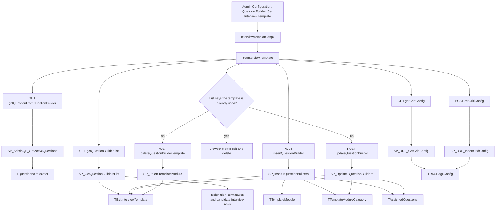
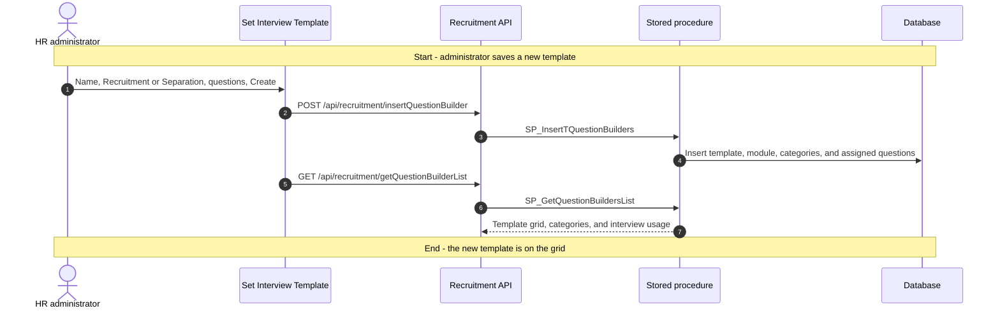
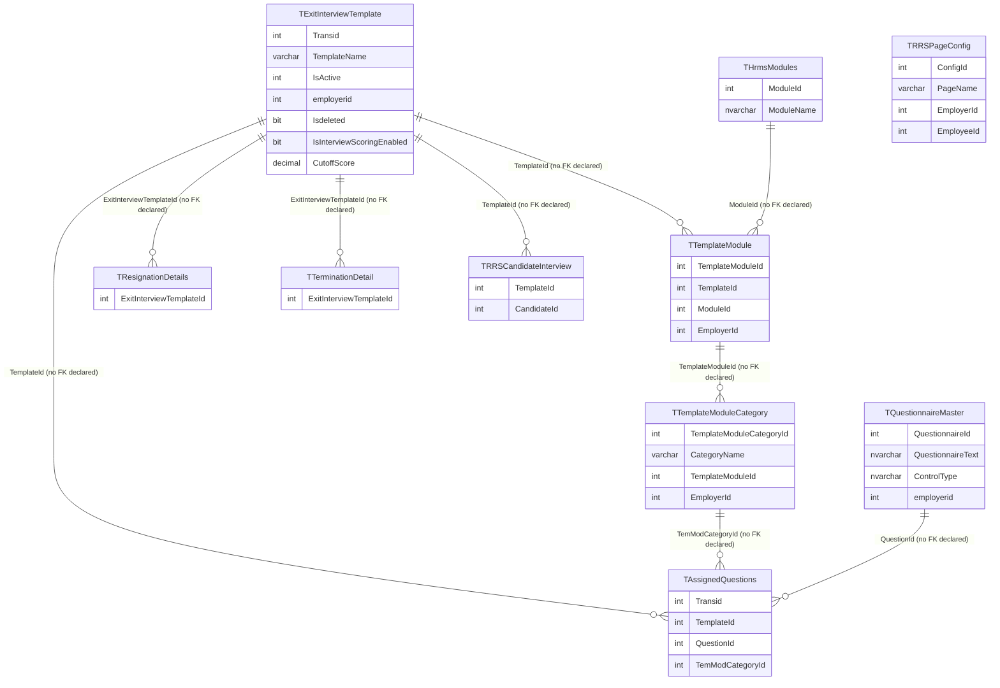

# Set Interview Template

## Overview

An HR administrator needs one named questionnaire they can attach to a recruitment interview or to a separation exit interview. They open **Admin Configuration → Question Builder → Set Interview Template**. They type a template name, map it to **Recruitment** or **Separation**, pick active questions from the question bank, optionally group those questions into categories, and mark the template Active or Inactive. Create writes the template. Update changes that same template. Delete hides the header and removes its module, categories, and assigned questions.

The browser will not open edit or delete when the list says the template is already used. Usage for separation is a resignation or termination row that points at the template. Usage for recruitment is a candidate interview row that points at the template.

Questions themselves are not written on this screen. The picker reads active rows from `TQuestionnaireMaster`. The sibling Question Builder page is the one that authors those questions.

SystemModel-2 does not name this screen. `domain/contexts/hr-core.md` describes Setup Exit Interview, which is a different separation page. There is no `llm-wiki` domain page for this builder. Table blurbs for the header, the question bank, and assigned questions are in `llm-wiki/reference/tables/hrms.md`. `TTemplateModule` and `TTemplateModuleCategory` are not in that catalog.

**Who's involved:**

- **HR administrator** — creates, updates, and deletes templates for the employer in the query string, or for their own employer when that query is absent.
- **Recruitment and separation screens** — can open this page with `templateId` and a `RedirectUrl`, then send the administrator back. They do not own the save.
- **Interviewer or exiting employee** — never opens this page. Later screens read the template this page saved.

## Workflow

The module radios are fixed values: Recruitment is module id 8, Separation is module id 13. The module radio is disabled while a template is open for edit. Column order for grid id `setInterviewQuestion_Grid` is a separate save on `TRRSPageConfig`.

## Request journey

### HR administrator — create a template

Update follows the same screen after the administrator confirms the dialog, and it calls `SP_UpdateTQuestionBuilders`. Delete calls `SP_DeleteTemplateModule`, which sets `TExitInterviewTemplate.Isdeleted` and removes the child rows. The browser skips both actions when the list marks the template as used.

## Entry points

`InterviewTemplate.aspx` is a host. Its markup loads `QuestionBuilder_React/BuildJS/questionbuilder.min.js` and leaves a `div#rmRoot`. `Routes.jsx` matches `/HRM/Settings/InterviewTemplate.aspx` and renders `InterviewTemplate.jsx`, which renders `SetInterviewTemplate.jsx`. Every method in `InterviewTemplate.aspx.cs` is commented out, so the page does not post back to those WebForms handlers.

SystemModel-2 does not name this URL. The left-nav target in this task is `~/HRM/Settings/InterviewTemplate.aspx`.

| UI page | Purpose |
|---|---|
| `HRM/Settings/InterviewTemplate.aspx` | Host for the React screen |
| `HRM/QuestionBuilder_React/Areas/InterviewTemplate/SetInterviewTemplate.jsx` | Template form, grid, create, update, delete |
| Same URL with `templateId`, `EmployerId`, `TabName`, `mode`, and `RedirectUrl` | Open one template from a recruitment or separation screen, then return |

## Code → database call chain

The exported API constants are the unversioned `/recruitment/...` paths. `routeIndex.js` mounts those on `/api/recruitment`, and that router uses `recruitmentDAL.js`.

| Entry | Method | Stored procedure |
|---|---|---|
| Question picker | `getQuestionFromQuestionBuilder` (`SetInterviewTemplate.jsx:355`) → `GetQuestionFromQuestionBuilder` (`recruitmentController.js:5130`) → `recruitmentDAL.js:10054` | `SP_AdminQB_GetActiveQuestions` |
| Template grid | `getQuestionBuilderList` (`SetInterviewTemplate.jsx:363`) → `GetQuestionBuilderList` (`recruitmentController.js:5139`) → `recruitmentDAL.js:10073` | `SP_GetQuestionBuildersList` |
| Create | `handleSubmit` (`SetInterviewTemplate.jsx:796`) → `InsertQuestionBuilder` (`recruitmentController.js:5167`) → `recruitmentDAL.js:10095` | `SP_InsertTQuestionBuilders` |
| Update | `handleUpdate` (`SetInterviewTemplate.jsx:880`) → `UpdateQuestionBuilder` (`recruitmentController.js:5181`) → `recruitmentDAL.js:10151` | `SP_UpdateTQuestionBuilders` |
| Delete | `handleDeleteTemplate` (`SetInterviewTemplate.jsx:975`) → `DeleteQuestionBuilderTemplate` (`recruitmentController.js:5195`) → `recruitmentDAL.js:10207` | `SP_DeleteTemplateModule` |
| Column order load | `getGridFormat` (`SetInterviewTemplate.jsx:1002`) → `GetGridConfig` (`recruitmentController.js:2525`) → `recruitmentDAL.js:6642` | `SP_RRS_GetGridConfig` |
| Column order save | `Grid.onSaveGrid` (`grid.jsx:2180`) → `SetGridConfig` (`recruitmentController.js:2534`) → `recruitmentDAL.js:6657` | `SP_RRS_InsertGridConfig` |

Create, update, and both grid-config writes begin a SQL transaction in the DAL and commit it after the procedure returns. The question and list reads do not.

## API endpoints

All of these routes use `Authorize` in `RecruitmentRoutes.js`. The same five question-builder routes are registered twice in that file. Both registrations call the same controller methods.

| Verb | Route | Parameters | Purpose | Source |
|---|---|---|---|---|
| GET | `/api/recruitment/getQuestionFromQuestionBuilder` | `employerId` query, required by the procedure | Active questions for the picker | `RecruitmentRoutes.js:366`, `recruitmentController.js:5130` |
| GET | `/api/recruitment/getQuestionBuilderList` | `employerId` query, required by the procedure | Three result sets: templates, categories, interview usage | `RecruitmentRoutes.js:367`, `recruitmentController.js:5139` |
| POST | `/api/recruitment/insertQuestionBuilder` | JSON body. Screen sends `TemplateName`, `CreatedBy`, `ModuleId`, `EmployerId`, `IsActive`, `UDT_QuestionCategory`, `TemplateId`, `TemplateModuleId`. `CreatedBy`, `ModuleId`, `EmployerId`, `IsActive`, and the category table are required by the procedure. `TemplateName`, `TemplateId`, and `TemplateModuleId` are optional in the procedure | Create a template when `TemplateId` is null | `RecruitmentRoutes.js:368`, `recruitmentController.js:5167` |
| POST | `/api/recruitment/updateQuestionBuilder` | Same body. `TemplateName`, `TemplateId`, and `TemplateModuleId` are required by the update procedure | Update the live template | `RecruitmentRoutes.js:369`, `recruitmentController.js:5181` |
| POST | `/api/recruitment/deleteQuestionBuilderTemplate` | JSON `TemplateId` and `EmployerId` | Soft-delete the header and delete child rows | `RecruitmentRoutes.js:370`, `recruitmentController.js:5195` |
| GET | `/api/recruitment/getGridConfig` | Query `employerId`, `employeeId`, `gridId`. The handler passes `employerId`, `req.EID`, and `gridId` | Saved column order | `RecruitmentRoutes.js:214`, `recruitmentController.js:2525` |
| POST | `/api/recruitment/setGridConfig` | JSON `EmployerId`, `EmployeeId`, `PageName`, `ConfigType`, `Config`. This screen sends `PageName` `setInterviewQuestion_Grid` and `ConfigType` `GridFormat` | Insert or update column order | `RecruitmentRoutes.js:215`, `recruitmentController.js:2534` |

`UDT_QuestionCategory` on the wire is an array of `{ category, questionIds, TemplateModuleCategoryId, IsDeleted }`. The DAL splits `questionIds` on commas into one `UDT_TQuestionCategory` row per question before it calls the procedure. Insert and update also accept `IsInterviewScoringEnabled` and `CutoffScore`. When scoring is omitted or false, the controller clears the cutoff. When scoring is true, the cutoff must be a number from 1 to 100 or the handler returns HTTP 400. This screen does not send either field.

## Stored procedures & tables involved

None of these procedures call another procedure or function. Pages for them are under `/docs/database/hrms/`.

| Object | File | Purpose |
|---|---|---|
| [`SP_AdminQB_GetActiveQuestions`](/docs/database/hrms/SP_AdminQB_GetActiveQuestions) | `HRMS-DATABASE/HRMS/STOREPROCEDURE/SP_AdminQB_GetActiveQuestions.sql` | Active question-bank rows for one employer. `TQuestionnaireMaster` is described in `llm-wiki/reference/tables/hrms.md` |
| [`SP_GetQuestionBuildersList`](/docs/database/hrms/SP_GetQuestionBuildersList) | `HRMS-DATABASE/HRMS/STOREPROCEDURE/SP_GetQuestionBuildersList.sql` | Template grid, categories, and which templates already appear on an interview. `TExitInterviewTemplate` and `TAssignedQuestions` are in `llm-wiki/reference/tables/hrms.md` |
| [`SP_InsertTQuestionBuilders`](/docs/database/hrms/SP_InsertTQuestionBuilders) | `HRMS-DATABASE/HRMS/STOREPROCEDURE/SP_InsertTQuestionBuilders.sql` | Insert header, module map, categories, and assigned questions |
| [`SP_UpdateTQuestionBuilders`](/docs/database/hrms/SP_UpdateTQuestionBuilders) | `HRMS-DATABASE/HRMS/STOREPROCEDURE/SP_UpdateTQuestionBuilders.sql` | Update the header and reconcile categories and questions |
| [`SP_DeleteTemplateModule`](/docs/database/hrms/SP_DeleteTemplateModule) | `HRMS-DATABASE/HRMS/STOREPROCEDURE/SP_DeleteTemplateModule.sql` | Mark the header deleted and remove child rows |
| [`SP_RRS_GetGridConfig`](/docs/database/hrms/SP_RRS_GetGridConfig) | `HRMS-DATABASE/HRMS/STOREPROCEDURE/SP_RRS_GetGridConfig.sql` | Read `TRRSPageConfig`. That table is in `llm-wiki/reference/tables/hrms.md` |
| [`SP_RRS_InsertGridConfig`](/docs/database/hrms/SP_RRS_InsertGridConfig) | `HRMS-DATABASE/HRMS/STOREPROCEDURE/SP_RRS_InsertGridConfig.sql` | Insert or update one grid-format row |

`THrmsModules`, `TResignationDetails`, `TTerminationDetail`, and `TRRSCandidateInterview` are read by the list procedure and are also in that table catalog. The catalog's related columns for those four tables are other parents (`TEmployee`, `TRRSCandidate`, and so on). This page joins them by template id, and those template columns have no foreign key in the table scripts.

## Table relationships

No foreign key in the table scripts links `TExitInterviewTemplate` to its module, categories, questions, resignation rows, termination rows, or candidate interviews. `TRRSCandidateInterview` does declare a foreign key from `CandidateId` to `TRRSCandidate`. That key is not how this page finds a template. `TResignationDetails` and `TTerminationDetail` declare foreign keys to the employee and to separation or termination reason, and `ExitInterviewTemplateId` is not one of those keys.

`IsInterviewScoringEnabled` and `CutoffScore` come from `DDL/172253 _DDL_Statement.sql`. `TemModCategoryId` comes from `DDL/77539_Alter Statement for TAssignedQuestions.sql`. The baseline `CREATE TABLE` scripts for those two tables do not list those columns. `TRRSPageConfig` is the grid-layout table and has no foreign key to the template.

## Known gaps

- `InterviewTemplate.aspx.cs` is commented out. The live screen is the Question Builder React bundle.
- `HRM/recruitmentmanagement_react/src/features/InterviewTemplate/SetInterviewTemplate.js` is a second client. This aspx does not load it.
- The create and update payloads from this screen omit `IsInterviewScoringEnabled` and `CutoffScore`. The controller then stores scoring off and a null cutoff, including when an existing template is updated.
- `SP_InsertTQuestionBuilders` writes only when `@TemplateId` is null. A create call that already has a template id returns without inserting.
- `SP_DeleteTemplateModule` does not read resignation, termination, or candidate-interview usage, and its `@EmployerId` parameter is unused. The browser is what blocks a used template.
- The update dialog says existing initiated templates stay as they were. `SP_UpdateTQuestionBuilders` updates the live header, categories, and assigned questions. Procedures that might copy those questions at initiation were not part of this page.
- `SP_UpdateTQuestionBuilders` does not update `TTemplateModule.ModuleId`. The module radios are disabled during edit.
- `SP_RRS_GetGridConfig` and `SP_RRS_InsertGridConfig` serve other recruitment grids as well. This page uses `setInterviewQuestion_Grid`. The get handler passes `req.EID` into `@EmployeeId` and does not pass the query-string `employeeId`.
- V2 and V3 copies of these routes exist in source and are commented out of the exported URL constants. `routeIndex.js` mounts the unversioned recruitment router only.
- `TTemplateModule` and `TTemplateModuleCategory` have no row in `llm-wiki/reference/tables/hrms.md`.

## Reference

Confidence is high because the host page, the React save path, the unversioned recruitment controller and DAL, and the seven procedure scripts were read.

### SourceCode

- `docs/SystemModels/SystemModel-2/domain/contexts/hr-core.md` (Setup Exit Interview, a different screen)
- `HRMS.Web/HRMS.Web/HRM/Settings/InterviewTemplate.aspx`
- `HRMS.Web/HRMS.Web/HRM/Settings/InterviewTemplate.aspx.cs`
- `HRMS.Web/HRMS.Web/HRM/QuestionBuilder_React/Routes.jsx`
- `HRMS.Web/HRMS.Web/HRM/QuestionBuilder_React/Areas/InterviewTemplate/InterviewTemplate.jsx`
- `HRMS.Web/HRMS.Web/HRM/QuestionBuilder_React/Areas/InterviewTemplate/SetInterviewTemplate.jsx`
- `HRMS.Web/HRMS.Web/HRM/QuestionBuilder_React/Common/apiURLConstants.js`
- `HRMS.Web/HRMS.Web/HRM/QuestionBuilder_React/SharedComponent/Grid/grid.jsx`
- `HRMS.CoreAPI/HRMS.Core.WebAPI.Node/Routes/routeIndex.js`
- `HRMS.CoreAPI/HRMS.Core.WebAPI.Node/Routes/RecruitmentRoutes.js`
- `HRMS.CoreAPI/HRMS.Core.WebAPI.Node/Controllers/recruitmentController.js`
- `HRMS.CoreAPI/HRMS.Core.WebAPI.Node/Core/DataAccessLayer/recruitmentDAL.js`

### TDG HRMS DB

- `llm-wiki/reference/tables/hrms.md`
- `HRMS-DATABASE/HRMS/STOREPROCEDURE/SP_AdminQB_GetActiveQuestions.sql`
- `HRMS-DATABASE/HRMS/STOREPROCEDURE/SP_GetQuestionBuildersList.sql`
- `HRMS-DATABASE/HRMS/STOREPROCEDURE/SP_InsertTQuestionBuilders.sql`
- `HRMS-DATABASE/HRMS/STOREPROCEDURE/SP_UpdateTQuestionBuilders.sql`
- `HRMS-DATABASE/HRMS/STOREPROCEDURE/SP_DeleteTemplateModule.sql`
- `HRMS-DATABASE/HRMS/STOREPROCEDURE/SP_RRS_GetGridConfig.sql`
- `HRMS-DATABASE/HRMS/STOREPROCEDURE/SP_RRS_InsertGridConfig.sql`
- `HRMS-DATABASE/HRMS/UDT/UDT_TQuestionCategory.sql`
- `HRMS-DATABASE/HRMS/TABLES/TExitInterviewTemplate.sql`
- `HRMS-DATABASE/HRMS/TABLES/TTemplateModule.sql`
- `HRMS-DATABASE/HRMS/TABLES/TTemplateModuleCategory.sql`
- `HRMS-DATABASE/HRMS/TABLES/TAssignedQuestions.sql`
- `HRMS-DATABASE/HRMS/TABLES/TQuestionnaireMaster.sql`
- `HRMS-DATABASE/HRMS/TABLES/TRRSPageConfig.sql`
- `HRMS-DATABASE/HRMS/DDL/172253 _DDL_Statement.sql`
- `HRMS-DATABASE/HRMS/DDL/77539_Alter Statement for TAssignedQuestions.sql`
