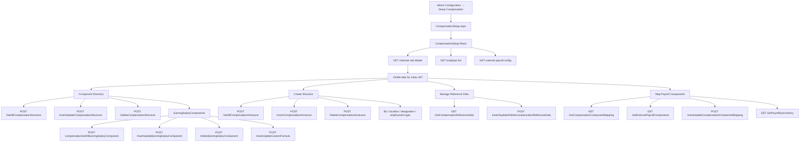
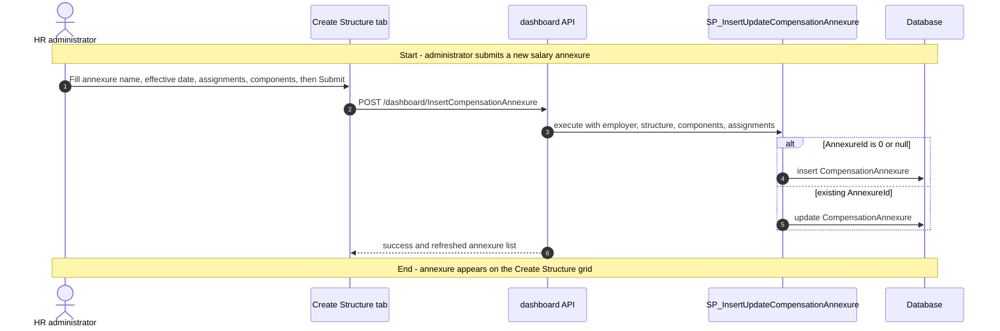
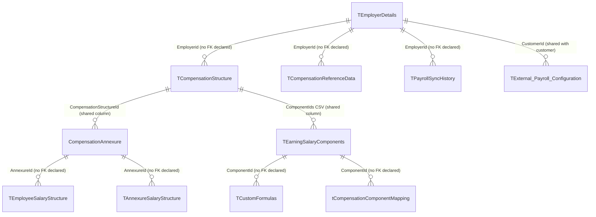

# Setup Compensation

## Overview

An HR administrator opens **Admin Configuration → Setup Compensation** (`~/HRM/DashBoard_React/CompensationSetup.aspx`) to define how salaries are built for an organisation. The WebForms host only binds session fields and loads the dashboard React bundle. The React screen `CompensationSetup` shows an organisation picker and up to four permission-gated tabs (menu `407`): **Component Directory** (tab `308`), **Create Structure** (tab `309`), **Manage Reference Data** (tab `433`), and **Map Payroll Components** (tab `549`).

On **Component Directory**, the admin maintains compensation structures and drills into earning salary components (flat amounts and formulas) for the selected structure. **Create Structure** creates salary annexures (named structures with effective dates, business units, locations, designations, employment types, and component sets) that employees and candidates later consume. **Manage Reference Data** maintains compensation-type reference text used elsewhere in compensation entry. **Map Payroll Components** maps internal earning components to external (Hive) payroll component codes when external payroll is configured for the customer.

Employees do not open this screen. Later compensation entry and payroll sync read the structures, annexures, and mappings created here. SystemModel-2 has no workflow page for this screen. Table scripts live under `HRMS-DATABASE/HRMS/TABLES/`.

**Who's involved:**

- **HR administrator** — configures structures, annexures, reference data, and payroll mappings for the selected organisation.
- **Employee / candidate** — do not open this screen; their salary rows later reference these annexures and components.
- **External payroll (Hive)** — receives mapped component codes when sync runs; configuration is read here but sync itself is outside this setup flow.

## Workflow

## Request journey

Saving a compensation structure on Component Directory follows the same UI → API → SP pattern through `SP_InsertUpdateCompensationStructure`. Mapping payroll components posts a batch to `SP_InsertCompensationComponentMapping` inside a Node transaction.

## Entry points

| Entry | Purpose |
|---|---|
| `~/HRM/DashBoard_React/CompensationSetup.aspx` | Host page. Logs `CompensationSetup`, binds session hidden fields, loads `dashboard_react.*.min.js`. |
| `Areas/Dashboard/Components/CompensationSetup.js` | React shell, org picker, tab visibility, unsaved-mapping leave guard. |
| `CompensationStructure.js` → `SalaryComponent.js` → `EarningSalaryComponents.js` | Component Directory structure list and earning components. |
| `SalaryAnnexure.js` | Create Structure tab. |
| `ManageReferenceData.js` | Manage Reference Data tab. |
| `MapPayrollComponents.js` | Map Payroll Components tab. |
| `routeConstants.COMPENSATION_SETUP` | `/HRM/Dashboard_React/CompensationSetup.aspx`. |

There is no WebForms postback for setup actions. All business calls go to Core API `/dashboard/*` (and one `/recruitment/*` earnings list).

## Code → database call chain

| UI | API | DAL (`file:line`) | Stored procedure |
|---|---|---|---|
| Org list (`CompensationSetup.js:296`) | `GET /dashBoard/GetGlobalAccessEmployerList` | `GetGlobalAccessEmployerList` (`dashBoardDAL.js:824`) | `SP_GetGlobalAccessEmployerList` |
| Role tabs (`CompensationSetup.js:142`) | `GET /dashboard/GetPermissionRoleTabDetails` | `GetPermissionRoleTabDetails` (`dashBoardDAL.js:853`) | `Sp_AdminRoleM_GetTabRoleDet` |
| User tabs (`CompensationSetup.js:160`) | `GET /dashboard/GetPermissionUserTabDetailsByuserId` | `GetPermissionUserTabDetailsByuserId` (`dashBoardDAL.js:838`) | `Sp_GetTabUserDetails` |
| External payroll flag (`CompensationSetup.js:126`) | `GET /dashboard/getExternalPayrollConfigDetails` | `GetExternalPayrollConfigDetails` (`dashBoardDAL.js:4086`) | `SP_GetPayrollSubmitDetails` |
| Structure grid (`CompensationStructure.js:67`) | `POST /dashboard/GetAllCompensationStructure` | `GetAllCompensationStructure` (`dashBoardDAL.js:2730`) | `SP_GetAllCompensationStructure` |
| Default structure (`CompensationStructure.js:247`) | `GET /dashboard/GetCompensationStructureByName` | `GetCompensationStructureByName` (`dashBoardDAL.js:5284`) | `SP_GetCompensationStructureByName` → nested `SP_InsertDefaultUpdateCompensationStructureComponents` |
| Save structure (`CompensationStructure.js:393`) | `POST /dashboard/InsertUpdateCompensationStructure` | `InsertUpdateCompensationStructure` (`dashBoardDAL.js:2685`) | `SP_InsertUpdateCompensationStructure` |
| Delete structure (`CompensationStructure.js:151`) | `POST /dashboard/DeleteCompensationStructure` | `DeleteCompensationStructure` (`dashBoardDAL.js:2713`) | `SP_DeleteCompensationStructure` |
| Currency list (`CompensationStructure.js:80`) | `GET /dashboard/GetAllCurrency` | `GetAllCurrency` (`dashBoardDAL.js:2933`) | `SP_CM_GetCurrency` |
| Employer country (`CompensationStructure.js:75`) | `POST /dashboard/GetCountryId` | `GetCountryId` (`dashBoardDAL.js:2945`) | `SP_CM_GetCountryID` |
| Annexures using a component (`CompensationStructure.js:211`) | `POST /dashboard/GetAllAnnexureForSpecificComponentOrCompensationStructure` | `GetAllAnnexureForSpecificComponentOrCompensationStructure` (`dashBoardDAL.js:2864`) | `SP_GetAllAnnexureForSpecificComponentOrCompensationStructure` |
| Earnings list (`EarningSalaryComponents.js:116`) | `POST /recruitment/compensationGetAllEarningSalaryComponent` | `CompensationGetAllEarningSalaryComponent` (`recruitmentDAL.js:11390`) | `SP_CompensationGetAllEarningSalaryComponent` |
| Save earning (`EarningSalaryComponents.js:725`) | `POST /dashboard/InsertUpdateEarningSalaryComponent` | `InsertUpdateEarningSalaryComponent` (`dashBoardDAL.js:2804`) | `SP_InsertUpdateEarningSalaryComponent` |
| Delete earning (`EarningSalaryComponents.js:382`) | `POST /dashboard/DeleteEarningSalaryComponent` | `DeleteEarningSalaryComponent` (`dashBoardDAL.js:2850`) | `SP_DeleteEarningSalaryComponent` |
| Custom formula (`EarningSalaryComponents.js:758`) | `POST /dashboard/InsertUpdateCustomFormula` | `InsertUpdateCustomFormula` (`dashBoardDAL.js:3028`) | `SP_InsertUpdateCustomFormula` |
| Annexure list (`SalaryAnnexure.js:274`) | `POST /dashboard/GetAllCompensationAnnexure` | `GetAllCompensationAnnexure` (`dashBoardDAL.js:2744`) | `SP_GetAllCompensationAnnexure` |
| Annexure pivot (`SalaryAnnexure.js:295`) | `POST /dashboard/GetAllCompensationAnnexureTest` | `GetAllCompensationAnnexureTest` (`dashBoardDAL.js:2959`) | `SP_GetUniqueCompensationAnnexure` |
| Save annexure (`SalaryAnnexure.js:409`) | `POST /dashboard/InsertCompensationAnnexure` | `InsertCompensationAnnexure` (`dashBoardDAL.js:2757`) | `SP_InsertUpdateCompensationAnnexure` |
| Delete annexure (`SalaryAnnexure.js:832`) | `POST /dashboard/DeleteCompensationAnnexure` | `DeleteCompensationAnnexure` (`dashBoardDAL.js:2789`) | `SP_DeleteCompensationAnnexure` |
| Employees on annexure (`SalaryAnnexure.js:1152`) | `POST /dashboard/GetEmployeesAccToSalaryStructure` | `GetEmployeesAccToSalaryStructure` (`dashBoardDAL.js:5532`) | `SP_GetEmployeesAccToSalaryStructure` |
| Candidates on annexure (`SalaryAnnexure.js:1153`) | `POST /dashboard/GetCandidatesFromSalaryStructure` | `GetCandidatesFromSalaryStructure` (`dashBoardDAL.js:2985`) | `SP_GetCandidatesAccToSalaryStructure` |
| Business units (`SalaryAnnexure.js:213`) | `GET /recruitment/getBusinessUnits` | `GetBusinessUnits` (`recruitmentDAL.js:126`) | `SP_TS_GetAllBusinessUnit` |
| Designations (`SalaryAnnexure.js:223`) | `GET /dashboard/GetDesignationList` | `GetDesignationList` (`dashBoardDAL.js:2232`) | `SP_CM_GetTitle` |
| Employment types (`SalaryAnnexure.js:234`) | `GET /dashboard/GetEmploymentTypeList` | `GetEmploymentTypeList` (`dashBoardDAL.js:2246`) | `SP_CM_GetEmploymentTypeList` |
| Locations (`SalaryAnnexure.js:1466`) | `GET /dashboard/GetLocationsByEmployer` | `GetLocationsByEmployer` (`dashBoardDAL.js:5548`) | `SP_Admin_GetLocations` |
| Reference grid (`ManageReferenceData.js:66`) | `GET /dashboard/GetCompensationReferenceData` | `GetCompensationReferenceData` (`dashBoardDAL.js:5164`) | `SP_GetCompensationReferenceData` |
| Insert reference (`ManageReferenceData.js:447`) | `POST /dashboard/InsertCompensationReferenceData` | `InsertCompensationReferenceData` (`dashBoardDAL.js:5199`) | `SP_InsertCompensationReferenceData` |
| Update reference (`ManageReferenceData.js:449`) | `POST /dashboard/UpdateCompensationReferenceData` | `UpdateCompensationReferenceData` (`dashBoardDAL.js:5222`) | `SP_UpdateCompensationReferenceData` |
| Delete reference (`ManageReferenceData.js:392`) | `POST /dashboard/DeleteCompensationReferenceData` | `DeleteCompensationReferenceData` (`dashBoardDAL.js:5246`) | `SP_DeleteCompensationReferenceData` |
| Mapping list (`MapPayrollComponents.js:153`) | `GET /dashboard/GetCompensationComponentMapping` | `GetCompensationComponentMapping` (`dashBoardDAL.js:5562`) | `SP_GetCompensationComponentMapping` |
| Save mappings (`MapPayrollComponents.js:319`) | `POST /dashboard/InsertUpdateCompensationComponentMapping` | `InsertUpdateCompensationComponentMapping` (`dashBoardDAL.js:5576`) | `SP_InsertCompensationComponentMapping` (per row in a Node transaction) |
| External components (`MapPayrollComponents.js:154`) | `GET /dashboard/GetExternalPayrollComponents` | `GetExternalPayrollComponents` (`dashBoardDAL.js:5987`) | `SP_GetPayrollSubmitDetails` then Hive HTTP API (no SP for the component list) |
| Sync history (`MapPayrollComponents.js:309`) | `GET /dashboard/GetPayrollSyncHistory` | `GetPayrollSyncHistory` (`dashBoardDAL.js:6023`) | `SP_GetPayrollSyncHistory` |

## API endpoints

No WebForms postback. Live routers are `DashBoardRoutes.js` and `RecruitmentRoutes.js` under `/api`.

| Verb | Route | Parameters | Purpose | Source |
|---|---|---|---|---|
| GET | `/dashBoard/GetGlobalAccessEmployerList` | `employeeId` (query) | Organisation dropdown | `DashBoardRoutes.js:59` |
| GET | `/dashboard/GetPermissionRoleTabDetails` | `EmployerId`, `RoleId` | Role tab rights for menu 407 | `DashBoardRoutes.js:61` |
| GET | `/dashboard/GetPermissionUserTabDetailsByuserId` | `EmployerId`, `UserId` | User tab rights | `DashBoardRoutes.js:60` |
| GET | `/dashboard/getExternalPayrollConfigDetails` | `customerId` | External payroll enabled flag and URLs | `DashBoardRoutes.js:237` |
| POST | `/dashboard/GetAllCompensationStructure` | body `employerId` | Structure grid | `DashBoardRoutes.js:119` |
| POST | `/dashboard/InsertUpdateCompensationStructure` | structure fields | Create/update structure | `DashBoardRoutes.js:118` |
| POST | `/dashboard/DeleteCompensationStructure` | `employerId`, `CompensationStructureId` | Delete structure | `DashBoardRoutes.js:120` |
| GET | `/dashboard/GetCompensationStructureByName` | `employerId`, `compensationStructureName` | Default structure bootstrap | `DashBoardRoutes.js:335` |
| GET | `/dashboard/GetAllCurrency` | none | Currency dropdown | `DashBoardRoutes.js:136` |
| POST | `/dashboard/GetCountryId` | body `employerId` | Employer country id | `DashBoardRoutes.js:137` |
| POST | `/dashboard/GetAllAnnexureForSpecificComponentOrCompensationStructure` | `ComponentId`, `CompensationStructureId` | Delete/edit guards | `DashBoardRoutes.js:124` |
| POST | `/recruitment/compensationGetAllEarningSalaryComponent` | body employer/structure/annexure | Earnings grid | `RecruitmentRoutes.js:409` |
| POST | `/dashboard/InsertUpdateEarningSalaryComponent` | component fields | Save earning | `DashBoardRoutes.js:121` |
| POST | `/dashboard/DeleteEarningSalaryComponent` | `employerId`, `ComponentId` | Delete earning | `DashBoardRoutes.js:123` |
| POST | `/dashboard/InsertUpdateCustomFormula` | formula fields | Save custom formula | `DashBoardRoutes.js:153` |
| POST | `/dashboard/GetAllCompensationAnnexure` | body `employerId` | Annexure grid | `DashBoardRoutes.js:140` |
| POST | `/dashboard/GetAllCompensationAnnexureTest` | body `employerId` | Annexure component pivot | `DashBoardRoutes.js:141` |
| POST | `/dashboard/InsertCompensationAnnexure` | annexure fields | Insert/update annexure | `DashBoardRoutes.js:139` |
| POST | `/dashboard/DeleteCompensationAnnexure` | `employerId`, `AnnexureId` | Delete annexure | `DashBoardRoutes.js:142` |
| POST | `/dashboard/GetEmployeesAccToSalaryStructure` | query `employerId`, `annexureId` | Employees linked to annexure | `DashBoardRoutes.js:393` |
| POST | `/dashboard/GetCandidatesFromSalaryStructure` | body `employerId`, `annexureId` | Candidates linked to annexure | `DashBoardRoutes.js:145` |
| GET | `/recruitment/getBusinessUnits` | `employerid` | BU multi-select | Recruitment routes |
| GET | `/dashboard/GetDesignationList` | `employerId` | Designation multi-select | `DashBoardRoutes.js:110` |
| GET | `/dashboard/GetEmploymentTypeList` | `employerId` | Employment type multi-select | `DashBoardRoutes.js:111` |
| GET | `/dashboard/GetLocationsByEmployer` | `employerId` | Location multi-select | `DashBoardRoutes.js:394` |
| GET | `/dashboard/GetCompensationReferenceData` | `employerId` | Reference grid | `DashBoardRoutes.js:305` |
| POST | `/dashboard/InsertCompensationReferenceData` | text, type, creator, employer | Insert reference | `DashBoardRoutes.js:311` |
| POST | `/dashboard/UpdateCompensationReferenceData` | id, text, type, modifier | Update reference | `DashBoardRoutes.js:317` |
| POST | `/dashboard/DeleteCompensationReferenceData` | `referenceId` | Delete reference | `DashBoardRoutes.js:323` |
| GET | `/dashboard/GetCompensationComponentMapping` | `employerId` | Mapping grid | `DashBoardRoutes.js:396` |
| POST | `/dashboard/InsertUpdateCompensationComponentMapping` | body `EmployerId`, `EmployeeId`, `components[]` | Save mappings | `DashBoardRoutes.js:397` |
| GET | `/dashboard/GetExternalPayrollComponents` | `custid` | Hive component list | `DashBoardRoutes.js:399` |
| GET | `/dashboard/GetPayrollSyncHistory` | `employerId` | Sync history panel | `DashBoardRoutes.js:400` |

## Stored procedures & tables involved

Direct procedures this screen executes, plus one nested level. Existing database pages are linked; new pages are listed the same way.

| Object | Script | Role on this screen |
|---|---|---|
| [SP_GetGlobalAccessEmployerList](/docs/database/hrms/SP_GetGlobalAccessEmployerList) | existing page | Organisation dropdown |
| [Sp_AdminRoleM_GetTabRoleDet](/docs/database/hrms/Sp_AdminRoleM_GetTabRoleDet) | existing page | Role tab visibility |
| [Sp_GetTabUserDetails](/docs/database/hrms/Sp_GetTabUserDetails) | existing page | User tab visibility |
| [SP_GetPayrollSubmitDetails](/docs/database/hrms/SP_GetPayrollSubmitDetails) | `STOREPROCEDURE/SP_GetPayrollSubmitDetails.sql` | External payroll config; nested `Fn_DecryptData` when credentials requested |
| [SP_GetAllCompensationStructure](/docs/database/hrms/SP_GetAllCompensationStructure) | `STOREPROCEDURE/SP_GetAllCompensationStructure.sql` | Structure grid from `TCompensationStructure` |
| [SP_InsertUpdateCompensationStructure](/docs/database/hrms/SP_InsertUpdateCompensationStructure) | `STOREPROCEDURE/SP_InsertUpdateCompensationStructure.sql` | Insert/update structure and seed/copy components |
| [SP_DeleteCompensationStructure](/docs/database/hrms/SP_DeleteCompensationStructure) | `STOREPROCEDURE/SP_DeleteCompensationStructure.sql` | Hard-delete structure row |
| [SP_GetCompensationStructureByName](/docs/database/hrms/SP_GetCompensationStructureByName) | `STOREPROCEDURE/SP_GetCompensationStructureByName.sql` | Default structure; may create via nested procedure |
| [SP_InsertDefaultUpdateCompensationStructureComponents](/docs/database/hrms/SP_InsertDefaultUpdateCompensationStructureComponents) | nested from by-name get | Seeds `DefaultCompensationStructure` |
| [SP_CM_GetCurrency](/docs/database/hrms/SP_CM_GetCurrency) | `STOREPROCEDURE/SP_CM_GetCurrency.sql` | Currency list from `TCountry` |
| [SP_CM_GetCountryID](/docs/database/hrms/SP_CM_GetCountryID) | `STOREPROCEDURE/SP_CM_GetCountryID.sql` | Employer country |
| [SP_GetAllAnnexureForSpecificComponentOrCompensationStructure](/docs/database/hrms/SP_GetAllAnnexureForSpecificComponentOrCompensationStructure) | matching script | Dependency check before delete |
| [SP_CompensationGetAllEarningSalaryComponent](/docs/database/hrms/SP_CompensationGetAllEarningSalaryComponent) | matching script | Earnings grid |
| [SP_InsertUpdateEarningSalaryComponent](/docs/database/hrms/SP_InsertUpdateEarningSalaryComponent) | matching script | Insert/update `TEarningSalaryComponents` |
| [SP_DeleteEarningSalaryComponent](/docs/database/hrms/SP_DeleteEarningSalaryComponent) | matching script | Delete earning row |
| [SP_InsertUpdateCustomFormula](/docs/database/hrms/SP_InsertUpdateCustomFormula) | matching script | Insert/update `TCustomFormulas` |
| [SP_GetAllCompensationAnnexure](/docs/database/hrms/SP_GetAllCompensationAnnexure) | matching script | Annexure grid |
| [SP_GetUniqueCompensationAnnexure](/docs/database/hrms/SP_GetUniqueCompensationAnnexure) | matching script | Annexure/component pivot |
| [SP_InsertUpdateCompensationAnnexure](/docs/database/hrms/SP_InsertUpdateCompensationAnnexure) | matching script | Insert/update `CompensationAnnexure` |
| [SP_DeleteCompensationAnnexure](/docs/database/hrms/SP_DeleteCompensationAnnexure) | matching script | Hard-delete annexure |
| [SP_GetEmployeesAccToSalaryStructure](/docs/database/hrms/SP_GetEmployeesAccToSalaryStructure) | matching script | Employees using an annexure |
| [SP_GetCandidatesAccToSalaryStructure](/docs/database/hrms/SP_GetCandidatesAccToSalaryStructure) | matching script | Candidates using an annexure |
| [SP_TS_GetAllBusinessUnit](/docs/database/hrms/SP_TS_GetAllBusinessUnit) | matching script | Business unit list |
| [SP_CM_GetTitle](/docs/database/hrms/SP_CM_GetTitle) | matching script | Designation list |
| [SP_CM_GetEmploymentTypeList](/docs/database/hrms/SP_CM_GetEmploymentTypeList) | existing page | Employment types |
| [SP_Admin_GetLocations](/docs/database/hrms/SP_Admin_GetLocations) | existing page | Locations |
| [SP_GetCompensationReferenceData](/docs/database/hrms/SP_GetCompensationReferenceData) | matching script | Reference grid |
| [SP_InsertCompensationReferenceData](/docs/database/hrms/SP_InsertCompensationReferenceData) | matching script | Insert reference |
| [SP_UpdateCompensationReferenceData](/docs/database/hrms/SP_UpdateCompensationReferenceData) | matching script | Update reference |
| [SP_DeleteCompensationReferenceData](/docs/database/hrms/SP_DeleteCompensationReferenceData) | matching script | Delete reference |
| [SP_GetCompensationComponentMapping](/docs/database/hrms/SP_GetCompensationComponentMapping) | matching script | Mapping grid; uses `FN_GetEmployeeOrgName` |
| [SP_InsertCompensationComponentMapping](/docs/database/hrms/SP_InsertCompensationComponentMapping) | matching script | Insert mapping row |
| [SP_GetPayrollSyncHistory](/docs/database/hrms/SP_GetPayrollSyncHistory) | matching script | Sync history; uses `Fn_GetEmployeeName` |
| [Fn_DecryptData](/docs/database/hrms/Fn_DecryptData) | existing page | Nested when payroll credentials are requested |
| [Fn_GetEmployeeName](/docs/database/hrms/Fn_GetEmployeeName) | existing page | Nested name formatting |
| [FN_GetEmployeeOrgName](/docs/database/hrms/FN_GetEmployeeOrgName) | existing page | Nested name formatting on mapping get |

## Table relationships

Declared keys are sparse on these tables. Edges below follow the columns the setup SPs join or write.

`CompensationAnnexure.CompensationStructureId` is typed `VARCHAR(MAX)` in the table script while structure ids are integers elsewhere. Component membership on structures and annexures is stored as comma-separated id lists, not child tables.

## Known gaps

- `SP_GetEmployeesAccToSalaryStructure` filters `TA.EmployeeId = @Employerid`. The DAL passes the organisation id as `@EmployerId`, so the employee-usage check likely returns empty or wrong rows.
- `SP_GetCompensationComponentMapping` resolves cross-reporting by looking up `TEmployee` with `employeeid = @EmployerId`, treating the employer parameter as an employee id.
- `GetExternalPayrollComponents` is Hive HTTP after `SP_GetPayrollSubmitDetails`; there is no SP that lists external components.
- Structure and annexure deletes are hard `DELETE` with no soft-delete flag in those procedures.
- `CompensationAnnexure.CompensationStructureId` is `VARCHAR(MAX)` while `TCompensationStructure.CompensationStructureId` is `INT`.
- Tab event keys when some tabs are hidden can collide (code reuses `eventKey={1}` when earlier tabs are off).
- SystemModel-2 does not document this page; the live path is the aspx host plus the React components above.

## Reference

Confidence is medium. The call chain was read from the aspx host, `CompensationSetup` and its four tab components, Core API dashboard/recruitment routes and DAL, and the matching `HRMS/STOREPROCEDURE` scripts. Nested walks stop at one level as requested.

### SourceCode

- `HRMS.Web/HRMS.Web/HRM/DashBoard_React/CompensationSetup.aspx` and `.aspx.cs`
- `HRMS.Web/HRMS.Web/HRM/DashBoard_React/Areas/Dashboard/Components/CompensationSetup.js`
- `CompensationStructure.js`, `SalaryComponent.js`, `EarningSalaryComponents.js`, `SalaryAnnexure.js`, `ManageReferenceData.js`, `MapPayrollComponents.js`, `CompensationConstantsClient.js`
- `HRMS.CoreAPI/HRMS.Core.WebAPI.Node/Routes/DashBoardRoutes.js`, `RecruitmentRoutes.js`
- `HRMS.CoreAPI/HRMS.Core.WebAPI.Node/Core/DataAccessLayer/dashBoardDAL.js`, `recruitmentDAL.js`
- `docs/SystemModels/SystemModel-2/` has no page for this screen

### TDG HRMS DB

- `HRMS-DATABASE/HRMS/STOREPROCEDURE/` scripts named in the procedure table
- `HRMS-DATABASE/HRMS/TABLES/TCompensationStructure.sql`, `CompensationAnnexure.sql`, `TEarningSalaryComponents.sql`
- Nested helpers `Fn_DecryptData`, `Fn_GetEmployeeName`, `FN_GetEmployeeOrgName`
