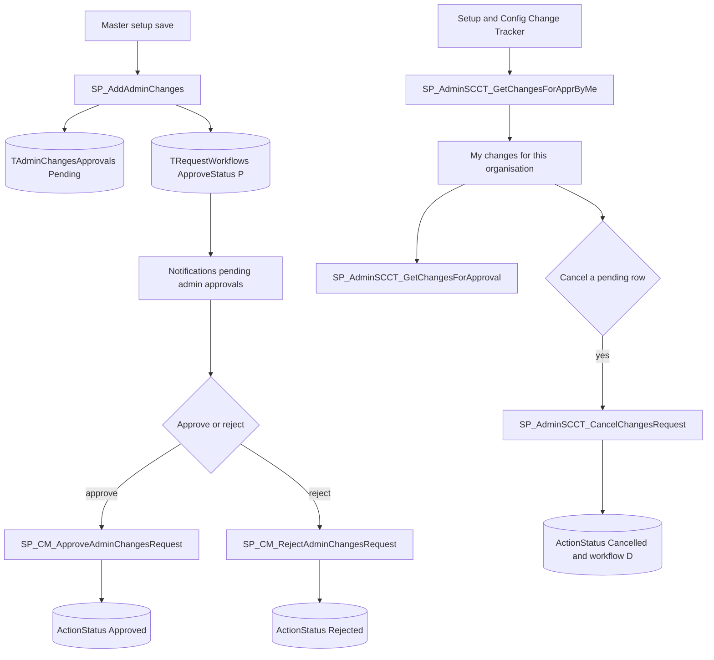
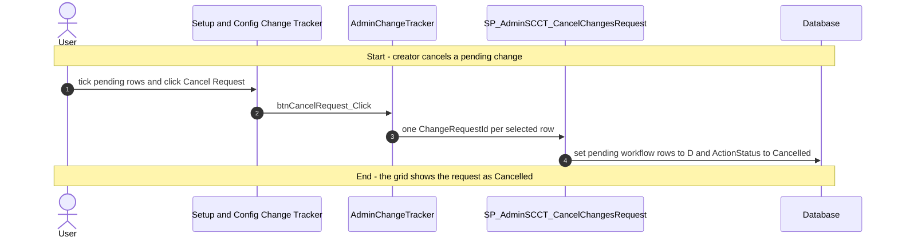
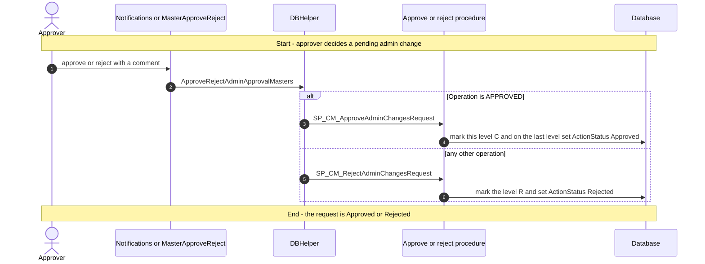
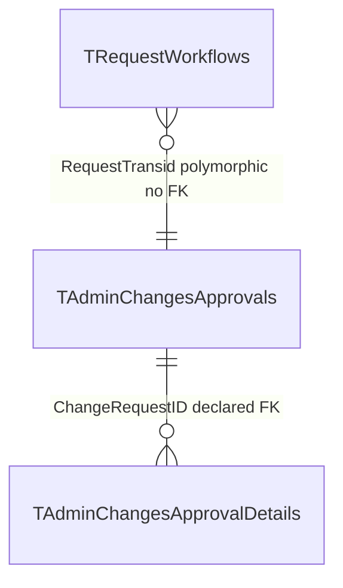

# Setup & Config Change Tracker

## Overview

An administrator changes setup data — a shift, a leave type, a role, a holiday — on a master page that has an approval workflow. That save does not write the master row. [SP_AddAdminChanges](/docs/database/hrms/SP_AddAdminChanges) files a header in `TAdminChangesApprovals` with `ActionStatus = Pending`, one field row per change in `TAdminChangesApprovalDetails`, and pending routing rows in `TRequestWorkflows`.

**Setup & Config Change Tracker** is the creator's own list of those filings. The logged-in administrator opens `~/HRM/MasterSetup/AdminChangeTracker.aspx`, sees every change they created for the selected organisation (pending, approved, rejected, and cancelled), expands a row to compare old and new values, and can cancel rows that are still pending. Cancel is hidden when the menu tab is not editable.

This page does not approve or reject. The approver works from Home notifications (**Pending Admin Approvals**) or from the email popup `MasterApproveReject.aspx`. Approve calls `SP_CM_ApproveAdminChangesRequest`, which advances the workflow and, on the last level, applies the master change. Reject calls `SP_CM_RejectAdminChangesRequest` and sets `ActionStatus` to `Rejected`. If the approver is also the person who filed the change, and more than one administrator sits on the first workflow-group level, approve returns without applying the change.

The shared engine is described in `llm-wiki/domain/approval-workflow.md`. Request types that land in `TRequestWorkflows` are listed in `llm-wiki/reference/event-catalog.md`. SourceCode `docs/SystemModels/SystemModel-2/behavior/workflows/generic-approval.md` describes the generic workflow engine and does not name this page.

## Workflow

## Request journey

The person who filed the change cancels it from this page.

A different person approves or rejects the same filing from notifications or the email popup.

## Entry points

| Entry | Purpose |
|---|---|
| `~/HRM/MasterSetup/AdminChangeTracker.aspx` | Creator's Setup & Config Change Tracker. Lists their filings and cancels pending ones. |
| `~/Notifications.aspx` | Approver queue **Pending Admin Approvals**, plus a by-me list that reuses the tracker list procedure with pending-only. |
| `~/MasterApproveReject.aspx` | Email popup. Loads one filing and approves or rejects it. |

Changing the organisation on the tracker redirects back to the same URL (`AdminChangeTracker.aspx.cs:37-39`, `HRMSConstants.URLs.URL_ADMIN_CHANGE_TRACKER`).

## Code → database call chain

This page. Constants in `DBConstant.cs:559-562` are the names sent to SQL. They are not the older procedure names that share the constant identifiers.

| Entry | Method | Procedure |
|---|---|---|
| Page load and grid `NeedDataSource` | `getPendingAdminApprovals` `AdminChangeTracker.aspx.cs:148-150` → `ApprovalRejectionDAL.GetHomePagePendingAdminApprovalsByMe` `ApprovalRejectionDAL.cs:103-114` with `IsReturnAllRecords = Y` | `SP_AdminSCCT_GetChangesForApprByMe` |
| Detail row expand | `bindAdminApprovalDetails` `AdminChangeTracker.aspx.cs:169-177` → `ApprovalRejectionDAL.GetHomePagePendingAdminApprovalDetails` `ApprovalRejectionDAL.cs:81-90` | `SP_AdminSCCT_GetChangesForApproval` |
| Cancel Request | `btnCancelRequest_Click` `AdminChangeTracker.aspx.cs:41-54` → `ApprovalRejectionDAL.CancelAdminApprovalMasters` `ApprovalRejectionDAL.cs:92-101` | `SP_AdminSCCT_CancelChangesRequest` |

Approve and reject are not on this page.

| Entry | Method | Procedure |
|---|---|---|
| Notifications Approve | `btnAdminApprove_Click` `Notifications.aspx.cs:2499-2501` → `adminApproveRejectRequest("Approved")` `Notifications.aspx.cs:2509-2529` | `DBHelper.ApproveRejectAdminApprovalMasters` `DBHelper.cs:2980-2988` → `SP_CM_ApproveAdminChangesRequest` |
| Notifications Reject | `btnAdminReject_Click` `Notifications.aspx.cs:2504-2506` → `adminApproveRejectRequest("Rejected")` | `DBHelper.cs:2989` → `SP_CM_RejectAdminChangesRequest` |
| Notifications approver grid | `getHomePagePendingAdminApproval` `Notifications.aspx.cs:2618-2620` → `DBHelper.GetHomePagePendingAdminApprovals` `DBHelper.cs:2968-2977` | `SP_GetAdminChangesForApproval` |
| Notifications detail | `BindPendingAdminApprovalDetails` `Notifications.aspx.cs:2622` and `bindAdminApprovalDetails` `Notifications.aspx.cs:3257-3261` | same `SP_AdminSCCT_GetChangesForApproval` as this page |
| Notifications by-me list | `getHomePagePendingAdminApprovalsByMe` `Notifications.aspx.cs:3253-3255` | `SP_AdminSCCT_GetChangesForApprByMe` with `IsReturnAllRecords = N` |
| Email popup load | `getEmployeeDetails` `MasterApproveReject.aspx.cs:235-237` → `EmployeeHelper.GetAdminPendingActivityEmployeeDetails` `EmployeeHelper.cs:230-238` | `Sp_GetPendingActivitiesForAdminChanges` |
| Email popup submit | `btnMasterApproveSubmit_Click` `MasterApproveReject.aspx.cs:212-220` → page method `ApproveRejctRequest` `MasterApproveReject.aspx.cs:117-130` → `ProcessApprovalRequest` `MasterApproveReject.aspx.cs:151-166` | same `DBHelper.ApproveRejectAdminApprovalMasters` branch as Notifications |

`Operation` compared as `APPROVED` selects the approve procedure. Every other value, including `Rejected` and the popup's `REJECT`, selects the reject procedure (`DBHelper.cs:2986-2989`).

## API endpoints

This page has no Web API and no page method. Load, organisation change, grid paging, detail expand, export, and Cancel Request are WebForms postbacks on `AdminChangeTracker.aspx`.

The email popup exposes one page method on `MasterApproveReject.aspx` (`MasterApproveReject.aspx.cs:116-117`). The Submit button calls it from the server click as well (`MasterApproveReject.aspx.cs:220`).

| Verb | Route | Parameters | Purpose |
|---|---|---|---|
| POST | `MasterApproveReject.aspx/ApproveRejctRequest` | `requestType` string required, `employeeId` string required, `requestState` string required, `transId` string required, `comment` string required | Approve when `requestState` is `APPROVED`. Otherwise reject. |

Notifications approve and reject are postbacks (`btnAdminApprove_Click`, `btnAdminReject_Click`), not separate HTTP routes.

## Stored procedures & tables involved

Pages linked below are the ones this page calls, plus one nested level. Approve and reject procedures are listed because they finish the request. They were not given new pages in this pass.

| Object | File | Purpose | Wiki / page |
|---|---|---|---|
| `SP_AdminSCCT_GetChangesForApprByMe` | `HRMS-DATABASE/HRMS/STOREPROCEDURE/SP_AdminSCCT_GetChangesForApprByMe.sql` | Changes created by this employee for this organisation. `Y` returns every status. `N` returns `Pending` only. | [page](/docs/database/hrms/SP_AdminSCCT_GetChangesForApprByMe) |
| `SP_AdminSCCT_GetChangesForApproval` | `HRMS-DATABASE/HRMS/STOREPROCEDURE/SP_AdminSCCT_GetChangesForApproval.sql` | Field-level old and new values for one `ChangeRequestID`, formatted by `RequestType`. | [page](/docs/database/hrms/SP_AdminSCCT_GetChangesForApproval) |
| `SP_AdminSCCT_CancelChangesRequest` | `HRMS-DATABASE/HRMS/STOREPROCEDURE/SP_AdminSCCT_CancelChangesRequest.sql` | Cancels each id, sets pending workflow rows to `D`, and adjusts home-page counts. | [page](/docs/database/hrms/SP_AdminSCCT_CancelChangesRequest) |
| `SP_AddAdminChanges` | `HRMS-DATABASE/HRMS/STOREPROCEDURE/SP_AddAdminChanges.sql` | Files the pending header and details. Not called by this page. | [page](/docs/database/hrms/SP_AddAdminChanges), `llm-wiki/domain/approval-workflow.md` |
| `SP_CM_ApproveAdminChangesRequest` | `HRMS-DATABASE/HRMS/STOREPROCEDURE/SP_CM_ApproveAdminChangesRequest.sql` | Approver path. Applies the master change on the final level and sets `ActionStatus` to `Approved`. | `llm-wiki/domain/approval-workflow.md` |
| `SP_CM_RejectAdminChangesRequest` | `HRMS-DATABASE/HRMS/STOREPROCEDURE/SP_CM_RejectAdminChangesRequest.sql` | Approver path. Sets the routing row to `R` and `ActionStatus` to `Rejected`. | `llm-wiki/reference/event-catalog.md` |
| `SP_GetAdminChangesForApproval` | `HRMS-DATABASE/HRMS/STOREPROCEDURE/SP_GetAdminChangesForApproval.sql` | Approver inbox, filtered by `ManagerId`. Used by Notifications, not by this page. | — |
| `TAdminChangesApprovals` | `HRMS-DATABASE/HRMS/TABLES/TAdminChangesApprovals.sql` | Header. `ChangeRequestID`, page, action, status, request type, employer, creator, cancel columns. | `llm-wiki/reference/tables/hrms.md` |
| `TAdminChangesApprovalDetails` | `HRMS-DATABASE/HRMS/TABLES/TAdminChangesApprovalDetails.sql` | One row per field. Declared FK to the header. | `llm-wiki/reference/tables/hrms.md` |
| `TRequestWorkflows` | `HRMS-DATABASE/HRMS/TABLES/TRequestWorkflows.sql` | One routing row per level. `RequestTransid` holds `ChangeRequestID` for these request types. No FK. | `llm-wiki/domain/approval-workflow.md` |

## Table relationships

The admin-change slice of the diagram in `llm-wiki/domain/approval-workflow.md` is the relationship for this page. The only declared foreign key on these two tables is `TAdminChangesApprovalDetails.ChangeRequestID`. `TRequestWorkflows` declares no primary key and no foreign key (`TRequestWorkflows.sql`). `RequestTransid` points at `TAdminChangesApprovals.ChangeRequestID` only by `RequestType`. Lookup tables used while formatting a detail row are not drawn here.

## Known gaps

- This menu item is the creator's tracker. The approver queue is Notifications, and it still calls `SP_GetAdminChangesForApproval` rather than `SP_AdminSCCT_GetChangesForApprByMe`.
- `CheckSelecetdItem` in `AdminChangeTracker.aspx` shows a message when nothing is selected and does not set `args.set_cancel`. The server click still runs and shows "Selected Request(s) Canceled." even when the loop updates nothing (`AdminChangeTracker.aspx.cs:41-53`).
- Cancel has no transaction in `SP_AdminSCCT_CancelChangesRequest`. A failure mid-cursor can leave an earlier id cancelled.
- `CreateEventLeave` returns the policy procedure's columns `RuleName`, `NewHtml`, `OldHtml`. The grid binds `FieldName`, `NewValue`, `OldValue`. The `CreateLeaveType` branch inserts that result by position into columns that do match the grid.
- `RoleAccessRightManagement` also reads `TAdminChangesApprovalDetails` for `ChangeRequestID + 1` (`SP_AdminSCCT_GetChangesForApproval.sql:685-707`).
- `llm-wiki/reference/event-catalog.md` says admin changes are approved by `SP_ApproveAdminChangesRequest`. The live DAL calls `SP_CM_ApproveAdminChangesRequest` and `SP_CM_RejectAdminChangesRequest`. The older `SP_ApproveAdminChangesRequest.sql` and `SP_RejectAdminChangesRequest.sql` are still in `STOREPROCEDURE/`.
- `SP_CM_ApproveAdminChangesRequest` is about 4,400 lines and applies a different master write per `RequestType`, including dynamic SQL (`EXEC (@Lv_DMLScript)` near the holiday path). That body was not expanded into its own database page.
- When the approver is the creator and more than one employee is mapped to workflow role `U` at routing level 1, approve returns `TransId = 0` and does not apply the change (`SP_CM_ApproveAdminChangesRequest.sql:449-467`). Notifications shows "Admin cannot approve the changes done by him/her when there are more than one admin in the workflow group." (`Notifications.aspx.cs:2533-2536`).
- SystemModel-2 `behavior/workflows/generic-approval.md` names `SP_ApproveWorkFlowRequest` for module approve/reject. It does not name `AdminChangeTracker.aspx` or the `SP_AdminSCCT_*` procedures.
- `TAdminChangesApprovals` declares no foreign key to `TEmployee`, `TEmployerDetails`, or `TRequestWorkflows`.

## Reference

High confidence on the tracker page, its three procedures, and the approve/reject entry points through `DBHelper.ApproveRejectAdminApprovalMasters`. The per-request-type master writes inside `SP_CM_ApproveAdminChangesRequest` are summarized, not line-by-line.

### SourceCode

- `HRMS.Web/HRMS.Web/HRM/MasterSetup/AdminChangeTracker.aspx`
- `HRMS.Web/HRMS.Web/HRM/MasterSetup/AdminChangeTracker.aspx.cs`
- `HRMS.Web/HRMS.Web/Notifications.aspx.cs`
- `HRMS.Web/HRMS.Web/MasterApproveReject.aspx.cs`
- `HRMS.Shared/HRMS.DataAccessLayer/ApprovalRejectionDAL.cs`
- `HRMS.Shared/HRMS.DataAccessLayer/DBHelper.cs`
- `HRMS.Shared/HRMS.DataAccessLayer/DBConstant.cs`
- `HRMS.Shared/HRMS.DataAccessLayer/EmployeeHelper.cs`
- `docs/SystemModels/SystemModel-2/behavior/workflows/generic-approval.md`

### TDG HRMS DB

- `llm-wiki/domain/approval-workflow.md`
- `llm-wiki/reference/event-catalog.md`
- `llm-wiki/reference/tables/hrms.md`
- `llm-wiki/architecture/module-catalog.md`
- `HRMS-DATABASE/HRMS/STOREPROCEDURE/SP_AdminSCCT_GetChangesForApprByMe.sql`
- `HRMS-DATABASE/HRMS/STOREPROCEDURE/SP_AdminSCCT_GetChangesForApproval.sql`
- `HRMS-DATABASE/HRMS/STOREPROCEDURE/SP_AdminSCCT_CancelChangesRequest.sql`
- `HRMS-DATABASE/HRMS/STOREPROCEDURE/SP_CM_ApproveAdminChangesRequest.sql`
- `HRMS-DATABASE/HRMS/STOREPROCEDURE/SP_CM_RejectAdminChangesRequest.sql`
- `HRMS-DATABASE/HRMS/STOREPROCEDURE/SP_AddAdminChanges.sql`
- `HRMS-DATABASE/HRMS/TABLES/TAdminChangesApprovals.sql`
- `HRMS-DATABASE/HRMS/TABLES/TAdminChangesApprovalDetails.sql`
- `HRMS-DATABASE/HRMS/TABLES/TRequestWorkflows.sql`
