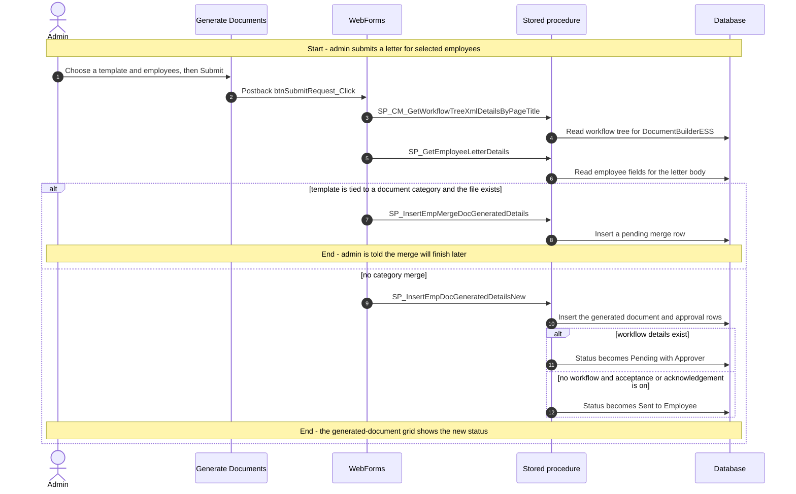
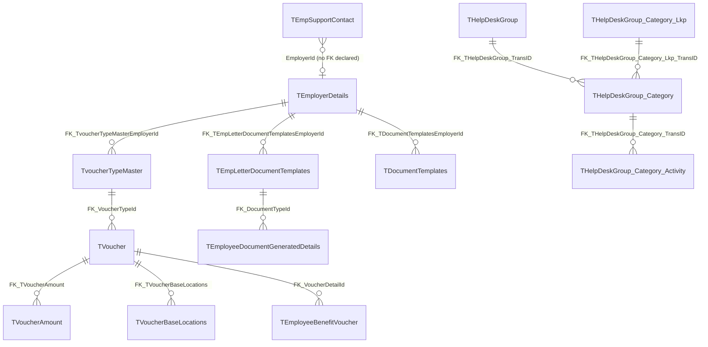

# Setup Employee Self Service

## Overview

An administrator opens **Admin Configuration → Setup Employee Self Service** to prepare what employees later see under Employee Self Service. This page is the setup screen at `~/HRM/MasterSetup/SetupEmployeeSelfService.aspx`. It is not the employee menu of the same name.

The administrator picks an organisation, then works in the tab their role can see. **Voucher Master** defines voucher types and the amounts an employee may request. **Create Voucher** opens a voucher for a month, a set of locations, and a date window, then initiates it, cancels it, or marks the amount credited. **Template Builder** stores an employee-letter template, its placeholders, and whether the employee must accept or acknowledge it. **Generate Documents** fills that template for selected employees, saves a PDF path, and either sends it for approval or straight to the employee. **Helpdesk** is a React screen on the same page for help-desk groups, categories, activities, and activity owners. **Support Contacts Master** keeps the department contacts employees can call.

The old WebForms help-desk category grid in this code-behind is commented out. The Helpdesk tab shows the React root and loads `CreateHelpDeskGroup`.

`docs/SystemModels/SystemModel-2/` has no workflow or surface page for this screen. Table descriptions live in `llm-wiki/reference/tables/hrms.md`. There is no domain `erDiagram` for this setup.

## Workflow

```mermaid
flowchart TD
  Open["SetupEmployeeSelfService.aspx"] --> Tabs["Show tabs the role can see"]
  Tabs --> VoucherMaster["Voucher Master"]
  Tabs --> CreateVoucher["Create Voucher"]
  Tabs --> Templates["Template Builder"]
  Tabs --> Generate["Generate Documents"]
  Tabs --> Helpdesk["Helpdesk React screen"]
  Tabs --> Contacts["Support Contacts Master"]

  VoucherMaster --> TypeList["SP_AdminESS_GetVoucherTypes"]
  VoucherMaster --> TypeSave{"Submit or Update"}
  TypeSave -->|Submit| TypeIns["SP_InsertVoucherTypeMaster"]
  TypeSave -->|Update| TypeUpd["SP_UpdateVoucherTypeMaster"]

  CreateVoucher --> VList["SP_AdminESS_GetVouchers"]
  CreateVoucher --> VSave{"Submit or Update"}
  VSave -->|Submit| VIns["SP_AdminESS_InsEmpBenefitVouchers"]
  VSave -->|Update| VUpd["SP_AdminESS_UpdEmpBenefitVouchers"]
  CreateVoucher --> VStatus["SP_AdminESS_UpdVoucherStatus"]

  Templates --> TList["SP_GetEmpLetterDocTemplate"]
  Templates --> TFields["SP_GetTemplateFields"]
  Templates --> TSave{"Save or Update"}
  TSave -->|Save| TIns["SP_InsertEmpLetterDocumentTemplates"]
  TSave -->|Update| TUpd["SP_UpdateEmpLetterDocumentTemplates"]
  Templates --> TDel["SP_DeleteEmpLettersDocTemplateByDocId"]

  Generate --> GList["SP_GenerateDocument_List"]
  Generate --> GBody["SP_GetEmployeeLetterDetails"]
  Generate --> GWf["SP_CM_GetWorkflowTreeXmlDetailsByPageTitle"]
  GWf --> GBranch{"Template has a category"}
  GBranch -->|yes| GMerge["SP_InsertEmpMergeDocGeneratedDetails"]
  GBranch -->|no| GNew["SP_InsertEmpDocGeneratedDetailsNew"]
  Generate --> GAct{"Grid action"}
  GAct -->|Initiate| GTime["SP_InsertTimlineEmpDocGeneratedDetails"]
  GAct -->|Pullback or extend| GUpd["SP_UpdateEmpDocGeneratedDetails"]
  GAct -->|Delete| GDel["SP_EmpDocGeneratedDetails_Delete"]

  Helpdesk --> HApi["Core API helpdesk routes"]
  HApi --> HGroup["SP_HelpDeskGroup"]
  HApi --> HCat["SP_HelpDeskGroup_Category"]
  HApi --> HAct["SP_HelpDeskGroup_Category_Activity"]

  Contacts --> CList["Sp_GetSupportContactDetails"]
  Contacts --> CSave["SP_ESS_InsUpdate_SupportContact"]
```

Voucher status on the grid is derived in `SP_AdminESS_GetVouchers`. An initiation-pending row whose active-to date has passed is shown as Auto-Cancelled. An initiated row past that date is shown as Voucher In Process. Those labels are not extra stored statuses.

## Request journey

## Entry points

| Entry | Purpose |
|---|---|
| `~/HRM/MasterSetup/SetupEmployeeSelfService.aspx` | Admin setup. Tabs are Voucher Master, Create Voucher, Template Builder, Generate Documents, Helpdesk, and Support Contacts Master. |
| `SetupEmployeeVoucher.ascx` | Create Voucher tab. The page calls `BindPageData` when that tab loads. |
| `CreateHelpDeskGroup` in `dashboard_react` | Helpdesk tab. `RouteConstants.HELPDESK_SETUP` is this aspx URL, and the tab shows `#root`. |
| `SetupEmployeeSelfService.aspx/GetAllActiveInactiveEmployeeCrossBUResults` | Telerik search on Support Contacts Master. Page method on `SeachBoxCommonMethods`. |

`Page_Load` logs the visit, loads the React bundle name, and binds the tab registry for menu `SETUP_EMPLOYEE_SELF_SERVICE`. The first visible tab is Voucher Master when that tab is allowed, otherwise Create Voucher, otherwise the first visible tab. A remembered tab that the user can no longer see is not shown.

The commented help-desk category region in the code-behind is not a live entry.

## Code → database call chain

| Entry | Method | Stored procedure |
|---|---|---|
| Voucher type grid | `bindVoucherTypeMasterList` `SetupEmployeeSelfService.aspx.cs:739` → `VoucherBLL.GetEmpBenifitVoucherList` `VoucherBLL.cs:51` → `VoucherDAL.GetVoucherTypeList` `VoucherDAL.cs:103` | `SP_AdminESS_GetVoucherTypes` |
| Submit voucher type | `insertVoucherTypeMaster` `SetupEmployeeSelfService.aspx.cs:802` → `VoucherBLL.InsertVoucherTypeMaster` `VoucherBLL.cs:61` → `VoucherDAL.InsertVoucherTypeMaster` `VoucherDAL.cs:129` | `SP_InsertVoucherTypeMaster` |
| Update voucher type | `updateVoucherTypeMaster` `SetupEmployeeSelfService.aspx.cs:791` → `VoucherBLL.UpdateVoucherTypeMaster` `VoucherBLL.cs:56` → `VoucherDAL.UpdateVoucherTypeMaster` `VoucherDAL.cs:114` | `SP_UpdateVoucherTypeMaster` |
| Create Voucher list | `SetupEmployeeVoucher.ascx.cs:417` `VoucherDAL.GetEmpBenifitVoucherList` `VoucherDAL.cs:157` | `SP_AdminESS_GetVouchers` |
| Voucher type dropdown | `SetupEmployeeVoucher.ascx.cs:426` → `VoucherBLL.GetEmpBenifitVoucherList` | `SP_AdminESS_GetVoucherTypes` |
| Base locations | `SetupEmployeeVoucher.ascx.cs:460` → `WorkflowManagementDAL.GetAllLocationsByEmployeeId` `WorkflowManagementDAL.cs:153` | `SP_AdminWM_GetLocationByOrg_EmployeeId` |
| Submit voucher | `btnVoucherSubmit_Click` `SetupEmployeeVoucher.ascx.cs:129` → `VoucherDAL.InsertEmployeeBenefitVoucher` `VoucherDAL.cs:172` | `SP_AdminESS_InsEmpBenefitVouchers` |
| Update voucher | `SetupEmployeeVoucher.ascx.cs:134` → `VoucherDAL.UpdateEmployeeVounter` `VoucherDAL.cs:196` | `SP_AdminESS_UpdEmpBenefitVouchers` |
| Initiate, cancel, or close | `updateRequestStatus` `SetupEmployeeVoucher.ascx.cs:313` → `VoucherDAL.UpdateEmployeeVoucherStatus` `VoucherDAL.cs:222` | `SP_AdminESS_UpdVoucherStatus` |
| Subscribed employees | `getEmployeeVoucherList` `SetupEmployeeVoucher.ascx.cs:297` → `VoucherDAL.GetAppliedEmployeeVoucherList` `VoucherDAL.cs:239` | `SP_AdminESS_GetVoucherAppEmpList` |
| Template list | `getAllDocumentTemplatesList` `SetupEmployeeSelfService.aspx.cs:1386` → `EmployeeBll.GetEmployeeDocumentTypeMasterList` `EmployeeBLL.cs:155` → `EmployeeDal.GetDocTemplatesList` `EmployeeDAL.cs:469` | `SP_GetEmpLetterDocTemplate` |
| Template placeholders | `loadDefaultFieldsItems` `SetupEmployeeSelfService.aspx.cs:1571` → `EmployeeBll.GetDefaultTemplatePageFields` `EmployeeBLL.cs:247` → `DBHelper.GetDefaultTemplatePageFields` `DBHelper.cs:2445` | `SP_GetTemplateFields` with `EMPLOYEELETTERS` |
| Save template | `saveDocTemplate` `SetupEmployeeSelfService.aspx.cs:1448` → `EmployeeBll.SaveEmployeeLetterDocTemplateDetails` `EmployeeBLL.cs:208` → `EmployeeDAL.cs:573` | `SP_InsertEmpLetterDocumentTemplates` |
| Update template | `updateDocTemplate` `SetupEmployeeSelfService.aspx.cs:1435` → `EmployeeBLL.cs:235` → `EmployeeDAL.cs:579` | `SP_UpdateEmpLetterDocumentTemplates` |
| Delete template | `deleteDocTempalte` `SetupEmployeeSelfService.aspx.cs:1408` → `EmployeeBLL.cs:258` → `EmployeeDAL.cs:614` | `SP_DeleteEmpLettersDocTemplateByDocId` |
| Edit template | `getSelectedTemplateDetails` `SetupEmployeeSelfService.aspx.cs:1600` → `EmployeeBLL.cs:179` → `EmployeeDAL.cs:489` | `SP_GetEmpLetterDocTemplateByID` |
| Letter header images | `saveTemplateToDrive` `SetupEmployeeSelfService.aspx.cs:1467` → `SealSignatureImageDAL.GetHeaderFooterImages` `SealSignatureImageDAL.cs:98` | Inline `SELECT` on `TEmployerDetails`. No procedure. |
| Customer folder for the PDF | `getTemplatePath` `SetupEmployeeSelfService.aspx.cs:1765` → `EmployerDal.GetSelectedEmployerDetails` `EmployerDAL.cs:500` | `SP_AdminORG_GetEmployerDet` |
| Employee picker | `loadGenerateLettersEmpData` `SetupEmployeeSelfService.aspx.cs:581` → `EmployeeHelper.GetAllActiveInActiveEmployeeList` `EmployeeHelper.cs:132` | `SP_GetAllActiveInActiveEmployeeList` |
| Generated-document grid | `getEmployeeDocumentGeneratedList` `SetupEmployeeSelfService.aspx.cs:2295` → `EmployeeBLL.cs:280` → `EmployeeDAL.cs:535` | `SP_GenerateDocument_List` with `IsConfirmation` `N` |
| Workflow check | `btnSubmitRequest_Click` `SetupEmployeeSelfService.aspx.cs:1867` → `GenericWorkFlowDal.GetWorkFlowTreeXml` `GenericWorkFlowDAL.cs:33` | `SP_CM_GetWorkflowTreeXmlDetailsByPageTitle` for `DocumentBuilderESS` |
| Letter body values | `SetupEmployeeSelfService.aspx.cs:2499` → `EmployeeBLL.cs:290` → `EmployeeDAL.cs:632` | `SP_GetEmployeeLetterDetails` |
| Category file for a merge | `SetupEmployeeSelfService.aspx.cs:1887` → `SetupMasterDBHelper.GetEmpBulkUploadDetailByCategoryId` `SetupMasterDBHelper.cs:113` | `SP_Get_EmpBulkUploadDetail` |
| My Details fallback for that file | `SetupMasterDBHelper.cs:142` → `MyDetailsDal.GetEmployeeAttachmentDetails` `MyDetailsDAL.cs:863` | `SP_EMPMD_GetEmpAttachment` |
| Queue a merged letter | `SetupEmployeeSelfService.aspx.cs:1894` → `EmployeeBLL.cs:226` → `EmployeeDAL.cs:1896` | `SP_InsertEmpMergeDocGeneratedDetails` |
| Save a generated letter | `SetupEmployeeSelfService.aspx.cs:1908` → `EmployeeBLL.cs:221` → `EmployeeDAL.cs:1864` | `SP_InsertEmpDocGeneratedDetailsNew` |
| Initiate timeline | `btnInitiate_Click` `SetupEmployeeSelfService.aspx.cs:2036` → `EmployeeDAL.cs:1761` | `SP_InsertTimlineEmpDocGeneratedDetails` |
| Pullback or extend | `btnPullup_Click` `SetupEmployeeSelfService.aspx.cs:2055` and `btnTimeline_Click` `SetupEmployeeSelfService.aspx.cs:2132` → `EmployeeDAL.cs:1779` | `SP_UpdateEmpDocGeneratedDetails` |
| History | `btnViewDocHistory_Click` `SetupEmployeeSelfService.aspx.cs:2087` → `EmployeeDAL.cs:2217` | `SP_GenerateDocument_HistoryGet` |
| Delete generated row | `btnDelete_Click` `SetupEmployeeSelfService.aspx.cs:2807` → `EmployeeDAL.cs:1742` | `SP_EmpDocGeneratedDetails_Delete` |
| Sender address for the share email | `SetupEmployeeSelfService.aspx.cs:2614` → `CommonDAL.GetEmployerEmail` `CommonDAL.cs:76` | `SP_CM_GetEmployerEmail` |
| Mark published after share | `SetupEmployeeSelfService.aspx.cs:2766` → `EmployeeDAL.UpdateStatusofDocument` `EmployeeDAL.cs:1990` | Inline `UPDATE` on `TEmployeeDocumentGeneratedDetails`. No procedure. |
| Module dropdown | `bindHRMSModules` `SetupEmployeeSelfService.aspx.cs:3706` → `WorkflowManagementDAL.GetHRMSModules` `WorkflowManagementDAL.cs:359` | `SP_AdminWM_GetHRMSModules` |
| Document category dropdown | `bindDocumentCategory` `SetupEmployeeSelfService.aspx.cs:3715` → `CommonDAL.GetAttachmentCategorys` `CommonDAL.cs:405` | `SP_GetAttachmentCategory` |
| Support-contact grid | `bindDepartmentContactsList` `SetupEmployeeSelfService.aspx.cs:3377` → `EmployeeBLL.cs:487` → `EmployeeDAL.cs:1650` | `Sp_GetSupportContactDetails` |
| Insert or update contact | `btnSubmitQuickLinks_Click` `SetupEmployeeSelfService.aspx.cs:3107` and `3082` → `EmployeeDAL.cs:1662` and `1682` | `SP_ESS_InsUpdate_SupportContact` |
| Delete contact | `removeSelectedSupportContact` `SetupEmployeeSelfService.aspx.cs:3356` → `EmployeeDAL.cs:1703` | `SP_ESS_InsUpdate_SupportContact` |
| Fill email and phone from a search hit | `RadSearchEmployeeAndPrePopulate` `SetupEmployeeSelfService.aspx.cs:3408` → `EmployeeDAL.cs:1728` | `Sp_GetSupportcontactdetailsbyid` |
| Support-contact employee search | `GetAllActiveInactiveEmployeeCrossBUResults` `SearchBoxCommonMethods.cs:234` → `EmployeeHelper.cs:141` | `SP_ESS_CrossBUEmployeeAssignment` |
| Helpdesk category lookup | `CreateHelpDeskGroup.js:224` → `helpdeskDAL.GetHelpDeskCategoryNew` `helpdeskDAL.js:227` | `SP_HelpDeskGroup_Category_Lkp` with flag `G` |
| Helpdesk groups | `CreateHelpDeskGroup.js:235` → `helpdeskDAL.GetHelpDeskGroup` `helpdeskDAL.js:272` | `SP_HelpDeskGroup` |
| Helpdesk group categories | `CreateHelpDeskGroup.js:251` and `282` → `helpdeskDAL.GetHelpDeskGroupCategory` `helpdeskDAL.js:416` | `SP_HelpDeskGroup_Category` |
| Save group category | `CreateHelpDeskGroup.js:315` → `helpdeskBLL.InsertUpdateHelpDeskGroupCategory` → `helpdeskDAL.js:438` | `SP_HelpDeskGroup_Category` with flag `S` |
| Activities | `CreateHelpDeskGroup.js:479` → `helpdeskDAL.GetHelpDeskGroupCategoryActivity` `helpdeskDAL.js:339` | `SP_HelpDeskGroup_Category_Activity` |
| Save activity or activity owners | `CreateHelpDeskGroup.js:612` and `helpdeskController.js:387` | `SP_HelpDeskGroup_Category_Activity` with flag `S` |
| Activity-owner list at group or category | `helpdeskController.js:355` and `358` | `SP_HelpDeskGroup` or `SP_HelpDeskGroup_Category` |
| Helpdesk employee search | `CreateHelpDeskGroup.js:516` → `helpdeskDAL.SearchEmployee` `helpdeskDAL.js:455` | `SP_ESS_CrossBUEmployeeAssignment` |
| Employer web config on the Helpdesk tab | `CreateHelpDeskGroup.js:826` → `dashBoardDAL.GetEmployerWebConfig` `dashBoardDAL.js:1081` | `SP_GetCustomerSettings` |

Up and down arrows on the support-contact grid reorder the in-memory table only. They do not call a procedure.

## API endpoints

The voucher, template, generate, and support-contact tabs are WebForms postbacks. They do not call a Web API controller.

The Helpdesk tab calls the Core API. `app.js` mounts `routeIndex` at `/api`. The live help-desk router is `HelpdeskRoutes.js`, not the V2 or V3 copies. The live dashboard router for this call is `DashBoardRoutes.js`.

| Verb | Route | Parameters | Purpose | Source |
|---|---|---|---|---|
| GET | `/api/helpdesk/GetHelpDeskCategoryNew` | `employerId`, `flagGetSet` (`G`), `loggedInUser` | Category names for the Helpdesk tab | `apiURLConstants.js:389`, `HelpdeskRoutes.js:24`, `helpdeskController.js:180` |
| GET | `/api/helpdesk/GetHelpDeskGroup` | `flagGetSet` (`G`), `employerId`, `Filter` | Help-desk groups | `apiURLConstants.js:390`, `HelpdeskRoutes.js:29` |
| GET | `/api/helpdesk/GetHelpDeskGroupCategory` | `flagGetSet` (`G`), `employerId`, `Filter` | Group and category rows | `apiURLConstants.js:392`, `HelpdeskRoutes.js:35` |
| GET | `/api/helpdesk/GetHelpDeskGroupCategoryForDropdown` | `flagGetSet`, `employerId`, `groupId`, `Filter` | Categories for one group. Same DAL method as the list | `apiURLConstants.js:391`, `HelpdeskRoutes.js:42`, `helpdeskController.js:331` |
| POST | `/api/helpdesk/InsertUpdateHelpDeskGroupCategory` | Body from the group-category form, including `flagGetSet`, employer, group, category, owners, active flag | Insert or update a group-category row | `apiURLConstants.js:393`, `HelpdeskRoutes.js:38`, `helpdeskController.js:320` |
| GET | `/api/helpdesk/GetHelpDeskGroupCategoryActivity` | `flagGetSet`, `employerId`, `groupCategoryId`, `Filter`, `DropDownFlag` | Activities | `apiURLConstants.js:394`, `HelpdeskRoutes.js:45` |
| POST | `/api/helpdesk/InsertUpdateHelpDeskGroupCategoryActivity` | Activity, group category, owners, TAT, notification targets, active flag | Insert or update an activity | `apiURLConstants.js:395`, `HelpdeskRoutes.js:48` |
| GET | `/api/helpdesk/GetActivityOwnerListing` | `flagGetSet`, `employerId`, `adminConfigEntityLevel`, `Filter` | Owner grid. The level chooses group, category, or activity | `apiURLConstants.js:396`, `HelpdeskRoutes.js:54`, `helpdeskController.js:347` |
| POST | `/api/helpdesk/AssignActivityOwners` | `adminConfigEntityLevel` plus the owner payload | Saves owners on the group, category, or activity procedure | `apiURLConstants.js:397`, `HelpdeskRoutes.js:53`, `helpdeskController.js:373` |
| GET | `/api/helpdesk/SearchEmployee` | `employeeId`, `employerId` | Employees the admin can assign | `apiURLConstants.js:398`, `HelpdeskRoutes.js:56` |
| GET | `/api/dashBoard/GetEmployerWebConfig` | `CustomerId` | Customer settings used by the Helpdesk tab | `apiURLConstants.js:87`, `DashBoardRoutes.js:69` |
| POST | `SetupEmployeeSelfService.aspx/GetAllActiveInactiveEmployeeCrossBUResults` | Telerik `SearchBoxContext` | Support-contact name search | `SetupEmployeeSelfService.aspx:788`, `SearchBoxCommonMethods.cs:234` |

## Stored procedures & tables involved

Pages below are the procedures this screen executes, plus the procedures and functions those scripts call directly. Encryption helpers, `Fn_GetEmployeeName`, `Split`, workflow email helpers, and the organisation and module lookups already have database pages.

| Object | Script | Role on this screen |
|---|---|---|
| [SP_AdminESS_GetVoucherTypes](/docs/database/hrms/SP_AdminESS_GetVoucherTypes) | `HRMS-DATABASE/HRMS/STOREPROCEDURE/SP_AdminESS_GetVoucherTypes.sql` | Voucher types for the master grid and the Create Voucher dropdown. Reads `TvoucherTypeMaster`. |
| [SP_InsertVoucherTypeMaster](/docs/database/hrms/SP_InsertVoucherTypeMaster) | `STOREPROCEDURE/SP_InsertVoucherTypeMaster.sql` | Inserts a type when the name is new for the employer. |
| [SP_UpdateVoucherTypeMaster](/docs/database/hrms/SP_UpdateVoucherTypeMaster) | `STOREPROCEDURE/SP_UpdateVoucherTypeMaster.sql` | Updates a type unless the new name is already used. |
| [SP_AdminESS_GetVouchers](/docs/database/hrms/SP_AdminESS_GetVouchers) | `STOREPROCEDURE/SP_AdminESS_GetVouchers.sql` | Active vouchers and the status label the grid shows. |
| [SP_AdminESS_InsEmpBenefitVouchers](/docs/database/hrms/SP_AdminESS_InsEmpBenefitVouchers) | `STOREPROCEDURE/SP_AdminESS_InsEmpBenefitVouchers.sql` | Inserts `TVoucher`, amount rows, and location rows. |
| [SP_AdminESS_UpdEmpBenefitVouchers](/docs/database/hrms/SP_AdminESS_UpdEmpBenefitVouchers) | `STOREPROCEDURE/SP_AdminESS_UpdEmpBenefitVouchers.sql` | Replaces amounts and locations. An extended validity queues `TEmailNotification`. |
| [SP_AdminESS_UpdVoucherStatus](/docs/database/hrms/SP_AdminESS_UpdVoucherStatus) | `STOREPROCEDURE/SP_AdminESS_UpdVoucherStatus.sql` | Initiate, close, or cancel. Writes email and, for initiate and close, a WhatsApp row when messaging is on. |
| [SP_AdminESS_GetVoucherAppEmpList](/docs/database/hrms/SP_AdminESS_GetVoucherAppEmpList) | `STOREPROCEDURE/SP_AdminESS_GetVoucherAppEmpList.sql` | Employees who applied, excluding employee-cancelled requests. |
| [SP_AdminWM_GetLocationByOrg_EmployeeId](/docs/database/hrms/SP_AdminWM_GetLocationByOrg_EmployeeId) | `STOREPROCEDURE/SP_AdminWM_GetLocationByOrg_EmployeeId.sql` | Locations the user may pick, limited by page and role location lists. |
| [SP_GetEmpLetterDocTemplate](/docs/database/hrms/SP_GetEmpLetterDocTemplate) | `STOREPROCEDURE/SP_GetEmpLetterDocTemplate.sql` | Template grid. Reads `TDocumentTemplates`. |
| [SP_GetEmpLetterDocTemplateByID](/docs/database/hrms/SP_GetEmpLetterDocTemplateByID) | `STOREPROCEDURE/SP_GetEmpLetterDocTemplateByID.sql` | One template for edit. Reads `TDocumentTemplates`. |
| [SP_InsertEmpLetterDocumentTemplates](/docs/database/hrms/SP_InsertEmpLetterDocumentTemplates) | `STOREPROCEDURE/SP_InsertEmpLetterDocumentTemplates.sql` | Inserts `TEmpLetterDocumentTemplates`. |
| [SP_UpdateEmpLetterDocumentTemplates](/docs/database/hrms/SP_UpdateEmpLetterDocumentTemplates) | `STOREPROCEDURE/SP_UpdateEmpLetterDocumentTemplates.sql` | Updates `TEmpLetterDocumentTemplates`. |
| [SP_DeleteEmpLettersDocTemplateByDocId](/docs/database/hrms/SP_DeleteEmpLettersDocTemplateByDocId) | `STOREPROCEDURE/SP_DeleteEmpLettersDocTemplateByDocId.sql` | Sets `Isdeleted` on `TEmpLetterDocumentTemplates`. |
| [SP_GetTemplateFields](/docs/database/hrms/SP_GetTemplateFields) | `STOREPROCEDURE/SP_GetTemplateFields.sql` | Placeholder list. This page passes `EMPLOYEELETTERS`. |
| [SP_GenerateDocument_List](/docs/database/hrms/SP_GenerateDocument_List) | `STOREPROCEDURE/SP_GenerateDocument_List.sql` | Generated-document grid. Joins `TEmployeeDocumentGeneratedDetails` to `TDocumentTemplates`. |
| [SP_GetEmployeeLetterDetails](/docs/database/hrms/SP_GetEmployeeLetterDetails) | `STOREPROCEDURE/SP_GetEmployeeLetterDetails.sql` | Placeholder values for one employee. |
| [SP_InsertEmpDocGeneratedDetailsNew](/docs/database/hrms/SP_InsertEmpDocGeneratedDetailsNew) | `STOREPROCEDURE/SP_InsertEmpDocGeneratedDetailsNew.sql` | Inserts the generated row, workflow rows, a home-page count, and the first status. |
| [SP_InsertEmpMergeDocGeneratedDetails](/docs/database/hrms/SP_InsertEmpMergeDocGeneratedDetails) | `STOREPROCEDURE/SP_InsertEmpMergeDocGeneratedDetails.sql` | Queues a category merge in `TEmployeeMergedDocumentGeneratedDetails`. |
| [SP_InsertTimlineEmpDocGeneratedDetails](/docs/database/hrms/SP_InsertTimlineEmpDocGeneratedDetails) | `STOREPROCEDURE/SP_InsertTimlineEmpDocGeneratedDetails.sql` | Sets expiry and status `Sent to Employee` when acceptance or acknowledgement has a timeline. |
| [SP_UpdateEmpDocGeneratedDetails](/docs/database/hrms/SP_UpdateEmpDocGeneratedDetails) | `STOREPROCEDURE/SP_UpdateEmpDocGeneratedDetails.sql` | Pullback, timeline extension, and other status changes. |
| [SP_GenerateDocument_HistoryGet](/docs/database/hrms/SP_GenerateDocument_HistoryGet) | `STOREPROCEDURE/SP_GenerateDocument_HistoryGet.sql` | Status history plus workflow approval levels. |
| [SP_EmpDocGeneratedDetails_Delete](/docs/database/hrms/SP_EmpDocGeneratedDetails_Delete) | `STOREPROCEDURE/SP_EmpDocGeneratedDetails_Delete.sql` | Soft-deletes the generated row and deletes its `DocumentBuilderESS` workflow rows. |
| [SP_Get_EmpBulkUploadDetail](/docs/database/hrms/SP_Get_EmpBulkUploadDetail) | `STOREPROCEDURE/SP_Get_EmpBulkUploadDetail.sql` | Successful bulk-upload file for a category. |
| [SP_EMPMD_GetEmpAttachment](/docs/database/hrms/SP_EMPMD_GetEmpAttachment) | `STOREPROCEDURE/SP_EMPMD_GetEmpAttachment.sql` | Attachment fallback when the bulk-upload query is empty. |
| [SP_CM_GetEmployerEmail](/docs/database/hrms/SP_CM_GetEmployerEmail) | `STOREPROCEDURE/SP_CM_GetEmployerEmail.sql` | Notification sender address. |
| [Sp_GetSupportContactDetails](/docs/database/hrms/Sp_GetSupportContactDetails) | `STOREPROCEDURE/Sp_GetSupportContactDetails.sql` | Active support contacts. External contacts are `EmployeeId` 0. |
| [SP_ESS_InsUpdate_SupportContact](/docs/database/hrms/SP_ESS_InsUpdate_SupportContact) | `STOREPROCEDURE/SP_ESS_InsUpdate_SupportContact.sql` | Insert or update `TEmpSupportContact`. |
| [Sp_GetSupportcontactdetailsbyid](/docs/database/hrms/Sp_GetSupportcontactdetailsbyid) | `STOREPROCEDURE/Sp_GetSupportcontactdetailsbyid.sql` | Email and mobile for an employment number. |
| [SP_GetAttachmentCategory](/docs/database/hrms/SP_GetAttachmentCategory) | `STOREPROCEDURE/SP_GetAttachmentCategory.sql` | Category dropdown. This page passes employer only. |
| [SP_GetAllActiveInActiveEmployeeList](/docs/database/hrms/SP_GetAllActiveInActiveEmployeeList) | `STOREPROCEDURE/SP_GetAllActiveInActiveEmployeeList.sql` | Employees for Generate Documents. The page then keeps `IsActive = Y`. |
| [SP_ESS_CrossBUEmployeeAssignment](/docs/database/hrms/SP_ESS_CrossBUEmployeeAssignment) | `STOREPROCEDURE/SP_ESS_CrossBUEmployeeAssignment.sql` | Employees in the user's location and business-unit scope. |
| [SP_HelpDeskGroup_Category_Lkp](/docs/database/hrms/SP_HelpDeskGroup_Category_Lkp) | `STOREPROCEDURE/SP_HelpDeskGroup_Category_Lkp.sql` | Flag `G` reads `TMHelpDeskCategoryType`. |
| [SP_HelpDeskGroup](/docs/database/hrms/SP_HelpDeskGroup) | `STOREPROCEDURE/SP_HelpDeskGroup.sql` | Get or save `THelpDeskGroup`. |
| [SP_HelpDeskGroup_Category](/docs/database/hrms/SP_HelpDeskGroup_Category) | `STOREPROCEDURE/SP_HelpDeskGroup_Category.sql` | Get or save `THelpDeskGroup_Category`. |
| [SP_HelpDeskGroup_Category_Activity](/docs/database/hrms/SP_HelpDeskGroup_Category_Activity) | `STOREPROCEDURE/SP_HelpDeskGroup_Category_Activity.sql` | Get or save `THelpDeskGroup_Category_Activity`. |
| [SP_CM_GetWorkflowTreeXmlDetailsByPageTitle](/docs/database/hrms/SP_CM_GetWorkflowTreeXmlDetailsByPageTitle) | existing page | Whether `DocumentBuilderESS` has a workflow tree. |
| [SP_AdminORG_GetEmployerDet](/docs/database/hrms/SP_AdminORG_GetEmployerDet) | existing page | Employer row used for the letter folder. |
| [SP_AdminWM_GetHRMSModules](/docs/database/hrms/SP_AdminWM_GetHRMSModules) | existing page | Module dropdown. |
| [SP_GetCustomerSettings](/docs/database/hrms/SP_GetCustomerSettings) | existing page | Helpdesk tab customer settings. |

`llm-wiki/reference/tables/hrms.md` describes `TvoucherTypeMaster`, `TVoucher`, `TVoucherAmount`, `TVoucherBaseLocations`, `TEmployeeBenefitVoucher`, `TEmpLetterDocumentTemplates`, `TEmployeeDocumentGeneratedDetails`, `TEmpSupportContact`, and the `THelpDeskGroup*` tables. Those rows are catalog blurbs. They are not a substitute for the declared keys below.

## Table relationships

Declared foreign keys from the table scripts. Edges that are only a shared column are labelled that way.

`TEmployeeDocumentGeneratedDetails.DocumentTypeId` is declared against `TEmpLetterDocumentTemplates`. The generate list and several status procedures join that column to `TDocumentTemplates` instead. That join is not a declared foreign key.

`THelpDeskGroup_Category.CategoryTypeId` is declared against `THelpDeskGroup_Category_Lkp`. The get branch joins `TMHelpDeskCategoryType`. That join is not the declared key.

## Known gaps

- Template Builder lists and loads `TDocumentTemplates` (`SP_GetEmpLetterDocTemplate`, `SP_GetEmpLetterDocTemplateByID`). Save, update, and delete write `TEmpLetterDocumentTemplates`. The generated-document foreign key also points at `TEmpLetterDocumentTemplates`. The two template tables are separate `CREATE TABLE` scripts.
- `SP_HelpDeskGroup_Category_Lkp` flag `G` reads `TMHelpDeskCategoryType`. Flag `S` writes `THelpDeskGroup_Category_Lkp`. This screen's React code calls flag `G`.
- Delete support contact passes `@EmpSupportContactID` (`EmployeeDAL.cs:1706`). `SP_ESS_InsUpdate_SupportContact` declares `@TEmpSupportContactID`. Insert and update pass the declared name.
- `USP_SaveHistory` is executed by the document and help-desk save procedures. No `CREATE PROCEDURE` script for that name is in `HRMS/STOREPROCEDURE` or `HRMS/FUNCTIONS`. `USP_SaveHistory_MultiID` and `USP_SaveHistory_MultiFilter` are different objects.
- `UpdateStatusofDocument` and `GetHeaderFooterImages` are inline SQL, not procedures.
- The WebForms help-desk category methods in `SetupEmployeeSelfService.aspx.cs` are commented out. The live Helpdesk tab is the React screen.
- `SP_GetTemplateFields` also serves email, report, and offer-document field lists. This page only calls the `EMPLOYEELETTERS` branch.
- SystemModel-2 does not name this page, so the live path is the aspx, the voucher user control, and `CreateHelpDeskGroup`.

## Reference

Confidence is medium. The postback and API call chain was read from the page, the voucher user control, the React Helpdesk screen, and the DAL methods they call. The letter-field procedure is large, and the template list and template save do not use the same table.

### SourceCode

- `HRMS.Web/HRMS.Web/HRM/MasterSetup/SetupEmployeeSelfService.aspx` and `.aspx.cs`
- `HRMS.Web/HRMS.Web/HRM/MasterSetup/SetupEmployeeVoucher.ascx.cs`
- `HRMS.Web/HRMS.Web/HRM/CustomControls/SearchBoxCommonMethods.cs`
- `HRMS.Web/HRMS.Web/HRM/DashBoard_React/Areas/routes.js` and `Areas/EmployeeSelfService/Components/CreateHelpDeskGroup.js`
- `HRMS.Shared/HRMS.DataAccessLayer/EmployeeSelfService/VoucherDAL.cs`
- `HRMS.Shared/HRMS.DataAccessLayer/Employee/EmployeeDAL.cs`
- `HRMS.Shared/HRMS.BusinessLayer/Employee/EmployeeBLL.cs`
- `HRMS.CoreAPI/HRMS.Core.WebAPI.Node/Routes/HelpdeskRoutes.js`
- `HRMS.CoreAPI/HRMS.Core.WebAPI.Node/Core/DataAccessLayer/helpdeskDAL.js`
- `docs/SystemModels/SystemModel-2/` has no page for this screen

### TDG HRMS DB

- `llm-wiki/reference/tables/hrms.md` for the table blurbs cited above
- `HRMS-DATABASE/HRMS/STOREPROCEDURE/` scripts named in the procedure table
- `HRMS-DATABASE/HRMS/TABLES/` for `TvoucherTypeMaster`, `TVoucher`, `TVoucherAmount`, `TVoucherBaseLocations`, `TEmployeeBenefitVoucher`, `TEmpLetterDocumentTemplates`, `TDocumentTemplates`, `TEmployeeDocumentGeneratedDetails`, `TEmpSupportContact`, `THelpDeskGroup`, `THelpDeskGroup_Category`, `THelpDeskGroup_Category_Lkp`, `THelpDeskGroup_Category_Activity`
