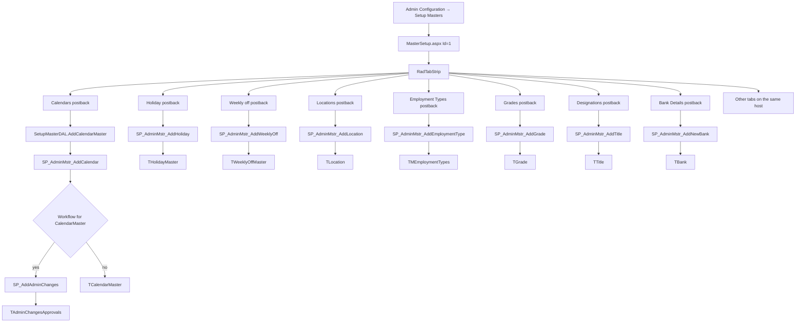
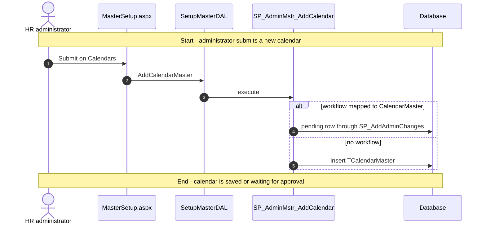
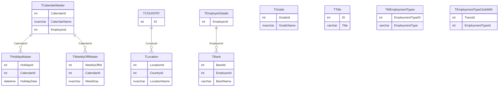

# Setup Masters

## Overview

An HR administrator keeps the organisation's reference lists in one place before anyone is hired or a holiday year is published. They open **Admin Configuration → Setup Masters** (`MasterSetup.aspx?Id=1`). The same WebForms host also serves Separation Management when `Id=2`. For Setup Masters the page title is "Setup Masters", and `bindMasterControls` loads the master grids. The markup opens on **Calendars**.

A calendar is a named holiday and weekly-off schedule for one organisation. The administrator enters a name, a description, whether it is active, whether a holiday may fall on a weekly off, which of those wins, and whether weekly off applies at all. Submitting it calls `SP_AdminMstr_AddCalendar`. That procedure looks up a workflow for module page `CalendarMaster`. When one is mapped, the calendar is not inserted yet. The procedure files a pending admin change through `SP_AddAdminChanges`. When none is mapped, it inserts `TCalendarMaster` and asks `USP_SaveHistory` to copy the row. The grid then reloads through `SP_AdminMstr_GetCalendar`.

The same host posts several other masters the same way. This guide follows the calendar save and load, then the insert and list path for holidays, weekly offs, locations, employment types, grades, designations, and banks. Each of those inserts also stops for approval when a workflow is mapped to that master's module page. Employees do not open this screen. Their employment record later points at the calendar, location, grade, designation, and employment type created here.

SystemModel-2 does not document this screen. Table descriptions live in `llm-wiki/reference/tables/hrms.md`. `llm-wiki/domain/overview.md` names `TGrade` and `TLocation` in the organisation taxonomy. There is no domain page with an ER diagram for these masters.

**Who's involved:**

- **HR administrator** — maintains the master lists for the selected organisation. A global-access user can switch organisation in the page header.
- **Workflow approver** — when the master's module page is mapped in Workflow Management, the change waits in admin-change approvals.
- **Employee** — does not open this screen. Later records use the calendar, location, grade, designation, employment type, and bank created here.

## Workflow

Holiday, weekly off, location, employment type, grade, designation, and bank inserts use the same approval fork. The flowchart shows the table they write when no workflow is mapped. A compulsory holiday also queues an attendance recalculation.

## Request journey

### HR administrator — add a calendar

The page checks the returned dataset. `ErrorCode` 1 shows the procedure message. Any other returned row shows "Calendar changes sent for approval." An empty result shows "Calendar details added successfully." The grid then reloads with `SP_AdminMstr_GetCalendar`.

## Entry points

`~/HRM/MasterSetup/MasterSetup.aspx?Id=1` is the Setup Masters host. `Page_Load` binds a tab registry for `MenuPage.SETUP_MASTER` and `MenuPage.SEPARATION_MGMT`. `Id=1` sets the title and calls `bindMasterControls`. `Id=2` is Separation Management on the same file and is outside this guide.

The tab strip in `MasterSetup.aspx` lists Calendars (selected in markup), Locations, Employment Types, Bank Details, Resignation Reasons, Termination Reasons, Separation type, Clearance Approver (Secondary), Clearance Categories, Clearance Activities, Setup Exit Interview, Setup Clearance Form, Exit Interview Template, Grades, Designations, Skill Categories, Add Skills, Add Domain, News Announcement and Events, Additional Info, Employee Search Purpose, Background Verification Category, Temporary Access Card Reason, Asset Category, Employee Role, Document Categories, Relationships, Helpdesk Category, Cost Center, Separation Configuration Setup, Notice Period, Deactivation Validation Setup, and Blacklist Reasons. Two tabs are `Visible="false"` in markup (Clearance Approver and Exit Interview Template). When customer setting `IsCelebrationHubEnabled` is true, News, Announcement & Events is hidden.

`radMenu_TabClick` calls `showAssetTab` with `block` for Termination Reasons, Asset Category, Setup Exit Interview, and Deactivation Validation Setup. Those tabs mount a React surface on this host. The masters in the call chain below stay on WebForms postback.

| UI page | Purpose |
|---|---|
| `HRM/MasterSetup/MasterSetup.aspx` | Host and WebForms master tabs |
| `HRM/MasterSetup/MasterSetup.aspx?Id=1` | Setup Masters title and master-grid bind |
| `HRM/MasterSetup/MasterSetup.aspx?Id=2` | Separation Management on the same host |

## Code → database call chain

`SetupMasterDAL` calls Enterprise Library through `DBHelper.m_returnDbObject`. The DAL constant names in `DBConstant.cs` are not the procedure names. `SP_AddCalendarMaster` executes `SP_AdminMstr_AddCalendar`. Older scripts such as `SP_AddCalendarMaster.sql` are not what this page runs.

| Entry | Method | Stored procedure |
|---|---|---|
| Calendars grid | `bindCaledarMaster` (`MasterSetup.aspx.cs:2035`) → `GetCalendarMasterDetails` (`SetupMasterDAL.cs:20`) | `SP_AdminMstr_GetCalendar` (`DBConstant.cs:842`) |
| Calendars Submit | `btnCalendarSubmit_Click` (`MasterSetup.aspx.cs:1622`) → `submitCalendar` (`MasterSetup.aspx.cs:1824`) → `AddCalendarMaster` (`SetupMasterDAL.cs:31`) | `SP_AdminMstr_AddCalendar` (`DBConstant.cs:844`) |
| Calendars Update | `submitCalendar` (`MasterSetup.aspx.cs:1852`) → `UpdateCalendarMaster` (`SetupMasterDAL.cs:49`) | `SP_AdminMstr_UpdCalendar` (`DBConstant.cs:845`) |
| Calendars Delete | `btnCalendarDelete_Click` (`MasterSetup.aspx.cs:1658`) → `DeleteCalendarMaster` (`SetupMasterDAL.cs:67`) | `SP_AdminMstr_DelCalendarById` (`DBConstant.cs:846`) |
| Holiday grid | `bindHolidayMaster` (`MasterSetup.aspx.cs:2672`) → `GetHolidayMasterDetails` (`SetupMasterDAL.cs:141`) | `SP_AdminMstr_GetHoliday` (`DBConstant.cs:848`) |
| Holiday Submit | `btnHolidaySubmit_Click` (`MasterSetup.aspx.cs:2123`) → `AddHolidayMaster` (`SetupMasterDAL.cs:177`), called at `MasterSetup.aspx.cs:2495` | `SP_AdminMstr_AddHoliday` (`DBConstant.cs:849`) |
| Weekly off grid | `bindWeeklyOffMaster` (`MasterSetup.aspx.cs:3534`) → `GetWeeklyOffMasterDetails` (`SetupMasterDAL.cs:317`) | `SP_AdminMstr_GetWeeklyOff` (`DBConstant.cs:863`) |
| Weekly off Submit | `btnWeeklyOffSubmit_Click` (`MasterSetup.aspx.cs:3146`) → `AddWeeklyOffMaster` (`SetupMasterDAL.cs:339`), called at `MasterSetup.aspx.cs:3373` | `SP_AdminMstr_AddWeeklyOff` (`DBConstant.cs:865`) |
| Locations grid | `loadLocationGirdCoulmns` (`MasterSetup.aspx.cs:4117`) → `GetAllLocations` (`SetupMasterDAL.cs:380`) | `SP_AdminMstr_GetAllLocations` (`DBConstant.cs:868`) |
| Locations Submit | `btnLocationSubmit_Click` (`MasterSetup.aspx.cs:3643`) → `AddLocation` (`SetupMasterDAL.cs:402`), called at `MasterSetup.aspx.cs:3909` | `SP_AdminMstr_AddLocation` (`DBConstant.cs:871`) |
| Employment Types grid | `bindEmploymentType` (`MasterSetup.aspx.cs:4560`) → `GetAllEmploymentTypeList` (`SetupMasterDAL.cs:450`) | `SP_AdminMstr_GetAllEmploymentTypeList` (`DBConstant.cs:874`) |
| Employment Types Submit | `btnEmploymentTypeSubmit_Click` (`MasterSetup.aspx.cs:4175`) → `AddEmploymentType` (`SetupMasterDAL.cs:463`), called at `MasterSetup.aspx.cs:4425` | `SP_AdminMstr_AddEmploymentType` (`DBConstant.cs:875`) |
| Grades grid | `loadGradeGirdCoulmns` (`MasterSetup.aspx.cs:5726`) → `getGradeDetails` (`MasterSetup.aspx.cs:5632`) → `GetGrades` (`SetupMasterDAL.cs:620`) | `SP_AdminMstr_GetGrades` (`DBConstant.cs:885`) |
| Grades Submit | `btnGradeSubmit_Click` (`MasterSetup.aspx.cs:5395`) → `AddGradeMaster` (`SetupMasterDAL.cs:575`), called at `MasterSetup.aspx.cs:5568` | `SP_AdminMstr_AddGrade` (`DBConstant.cs:882`) |
| Designations grid | `bindDesignationGrid` (`MasterSetup.aspx.cs:5999`) → `GetAllTitleList` (`SetupMasterDAL.cs:697`) | `SP_AdminMstr_GetAllTitle` (`DBConstant.cs:891`) |
| Designations Submit | `btnDesignationSubmit_Click` (`MasterSetup.aspx.cs:5740`) → `AddTitle` (`SetupMasterDAL.cs:646`), called at `MasterSetup.aspx.cs:5961` | `SP_AdminMstr_AddTitle` (`DBConstant.cs:888`) |
| Banks grid | `getBankList` (`MasterSetup.aspx.cs:4909`) → `GetBankNames` (`SetupMasterDAL.cs:880`) | `SP_AdminMstr_GetBankName` (`DBConstant.cs:913`) |
| Banks Submit | `btnSubmitBank_Click` (`MasterSetup.aspx.cs:4693`) → `AddBank` (`SetupMasterDAL.cs:902`), called at `MasterSetup.aspx.cs:4897` | `SP_AdminMstr_AddNewBank` (`DBConstant.cs:908`) |

Before an update that turns weekly off off, `btnCalendarSubmit_Click` also reads weekly offs (`MasterSetup.aspx.cs:1642`) and refuses the update when that calendar still has weekly-off rows.

## API endpoints

The masters in the call chain are WebForms postbacks. They do not call `HRMS.CoreAPI`.

`Id` is a query-string flag on the page URL, not an API route. Termination Reasons, Asset Category, Setup Exit Interview, and Deactivation Validation Setup set `showAssetTab` to `block` and are not traced here.

## Stored procedures & tables involved

| Object | File | Purpose |
|---|---|---|
| [`SP_AdminMstr_GetCalendar`](/docs/database/hrms/SP_AdminMstr_GetCalendar) | `HRMS-DATABASE/HRMS/STOREPROCEDURE/SP_AdminMstr_GetCalendar.sql` | List calendars for an employer |
| [`SP_AdminMstr_AddCalendar`](/docs/database/hrms/SP_AdminMstr_AddCalendar) | `HRMS-DATABASE/HRMS/STOREPROCEDURE/SP_AdminMstr_AddCalendar.sql` | Insert a calendar, or file it for approval |
| [`SP_AdminMstr_UpdCalendar`](/docs/database/hrms/SP_AdminMstr_UpdCalendar) | `HRMS-DATABASE/HRMS/STOREPROCEDURE/SP_AdminMstr_UpdCalendar.sql` | Update a calendar, same approval fork |
| [`SP_AdminMstr_DelCalendarById`](/docs/database/hrms/SP_AdminMstr_DelCalendarById) | `HRMS-DATABASE/HRMS/STOREPROCEDURE/SP_AdminMstr_DelCalendarById.sql` | Delete a calendar that nothing else uses |
| [`SP_AdminMstr_GetHoliday`](/docs/database/hrms/SP_AdminMstr_GetHoliday) | `HRMS-DATABASE/HRMS/STOREPROCEDURE/SP_AdminMstr_GetHoliday.sql` | List active holidays with calendar name |
| [`SP_AdminMstr_AddHoliday`](/docs/database/hrms/SP_AdminMstr_AddHoliday) | `HRMS-DATABASE/HRMS/STOREPROCEDURE/SP_AdminMstr_AddHoliday.sql` | Insert a holiday, or file it for approval |
| [`SP_AdminMstr_GetWeeklyOff`](/docs/database/hrms/SP_AdminMstr_GetWeeklyOff) | `HRMS-DATABASE/HRMS/STOREPROCEDURE/SP_AdminMstr_GetWeeklyOff.sql` | List weekly offs with calendar name |
| [`SP_AdminMstr_AddWeeklyOff`](/docs/database/hrms/SP_AdminMstr_AddWeeklyOff) | `HRMS-DATABASE/HRMS/STOREPROCEDURE/SP_AdminMstr_AddWeeklyOff.sql` | Insert weekly offs, or file them for approval |
| [`SP_AdminMstr_GetAllLocations`](/docs/database/hrms/SP_AdminMstr_GetAllLocations) | `HRMS-DATABASE/HRMS/STOREPROCEDURE/SP_AdminMstr_GetAllLocations.sql` | List locations with country name |
| [`SP_AdminMstr_AddLocation`](/docs/database/hrms/SP_AdminMstr_AddLocation) | `HRMS-DATABASE/HRMS/STOREPROCEDURE/SP_AdminMstr_AddLocation.sql` | Insert a location, or file it for approval |
| [`SP_AdminMstr_GetAllEmploymentTypeList`](/docs/database/hrms/SP_AdminMstr_GetAllEmploymentTypeList) | `HRMS-DATABASE/HRMS/STOREPROCEDURE/SP_AdminMstr_GetAllEmploymentTypeList.sql` | List employment types and club-with names |
| [`SP_AdminMstr_AddEmploymentType`](/docs/database/hrms/SP_AdminMstr_AddEmploymentType) | `HRMS-DATABASE/HRMS/STOREPROCEDURE/SP_AdminMstr_AddEmploymentType.sql` | Insert an employment type, or file it for approval |
| [`SP_AdminMstr_GetGrades`](/docs/database/hrms/SP_AdminMstr_GetGrades) | `HRMS-DATABASE/HRMS/STOREPROCEDURE/SP_AdminMstr_GetGrades.sql` | List grades for an employer |
| [`SP_AdminMstr_AddGrade`](/docs/database/hrms/SP_AdminMstr_AddGrade) | `HRMS-DATABASE/HRMS/STOREPROCEDURE/SP_AdminMstr_AddGrade.sql` | Insert a grade, or file it for approval |
| [`SP_AdminMstr_GetAllTitle`](/docs/database/hrms/SP_AdminMstr_GetAllTitle) | `HRMS-DATABASE/HRMS/STOREPROCEDURE/SP_AdminMstr_GetAllTitle.sql` | List designations with level and grade text |
| [`SP_AdminMstr_AddTitle`](/docs/database/hrms/SP_AdminMstr_AddTitle) | `HRMS-DATABASE/HRMS/STOREPROCEDURE/SP_AdminMstr_AddTitle.sql` | Insert a designation, or file it for approval |
| [`SP_AdminMstr_GetBankName`](/docs/database/hrms/SP_AdminMstr_GetBankName) | `HRMS-DATABASE/HRMS/STOREPROCEDURE/SP_AdminMstr_GetBankName.sql` | List banks for an employer |
| [`SP_AdminMstr_AddNewBank`](/docs/database/hrms/SP_AdminMstr_AddNewBank) | `HRMS-DATABASE/HRMS/STOREPROCEDURE/SP_AdminMstr_AddNewBank.sql` | Insert a bank, or file it for approval |
| [`SP_AddAdminChanges`](/docs/database/hrms/SP_AddAdminChanges) | `HRMS-DATABASE/HRMS/STOREPROCEDURE/SP_AddAdminChanges.sql` | Pending admin-change request when a workflow is mapped |
| [`SP_GetWorkflowTreeXmlDetailsByPageTitle`](/docs/database/hrms/SP_GetWorkflowTreeXmlDetailsByPageTitle) | `HRMS-DATABASE/HRMS/STOREPROCEDURE/SP_GetWorkflowTreeXmlDetailsByPageTitle.sql` | Workflow id for calendar, designation, and bank |
| [`usp_GetWorkflowPartialErrorMessage`](/docs/database/hrms/usp_GetWorkflowPartialErrorMessage) | `HRMS-DATABASE/HRMS/STOREPROCEDURE/usp_GetWorkflowPartialErrorMessage.sql` | Bank insert stops when the workflow is partial |
| [`USP_Cal_AttendanceDataRecalculate`](/docs/database/hrms/USP_Cal_AttendanceDataRecalculate) | `HRMS-DATABASE/HRMS/STOREPROCEDURE/USP_Cal_AttendanceDataRecalculate.sql` | Queue attendance rebuild after a compulsory holiday |
| [`Split`](/docs/database/hrms/Split) | `HRMS-DATABASE/HRMS/FUNCTIONS/Split.sql` | Split calendar, weekday, and club-with id lists |

Table notes in `llm-wiki/reference/tables/hrms.md` cover `TCalendarMaster`, `THolidayMaster`, `TWeeklyOffMaster`, `TLocation`, `TCOUNTRY`, `TMEmploymentTypes`, `TEmploymentTypeClubWith`, `TGrade`, `TTitle`, `TBank`, and `TEmployerDetails`.

## Table relationships

Declared foreign keys in the table scripts read for this page:

- `THolidayMaster.CalendarId` → `TCalendarMaster.CalendarId`
- `TWeeklyOffMaster.CalendarId` → `TCalendarMaster.CalendarId`
- `TLocation.CountryId` → `TCOUNTRY.ID`
- `TBank.EmployerId` → `TEmployerDetails.Employerid`

`TGrade`, `TTitle`, `TMEmploymentTypes`, and `TEmploymentTypeClubWith` declare no foreign key. `TWorkflowManagement` references `THrmsModules`, not these masters. `TAdminChangesApprovals` declares no foreign key to the master tables.

## Known gaps

- Resignation reasons, separation type, clearance, skills, news, custom fields, employee search purpose, background verification, temporary access cards, employee role, document categories, relationships, helpdesk, cost center, notice period, and blacklist are tabs on this host. Their postbacks are not in the call chain above.
- Termination Reasons, Asset Category, Setup Exit Interview, and Deactivation Validation Setup hand off to `showAssetTab`. Their React saves are not traced.
- Update and delete for holiday, weekly off, location, employment type, grade, designation, and bank are posted by this page and are not given database pages in this pass. Calendar update and delete are included.
- Optional-holiday setup, year-wise optional holidays, and bank-branch mapping post through `SetupMasterDAL` and are not expanded here.
- `USP_SaveHistory` is executed by the calendar, location, grade, designation, and bank inserts. No `USP_SaveHistory.sql` exists under `HRMS-DATABASE/HRMS/STOREPROCEDURE`, so this pass does not write a page for it.
- `THolidayMaster.sql` does not declare the half-day and minimum-attendance columns that `SP_AdminMstr_AddHoliday` inserts. `TTitle.sql` does not declare `Gradeid`, which `SP_AdminMstr_AddTitle` inserts.
- `CommonUtil.LogActivity` runs after several successful saves. That helper was not traced to a procedure.
- `dbo.Split` is used by weekly off and employment type and by more than 200 other scripts. Its page lists the Setup Masters callers from this pass.

## Reference

Confidence is medium because the calendar save and load, and the insert and list procedures for the seven representative masters, were read from `STOREPROCEDURE`. The rest of the tab strip was not.

### SourceCode

- `docs/SystemModels/SystemModel-2/index.md` (no Setup Masters page)
- `HRMS.Web/HRMS.Web/HRM/MasterSetup/MasterSetup.aspx`
- `HRMS.Web/HRMS.Web/HRM/MasterSetup/MasterSetup.aspx.cs`
- `HRMS.Shared/HRMS.DataAccessLayer/Masters/SetupMasterDAL.cs`
- `HRMS.Shared/HRMS.DataAccessLayer/DBConstant.cs`

### TDG HRMS DB

- `llm-wiki/reference/tables/hrms.md`
- `llm-wiki/domain/overview.md`
- `HRMS-DATABASE/HRMS/STOREPROCEDURE/SP_AdminMstr_AddCalendar.sql`
- `HRMS-DATABASE/HRMS/STOREPROCEDURE/SP_AdminMstr_GetCalendar.sql`
- `HRMS-DATABASE/HRMS/STOREPROCEDURE/SP_AdminMstr_UpdCalendar.sql`
- `HRMS-DATABASE/HRMS/STOREPROCEDURE/SP_AdminMstr_DelCalendarById.sql`
- `HRMS-DATABASE/HRMS/STOREPROCEDURE/SP_AdminMstr_AddHoliday.sql`
- `HRMS-DATABASE/HRMS/STOREPROCEDURE/SP_AdminMstr_GetHoliday.sql`
- `HRMS-DATABASE/HRMS/STOREPROCEDURE/SP_AdminMstr_AddWeeklyOff.sql`
- `HRMS-DATABASE/HRMS/STOREPROCEDURE/SP_AdminMstr_GetWeeklyOff.sql`
- `HRMS-DATABASE/HRMS/STOREPROCEDURE/SP_AdminMstr_AddLocation.sql`
- `HRMS-DATABASE/HRMS/STOREPROCEDURE/SP_AdminMstr_GetAllLocations.sql`
- `HRMS-DATABASE/HRMS/STOREPROCEDURE/SP_AdminMstr_AddEmploymentType.sql`
- `HRMS-DATABASE/HRMS/STOREPROCEDURE/SP_AdminMstr_GetAllEmploymentTypeList.sql`
- `HRMS-DATABASE/HRMS/STOREPROCEDURE/SP_AdminMstr_AddGrade.sql`
- `HRMS-DATABASE/HRMS/STOREPROCEDURE/SP_AdminMstr_GetGrades.sql`
- `HRMS-DATABASE/HRMS/STOREPROCEDURE/SP_AdminMstr_AddTitle.sql`
- `HRMS-DATABASE/HRMS/STOREPROCEDURE/SP_AdminMstr_GetAllTitle.sql`
- `HRMS-DATABASE/HRMS/STOREPROCEDURE/SP_AdminMstr_AddNewBank.sql`
- `HRMS-DATABASE/HRMS/STOREPROCEDURE/SP_AdminMstr_GetBankName.sql`
- `HRMS-DATABASE/HRMS/STOREPROCEDURE/SP_AddAdminChanges.sql`
- `HRMS-DATABASE/HRMS/STOREPROCEDURE/SP_GetWorkflowTreeXmlDetailsByPageTitle.sql`
- `HRMS-DATABASE/HRMS/STOREPROCEDURE/usp_GetWorkflowPartialErrorMessage.sql`
- `HRMS-DATABASE/HRMS/STOREPROCEDURE/USP_Cal_AttendanceDataRecalculate.sql`
- `HRMS-DATABASE/HRMS/FUNCTIONS/Split.sql`
- `HRMS-DATABASE/HRMS/TABLES/TCalendarMaster.sql`
- `HRMS-DATABASE/HRMS/TABLES/THolidayMaster.sql`
- `HRMS-DATABASE/HRMS/TABLES/TWeeklyOffMaster.sql`
- `HRMS-DATABASE/HRMS/TABLES/TLocation.sql`
- `HRMS-DATABASE/HRMS/TABLES/TBank.sql`
- `HRMS-DATABASE/HRMS/TABLES/TGrade.sql`
- `HRMS-DATABASE/HRMS/TABLES/TTitle.sql`
- `HRMS-DATABASE/HRMS/TABLES/TMEmploymentTypes.sql`
- `HRMS-DATABASE/HRMS/TABLES/TEmploymentTypeClubWith.sql`
