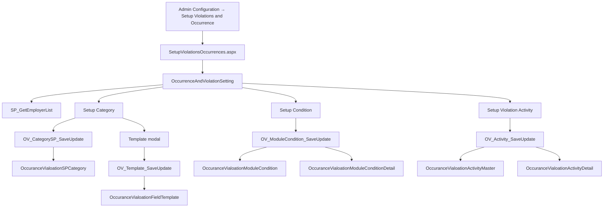
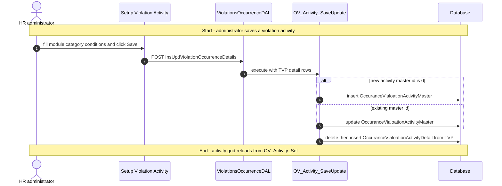
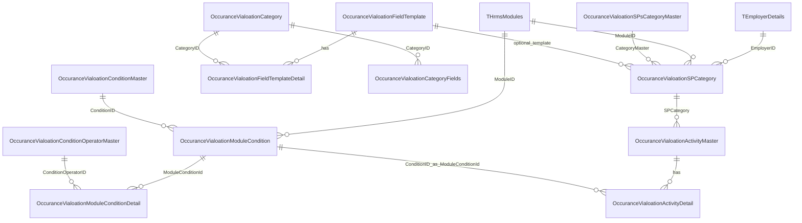

# Setup Violations & Occurrence

## Overview

An HR administrator configures how the organisation scores employee “violations and occurrences” — missing personal data, late marks, paid leaves, absenteeism, separation, confirmation, and similar cards later shown on the employee Violations & Occurrence dashboard. They open **Admin Configuration → Setup Violations & Occurrence** (`SetupViolationsOccurrences.aspx`). The WebForms host only injects session ids and loads the Dashboard React bundle. React Router mounts `OccurrenceAndViolationSetting`, which shows three tabs for the selected organisation.

On **Setup Category**, the administrator maps an HRMS module to a category master row (and optionally a field template that lists which personal-data tabs and fields the Employee Missing Data rule cares about). On **Setup Condition**, they map a module to condition names and the operators those conditions may use. On **Setup Violation Activity**, they create the activity itself — name, description, category, effective date, active flag — and one or more condition rows with ranges, points, and card colours. Saves go through Core API `violationsOccurrence/*` into `OV_*` procedures that write `OccuranceVialoation*` tables (spelling as in the database). Soft deletes set `IsActive`/`Active` to 0.

Employees do not open this screen. Their card data is produced later by rule procedures such as `OV_Rule_MasterSP`, which is outside this setup guide. SystemModel-2 and `llm-wiki` do not document this feature; table names and relationships below come from the Core API DAL and the `OV_*` scripts under `HRMS-DATABASE/HRMS/STOREPROCEDURE/`.

**Who's involved:**

- **HR administrator** — configures categories, conditions, templates, and violation activities for an organisation.
- **Employee / manager** — does not use this page; they later see scored cards on Violations & Occurrence.

## Workflow

## Request journey

### HR administrator — save a violation activity

Category and condition saves follow the same pattern through `OV_CategorySP_SaveUpdate` and `OV_ModuleCondition_SaveUpdate` (the latter also soft-deactivates prior operator detail rows and re-inserts from a CSV of operator ids).

## Entry points

`~/HRM/DashBoard_React/SetupViolationsOccurrences.aspx` is the left-nav host. `Page_Load` logs activity `SetupViolationsOccurrences` (343), copies the logged-in user into hidden fields, and resolves `dashboard_react.*.min.js`. There is no WebForms postback business logic on this page.

React route `SETUP_VIOLATIONS_OCCURRENCES` in `Areas/routes.js` mounts `OccurrenceAndViolationSetting`. The sibling page `ViolationsOccurrences.aspx` → `ViolationDetails` is the employee/team view and is outside this guide.

| UI page | Purpose |
|---|---|
| `HRM/DashBoard_React/SetupViolationsOccurrences.aspx` | Host, session hidden fields, React shell |
| `OccurrenceAndViolationSetting` | Org dropdown + three setup tabs |
| `ViolationMasterCategoryCreation` | Setup Category grid and save/delete |
| `ViolationTemplateMaster` | Field-template modal from Setup Category |
| `ViolationConditionConditionOperatorMaster` | Setup Condition grid and save/delete |
| `CreateViolationsActivity` | Setup Violation Activity form and grid |

## Code → database call chain

Core API mounts routes at `/violationsOccurrence`. The DAL uses `mssql` `.execute` against HRMS.

| Entry | Method | Stored procedure |
|---|---|---|
| Org dropdown | `getOrganizationData` (`OccurrenceAndViolationSetting.js:43`) → `GetEmployerList` (`ViolationsOccurrenceDAL.js:133`) | `SP_GetEmployerList` |
| Setup Category modules | `getModuleList` (`ViolationMasterCategoryCreation.js:90`) → `GetMasterModuleList` (`ViolationsOccurrenceDAL.js:563`) | `OV_ModuleMasterList` |
| Setup Category dropdown | `getMaterCategoryDropdown` (`ViolationMasterCategoryCreation.js:124`) → `GetMaterCategoryDropdown` (`ViolationsOccurrenceDAL.js:711`) | `OV_SPsCategoryMasterList` |
| Setup Category grid | `getMaterCategoryGridData` (`ViolationMasterCategoryCreation.js:136`) → `GetMaterCategoryGridData` (`ViolationsOccurrenceDAL.js:588`) | `OV_CategorySP_List` |
| Setup Category save | `saveCategoryName` (`ViolationMasterCategoryCreation.js:235` / `287`) → `SaveUpdateCategoryMaster` (`ViolationsOccurrenceDAL.js:602`) | `OV_CategorySP_SaveUpdate` |
| Setup Category delete | delete handler (`ViolationMasterCategoryCreation.js:324`) → `DeleteCategory` (`ViolationsOccurrenceDAL.js:626`) | `OV_CategorySP_Delete` |
| Template tabs | `getTabsList` (`ViolationTemplateMaster.js:150`) → `GetTabsList` (`ViolationsOccurrenceDAL.js:794`) | `OV_Template_CategoryMasterList` |
| Template fields | `GetTabsWiseFieldsList` (`ViolationTemplateMaster.js:77`) → `GetTabsWiseFieldsList` (`ViolationsOccurrenceDAL.js:807`) | `OV_Template_FieldsByCategory` |
| Template grid / detail | `getTemplateGridData` (`ViolationTemplateMaster.js:267`) → `GetTemplateGridData` (`ViolationsOccurrenceDAL.js:858`) | `OV_Template_List` |
| Template save | `saveTemplateFields` (`ViolationTemplateMaster.js:484`) → `SaveUpdateTemplateFieldsData` (`ViolationsOccurrenceDAL.js:821`) | `OV_Template_SaveUpdate` |
| Template delete | delete handler (`ViolationTemplateMaster.js:316`) → `DeleteTemplateField` (`ViolationsOccurrenceDAL.js:873`) | `OV_Template_Delete` |
| Setup Condition modules | `getModuleList` (`ViolationConditionConditionOperatorMaster.js:85`) → `GetMasterModuleList` | `OV_ModuleMasterList` |
| Setup Condition grid | `getMasterConditionGridData` (`ViolationConditionConditionOperatorMaster.js:97`) → `GetMasterConditionGridData` (`ViolationsOccurrenceDAL.js:680`) | `OV_ModuleCondition_List` |
| Setup Condition save | save handlers (`ViolationConditionConditionOperatorMaster.js:280` / `335`) → `SaveUpdateConditionMaster` (`ViolationsOccurrenceDAL.js:656`) | `OV_ModuleCondition_SaveUpdate` |
| Setup Condition delete | delete handler (`ViolationConditionConditionOperatorMaster.js:363`) → `DeleteCondition` (`ViolationsOccurrenceDAL.js:694`) | `OV_ModuleCondition_Delete` |
| Condition row dropdowns | `ViolationAddRowConditionOperator.js:51` / `:64` → `GetMasterConditionList` / `GetMaterConditionOperatorList` | `OV_ModuleCondtionMasterList` / `OV_ModuleOperatorMasterList` |
| Activity modules | `getModuleList` (`CreateViolationsActivity.js:118`) → `GetModuleList` (`ViolationsOccurrenceDAL.js:146`) | `OV_ModuleMasterList` |
| Activity categories | `getSpList` (`CreateViolationsActivity.js:146`) → `GetSpList` (`ViolationsOccurrenceDAL.js:160`) | `OV_GetSPsCategory` |
| Activity conditions | `getModuleWiseConditions` (`CreateViolationsActivity.js:88`) → `GetModuleConditions` (`ViolationsOccurrenceDAL.js:174`) | `OV_GetConditionNames` |
| Activity operators | `RowConditionItem.js:41` → `GetBasicConditions` (`ViolationsOccurrenceDAL.js:189`) | `OV_GetConditionDetail` |
| Activity grid | `getVODetails` (`CreateViolationsActivity.js:401`) → `GetViolationUserDetails` (`ViolationsOccurrenceDAL.js:424`) | `OV_Activity_Sel` |
| Activity save | save post (`CreateViolationsActivity.js:379`) → `InsUpdViolationOccurrenceDetails` (`ViolationsOccurrenceDAL.js:370`) | `OV_Activity_SaveUpdate` |
| Activity delete | `afterDeleteConfirm` (`CreateViolationsActivity.js:446`) → `DeleteViolationOccurrenceDetails` (`ViolationsOccurrenceDAL.js:405`) | `OV_Activity_Delete` |

## API endpoints

All routes are under Core API `/violationsOccurrence` (`ViolationsOccurrenceRoutes.js`). Controllers pass query/body through to the DAL. There is no WebForms postback for this feature.

| Verb | Route | Parameters | Purpose | Source |
|---|---|---|---|---|
| GET | `/violationsOccurrence/GetEmployerList` | `employeeId` (query, required) | Org dropdown | `ViolationsOccurrenceController.js:7` |
| GET | `/violationsOccurrence/GetMasterModuleList` | `employerId` (query) | Module list (tabs 1–2) | `:219` |
| GET | `/violationsOccurrence/GetModuleList` | `employeeId`, `employerId` (query) | Module list (tab 3) | `:17` |
| GET | `/violationsOccurrence/GetMaterCategoryDropdown` | `employerId`, `moduleId` (query) | Category master dropdown | `:315` |
| GET | `/violationsOccurrence/GetMaterCategoryGridData` | `employerId` (query) | Category grid | `:242` |
| POST | `/violationsOccurrence/SaveUpdateCategoryMaster` | body: category mapping fields | Insert/update category | `:253` |
| POST | `/violationsOccurrence/DeleteCategory` | body: `OccuranceVialoationSPCategoryID`, `UpdatedBy` | Soft-delete category | `:264` |
| GET | `/violationsOccurrence/GetTabsList` | `employerId` (query, unused by SP) | Template tab categories | `:368` |
| GET | `/violationsOccurrence/GetTabsWiseFieldsList` | `tabCategoryID` (query) | Fields for a tab | `:378` |
| POST | `/violationsOccurrence/GetTemplateGridData` | body: `employerId`, template id, `Type` | Template list or detail | `:399` |
| POST | `/violationsOccurrence/SaveUpdateTemplateFieldsData` | body + TVP detail | Save template | `:388` |
| POST | `/violationsOccurrence/DeleteTemplateField` | body: template id, `UpdatedBy` | Soft-delete template | `:409` |
| GET | `/violationsOccurrence/GetMasterConditionGridData` | `employerId` (query) | Condition grid | `:295` |
| POST | `/violationsOccurrence/SaveUpdateConditionMaster` | body including `ConditionOperatorIDs` CSV | Save module condition | `:284` |
| POST | `/violationsOccurrence/DeleteCondition` | body: `ModuleConditionId`, updater | Soft-delete condition | `:305` |
| GET | `/violationsOccurrence/GetMasterConditionList` | `employerId` (query, unused by SP) | Condition master names | `:274` |
| GET | `/violationsOccurrence/GetMaterConditionOperatorList` | `employerId` (query, unused by SP) | Operator master names | `:327` |
| GET | `/violationsOccurrence/GetSpList` | `moduleId`, `employerId` (query) | Activity category dropdown | `:28` |
| GET | `/violationsOccurrence/GetModuleConditions` | `moduleId`, `employerId` (query) | Activity condition names | `:38` |
| GET | `/violationsOccurrence/GetBasicConditions` | `moduleConditionId` (query) | Operators for a condition | `:48` |
| GET | `/violationsOccurrence/GetViolationUserDetails` | `employerId` (query) | Activity grid | `:164` |
| POST | `/violationsOccurrence/InsUpdViolationOccurrenceDetails` | body + TVP conditions | Save activity | `:144` |
| POST | `/violationsOccurrence/DeleteViolationOccurrenceDetails` | body: activity id, employer, modifier | Soft-delete activity | `:154` |

`InsUpdViolationOccurrenceDetails` and `DeleteViolationOccurrenceDetails` are registered **without** the `Authorize` middleware used by the other routes on this router.

## Stored procedures & tables involved

| Object | File | Purpose |
|---|---|---|
| `SP_GetEmployerList` | `HRMS-DATABASE/HRMS/STOREPROCEDURE/SP_GetEmployerList.sql` | Employers under the employee’s root employer |
| `OV_ModuleMasterList` | `…/OV_ModuleMasterList.sql` | Licensed modules that have category masters |
| `OV_SPsCategoryMasterList` | `…/OV_SPsCategoryMasterList.sql` | Category master dropdown |
| `OV_CategorySP_List` | `…/OV_CategorySP_List.sql` | Employer category mappings + CanDelete |
| `OV_CategorySP_SaveUpdate` | `…/OV_CategorySP_SaveUpdate.sql` | Insert/update category mapping |
| `OV_CategorySP_Delete` | `…/OV_CategorySP_Delete.sql` | Soft-delete category mapping |
| `OV_Template_CategoryMasterList` | `…/OV_Template_CategoryMasterList.sql` | Template tab list |
| `OV_Template_FieldsByCategory` | `…/OV_Template_FieldsByCategory.sql` | Fields for a tab |
| `OV_Template_List` | `…/OV_Template_List.sql` | Template list or detail |
| `OV_Template_SaveUpdate` | `…/OV_Template_SaveUpdate.sql` | Insert/update template + field details |
| `OV_Template_Delete` | `…/OV_Template_Delete.sql` | Soft-delete template |
| `OV_ModuleCondition_List` | `…/OV_ModuleCondition_List.sql` | Condition grid with operators and CanDelete |
| `OV_ModuleCondition_SaveUpdate` | `…/OV_ModuleCondition_SaveUpdate.sql` | Insert/update condition + operator details |
| `OV_ModuleCondition_Delete` | `…/OV_ModuleCondition_Delete.sql` | Soft-delete condition and details |
| `OV_ModuleCondtionMasterList` | `…/OV_ModuleCondtionMasterList.sql` | Condition name master (spelling Condtion) |
| `OV_ModuleOperatorMasterList` | `…/OV_ModuleOperatorMasterList.sql` | Operator name master |
| `OV_GetSPsCategory` | `…/OV_GetSPsCategory.sql` | Active categories for module+employer |
| `OV_GetConditionNames` | `…/OV_GetConditionNames.sql` | Active conditions for module+employer |
| `OV_GetConditionDetail` | `…/OV_GetConditionDetail.sql` | Operators for one module condition |
| `OV_Activity_Sel` | `…/OV_Activity_Sel.sql` | Flat activity + detail rows for grid |
| `OV_Activity_SaveUpdate` | `…/OV_Activity_SaveUpdate.sql` | Insert/update activity; replace details from TVP |
| `OV_Activity_Delete` | `…/OV_Activity_Delete.sql` | Soft-delete activity master |

Main tables: `OccuranceVialoationSPCategory`, `OccuranceVialoationSPsCategoryMaster`, `OccuranceVialoationFieldTemplate`, `OccuranceVialoationFieldTemplateDetail`, `OccuranceVialoationCategory`, `OccuranceVialoationCategoryFields`, `OccuranceVialoationModuleCondition`, `OccuranceVialoationModuleConditionDetail`, `OccuranceVialoationConditionMaster`, `OccuranceVialoationConditionOperatorMaster`, `OccuranceVialoationActivityMaster`, `OccuranceVialoationActivityDetail`, plus `TEmployerDetails`, `TEmployee`, `THrmsModules`, `TEmployerModule`, `TRRS_GRID_CONFIG`.

Database pages: `/docs/database/hrms/<ObjectName>` for each procedure above. None of these procedures call nested procedures or functions.

## Table relationships

Declared foreign keys are sparse on these tables; the diagram follows join keys used by the `OV_*` scripts and the UI.

## Known gaps

- No SystemModel-2 or `llm-wiki` domain page for Setup Violations & Occurrence; relationships are derived from SQL joins and the DAL.
- Table and column names use the misspelling `OccuranceVialoation` throughout the database and API.
- `OccurrenceAndViolationSetting.getOrganizationData` assigns `setOrganizations(tempData)` after a successful fetch, but `tempData` is not defined in that function — the org dropdown may fail to populate.
- `POST /InsUpdViolationOccurrenceDetails` and `POST /DeleteViolationOccurrenceDetails` omit `Authorize` on the router while sibling routes use it.
- Activity delete UI column is commented out in `CreateViolationsActivity.js`, so `OV_Activity_Delete` is reachable from the handler but not from a visible grid Delete action.
- Orphaned `ViolationConditionOperatorMaster.js` (not imported by the setup host) targets `OV_ModuleConditionDetail_*` procedures that have no SQL scripts in `HRMS-DATABASE`.
- Commented `getMaterSpList` would call `OV_GetAllSPs`; that path is not live on Setup Category.
- Employee-facing rule engine (`OV_Rule_MasterSP` and card SPs) and mock `GetMyViolationData` are out of scope for this setup page.
- `OV_ModuleMasterList.sql` begins with `USE [HRM-CL-Prod]` in the inventoried file.

## Reference

Confidence is medium: the React → Core API → `OV_*` chain is verified in source, but there is no canonical domain wiki and several UI dead paths remain.

### SourceCode

- `HRMS.Web/HRMS.Web/HRM/DashBoard_React/SetupViolationsOccurrences.aspx`
- `HRMS.Web/HRMS.Web/HRM/DashBoard_React/SetupViolationsOccurrences.aspx.cs`
- `HRMS.Web/HRMS.Web/HRM/DashBoard_React/Areas/routes.js`
- `HRMS.Web/HRMS.Web/HRM/DashBoard_React/Areas/Violations&Occurrence/OccurrenceAndViolationSetting.js`
- `HRMS.Web/HRMS.Web/HRM/DashBoard_React/Areas/Violations&Occurrence/ViolationMasterCategoryCreation.js`
- `HRMS.Web/HRMS.Web/HRM/DashBoard_React/Areas/Violations&Occurrence/ViolationTemplateMaster.js`
- `HRMS.Web/HRMS.Web/HRM/DashBoard_React/Areas/Violations&Occurrence/ViolationConditionConditionOperatorMaster.js`
- `HRMS.Web/HRMS.Web/HRM/DashBoard_React/Areas/Violations&Occurrence/CreateViolationsActivity.js`
- `HRMS.Web/HRMS.Web/HRM/DashBoard_React/Common/apiURLConstants.js`
- `HRMS.CoreAPI/HRMS.Core.WebAPI.Node/Routes/ViolationsOccurrenceRoutes.js`
- `HRMS.CoreAPI/HRMS.Core.WebAPI.Node/Controllers/ViolationsOccurrenceController.js`
- `HRMS.CoreAPI/HRMS.Core.WebAPI.Node/Core/DataAccessLayer/ViolationsOccurrenceDAL.js`

### TDG HRMS DB

- `HRMS-DATABASE/HRMS/STOREPROCEDURE/SP_GetEmployerList.sql`
- `HRMS-DATABASE/HRMS/STOREPROCEDURE/OV_*.sql` (category, condition, template, activity, and lookup procedures listed above)
- No `llm-wiki` page found for this feature
