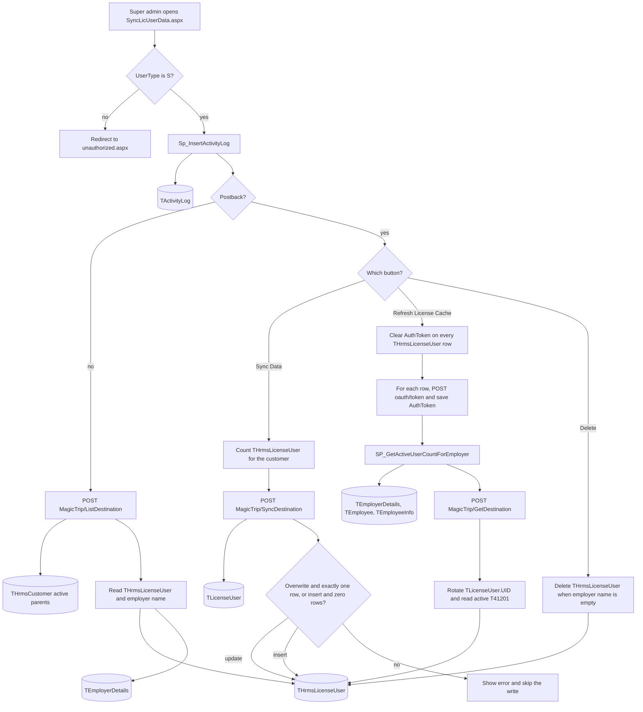
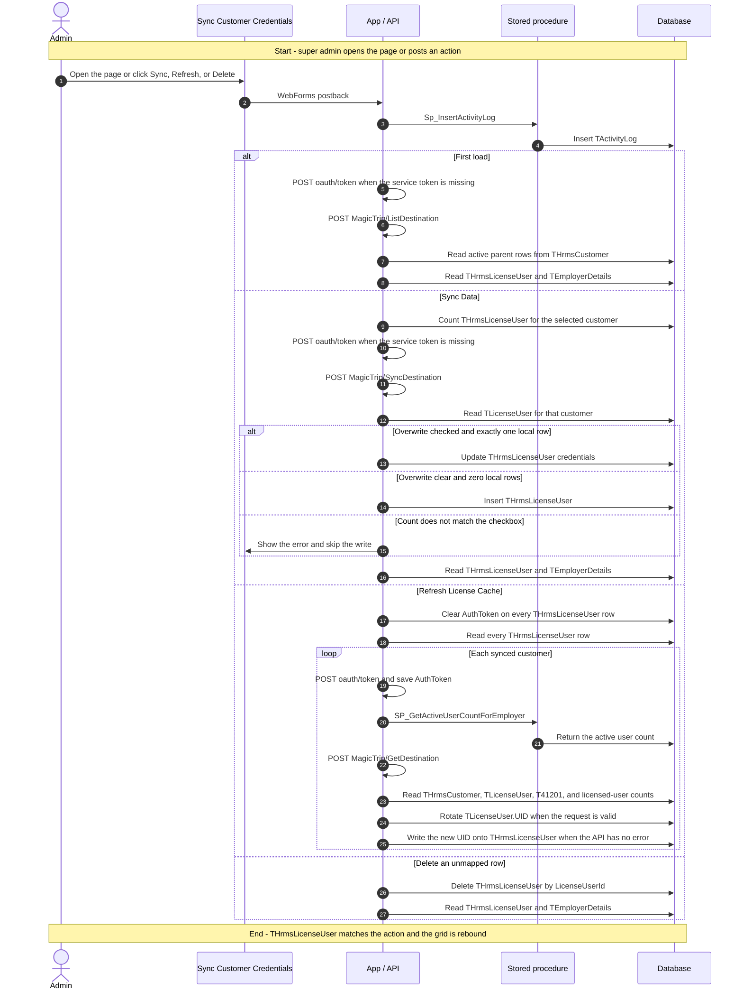
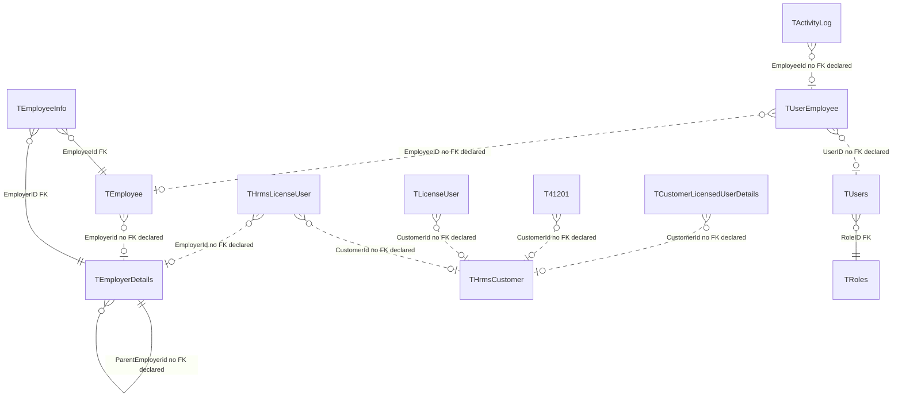

# Sync Customer Credentials

## Overview

A super admin needs each customer's license login (user name, password, and UID) to exist inside this HRMS database before the product can talk to the license service. They open **Admin Configuration → Organization Setup → Sync Customer Credentials**, pick a customer from the license service, and click **Sync Data**. The page copies that customer's keys into `THrmsLicenseUser`. If a row for that customer is already there, they tick **Overwrite Existing Data** and the same click updates it. Customers that are not yet tied to an employer can be deleted from the grid. **Refresh License Cache** is a separate action: it clears every stored license token, asks the license service for a fresh UID per customer, and writes that UID back.

Only a logged-in user whose `UserType` is `S` stays on the page. Anyone else is sent to `~/unauthorized.aspx`.

There is no Business Layer class for this screen. The WebForms page calls `LicenseDbHelper` and the license HTTP API directly. Most of the credential reads and writes are inline SQL against `THrmsLicenseUser`. Two stored procedures sit on the edges: `Sp_InsertActivityLog` on every request, and `SP_GetActiveUserCountForEmployer` while the cache refresh counts active employees.

`docs/SystemModels/SystemModel-2` has no workflow or context page for this screen. Table blurbs for the license and activity tables are in `llm-wiki/reference/tables/hrms.md`. That catalog does not declare foreign keys among the credential tables, and the `CREATE TABLE` scripts do not either. License-insight tables in `llm-wiki/architecture/module-catalog.md` are a different feature.

## Workflow

List and Sync sign in with a built-in service client (`CustomerId` -2) and do not store that token. Refresh signs in with each `THrmsLicenseUser` row's own user name and password and does store the token.

## Request journey

## Entry points

The live menu node is **Sync Customer Credentials** under **Admin Configuration → Organization Setup** (`TDynamicMenuHierarchy`, menu value 78). `docs/SystemModels/SystemModel-2` does not name a second page for this item.

| Entry | Purpose |
|---|---|
| `~/HRM/Settings/SyncLicUserData.aspx` | Super-admin screen. Dropdown of license customers, Sync Data, Overwrite Existing Data, Refresh License Cache, and a customer/employer grid with delete. |
| `POST /oauth/token` on the license API | Password grant used before the MagicTrip calls. |
| `POST api/v1/MagicTrip/ListDestination` | Fills the customer dropdown from active parent customers. |
| `POST api/v1/MagicTrip/SyncDestination` | Returns one customer's license user name, password, and UID. |
| `POST api/v1/MagicTrip/GetDestination` | Used only by Refresh License Cache. Rotates the license UID and returns subscription dates. |

`Login.aspx.cs` can call the same cache-refresh helper. That is not this menu item.

## Code → database call chain

No HRMS.Shared BLL type is on this path. `LicenseDbHelper` uses Enterprise Library `GetSqlStringCommand` for the credential SQL and `GetStoredProcCommand` for the active-user count. Activity logging uses Enterprise Library `GetStoredProcCommand`. The license API uses Entity Framework repositories, not stored procedures.

| Entry | Method | Database |
|---|---|---|
| Every request, `SyncLicUserData.aspx.cs:18` | `CommonUtil.LogActivity` (`Common.cs:52`) → `LogUserActivity.LogActivity` (`LogUserActivity.cs:36`) → `ActivityHelper.LogActivity` (`ActivityHelper.cs:32`) | `Sp_InsertActivityLog`. Inserts `TActivityLog`. Reads `TUserEmployee`, `TUsers`, `TRoles`. Activity type id is `ActivityDescription.SyncLicUserData` = 312 (`Enums.cs:255`). |
| First load, `SyncLicUserData.aspx.cs:28` | `LicenseManager.ListDestinations` (`LicenseManager.cs:173`) → `AuthTokenHelper.ValidateOrGenerateTokenData` (`AuthTokenHelper.cs:24`, `SaveToken` false) → `APIService.GetToken` (`APIService.cs:155`) → `APIService.ListDestination` (`APIService.cs:177`) → `CustonmersListRequestProcessor` (`CustonmersListRequestProcessor.cs:14`) | No stored procedure. Reads `THrmsCustomer` where `ParentCustId` is null and `IsActive` is true (`CustomerRepository.cs:14`). |
| First load and after each action, `SyncLicUserData.aspx.cs:40` and `:109` | `LicenseDbHelper.GetCustomerEmployerMapperData` (`LicenseDbHelper.cs:229`) | No stored procedure. Reads `THrmsLicenseUser` and `TEmployerDetails.EmployerName`. |
| Sync Data, `SyncLicUserData.aspx.cs:53` | `LicenseDbHelper.CountCustomerRecords` (`LicenseDbHelper.cs:106`) | No stored procedure. `COUNT(*)` on `THrmsLicenseUser` for the selected `CustomerId`. |
| Sync Data, `SyncLicUserData.aspx.cs:74` | `LicenseManager.SyncDestinations` (`LicenseManager.cs:191`) → `APIService.GetSyncDestination` (`APIService.cs:217`) → `CustonmersSyncRequestProcessor` (`CustonmersSyncRequestProcessor.cs:35`) | No stored procedure. Reads `TLicenseUser` by `CustomerId` (`LicenseUserRepository.cs:49`). |
| Sync Data overwrite, `SyncLicUserData.aspx.cs:78` | `LicenseDbHelper.UpdateCustomerCredentials` (`LicenseDbHelper.cs:131`) | No stored procedure. Updates `LicenseUserName`, `LicenseUserPassword`, `UID`, `CustomerName` on `THrmsLicenseUser`. |
| Sync Data insert, `SyncLicUserData.aspx.cs:80` | `LicenseDbHelper.InsertCustomerCredentials` (`LicenseDbHelper.cs:117`) | No stored procedure. Inserts `CustomerId`, `LicenseUserName`, `LicenseUserPassword`, `UID`, `CustomerName` into `THrmsLicenseUser`. |
| Refresh, `SyncLicUserData.aspx.cs:95` | `LicenseDbHelper.CleanAuthenticationData` (`LicenseDbHelper.cs:145`) | No stored procedure. Sets `AuthToken` and `AuthTokenValidity` to null on every `THrmsLicenseUser` row. |
| Refresh, `SyncLicUserData.aspx.cs:96` | `LicenseManager.LoadData` (`LicenseManager.cs:44`) → `ClientUser.LoadAllClients` (`LicenseModels.cs:50`) → `LicenseDbHelper.GetLicenseDetails` (`LicenseDbHelper.cs:12`) | No stored procedure. Reads every `THrmsLicenseUser` row. |
| Refresh, per customer, `LicenseManager.cs:56` | `AuthTokenHelper.ValidateOrGenerateTokenData` (`AuthTokenHelper.cs:24`) → `APIService.GetToken` (`APIService.cs:155`) → `LicenseDbHelper.SaveToken` (`LicenseDbHelper.cs:91`) | No stored procedure. Updates `AuthToken` and `AuthTokenValidity` on that `THrmsLicenseUser` row. |
| Refresh, per customer, `LicenseManager.cs:61` | `LicenseDbHelper.GetHrmsActiveUserCount` (`LicenseDbHelper.cs:295`) | `SP_GetActiveUserCountForEmployer`. Reads `TEmployerDetails`, `TEmployee`, `TEmployeeInfo`. |
| Refresh, per customer, `LicenseManager.cs:64` | `APIService.GetMagicDestination` (`APIService.cs:42`) → `LDataRequestValidator` (`LDataRequestValidator.cs:12`) → `LDataRequestProcessor` (`LDataRequestprocessor.cs:47`) | No stored procedure. Reads `THrmsCustomer`, `TLicenseUser`, active `T41201`. When the active-user count is greater than 0, reads `TCustomerLicensedUserDetails` and `TLicenseEmailTemplate` (`EmailRequestProcessor.cs:196`). On success, rotates `TLicenseUser.UID` (`LicenseUserRepository.cs:65`). |
| Refresh, per customer, `LicenseManager.cs:71` | `LicenseDbHelper.UpdateLicenseDetails` (`LicenseDbHelper.cs:52`) | No stored procedure. Writes the new `UID` onto `THrmsLicenseUser` when the API response has no error. |
| Delete, `SyncLicUserData.aspx.cs:118` | `LicenseDbHelper.DeleteCustomerEmployerMapping` (`LicenseDbHelper.cs:258`) | No stored procedure. Deletes `THrmsLicenseUser` by `LicenseUserId`. The link is hidden when `EmployerName` is non-empty (`CustomerEmployerMapper.cs:14`, `SyncLicUserData.aspx.cs:134`). |

## API endpoints

The screen itself is a WebForms postback (`btnSync_OnClick`, `btnUpdateCache_OnClick`, `btnGridDeleteMappingClick`). It does not call HRMS Core API. The license calls below use `APIBaseUrl` (`…/api/v1/`) and `APITokenUrl` (`…/oauth/token`) from `Web.config`. The body field `source` is JSON encrypted and then base64-encoded.

| Verb | Route | Parameters | Purpose | Source |
|---|---|---|---|---|
| POST | `/oauth/token` | `username` string required, `password` string required, `customerid` string required, `grant_type` string required (`password`) | Bearer token. List and Sync use the built-in service client and do not save the token. Refresh uses each customer's `LicenseUserName` / `LicenseUserPassword` and then saves the token. | `APIService.cs:155`, `Startup.cs:27`, `AuthorizationProviderServer.cs:34` |
| POST | `api/v1/MagicTrip/ListDestination` | `Authorization: Bearer` required. No `source` body. | Active parent customers (`CustomerId`, `Name`) for the dropdown. | `APIService.cs:177`, `SecLisnController.cs:45` |
| POST | `api/v1/MagicTrip/SyncDestination` | `Authorization: Bearer` required. `source` string required. `ServiceRequestModel.CustomerId` int required. | That customer's `LicenseUserName`, `LicenseUserPassword`, and `UID`, returned as `Key1`, `Key2`, `Key3`. | `APIService.cs:217`, `SecLisnController.cs:56`, `ServiceRequestModel.cs:9` |
| POST | `api/v1/MagicTrip/GetDestination` | `Authorization: Bearer` required. `source` string required. `CustomerId` int, `UID` string, `HrmsActiveUsersCount` int, `CallingMethodName` string. | Validates the customer and UID, may send a count-mismatch email, rotates `TLicenseUser.UID`, and returns the active `T41201` start and expiry dates plus the new UID. | `APIService.cs:42`, `SecLisnController.cs:22`, `LDataRequestValidator.cs:12` |

`ManageDestination` exists on the same controller and is not called by this page.

## Stored procedures & tables involved

Credential insert, update, delete, token clear, and the grid are inline SQL. The two procedures are the only ones this page executes. Neither calls another procedure or function.

| Object | File | Purpose | Wiki |
|---|---|---|---|
| `Sp_InsertActivityLog` | `HRMS-DATABASE/HRMS/STOREPROCEDURE/Sp_InsertActivityLog.sql` | Writes one `TActivityLog` row and looks up the employee's role name. | `llm-wiki/reference/tables/hrms.md` (`TActivityLog`) |
| `SP_GetActiveUserCountForEmployer` | `HRMS-DATABASE/HRMS/STOREPROCEDURE/SP_GetActiveUserCountForEmployer.sql` | Counts distinct active employee emails for an employer and its descendant employers. | `llm-wiki/reference/tables/hrms.md` (`TEmployerDetails`) |
| `THrmsLicenseUser` | `HRMS-DATABASE/HRMS/TABLES/THrmsLicenseUser.sql` | Local copy of the customer license login, token, and optional employer. | `llm-wiki/reference/tables/hrms.md` |
| `TLicenseUser` | `HRMS-DATABASE/HRMS/TABLES/TLicenseUser.sql` | License-service login row the sync copies from, and whose UID refresh rotates. | `llm-wiki/reference/tables/hrms.md` |
| `THrmsCustomer` | `HRMS-DATABASE/HRMS/TABLES/THrmsCustomer.sql` | Customer master. The dropdown is active rows with no parent. | `llm-wiki/reference/tables/hrms.md` |
| `T41201` | `HRMS-DATABASE/HRMS/TABLES/T41201.sql` | Active license subscription dates and user-license count. Read on cache refresh. | `llm-wiki/reference/tables/hrms.md` |
| `TEmployerDetails` | `HRMS-DATABASE/HRMS/TABLES/TEmployerDetails.sql` | Employer name on the grid, and the parent/child walk inside the active-user count. | `llm-wiki/reference/tables/hrms.md` |
| `TEmployee`, `TEmployeeInfo` | `HRMS-DATABASE/HRMS/TABLES/TEmployee.sql`, `TEmployeeInfo.sql` | Active employees counted during cache refresh. | `llm-wiki/reference/tables/hrms.md` |
| `TActivityLog` | `HRMS-DATABASE/HRMS/TABLES/TActivityLog.sql` | Page-access row for activity type 312. | `llm-wiki/reference/tables/hrms.md` |
| `TCustomerLicensedUserDetails` | `HRMS-DATABASE/HRMS/TABLES/TCustomerLicensedUserDetails.sql` | License-side active user count, compared with the HRMS count when that count is greater than 0. | `llm-wiki/reference/tables/hrms.md` |
| `TLicenseEmailTemplate` | `HRMS-DATABASE/HRMS/TABLES/TLicenseEmailTemplate.sql` | `LicenseCountMismatch` template, read only when those two counts differ. | `llm-wiki/reference/tables/hrms.md` |

## Table relationships

`llm-wiki/reference/tables/hrms.md` lists these tables and leaves the license-credential rows with no referenced parents. The diagram below uses the `CREATE TABLE` scripts. A join the page or procedure uses is shown only when that script declares a foreign key. Other joins are labeled as not declared.

`TActivityLog` has no primary key and no foreign key. `TActivityLog.ActivityTypeId` is not declared against `TActivityLogTypes`. `T41201.LicenseTypeId` is not declared against `TLicenseType`. `TLicenseEmailTemplate` is read by template name and has no foreign key to a customer.

## Known gaps

- **No SystemModel-2 page.** Nothing under `docs/SystemModels/SystemModel-2` names `SyncLicUserData` or this menu item. The call chain above is from the WebForms page, `LicenseDbHelper`, and the license API.
- **Credential SQL is not a stored procedure.** Insert, update, delete, token updates, and the grid are string-built SQL in `LicenseDbHelper`. Values are concatenated into the command text.
- **Overwrite needs exactly one row, insert needs zero.** Any other count skips the write. The overwrite message says "No data found" even when the count is greater than one. `GetDetailsByCustomerId` uses `SingleOrDefault`, so two `TLicenseUser` rows for one customer throw on the license API.
- **Delete is hidden when an employer name comes back.** `IsEmployerMapped` is true when the employer-name subquery is non-empty. A mapped customer cannot be removed on this grid.
- **Refresh clears every token.** `CleanAuthenticationData` nulls `AuthToken` and `AuthTokenValidity` on all `THrmsLicenseUser` rows, then `LoadData` walks every row, not the dropdown selection.
- **Unmapped customers send a zero user count.** `EmployerId` null becomes 0 on `ClientUser`, and `SP_GetActiveUserCountForEmployer` returns 0 when `@EmployerId <= 0`. The mismatch email runs only when `HrmsActiveUsersCount > 0`.
- **Activity insert is fire-and-forget.** `CommonUtil.LogActivity` never sets `HostName`. `ActivityHelper` completes a `TransactionScope` before the task runs the procedure. `ActivityLog.LogActivityAsync` throws `NotImplementedException` when the result is not 1, on an `async void` method. `TActivityLog.Comments` is `VARCHAR(500)` while the procedure parameter is `VARCHAR(1000)`. This page passes null comments.
- **Activity type 312 is an application enum.** The procedure does not read `TActivityLogTypes`.
- **Login.aspx.cs:643** calls `CleanAuthenticationData` and `LicenseManager.LoadData` with the same caller name. That path is outside this menu item.
- **License insights** (`TLicenseInsight` and `USP_LicenseInsight_*` in `llm-wiki/architecture/module-catalog.md`) are not used by this page.

## Reference

Confidence is **high** for the page, DAL, and license API path traced here. `docs/SystemModels/SystemModel-2` does not cover this screen. Foreign keys are only those declared on the table scripts. `llm-wiki/reference/tables/hrms.md` supplies the table descriptions and does not add relationships for these credential tables.

### SourceCode

- `HRMS.Web/HRMS.Web/HRM/Settings/SyncLicUserData.aspx`
- `HRMS.Web/HRMS.Web/HRM/Settings/SyncLicUserData.aspx.cs`
- `HRMS.Web/HRMS.Web/HRM/LicenseCode/LicenseManager.cs`
- `HRMS.Web/HRMS.Web/HRM/LicenseCode/LicenseModels.cs`
- `HRMS.Web/HRMS.Web/HRM/LicenseCode/AuthTokenHelper.cs`
- `HRMS.Web/HRMS.Web/APIServices/APIService.cs`
- `HRMS.Shared/HRMS.DataAccessLayer/LicenseDbHelper.cs`
- `HRMS.Shared/HRMS.DataContract/Common/CustomerEmployerMapper.cs`
- `HRMS.Shared/HRMS.DataContract/Common/Enums.cs`
- `HRMS.Shared/HRMS.Common/Common.cs`
- `HRMS.Shared/TDG.ActivityAuditLog/DAL/ActivityHelper.cs`
- `HRMS.License/HRMS.LicenseAPI/Controllers/SecLisnController.cs`
- `HRMS.License/HRMS.LicenseAPI/Startup.cs`
- `HRMS.License/HRMS.LicenseAPI/AuthorizationProviderServer.cs`
- `HRMS.License/HRMS.LicenseAPI/Models/RequestProcessors/CustonmersListRequestProcessor.cs`
- `HRMS.License/HRMS.LicenseAPI/Models/RequestProcessors/CustonmersSyncRequestProcessor.cs`
- `HRMS.License/HRMS.LicenseAPI/Models/RequestProcessors/LDataRequestprocessor.cs`
- `HRMS.License/HRMS.LicenseAPI/Models/Validators/LDataRequestValidator.cs`
- `HRMS.License/HRMS.LicenseAPI/Models/Repositories/LicenseUserRepository.cs`
- `HRMS.License/HRMS.LicenseAPI/Models/Repositories/CustomerRepository.cs`
- `HRMS.License/HRMS.License.Common/ServiceRequestModel.cs`

### TDG HRMS DB

- `llm-wiki/reference/tables/hrms.md`
- `llm-wiki/domain/overview.md` (`TActivityLog` listed as an audit ledger only)
- `HRMS-DATABASE/HRMS/STOREPROCEDURE/Sp_InsertActivityLog.sql`
- `HRMS-DATABASE/HRMS/STOREPROCEDURE/SP_GetActiveUserCountForEmployer.sql`
- `HRMS-DATABASE/HRMS/TABLES/THrmsLicenseUser.sql`
- `HRMS-DATABASE/HRMS/TABLES/TLicenseUser.sql`
- `HRMS-DATABASE/HRMS/TABLES/THrmsCustomer.sql`
- `HRMS-DATABASE/HRMS/TABLES/T41201.sql`
- `HRMS-DATABASE/HRMS/TABLES/TEmployerDetails.sql`
- `HRMS-DATABASE/HRMS/TABLES/TEmployee.sql`
- `HRMS-DATABASE/HRMS/TABLES/TEmployeeInfo.sql`
- `HRMS-DATABASE/HRMS/TABLES/TActivityLog.sql`
- `HRMS-DATABASE/HRMS/TABLES/TUsers.sql`
- `HRMS-DATABASE/HRMS/DML/Tmenudetails DML.sql` (menu node text Sync Customer Credentials, value 78, under Organization Setup)
