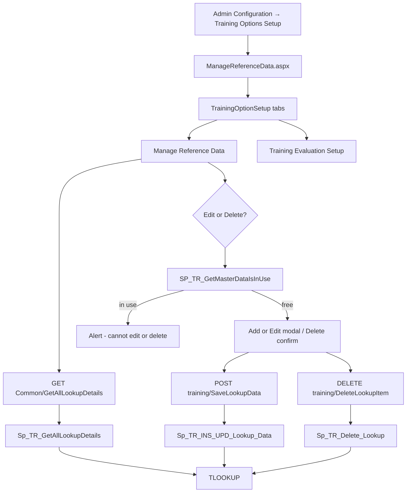
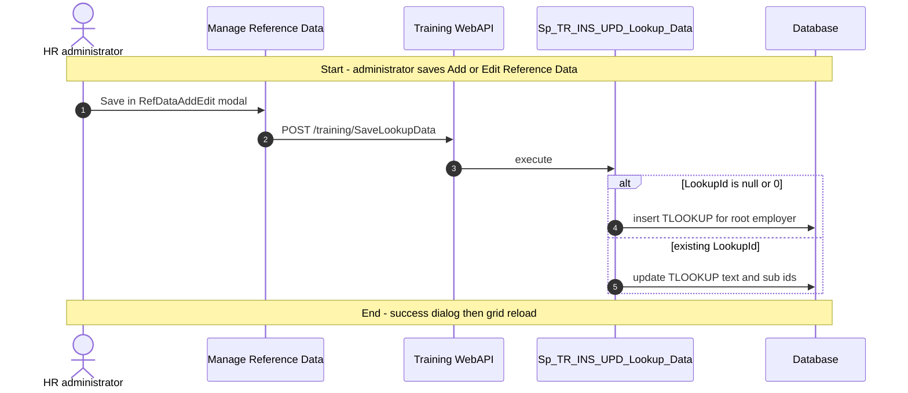
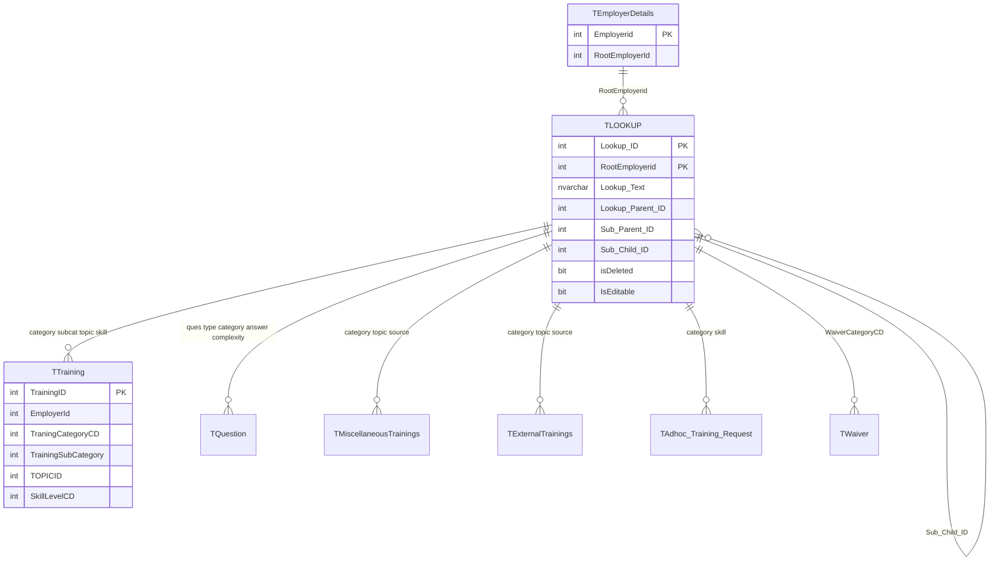

# Training Options Setup

## Overview

An HR administrator prepares the Training / LMS pick-lists before anyone creates a training, TNI topic, question, or evaluation setting. They open **Admin Configuration → Training Options Setup** (`~/HRM/Training/ManageReferenceData.aspx`). The WebForms host logs activity `TrainingOptionSetup`, stamps session employee context into hidden fields, and loads the Training webpack bundle. Client routing mounts `TrainingOptionSetup` behind claim `TR020` (`CNST_MANAGE_TR_REFERENCE_DATA`).

The shell has two tabs. **Manage Reference Data** (default) loads every non-deleted `TLOOKUP` row for the root employer, filters parents into the Reference Type dropdown (hiding Training Type `4000`), and shows children in a grid. The administrator can add or edit a leaf (category, sub-category, topic, skill level, cooling period, and related types), or soft-delete when the row is editable and not already in use. Edit and delete first call `SP_TR_GetMasterDataIsInUse` with the parent type name; when `DataIsInUse = 1` the UI blocks the change. Organisation switching for global access is present in code but hardcoded off (`showOrganization = false`).

The second tab, **Training Evaluation Setup**, maintains rating scales and evaluation duration. Its APIs and procedures are out of the call chain below.

Employees do not open this screen. Training create, TNI, questions, waivers, and evaluations later read the employer-scoped `TLOOKUP` values configured here.

Table catalogue notes live in `content/llm-wiki/reference/tables/training.md` (`TLOOKUP` and related training tables). SystemModel-2 has no workflow page for this screen. There is no llm-wiki domain ER page dedicated to Training Options Setup.

**Who's involved:**

- **HR administrator** — maintains Training reference lists for their organisation. Needs claim `TR020`.
- **Employee** — does not open this screen. Later Training / LMS flows consume the lookup values set here.

## Workflow

## Request journey

### HR administrator — save a reference row

## Entry points

`~/HRM/Training/ManageReferenceData.aspx` is the live host. `Page_Load` logs `ActivityDescription.TrainingOptionSetup` and copies `LoggedInEmployee` into hidden fields (`hdnEmpId`, `hdnEmployerId`, and related). The React bundle mounts at `#root`. Client route `RouteConstants.MANAGE_REFERENCEDATA` wraps `TrainingOptionSetup` with claim `TR020`.

A sibling folder `Areas/ManageReferenceData/` also defines a Manage Reference Data component, but `Areas/routes.js` imports `Areas/TrainingOptionSetup/Containers/trainingOptionSetup` for this URL. The older sibling is not the live mount.

| UI page | Purpose |
|---|---|
| `HRM/Training/ManageReferenceData.aspx` | WebForms host and session stamp |
| `Areas/TrainingOptionSetup/Containers/trainingOptionSetup.js` | Tab host (Manage Reference Data, Training Evaluation Setup) |
| `Areas/TrainingOptionSetup/Components/manageReferenceData.js` | Grid, type filter, edit/delete guards |
| `Areas/TrainingOptionSetup/Components/refDataAddEdit.js` | Add/edit modal and save |

## Code → database call chain

Active `apiURLConstants.js` exports unversioned `/Common/...` and `/training/...` paths (V1). Controllers below are the V1 files mounted from `routeIndex.js` (`/common`, `/training`). Global employer list and Training Evaluation Setup rating/duration APIs are not expanded here.

| Entry | Method | Stored procedure |
|---|---|---|
| Page load / after save / after delete | `fetchLookupData` (`manageReferenceData.js:68`) → `GetAllLookupDetails` (`commonController.js:32`) → `GetAllLookupDetails` (`commonDAL.js:72`) | `Sp_TR_GetAllLookupDetails` |
| Edit click (in-use guard) | `updateHandler` (`manageReferenceData.js:169`) → `GetMasterDataIsInUse` (`trainingController.js:1086`) → `GetMasterDataIsInUse` (`trainingDAL.js:2259`) | `SP_TR_GetMasterDataIsInUse` |
| Delete click (in-use guard) | `deleteHandler` (`manageReferenceData.js:199`) → same controller/DAL as edit guard | `SP_TR_GetMasterDataIsInUse` |
| Add/Edit Save | `saveFormData` (`refDataAddEdit.js:227`) → `SaveLookupData` (`trainingController.js:270`) → `SaveLookupData` (`trainingDAL.js:633`) | `Sp_TR_INS_UPD_Lookup_Data` |
| Delete confirm | `handleDataDelete` (`manageReferenceData.js:222`) → `DeleteLookupItem` (`trainingController.js:281`) → `DeleteLookupItem` (`trainingDAL.js:616`) | `Sp_TR_Delete_Lookup` |

Modal open also reloads lookups via `GET_ALL_LOOKUPITEMS` (`refDataAddEdit.js:75`) → same `Sp_TR_GetAllLookupDetails` path.

## API endpoints

Not WebForms postback. The React host calls the Training Node API (`API_URL` + paths below). Authorize middleware applies on these routes.

| Verb | Route | Parameters | Purpose | Source |
|---|---|---|---|---|
| GET | `/Common/GetAllLookupDetails` (route registers `/common/getAllLookupDetails`) | `EId` (employer id, required) | Load all non-deleted lookups for the root employer | `commonRoutes.js:10`, `commonController.js:32` |
| GET | `/training/getMasterDataIsInUse` | `employerId`, `LookupId`, `LookupText` (parent type name from grid) | Whether the row is referenced elsewhere | `trainingRoutes.js:111`, `trainingController.js:1086` |
| POST | `/training/SaveLookupData` (route registers `/saveLookupData`) | Body `LookupId`, `LookupText`, `LookupParentId`, `SubParentId`, `SubChildId`, `EmployerId` | Insert or update a lookup leaf | `trainingRoutes.js:30`, `trainingController.js:270` |
| DELETE | `/training/DeleteLookupItem` (route registers `/deleteLookupItem`) | `lookupId`, `employerId` query | Soft-delete lookup and related children | `trainingRoutes.js:31`, `trainingController.js:281` |

## Stored procedures & tables involved

| Object | File path | Purpose | llm-wiki |
|---|---|---|---|
| `Sp_TR_GetAllLookupDetails` | `HRMS-DATABASE/HRMS-TRAINING/STOREPROCEDURE/Sp_TR_GetAllLookupDetails.sql` | List non-deleted `TLOOKUP` rows for root employer, with parent text | `content/llm-wiki/reference/tables/training.md` (`TLOOKUP`) |
| `Sp_TR_INS_UPD_Lookup_Data` | `HRMS-DATABASE/HRMS-TRAINING/STOREPROCEDURE/Sp_TR_INS_UPD_Lookup_Data.sql` | Insert or update one `TLOOKUP` leaf | same |
| `Sp_TR_Delete_Lookup` | `HRMS-DATABASE/HRMS-TRAINING/STOREPROCEDURE/Sp_TR_Delete_Lookup.sql` | Soft-delete row and children (`isDeleted = 1`) | same |
| `SP_TR_GetMasterDataIsInUse` | `HRMS-DATABASE/HRMS-TRAINING/STOREPROCEDURE/SP_TR_GetMasterDataIsInUse.sql` | Branch by parent type name; probe training/question/waiver tables | same (`TTraining`, `TQuestion`, …) |
| `TEmployerDetails` | synonym `HRMS-DATABASE/HRMS-TRAINING/SYNONYMS/TEmployerDetails.sql` | Resolve `RootEmployerId` for list and in-use checks | core HRMS employer |

None of these four procedures call nested procedures or functions.

## Table relationships

Declared FKs are sparse; the diagram follows the joins and write targets in the procedures above (same style as other admin-configuration guides). `TEmployerDetails` is a Training synonym to core HRMS.

## Known gaps

- Active UI constants use unversioned V1 paths. V2 is line-commented; V3 sits inside a block comment in `apiURLConstants.js`. `routeIndex.js` still mounts `/v2/...` and `/v3/...`, but this guide documents the live V1 export.
- Several UI paths use PascalCase (`SaveLookupData`, `GetAllLookupDetails`) while Express registers camelCase (`saveLookupData`, `getAllLookupDetails`). Production likely depends on a case-insensitive host.
- Global organisation picker is hardcoded off (`showOrganization = false`); `GET_ALL_EMPLOYER_LIST` → `SP_GetGlobalAccessEmployerList` is dead on this screen until that flag is enabled.
- Sibling `Areas/ManageReferenceData/` is not routed for this URL; live mount is `TrainingOptionSetup`.
- Training Evaluation Setup (rating scales / evaluation duration) shares the host page but is not expanded in the call chain or database pages of this pass.
- Parent type `5000` hides the Add button; rows with `IsEditable = false` show "System Default" instead of edit/delete.
- SystemModel-2 has no workflow page for this screen. No llm-wiki domain ER page covers Training Options Setup end-to-end.

## Reference

Confidence is medium: the React → V1 Training WebAPI → procedure chain is clear in source. Express casing and commented V2/V3 constant blocks leave some runtime ambiguity.

### SourceCode

- `HRMS.Web/HRMS.Web/HRM/Training/ManageReferenceData.aspx`
- `HRMS.Web/HRMS.Web/HRM/Training/ManageReferenceData.aspx.cs`
- `HRMS.Web/HRMS.Web/HRM/Training/Areas/TrainingOptionSetup/Containers/trainingOptionSetup.js`
- `HRMS.Web/HRMS.Web/HRM/Training/Areas/TrainingOptionSetup/Components/manageReferenceData.js`
- `HRMS.Web/HRMS.Web/HRM/Training/Areas/TrainingOptionSetup/Components/refDataAddEdit.js`
- `HRMS.Web/HRMS.Web/HRM/Training/Areas/routes.js`
- `HRMS.Web/HRMS.Web/HRM/Training/Common/apiURLConstants.js`
- `HRMS.Web/HRMS.Web/HRM/Training/Common/claimConstants.js`
- `HRMS.Training/HRMS.Training.WebAPI.Node/Routes/routeIndex.js`
- `HRMS.Training/HRMS.Training.WebAPI.Node/Routes/commonRoutes.js`
- `HRMS.Training/HRMS.Training.WebAPI.Node/Routes/trainingRoutes.js`
- `HRMS.Training/HRMS.Training.WebAPI.Node/Controllers/commonController.js`
- `HRMS.Training/HRMS.Training.WebAPI.Node/Controllers/trainingController.js`
- `HRMS.Training/HRMS.Training.WebAPI.Node/Core/DataAccessLayer/commonDAL.js`
- `HRMS.Training/HRMS.Training.WebAPI.Node/Core/DataAccessLayer/trainingDAL.js`

### TDG HRMS DB

- `HRMS-DATABASE/HRMS-TRAINING/STOREPROCEDURE/Sp_TR_GetAllLookupDetails.sql`
- `HRMS-DATABASE/HRMS-TRAINING/STOREPROCEDURE/Sp_TR_INS_UPD_Lookup_Data.sql`
- `HRMS-DATABASE/HRMS-TRAINING/STOREPROCEDURE/Sp_TR_Delete_Lookup.sql`
- `HRMS-DATABASE/HRMS-TRAINING/STOREPROCEDURE/SP_TR_GetMasterDataIsInUse.sql`
- `HRMS-DATABASE/HRMS-TRAINING/TABLES/TLOOKUP.sql`
- `HRMS-DATABASE/HRMS-TRAINING/SYNONYMS/TEmployerDetails.sql`
- `content/llm-wiki/reference/tables/training.md`
