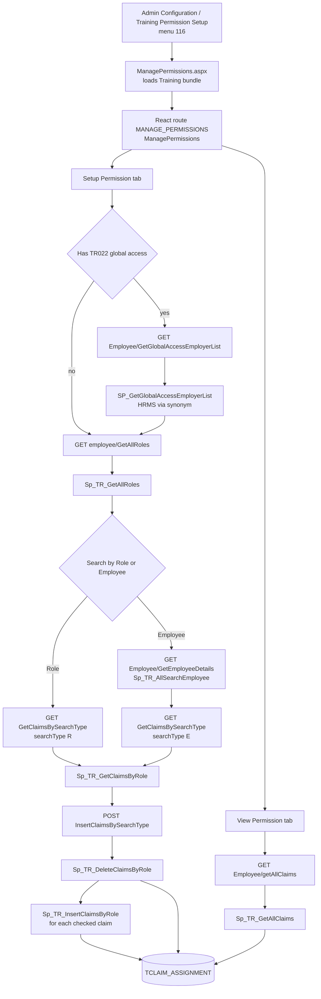
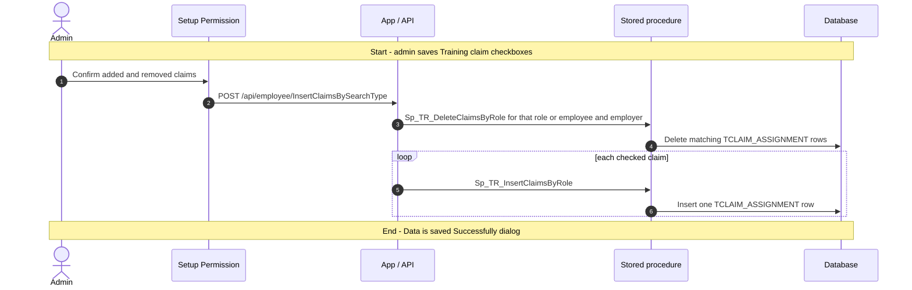
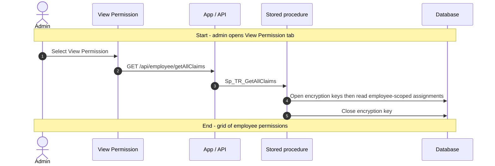
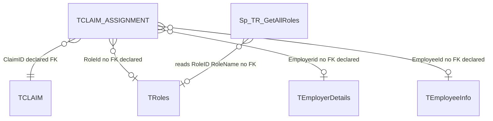

# Training Permission Setup

## Overview

An administrator grants Training / LMS actions (trainings, question bank, TNI, reports, global org pickers, and the rest of the Training claim catalog) by **role** or by **one employee**. On **Admin Configuration → Training Permission Setup** (menu node **116**) they open `~/HRM/Training/ManagePermissions.aspx`, which only seeds hidden session fields, logs activity **335** (`TrainingPermissionSetup`), and loads the webpack Training React app. The React route `MANAGE_PERMISSIONS` mounts **ManagePermissions** with two tabs: **Setup Permission** and **View Permission**.

On Setup Permission they pick an organisation when they hold claim `TR022` (global access), choose **Role** or **Employee**, tick claim checkboxes grouped as **Manage Training Permissions** (`ModuleID` 0) and **Manage Access Permissions** (`ModuleID` 1), and save. Save deletes that role’s or employee’s rows in Training `TCLAIM_ASSIGNMENT`, then inserts one row per checked claim. View Permission lists every employee-scoped assignment under the employer’s root-employer tree. This is **not** HRMS left-nav Access Right Management (`TRoles` / `TRolePagesMapping`); it is the Training claim catalog on `TCLAIM` / `TCLAIM_ASSIGNMENT` in the Training database (`HRMS-TRAINING`).

**Who's involved:**

- **Administrator** with the Training Permission Setup menu — grants or revokes Training claims for a role or one employee.
- **Global-access administrator** (claim `TR022`) — sees the organisation dropdown fed by `SP_GetGlobalAccessEmployerList`.
- **Employee** — never uses this screen; their effective Training claims are read elsewhere through `Sp_TR_GetUserClaims` (not called from this page).

There is no SourceCode SystemModel-2 page for Training Permission Setup. Table blurbs for Training `TCLAIM` and `TCLAIM_ASSIGNMENT` are in `llm-wiki/reference/tables/training.md`. The glossary notes that “Claim” recurs across satellite modules (`llm-wiki/glossary/ubiquitous-language.md`, `llm-wiki/glossary/business-entities.md`).

## Workflow

## Request journey

### Save role or employee claims

### View employee claim assignments

## Entry points

> The live screen is the WebForms host `HRM/Training/ManagePermissions.aspx`. It does not post back for claim saves. Claim work goes through the Training Web API Node `employeeController` (`/api/employee/...`) against the Training database. There is no React route outside this ASPX host. SourceCode SystemModel-2 has no Training permission page.

| Entry point | Purpose | Live? |
|---|---|---|
| `~/HRM/Training/ManagePermissions.aspx` (`RouteConstants.MANAGE_PERMISSIONS`, menu **116**) | Host page; seeds employee/employer hidden fields; loads React | Yes |
| Setup Permission tab (`ManagePermissions` eventKey 1) | Role or employee claim grant UI | Yes |
| View Permission tab (`ManagePermissions` eventKey 2) | Read-only grid of employee claim assignments | Yes |
| `CommonUtil.LogActivity(TrainingPermissionSetup)` on `Page_Load` | Activity type **335** | Yes |
| Legacy `GET getClaimsByRole` | Older claim API still on `employeeRoutes` | Not called from this React page |

## Code → database call chain

The React UI calls `APIHelper` → Training Node `employeeController` (v1 routes; `apiURLConstants.js` Version 3 block is commented out). Reads go Controller → `EmployeeDAL`. Save goes Controller → `EmployeeBLL.InsertClaimsBySearchType` → delete then insert on `EmployeeDAL`.

| Step | Entry point | App code | Stored procedure |
|---|---|---|---|
| Activity on open | `ManagePermissions.aspx.cs:22` | `CommonUtil.LogActivity` (`Common.cs:52`) | `Sp_InsertActivityLog` (HRMS; activity **335**) |
| Organisation list when `TR022` | `setupPermission.js:64` | `employeeController.GetGlobalAccessEmployerList` (`employeeController.js:105`) → `EmployeeDAL.GetGlobalAccessEmployerList` (`employeeDAL.js:194`) | `SP_GetGlobalAccessEmployerList` (HRMS object; synonym in TRAINING) |
| Role dropdown | `setupPermission.js:91` | `employeeController.GetAllRoles` (`employeeController.js:52`) → `EmployeeDAL.GetAllRoles` (`employeeDAL.js:87`) | `Sp_TR_GetAllRoles` |
| Load role or employee claim checkboxes | `setupPermission.js:143` | `employeeController.GetClaimsBySearchType` (`employeeController.js:63`) → `EmployeeDAL.GetClaimsBySearchType` (`employeeDAL.js:123`) | `Sp_TR_GetClaimsByRole` |
| Employee search / select | `employeeSearch.js:67` | `employeeController.GetEmployeeDetails` (`employeeController.js:19`) → `EmployeeDAL.GetEmployeeDetails` (`employeeDAL.js:49`) | `Sp_TR_AllSearchEmployee` (called by DAL; **no SQL file** in `HRMS-DATABASE/HRMS-TRAINING`) |
| Save claims | `setupPermission.js:167` | `employeeController.InsertClaimsBySearchType` (`employeeController.js:84`) → `EmployeeBLL.InsertClaimsBySearchType` (`employeeBLL.js:17`) → `EmployeeDAL.DeleteClaimsBySearchType` (`employeeDAL.js:142`) then `InsertClaimsBySearchType` (`employeeDAL.js:160`) | `Sp_TR_DeleteClaimsByRole` then `Sp_TR_InsertClaimsByRole` per checked claim |
| View Permission grid | `viewPermission.js:19` | `employeeController.GetAllClaims` (`employeeController.js:95`) → `EmployeeDAL.GetAllClaims` (`employeeDAL.js:178`) | `Sp_TR_GetAllClaims` |

## API endpoints

This screen is not a WebForms postback for claim data. The ASPX only loads the React shell. Claim traffic is HTTP to the Training Web API (`process.env.API_URL`), Express mount `/api` + `/employee`, with `Authorize` middleware on these routes.

| Method | Path | Purpose | Caller | Handler |
|---|---|---|---|---|
| GET | `/api/employee/GetGlobalAccessEmployerList?employeeId=` | Organisations for global-access admins | `setupPermission.js` `populateOrganization` | `employeeController.GetGlobalAccessEmployerList` |
| GET | `/api/employee/GetAllRoles?employerId=` | Role dropdown | `setupPermission.js` `populateRoles` | `employeeController.GetAllRoles` |
| GET | `/api/employee/GetClaimsBySearchType?roleId=&employerId=&searchType=&employeeId=` | Claim checkbox state. `searchType` `R` or `E` | `setupPermission.js` `loadClaims` | `employeeController.GetClaimsBySearchType` |
| GET | `/api/Employee/GetEmployeeDetails?...` | Employee picker rows | `employeeSearch.js` | `employeeController.GetEmployeeDetails` |
| POST | `/api/employee/InsertClaimsBySearchType` | Replace role or employee assignments | `setupPermission.js` `saveFormData` | `employeeController.InsertClaimsBySearchType` |
| GET | `/api/employee/getAllClaims?employerId=` | View Permission grid | `viewPermission.js` | `employeeController.GetAllClaims` |

`apiURLConstants.js` also defines `/v3/...` paths inside a block comment; the live constants used by this page are the unversioned `/employee/...` paths above. `/v2/employee` and `/v3/employee` routes still exist on the server but are not what this bundle calls.

## Stored procedures & tables involved

Inventory paths are under `HRMS-DATABASE/HRMS-TRAINING/` unless noted. Procedure pages for Training objects are under `/docs/database/hrms-training/`. Shared HRMS objects keep the `hrms` slug.

| Object | File | Purpose | Database page |
|---|---|---|---|
| `Sp_TR_GetAllRoles` | `STOREPROCEDURE/Sp_TR_GetAllRoles.sql` | Role id/name for default roles and the employer’s active roles | [Sp_TR_GetAllRoles](/docs/database/hrms-training/Sp_TR_GetAllRoles) |
| `Sp_TR_GetClaimsByRole` | `STOREPROCEDURE/Sp_TR_GetClaimsByRole.sql` | Claim catalog plus existence flags for role or employee | [Sp_TR_GetClaimsByRole](/docs/database/hrms-training/Sp_TR_GetClaimsByRole) |
| `Sp_TR_InsertClaimsByRole` | `STOREPROCEDURE/Sp_TR_InsertClaimsByRole.sql` | Insert one `TCLAIM_ASSIGNMENT` row | [Sp_TR_InsertClaimsByRole](/docs/database/hrms-training/Sp_TR_InsertClaimsByRole) |
| `Sp_TR_DeleteClaimsByRole` | `STOREPROCEDURE/Sp_TR_DeleteClaimsByRole.sql` | Delete role- or employee-scoped assignments for an employer | [Sp_TR_DeleteClaimsByRole](/docs/database/hrms-training/Sp_TR_DeleteClaimsByRole) |
| `Sp_TR_GetAllClaims` | `STOREPROCEDURE/Sp_TR_GetAllClaims.sql` | Employee-scoped assignment report for the root employer tree | [Sp_TR_GetAllClaims](/docs/database/hrms-training/Sp_TR_GetAllClaims) |
| `Sp_TR_AllSearchEmployee` | *(not in Liquibase inventory)* | Employee search for the Employee mode picker | No page yet — SQL missing from repo |
| `SP_GetGlobalAccessEmployerList` | `HRMS/STOREPROCEDURE/SP_GetGlobalAccessEmployerList.sql` (synonym in TRAINING) | Global-access organisation list | [SP_GetGlobalAccessEmployerList](/docs/database/hrms/SP_GetGlobalAccessEmployerList) |
| `Sp_InsertActivityLog` | `HRMS/STOREPROCEDURE/Sp_InsertActivityLog.sql` | Page-open activity **335** | [Sp_InsertActivityLog](/docs/database/hrms/Sp_InsertActivityLog) |

Tables these procedures read or write in Training: `TCLAIM`, `TCLAIM_ASSIGNMENT`. Synonym / cross-db reads include `TRoles`, `TEmployeeInfo`, `TEmployerDetails`, `TUsers`, plus name/encryption helpers. `llm-wiki/reference/tables/training.md` catalogs `TCLAIM` and `TCLAIM_ASSIGNMENT` and records the declared FK `TCLAIM_ASSIGNMENT` → `TCLAIM`.

Direct nested callees (one level) already have HRMS pages: `Sp_OpenEncryptionKeys`, `SP_CloseEncryptionKey`, `Fn_GetEmployeeName`.

## Table relationships

Declared foreign keys are labeled as such. Columns the procedures join without a foreign key are labeled **no FK declared**. Do not invent FKs for `RoleId`, `Employerid`, or `EmployeeId` on `TCLAIM_ASSIGNMENT` — the table script only declares `FK_ClaimAssm_Claim_Id`.

`TCLAIM.ModuleID` is an integer used by the UI as Manage Training Permissions `0` and Manage Access Permissions `1`. There is no foreign key from `ModuleID` to a module table in the TRAINING `TCLAIM` script.

## Known gaps

- SourceCode `docs/SystemModels/SystemModel-2` has no Training or Training Permission Setup domain page.
- `EmployeeDAL.GetEmployeeDetails` executes `Sp_TR_AllSearchEmployee`, but that procedure is **not** present under `HRMS-DATABASE/HRMS-TRAINING` (inventory has `Sp_TR_SearchEmployee` / `Sp_TnE_SearchEmployee` instead). No database page was written for it.
- `setupPermission.js` `populateRoles` always passes the logged-in `employerId` from Redux, not the selected organisation when `TR022` is present, even though `useEffect` re-runs on organisation change.
- View Permission export file name is hard-coded as `Resource Allocation Permission Report`.
- There is no Reset-to-role-based-permissions action on this Training screen (unlike Travel & Expense Permission Setup).
- `Sp_TR_GetUserClaims` loads a signed-in user’s effective claims elsewhere. It is not called from Training Permission Setup.
- `EmployeeBLL.InsertClaimsBySearchType` reuses one `transactionRequest` for delete plus every insert; input-name reuse on the same mssql request is fragile compared with a fresh request per call.
- Several Training claim scripts begin with `USE [Training]`.
- Page-open `Sp_InsertActivityLog` for activity **335** runs through shared HRMS logging.

## Reference

High confidence on the React → Training Node API → DAL → Training procedure chain. Nested encryption and name helpers resolve through TRAINING synonyms into HRMS. `Sp_TR_AllSearchEmployee` is unresolved in the Liquibase tree.

### SourceCode

- `HRMS.Web/HRMS.Web/HRM/Training/ManagePermissions.aspx` and `ManagePermissions.aspx.cs`
- `HRMS.Web/HRMS.Web/HRM/Training/Areas/ManagePermissions/Containers/managePermissions.js`
- `HRMS.Web/HRMS.Web/HRM/Training/Areas/ManagePermissions/Components/setupPermission.js`
- `HRMS.Web/HRMS.Web/HRM/Training/Areas/ManagePermissions/Components/viewPermission.js`
- `HRMS.Web/HRMS.Web/HRM/Training/SharedComponent/UI/EmployeeSearch/employeeSearch.js`
- `HRMS.Web/HRMS.Web/HRM/Training/Common/apiURLConstants.js`, `apiHelper.js`, `routeConstants.js`, `claimConstants.js`
- `HRMS.Web/HRMS.Web/HRM/Training/Areas/routes.js`
- `HRMS.Training/HRMS.Training.WebAPI.Node/Controllers/employeeController.js`
- `HRMS.Training/HRMS.Training.WebAPI.Node/Core/BusinessLogicLayer/employeeBLL.js`
- `HRMS.Training/HRMS.Training.WebAPI.Node/Core/DataAccessLayer/employeeDAL.js`
- `HRMS.Training/HRMS.Training.WebAPI.Node/Routes/employeeRoutes.js`, `Routes/routeIndex.js`
- `HRMS.Shared/HRMS.DataContract/Common/Enums.cs` (`TrainingPermissionSetup = 335`)

### TDG HRMS DB

- `llm-wiki/reference/tables/training.md` (mirrored under Backstage `content/llm-wiki/`)
- `llm-wiki/glossary/ubiquitous-language.md`
- `llm-wiki/glossary/business-entities.md`
- `HRMS-DATABASE/HRMS-TRAINING/TABLES/TCLAIM.sql`, `TCLAIM_ASSIGNMENT.sql`
- `HRMS-DATABASE/HRMS-TRAINING/SYNONYMS/SP_GetGlobalAccessEmployerList.sql`, `Sp_OpenEncryptionKeys.sql`, `SP_CloseEncryptionKey.sql`, `Fn_GetEmployeeName.sql`, `TRoles.sql`, `TEmployeeInfo.sql`, `TEmployerDetails.sql`, `TUsers.sql`
- Procedure scripts listed in the table above
- `HRMS-DATABASE/HRMS/DML/Tmenudetails DML.sql` (Training Permission Setup node **116**)
