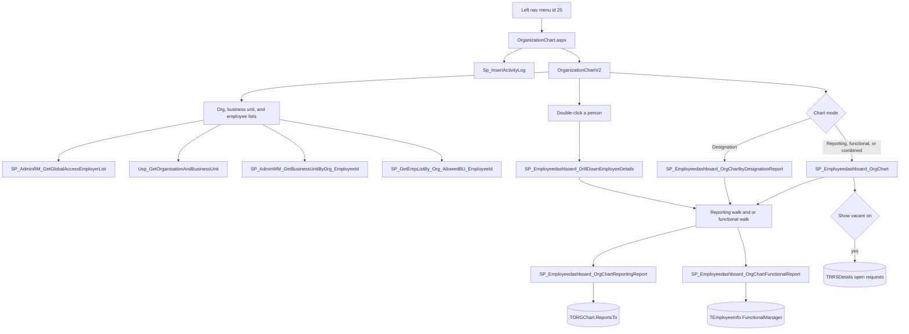
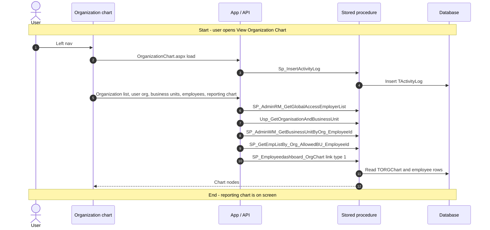
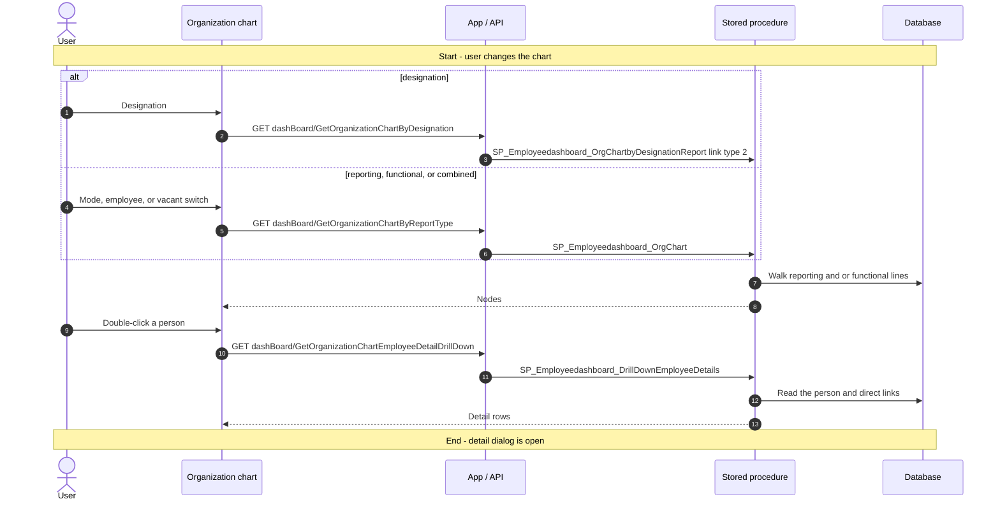
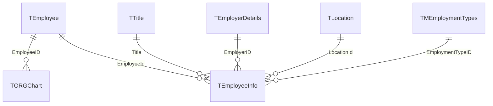

# View Organization Chart

## Overview

An administrator opens **View Organization Chart** to see how people report to each other. The chart is rooted on one employee and can be drawn four ways: the reporting line, the functional-manager line, both lines together for two levels, or the functional line grouped by job title. Optional vacant boxes come from open recruitment requests (in process, approved, or on hold). Double-clicking a person opens a detail table for that person and their direct links. Nothing on this screen saves the hierarchy. Reporting lines and functional managers are maintained elsewhere.

On DEV, every `tMenuDetails` row for menu id 25 (243 rows) stores `NavigateURL` `~/HRM/Organization/OrganizationChart.aspx` and `PageName` `OrganizationChart.aspx`. That WebForms page is the host. Its code-behind only writes an activity-log row and loads `dashboard_react.*.min.js` into `
`. The React router treats that same URL as `ORGANIZATION_CHART` and mounts `OrganizationChartV2`. The older `Areas/OrganizationChart` React screen is still in the source tree and is not registered on a route, so the menu does not open it.

The on-page breadcrumb says Home / Employee Management / View Organization Chart. Menu scripts place the same item under Admin Configuration → Organization Setup (menu value 25). `docs/SystemModels/SystemModel-2` has no context page for this screen. `llm-wiki/reference/tables/hrms.md` describes `TOrganisationHierarchy` as the organization-chart XML. This screen does not read that table. It walks `TORGChart.ReportsTo` for reporting and `TEmployeeInfo.FunctionalManager` for the functional line, and it uses `TOrgHierarchyDetails` only as the business-unit name list.

**Who's involved:**

- **Signed-in user** — picks organizations they can see, a business unit, and an employee, then reads the chart. Organization, business-unit, and employee lists are scoped with the token employee id. The chart itself is loaded for the employee selected in the picker.
- **People on the chart** — active employees under the selected person, plus hiring-manager vacant seats when that switch is on.

## Workflow

Link type sent to the chart procedures: Reporting is 1, Functional is 2, Combined Dual-Reporting is 0. Designation does not use that procedure. It always calls the designation procedure with link type 2, then the browser groups people who share `TEmployeeInfo.Title`.

## Request journey

### Open the page

### Change the chart or open a person

Photos are not loaded by these procedures. The browser asks for `/Images/{customerId}/Photos/{employeeId}.jpg`. Theme, PDF, and PNG export stay in the browser.

## Entry points

| Entry point | Purpose | Live? |
|---|---|---|
| Left nav menu id 25, `~/HRM/Organization/OrganizationChart.aspx` | Admin Configuration → Organization Setup → View Organization Chart | Yes. DEV `tMenuDetails` has 243 rows and one URL |
| `OrganizationChart.aspx` plus `OrganizationChartV2` | Host page and the chart that route renders | Yes. This is the screen the menu opens |
| `Areas/OrganizationChart` (V1) | Older React chart. Calls `GET /dashBoard/GetOrganizationChartByBusinessUnit`, which runs `SP_OrgChart` | Source only. `routes.js` does not mount it |
| `Dashboard/Components/OrganizationCharts.js` on Management Dashboard | A different home-dashboard widget. Calls `GET /dashBoard/GetManagementOrganizationChart`, which runs `USP_OrgChart` | Yes, on the dashboard, not on this menu |
| `OrganizationChart.aspx.cs` `bindOrganization`, `getEmployeePicture`, `getImageUrl` | Leftover WebForms helpers. `bindOrganization` is empty and the picture methods are not called | No |

## Code → database call chain

| Step | UI | App | Stored procedure |
|---|---|---|---|
| Menu open | `tMenuDetails.NavigateURL` for menu id 25 | `OrganizationChart.aspx` loads `dashboard_react.*.min.js` (`OrganizationChart.aspx.cs:18-22`) | — |
| Activity log | same page load | `CommonUtil.LogActivity(ActivityDescription.OrganizationChart)` (`OrganizationChart.aspx.cs:20`, enum value 311 at `Enums.cs:254`) → `Common.cs:52` → `ActivityHelper.cs:32` | `Sp_InsertActivityLog` |
| Route | URL equals `RouteConstants.ORGANIZATION_CHART` (`routeConstants.js:21`) | `routes.js:36` and `routes.js:112` mount `OrganizationChartV2/Containers/OrganizationChartContainer.js` | — |
| First paint | `initData` (`OrganizationChartContainer.js:85-131`) | five calls below, in two waves | see each row |
| Organizations | `apiHelper.js:3-7` | `GET /api/recruitment/getOrganizationList` → `RecruitmentRoutes.js:22` → `recruitmentController.js:235-237` → `recruitmentDAL.js:943-954`. Query `employeeId` is ignored. The procedure gets `req.EID`. `gridId` in the client URL is the literal `null` (`apiURLConstants.js:169`) | `SP_AdminRM_GetGlobalAccessEmployerList` |
| Signed-in org and business unit | `apiHelper.js:14-22` | `POST /api/dashboard/GetOrganizationAndBusinessUnit` → `DashBoardRoutes.js:143` → `dashboardController.js:1838-1840` → `dashBoardDAL.js:2972-2978`. Employee id is `req.EID` or the body | `Usp_GetOrganisationAndBusinessUnit` |
| Business units | `apiHelper.js:29-36` | `GET /api/recruitment/GetBusinessUnitsByEmployeeId` → `RecruitmentRoutes.js:18` → `recruitmentController.js:117-119` → `recruitmentDAL.js:140-148`. Employee id is `req.EID` | `SP_AdminWM_GetBusinessUnitByOrg_EmployeeId` |
| Employees | `apiHelper.js:43-54` | `GET /api/dashboard/GetEmployeeListByOrgBuEmployeeId` → `DashBoardRoutes.js:387` → `dashboardController.js:3811-3817` → `dashBoardDAL.js:5104-5117`. Employee id is `req.EID`. A missing business-unit id is sent as null | `SP_GetEmpListBy_Org_AllowedBU_EmployeeId` |
| Reporting, functional, or combined | `apiHelper.js:62-105` | `GET /api/dashBoard/GetOrganizationChartByReportType` → `DashBoardRoutes.js:132` → `dashboardController.js:1656-1661` → `dashBoardDAL.js:2892-2900`. This employee id is the query value, so it can be the person in the picker | `SP_Employeedashboard_OrgChart` |
| Designation | `apiHelper.js:70-83` | `GET /api/dashBoard/GetOrganizationChartByDesignation` → `DashBoardRoutes.js:134` → `dashboardController.js:1685-1689` → `dashBoardDAL.js:2919-2926`. The client always sends link type 2 | `SP_Employeedashboard_OrgChartbyDesignationReport` |
| Drill-down | `OrganizationChartContainer.js:270-300` → `apiHelper.js:107-118` | `GET /api/dashBoard/GetOrganizationChartEmployeeDetailDrillDown` → `DashBoardRoutes.js:133` → `dashboardController.js:1668-1677` → `dashBoardDAL.js:2906-2913` | `SP_Employeedashboard_DrillDownEmployeeDetails` |
| Reporting walk | called by the three procedures above | — | `SP_Employeedashboard_OrgChartReportingReport` |
| Functional walk | called by the three procedures above | — | `SP_Employeedashboard_OrgChartFunctionalReport` |

`DashBoardRoutes_V2.js` and `DashBoardRoutes_V3.js` are not mounted for these paths. `routeIndex.js:22` mounts `DashBoardRoutes.js` at `/api/dashBoard`, and `routeIndex.js:48` mounts `RecruitmentRoutes.js` at `/api/recruitment`. Two client constants spell the prefix `/dashboard/` (organization-and-business-unit, employee list). The chart constants spell `/dashBoard/`.

## API endpoints

The host page is a WebForms GET. It does not post the chart back. After load, the React screen calls the Node API under `/api`.

| Verb | Route | Parameters | Purpose | Source |
|---|---|---|---|---|
| `GET` | `/HRM/Organization/OrganizationChart.aspx` | none | Host page. Logs activity 311 and injects the React bundle | `OrganizationChart.aspx`, `OrganizationChart.aspx.cs:18-25` |
| `GET` | `/api/recruitment/getOrganizationList` | query `employeeId` (ignored), `gridId` (client sends the text `null`). Procedure employee is `req.EID` | Employers the user may pick | `RecruitmentRoutes.js:22`, `recruitmentController.js:235` |
| `POST` | `/api/dashboard/GetOrganizationAndBusinessUnit` | body `employeeId`. Controller uses `req.EID` when present | Signed-in user's employer and business unit, used to preselect the filters | `DashBoardRoutes.js:143`, `dashboardController.js:1838` |
| `GET` | `/api/recruitment/GetBusinessUnitsByEmployeeId` | query `employerid`. Employee is `req.EID` | Business units for the organization multi-select | `RecruitmentRoutes.js:18`, `recruitmentController.js:117` |
| `GET` | `/api/dashboard/GetEmployeeListByOrgBuEmployeeId` | query `organizationId`, `businessUnitId`. Employee is `req.EID`. Route also runs `assertEmployerAccess('organizationId')` | Employee picker | `DashBoardRoutes.js:387`, `dashboardController.js:3811` |
| `GET` | `/api/dashBoard/GetOrganizationChartByReportType` | query `employeeId`, `reportType` (0 combined, 1 reporting, 2 functional), `showVacant` (0 or 1) | Chart nodes, including vacant seats when the flag is 1 | `DashBoardRoutes.js:132`, `dashboardController.js:1656` |
| `GET` | `/api/dashBoard/GetOrganizationChartByDesignation` | query `employeeId`, `reportType` (client always sends 2) | Functional tree with `type` designation and `designationId` from `TEmployeeInfo.Title` | `DashBoardRoutes.js:134`, `dashboardController.js:1685` |
| `GET` | `/api/dashBoard/GetOrganizationChartEmployeeDetailDrillDown` | query `employeeId`, `reportType` mapped the same way as the chart | Detail rows for the double-clicked person and direct links | `DashBoardRoutes.js:133`, `dashboardController.js:1668` |

These routes exist and are not used by the mounted V2 screen:

| Verb | Route | Procedure | Who calls it |
|---|---|---|---|
| `GET` | `/api/dashBoard/GetOrganizationChart` | `SP_OrgChart` | No V2 caller |
| `GET` | `/api/dashBoard/GetOrganizationChartByBusinessUnit` | `SP_OrgChart` | Unrouted V1 `OrganizationChartReducer.js` |
| `GET` | `/api/dashBoard/GetManagementOrganizationChart` | `USP_OrgChart` | Management Dashboard widget |

## Stored procedures & tables involved

Pages below are the procedures this screen executes, plus the two walks they call directly. Encryption helpers and `Fn_GetEmployeeName` already have database pages.

| Object | Role on this screen | Page |
|---|---|---|
| `Sp_InsertActivityLog` | One row in `TActivityLog` on every host-page load | [Sp_InsertActivityLog](/docs/database/hrms/Sp_InsertActivityLog) |
| `SP_AdminRM_GetGlobalAccessEmployerList` | Organization multi-select | [SP_AdminRM_GetGlobalAccessEmployerList](/docs/database/hrms/SP_AdminRM_GetGlobalAccessEmployerList) |
| `Usp_GetOrganisationAndBusinessUnit` | Preselect the signed-in user's org and business unit | [Usp_GetOrganisationAndBusinessUnit](/docs/database/hrms/Usp_GetOrganisationAndBusinessUnit) |
| `SP_AdminWM_GetBusinessUnitByOrg_EmployeeId` | Business-unit picker. Also called inside the employee-list procedure | [SP_AdminWM_GetBusinessUnitByOrg_EmployeeId](/docs/database/hrms/SP_AdminWM_GetBusinessUnitByOrg_EmployeeId) |
| `SP_GetEmpListBy_Org_AllowedBU_EmployeeId` | Employee picker | [SP_GetEmpListBy_Org_AllowedBU_EmployeeId](/docs/database/hrms/SP_GetEmpListBy_Org_AllowedBU_EmployeeId) |
| `SP_Employeedashboard_OrgChart` | Reporting, functional, and combined charts, plus vacant seats | [SP_Employeedashboard_OrgChart](/docs/database/hrms/SP_Employeedashboard_OrgChart) |
| `SP_Employeedashboard_OrgChartbyDesignationReport` | Designation chart | [SP_Employeedashboard_OrgChartbyDesignationReport](/docs/database/hrms/SP_Employeedashboard_OrgChartbyDesignationReport) |
| `SP_Employeedashboard_DrillDownEmployeeDetails` | Double-click detail | [SP_Employeedashboard_DrillDownEmployeeDetails](/docs/database/hrms/SP_Employeedashboard_DrillDownEmployeeDetails) |
| `SP_Employeedashboard_OrgChartReportingReport` | Downward walk of `TORGChart.ReportsTo` | [SP_Employeedashboard_OrgChartReportingReport](/docs/database/hrms/SP_Employeedashboard_OrgChartReportingReport) |
| `SP_Employeedashboard_OrgChartFunctionalReport` | Downward walk of `TEmployeeInfo.FunctionalManager` | [SP_Employeedashboard_OrgChartFunctionalReport](/docs/database/hrms/SP_Employeedashboard_OrgChartFunctionalReport) |
| `Sp_OpenEncryptionKeys`, `SP_CloseEncryptionKey`, `Fn_GetEmployeeName` | Used inside the walks, the employee list, and the org lookup | Existing pages under `/docs/database/hrms/` |

`SP_Employeedashboard_OrgChart` with link type 0 runs both walks, drops rows deeper than level 2, marks a person who appears in both walks as `combined`, and deletes the extra functional row. Level 1 `parentId` is cleared so the selected employee is the root. Vacant nodes are `TRRSDetails` rows in status `Inprocess`, `Approved`, or `OnHold`, parented to `HiringMGR`. The designation procedure leaves that vacant insert commented out, and the vacant switch is hidden for Designation (`OrganizationChartContainer.js:569`).

The browser then adds group nodes (Reporting Level, Functional Level, Vacant Positions) that are not returned by SQL.

| Table | How this screen uses it |
|---|---|
| `tMenuDetails` | Menu id 25 URL and page name |
| `TActivityLog` | Visit row. No foreign key in its CREATE script |
| `TORGChart` | Reporting parent (`ReportsTo`). Foreign key `EmployeeID` → `TEmployee.EmployeeId` |
| `TEmployeeInfo` | Functional manager, title, business unit, location, employment number, dates used for experience |
| `TEmployee` | Active flag. The walks keep `IsActive = 'Y'` |
| `TEmployerDetails` | Organization name and the cross-reporting flag |
| `TOrgHierarchyDetails` | Business-unit display name. No foreign key in its CREATE script |
| `TTitle` | Designation text. `TEmployeeInfo.Title` references `TTitle.ID` |
| `TLocation` | Base location. Drill-down also reads `TEmployeeInfo.worklocation` with no foreign key on that column |
| `TEmployeeBudgetSourceDetails`, `TProject` | Project names on a node. No foreign key in the budget-source CREATE script |
| `TRRSDetails` | Vacant seats when the switch is on |
| `TUsers`, `TUserEmployee`, `TUSerPagesMapping`, `TRolePagesMapping` | Which organizations and business units the signed-in user may list |
| `TRRS_GRID_CONFIG` | `SelectedOrgs` on the organization query. This screen does not apply that column |
| `TEmployeeRoleMaster`, `TMEmploymentTypes`, `TCategory` | Drill-down role, employment type, and skill category |

## Table relationships

Declared foreign keys from the CREATE scripts used by the chart. `ReportsTo`, `FunctionalManager`, `BusinessUnitId`, and `worklocation` are join columns in the procedures and are not foreign keys in those scripts.

## Known gaps

- The React breadcrumb says Employee Management. The menu scripts and this guide's submenu place the item under Admin Configuration → Organization Setup.
- `llm-wiki/reference/tables/hrms.md` says `TOrganisationHierarchy` stores the organization chart as XML. This screen never reads it. SystemModel-2 has no page for this screen (`domain/contexts/hr-core.md` does not mention the chart).
- V1 `Areas/OrganizationChart` and `SP_OrgChart` are not on the menu route. The Management Dashboard widget uses `USP_OrgChart`, a third procedure.
- `OrganizationChart.aspx.cs` still contains unused picture helpers, an empty `bindOrganization`, and zoom script for `.chartdiv`. The live chart does not use them.
- Organization and employee list URLs use `/dashboard/` while `routeIndex.js` mounts `/api/dashBoard`. Chart URLs use `/dashBoard/`.
- `Usp_GetOrganisationAndBusinessUnit` opens encryption keys and does not close them. The cross-reporting `IF` is commented out, so `IsCrossreportingApplicable` does not change the result.
- `SP_GetEmpListBy_Org_AllowedBU_EmployeeId` closes encryption keys only on the cross-reporting branch. The early return for a business unit outside the allowed list returns after the keys are opened.
- Several chart scripts begin with `USE [HRM-CL-Prod]`.
- `SP_AdminRM_GetGlobalAccessEmployerList` sets `IsParentOrg` with `ParentEmployerid = null`. In SQL that comparison is unknown, so a null parent does not count as a parent organization. A parent id of 0 does.
- Designation `designationId` is `TEmployeeInfo.Title` (the title id), not `TEmployeeInfo.DesignationId`.

## Reference

Last analyzed 2026-11-06. Confidence is **high** for the menu URL, the mounted React screen, and the procedure chain. DEV `tMenuDetails` was read with a SELECT. Procedure bodies were read from the Liquibase inventory files and were not executed.

### SourceCode

- `HRMS.Web/HRMS.Web/HRM/Organization/OrganizationChart.aspx`
- `HRMS.Web/HRMS.Web/HRM/Organization/OrganizationChart.aspx.cs`
- `HRMS.Web/HRMS.Web/HRM/DashBoard_React/Areas/routes.js`
- `HRMS.Web/HRMS.Web/HRM/DashBoard_React/Common/routeConstants.js`
- `HRMS.Web/HRMS.Web/HRM/DashBoard_React/Common/apiURLConstants.js`
- `HRMS.Web/HRMS.Web/HRM/DashBoard_React/Areas/OrganizationChartV2/Containers/OrganizationChartContainer.js`
- `HRMS.Web/HRMS.Web/HRM/DashBoard_React/Areas/OrganizationChartV2/Components/apiHelper.js`
- `HRMS.Web/HRMS.Web/HRM/DashBoard_React/Areas/OrganizationChartV2/Components/ReportTypeSelection.js`
- `HRMS.Web/HRMS.Web/HRM/DashBoard_React/Areas/OrganizationChart/` (not routed)
- `HRMS.Web/HRMS.Web/HRM/DashBoard_React/Areas/Dashboard/Components/OrganizationCharts.js` (dashboard widget)
- `HRMS.CoreAPI/HRMS.Core.WebAPI.Node/Routes/routeIndex.js`
- `HRMS.CoreAPI/HRMS.Core.WebAPI.Node/Routes/DashBoardRoutes.js`
- `HRMS.CoreAPI/HRMS.Core.WebAPI.Node/Routes/RecruitmentRoutes.js`
- `HRMS.CoreAPI/HRMS.Core.WebAPI.Node/Controllers/dashboardController.js`
- `HRMS.CoreAPI/HRMS.Core.WebAPI.Node/Controllers/recruitmentController.js`
- `HRMS.CoreAPI/HRMS.Core.WebAPI.Node/Core/DataAccessLayer/dashBoardDAL.js`
- `HRMS.CoreAPI/HRMS.Core.WebAPI.Node/Core/DataAccessLayer/recruitmentDAL.js`
- `HRMS.Shared/HRMS.Common/Common.cs`
- `HRMS.Shared/HRMS.DataContract/Common/Enums.cs`
- `HRMS.Shared/TDG.ActivityAuditLog/DAL/ActivityHelper.cs`
- `docs/SystemModels/SystemModel-2/domain/contexts/hr-core.md` (no chart write-up)

### TDG HRMS DB and wiki

- `llm-wiki/reference/tables/hrms.md` (`TOrganisationHierarchy`, `TORGChart`, `TOrgHierarchyDetails`)
- `HRMS-DATABASE/HRMS/STOREPROCEDURE/` inventory files named in the procedure table above
- `HRMS-DATABASE/HRMS/TABLES/TORGChart.sql`, `TEmployeeInfo.sql`, `TOrgHierarchyDetails.sql`, `TActivityLog.sql`, `tMenuDetails.sql`
- `HRMS-DATABASE/HRMS/DML/134812/tMenuDetails.sql` (icon name `orgChart` for menu id 25)
- Menu XML samples that nest "View Organization Chart" value 25 under Organization Setup, including `HRMS-DATABASE/HRMS/DML/95919/DML_MenuCreation.sql`
