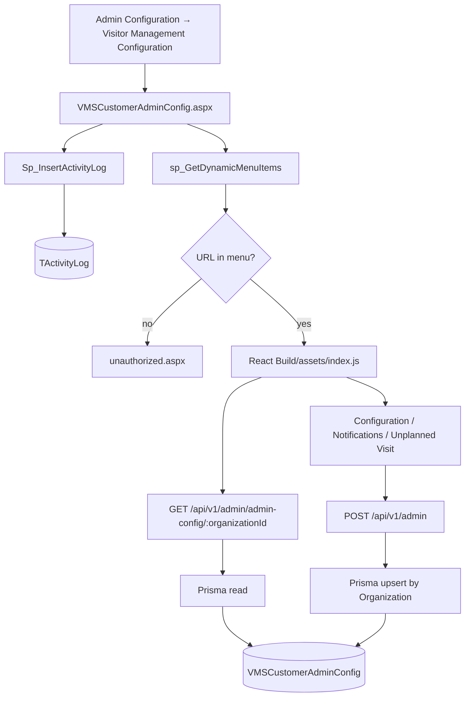
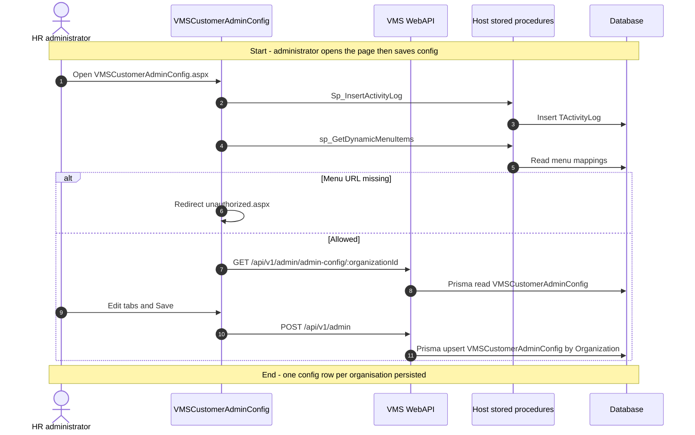
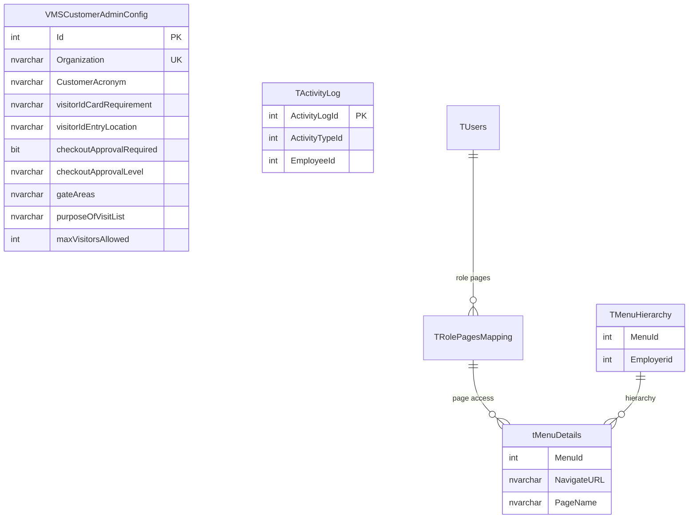

# Visitor Management Configuration

## Overview

An HR administrator opens **Admin Configuration → Visitor Management Configuration** (`~/HRM/VMS_React/VMSCustomerAdminConfig.aspx`) to set organisation-wide Visitor Management behaviour: ID capture rules, checkout approval, gate areas, notification channels, gate-pass print layout, max visitors, purpose-of-visit options, declaration-form options, and the unplanned-visit QR link. The WebForms host stamps session identity into hidden fields, logs activity `VisitorManagementConfig` (350), and only continues when the user’s dynamic menu includes this page URL. It then loads the VMS React bundle at `#root` (`Build/assets/index.js`).

Inside the SPA the admin works three tabs (Configuration, Notifications, Unplanned Visit), loads one `VMSCustomerAdminConfig` row for the organisation, edits fields, and saves. Load and save go to the separate VMS Express API (`GET /api/v1/admin/admin-config/:organizationId`, `POST /api/v1/admin`), which upserts that row through Prisma. There is no stored procedure on the config read/write path.

Employees and security guards do not open this screen. Check-in, gate-pass, and notification flows later read the same org config.

Canonical VMS behaviour for this screen lives in the **VMS** Azure DevOps repo’s SystemModel-2 (`behavior/use-cases/admin-config.md`, `experience/surfaces/admin-config-surface.md`, `data/entities/config-entities.yaml`). The VMS frontend/backend source and `Build/` bundle are **not** present in the SourceCode workspace analyzed for this guide. There is no llm-wiki domain page for Visitor Management Configuration.

**Who's involved:**

- **HR administrator** — maintains one VMS config row per organisation. Needs the left-nav item that points at `VMSCustomerAdminConfig.aspx` (menu gate in `Page_Load`).
- **Security guard / operator / visitor** — do not open this screen. Their check-in, declaration, and notification behaviour consume the flags saved here.

## Workflow

## Request journey

### HR administrator — save organisation configuration

## Entry points

`~/HRM/VMS_React/VMSCustomerAdminConfig.aspx` is the live HRMS host. `Page_Load` logs `ActivityDescription.VisitorManagementConfig`, requires `Session["LoggedInUser"]`, gates access with `DashboardBLL.GetMenuItems` (must contain `VMSCustomerAdminConfig.aspx`), and stamps hidden fields (`hdnEmpId`, `hdnEmployerId`, `hdnCustomerId`, and related). The React module mounts at `#root` via `Build/assets/index.js`.

Menu DML historically used MenuId `1181` (**Visitor Management Configuration**) with a child `1182` (**Customer Admin Config**); later scripts pointed `1181` at this aspx and removed `1182`.

VMS SPA route and components live under the separate **VMS** repo (`frontend/src/components/VMSCustomerAdminConfig`), not under SourceCode `HRM/VMS_REACT/` beyond the aspx host.

| UI page | Purpose |
|---|---|
| `HRM/VMS_REACT/VMSCustomerAdminConfig.aspx` | WebForms host, activity log, menu gate, session stamp |
| `HRM/VMS_REACT/Build/assets/index.js` | Deployed VMS SPA bundle (not in SourceCode git tree) |
| VMS repo `frontend/src/components/VMSCustomerAdminConfig` | Admin tabs, form, save/reset (SystemModel-2) |
| VMS repo `backend` `/api/v1/admin` | Config GET/POST (SystemModel-2) |

## Code → database call chain

Host-side hops are verified in SourceCode. SPA → API → Prisma hops are from the VMS SystemModel-2 knowledge base (VMS repo source and Build bundle were not in this workspace).

| Entry | Method | Stored procedure / data access |
|---|---|---|
| Page load (activity) | `Page_Load` (`VMSCustomerAdminConfig.aspx.cs:28`) → `CommonUtil.LogActivity` (`Common.cs:52`) → `ActivityHelper.LogActivity` (`ActivityHelper.cs:32`) | `Sp_InsertActivityLog` → `TActivityLog` |
| Page load (access gate) | `Page_Load` (`VMSCustomerAdminConfig.aspx.cs:37-44`) → `DashboardBLL.GetMenuItems` (`DashboardBLL.cs:23`) → `DashboardDAL.GetMenuItems` (`DashboardDAL.cs:241`) | `sp_GetDynamicMenuItems` |
| SPA load config | `getAdminConfigurationAsync` → `GET /api/v1/admin/admin-config/:organizationId` → admin service/repository (VMS repo) | Prisma read `VMSCustomerAdminConfig` (no SP) |
| SPA save config | `saveAdminConfigurationAsync` → `POST /api/v1/admin` → `createAdminConfigService` upsert by `Organization` (VMS repo) | Prisma upsert `VMSCustomerAdminConfig` (no SP) |

## API endpoints

Not WebForms postback for configuration. The host page has no PageMethods. After mount, the VMS React app calls the VMS Node API under `/api/v1` (base URL is configured in the VMS frontend env, not in the aspx).

| Verb | Route | Parameters | Purpose | Source |
|---|---|---|---|---|
| GET | `/api/v1/admin/admin-config/:organizationId` | path `organizationId` (required) | Load org config (documented public on VMS API) | VMS SystemModel-2 `interface/apis/service-apis.md` |
| POST | `/api/v1/admin` | body org config fields (`Organization` key for upsert); JWT + org-access | Upsert org config | same |

Host-only side effects use Enterprise Library / ActivityAuditLog against core HRMS procedures (see call chain). No Core `HRMS.Core.WebAPI.Node` controller serves this screen’s config CRUD.

## Stored procedures & tables involved

| Object | File path | Purpose | llm-wiki |
|---|---|---|---|
| [`Sp_InsertActivityLog`](/docs/database/hrms/Sp_InsertActivityLog) | `HRMS-DATABASE/HRMS/STOREPROCEDURE/Sp_InsertActivityLog.sql` | Activity row on every page open | — |
| [`sp_GetDynamicMenuItems`](/docs/database/hrms/sp_GetDynamicMenuItems) | `HRMS-DATABASE/HRMS/STOREPROCEDURE/sp_GetDynamicMenuItems.sql` | Menu rows for the access gate | — |
| `VMSCustomerAdminConfig` (table) | Live on DEV as `HRM-VMS.dbo.VMSCustomerAdminConfig`; Liquibase tree `HRM-VMS` has DML only (no TABLE/SP scripts for this object) | One config row per organisation; Prisma upsert target | No llm-wiki page |

Config CRUD uses Prisma, not a stored procedure. Nested level under the two host SPs: neither calls another procedure or function.

Related operational tables (`Visit`, `Visitor`, `VisitorRecord`, …) consume these flags later; they are not written by this admin save path.

## Table relationships

`VMSCustomerAdminConfig` has a unique `Organization` and no declared foreign keys to Visit/Visitor tables. Host menu/activity tables are core HRMS.

Declared FKs among Visit/Visitor graphs exist in `HRM-VMS` but are outside this screen’s write path. Diagram follows host SP reads/writes plus the unique org config row.

## Known gaps

- VMS React source, Vite `Build/` output, and VMS Express API are **not** in the SourceCode workspace; call-chain detail for SPA/API is taken from VMS SystemModel-2, not re-read file:line from that repo.
- `HRMS-DATABASE/HRM-VMS` Liquibase baseline contains only DML (including backups/dedupe of `VMSCustomerAdminConfig`); there are **no** checked-in `STOREPROCEDURE` or `TABLES` scripts for this feature, and DEV has **no** VMS admin SPs (Prisma only).
- SystemModel-2 describes `VMSCustomerAdminConfig` as living in the shared HRMS SQL Server via `prisma-integrated`; on DEV the table is observed under database `HRM-VMS`. Physical database placement may differ by environment.
- SystemModel notes `gatePassPrintType` / `gatePassPrintMode` hard-forced on save, and `verifyId` with no active UI branch — runtime UI quirks not re-verified here.
- No llm-wiki domain or table catalogue page for Visitor Management Configuration.
- Nested history or deeper dynamic SQL under `Sp_InsertActivityLog` / `sp_GetDynamicMenuItems` was not expanded; both already document “calls no other procedures.”

## Reference

Confidence is medium: the ASP.NET host → `Sp_InsertActivityLog` / `sp_GetDynamicMenuItems` chain is clear in SourceCode. The React → VMS API → Prisma upsert chain is documented in the VMS SystemModel-2 knowledge base but the VMS application repo was not present in this workspace for line-level re-verification. Config persistence has no SP layer.

### SourceCode

- `HRMS.Web/HRMS.Web/HRM/VMS_REACT/VMSCustomerAdminConfig.aspx`
- `HRMS.Web/HRMS.Web/HRM/VMS_REACT/VMSCustomerAdminConfig.aspx.cs`
- `HRMS.Shared/HRMS.DataContract/Common/Enums.cs` (`VisitorManagementConfig = 350`)
- `HRMS.Shared/HRMS.Common/Common.cs` (`LogActivity`)
- `HRMS.Shared/TDG.ActivityAuditLog/DAL/ActivityHelper.cs`
- `HRMS.Shared/HRMS.BusinessLayer/DashboardBLL.cs`
- `HRMS.Shared/HRMS.DataAccessLayer/DashboardDAL.cs`
- `HRMS.Shared/HRMS.DataAccessLayer/DBConstant.cs` (`DASHBOARD_GET_DYNAMIC_MENU_ITEMS`)

### VMS repo (SystemModel-2; not in SourceCode workspace)

- `docs/SystemModels/SystemModel-2/behavior/use-cases/admin-config.md`
- `docs/SystemModels/SystemModel-2/experience/surfaces/admin-config-surface.md`
- `docs/SystemModels/SystemModel-2/interface/apis/service-apis.md`
- `docs/SystemModels/SystemModel-2/data/entities/config-entities.yaml`
- `docs/SystemModels/SystemModel-2/data/relationships/erd.md`
- `docs/SystemModels/SystemModel-2/architecture/overview.md`

### TDG HRMS DB

- `HRMS-DATABASE/HRMS/STOREPROCEDURE/Sp_InsertActivityLog.sql`
- `HRMS-DATABASE/HRMS/STOREPROCEDURE/sp_GetDynamicMenuItems.sql`
- `HRMS-DATABASE/HRMS/DML/VMS_AdminConfigUpdate.sql`
- `HRMS-DATABASE/HRMS/DML/109351/TMenuDetails.sql`
- `HRMS-DATABASE/HRMS/DML/20261022_Delete_Menu_VMS_Sub_Config.sql`
- `HRMS-DATABASE/HRM-VMS/DML/107880.sql` / `107881.sql` (config table maintenance)
- `content/database/hrms/Sp_InsertActivityLog.md` (existing)
- `content/database/hrms/sp_GetDynamicMenuItems.md` (existing)
