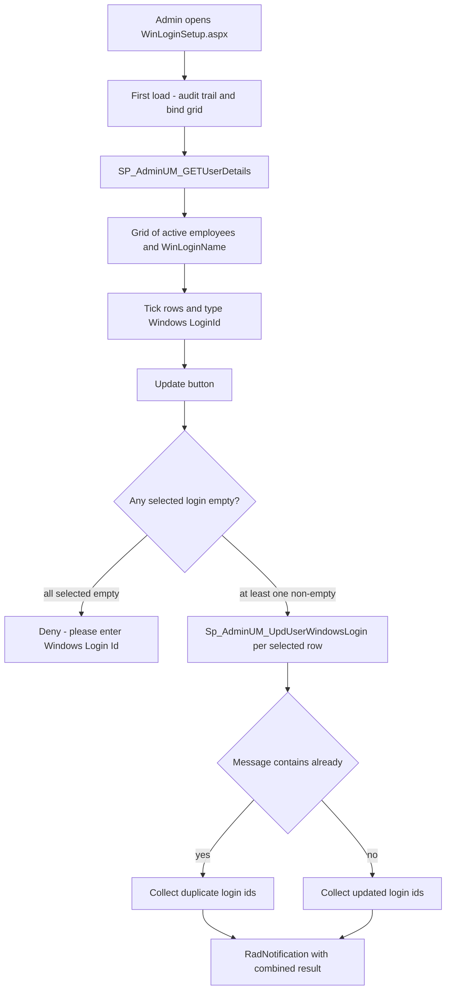
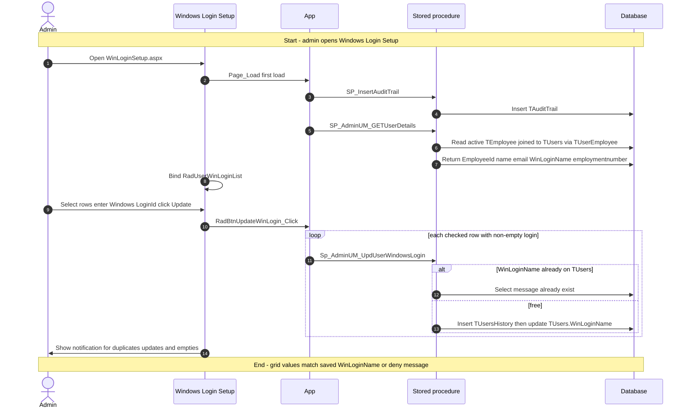
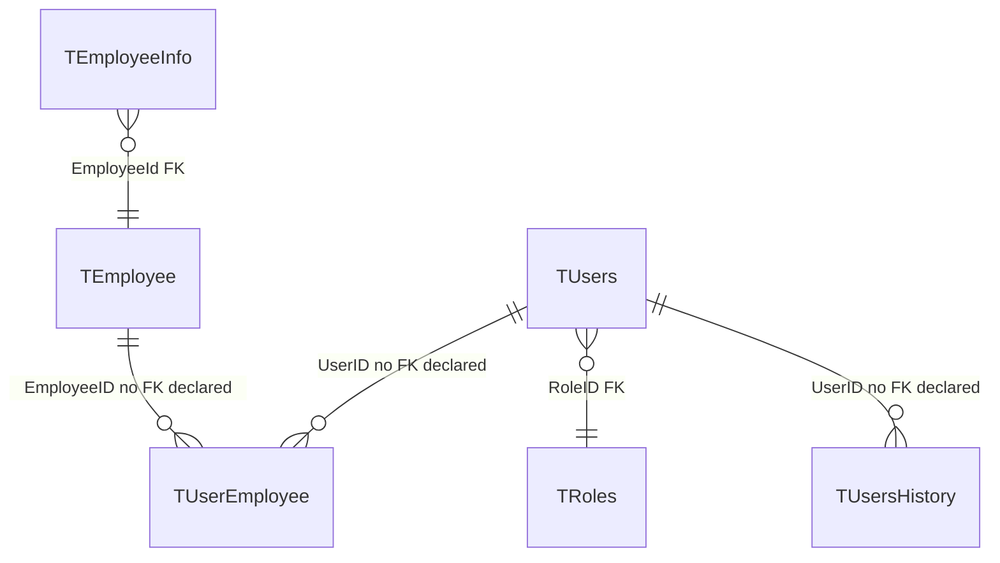

# Windows Login Setup

## Overview

An administrator maps each active employee’s Windows / Active Directory login onto `TUsers.WinLoginName` so intranet sign-in can resolve that person. On **Windows Login Setup** they pick the employer (global-access control), see a grid of active employees with employment number, name, email, and the current Windows login id, tick one or more rows, type the Windows login into the row text box, and press **Update**. Each selected non-empty value is written through `UserManagementDAL.UpdateUserWinLogin` → `Sp_AdminUM_UpdUserWindowsLogin`. That procedure refuses a Windows login that already exists on any `TUsers` row and otherwise copies the current user row into `TUsersHistory` before updating `WinLoginName`.

**Who’s involved:**

- **Administrator** (`UserType` `A`) or an employee with this menu — edits Windows login ids. When the signed-in user is not Super Admin, the Update button is hidden if the menu tab grant is not editable (`WinLoginSetup.aspx.cs:194-207`).
- **Super Admin** (`UserType` `S`) — skips the tab-permission hide path and keeps Update visible (`WinLoginSetup.aspx.cs:217-218`).
- **Employee signing in later** — intranet login looks up `WinLoginName` (see `llm-wiki/architecture/auth-flow.md` and the Platform Authentication guide). This screen only maintains the mapping.

There is no User Management BLL for this page. The code-behind calls `UserManagementDAL` directly. `docs/SystemModels/SystemModel-2` has no page that names `WinLoginSetup`.

## Workflow

## Request journey

## Entry points

The live menu node is **Windows Login Setup** under **Admin Configuration → User Management** (`MenuPage.USER_MGMT_WIN_LOGIN_SETUP` = 41). Activity type is `ActivityDescription.WindowsLoginSetup` = 325. There is no React route and no Core API controller for this screen.

| Entry | Purpose |
|---|---|
| `~/HRM/UserManagement/WinLoginSetup.aspx` (`HRMSConstants.URLs.URL_USER_WIN_LOGIN_SETUP`) | List active employees for the selected employer and update Windows login ids |
| Update (`RadBtnUpdateWinLogin_Click`) | Persist selected non-empty Windows login values |
| Grid NeedDataSource / page / size change | Re-read the list via `SP_AdminUM_GETUserDetails` |
| Export Excel / PDF / Word | Client export of the bound grid; no extra procedure |
| Global-access employer change | Redirects to the same URL |

Sibling User Management screens **Create New User** and **Disable User** are out of scope for this guide.

## Code → database call chain

There is no `UserManagementBLL`. The page calls `UserManagementDAL` and shared helpers. Constant names in `DBConstant.cs` differ from the procedure names they execute.

| Entry | Method | Database |
|---|---|---|
| Every request, `WinLoginSetup.aspx.cs:51` | `CommonUtil.LogActivity` (`Common.cs:52`) → `LogUserActivity.LogActivity` → `ActivityHelper.LogActivity` (`ActivityHelper.cs:32`) | `Sp_InsertActivityLog`. Activity type id `WindowsLoginSetup` = 325 |
| First load, `WinLoginSetup.aspx.cs:55` | `DBHelper.AuditTrail` (`DBHelper.cs:218`) | `SP_InsertAuditTrail` |
| First load, NeedDataSource, paging, `WinLoginSetup.aspx.cs:91`, `:98`, `:278`, `:136-138` | `UserManagementDAL.GetWinUserList` (`UserManagementDAL.cs:85`) | `SP_AdminUM_GETUserDetails` (constant `SP_GETUserDetails` → string `SP_AdminUM_GETUserDetails` in `DBConstant.cs:697`) |
| Update, `WinLoginSetup.aspx.cs:246` | `UserManagementDAL.UpdateUserWinLogin` (`UserManagementDAL.cs:68`) | `Sp_AdminUM_UpdUserWindowsLogin` (constant `sp_UpdateUserWindowsLogin` → string `Sp_AdminUM_UpdUserWindowsLogin` in `DBConstant.cs:696`) |
| Edit permission, `WinLoginSetup.aspx.cs:196` | `WebCommonTab.GetTabsByMenu` (`Web.Common.Tab.cs:59`) | No stored procedure. Uses tab lists already in session for menu id 41 |

`SP_AdminUM_GETUserDetails` nests `Sp_OpenEncryptionKeys`, `Fn_GetEmployeeName`, and `SP_CloseEncryptionKey`. `Sp_AdminUM_UpdUserWindowsLogin` calls no nested procedure or function.

Legacy inventory scripts `SP_GETUserDetails.sql` and `sp_UpdateUserWindowsLogin.sql` still exist; this page does not execute those object names.

## API endpoints

This screen is a WebForms postback. It does not call HRMS Core API, and it has no page method or WebMethod of its own.

| Postback | Handler | What is posted | Purpose | Source |
|---|---|---|---|---|
| First load and every postback | `Page_Load` | Session employee, selected employer | Activity log every time. First load also writes audit and binds the grid | `WinLoginSetup.aspx.cs:49` |
| Update | `RadBtnUpdateWinLogin_Click` | Checked rows and `txtUserWinLoginID` text | Calls `updateWinUser` when at least one row is checked | `WinLoginSetup.aspx.cs:67` |
| Grid NeedDataSource | `RadUserWinLoginList_NeedDataSource` | Paging / filter / sort state | Rebinds from `GetWinUserList` without forcing `DataBind` when the grid drives it | `WinLoginSetup.aspx.cs:136` |
| Page index / page size | `RadUserWinLoginList_PageIndexChanged`, `PageSizeChanged` | New page or size | Reloads the full list and rebinds | `WinLoginSetup.aspx.cs:88`, `:96` |
| Export | `RadUserWinLoginList_ItemCommand` | Excel, PDF, or Word command | Exports current grid; hides the checkbox column | `WinLoginSetup.aspx.cs:141` |
| Change employer | `ucGlobalAccessEmployer_GlobalAccessOrganizationSelectionChangeEvent` | Selected employer | Redirects to `~/HRM/UserManagement/WinLoginSetup.aspx` | `WinLoginSetup.aspx.cs:62` |

## Stored procedures & tables involved

| Object | File | Purpose | Wiki |
|---|---|---|---|
| [SP_AdminUM_GETUserDetails](/docs/database/hrms/SP_AdminUM_GETUserDetails) | `HRMS-DATABASE/HRMS/STOREPROCEDURE/SP_AdminUM_GETUserDetails.sql` | Active employees for one employer with `WinLoginName` and employment number | `llm-wiki/reference/tables/hrms.md` (`TUsers`, `TUserEmployee`, `TEmployee`, `TEmployeeInfo`) |
| [Sp_AdminUM_UpdUserWindowsLogin](/docs/database/hrms/Sp_AdminUM_UpdUserWindowsLogin) | `HRMS-DATABASE/HRMS/STOREPROCEDURE/Sp_AdminUM_UpdUserWindowsLogin.sql` | Duplicate check, history insert, update `WinLoginName` | `llm-wiki/architecture/auth-flow.md`, `llm-wiki/reference/tables/hrms.md` (`TUsers`, `TUsersHistory`) |
| [Sp_OpenEncryptionKeys](/docs/database/hrms/Sp_OpenEncryptionKeys) | nested from list SP | Open encryption keys (body currently no-ops) | — |
| [Fn_GetEmployeeName](/docs/database/hrms/Fn_GetEmployeeName) | nested from list SP | Display name for the grid | — |
| [SP_CloseEncryptionKey](/docs/database/hrms/SP_CloseEncryptionKey) | nested from list SP | Close encryption keys (body currently no-ops) | — |
| [SP_InsertAuditTrail](/docs/database/hrms/SP_InsertAuditTrail) | `HRMS-DATABASE/HRMS/STOREPROCEDURE/SP_InsertAuditTrail.sql` | One page-access row on first load | `llm-wiki/reference/tables/hrms.md` (`TAuditTrail`) |
| [Sp_InsertActivityLog](/docs/database/hrms/Sp_InsertActivityLog) | `HRMS-DATABASE/HRMS/STOREPROCEDURE/Sp_InsertActivityLog.sql` | One activity row on every request | `llm-wiki/reference/tables/hrms.md` (`TActivityLog`) |

Tables touched on the feature path: `TEmployee` (read), `TEmployeeInfo` / `TEmployeeinfo` (read employment number), `TUserEmployee` (join and UserID lookup), `TUsers` (read/update `WinLoginName`), `TUsersHistory` (insert before update), `TAuditTrail`, `TActivityLog`.

## Table relationships

`llm-wiki/reference/tables/hrms.md` lists `TUsers` → `TRoles`, and `TUserEmployee` / `TUsersHistory` with no parent. The diagram uses only foreign keys declared in the `CREATE TABLE` scripts. Joins the procedures use without a declared FK are labeled as such.

`TUserEmployee` has columns `UserID` and `EmployeeID` only and declares no primary key and no foreign key. `TUsersHistory` has no foreign key. `TUsers.WinLoginName` is the intranet mapping column described in `llm-wiki/architecture/auth-flow.md`.

## Known gaps

- **No SystemModel-2 page.** Nothing under `docs/SystemModels/SystemModel-2` names Windows Login Setup or `WinLoginSetup`. The call chain is from the WebForms page and DAL.
- **Constant names vs live procedure names.** `DBConstant.cs` still uses `SP_GETUserDetails` and `sp_UpdateUserWindowsLogin` as C# identifiers while the string values are `SP_AdminUM_GETUserDetails` and `Sp_AdminUM_UpdUserWindowsLogin`. Sibling scripts `SP_GETUserDetails` and `sp_UpdateUserWindowsLogin` remain in the inventory and are not what this page runs. The legacy update script has no duplicate message result set.
- **Duplicate check is global and includes the same user.** `Sp_AdminUM_UpdUserWindowsLogin` fails when any `TUsers` row already has that `WinLoginName`, including the employee being edited. Re-saving an unchanged Windows login reports “already exist.”
- **No employer filter on the update.** The update procedure resolves `UserID` from `TUserEmployee` by `EmployeeID` only. It does not check that the employee belongs to the selected employer.
- **Partial success across a multi-row Update.** Each checked row is its own procedure call with no outer transaction. Some rows can update while others hit the duplicate message; the page then shows a combined notification.
- **Encryption open/close are no-ops in current scripts.** `Sp_OpenEncryptionKeys` and `SP_CloseEncryptionKey` still run around the list query; their symmetric-key bodies are commented out in the inventoried scripts.
- **Create New User / Disable User not documented here.** Those sibling User Management screens are separate guides when written.

## Reference

Confidence is high because `WinLoginSetup.aspx(.cs)`, `UserManagementDAL`, `DBConstant` string mappings, and both live AdminUM procedure bodies were read. Relationships are only foreign keys declared on those tables. SystemModel-2 has no covering page.

### SourceCode

- `HRMS.Web/HRMS.Web/HRM/UserManagement/WinLoginSetup.aspx`
- `HRMS.Web/HRMS.Web/HRM/UserManagement/WinLoginSetup.aspx.cs`
- `HRMS.Shared/HRMS.DataAccessLayer/UserManagement/UserManagementDAL.cs`
- `HRMS.Shared/HRMS.DataAccessLayer/DBConstant.cs`
- `HRMS.Shared/HRMS.DataAccessLayer/DBHelper.cs`
- `HRMS.Shared/HRMS.DataContract/Common/Enums.cs` (`WindowsLoginSetup` 325, `USER_MGMT_WIN_LOGIN_SETUP` 41)
- `HRMS.Shared/HRMS.DataContract/Common/Constants.cs` (`URL_USER_WIN_LOGIN_SETUP`)
- `HRMS.Shared/HRMS.Common/Common.cs`
- `HRMS.Shared/TDG.ActivityAuditLog/DAL/ActivityHelper.cs`
- `HRMS.Web/HRMS.Web/Common/Web.Common.Tab.cs`
- `docs/SystemModels/SystemModel-2` — no page for this screen
- `docs/SystemModels/SystemModel-2/architecture/auth-flow.md` — intranet / `WinLoginName` login path (Platform Authentication guide)

### TDG HRMS DB

- `HRMS-DATABASE/HRMS/STOREPROCEDURE/SP_AdminUM_GETUserDetails.sql`
- `HRMS-DATABASE/HRMS/STOREPROCEDURE/Sp_AdminUM_UpdUserWindowsLogin.sql`
- `HRMS-DATABASE/HRMS/STOREPROCEDURE/SP_GETUserDetails.sql` (legacy sibling; not executed by this page)
- `HRMS-DATABASE/HRMS/STOREPROCEDURE/sp_UpdateUserWindowsLogin.sql` (legacy sibling; not executed by this page)
- `HRMS-DATABASE/HRMS/STOREPROCEDURE/Sp_OpenEncryptionKeys.sql`
- `HRMS-DATABASE/HRMS/STOREPROCEDURE/SP_CloseEncryptionKey.sql`
- `HRMS-DATABASE/HRMS/FUNCTIONS/Fn_GetEmployeeName.sql`
- `HRMS-DATABASE/HRMS/STOREPROCEDURE/SP_InsertAuditTrail.sql`
- `HRMS-DATABASE/HRMS/STOREPROCEDURE/Sp_InsertActivityLog.sql`
- `HRMS-DATABASE/HRMS/TABLES/TUsers.sql`
- `HRMS-DATABASE/HRMS/TABLES/TUsersHistory.sql`
- `HRMS-DATABASE/HRMS/TABLES/TUserEmployee.sql`
- `HRMS-DATABASE/HRMS/TABLES/TEmployee.sql`
- `HRMS-DATABASE/HRMS/TABLES/TEmployeeInfo.sql`

### Backstage wiki

- `llm-wiki/architecture/auth-flow.md` — `TUsers.WinLoginName` as Windows/AD login
- `llm-wiki/reference/tables/hrms.md` — `TUsers`, `TUsersHistory`, `TUserEmployee`
- Platform guide `/docs/guides/platform/authentication` — intranet login uses the mapped Windows name
