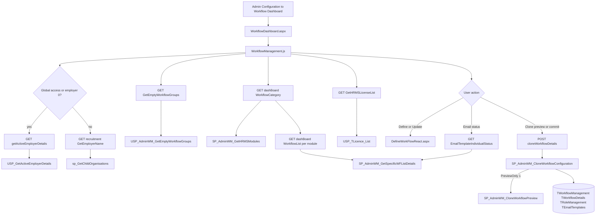
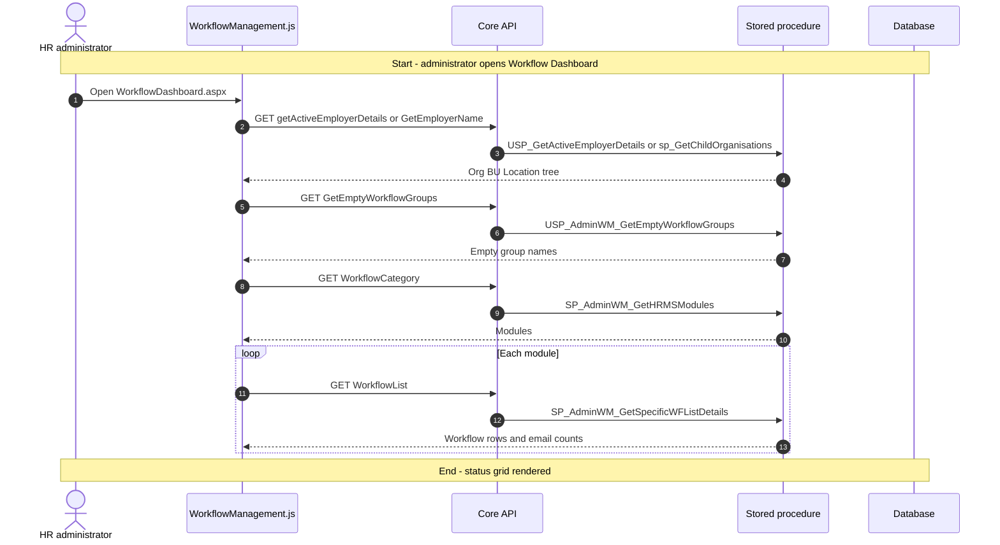
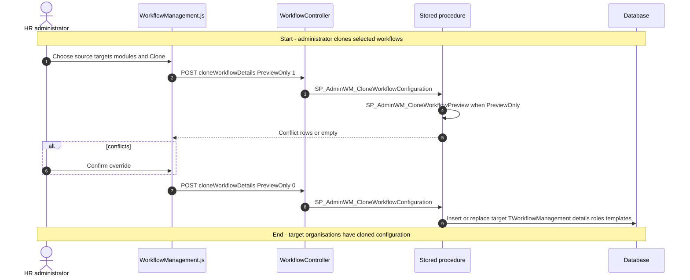
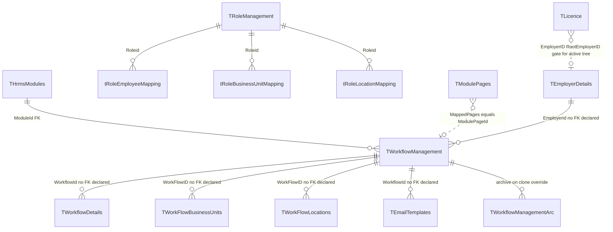

# Workflow Dashboard

## Overview

An HR administrator needs a single place to see, for one organisation (or DefaultEmployer / employer `0`), which module pages already have a workflow defined, which are only partial, and which still need email templates — then clone a finished set onto other organisations. They open **Admin Configuration → Workflow Management → Workflow Dashboard** (`~/HRM/Settings/WorkflowDashboard.aspx`, menu id **1169**). The WebForms host only stamps session fields, logs activity type `WorkflowDashboard` (296), and loads the Dashboard React bundle. The live UI is `Areas/CustomerSetting/Components/WorkflowManagement.js`, routed from `Areas/routes.js` on `RouteConstants.WORKFLOW_DASHBOARD`.

The grid loads modules via `GET /api/dashBoard/WorkflowCategory`, then one `GET /api/dashBoard/WorkflowList` per module. Status badges (Not Defined / Partial / Completed, plus email Missing / Defined) are computed in the browser from `WorkflowDefined`, `IsWorkflowPartial`, and `EmailTemplateCount`. **Define / Update** deep-links into `DefineWorkFlowReact.aspx`. **Clone** (super-admin / global-access path) posts `POST /api/workflow/cloneWorkflowDetails`, which runs `SP_AdminWM_CloneWorkflowConfiguration` (preview-first when conflicts exist). Empty workflow-group warning uses `GET /api/workflow/GetEmptyWorkflowGroups`.

This leaf is the **catalog and clone** surface. Creating headers, editing the XML tree, and runtime approve/reject live under sibling guides (`workflow.md` / Workflow Management) and SystemModel-2 `workflow-platform.md`.

**Who's involved:**

- **Workflow admin / Super Admin** — browses status by organisation (and optional BU/location), opens Define Workflow or Email Template Builder, clones definitions/groups/templates to target orgs.
- **Pending Workflows panel** — can deep-link here with `selectedEmployerId` and `cloneTemplateIds` (notification-clone mode locks the source to DefaultEmployer).
- **End users / approvers** — do not open this screen.

## Workflow

## Request journey

### HR administrator — load the catalog

### HR administrator — clone workflows

## Entry points

Live `tMenuDetails` (employer `0` and copies): **MenuId 1169**, **MenuName** `Workflow Dashboard`, **NavigateURL** `~/HRM/Settings/WorkflowDashboard.aspx`. SourceCode constant `URL_WORKFLOW_DASHBOARD` and React `RouteConstants.WORKFLOW_DASHBOARD` match that path.

| Entry | Purpose |
|---|---|
| `~/HRM/Settings/WorkflowDashboard.aspx` | WebForms host. Session → hidden fields; activity 296; loads `dashboard_react.*.min.js`. |
| React `WorkflowManagement` | Catalog grid, filters, clone UI, empty-group banner, deep-links. |
| Query `selectedEmployerId` / `ModuleId` / `SearchCriteria` / `cloneTemplateIds` | Deep-link from Define Workflow back-button or Pending Workflows clone. |
| `~/HRM/Settings/DefineWorkFlowReact.aspx` | Target of Define / Update (not this page's SP path). |

There is no WebForms postback for catalog or clone data. The Customer Setting "WorkFlow Management" tab that once mounted the same component is commented out; this aspx is the live host.

## Code → database call chain

| Entry | Method | Database |
|---|---|---|
| Page load, `WorkflowDashboard.aspx.cs:25` | `CommonUtil.LogActivity(WorkflowDashboard)`; session fields only | No SP |
| Org tree (global / employer 0), `WorkflowManagement.js:453` | `GET getActiveEmployerDetails` → `WorkflowController.GetActiveEmployerDetails` (`WorkflowController.js:165`) → `WorkflowDAL.GetActiveEmployerDetails` (`WorkflowDAL.js:604`) | `USP_GetActiveEmployerDetails` |
| Org tree (scoped), `WorkflowManagement.js:469` | `GET /recruitment/GetEmployerName` → `recruitmentDAL.GetEmployerName` (`recruitmentDAL.js:6007`) | `sp_GetChildOrganisations` |
| Empty groups, `WorkflowManagement.js:558` | `GET GetEmptyWorkflowGroups` → `WorkflowController.GetEmptyWorkflowGroups` (`WorkflowController.js:1236`) → `WorkflowDAL.GetEmptyWorkflowGroups` (`WorkflowDAL.js:687`) | `USP_AdminWM_GetEmptyWorkflowGroups` |
| Module list, `WorkflowManagement.js:597` | `GET /dashBoard/WorkflowCategory` → `dashboardController.WorkflowCategory` (`dashboardController.js:862`) → `dashBoardDAL.WorkflowCategory` (`dashBoardDAL.js:920`) | `SP_AdminWM_GetHRMSModules` |
| Per-module rows, `WorkflowManagement.js:603` | `GET /dashBoard/WorkflowList` → `dashboardController.WorkflowList` (`dashboardController.js:871`) → `dashBoardDAL.WorkflowList` (`dashBoardDAL.js:933`) | `SP_AdminWM_GetSpecificWFListDetails` (nested `Fn_GetEmployeeName`) |
| Licensed module filter, `WorkflowManagement.js:509` | `GET /dashboard/GetHRMSLicenseList` → `GetHRMSLicenseList` (`dashboardController.js:3366`) → `dashBoardDAL.GetHRMSLicenseList` (`dashBoardDAL.js:4578`) | `USP_TLicence_List` |
| Email status modal, `WorkflowManagement.js:851` | `GET EmailTemplateIndividualStatus` → `dashboardController.EmailTemplateIndividualStatus` (`dashboardController.js:3019`) → reuses `WorkflowList` | `SP_AdminWM_GetSpecificWFListDetails` |
| Clone, `WorkflowManagement.js:1022` | `POST /workflow/cloneWorkflowDetails` → `WorkflowController.CloneWorkflowDetails` (`WorkflowController.js:143`) → `WorkflowDAL.CloneWorkflowDetails` (`WorkflowDAL.js:574`) | `SP_AdminWM_CloneWorkflowConfiguration` → nested `SP_AdminWM_CloneWorkflowPreview` when `PreviewOnly=1` |
| Define / Update click | Client redirect to `DefineWorkFlowReact.aspx` (`WorkflowManagement.js:361`) | No SP on this page |

## API endpoints

Host is WebForms; data is Core API JSON (`Authorize`). Workflow routes mount as `/api/workflow` and `/api/V2/workflow` (V1 router). Dashboard routes under `/api/dashBoard` (casing also appears as `/dashboard/` in some constants).

| Verb | Route | Parameters | Purpose | Source |
|---|---|---|---|---|
| GET | `/api/workflow/getActiveEmployerDetails` | query `employeeId` (required) | Source/target org hierarchy for clone | `WorkflowRoutes.js:14`; `WorkflowController.js:165` |
| GET | `/api/workflow/GetEmptyWorkflowGroups` | query `employerId` | Empty workflow-group warning | `WorkflowRoutes.js:19`; `WorkflowController.js:1236` |
| POST | `/api/workflow/cloneWorkflowDetails` | body `sourceEmployer`, `targetEmployers`, `workflowIds`, flags (`IsEmployeesIncludedForWFGroup`, `IsEmailTemplatesClone`, `IsEmialTemplateOverride`, `IsWFGroupOverride`, `IsWorkflowSkip`, `PreviewOnly`, BU/location fields) | Preview or commit clone | `WorkflowRoutes.js:13`; `WorkflowController.js:143` |
| GET | `/api/dashBoard/WorkflowCategory` | query `employerid` | Module filter list | `DashBoardRoutes.js:63` |
| GET | `/api/dashBoard/WorkflowList` | query `employerid`, `userType`, `ModID`, optional `buId` / `locationId` | Grid rows for one module | `DashBoardRoutes.js:65` |
| GET | `/api/dashBoard/EmailTemplateIndividualStatus` | query `employerid`, `EmployeeId`, `ModID`, `userType`, `workflowId` | Email node status modal (client-side parse of list SP) | `DashBoardRoutes.js:280` |
| GET | `/api/dashboard/GetHRMSLicenseList` | query `employerId` (+ unused `buId`/`locationId` in URL helper) | Licensed module ids for filter | `apiURLConstants.js:24`; `DashBoardRoutes.js:284` |
| GET | `/api/recruitment/GetEmployerName` | query `employerId`, `Type` | Scoped org list when not global | `apiURLConstants.js:491` |

No WebForms postback handles catalog or clone. Sibling admin pages (`CreateWorkFlow.aspx`, `CreateRole.aspx`) still post to `WorkflowManagementBLL` and are out of scope for this leaf.

## Stored procedures & tables involved

| Object | File | Purpose | Wiki / docs |
|---|---|---|---|
| `SP_AdminWM_GetHRMSModules` | `HRMS-DATABASE/HRMS/STOREPROCEDURE/SP_AdminWM_GetHRMSModules.sql` | Module categories for the grid | [SP_AdminWM_GetHRMSModules](/docs/database/hrms/SP_AdminWM_GetHRMSModules) |
| `SP_AdminWM_GetSpecificWFListDetails` | `…/SP_AdminWM_GetSpecificWFListDetails.sql` | Workflow rows, defined flag, email types | [SP_AdminWM_GetSpecificWFListDetails](/docs/database/hrms/SP_AdminWM_GetSpecificWFListDetails) |
| `SP_AdminWM_CloneWorkflowConfiguration` | `…/SP_AdminWM_CloneWorkflowConfiguration.sql` | Cross-employer clone of definitions, groups, templates | [SP_AdminWM_CloneWorkflowConfiguration](/docs/database/hrms/SP_AdminWM_CloneWorkflowConfiguration) |
| `SP_AdminWM_CloneWorkflowPreview` | `…/SP_AdminWM_CloneWorkflowPreview.sql` | Nested when `PreviewOnly=1` | [SP_AdminWM_CloneWorkflowPreview](/docs/database/hrms/SP_AdminWM_CloneWorkflowPreview) |
| `USP_AdminWM_GetEmptyWorkflowGroups` | `…/USP_AdminWM_GetEmptyWorkflowGroups.sql` | Roles used by workflows with no employee mapping | [USP_AdminWM_GetEmptyWorkflowGroups](/docs/database/hrms/USP_AdminWM_GetEmptyWorkflowGroups) |
| `USP_GetActiveEmployerDetails` | `…/USP_GetActiveEmployerDetails.sql` | Active licensed org / BU / location tree | [USP_GetActiveEmployerDetails](/docs/database/hrms/USP_GetActiveEmployerDetails) |
| `USP_TLicence_List` | `…/USP_TLicence_List.sql` | Licensed modules for filter | [USP_TLicence_List](/docs/database/hrms/USP_TLicence_List) |
| `sp_GetChildOrganisations` | `…/sp_GetChildOrganisations.sql` | Scoped employer list | [sp_GetChildOrganisations](/docs/database/hrms/sp_GetChildOrganisations) |
| `TWorkflowManagement` / `TWorkflowDetails` | `TABLES/` | Definition header + levels | `llm-wiki/reference/tables/hrms.md` |
| `TWorkFlowBusinessUnits` / `TWorkFlowLocations` | `TABLES/` | Scope maps cloned with definitions | same |
| `TRoleManagement` / `tRoleEmployeeMapping` / `tRoleBusinessUnitMapping` / `tRoleLocationMapping` | `TABLES/` | Workflow groups and membership | same |
| `TEmailTemplates` | `TABLES/` | Templates cloned with workflows | same |
| `THrmsModules` / `TModulePages` | `TABLES/` | Module catalog and mapped pages | same |
| `TEmployerDetails` / `TLicence` / `TOrgHierarchyDetails` / `TLocation` | `TABLES/` | Org tree and licence gate | same |

## Table relationships

## Known gaps

- **Leaf vs platform guide.** Runtime approve/reject and Add/Define Workflow header/tree save are documented on `workflow.md` (submenu Workflow Management), not repeated here.
- **No SystemModel-2 page** names Workflow Dashboard specifically; SystemModel-2 covers the XML engine and ADR-004, not this catalog UI.
- **`GetHRMSLicenseList` ignores BU/location query params** that `GET_MODULES_ACCESS` appends; DAL only binds `@EmployerID`.
- **Email status modal does not call a dedicated SP** — it re-runs `SP_AdminWM_GetSpecificWFListDetails` and parses `WorkflowDefinitionTree` in Node.
- **Clone flag typo** `IsEmialTemplateOverride` is intentional across UI, API, and SP parameter names.
- **Breadcrumb label** shows parent "Workflow Management" even though this guide's submenu is **Workflow Dashboard**.
- **Pending panel APIs** (`getPendingWorkflowPanelCount` / `Details` / `dismissWorkflowNotification`) live on Workflow routes and feed the host badge; they are not invoked from `WorkflowManagement.js` itself (only a `pendingWorkflowsRefresh` custom event after clone).

## Reference

Last analyzed 2026-11-16. Confidence: **high** — live `tMenuDetails` NavigateURL verified on DEV; React → Node → SP chain traced with file:line; clone nested preview SP confirmed in script.

### SourceCode

- `HRMS.Web/HRMS.Web/HRM/Settings/WorkflowDashboard.aspx`
- `HRMS.Web/HRMS.Web/HRM/Settings/WorkflowDashboard.aspx.cs`
- `HRMS.Web/HRMS.Web/HRM/DashBoard_React/Areas/CustomerSetting/Components/WorkflowManagement.js`
- `HRMS.Web/HRMS.Web/HRM/DashBoard_React/Areas/routes.js`
- `HRMS.Web/HRMS.Web/HRM/DashBoard_React/Common/routeConstants.js`
- `HRMS.Web/HRMS.Web/HRM/DashBoard_React/Common/apiURLConstants.js`
- `HRMS.Web/HRMS.Web/HRM/DashBoard_React/Areas/PendingWorkflows/Containers/PendingWorkflowsContainer.js`
- `HRMS.Shared/HRMS.DataContract/Common/Constants.cs` (`URL_WORKFLOW_DASHBOARD`)
- `HRMS.Shared/HRMS.DataContract/Common/Enums.cs` (`WorkflowDashboard = 296`)
- `HRMS.CoreAPI/HRMS.Core.WebAPI.Node/Routes/WorkflowRoutes.js`
- `HRMS.CoreAPI/HRMS.Core.WebAPI.Node/Routes/DashBoardRoutes.js`
- `HRMS.CoreAPI/HRMS.Core.WebAPI.Node/Controllers/WorkflowController.js`
- `HRMS.CoreAPI/HRMS.Core.WebAPI.Node/Controllers/dashboardController.js`
- `HRMS.CoreAPI/HRMS.Core.WebAPI.Node/Core/DataAccessLayer/WorkflowDAL.js`
- `HRMS.CoreAPI/HRMS.Core.WebAPI.Node/Core/DataAccessLayer/dashBoardDAL.js`
- `docs/SystemModels/SystemModel-2/domain/contexts/workflow-platform.md`

### TDG HRMS DB

- `HRMS-DATABASE/HRMS/DDL/87254_SubMenu_WorkflowDashboard_Creation.sql`
- `HRMS-DATABASE/HRMS/STOREPROCEDURE/SP_AdminWM_CloneWorkflowConfiguration.sql`
- `HRMS-DATABASE/HRMS/STOREPROCEDURE/SP_AdminWM_CloneWorkflowPreview.sql`
- `HRMS-DATABASE/HRMS/STOREPROCEDURE/USP_AdminWM_GetEmptyWorkflowGroups.sql`
- `HRMS-DATABASE/HRMS/STOREPROCEDURE/USP_GetActiveEmployerDetails.sql`
- `HRMS-DATABASE/HRMS/STOREPROCEDURE/SP_AdminWM_GetHRMSModules.sql`
- `HRMS-DATABASE/HRMS/STOREPROCEDURE/SP_AdminWM_GetSpecificWFListDetails.sql`
- Sibling guide: `content/guides/admin-configuration/workflow.md`
