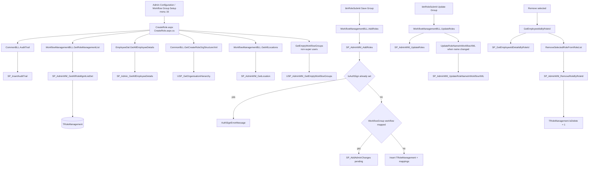
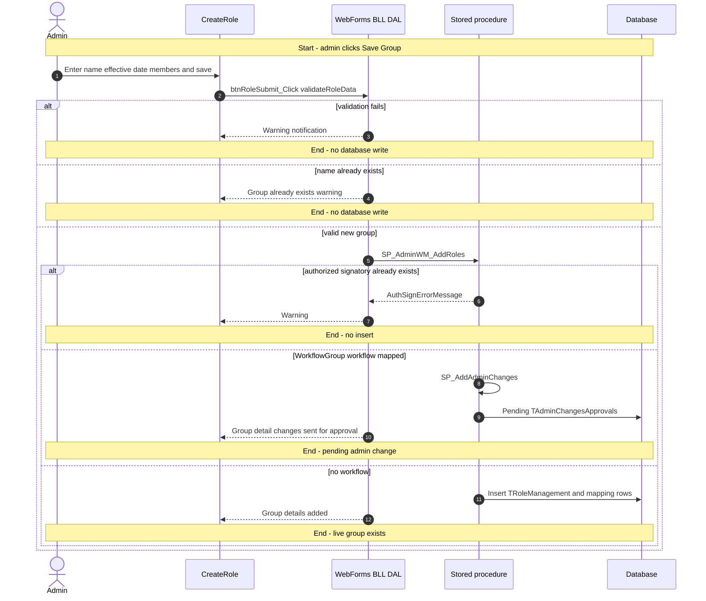
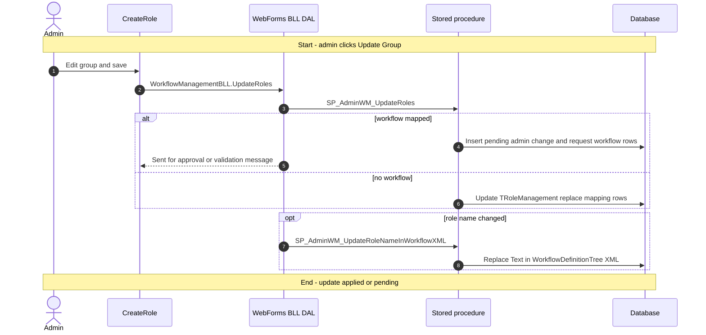
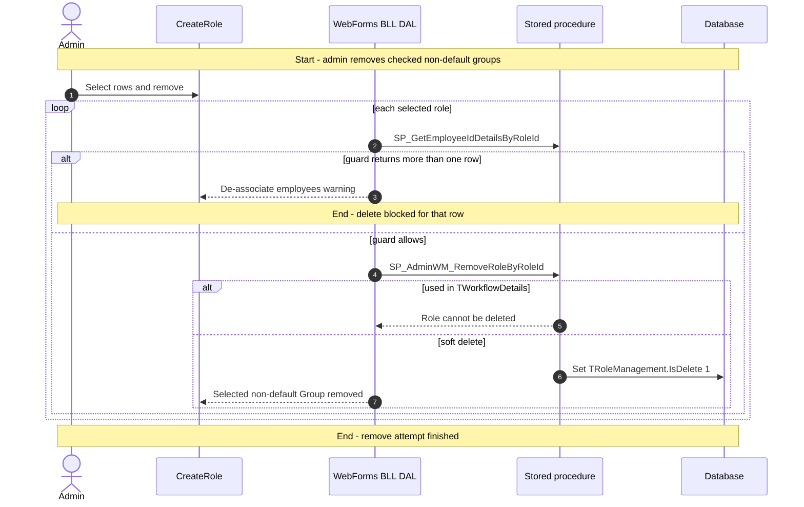
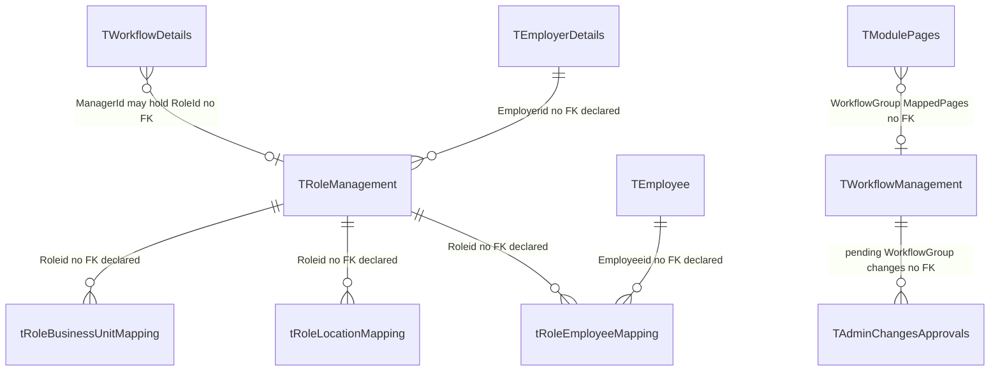

# Workflow Group Setup

## Overview

An administrator opens **Admin Configuration → Workflow Management → Workflow Group Setup** (menu **16**) to create named sets of people that approval trees can later pick as a workflow group. Live `tMenuDetails` (employer **0** and child employers) points this leaf at `~/HRM/Settings/CreateRole.aspx` (`PageName` `CreateRole.aspx`). On that WebForms page they name the group, set effective date and active flag, optionally mark one authorized signatory per organisation, pick business units, locations, and employees, then save. Rows land in `TRoleManagement` plus mapping tables `tRoleEmployeeMapping`, `tRoleLocationMapping`, and `tRoleBusinessUnitMapping`. When a `WorkflowGroup` admin-change workflow is mapped for the employer, insert/update is held as a pending config-change request instead of writing the live tables immediately.

This leaf is only the group catalog. Designing approval trees and cloning workflows live on sibling leaves (Add / Define Workflow, Workflow Dashboard) and in the umbrella guide `workflow.md` (`submenu: Workflow Management`).

**Who's involved:**

- **Workflow admin** — creates, edits, views, removes non-default groups; sees empty-group warnings when a group is referenced by a live workflow but has no mapped employees.
- **Super user** (`UserType` `S`) — full edit without employee/BU required fields; organisation combo disabled.
- **Approver of admin changes** — when a `WorkflowGroup` workflow exists, reviews pending inserts/updates through the Setup & Config Change Tracker path (not this page).

There is no SystemModel-2 page for this screen. Table blurbs for `TRoleManagement` and the mapping tables are in `llm-wiki/reference/tables/hrms.md` and the data-catalog notes in `TDataCatalog_DML.sql`.

## Workflow

## Request journey

### Save a new workflow group

### Update an existing workflow group

### Remove selected groups

## Entry points

Live employer-**0** menu row: `MenuId` **16**, `MenuName` `Workflow Group Setup`, `NavigateURL` `~/HRM/Settings/CreateRole.aspx`. Tab grant checks use menu **16** via `WebCommonTab.GetTabsByMenu(16)`.

| Entry point | Purpose | Live? |
|---|---|---|
| `~/HRM/Settings/CreateRole.aspx` | Create / edit / view / remove workflow groups | Yes |
| Grid edit / view image buttons | Load one group into the form (`btnGridEditRole`, `btnGridViewActivity`) | Yes |
| Empty-group warning banner | Non-super users when referenced groups have no employees | Yes |
| Define Workflow React popup `CreateWorkflowPopup` → `POST /api/workflow/AddRolesInWorkflow` | Alternate group create from Define Workflow UI | Yes elsewhere — not this menu leaf |
| Customer Setting `WorkflowManagement.js` empty-group APIs | Dashboard / COB adjacent | Yes elsewhere — not this menu leaf |

## Code → database call chain

All mutating paths are WebForms postbacks through `WorkflowManagementBLL` → `WorkflowManagementDAL`. No Node Core API is required for this leaf.

| Step | Entry point | App code | Stored procedure |
|---|---|---|---|
| Page-open audit | `CreateRole.aspx.cs:167` | `CommonBLL.AuditTrail` (`CommonBLL.cs:614`) → `DBHelper.AuditTrail` | `SP_InsertAuditTrail` |
| Role grid load / rebind | `CreateRole.aspx.cs:104`, `:249`, `:387` | `WorkflowManagementBLL.GetRoleManagementList` (`WorkflowManagementBLL.cs:19`) → `WorkflowManagementDAL.GetRoleManagementList` (`WorkflowManagementDAL.cs:23`) | `SP_AdminWM_GetAllRoleMgmtListDet` |
| Empty-group warning | `CreateRole.aspx.cs:189` | `WorkflowManagementBLL.GetEmptyWorkflowGroups` (`WorkflowManagementBLL.cs:23`) → DAL `:31` | `USP_AdminWM_GetEmptyWorkflowGroups` |
| Employee multi-select | `CreateRole.aspx.cs:640` | `EmployeeDal.GetAllEmployeeDetails` (`EmployeeDAL.cs:241`) | `SP_Admin_GetAllEmployeeDetails` |
| Business-unit tree | `CreateRole.aspx.cs:626` | `CommonBLL.GetCreateRoleOrgStructureXml` (`CommonBLL.cs:37`) → `CommonDAL.GetCreateRoleOrgStructureXml` (`CommonDAL.cs:478`) | `USP_GetOrganisationHierarchy` (DAL string `usp_GetOrganisationHierarchy`) |
| Location list | `CreateRole.aspx.cs:617` | `WorkflowManagementBLL.GetAllLocations` → DAL `:140` | `SP_AdminWM_GetLocation` |
| Edit / view load | `CreateRole.aspx.cs:810` | `WorkflowManagementBLL.GetRoleDetailsByRoleId` → DAL `:184` | `SP_CM_GetRoleDetailsByRoleId` |
| Save Group | `CreateRole.aspx.cs:225` | `WorkflowManagementBLL.AddRoles` → DAL `:40` | `SP_AdminWM_AddRoles` (may `EXEC SP_AddAdminChanges`) |
| Activity after add | `CreateRole.aspx.cs:228` | `CommonUtil.LogActivity` | `Sp_InsertActivityLog` (activity **104** `AddWorkFlowGroups`) |
| Update Group | `CreateRole.aspx.cs:233` | `WorkflowManagementBLL.UpdateRoles` → DAL `:63` | `SP_AdminWM_UpdateRoles`; then optional `SP_AdminWM_UpdateRoleNameInWorkflowXML` (`WorkflowManagementDAL.cs:106`) |
| Activity after update | `CreateRole.aspx.cs:236` | `CommonUtil.LogActivity` | `Sp_InsertActivityLog` (activity **105**) |
| Delete guard | `CreateRole.aspx.cs:453` | `WorkflowManagementBLL.GetEmployeeIdsByRoleId` → DAL `:116` | `SP_GetEmployeeIdDetailsByRoleId` |
| Soft delete | `CreateRole.aspx.cs:463` | `WorkflowManagementBLL.RemoveSelectedRoleFromRoleList` → DAL `:125` | `SP_AdminWM_RemoveRoleByRoleId` |
| Activity after delete | `CreateRole.aspx.cs:469` | `CommonUtil.LogActivity` | `Sp_InsertActivityLog` (activity **106**) |
| Tab edit visibility | `CreateRole.aspx.cs:139` | `WebCommonTab.GetTabsByMenu(16)` | Session only |

## API endpoints

This leaf is a classic WebForms postback. It does not call Node `/api/workflow/*` routes. Those routes (`SaveUpdateWorkflowGroup`, `AddRolesInWorkflow`, `GetEmptyWorkflowGroups`) serve the Define Workflow / Customer Setting React UIs and share some of the same `SP_AdminWM_*` procedures.

| Verb | Route | Purpose on this leaf |
|---|---|---|
| — | WebForms postback on `CreateRole.aspx` | Load, save, update, remove, export grid |

## Stored procedures & tables involved

Inventory paths are under `HRMS-DATABASE/HRMS/` unless noted.

| Object | File | Purpose | Database page |
|---|---|---|---|
| `SP_AdminWM_GetAllRoleMgmtListDet` | `STOREPROCEDURE/SP_AdminWM_GetAllRoleMgmtListDet.sql` | List current-org groups plus org-0 default groups | [SP_AdminWM_GetAllRoleMgmtListDet](/docs/database/hrms/SP_AdminWM_GetAllRoleMgmtListDet) |
| `USP_AdminWM_GetEmptyWorkflowGroups` | `STOREPROCEDURE/USP_AdminWM_GetEmptyWorkflowGroups.sql` | Groups referenced by workflows with no employees | [USP_AdminWM_GetEmptyWorkflowGroups](/docs/database/hrms/USP_AdminWM_GetEmptyWorkflowGroups) |
| `SP_AdminWM_AddRoles` | `STOREPROCEDURE/SP_AdminWM_AddRoles.sql` | Insert group or file pending admin change | [SP_AdminWM_AddRoles](/docs/database/hrms/SP_AdminWM_AddRoles) |
| `SP_AdminWM_UpdateRoles` | `STOREPROCEDURE/SP_AdminWM_UpdateRoles.sql` | Update group or file pending admin change + notifications | [SP_AdminWM_UpdateRoles](/docs/database/hrms/SP_AdminWM_UpdateRoles) |
| `SP_AdminWM_UpdateRoleNameInWorkflowXML` | `STOREPROCEDURE/SP_AdminWM_UpdateRoleNameInWorkflowXML.sql` | Cascade rename into definition XML | [SP_AdminWM_UpdateRoleNameInWorkflowXML](/docs/database/hrms/SP_AdminWM_UpdateRoleNameInWorkflowXML) |
| `SP_AdminWM_RemoveRoleByRoleId` | `STOREPROCEDURE/SP_AdminWM_RemoveRoleByRoleId.sql` | Soft-delete when not used in `TWorkflowDetails` | [SP_AdminWM_RemoveRoleByRoleId](/docs/database/hrms/SP_AdminWM_RemoveRoleByRoleId) |
| `SP_CM_GetRoleDetailsByRoleId` | `STOREPROCEDURE/SP_CM_GetRoleDetailsByRoleId.sql` | Load one group for edit/view | [SP_CM_GetRoleDetailsByRoleId](/docs/database/hrms/SP_CM_GetRoleDetailsByRoleId) |
| `SP_GetEmployeeIdDetailsByRoleId` | `STOREPROCEDURE/SP_GetEmployeeIdDetailsByRoleId.sql` | Delete guard (reads `TEmployee.RoleId`) | [SP_GetEmployeeIdDetailsByRoleId](/docs/database/hrms/SP_GetEmployeeIdDetailsByRoleId) |
| `SP_AdminWM_GetLocation` | `STOREPROCEDURE/SP_AdminWM_GetLocation.sql` | Location checklist | [SP_AdminWM_GetLocation](/docs/database/hrms/SP_AdminWM_GetLocation) |
| `USP_GetOrganisationHierarchy` | `STOREPROCEDURE/USP_GetOrganisationHierarchy.sql` | BU tree XML | [USP_GetOrganisationHierarchy](/docs/database/hrms/USP_GetOrganisationHierarchy) |
| `SP_Admin_GetAllEmployeeDetails` | `STOREPROCEDURE/SP_Admin_GetAllEmployeeDetails.sql` | Employee multi-select | [SP_Admin_GetAllEmployeeDetails](/docs/database/hrms/SP_Admin_GetAllEmployeeDetails) |
| `SP_AddAdminChanges` | `STOREPROCEDURE/SP_AddAdminChanges.sql` | Nested from add when workflow exists | [SP_AddAdminChanges](/docs/database/hrms/SP_AddAdminChanges) |
| `SP_InsertAuditTrail` / `Sp_InsertActivityLog` | matching `STOREPROCEDURE/` | Page audit and activity **104–106** | existing pages |

Tables: `TRoleManagement`, `tRoleEmployeeMapping`, `tRoleLocationMapping`, `tRoleBusinessUnitMapping`, plus reads of `TWorkflowManagement`, `TWorkflowDetails`, `TModulePages`, `TEmployee`, `TOrganisationHierarchy`. When approval is on: `TAdminChangesApprovals`, `TAdminChangesApprovalDetails`, `TRequestWorkflows`, `TEmailNotification`.

## Table relationships

Mapping tables declare only a primary key on `Mappingid` — no FK to `TRoleManagement`. `TRoleManagement` has PK `RoleId` only.

## Known gaps

- Umbrella guide `workflow.md` still uses submenu `Workflow Management` and covers the whole engine; this leaf is the group catalog only — do not treat them as duplicates.
- `SP_GetEmployeeIdDetailsByRoleId` selects from `TEmployee` where `TEmployee.RoleId = @RoleId`. That column is the access-right role, not `tRoleEmployeeMapping.Roleid`, so the delete guard does not measure workflow-group membership.
- Remove UI refuses when the guard returns **more than one** row (`CreateRole.aspx.cs:454`); with the buggy SP that condition is rarely meaningful for workflow groups.
- `SP_AdminWM_AddRoles` calls `SP_AddAdminChanges` when a workflow exists; `SP_AdminWM_UpdateRoles` inserts `TAdminChangesApprovals` inline instead of calling `SP_AddAdminChanges`.
- Page header label is hard-coded `"Create Workflow"` / `"View Workflow"` even though the menu is Workflow Group Setup.
- Super users skip empty-group load and employee/BU required validation; Org-0 default groups (`IsDefault = Y`) cannot be deleted or edited by name.
- React/Node alternate create paths (`AddRolesInWorkflow`, `SaveUpdateWorkflowGroup`) are out of scope for this menu leaf but share `SP_AdminWM_AddRoles`.
- Several scripts begin with `USE [HRM-CL-Prod]` (`SP_AdminWM_GetAllRoleMgmtListDet`, `USP_AdminWM_GetEmptyWorkflowGroups`).
- No SystemModel-2 domain page names this screen.

## Reference

High confidence on live menu NavigateURL, WebForms call chain, and inventoried `SP_AdminWM_*` scripts for employer-0 leaf `CreateRole.aspx`.

### SourceCode

- `HRMS.Web/HRMS.Web/HRM/Settings/CreateRole.aspx` and `CreateRole.aspx.cs`
- `HRMS.Shared/HRMS.BusinessLayer/GenericWorkFlow/WorkflowManagementBLL.cs`
- `HRMS.Shared/HRMS.DataAccessLayer/GenericWorkFlowDAL/WorkflowManagementDAL.cs`
- `HRMS.Shared/HRMS.DataAccessLayer/DBConstant.cs` (`SP_AdminWM_*`, `USP_AdminWM_GetEmptyWorkflowGroups`, `SP_CM_GetRoleDetailsByRoleId`)
- `HRMS.Shared/HRMS.DataAccessLayer/CommonDAL.cs` (`GetCreateRoleOrgStructureXml`)
- `HRMS.Shared/HRMS.DataAccessLayer/Employee/EmployeeDAL.cs` (`GetAllEmployeeDetails`)
- `HRMS.Shared/HRMS.DataContract/Common/Enums.cs` (activities **104–106**)
- `HRMS.CoreAPI/HRMS.Core.WebAPI.Node/Controllers/WorkflowController.js` (adjacent React APIs only)

### TDG HRMS DB

- Procedure scripts listed in the table above
- `HRMS-DATABASE/HRMS/TABLES/TRoleManagement.sql`, `tRoleEmployeeMapping.sql`, `tRoleLocationMapping.sql`, `tRoleBusinessUnitMapping.sql`
- `llm-wiki/reference/tables/hrms.md`
- Live DEV `tMenuDetails` MenuId **16** NavigateURL `~/HRM/Settings/CreateRole.aspx`
