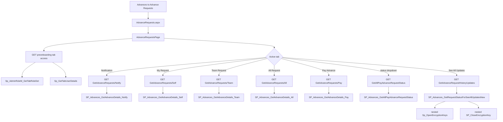
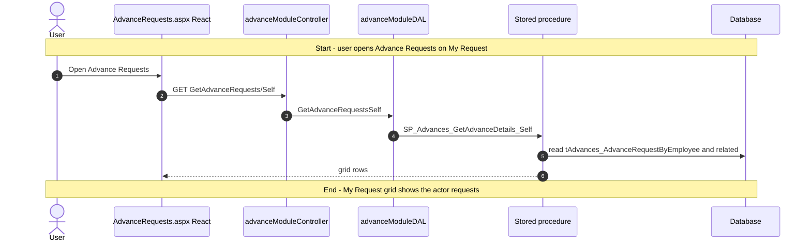
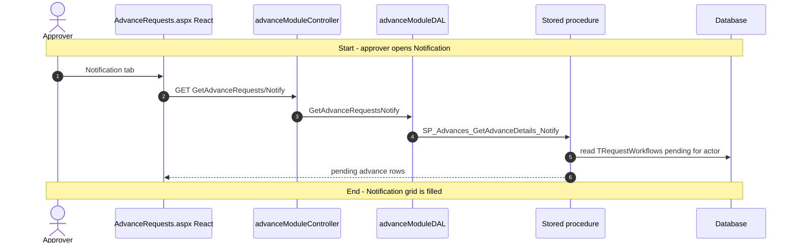
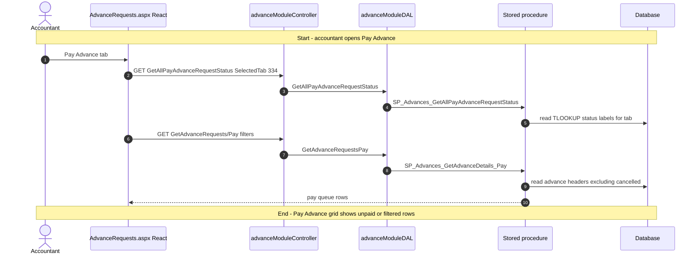
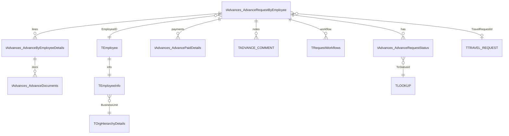

# Advance Requests

## Overview

An employee, manager, or accountant opens **Advances → Advance Requests**. The left-nav item loads `HRM/AdvanceModule/AdvanceRequests.aspx`, which stamps session identity into hidden fields, logs activity type `RequestAdvance`, and mounts the AdvanceModule webpack bundle into `#root`. The live UI is the React SPA (`AdvanceRequestsPage`) with claim-gated tabs.

The dashboard is a **list and inbox** surface, not the create/edit form. Tabs (menu id `1158`) filter what the signed-in actor can see:

- **Notification** (tab `330`) — advance requests pending with the actor as approver/accountant.
- **My Request** (`331`) — requests for the login employee, plus drafts the actor created on behalf of others.
- **Team Request** (`332`) — reportees’ requests (functional manager / org-chart).
- **All Request** (`333`) — organisation-wide list (tab-access gated).
- **Pay Advance** (`334`) — accountant payment queue; excludes cancelled; status-filterable.

**Create New Request** navigates to `CreateAdvanceRequest`; that upsert/approve/pay path is not what this list page executes. Row open navigates to view/edit routes under `AdvanceRequests.aspx/{detailId}`.

**Who's involved:**

- **Employee** — My Request; create when the UI allows.
- **Manager / L1+ approver** — Notification and Team Request.
- **Admin / HR with All tab** — All Request when role/user tab access grants tab `333`.
- **Accountant** — Pay Advance when tab `334` is granted.

Tab visibility is the union of role and user tab permissions for menu `1158` via PreOnBoarding APIs against the main HRMS database. List grids and status filters call Core Node `/advanceModule/*` against database slug **hrms-travelnexpense**.

## Workflow

List reads are HTTP calls to Core Node (`/advanceModule/...` and `/preonboarding/...`). The ASPX host does not bind grids or post back list data.

## Request journey

### Employee — open My Request and load the grid

### Approver — open Notification inbox

### Accountant — open Pay Advance with status filter

## Entry points

| UI / API | Purpose |
|---|---|
| `HRM/AdvanceModule/AdvanceRequests.aspx` | Live left-nav host for Advance Requests. |
| `AdvanceRequestsPage` | React tabs, Create New Request, tab-access load. |
| `GET /preonboarding/GetPermissionRoleTabDetails` | Role tab visibility for menu `1158`. |
| `GET /preonboarding/GetPermissionUserTabDetailsByuserId` | User tab visibility overlay. |
| `GET /advanceModule/GetAdvanceRequests/Notify` | Notification inbox. |
| `GET /advanceModule/GetAdvanceRequests/Self` | My Request grid. |
| `GET /advanceModule/GetAdvanceRequests/Team` | Team Request grid. |
| `GET /advanceModule/GetAdvanceRequests/All` | All Request grid. |
| `GET /advanceModule/GetAdvanceRequests/Pay` | Pay Advance grid. |
| `GET /advanceModule/GetAllPayAdvanceRequestStatus` | Status filter options per tab. |
| `GET /advanceModule/GetAdvanceRequestHistoryUpdates` | See All Updates status trail. |
| Create / view / edit advance routes | Separate screens; not this list page’s write SP set. |

No WebForms postback drives the grids. JWT `Authorize` plus `assertEmployerAccess` gate Core Node advanceModule actions.

## Code → database call chain

| Entry point | DAL / BLL method | Stored procedure |
|---|---|---|
| `AdvanceRequests.aspx.cs` `Page_Load` (`AdvanceRequests.aspx.cs:24`) | `CommonUtil.LogActivity(RequestAdvance)` — no list read | — |
| `AdvanceRequestsPage.js` `fetchTabAccess` (`AdvanceRequestsPage.js:96`) → `GET GetPermissionRoleTabDetails` / `GetPermissionUserTabDetailsByuserId` (`PreOnBoardingRoutes.js:96-97`) | `preOnBoardingDAL.GetPermissionRoleTabDetails` / `GetPermissionUserTabDetailsByuserId` (`preOnBoardingDAL.js:1914`, `1928`) | `Sp_AdminRoleM_GetTabRoleDet`, `Sp_GetTabUserDetails` (database **hrms**) |
| `MyRequestViewContext` → `GET GetAdvanceRequests/Self` (`advanceModuleController.js:180`) | `advanceModuleDAL.GetAdvanceRequestsSelf` (`advanceModuleDAL.js:240`) | `SP_Advances_GetAdvanceDetails_Self` |
| `MyTeamRequestNotificationViewContext` → `GET GetAdvanceRequests/Notify` (`advanceModuleController.js:196`) | `advanceModuleDAL.GetAdvanceRequestsNotify` (`advanceModuleDAL.js:441`) | `SP_Advances_GetAdvanceDetails_Notify` |
| Team context → `GET GetAdvanceRequests/Team` (`advanceModuleController.js:146`) | `advanceModuleDAL.GetAdvanceRequestsTeam` (`advanceModuleDAL.js:264`) | `SP_Advances_GetAdvanceDetails_Team` |
| All context → `GET GetAdvanceRequests/All` (`advanceModuleController.js:104`) | `advanceModuleDAL.GetAdvanceRequestsAll` (`advanceModuleDAL.js:548`) | `SP_Advances_GetAdvanceDetails_All` |
| Pay context → `GET GetAdvanceRequests/Pay` (`advanceModuleController.js:239`) | `advanceModuleDAL.GetAdvanceRequestsPay` (`advanceModuleDAL.js:291`) | `SP_Advances_GetAdvanceDetails_Pay` |
| Status filter → `GET GetAllPayAdvanceRequestStatus` (`advanceModuleController.js:671`) | `advanceModuleDAL.GetAllPayAdvanceRequestStatus` (`advanceModuleDAL.js:822`) | `SP_Advances_GetAllPayAdvanceRequestStatus` |
| See All Updates → `GET GetAdvanceRequestHistoryUpdates` (`advanceModuleController.js:659`) | `advanceModuleDAL._getAdvanceRequestHistory` (`advanceModuleDAL.js:633`) | `SP_Advances_GetRequestStatusForSeeAllUpdatesNew` |

Nested from the history procedure: [`Sp_OpenEncryptionKeys`](/docs/database/hrms/Sp_OpenEncryptionKeys), [`SP_CloseEncryptionKey`](/docs/database/hrms/SP_CloseEncryptionKey). List tab procedures call UDFs (`UFN_Advances_GetPendingApprovalInfo`, `USP_Advances_FN_Get_CurrencyAmount`, `FN_Advances_GetExpandedStatusIDs`) but do not `EXEC` nested procedures.

## API endpoints

Core Node route prefix `/advanceModule/{action}` (and `/preonboarding/...` for tab access). Base URL is `process.env.API_URL` / `PRE_ONBOARDING_URL` in the SPA.

| Method | Path | Role on this page |
|---|---|---|
| GET | `/preonboarding/GetPermissionRoleTabDetails` | Role tab ACL |
| GET | `/preonboarding/GetPermissionUserTabDetailsByuserId` | User tab ACL |
| GET | `/advanceModule/GetAdvanceRequests/Notify` | Notification |
| POST | `/advanceModule/GetAdvanceRequests/NotifyWithFilters` | Multi-org notification (optional) |
| GET | `/advanceModule/GetAdvanceRequests/Self` | My Request |
| GET | `/advanceModule/GetAdvanceRequests/Team` | Team Request |
| GET | `/advanceModule/GetAdvanceRequests/All` | All Request |
| GET | `/advanceModule/GetAdvanceRequests/Pay` | Pay Advance |
| GET | `/advanceModule/GetAllPayAdvanceRequestStatus` | Status dropdown |
| GET | `/advanceModule/GetAdvanceRequestHistoryUpdates` | See All Updates |

No ASPX `__doPostBack` list binding.

## Stored procedures & tables involved

| Procedure | Role | Database docs |
|---|---|---|
| [`SP_Advances_GetAdvanceDetails_Notify`](/docs/database/hrms-travelnexpense/SP_Advances_GetAdvanceDetails_Notify) | Notification grid | written |
| [`SP_Advances_GetAdvanceDetails_Self`](/docs/database/hrms-travelnexpense/SP_Advances_GetAdvanceDetails_Self) | My Request grid | written |
| [`SP_Advances_GetAdvanceDetails_Team`](/docs/database/hrms-travelnexpense/SP_Advances_GetAdvanceDetails_Team) | Team Request grid | written |
| [`SP_Advances_GetAdvanceDetails_All`](/docs/database/hrms-travelnexpense/SP_Advances_GetAdvanceDetails_All) | All Request grid | written |
| [`SP_Advances_GetAdvanceDetails_Pay`](/docs/database/hrms-travelnexpense/SP_Advances_GetAdvanceDetails_Pay) | Pay Advance grid | written |
| [`SP_Advances_GetAllPayAdvanceRequestStatus`](/docs/database/hrms-travelnexpense/SP_Advances_GetAllPayAdvanceRequestStatus) | Status filter lookup | written |
| [`SP_Advances_GetRequestStatusForSeeAllUpdatesNew`](/docs/database/hrms-travelnexpense/SP_Advances_GetRequestStatusForSeeAllUpdatesNew) | Status history trail | written |
| [`Sp_AdminRoleM_GetTabRoleDet`](/docs/database/hrms/Sp_AdminRoleM_GetTabRoleDet) | Role tab ACL | existing (hrms) |
| [`Sp_GetTabUserDetails`](/docs/database/hrms/Sp_GetTabUserDetails) | User tab ACL | existing (hrms) |
| [`Sp_OpenEncryptionKeys`](/docs/database/hrms/Sp_OpenEncryptionKeys) | Nested open keys | existing (hrms) |
| [`SP_CloseEncryptionKey`](/docs/database/hrms/SP_CloseEncryptionKey) | Nested close keys | existing (hrms) |

Primary tables on the list paths: `tAdvances_AdvanceRequestByEmployee`, `tAdvances_AdvanceRequestStatus`, `tAdvances_AdvanceByEmployeeDetails`, `tAdvances_AdvancePaidDetails`, `tAdvances_AdvanceDocuments`, `TADVANCE_COMMENT`, `TRequestWorkflows`, `TLOOKUP`, `TEmployee`, `TEmployeeInfo`, `TEmployerDetails`, `TOrgHierarchyDetails`, `tCostCenter`, `TProject`, `TCountry`, optional `TTRAVEL_REQUEST` for linked travel ids.

## Table relationships

## Known gaps

- Create / edit / approve / pay / cancel / upsert procedures are **not** called by this list page; they belong to Create/View Advance Request guides.
- DAL `GetAdvanceRequestsNotifyWithFilters` may bind `@EmployerIds`, but the inventoried `SP_Advances_GetAdvanceDetails_Notify` declares `@EmployerId` only; DAL falls back to per-employer calls on parameter mismatch.
- `SP_Advances_GetAdvanceDetails_Self` declares `@EmployerId INT` while the Node DAL binds `VarChar`; employer scoping on Self is primarily via the login employee `#Team` set, not a CSV employer filter.
- Status history opens encryption keys via `Sp_OpenEncryptionKeys` / `SP_CloseEncryptionKey`; list grid SPs do not.
- SystemModel-2 has no dedicated Advance Requests workflow page in this checkout.
- Grid “view details” can also call `GetAdvanceRequestDetails` → `SP_Advances_GetAdvanceDetailsById`; that detail procedure is out of scope for this list-page guide.

## Reference

- `HRMS.Web/HRMS.Web/HRM/AdvanceModule/AdvanceRequests.aspx` (+ `.cs`)
- `HRMS.Web/.../AdvanceModule/Areas/AdvanceRequests/AdvanceRequestsPage.js`
- `HRMS.Web/.../AdvanceModule/Areas/AdvanceRequests/contexts/*ViewContext.js`
- `HRMS.Web/.../AdvanceModule/Common/HttpClients/AdvanceModuleHttpClient.js`
- `HRMS.Web/.../AdvanceModule/Common/HttpClients/PreOnBoardingHttpClient.js`
- `HRMS.CoreAPI/.../Routes/AdvanceModuleRoutes.js`
- `HRMS.CoreAPI/.../Routes/PreOnBoardingRoutes.js`
- `HRMS.CoreAPI/.../Controllers/advanceModuleController.js`
- `HRMS.CoreAPI/.../Core/DataAccessLayer/advanceModuleDAL.js`
- `HRMS.CoreAPI/.../Core/DataAccessLayer/preOnBoardingDAL.js`
- `HRMS-DATABASE/HRMS_TRAVELNEXPENSE/STOREPROCEDURE/SP_Advances_GetAdvanceDetails_Self.sql` (and sibling list/status/history procedures)
