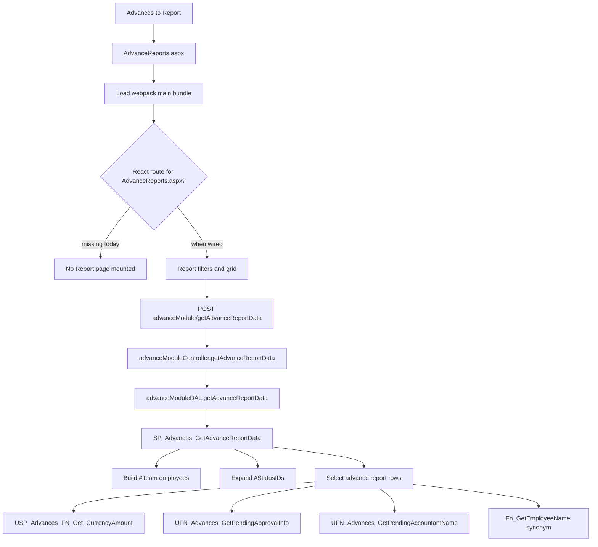
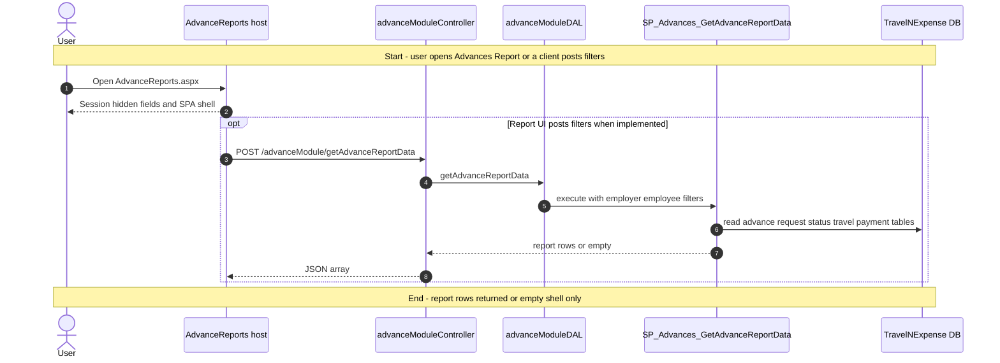
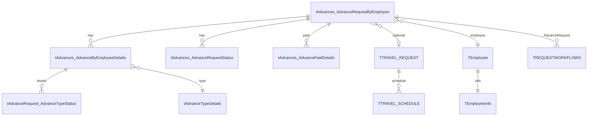

# Report

## Overview

**Advances → Report** is the left-nav item for advance request reporting (`MenuId` 1159). Navigation targets `/HRM/AdvanceModule/AdvanceReports.aspx`. The WebForms host stamps session identity into hidden fields and loads the Advance Module webpack `main` bundle into `#root`. Intended data for the report grid comes from Core Node `POST /advanceModule/getAdvanceReportData`, which runs `SP_Advances_GetAdvanceReportData` on the Travel & Expense database (slug **hrms-travelnexpense**).

In the current SourceCode checkout the SPA router (`routes.js`) only registers Setup Advance Types, Advance Requests, Create, Details, and Edit. There is no React route for `AdvanceReports.aspx`, and `AdvanceModuleHttpClient` has no `getAdvanceReportData` method. Opening the menu therefore loads the shell without a Report page component that posts filters. The API and stored procedure are present and are the documented call chain for when the UI is wired.

The report procedure returns employer-wide (or cross-reporting root) advance request rows with status, amounts, travel linkage, pending-with, payment, and L1–L5 approver columns. Filter parameters include status CSV, advance type CSV, date range, currency, amount operator, cost center, project, travel-request flag, and inactive employees.

**Who's involved:**

- **HR / admin / finance viewer** — intended consumer of Advances → Report (menu 1159 under Advances 1157).
- **Employee / approver / accountant** — not the primary actors on this menu; their work stays on Request Advances. The SP still projects pending-with and accountant names for each row.
- **Global / cross-reporting employers** — when `IsCrossReportingApplicable = 'Y'`, the SP expands the employee universe under the root employer.

There is no SystemModel-2 workflow page for this menu item in this checkout. Runtime truth is the ASPX host, Core API route, and T&E procedure.

## Workflow

List/report reads are HTTP JSON to Core Node. The ASPX does not bind grids or post back report filters.

## Request journey

### Viewer — load advance report data via API

## Entry points

| UI / API | Purpose |
|---|---|
| `HRM/AdvanceModule/AdvanceReports.aspx` | Left-nav host for Advances → Report (`NavigateURL` menu 1159). |
| `AdvanceReports.aspx.cs` `Page_Load` | Session → hidden fields; webpack manifest → `MainBundle`. |
| Advance Module `index.js` / `App.js` | Mounts React router into `#root` (no Report route today). |
| `POST /advanceModule/getAdvanceReportData` | Filtered advance report result set. |
| `ActivityDescription.AdvanceReports = 403` | Shared enum; host currently does not log activity on load. |

No WebForms `__doPostBack` drives the report. Authorize + `assertEmployerAccess('employerId')` + `setLoggedInEmployeeId('employeeId')` gate the Core API action.

## Code → database call chain

| Entry point | DAL / BLL method | Stored procedure |
|---|---|---|
| `AdvanceReports.aspx.cs` `Page_Load` (`AdvanceReports.aspx.cs:24`) | Session stamp + `LoadWebpackManifest` — no DB read | — |
| React `routes.js` (no `AdvanceReports.aspx` path) | — | — |
| `POST /advanceModule/getAdvanceReportData` (`AdvanceModuleRoutes.js:59`) | `advanceModuleController.getAdvanceReportData` (`advanceModuleController.js:1242`) → `advanceModuleDAL.getAdvanceReportData` (`advanceModuleDAL.js:2497`) | `SP_Advances_GetAdvanceReportData` |

Nested from the report procedure: [`USP_Advances_FN_Get_CurrencyAmount`](/docs/database/hrms-travelnexpense/USP_Advances_FN_Get_CurrencyAmount), [`UFN_Advances_GetPendingApprovalInfo`](/docs/database/hrms-travelnexpense/UFN_Advances_GetPendingApprovalInfo), [`UFN_Advances_GetPendingAccountantName`](/docs/database/hrms-travelnexpense/UFN_Advances_GetPendingAccountantName), and synonym [`Fn_GetEmployeeName`](/docs/database/hrms/Fn_GetEmployeeName) (HRMS).

DAL uses `dbSettings.tneDbConfig` (`advanceModuleDAL.js:231`).

## API endpoints

Core Node route prefix `api` → `/advanceModule` (`routeIndex.js` mounts `AdvanceModuleRoutes`). Base URL is the Core WebAPI (`process.env.API_URL` in the Advance SPA), not a separate T&E .NET host for this action.

| Method | Path | Role on this page |
|---|---|---|
| POST | `/advanceModule/getAdvanceReportData` | Filtered advance report grid data |

Body fields used by the controller: `employerId`, `employeeId` (required); optional `advanceRequestDetailId`, `StatusId`, `advanceTypeId`, `FromDate`, `ToDate`, `ReqCurrencyCodeId`, `ReqestedAmount`, `ReqOperator`, `CostCenter`, `ProjectId`, `ShouldHaveTravelRequest`, `isInactive`.

No ASPX `__doPostBack` list binding. Supporting lookup endpoints used by Request Advances (types, cost centers, pay statuses) are not called from a Report UI in this checkout.

## Stored procedures & tables involved

| Procedure / function | Role | Database docs |
|---|---|---|
| [`SP_Advances_GetAdvanceReportData`](/docs/database/hrms-travelnexpense/SP_Advances_GetAdvanceReportData) | Main report result set | written |
| [`USP_Advances_FN_Get_CurrencyAmount`](/docs/database/hrms-travelnexpense/USP_Advances_FN_Get_CurrencyAmount) | Format amounts for display / raw | written |
| [`UFN_Advances_GetPendingApprovalInfo`](/docs/database/hrms-travelnexpense/UFN_Advances_GetPendingApprovalInfo) | Pending approver aggregation | written |
| [`UFN_Advances_GetPendingAccountantName`](/docs/database/hrms-travelnexpense/UFN_Advances_GetPendingAccountantName) | Pending accountant names when status is Pending With Accounts | written |
| [`Fn_GetEmployeeName`](/docs/database/hrms/Fn_GetEmployeeName) | Display names (synonym on T&E) | existing (hrms) |

Primary tables on the report path: `tAdvances_AdvanceRequestByEmployee`, `tAdvances_AdvanceByEmployeeDetails`, `tAdvances_AdvanceRequestStatus`, `tAdvances_AdvancePaidDetails`, `tAdvanceRequest_AdvanceTypeStatus`, `tAdvanceTypeDetails`, `TREQUESTWORKFLOWS` / `TWorkflowDetails` / `tworkflowmanagement`, `TTRAVEL_REQUEST` / `TTRAVEL_SCHEDULE`, `TLOOKUP` / `tLookUp`, `TEmployee` / `TEmployeeInfo` / `TEmployerDetails` / `TOrgHierarchyDetails`, `tCostCenter`, `TProject`, `TCountry`, `TADVANCE_COMMENT`, `tAdvances_AdvanceDocuments`.

## Table relationships

## Known gaps

- React `APP_ROUTES` has no path for `/HRM/AdvanceModule/AdvanceReports.aspx`; the shell mounts with no Report page.
- `AdvanceModuleHttpClient` does not call `getAdvanceReportData`; no filter UI source under `Areas/` for Report.
- `AdvanceReports.aspx` markup `Inherits="HRMS.Web.HRM.AdvanceModule.AdvanceModule"` while code-behind class is `AdvanceReports` — possible designer/inherits mismatch.
- Activity log for `AdvanceReports` (enum 403) is commented out / unused on `Page_Load`.
- Filter dropdown helpers (statuses, types, cost centers, projects, currencies) are not invoked by a Report screen in this checkout; they may be reused from Request Advances when UI lands.
- SystemModel-2 has no dedicated Advances Report workflow page.

## Reference

- `HRMS.Web/HRMS.Web/HRM/AdvanceModule/AdvanceReports.aspx` (+ `.cs`)
- `HRMS.Web/HRMS.Web/HRM/AdvanceModule/routes.js`
- `HRMS.Web/HRMS.Web/HRM/AdvanceModule/index.js`
- `HRMS.Web/HRMS.Web/HRM/AdvanceModule/Common/HttpClients/AdvanceModuleHttpClient.js`
- `HRMS.CoreAPI/HRMS.Core.WebAPI.Node/Routes/AdvanceModuleRoutes.js`
- `HRMS.CoreAPI/HRMS.Core.WebAPI.Node/Controllers/advanceModuleController.js`
- `HRMS.CoreAPI/HRMS.Core.WebAPI.Node/Core/DataAccessLayer/advanceModuleDAL.js`
- `HRMS-DATABASE/HRMS_TRAVELNEXPENSE/STOREPROCEDURE/SP_Advances_GetAdvanceReportData.sql`
- `HRMS-DATABASE/HRMS_TRAVELNEXPENSE/DML/AdvanceReportsTMenuDML.sql`
- `HRMS.Shared/HRMS.DataContract/Common/Enums.cs` (`AdvanceReports = 403`)
