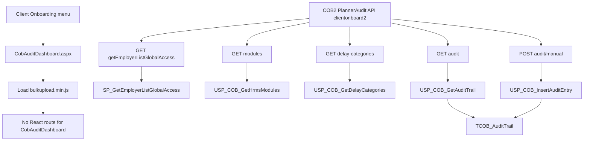
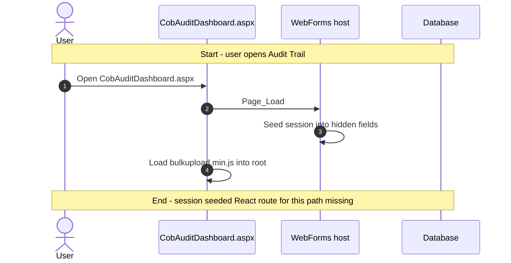
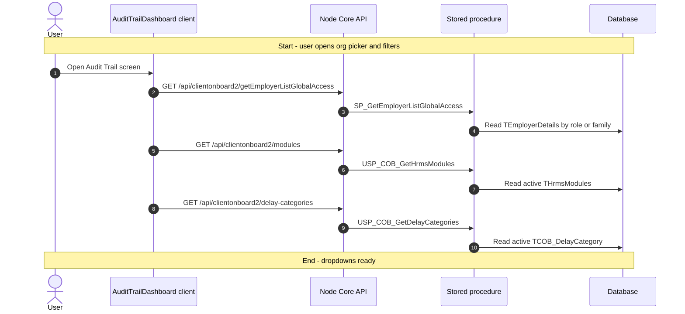
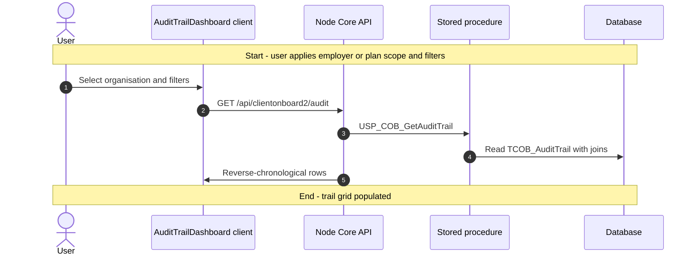
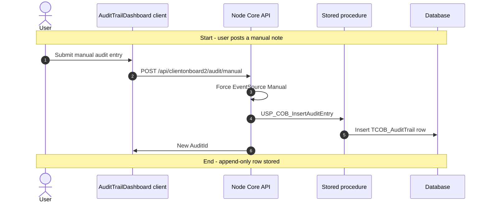
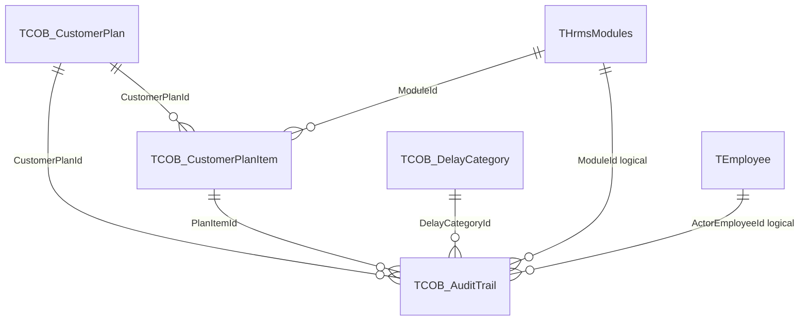

# Audit Trail

## Overview

An operations / COB user opens **Client Onboarding → Audit Trail** (`CobAuditDashboard.aspx`, MenuId **1354**) to review the append-only onboarding plan event feed for a selected organisation — status changes, delays, auto-tracked import steps, module resync, bulk sign-off, and optional manual notes. The WebForms host only seeds session identity into hidden fields and loads `bulkupload.min.js`. Screen traffic is Core Node `/api/clientonboard2/audit*` plus shared lookups (`/modules`, `/delay-categories`, `/getEmployerListGlobalAccess`). There is no WebForms postback for the trail grid.

Live employerid=0 left-nav order under Client Onboarding places this leaf after Client Plan Config and before Cross Client Dashboard. `tMenuDetails` (employer 0) maps MenuId **1354** / MenuName **Audit Trail** to NavigateURL `HRM\BulkUpload_React\CobAuditDashboard.aspx`. Activity type **470** (`Onboarding Audit Trail`) exists in page-visit DML; the host `Page_Load` does not call `Sp_InsertActivityLog`.

**Who's involved:**

- **Ops / COB user** — picks organisation (and optional module / source / delay / date filters), reads the reverse-chronological trail, may post a manual entry.
- **Planner / Import / System writers** — other COB procs and BLL paths insert into `TCOB_AuditTrail` (auto and system sources); this leaf primarily reads that table.

There is no SystemModel-2 page for this screen. Schema and procs live under `HRMS-DATABASE/HRMS/DDL/001_COB_AuditPlanner_Tables.sql` and `STOREPROCEDURE/USP_COB_*`.

## Workflow

The WebForms host has no postback that binds the audit grid. Request lifecycle is Core Node JWT/`Authorization` traffic under `/api/clientonboard2`.

## Request journey

### Open Audit Trail host

### Load employer list and filter lookups (API)

### Load filtered audit trail (API)

### Record a manual audit entry (API)

## Entry points

| Entry | Purpose | Live? |
|---|---|---|
| `~/HRM/BulkUpload_React/CobAuditDashboard.aspx` | Menu leaf **Audit Trail** (MenuId 1354). WebForms host + session seed | Yes (host only) |
| React route in `BulkUpload_React/Areas/routes.js` | Only `UPLOAD_FILE` → `UploadFiles.aspx` | No route for CobAuditDashboard |
| `/api/clientonboard2/audit`, `/audit/manual` (`PlannerAuditRoutes.js`) | Trail read + manual insert | Yes |
| `/api/clientonboard2/modules`, `/delay-categories` | Module and delay filter lookups | Yes |
| `/api/clientonboard2/getEmployerListGlobalAccess` (`ClientOnboardingRoutes.js`) | Organisation dropdown for Audit Trail + Plan | Yes |
| `~/HRM/BulkUpload_React/CobDashboard.aspx` | Sibling **Import Management** (writers into trail) | Out of scope |
| Cross Client Dashboard / Client Plan Config | Sibling planner leaves under same `/clientonboard2` mount | Out of scope |

## Code → database call chain

| Entry | Method | Database |
|---|---|---|
| Page load, `CobAuditDashboard.aspx.cs:23` | Session → hidden fields only (no activity log) | *(none)* |
| API, `PlannerAuditController.getAuditTrail:163` | BLL `getAuditTrail:109` → DAL `getAuditTrail:195` | `USP_COB_GetAuditTrail` |
| API, `insertManualAuditEntry:182` | BLL `insertManualAuditEntry:147` → DAL `insertAuditEntry:271` | `USP_COB_InsertAuditEntry` |
| API, `getHrmsModules:74` | BLL `getHrmsModules:24` → DAL `getHrmsModules:53` | `USP_COB_GetHrmsModules` |
| API, `getDelayCategories:64` | BLL `getDelayCategories:20` → DAL `getDelayCategories:40` | `USP_COB_GetDelayCategories` |
| API, `ClientOnboardingController.getEmployerListGlobalAccess:150` | BLL `getEmployerListGlobalAccess:163` → DAL `getEmployerListGlobalAccess:52` | `SP_GetEmployerListGlobalAccess` |

## API endpoints

No WebForms postback binds Audit Trail request data. Primary traffic is Core Node under `/api/clientonboard2` (`routeIndex.js:106` mounts `PlannerAuditRoutes.js` after ClientOnboarding and baseline). `/audit` and `/audit/manual` use `Authorize` only (no `assertEmployerAccess`); tenancy is enforced inside `USP_COB_GetAuditTrail` via required `CustomerPlanId` or `EmployerId`.

| Verb | Route | Parameters | Purpose | Source |
|---|---|---|---|---|
| GET | `/api/clientonboard2/audit` | query `customerPlanId` and/or `employerId`, optional `moduleIds`, `eventSource`, `delayCategoryIds` / `delayCategoryId`, `fromUtc`, `toUtc` | Filtered reverse-chronological trail | `PlannerAuditRoutes.js:45` |
| POST | `/api/clientonboard2/audit/manual` | body `eventType` (required) plus optional plan/item/employer/status/delay/remark/evidence/actor/field values | Append Manual-source audit row | `PlannerAuditRoutes.js:46` |
| GET | `/api/clientonboard2/modules` | (auth) | Module filter dropdown | `PlannerAuditRoutes.js:26` |
| GET | `/api/clientonboard2/delay-categories` | (auth) | Delay category filter dropdown | `PlannerAuditRoutes.js:25` |
| GET | `/api/clientonboard2/getEmployerListGlobalAccess` | query `employeeId` | Organisation list (raw array, not ActionResult) | `ClientOnboardingRoutes.js:45` |

Planner plan/item/sign-off/overview routes also sit under `/clientonboard2` but belong to sibling leaves (Client Plan Config / Cross Client Dashboard). Those paths often write `TCOB_AuditTrail` directly inside their SPs.

## Stored procedures & tables involved

| Object | File | Purpose | Wiki |
|---|---|---|---|
| [USP_COB_GetAuditTrail](/docs/database/hrms/USP_COB_GetAuditTrail) | `STOREPROCEDURE/USP_COB_GetAuditTrail.sql` | Filtered trail feed with actor and field columns | `TCOB_AuditTrail` |
| [USP_COB_InsertAuditEntry](/docs/database/hrms/USP_COB_InsertAuditEntry) | `STOREPROCEDURE/USP_COB_InsertAuditEntry.sql` | Append-only insert used by manual API and BLL field diffs | `TCOB_AuditTrail` |
| [USP_COB_GetHrmsModules](/docs/database/hrms/USP_COB_GetHrmsModules) | `STOREPROCEDURE/USP_COB_GetHrmsModules.sql` | Active module list for filter | `THrmsModules` |
| [USP_COB_GetDelayCategories](/docs/database/hrms/USP_COB_GetDelayCategories) | `STOREPROCEDURE/USP_COB_GetDelayCategories.sql` | Active delay taxonomy | `TCOB_DelayCategory` |
| [SP_GetEmployerListGlobalAccess](/docs/database/hrms/SP_GetEmployerListGlobalAccess) | `STOREPROCEDURE/SP_GetEmployerListGlobalAccess.sql` | Org picker (admin/global vs family) | `TEmployerDetails` |
| `TCOB_AuditTrail` | `DDL/001_COB_AuditPlanner_Tables.sql` (+ field/ModuleId alters) | Append-only event store | COB Audit Trail & Planner |
| `TCOB_CustomerPlan`, `TCOB_CustomerPlanItem` | same DDL | Plan and item context on trail rows | Planner sibling |
| `TCOB_DelayCategory`, `THrmsModules`, `TEmployee` | catalogued | Delay name, module name, actor display | joins in get trail |

No nested procedures on the direct Audit Trail read/write path. Other COB procs (`USP_COB_UpdateCustomerPlanItem`, `USP_COB_BulkSignOffModule`, `USP_COB_SyncAutoTrackedItem`, …) insert into `TCOB_AuditTrail` inline and are producers, not nested callers of the leaf SPs.

## Table relationships

Declared FKs exist from `TCOB_AuditTrail` to plan, plan item, and delay category. Module and actor links are logical joins (no FK on `ModuleId` / `ActorEmployeeId` in the baseline DDL).

## Known gaps

- **No React route for `CobAuditDashboard.aspx`** in `BulkUpload_React/Areas/routes.js` or the checked-in upload-only Switch; SPA source is referenced elsewhere as `AuditTrailDashboard.jsx` outside this tree. Opening the menu leaf seeds session fields and leaves `#root` empty unless a different bundle is deployed outside this repo.
- **No activity log on open** — `CobAuditDashboard.aspx.cs` does not call `CommonUtil.LogActivity` / `Sp_InsertActivityLog` despite activity type **470** in page-visit DML.
- **No SystemModel-2 page** for Audit Trail.
- **`GET /audit` has no `assertEmployerAccess`** — scoping relies on the SP raising `COB_SCOPE_REQUIRED` when both plan and employer filters are missing; callers must always send one.
- **Many writers bypass `USP_COB_InsertAuditEntry`** and `INSERT` into `TCOB_AuditTrail` directly inside planner/auto-track SPs; the manual API path is the documented insert SP for this leaf.
- **No checked-in DML row** for MenuId 1354 NavigateURL in the Liquibase tree; live DEV `tMenuDetails` (employer 0) confirms the mapping.
- **Baseline DDL script starts with `USE [HRM-CL-Prod]`** — hardcoded database name in the Liquibase tree for the planner tables file.

## Reference

Confidence is **medium** for the Core `/clientonboard2` PlannerAudit DAL paths and the listed STOREPROCEDURE scripts; **low** for any browser UI on this leaf because the BulkUpload React host does not mount CobAuditDashboard. Foreign keys are those declared in `001_COB_AuditPlanner_Tables.sql` plus logical joins documented above.

### SourceCode

- `HRMS.Web/HRMS.Web/HRM/BulkUpload_React/CobAuditDashboard.aspx`
- `HRMS.Web/HRMS.Web/HRM/BulkUpload_React/CobAuditDashboard.aspx.cs`
- `HRMS.Web/HRMS.Web/HRM/BulkUpload_React/Areas/routes.js`
- `HRMS.CoreAPI/HRMS.Core.WebAPI.Node/Routes/PlannerAuditRoutes.js`
- `HRMS.CoreAPI/HRMS.Core.WebAPI.Node/Routes/ClientOnboardingRoutes.js`
- `HRMS.CoreAPI/HRMS.Core.WebAPI.Node/Routes/routeIndex.js`
- `HRMS.CoreAPI/HRMS.Core.WebAPI.Node/Controllers/PlannerAuditController.js`
- `HRMS.CoreAPI/HRMS.Core.WebAPI.Node/Controllers/ClientOnboardingController.js`
- `HRMS.CoreAPI/HRMS.Core.WebAPI.Node/Core/BusinessLogicLayer/PlannerAuditBLL.js`
- `HRMS.CoreAPI/HRMS.Core.WebAPI.Node/Core/BusinessLogicLayer/ClientOnboardingBLL.js`
- `HRMS.CoreAPI/HRMS.Core.WebAPI.Node/Core/DataAccessLayer/PlannerAuditDAL.js`
- `HRMS.CoreAPI/HRMS.Core.WebAPI.Node/Core/DataAccessLayer/ClientOnboardingDAL.js`
- `HRMS.CoreAPI/HRMS.Core.WebAPI.Node/Middlewares/validatePlannerAuditRequest.js`

### TDG HRMS DB

- Live DEV `dbo.tMenuDetails` MenuId 1354 (employer 0) — MenuName Audit Trail, NavigateURL `HRM\BulkUpload_React\CobAuditDashboard.aspx`
- `HRMS-DATABASE/HRMS/DML/PageVisitTracking/001_DML_TActivityLogTypes_PageVisits.sql` (activity 470)
- `HRMS-DATABASE/HRMS/DDL/001_COB_AuditPlanner_Tables.sql`
- `HRMS-DATABASE/HRMS/DDL/007_COB_AuditTrail_FieldTracking_Columns.sql`
- `HRMS-DATABASE/HRMS/DML/COB_Alter_TCOB_AuditTrail_Add_ModuleId.sql`
- `HRMS-DATABASE/HRMS/STOREPROCEDURE/USP_COB_GetAuditTrail.sql`
- `HRMS-DATABASE/HRMS/STOREPROCEDURE/USP_COB_InsertAuditEntry.sql`
- `HRMS-DATABASE/HRMS/STOREPROCEDURE/USP_COB_GetHrmsModules.sql`
- `HRMS-DATABASE/HRMS/STOREPROCEDURE/USP_COB_GetDelayCategories.sql`
- `HRMS-DATABASE/HRMS/STOREPROCEDURE/SP_GetEmployerListGlobalAccess.sql`
