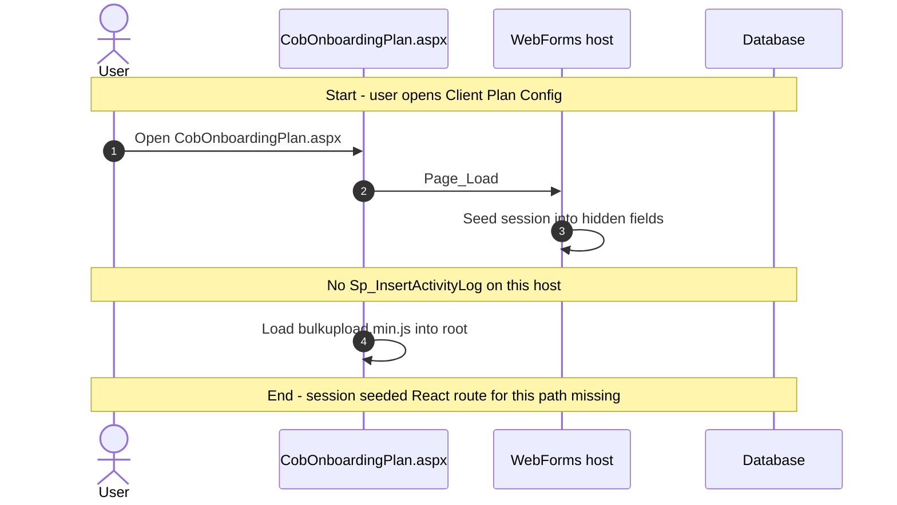
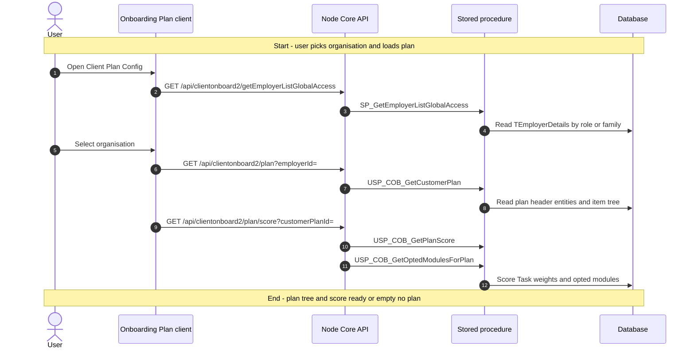
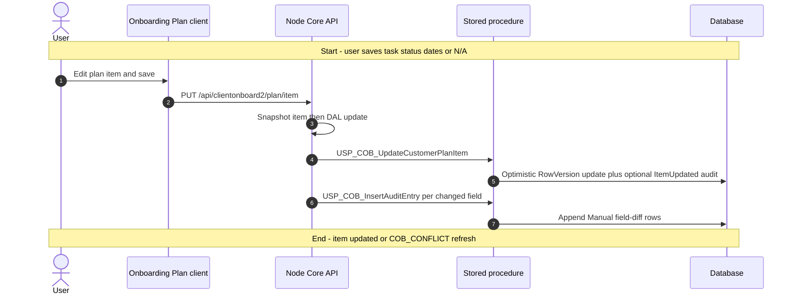
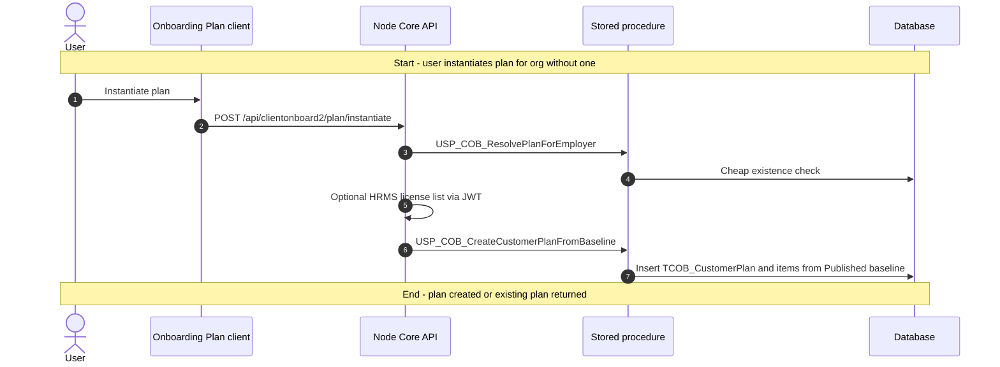
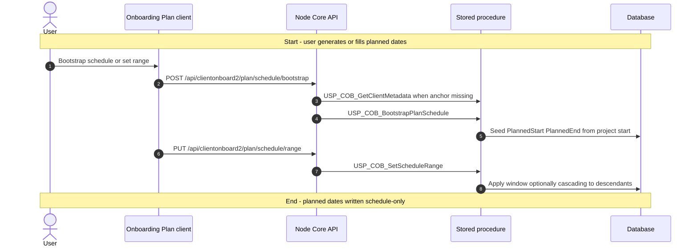
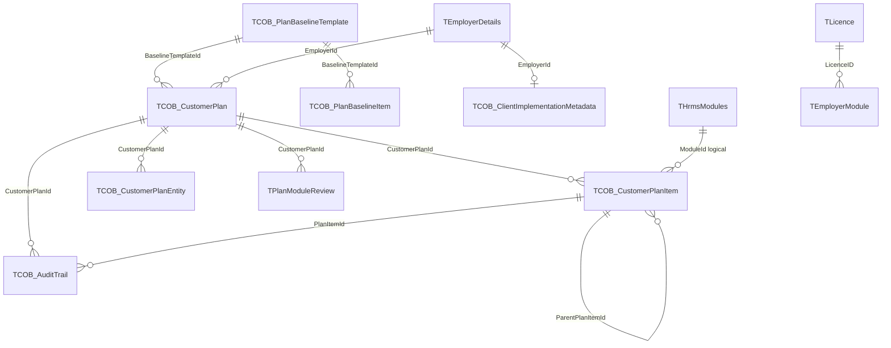

# Client Plan Config

## Overview

An operations / COB user opens **Client Onboarding → Client Plan Config** (`CobOnboardingPlan.aspx`, MenuId **1353**, page title **Onboarding Plan**) to create and maintain one organisation’s live onboarding plan — header and Module → Section → Activity → Task tree in `TCOB_CustomerPlan` / `TCOB_CustomerPlanItem`, weighted ClientScore, planned-date schedule, implementer metadata, instantiate from the active Published baseline, license resync, item add/remove/reorder/reweight, task/module sign-off, and plan Excel export. The WebForms host only seeds session identity into hidden fields and loads `bulkupload.min.js`. Screen traffic is Core Node `/api/clientonboard2/plan*` (plus shared org picker `getEmployerListGlobalAccess`). There is no WebForms postback for plan data.

Live employerid=0 left-nav order under Client Onboarding places this leaf after Plan Templates and before Audit Trail. Live DEV `tMenuDetails` (employer 0) maps MenuId **1353** / MenuName **Client Plan Config** to NavigateURL `HRM\BulkUpload_React\CobOnboardingPlan.aspx`. Activity type **472** (`Onboarding Plan`) exists in page-visit DML; the host `Page_Load` does not call `Sp_InsertActivityLog`.

Sibling leaves own adjacent surfaces: **Plan Templates** authors the baseline under `/clientonboard2/baseline`; **Audit Trail** reads/writes `TCOB_AuditTrail` via `/audit*`; **Cross Client Dashboard** rolls up all orgs via `/plan/overview*`. This leaf owns the per-org create/update path.

**Who's involved:**

- **Ops / COB implementer** — picks an organisation, views/edits the live plan tree, schedule, score, and metadata; may instantiate or resync; may export `.xlsx`.
- **Reviewer** — signs off individual tasks or bulk-reviews a module when every task is Complete or N/A.
- **License / org-create hooks** — `onLicenseSaved` / `USP_COB_InstantiatePlanForEmployer` instantiate or resync plans outside this screen (same tables/procs).

There is no SystemModel-2 page for this screen. Schema and procs live under `HRMS-DATABASE/HRMS/DDL/001_COB_AuditPlanner_Tables.sql` and `STOREPROCEDURE/USP_COB_*`.

## Workflow

```mermaid
flowchart TD
  Nav["Client Onboarding menu"] --> Page["CobOnboardingPlan.aspx"]
  Page --> Seed["Seed session hidden fields"]
  Page --> Bundle["Load bulkupload.min.js"]
  Bundle --> NoRoute["No React route for CobOnboardingPlan"]
  Api["COB2 plan API clientonboard2"] --> Emp["GET getEmployerListGlobalAccess"]
  Emp --> EmpSP["SP_GetEmployerListGlobalAccess"]
  Api --> GetPlan["GET plan"]
  GetPlan --> PlanSP["USP_COB_GetCustomerPlan"]
  PlanSP --> Store["TCOB_CustomerPlan plus items"]
  Api --> Score["GET plan/score"]
  Score --> ScoreSP["USP_COB_GetPlanScore"]
  Score --> OptedSP["USP_COB_GetOptedModulesForPlan"]
  Api --> Update["PUT plan/item"]
  Update --> UpdSP["USP_COB_UpdateCustomerPlanItem"]
  Update --> AuditSP["USP_COB_InsertAuditEntry field diffs"]
  Api --> Sched["POST schedule/bootstrap PUT schedule/range"]
  Sched --> BootSP["USP_COB_BootstrapPlanSchedule"]
  Sched --> RangeSP["USP_COB_SetScheduleRange"]
  Api --> Inst["POST plan/instantiate"]
  Inst --> ResSP["USP_COB_ResolvePlanForEmployer"]
  Inst --> CreateSP["USP_COB_CreateCustomerPlanFromBaseline"]
  Api --> Sync["POST plan/resync"]
  Sync --> SyncSP["USP_COB_ResyncPlanModules"]
  Api --> Custom["add remove reorder reweight signoff"]
  Custom --> CustomSP["USP_COB_Add Remove Reorder Reweight SignOff BulkSignOff"]
  Api --> Meta["GET POST plan/metadata"]
  Meta --> MetaSP["USP_COB_Get Upsert ClientMetadata"]
  Api --> Export["GET plan/export"]
  Export --> GetPlan
  Export --> Score
  Export --> Meta
  Export --> Xlsx["buildPlanWorkbook xlsx stream"]
```

The WebForms host has no postback that binds the plan grid. Request lifecycle is Core Node JWT/`Authorization` traffic under `/api/clientonboard2`.

## Request journey

### Open Client Plan Config host

### Load organisation list and plan (API)

### Update a plan item and field-level audit (API)

### Instantiate plan from baseline (API)

### Bootstrap schedule or set planned range (API)

## Entry points

| Entry | Purpose | Live? |
|---|---|---|
| `~/HRM/BulkUpload_React/CobOnboardingPlan.aspx` | Menu leaf **Client Plan Config** (MenuId 1353). WebForms host + session seed | Yes (host only) |
| React route in `BulkUpload_React/Areas/routes.js` | Only `UPLOAD_FILE` → `UploadFiles.aspx` | No route for CobOnboardingPlan |
| `/api/clientonboard2/plan*` (`PlannerAuditRoutes.js`) | Per-org plan CRUD, score, schedule, instantiate, resync, metadata, export | Yes |
| `/api/clientonboard2/getEmployerListGlobalAccess` (`ClientOnboardingRoutes.js`) | Organisation dropdown | Yes |
| `/api/clientonboard2/plan/overview*` | Sibling **Cross Client Dashboard** | Out of scope |
| `/api/clientonboard2/audit*` | Sibling **Audit Trail** | Out of scope |
| `/api/clientonboard2/baseline*` | Sibling **Plan Templates** | Out of scope |
| `~/HRM/BulkUpload_React/PlanTemplates.aspx` | Sibling baseline authoring (MenuId 1352) | Out of scope |

## Code → database call chain

| Entry | Method | Database |
|---|---|---|
| Page load, `CobOnboardingPlan.aspx.cs:23` | Session → hidden fields only (no activity log) | *(none)* |
| API, `ClientOnboardingController.getEmployerListGlobalAccess:150` | BLL `getEmployerListGlobalAccess:163` → DAL `getEmployerListGlobalAccess:52` | `SP_GetEmployerListGlobalAccess` |
| API, `PlannerAuditController.getCustomerPlan:84` | BLL `getCustomerPlan:28` → DAL `getCustomerPlan:66` | `USP_COB_GetCustomerPlan` |
| API, `getPlanScore:94` | BLL `getPlanScore:33` → DAL `getPlanScore:87` | `USP_COB_GetPlanScore` then `USP_COB_GetOptedModulesForPlan` |
| API, `updateCustomerPlanItem:104` | BLL `updateCustomerPlanItem:38` → DAL update `118` + optional `insertAuditEntry` | `USP_COB_UpdateCustomerPlanItem` + `USP_COB_InsertAuditEntry` |
| API, `signOffPlanItem:131` | BLL `signOffPlanItem:101` → DAL `signOffPlanItem:151` | `USP_COB_SignOffPlanItem` |
| API, `bulkSignOffModule:147` | BLL `bulkSignOffModule:105` → DAL `bulkSignOffModule:172` | `USP_COB_BulkSignOffModule` |
| API, `bootstrapPlanSchedule:192` | BLL `bootstrapPlanSchedule:122` → optional metadata then DAL `595` | `USP_COB_GetClientMetadata` then `USP_COB_BootstrapPlanSchedule` |
| API, `setScheduleRange:212` | BLL `setScheduleRange:143` → DAL `615` | `USP_COB_SetScheduleRange` |
| API, `instantiatePlan:257` | BLL `instantiatePlan:224` → `resolvePlanForEmployer:337` then `createCustomerPlanFromBaseline:353` | `USP_COB_ResolvePlanForEmployer` then `USP_COB_CreateCustomerPlanFromBaseline` |
| API, `resyncPlanModules:270` | BLL `resyncPlanModules:278` → DAL `404` | `USP_COB_ResyncPlanModules` (license via CoreAPI HTTP) |
| API, `addPlanItem:283` | BLL `addPlanItem:473` → DAL `464` | `USP_COB_AddPlanItem` |
| API, `removePlanItem:309` | BLL `removePlanItem:484` → DAL `519` | `USP_COB_RemovePlanItem` |
| API, `reweightPlanItems:319` | BLL `reweightPlanItems:488` → DAL `536` + field audits | `USP_COB_ReweightPlanItems` + `USP_COB_InsertAuditEntry` |
| API, `reorderPlanItems:335` | BLL `reorderPlanItems:478` → DAL `501` | `USP_COB_ReorderPlanItems` |
| API, `exportPlan:345` | BLL `exportPlan:532` → get plan / score / metadata → `buildPlanWorkbook` | same read SPs (no export SP) |
| API, `getClientMetadata:365` / `upsertClientMetadata:375` | BLL `566` / `571` → DAL `555` / `571` | `USP_COB_GetClientMetadata` / `USP_COB_UpsertClientMetadata` |

Unattended hooks (same DAL, not this menu leaf’s UI): `checkLicenseChanges` / `onLicenseSaved` use `USP_COB_GetActivePlans`, `USP_TLicence_List`, `USP_COB_GetUnplannedEmployers`, create, and resync.

## API endpoints

No WebForms postback binds Client Plan Config request data. Primary traffic is Core Node under `/api/clientonboard2` (`routeIndex.js:106` mounts `PlannerAuditRoutes.js` after ClientOnboarding and baseline). `/plan` and `/plan/score` use `Authorize` plus `assertEmployerAccess("employerId")`. Other plan write routes use `Authorize` + express-validator only; tenancy is expected from body/query `employerId` / `customerPlanId`.

| Verb | Route | Parameters | Purpose | Source |
|---|---|---|---|---|
| GET | `/api/clientonboard2/plan` | query `employerId` | Plan header + entities + item tree | `PlannerAuditRoutes.js:29` |
| GET | `/api/clientonboard2/plan/score` | query `customerPlanId` (+ employer access) | Module + client score + opted modules | `PlannerAuditRoutes.js:30` |
| PUT | `/api/clientonboard2/plan/item` | body plan item fields + `rowVersion` | Manual item update | `PlannerAuditRoutes.js:39` |
| POST | `/api/clientonboard2/plan/item/signoff` | body `planItemId`, `rowVersion`, remarks | Task reviewer sign-off | `PlannerAuditRoutes.js:40` |
| POST | `/api/clientonboard2/plan/module/bulk-signoff` | body `customerPlanId`, `moduleId`, remark | Module bulk review | `PlannerAuditRoutes.js:42` |
| POST | `/api/clientonboard2/plan/schedule/bootstrap` | body `customerPlanId`, dates, `overwrite` | Seed planned dates | `PlannerAuditRoutes.js:35` |
| PUT | `/api/clientonboard2/plan/schedule/range` | body `planItemId`, planned window, `cascade` | Range-fill planned dates | `PlannerAuditRoutes.js:36` |
| POST | `/api/clientonboard2/plan/instantiate` | body `employerId`, `createdBy`, optional `jwt` | Create plan from baseline | `PlannerAuditRoutes.js:49` |
| POST | `/api/clientonboard2/plan/resync` | body `employerId`, `updatedBy`, `jwt` | Re-sync modules to license | `PlannerAuditRoutes.js:50` |
| POST | `/api/clientonboard2/plan/item/add` | body item fields | Add custom plan item | `PlannerAuditRoutes.js:51` |
| DELETE | `/api/clientonboard2/plan/item/:id` | param id; body `updatedBy` | Soft-remove item + descendants | `PlannerAuditRoutes.js:52` |
| PUT | `/api/clientonboard2/plan/item/reweight` | body `customerPlanId`, `weights` | Bulk reweight | `PlannerAuditRoutes.js:53` |
| PUT | `/api/clientonboard2/plan/item/reorder` | body `customerPlanId`, `order` | Reorder siblings | `PlannerAuditRoutes.js:54` |
| GET | `/api/clientonboard2/plan/export` | query `employerId` | Stream `onboarding-plan-{id}.xlsx` | `PlannerAuditRoutes.js:55` |
| GET | `/api/clientonboard2/plan/metadata` | query `employerId` | Implementation metadata | `PlannerAuditRoutes.js:58` |
| POST | `/api/clientonboard2/plan/metadata` | body metadata fields | Upsert implementation metadata | `PlannerAuditRoutes.js:59` |
| GET | `/api/clientonboard2/getEmployerListGlobalAccess` | query `employeeId` | Organisation list | `ClientOnboardingRoutes.js:46` |

Overview and audit routes share the same router but belong to sibling leaves.

## Stored procedures & tables involved

| Object | File | Purpose | Wiki |
|---|---|---|---|
| [USP_COB_GetCustomerPlan](/docs/database/hrms/USP_COB_GetCustomerPlan) | `STOREPROCEDURE/USP_COB_GetCustomerPlan.sql` | Plan header, entities, rolled-up item tree | `TCOB_CustomerPlan` |
| [USP_COB_GetPlanScore](/docs/database/hrms/USP_COB_GetPlanScore) | `STOREPROCEDURE/USP_COB_GetPlanScore.sql` | Per-module + overall ClientScore (N/A = 100%) | `TCOB_CustomerPlanItem` |
| [USP_COB_GetOptedModulesForPlan](/docs/database/hrms/USP_COB_GetOptedModulesForPlan) | `STOREPROCEDURE/USP_COB_GetOptedModulesForPlan.sql` | Licensed modules + IsCovered vs plan tasks | `TEmployerModule` |
| [USP_COB_UpdateCustomerPlanItem](/docs/database/hrms/USP_COB_UpdateCustomerPlanItem) | `STOREPROCEDURE/USP_COB_UpdateCustomerPlanItem.sql` | Optimistic item update + optional ItemUpdated | `TCOB_CustomerPlanItem` |
| [USP_COB_InsertAuditEntry](/docs/database/hrms/USP_COB_InsertAuditEntry) | `STOREPROCEDURE/USP_COB_InsertAuditEntry.sql` | Field-diff rows from BLL after update/reweight | `TCOB_AuditTrail` |
| [USP_COB_SignOffPlanItem](/docs/database/hrms/USP_COB_SignOffPlanItem) | `STOREPROCEDURE/USP_COB_SignOffPlanItem.sql` | Single-task review | `TCOB_CustomerPlanItem` |
| [USP_COB_BulkSignOffModule](/docs/database/hrms/USP_COB_BulkSignOffModule) | `STOREPROCEDURE/USP_COB_BulkSignOffModule.sql` | Module bulk review + `TPlanModuleReview` | `TPlanModuleReview` |
| [USP_COB_ResolvePlanForEmployer](/docs/database/hrms/USP_COB_ResolvePlanForEmployer) | `STOREPROCEDURE/USP_COB_ResolvePlanForEmployer.sql` | Existence check before instantiate | `TCOB_CustomerPlan` |
| [USP_COB_CreateCustomerPlanFromBaseline](/docs/database/hrms/USP_COB_CreateCustomerPlanFromBaseline) | `STOREPROCEDURE/USP_COB_CreateCustomerPlanFromBaseline.sql` | Copy Published baseline into live plan | `TCOB_PlanBaselineItem` |
| [USP_COB_ResyncPlanModules](/docs/database/hrms/USP_COB_ResyncPlanModules) | `STOREPROCEDURE/USP_COB_ResyncPlanModules.sql` | Add/remove modules vs current license | `TCOB_CustomerPlanItem` |
| [USP_COB_AddPlanItem](/docs/database/hrms/USP_COB_AddPlanItem) / [Remove](/docs/database/hrms/USP_COB_RemovePlanItem) / [Reorder](/docs/database/hrms/USP_COB_ReorderPlanItems) / [Reweight](/docs/database/hrms/USP_COB_ReweightPlanItems) | matching STOREPROCEDURE files | Customisation | `TCOB_CustomerPlanItem` |
| [USP_COB_BootstrapPlanSchedule](/docs/database/hrms/USP_COB_BootstrapPlanSchedule) / [SetScheduleRange](/docs/database/hrms/USP_COB_SetScheduleRange) | matching files | Planned-date seed / range-fill | schedule columns |
| [USP_COB_GetClientMetadata](/docs/database/hrms/USP_COB_GetClientMetadata) / [Upsert](/docs/database/hrms/USP_COB_UpsertClientMetadata) | matching files | Implementation metadata | `TCOB_ClientImplementationMetadata` |
| [USP_COB_GetActivePlans](/docs/database/hrms/USP_COB_GetActivePlans) | `STOREPROCEDURE/USP_COB_GetActivePlans.sql` | License-change job feed | Active plans |
| [SP_GetEmployerListGlobalAccess](/docs/database/hrms/SP_GetEmployerListGlobalAccess) | `STOREPROCEDURE/SP_GetEmployerListGlobalAccess.sql` | Org picker | `TEmployerDetails` |
| [USP_TLicence_List](/docs/database/hrms/USP_TLicence_List) | license SP | Unattended license read | `TLicence` |
| `TCOB_CustomerPlan`, `TCOB_CustomerPlanItem`, `TCOB_CustomerPlanEntity` | planner DDL | Per-org plan store | this leaf |
| `TCOB_PlanBaselineTemplate`, `TCOB_PlanBaselineItem` | planner DDL | Source for instantiate | Plan Templates |
| `TCOB_AuditTrail`, `TCOB_DelayCategory` | planner DDL | Delay / field audit writers | Audit Trail sibling |
| `TPlanModuleReview` | bulk sign-off | Module review history | this leaf |

Direct plan SPs generally call no nested procedures. Nested one level under related instantiate helpers already documented: [USP_COB_InstantiatePlanForEmployer](/docs/database/hrms/USP_COB_InstantiatePlanForEmployer) → [USP_COB_GetUnplannedEmployers](/docs/database/hrms/USP_COB_GetUnplannedEmployers) + [USP_COB_CreateCustomerPlanFromBaseline](/docs/database/hrms/USP_COB_CreateCustomerPlanFromBaseline).

## Table relationships

Declared FKs exist from plan items and audit to the plan header; baseline and employer links are logical joins used by instantiate/get-plan.

## Known gaps

- **No React route for `CobOnboardingPlan.aspx`** in `BulkUpload_React/Areas/routes.js` or the checked-in upload-only Switch; SPA source is referenced elsewhere as Planner / Onboarding Plan views outside this tree. Opening the menu leaf seeds session fields and leaves `#root` empty unless a different bundle is deployed outside this repo.
- **No activity log on open** — `CobOnboardingPlan.aspx.cs` does not call `CommonUtil.LogActivity` / `Sp_InsertActivityLog` despite activity type **472** in page-visit DML.
- **No SystemModel-2 page** for Client Plan Config.
- **COB planner SPA source is not in `BulkUpload_React`** — same host/bundle gap as Audit Trail / Cross Client Dashboard.
- **Most write routes lack `assertEmployerAccess`** — only `GET /plan` and `GET /plan/score` gate by employer; instantiate/resync/item writes rely on Authorize + body ids.
- **No checked-in DML row** for MenuId 1353 NavigateURL in the Liquibase tree; live DEV `tMenuDetails` (employer 0) confirms the mapping.
- **Baseline DDL script starts with `USE [HRM-CL-Prod]`** — hardcoded database name in the Liquibase tree for the planner tables file.
- **Auto-track writers** (`USP_COB_SyncAutoTrackedItem` / import-result) sit on Import Management paths and are producers into the same plan/audit tables, not this leaf’s primary API.

## Reference

Confidence is **medium** for the Core `/clientonboard2/plan*` DAL paths and the listed STOREPROCEDURE scripts; **low** for any browser UI on this leaf because the BulkUpload React host does not mount CobOnboardingPlan. Foreign keys are those declared in `001_COB_AuditPlanner_Tables.sql` plus logical joins documented above.

### SourceCode

- `HRMS.Web/HRMS.Web/HRM/BulkUpload_React/CobOnboardingPlan.aspx`
- `HRMS.Web/HRMS.Web/HRM/BulkUpload_React/CobOnboardingPlan.aspx.cs`
- `HRMS.Web/HRMS.Web/HRM/BulkUpload_React/Areas/routes.js`
- `HRMS.CoreAPI/HRMS.Core.WebAPI.Node/Routes/PlannerAuditRoutes.js`
- `HRMS.CoreAPI/HRMS.Core.WebAPI.Node/Routes/ClientOnboardingRoutes.js`
- `HRMS.CoreAPI/HRMS.Core.WebAPI.Node/Routes/routeIndex.js`
- `HRMS.CoreAPI/HRMS.Core.WebAPI.Node/Controllers/PlannerAuditController.js`
- `HRMS.CoreAPI/HRMS.Core.WebAPI.Node/Controllers/ClientOnboardingController.js`
- `HRMS.CoreAPI/HRMS.Core.WebAPI.Node/Core/BusinessLogicLayer/PlannerAuditBLL.js`
- `HRMS.CoreAPI/HRMS.Core.WebAPI.Node/Core/BusinessLogicLayer/ClientOnboardingBLL.js`
- `HRMS.CoreAPI/HRMS.Core.WebAPI.Node/Core/DataAccessLayer/PlannerAuditDAL.js`
- `HRMS.CoreAPI/HRMS.Core.WebAPI.Node/Core/DataAccessLayer/ClientOnboardingDAL.js`
- `HRMS.CoreAPI/HRMS.Core.WebAPI.Node/Helpers/plannerExcelExport.js`
- `HRMS.CoreAPI/HRMS.Core.WebAPI.Node/Middlewares/validatePlannerAuditRequest.js`
- `HRMS.CoreAPI/HRMS.Core.WebAPI.Node/Features/Employer/AccessValidation/Service.js`

### TDG HRMS DB

- Live DEV `dbo.tMenuDetails` MenuId 1353 (employer 0) — MenuName Client Plan Config, NavigateURL `HRM\BulkUpload_React\CobOnboardingPlan.aspx`
- `HRMS-DATABASE/HRMS/DML/PageVisitTracking/001_DML_TActivityLogTypes_PageVisits.sql` (activity 472)
- `HRMS-DATABASE/HRMS/DDL/001_COB_AuditPlanner_Tables.sql`
- `HRMS-DATABASE/HRMS/STOREPROCEDURE/USP_COB_GetCustomerPlan.sql`
- `HRMS-DATABASE/HRMS/STOREPROCEDURE/USP_COB_GetPlanScore.sql`
- `HRMS-DATABASE/HRMS/STOREPROCEDURE/USP_COB_GetOptedModulesForPlan.sql`
- `HRMS-DATABASE/HRMS/STOREPROCEDURE/USP_COB_UpdateCustomerPlanItem.sql`
- `HRMS-DATABASE/HRMS/STOREPROCEDURE/USP_COB_SignOffPlanItem.sql`
- `HRMS-DATABASE/HRMS/STOREPROCEDURE/USP_COB_BulkSignOffModule.sql`
- `HRMS-DATABASE/HRMS/STOREPROCEDURE/USP_COB_ResolvePlanForEmployer.sql`
- `HRMS-DATABASE/HRMS/STOREPROCEDURE/USP_COB_CreateCustomerPlanFromBaseline.sql`
- `HRMS-DATABASE/HRMS/STOREPROCEDURE/USP_COB_ResyncPlanModules.sql`
- `HRMS-DATABASE/HRMS/STOREPROCEDURE/USP_COB_AddPlanItem.sql`
- `HRMS-DATABASE/HRMS/STOREPROCEDURE/USP_COB_RemovePlanItem.sql`
- `HRMS-DATABASE/HRMS/STOREPROCEDURE/USP_COB_ReorderPlanItems.sql`
- `HRMS-DATABASE/HRMS/STOREPROCEDURE/USP_COB_ReweightPlanItems.sql`
- `HRMS-DATABASE/HRMS/STOREPROCEDURE/USP_COB_BootstrapPlanSchedule.sql`
- `HRMS-DATABASE/HRMS/STOREPROCEDURE/USP_COB_SetScheduleRange.sql`
- `HRMS-DATABASE/HRMS/STOREPROCEDURE/USP_COB_GetClientMetadata.sql`
- `HRMS-DATABASE/HRMS/STOREPROCEDURE/USP_COB_UpsertClientMetadata.sql`
- `HRMS-DATABASE/HRMS/STOREPROCEDURE/USP_COB_GetActivePlans.sql`
- `HRMS-DATABASE/HRMS/STOREPROCEDURE/SP_GetEmployerListGlobalAccess.sql`
- `HRMS-DATABASE/HRMS/STOREPROCEDURE/USP_TLicence_List.sql`
