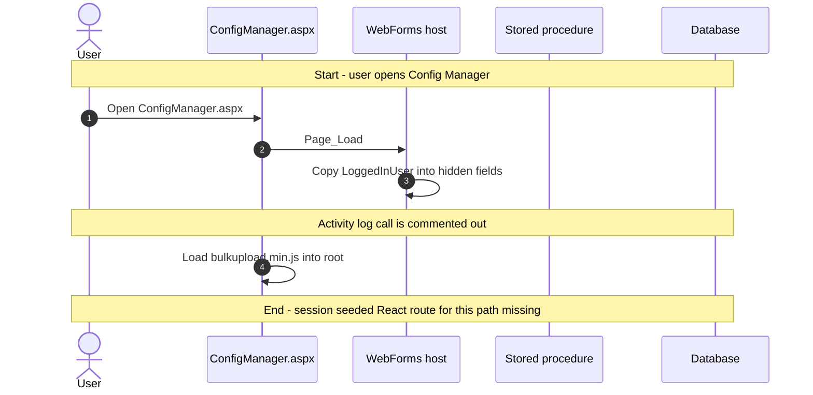
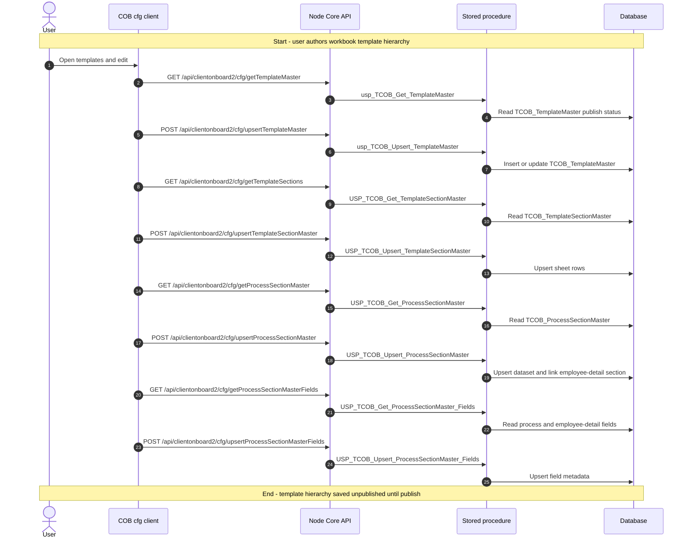
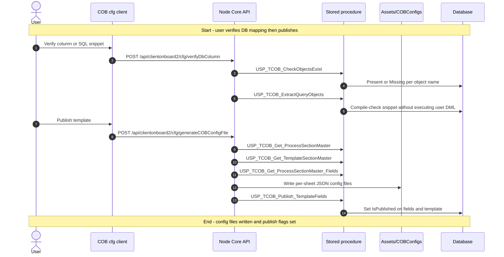
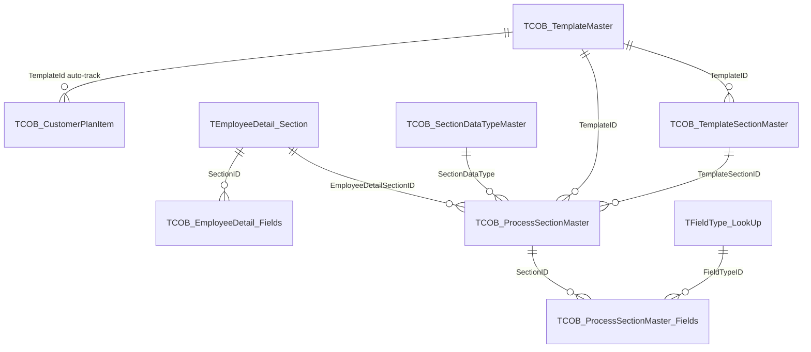

# Config Manager

## Overview

An operations / platform user opens **Client Onboarding → Config Manager** (`ConfigManager.aspx`, MenuId **1307**) to author COB workbook configuration: workbook templates, sheets (template sections), datasets (process sections), and field metadata (validation, transformation, DB mapping). Data Catalog attributes `TCOB_TemplateMaster`, `TCOB_TemplateSectionMaster`, `TCOB_ProcessSectionMaster`, `TCOB_ProcessSectionMaster_Fields`, and `TCOB_EmployeeDetail_Fields` to this leaf’s WORKBOOK TEMPLATES / SHEETS / DATASETS / FIELDS paths. The Core Node surface is Authorize-protected `/api/clientonboard2/cfg/*` on `ClientOnboardingRoutes.js`.

In the checked-in `BulkUpload_React` tree, `ConfigManager.aspx` only seeds session identity into hidden fields and loads `bulkupload.min.js`. Activity logging is commented out on `Page_Load`. That bundle’s React router mounts only `UploadFiles.aspx`, so this leaf’s host does not render a Config Manager SPA from SourceCode as it stands. The `/cfg/*` API and `usp_TCOB_*` / `USP_TCOB_*` procedures below are the live backend attributed to this menu leaf; the WebForms page itself has no postback for config data.

Live employerid=0 left-nav order under Client Onboarding is Upload Files → Import Management → **Config Manager** → Setup Data Management → Plan Templates → Client Plan Config → Audit Trail → Cross Client Dashboard → Default Access Right Management → Data Catalog.

**Who's involved:**

- **Ops / COB config author** — creates templates, sheets, datasets, and fields; verifies DB objects; publishes config JSON under `Assets/COBConfigs`.
- **Import Management consumers** — COB2 import reads the same `TCOB_*` masters and published field flags when mapping and processing workbooks.

There is no SystemModel-2 page for this screen. Catalog blurbs for the config tables live in `TDataCatalog_DML.sql` under Client Onboarding → Config Manager.

## Workflow

```mermaid
flowchart TD
  Nav["Client Onboarding menu"] --> Page["ConfigManager.aspx"]
  Page --> Seed["Seed session hidden fields"]
  Page --> Bundle["Load bulkupload.min.js"]
  Bundle --> NoRoute["No React route for ConfigManager"]
  Api["COB2 cfg API"] --> Tpl["GET cfg/getTemplateMaster"]
  Tpl --> TplSP["usp_TCOB_Get_TemplateMaster"]
  Api --> UpsertTpl["POST cfg/upsertTemplateMaster"]
  UpsertTpl --> UpsertTplSP["usp_TCOB_Upsert_TemplateMaster"]
  Api --> Sheets["GET/POST cfg template sections"]
  Sheets --> SheetSP["USP_TCOB_*_TemplateSectionMaster"]
  Api --> Datasets["GET/POST cfg process section master"]
  Datasets --> DsSP["USP_TCOB_*_ProcessSectionMaster"]
  Api --> Fields["GET/POST cfg process section fields"]
  Fields --> FieldSP["USP_TCOB_*_ProcessSectionMaster_Fields"]
  Api --> Verify["POST cfg/verifyDbColumn"]
  Verify --> CheckSP["USP_TCOB_CheckObjectsExist"]
  Verify --> ExtractSP["USP_TCOB_ExtractQueryObjects"]
  Api --> CrossDb["POST cfg/ensureCrossDbView"]
  CrossDb --> ViewSP["USP_TCOB_EnsureOtdCrossDbView"]
  Api --> Publish["POST cfg/generateCOBConfigFile"]
  Publish --> ReadMasters["Read sections and fields"]
  Publish --> Files["Write Assets/COBConfigs JSON"]
  Publish --> PubSP["USP_TCOB_Publish_TemplateFields"]
```

The WebForms host has no postback that binds config grids. Request lifecycle for Config Manager data is Core Node JWT/`Authorization` traffic under `/api/clientonboard2/cfg`.

## Request journey

### Open Config Manager host

### Maintain template, sheet, dataset, fields (API)

### Verify objects and publish config (API)

## Entry points

| Entry | Purpose | Live? |
|---|---|---|
| `~/HRM/BulkUpload_React/ConfigManager.aspx` | Menu leaf **Config Manager** (MenuId 1307). WebForms host + session seed | Yes (host only) |
| React route in `BulkUpload_React/Areas/routes.js` | Only `UPLOAD_FILE` → `UploadFiles.aspx` | No route for ConfigManager |
| `/api/clientonboard2/cfg/*` (`ClientOnboardingRoutes.js`) | Template / sheet / dataset / field / verify / publish API | Yes |
| `~/HRM/BulkUpload_React/CobDashboard.aspx` | Sibling leaf **Import Management** | Out of scope |
| `~/HRM/BulkUpload_React/OtdDefaultMaster.aspx` | Sibling leaf **Setup Data Management** (`/otd/*`) | Out of scope |
| `~/HRM/BulkUpload_React/UploadFiles.aspx` | Prior leaf **Upload Files** | Out of scope |

## Code → database call chain

| Entry | Method | Database |
|---|---|---|
| Page load, `ConfigManager.aspx.cs:24` | Session → hidden fields only (`LogActivity` commented at line 26) | *(none)* |
| API, `ClientOnboardingController.getTCOBTemplateMaster:1312` | BLL `getTCOBTemplateMaster:1262` → `ClientOnboardingDAL.getTCOBTemplateMaster:1253` | `usp_TCOB_Get_TemplateMaster` |
| API, `upsertTCOBTemplateMaster:1328` | BLL `upsertTCOBTemplateMaster:1266` → DAL `upsertTCOBTemplateMaster:1269` | `usp_TCOB_Upsert_TemplateMaster` |
| API, `deleteTCOBTemplateMaster:1347` | BLL → DAL `deleteTCOBTemplateMaster:1288` | `usp_TCOB_Delete_TemplateMaster` |
| API, `getTCOBTemplateSections:1363` | BLL → DAL `getTCOBTemplateSections:1304` | `USP_TCOB_Get_TemplateSectionMaster` |
| API, `upsertTCOBTemplateSectionMaster:1379` | BLL → DAL `upsertTCOBTemplateSectionMaster:1320` | `USP_TCOB_Upsert_TemplateSectionMaster` |
| API, `deleteTCOBTemplateSectionMaster:1400` | BLL → DAL `deleteTCOBTemplateSectionMaster:1341` | `USP_TCOB_Delete_TemplateSectionMaster` |
| API, `getTCOBProcessSectionMaster:1416` | BLL → DAL `getTCOBProcessSectionMaster:1357` | `USP_TCOB_Get_ProcessSectionMaster` |
| API, `upsertTCOBProcessSectionMaster:1433` | BLL → DAL `upsertTCOBProcessSectionMaster:1374` | `USP_TCOB_Upsert_ProcessSectionMaster` |
| API, `deleteTCOBProcessSectionMaster:1470` | BLL → DAL `deleteTCOBProcessSectionMaster:1408` | `USP_TCOB_Delete_ProcessSectionMaster` |
| API, `getTCOBProcessSectionMasterFields:1486` | BLL → DAL `getTCOBProcessSectionMasterFields:1424` | `USP_TCOB_Get_ProcessSectionMaster_Fields` |
| API, `upsertTCOBProcessSectionMasterFields:1601` | BLL may `ensureOtdCrossDbView` then DAL `upsertTCOBProcessSectionMasterFields:1582` | `USP_TCOB_EnsureOtdCrossDbView` (optional) + `USP_TCOB_Upsert_ProcessSectionMaster_Fields` |
| API, `deleteTCOBProcessSectionMasterFields:1679` | BLL → DAL `deleteTCOBProcessSectionMasterFields:1625` | `USP_TCOB_Delete_ProcessSectionMaster_Fields` |
| API, `verifyDbColumn:1538` | BLL `verifyDbColumn:1355` → DAL `verifyDbColumn` / `validateSqlSnippet` | `USP_TCOB_CheckObjectsExist`, `USP_TCOB_ExtractQueryObjects` |
| API, `ensureCrossDbView:1563` | BLL `ensureOtdCrossDbView:1437` → DAL `ensureOtdCrossDbView:1565` | `USP_TCOB_EnsureOtdCrossDbView` |
| API, `generateCOBConfigFile:1582` | BLL `generateCOBConfigFile:1710` → read masters/fields, write JSON, DAL `publishTCOBTemplateFields:1642` | `USP_TCOB_Get_*` + `USP_TCOB_Publish_TemplateFields` (+ optional sheet upsert) |
| API, `getTCOBCountryMaster:1499` | BLL → DAL `getTCOBCountryMaster:1440` | `SP_GetCountries` |
| API, `getTCOBSectionDataTypeMaster:1508` | BLL → DAL `getTCOBSectionDataTypeMaster:1454` | `USP_TCOB_Get_SectionDataTypeMaster` |
| API, `getHRMSModuleList:1520` | BLL → DAL `getHRMSModuleList:1469` | `USP_HRMS_Module_List` |
| API, `getTCOBFieldTypeLookup:1529` | BLL → DAL `getTCOBFieldTypeLookup:1483` | `USP_TCOB_GetFieldTypeLookup` |
| API, `getValidationRuleSpecs:1653` | BLL `getValidationRuleSpecs` → in-process `RuleSpecs` | *(no SP)* |
| API, `validateFieldValidationRules:1662` | BLL dry-run against field-type lookup | `USP_TCOB_GetFieldTypeLookup` (lookup only) |

## API endpoints

No WebForms postback binds Config Manager request data. Primary traffic is Core Node under `/api/clientonboard2` (`routeIndex.js:96` mounts `ClientOnboardingRoutes.js`). `/cfg/*` routes use `Authorize` only (no `assertEmployerAccess`); masters are global config, not employer-scoped.

| Verb | Route | Parameters | Purpose | Source |
|---|---|---|---|---|
| GET | `/api/clientonboard2/cfg/getTemplateMaster` | query `templateId`, `isActive` | List / filter templates + publish status | `ClientOnboardingRoutes.js:288` |
| POST | `/api/clientonboard2/cfg/upsertTemplateMaster` | body template fields | Insert or update template | `ClientOnboardingRoutes.js:294` |
| POST | `/api/clientonboard2/cfg/deleteTemplateMaster` | body `templateId` | Soft-deactivate template | `ClientOnboardingRoutes.js:302` |
| GET | `/api/clientonboard2/cfg/getTemplateSections` | query template / section ids | List sheets | `ClientOnboardingRoutes.js:311` |
| POST | `/api/clientonboard2/cfg/upsertTemplateSectionMaster` | body sheet fields | Upsert sheet | `ClientOnboardingRoutes.js:317` |
| POST | `/api/clientonboard2/cfg/deleteTemplateSectionMaster` | body section id | Soft-deactivate sheet | `ClientOnboardingRoutes.js:325` |
| GET | `/api/clientonboard2/cfg/getProcessSectionMaster` | query template / sheet / section ids | List datasets | `ClientOnboardingRoutes.js:334` |
| POST | `/api/clientonboard2/cfg/upsertProcessSectionMaster` | body dataset fields | Upsert dataset | `ClientOnboardingRoutes.js:340` |
| POST | `/api/clientonboard2/cfg/deleteProcessSectionMaster` | body `sectionId` | Soft-deactivate dataset | `ClientOnboardingRoutes.js:348` |
| GET | `/api/clientonboard2/cfg/getProcessSectionMasterFields` | query `sectionId` | List fields | `ClientOnboardingRoutes.js:357` |
| POST | `/api/clientonboard2/cfg/upsertProcessSectionMasterFields` | body field metadata | Upsert field | `ClientOnboardingRoutes.js:365` |
| POST | `/api/clientonboard2/cfg/deleteProcessSectionMasterFields` | body section + field name | Soft-deactivate field | `ClientOnboardingRoutes.js:373` |
| GET | `/api/clientonboard2/cfg/validationRuleSpecs` | (auth) | Rule Builder metadata | `ClientOnboardingRoutes.js:382` |
| POST | `/api/clientonboard2/cfg/validateFieldValidationRules` | body rules | Dry-run rule config | `ClientOnboardingRoutes.js:388` |
| GET | `/api/clientonboard2/cfg/getCountryMaster` | (auth) | Country lookup | `ClientOnboardingRoutes.js:397` |
| GET | `/api/clientonboard2/cfg/getSectionDataTypeMaster` | optional id | Section data-type lookup | `ClientOnboardingRoutes.js:403` |
| GET | `/api/clientonboard2/cfg/getModuleList` | (auth) | HRMS module list | `ClientOnboardingRoutes.js:409` |
| GET | `/api/clientonboard2/cfg/getFieldTypeLookup` | (auth) | Field type lookup | `ClientOnboardingRoutes.js:415` |
| POST | `/api/clientonboard2/cfg/verifyDbColumn` | body table/column/proc/sql | Existence + SQL parse check | `ClientOnboardingRoutes.js:421` |
| POST | `/api/clientonboard2/cfg/ensureCrossDbView` | body `dbName`, `tableName`, `whatIf` | Create/refresh `OTD*` view | `ClientOnboardingRoutes.js:427` |
| POST | `/api/clientonboard2/cfg/generateCOBConfigFile` | body `templateId`, `templateName`, `employeeId` | Write JSON + publish flags | `ClientOnboardingRoutes.js:433` |

Import Management, OTD / Setup Data Management, planner, and data-catalog routes also sit under `/clientonboard2` but belong to sibling leaves.

## Stored procedures & tables involved

| Object | File | Purpose | Wiki |
|---|---|---|---|
| [usp_TCOB_Get_TemplateMaster](/docs/database/hrms/usp_TCOB_Get_TemplateMaster) | `STOREPROCEDURE/usp_TCOB_Get_TemplateMaster.sql` | Template list + publish status | `TCOB_TemplateMaster` |
| [usp_TCOB_Upsert_TemplateMaster](/docs/database/hrms/usp_TCOB_Upsert_TemplateMaster) | `STOREPROCEDURE/usp_TCOB_Upsert_TemplateMaster.sql` | Insert/update template; clear auto-track on deactivate | `TCOB_TemplateMaster` |
| [usp_TCOB_Delete_TemplateMaster](/docs/database/hrms/usp_TCOB_Delete_TemplateMaster) | `STOREPROCEDURE/usp_TCOB_Delete_TemplateMaster.sql` | Soft-delete template | `TCOB_TemplateMaster` |
| [USP_TCOB_Get_TemplateSectionMaster](/docs/database/hrms/USP_TCOB_Get_TemplateSectionMaster) | `STOREPROCEDURE/USP_TCOB_Get_TemplateSectionMaster.sql` | Sheet list | `TCOB_TemplateSectionMaster` |
| [USP_TCOB_Upsert_TemplateSectionMaster](/docs/database/hrms/USP_TCOB_Upsert_TemplateSectionMaster) | `STOREPROCEDURE/USP_TCOB_Upsert_TemplateSectionMaster.sql` | Upsert sheet | `TCOB_TemplateSectionMaster` |
| [USP_TCOB_Delete_TemplateSectionMaster](/docs/database/hrms/USP_TCOB_Delete_TemplateSectionMaster) | `STOREPROCEDURE/USP_TCOB_Delete_TemplateSectionMaster.sql` | Soft-delete sheet | `TCOB_TemplateSectionMaster` |
| [USP_TCOB_Get_ProcessSectionMaster](/docs/database/hrms/USP_TCOB_Get_ProcessSectionMaster) | `STOREPROCEDURE/USP_TCOB_Get_ProcessSectionMaster.sql` | Dataset list | `TCOB_ProcessSectionMaster` |
| [USP_TCOB_Upsert_ProcessSectionMaster](/docs/database/hrms/USP_TCOB_Upsert_ProcessSectionMaster) | `STOREPROCEDURE/USP_TCOB_Upsert_ProcessSectionMaster.sql` | Upsert dataset; resolve employee-detail section | `TCOB_ProcessSectionMaster` |
| [USP_TCOB_Delete_ProcessSectionMaster](/docs/database/hrms/USP_TCOB_Delete_ProcessSectionMaster) | `STOREPROCEDURE/USP_TCOB_Delete_ProcessSectionMaster.sql` | Soft-delete dataset | `TCOB_ProcessSectionMaster` |
| [USP_TCOB_Get_ProcessSectionMaster_Fields](/docs/database/hrms/USP_TCOB_Get_ProcessSectionMaster_Fields) | `STOREPROCEDURE/USP_TCOB_Get_ProcessSectionMaster_Fields.sql` | Field list (process + employee-detail) | `TCOB_ProcessSectionMaster_Fields` |
| [USP_TCOB_Upsert_ProcessSectionMaster_Fields](/docs/database/hrms/USP_TCOB_Upsert_ProcessSectionMaster_Fields) | `STOREPROCEDURE/USP_TCOB_Upsert_ProcessSectionMaster_Fields.sql` | Upsert field row | fields tables |
| [USP_TCOB_Delete_ProcessSectionMaster_Fields](/docs/database/hrms/USP_TCOB_Delete_ProcessSectionMaster_Fields) | `STOREPROCEDURE/USP_TCOB_Delete_ProcessSectionMaster_Fields.sql` | Soft-delete field | fields tables |
| [USP_TCOB_Publish_TemplateFields](/docs/database/hrms/USP_TCOB_Publish_TemplateFields) | `STOREPROCEDURE/USP_TCOB_Publish_TemplateFields.sql` | Mark fields + template published | fields + template |
| [USP_TCOB_Get_SectionDataTypeMaster](/docs/database/hrms/USP_TCOB_Get_SectionDataTypeMaster) | `STOREPROCEDURE/USP_TCOB_Get_SectionDataTypeMaster.sql` | Section data-type lookup | `TCOB_SectionDataTypeMaster` |
| [USP_TCOB_GetFieldTypeLookup](/docs/database/hrms/USP_TCOB_GetFieldTypeLookup) | `STOREPROCEDURE/USP_TCOB_GetFieldTypeLookup.sql` | Field type lookup | `TFieldType_LookUp` |
| [USP_TCOB_CheckObjectsExist](/docs/database/hrms/USP_TCOB_CheckObjectsExist) | `STOREPROCEDURE/USP_TCOB_CheckObjectsExist.sql` | Table/column/proc existence | `sys.objects` |
| [USP_TCOB_ExtractQueryObjects](/docs/database/hrms/USP_TCOB_ExtractQueryObjects) | `STOREPROCEDURE/USP_TCOB_ExtractQueryObjects.sql` | SQL snippet object extract | catalog + `sys.sp_executesql` |
| [USP_TCOB_EnsureOtdCrossDbView](/docs/database/hrms/USP_TCOB_EnsureOtdCrossDbView) | `STOREPROCEDURE/USP_TCOB_EnsureOtdCrossDbView.sql` | Create/refresh `OTD*` cross-db view | remote table + local view |
| [SP_GetCountries](/docs/database/hrms/SP_GetCountries) | `STOREPROCEDURE/SP_GetCountries.sql` | Country lookup | country master |
| [USP_HRMS_Module_List](/docs/database/hrms/USP_HRMS_Module_List) | `STOREPROCEDURE/USP_HRMS_Module_List.sql` | Module list for dataset | `THrmsModules` |
| `TCOB_TemplateMaster`, `TCOB_TemplateSectionMaster`, `TCOB_ProcessSectionMaster` | catalogued | Template / sheet / dataset | Data Catalog Config Manager |
| `TCOB_ProcessSectionMaster_Fields`, `TCOB_EmployeeDetail_Fields` | catalogued | Field metadata | Data Catalog Config Manager |
| `TCOB_CustomerPlanItem` | catalogued | Auto-track cleared on template deactivate | Plan Templates sibling |

## Table relationships

Declared FKs on COB config tables are sparse in-repo. The diagram shows joins the get/upsert/publish procedures use.

## Known gaps

- **No React route for `ConfigManager.aspx`** in `BulkUpload_React/Areas/routes.js` or the checked-in `BuildJS/bulkupload.min.js` (only `UploadFiles.aspx`). Opening the menu leaf seeds session fields and leaves `#root` empty unless a different bundle is deployed outside this tree.
- **No activity log** on Config Manager — `CommonUtil.LogActivity` is commented out in `ConfigManager.aspx.cs`; Upload Files uses 446 and Import Management uses 447.
- **No SystemModel-2 page** for Config Manager.
- **COB cfg SPA source is not in `BulkUpload_React`** — same host/bundle gap as Import Management.
- **Several `usp_TCOB_*` / `USP_TCOB_*` scripts start with `USE [HRM-CL-Prod]`** — hardcoded database name in the Liquibase tree.
- **Menu id drift** — some DML (`Customer License Dashboard/TMenuDetails DML.sql`) listed Config Manager as Value **1328**; live employer-0 row is MenuId **1307** → `ConfigManager.aspx`.
- **`generateCOBConfigFile` writes filesystem JSON** under `Assets/COBConfigs` on the API host; that path is outside SQL and depends on the Node process identity.

## Reference

Confidence is **medium** for the Core `/clientonboard2/cfg` DAL paths and the listed STOREPROCEDURE scripts; **low** for any browser UI on this leaf because the BulkUpload React host does not mount ConfigManager. Foreign keys are only those implied by joins.

### SourceCode

- `HRMS.Web/HRMS.Web/HRM/BulkUpload_React/ConfigManager.aspx`
- `HRMS.Web/HRMS.Web/HRM/BulkUpload_React/ConfigManager.aspx.cs`
- `HRMS.Web/HRMS.Web/HRM/BulkUpload_React/Areas/routes.js`
- `HRMS.Web/HRMS.Web/HRM/BulkUpload_React/Common/routeConstants.js`
- `HRMS.Web/HRMS.Web/HRM/BulkUpload_React/BuildJS/bulkupload.min.js`
- `HRMS.CoreAPI/HRMS.Core.WebAPI.Node/Routes/ClientOnboardingRoutes.js`
- `HRMS.CoreAPI/HRMS.Core.WebAPI.Node/Routes/routeIndex.js`
- `HRMS.CoreAPI/HRMS.Core.WebAPI.Node/Controllers/ClientOnboardingController.js`
- `HRMS.CoreAPI/HRMS.Core.WebAPI.Node/Core/BusinessLogicLayer/ClientOnboardingBLL.js`
- `HRMS.CoreAPI/HRMS.Core.WebAPI.Node/Core/DataAccessLayer/ClientOnboardingDAL.js`
- `HRMS.CoreAPI/HRMS.Core.WebAPI.Node/Features/Employee/BulkProfileUpdate/Utils/RuleSpecs.js`

### TDG HRMS DB

- `HRMS-DATABASE/HRMS/DML/TDataCatalog_DML.sql` (Config Manager UIPath rows)
- `HRMS-DATABASE/HRMS/STOREPROCEDURE/usp_TCOB_Get_TemplateMaster.sql`
- `HRMS-DATABASE/HRMS/STOREPROCEDURE/usp_TCOB_Upsert_TemplateMaster.sql`
- `HRMS-DATABASE/HRMS/STOREPROCEDURE/usp_TCOB_Delete_TemplateMaster.sql`
- `HRMS-DATABASE/HRMS/STOREPROCEDURE/USP_TCOB_Get_TemplateSectionMaster.sql`
- `HRMS-DATABASE/HRMS/STOREPROCEDURE/USP_TCOB_Upsert_TemplateSectionMaster.sql`
- `HRMS-DATABASE/HRMS/STOREPROCEDURE/USP_TCOB_Delete_TemplateSectionMaster.sql`
- `HRMS-DATABASE/HRMS/STOREPROCEDURE/USP_TCOB_Get_ProcessSectionMaster.sql`
- `HRMS-DATABASE/HRMS/STOREPROCEDURE/USP_TCOB_Upsert_ProcessSectionMaster.sql`
- `HRMS-DATABASE/HRMS/STOREPROCEDURE/USP_TCOB_Delete_ProcessSectionMaster.sql`
- `HRMS-DATABASE/HRMS/STOREPROCEDURE/USP_TCOB_Get_ProcessSectionMaster_Fields.sql`
- `HRMS-DATABASE/HRMS/STOREPROCEDURE/USP_TCOB_Upsert_ProcessSectionMaster_Fields.sql`
- `HRMS-DATABASE/HRMS/STOREPROCEDURE/USP_TCOB_Delete_ProcessSectionMaster_Fields.sql`
- `HRMS-DATABASE/HRMS/STOREPROCEDURE/USP_TCOB_Publish_TemplateFields.sql`
- `HRMS-DATABASE/HRMS/STOREPROCEDURE/USP_TCOB_Get_SectionDataTypeMaster.sql`
- `HRMS-DATABASE/HRMS/STOREPROCEDURE/USP_TCOB_GetFieldTypeLookup.sql`
- `HRMS-DATABASE/HRMS/STOREPROCEDURE/USP_TCOB_CheckObjectsExist.sql`
- `HRMS-DATABASE/HRMS/STOREPROCEDURE/USP_TCOB_ExtractQueryObjects.sql`
- `HRMS-DATABASE/HRMS/STOREPROCEDURE/USP_TCOB_EnsureOtdCrossDbView.sql`
