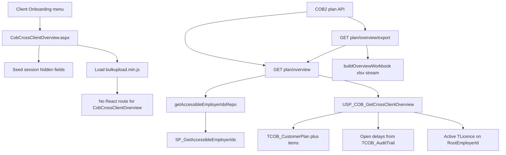
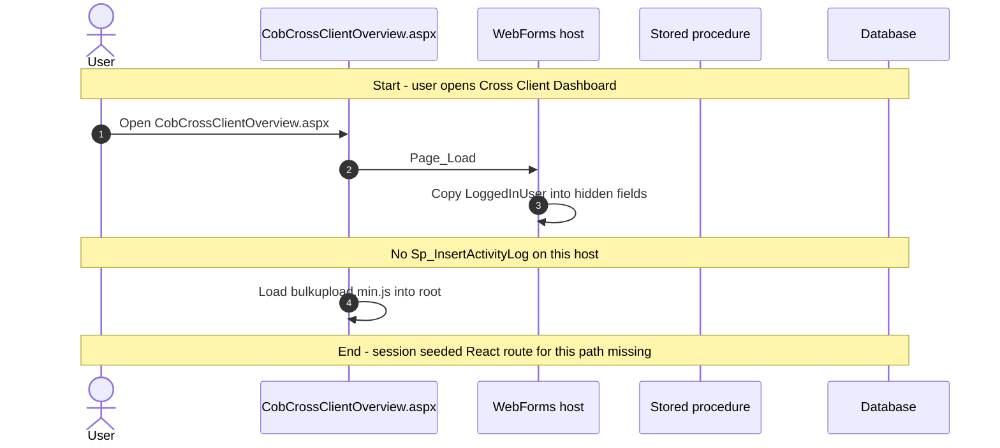
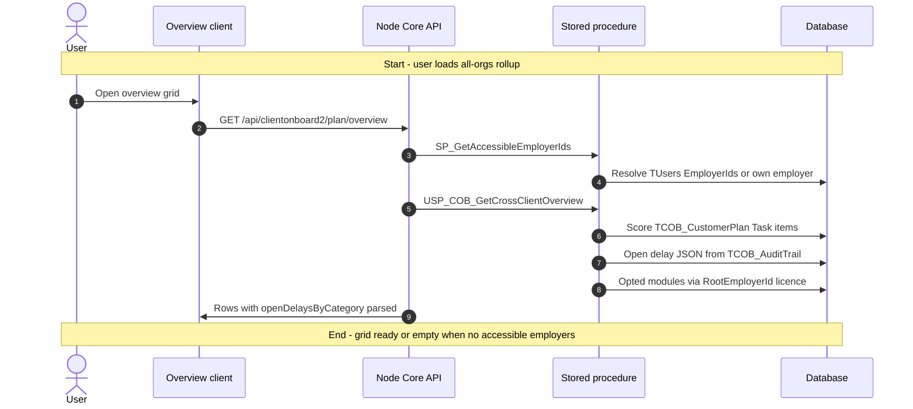
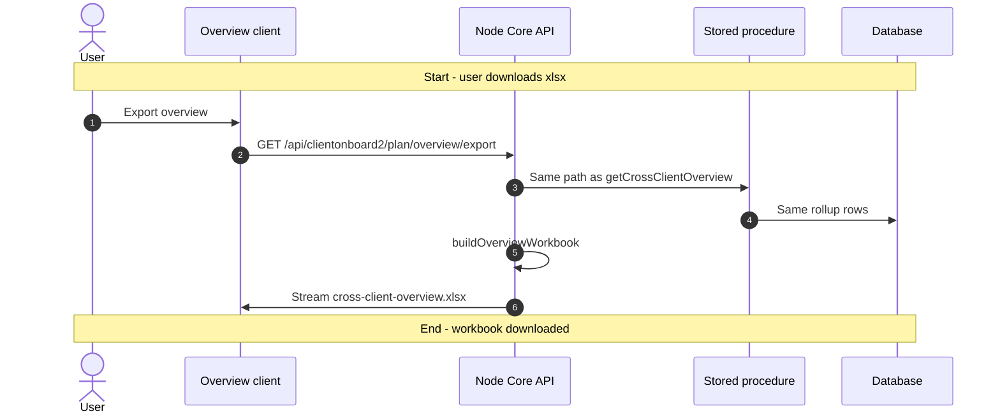
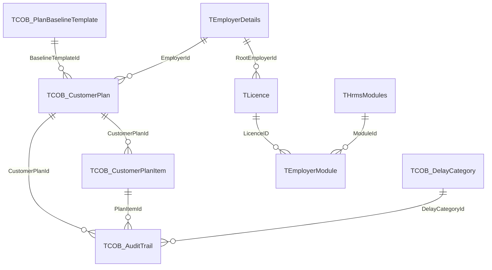

# Cross Client Dashboard

## Overview

An operations / platform user opens **Client Onboarding → Cross Client Dashboard** (`CobCrossClientOverview.aspx`, MenuId **1355**) to see one rollup row per organisation that has a `TCOB_CustomerPlan` and an Active family licence: organisation name, customer id (`custid`), plan status, planned start, baseline template name, ClientScore, opted-module count/names, and open delays by category. Screen traffic is Core Node Authorize-protected `/api/clientonboard2/plan/overview` and `/plan/overview/export` on `PlannerAuditRoutes.js`.

In the checked-in `BulkUpload_React` tree, `CobCrossClientOverview.aspx` only seeds session identity into hidden fields and loads `bulkupload.min.js`. There is no activity-log call on `Page_Load`. That bundle’s React router mounts only `UploadFiles.aspx`, so this leaf’s host does not render a Cross Client Dashboard SPA from SourceCode as it stands. The overview API and `USP_COB_GetCrossClientOverview` below are the live backend attributed to this menu leaf; the WebForms page itself has no postback for overview data.

Live employerid=0 left-nav order under Client Onboarding places this leaf after Audit Trail and before Default Access Right Management. Live DEV `tMenuDetails` (employer 0) maps MenuId **1355** / MenuName **Cross Client Dashboard** to NavigateURL `HRM\BulkUpload_React\CobCrossClientOverview.aspx`.

**Who's involved:**

- **Ops / COB admin** — opens the cross-client grid (or export) to compare onboarding progress across organisations they can access.
- **Planner / Client Plan Config** — creates and updates the per-org `TCOB_CustomerPlan` / items / audit delays that this rollup reads (sibling leaves; out of scope here).

There is no SystemModel-2 page for this screen. Activity type **471** (`Cross-Client Onboarding Overview`) exists in `001_DML_TActivityLogTypes_PageVisits.sql` but this host does not call it.

## Workflow

The WebForms host has no postback that binds the overview grid. Request lifecycle for Cross Client Dashboard data is Core Node JWT/`Authorization` traffic under `/api/clientonboard2/plan/overview`.

## Request journey

### Open Cross Client Dashboard host

### Load cross-client overview (API)

### Export cross-client overview (API)

## Entry points

| Entry | Purpose | Live? |
|---|---|---|
| `~/HRM/BulkUpload_React/CobCrossClientOverview.aspx` | Menu leaf **Cross Client Dashboard** (MenuId 1355). WebForms host + session seed | Yes (host only) |
| React route in `BulkUpload_React/Areas/routes.js` | Only `UPLOAD_FILE` → `UploadFiles.aspx` | No route for CobCrossClientOverview |
| `/api/clientonboard2/plan/overview` (`PlannerAuditRoutes.js`) | JSON rollup for all accessible orgs | Yes |
| `/api/clientonboard2/plan/overview/export` | Same data as `.xlsx` download | Yes |
| `/api/clientonboard2/plan`, `/plan/score`, `/audit`, … | Sibling Client Plan Config / Audit Trail APIs | Out of scope |
| `~/HRM/BulkUpload_React/CobDashboard.aspx` | Sibling **Import Management** | Out of scope |

## Code → database call chain

| Entry | Method | Database |
|---|---|---|
| Page load, `CobCrossClientOverview.aspx.cs:23` | Session → hidden fields only (no `LogActivity`) | *(none)* |
| API, `PlannerAuditController.getCrossClientOverview:231` | BLL `getCrossClientOverview:152` → `getAccessibleEmployerIdsRepo:9` then DAL `getCrossClientOverview:301` | `SP_GetAccessibleEmployerIds` then `USP_COB_GetCrossClientOverview` |
| API, `PlannerAuditController.exportCrossClientOverview:241` | BLL `exportOverview:172` → same `getCrossClientOverview` → `buildOverviewWorkbook:203` | same SPs (no extra SP for Excel) |

When `req.EID` is missing or `-1`, BLL passes `NULL` `@AccessibleEmployerIds` and the proc returns every licensed plan. When the accessible list is empty, BLL returns `[]` without calling the overview proc.

## API endpoints

No WebForms postback binds Cross Client Dashboard request data. Primary traffic is Core Node under `/api/clientonboard2` (`routeIndex.js:106` mounts `PlannerAuditRoutes.js` after `ClientOnboardingRoutes.js`). Overview routes use `Authorize` only (no `assertEmployerAccess`); org scope is applied inside BLL via `SP_GetAccessibleEmployerIds`.

| Verb | Route | Parameters | Purpose | Source |
|---|---|---|---|---|
| GET | `/api/clientonboard2/plan/overview` | (auth; uses `req.EID`) | JSON all-orgs rollup | `PlannerAuditRoutes.js:31` |
| GET | `/api/clientonboard2/plan/overview/export` | (auth; uses `req.EID`) | Stream `cross-client-overview.xlsx` | `PlannerAuditRoutes.js:32` |

Sibling `/plan`, `/plan/score`, `/audit`, instantiate, and schedule routes share the same router but belong to Client Plan Config / Audit Trail.

## Stored procedures & tables involved

| Object | File | Purpose | Wiki |
|---|---|---|---|
| [USP_COB_GetCrossClientOverview](/docs/database/hrms/USP_COB_GetCrossClientOverview) | `STOREPROCEDURE/USP_COB_GetCrossClientOverview.sql` | One row per org plan with score, delays, opted modules | `TCOB_CustomerPlan` |
| [SP_GetAccessibleEmployerIds](/docs/database/hrms/SP_GetAccessibleEmployerIds) | `STOREPROCEDURE/SP_GetAccessibleEmployerIds.sql` | Caller employer scope from `TUsers` | `TEmployee` / `TUsers` |
| `TCOB_CustomerPlan` | planner DDL | Plan header per `EmployerId` | Client Plan Config |
| `TCOB_CustomerPlanItem` | planner DDL | Task-level weight / % / N/A for score; open-delay filter | Client Plan Config |
| `TCOB_AuditTrail` + `TCOB_DelayCategory` | planner DDL | Open delays JSON by category | Audit Trail |
| `TCOB_PlanBaselineTemplate` | baseline DDL | `TemplateName` for Onboarding Plan column | Plan Templates |
| `TEmployerDetails` | core | `OrganizationName`, `custid`, parent id | org master |
| `TLicence` + `TEmployerModule` + `THrmsModules` | license | Active family licence + opted module count/names | HRMSLicense |
| `TCOB_CrossClientBaseline` | `DDL/TCOB_CrossClientBaseline.sql` | Single-row cutoff table exists in DEV | *(not read by current SP)* |

## Table relationships

Declared FKs on planner tables vary; the diagram shows joins `USP_COB_GetCrossClientOverview` uses for the rollup.

## Known gaps

- **No React route for `CobCrossClientOverview.aspx`** in `BulkUpload_React/Areas/routes.js` or the checked-in `BuildJS/bulkupload.min.js` (only `UploadFiles.aspx`). Opening the menu leaf seeds session fields and leaves `#root` empty unless a different bundle is deployed outside this tree.
- **No activity log** on Cross Client Dashboard — activity type **471** is seeded in DML, but `CobCrossClientOverview.aspx.cs` never calls `LogActivity` (Config Manager is similarly silent; Upload Files uses 446).
- **No SystemModel-2 page** for Cross Client Dashboard.
- **COB overview SPA source is not in `BulkUpload_React`** — same host/bundle gap as Config Manager / Import Management.
- **`TCOB_CrossClientBaseline` unused** — DDL and DEV row (`CutoffDate` 2026-08-30) describe a deploy cutoff for the overview, but `USP_COB_GetCrossClientOverview` does not read that table.
- **Excel header drift** — `buildOverviewWorkbook` labels the score column `Progress Score (NA-excluded)` while the proc now credits N/A tasks at 100% weight (Bug 177959 alignment with `USP_COB_GetPlanScore`).
- **BR-09 “admin/superuser” gate is menu-only** — overview routes are `Authorize` + employer-id scoping; there is no extra ADMINISTRATOR middleware (unlike `/clientonboard2/baseline`).
- **No checked-in DML row** for MenuId 1355 NavigateURL in the Liquibase tree; live DEV `tMenuDetails` (employer 0) confirms the mapping.

## Reference

Confidence is **medium** for the Core `/clientonboard2/plan/overview` DAL paths and the listed STOREPROCEDURE scripts; **low** for any browser UI on this leaf because the BulkUpload React host does not mount CobCrossClientOverview. Foreign keys are only those implied by joins.

### SourceCode

- `HRMS.Web/HRMS.Web/HRM/BulkUpload_React/CobCrossClientOverview.aspx`
- `HRMS.Web/HRMS.Web/HRM/BulkUpload_React/CobCrossClientOverview.aspx.cs`
- `HRMS.Web/HRMS.Web/HRM/BulkUpload_React/Areas/routes.js`
- `HRMS.CoreAPI/HRMS.Core.WebAPI.Node/Routes/PlannerAuditRoutes.js`
- `HRMS.CoreAPI/HRMS.Core.WebAPI.Node/Routes/routeIndex.js`
- `HRMS.CoreAPI/HRMS.Core.WebAPI.Node/Controllers/PlannerAuditController.js`
- `HRMS.CoreAPI/HRMS.Core.WebAPI.Node/Core/BusinessLogicLayer/PlannerAuditBLL.js`
- `HRMS.CoreAPI/HRMS.Core.WebAPI.Node/Core/DataAccessLayer/PlannerAuditDAL.js`
- `HRMS.CoreAPI/HRMS.Core.WebAPI.Node/ORM/Data/getAccessibleEmployerIdsRepo.js`
- `HRMS.CoreAPI/HRMS.Core.WebAPI.Node/Helpers/plannerExcelExport.js`
- `HRMS.CoreAPI/HRMS.Core.WebAPI.Node/Middlewares/authMiddleware.js`

### TDG HRMS DB

- Live DEV `dbo.tMenuDetails` MenuId 1355 (employer 0) — MenuName Cross Client Dashboard, NavigateURL `HRM\BulkUpload_React\CobCrossClientOverview.aspx`
- `HRMS-DATABASE/HRMS/STOREPROCEDURE/USP_COB_GetCrossClientOverview.sql`
- `HRMS-DATABASE/HRMS/STOREPROCEDURE/SP_GetAccessibleEmployerIds.sql`
- `HRMS-DATABASE/HRMS/DDL/TCOB_CrossClientBaseline.sql`
- `HRMS-DATABASE/HRMS/DML/PageVisitTracking/001_DML_TActivityLogTypes_PageVisits.sql` (activity 471)
