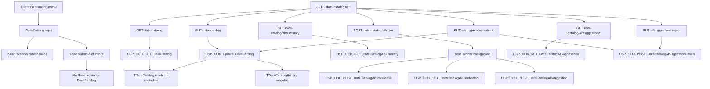
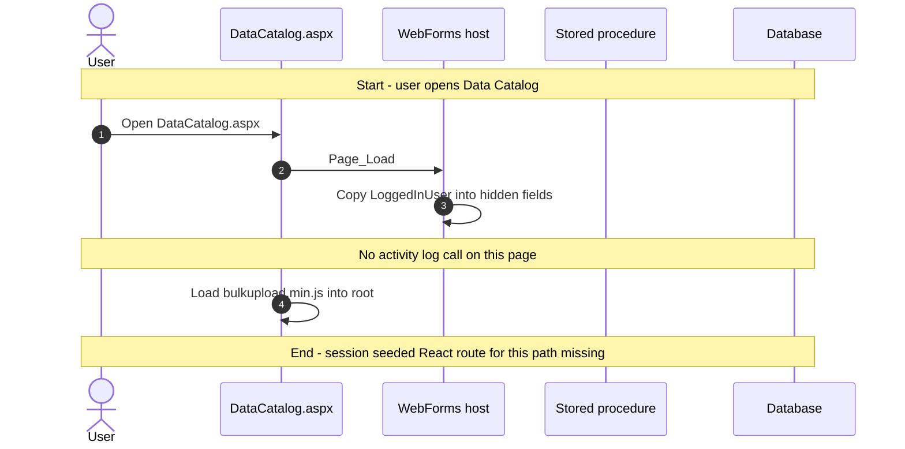
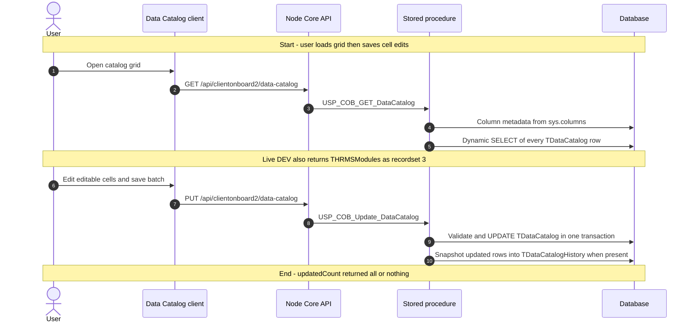
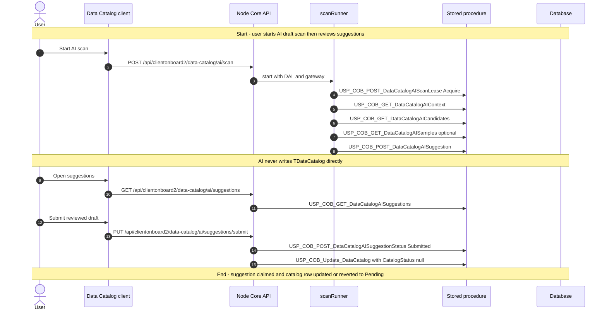
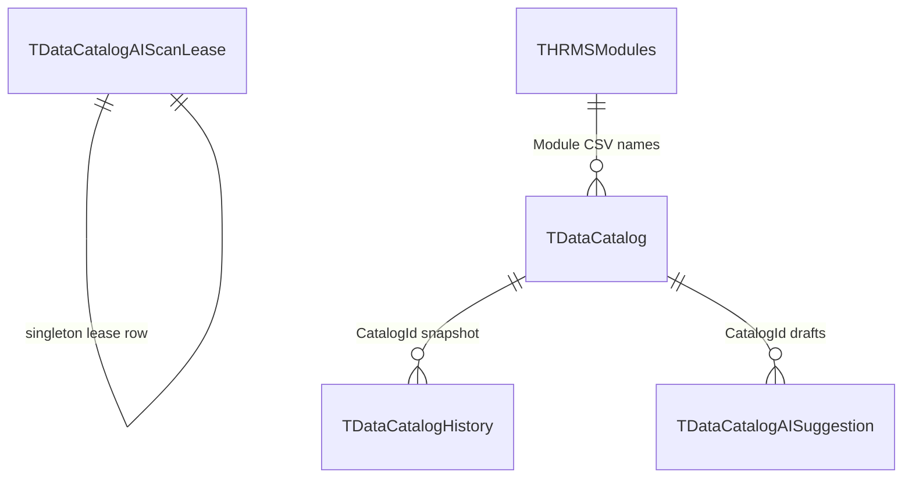

# Data Catalog

## Overview

An operations / platform user opens **Client Onboarding → Data Catalog** (`DataCatalog.aspx`, MenuId **1397**) to review and edit shared table metadata in `dbo.TDataCatalog` (database/schema/table identity, usage flags, COB/clone hints, schema fingerprint columns). The catalog is **not** employer-scoped. The Core Node surface is Authorize-protected `/api/clientonboard2/data-catalog` and `/api/clientonboard2/data-catalog/ai/*` on `ClientOnboardingRoutes.js`.

In the checked-in `BulkUpload_React` tree, `DataCatalog.aspx` only seeds session identity into hidden fields and loads `bulkupload.min.js`. Activity logging is absent on `Page_Load` (unlike Upload Files / Setup Data Management). That bundle’s React router mounts only `UploadFiles.aspx`, so this leaf’s host does not render a Data Catalog SPA from SourceCode as it stands. The GET/PUT catalog API, AI draft pipeline, and `USP_COB_*_DataCatalog*` procedures below are the live backend attributed to this menu leaf; the WebForms page itself has no postback for catalog cells.

Live employerid=0 left-nav order under Client Onboarding ends with this leaf (after Default Access Right Management). DEV `tMenuDetails` (employer 0) maps MenuId **1397** / MenuName **Data Catalog** to NavigateURL `/HRM/BulkUpload_React/DataCatalog.aspx`. Page-visit activity type **473** is inventoried for this leaf but is not called from `DataCatalog.aspx.cs`.

**Who's involved:**

- **Ops / data steward** — browses catalog rows, edits editable cells in batches, reviews AI suggestions when the AI scan is configured.
- **CatalogWatch / schema scan** — background `USP_DataCatalog_GetChangedTables` refreshes fingerprints and queues PENDING rows (outside this screen’s HTTP path).
- **Org Data Clone / COB consumers** — read the same `TDataCatalog` metadata for clone/remap and COB attribution (sibling leaves).

There is no SystemModel-2 page for this screen. Seed blurbs for many feature tables live in `TDataCatalog_DML.sql`; this leaf authors the catalog itself.

## Workflow

The WebForms host has no postback that binds the catalog grid. Request lifecycle for Data Catalog data is Core Node JWT/`Authorization` traffic under `/api/clientonboard2/data-catalog`.

## Request journey

### Open Data Catalog host

### Load and save catalog grid (API)

### AI scan and review (API)

## Entry points

| Entry | Purpose | Live? |
|---|---|---|
| `~/HRM/BulkUpload_React/DataCatalog.aspx` | Menu leaf **Data Catalog** (MenuId 1397). WebForms host + session seed | Yes (host only) |
| React route in `BulkUpload_React/Areas/routes.js` | Only `UPLOAD_FILE` → `UploadFiles.aspx` | No route for DataCatalog |
| `/api/clientonboard2/data-catalog` | GET grid + PUT batch cell edits | Yes |
| `/api/clientonboard2/data-catalog/ai/*` | AI summary, scan, suggestions, submit, reject | Yes |
| `USP_DataCatalog_GetChangedTables` (SQL job / CatalogWatch) | Schema fingerprint refresh + PENDING queue | Yes (off-page) |
| `~/HRM/BulkUpload_React/ConfigManager.aspx` | Sibling leaf **Config Manager** | Out of scope |
| `~/HRM/BulkUpload_React/CobDashboard.aspx` | Sibling leaf **Import Management** | Out of scope |

## Code → database call chain

| Entry | Method | Database |
|---|---|---|
| Page load, `DataCatalog.aspx.cs:23` | Session → hidden fields only (no `LogActivity`) | *(none)* |
| API, `ClientOnboardingController.getDataCatalog:1952` | BLL `getDataCatalog:2185` → DAL `getDataCatalog:1659` | `USP_COB_GET_DataCatalog` |
| API, `updateDataCatalog:1966` | BLL `updateDataCatalog:2195` → DAL `updateDataCatalog:1677` | `USP_COB_Update_DataCatalog` |
| API, `getDataCatalogAISummary:1984` | BLL `getDataCatalogAISummary:2223` → DAL `aiGetSummary:1779` | `USP_COB_GET_DataCatalogAISummary` |
| API, `startDataCatalogAIScan:1997` | BLL `startDataCatalogAIScan:2236` → `scanRunner.start` → DAL lease/candidates/context/samples/suggestion | `USP_COB_POST_DataCatalogAIScanLease`, `USP_COB_GET_DataCatalogAICandidates`, `USP_COB_GET_DataCatalogAIContext`, `USP_COB_GET_DataCatalogAISamples`, `USP_COB_POST_DataCatalogAISuggestion` |
| API, `getDataCatalogAISuggestions:2010` | BLL `getDataCatalogAISuggestions:2245` → DAL `aiGetSuggestions:1794` | `USP_COB_GET_DataCatalogAISuggestions` |
| API, `submitDataCatalogAI:2024` | BLL `submitDataCatalogAI:2267` → DAL `aiSetSuggestionStatus:1809` then `updateDataCatalog` | `USP_COB_POST_DataCatalogAISuggestionStatus` + `USP_COB_Update_DataCatalog` |
| API, `rejectDataCatalogAI:2038` | BLL `rejectDataCatalogAI:2291` → DAL `aiSetSuggestionStatus:1809` | `USP_COB_POST_DataCatalogAISuggestionStatus` |

## API endpoints

No WebForms postback binds Data Catalog request data. Primary traffic is Core Node under `/api/clientonboard2` (`routeIndex.js:96` mounts `ClientOnboardingRoutes.js`). Data Catalog routes use `Authorize` only (no `assertEmployerAccess`); `TDataCatalog` is global metadata.

| Verb | Route | Parameters | Purpose | Source |
|---|---|---|---|---|
| GET | `/api/clientonboard2/data-catalog` | (auth) | Column metadata + all catalog rows (+ modules when proc returns RS3) | `ClientOnboardingRoutes.js:466` |
| PUT | `/api/clientonboard2/data-catalog` | body `{ rows: [{ catalogId, changes }] }` | Batch cell edits (all or nothing) | `ClientOnboardingRoutes.js:467` |
| GET | `/api/clientonboard2/data-catalog/ai/summary` | (auth) | Scan banner counts + gateway configured flag | `ClientOnboardingRoutes.js:476` |
| POST | `/api/clientonboard2/data-catalog/ai/scan` | (auth) | Start background AI draft scan | `ClientOnboardingRoutes.js:477` |
| GET | `/api/clientonboard2/data-catalog/ai/suggestions` | (auth) | Pending AI drafts for review | `ClientOnboardingRoutes.js:478` |
| PUT | `/api/clientonboard2/data-catalog/ai/suggestions/submit` | body `{ items: [{ suggestionId, catalogId, values }] }` | Claim suggestion then update catalog | `ClientOnboardingRoutes.js:479` |
| PUT | `/api/clientonboard2/data-catalog/ai/suggestions/reject` | body `{ suggestionIds }` | Reject open suggestions | `ClientOnboardingRoutes.js:486` |

POST/DELETE on `/data-catalog` are rejected by route tests (GET + PUT only). Import Management, Config Manager, OTD, planner, and org-clone routes also sit under `/clientonboard2` but belong to sibling leaves.

## Stored procedures & tables involved

| Object | File | Purpose | Wiki |
|---|---|---|---|
| [USP_COB_GET_DataCatalog](/docs/database/hrms/USP_COB_GET_DataCatalog) | `STOREPROCEDURE/USP_COB_GET_DataCatalog.sql` | Column metadata + all `TDataCatalog` rows | `TDataCatalog` |
| [USP_COB_Update_DataCatalog](/docs/database/hrms/USP_COB_Update_DataCatalog) | `STOREPROCEDURE/USP_COB_Update_DataCatalog.sql` | Batch cell update + optional history snapshot | `TDataCatalog`, `TDataCatalogHistory` |
| `USP_COB_GET_DataCatalogAISummary` | *(live DEV; not in Liquibase tree)* | AI banner counts | AI lease/suggestion tables |
| `USP_COB_POST_DataCatalogAIScanLease` | *(live DEV; not inventoried)* | Acquire / renew / release scan lease | `TDataCatalogAIScanLease` |
| `USP_COB_GET_DataCatalogAICandidates` | *(live DEV; not inventoried)* | PENDING tables for AI draft batch | `TDataCatalog` |
| `USP_COB_GET_DataCatalogAIContext` | *(live DEV; not inventoried)* | Allowed values + examples for prompts | catalog samples |
| `USP_COB_GET_DataCatalogAISamples` | *(live DEV; not inventoried)* | Sample column values for one CatalogId | target table |
| `USP_COB_POST_DataCatalogAISuggestion` | *(live DEV; not inventoried)* | Store Pending/Failed suggestion | `TDataCatalogAISuggestion` |
| `USP_COB_GET_DataCatalogAISuggestions` | *(live DEV; not inventoried)* | Suggestions awaiting review | `TDataCatalogAISuggestion` |
| `USP_COB_POST_DataCatalogAISuggestionStatus` | *(live DEV; not inventoried)* | Submitted / Rejected / Pending | `TDataCatalogAISuggestion` |
| `USP_DataCatalog_GetChangedTables` | `STOREPROCEDURE/USP_DataCatalog_GetChangedTables.sql` | CatalogWatch schema fingerprint job | `TDataCatalog`, history |
| `TDataCatalog` | `TABLES/TDataCatalog/001_DDL_TDataCatalog.sql` | Shared table metadata catalog | this leaf |
| `TDataCatalogHistory` | `TABLES/TDataCatalog/002_DDL_TDataCatalogHistory.sql` | Append-only snapshots | CatalogWatch / update |
| `TDataCatalogAISuggestion`, `TDataCatalogAIScanLease` | *(present on DEV; no Liquibase DDL in tree)* | AI drafts + scan lease | AI pipeline |
| `THRMSModules` | catalogued / module master | Module multi-select names (live GET RS3) | Admin modules |

## Table relationships

Declared FKs on catalog tables are sparse in-repo. Edges below follow keys and joins the GET/update procedures and AI DAL names use.

`UQ_TDataCatalog` uniqueness is `(DatabaseName, DBSchema, TableName)`. `USP_COB_Update_DataCatalog` enforces the DatabaseName + TableName pair check before write (THROW 50007) and maps unique-key violations on `UQ_TDataCatalog` in BLL.

## Known gaps

- **No React route for `DataCatalog.aspx`** in `BulkUpload_React/Areas/routes.js` or the checked-in `BuildJS/bulkupload.min.js` (only `UploadFiles.aspx`). Opening the menu leaf seeds session fields and leaves `#root` empty unless a different bundle is deployed outside this tree.
- **No activity log** on Data Catalog — `DataCatalog.aspx.cs` never calls `CommonUtil.LogActivity`; activity type **473** exists in page-visit DML only.
- **Inventoried `USP_COB_GET_DataCatalog` lags DEV** — Liquibase script returns two recordsets; live DEV (2026-10-22) also selects module names from `dbo.THRMSModules`. BLL already maps a third recordset to `modules` (AT-24/AT-25).
- **AI procedures and tables are not in the Liquibase tree** — `USP_COB_*DataCatalogAI*` procs and `TDataCatalogAISuggestion` / `TDataCatalogAIScanLease` exist on DEV but have no `STOREPROCEDURE` / `TABLES` scripts under `HRMS-DATABASE` in this checkout, so Backstage database pages were not written for them.
- **No SystemModel-2 page** for Data Catalog.
- **History header comment drift** — `002_DDL_TDataCatalogHistory.sql` still says UI saves through `USP_COB_Update_DataCatalog` are not snapshotted; the inventoried update proc now writes `IsSchemaChange = 0` history rows when the history table exists.
- **CatalogWatch is off-page** — `USP_DataCatalog_GetChangedTables` mutates `TDataCatalog` / history outside this HTTP surface.

## Reference

Confidence is **medium** for the Core `/clientonboard2/data-catalog` DAL paths and the inventoried GET/Update STOREPROCEDURE scripts; **low** for any browser UI on this leaf because the BulkUpload React host does not mount DataCatalog; **low** for AI SQL bodies because scripts are missing from the DB repo.

### SourceCode

- `HRMS.Web/HRMS.Web/HRM/BulkUpload_React/DataCatalog.aspx`
- `HRMS.Web/HRMS.Web/HRM/BulkUpload_React/DataCatalog.aspx.cs`
- `HRMS.Web/HRMS.Web/HRM/BulkUpload_React/Areas/routes.js`
- `HRMS.Web/HRMS.Web/HRM/BulkUpload_React/BuildJS/bulkupload.min.js`
- `HRMS.CoreAPI/HRMS.Core.WebAPI.Node/Routes/ClientOnboardingRoutes.js`
- `HRMS.CoreAPI/HRMS.Core.WebAPI.Node/Routes/routeIndex.js`
- `HRMS.CoreAPI/HRMS.Core.WebAPI.Node/Controllers/ClientOnboardingController.js`
- `HRMS.CoreAPI/HRMS.Core.WebAPI.Node/Core/BusinessLogicLayer/ClientOnboardingBLL.js`
- `HRMS.CoreAPI/HRMS.Core.WebAPI.Node/Core/DataAccessLayer/ClientOnboardingDAL.js`
- `HRMS.CoreAPI/HRMS.Core.WebAPI.Node/Core/DataCatalogAI/scanRunner.js`
- `HRMS.CoreAPI/HRMS.Core.WebAPI.Node/Core/DataCatalogAI/gatewayClient.js`
- `HRMS.CoreAPI/HRMS.Core.WebAPI.Node/Middlewares/validateClientOnboardingRequest.js`
- `HRMS.CoreAPI/HRMS.Core.WebAPI.Node/Tests/Features/DataCatalog/dataCatalog.test.js`
- `HRMS.CoreAPI/HRMS.Core.WebAPI.Node/Tests/Features/DataCatalog/dataCatalogAI.test.js`

### TDG HRMS DB

- `HRMS-DATABASE/HRMS/STOREPROCEDURE/USP_COB_GET_DataCatalog.sql`
- `HRMS-DATABASE/HRMS/STOREPROCEDURE/USP_COB_Update_DataCatalog.sql`
- `HRMS-DATABASE/HRMS/STOREPROCEDURE/USP_DataCatalog_GetChangedTables.sql`
- `HRMS-DATABASE/HRMS/TABLES/TDataCatalog/001_DDL_TDataCatalog.sql`
- `HRMS-DATABASE/HRMS/TABLES/TDataCatalog/002_DDL_TDataCatalogHistory.sql`
- `HRMS-DATABASE/HRMS/DML/TDataCatalog_DML.sql`
- `HRMS-DATABASE/HRMS/DML/PageVisitTracking/001_DML_TActivityLogTypes_PageVisits.sql` (activity 473)

### Live DEV (read-only)

- `dbo.tMenuDetails` MenuId **1397** (employer 0) — MenuName Data Catalog, NavigateURL `/HRM/BulkUpload_React/DataCatalog.aspx`
- Live `USP_COB_GET_DataCatalog` includes `THRMSModules` recordset 3 (not yet in inventoried SQL)
