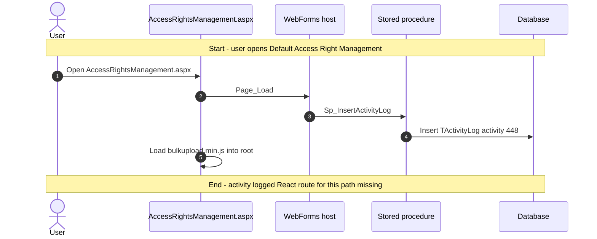
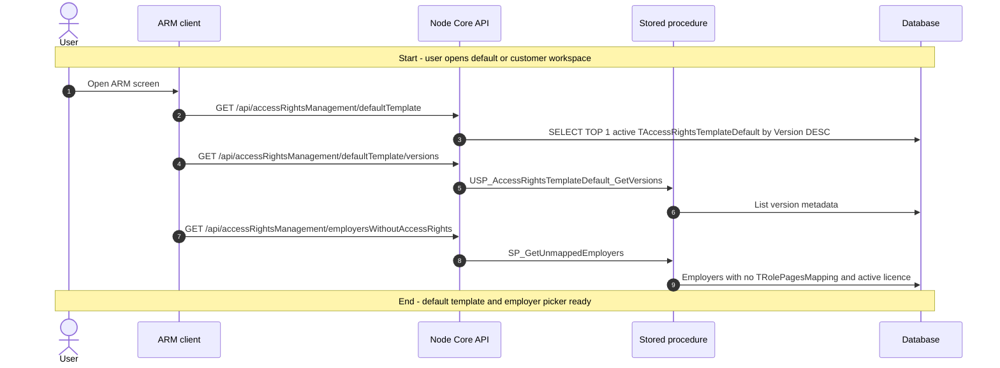
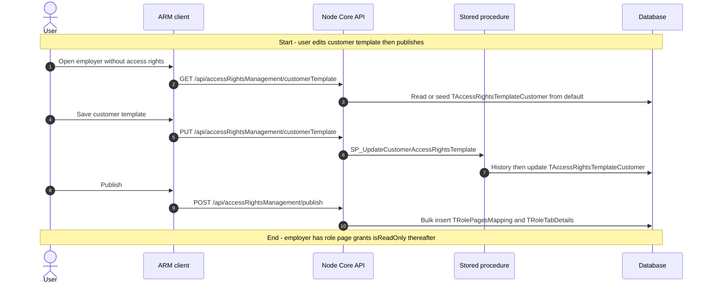
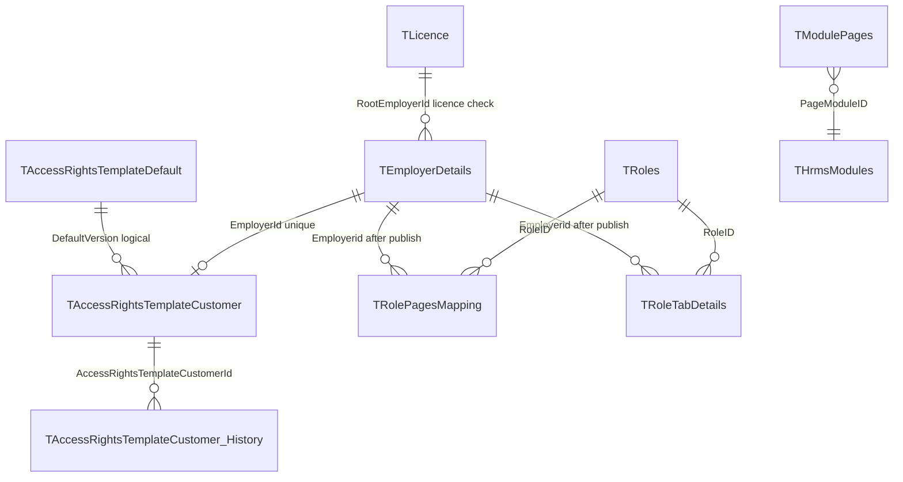

# Default Access Right Management

## Overview

An operations user opens **Client Onboarding → Default Access Right Management** (`AccessRightsManagement.aspx`, live MenuId **1369** under parent Client Onboarding 302) to maintain the **platform default** access-rights JSON template and per-organisation **customer** templates, then **publish** those grants into `TRolePagesMapping` / `TRoleTabDetails` for employers that still have no role-page rows. The WebForms host seeds session identity into hidden fields, logs activity type `DefaultAccessRightManagement` (448), and loads `bulkupload.min.js`. Screen traffic is Core Node `/api/accessRightsManagement/*` (Authorize). There is no WebForms postback for template grids or publish.

Live employerid=0 left-nav order under Client Onboarding places this leaf after Cross Client Dashboard and before Data Catalog. Older hierarchy XML still names menu value **1250** as “Default Access Rights Management”; orphan rows **1248** / **1346** share the same NavigateURL but are not under the Client Onboarding parent in live DEV hierarchy.

**Who's involved:**

- **Ops / COB user** — edits the default template (new version row), opens an employer without access rights, adjusts the customer template, publishes once.
- **Menu Manager** — on base-org menu save, `_syncDefaultAccessRightsTemplate` in `MenuManagerBLL` also inserts new `TAccessRightsTemplateDefault` versions (related, not this leaf’s UI).
- **Admin Access Right Management** — later per-employer role editing on `TRoles` / `TRolePagesMapping` after publish (out of scope for this leaf).

There is no SystemModel-2 page for this screen. Schema lives under `HRMS-DATABASE/HRMS/DDL/10011_CREATE.sql`; catalog blurbs attribute the template tables to Client Onboarding → Default Access Right Management.

## Workflow

```mermaid
flowchart TD
  Nav["Client Onboarding menu"] --> Page["AccessRightsManagement.aspx"]
  Page --> Log["Sp_InsertActivityLog activity 448"]
  Page --> Bundle["Load bulkupload.min.js"]
  Bundle --> NoRoute["No React route for AccessRightsManagement"]
  Api["ARM API accessRightsManagement"] --> DefGet["GET defaultTemplate"]
  DefGet --> DefSql["Inline SELECT TAccessRightsTemplateDefault"]
  Api --> DefPut["PUT defaultTemplate"]
  DefPut --> DefIns["Inline INSERT new Version row"]
  Api --> Ver["GET defaultTemplate/versions"]
  Ver --> VerSP["USP_AccessRightsTemplateDefault_GetVersions"]
  Api --> Json["GET defaultTemplate/:id/json"]
  Json --> JsonSP["USP_AccessRightsTemplateDefault_GetJson"]
  Api --> Emp["GET employersWithoutAccessRights"]
  Emp --> EmpSP["SP_GetUnmappedEmployers"]
  Api --> CustGet["GET customerTemplate"]
  CustGet --> CustSql["Inline SELECT TAccessRightsTemplateCustomer"]
  CustGet --> Seed["Maybe seed from default + SP_AdminWM_GetHRMSModules"]
  Api --> CustPut["PUT customerTemplate"]
  CustPut --> CustSP["SP_UpdateCustomerAccessRightsTemplate"]
  Api --> Pub["POST publish"]
  Pub --> Map["Inline INSERT TRolePagesMapping"]
  Pub --> Tab["Inline INSERT TRoleTabDetails"]
```

The WebForms host has no postback that binds template grids. Request lifecycle for this leaf’s data is Core Node JWT/`Authorization` traffic under `/api/accessRightsManagement`.

## Request journey

### Open Default Access Right Management host

### Load default template and employers without access rights (API)

### Save customer template and publish (API)

## Entry points

| Entry | Purpose | Live? |
|---|---|---|
| `~/HRM/BulkUpload_React/AccessRightsManagement.aspx` | Menu leaf **Default Access Right Management** (MenuId **1369**, parent 302). WebForms host + activity log | Yes (host only) |
| React route in `BulkUpload_React/Areas/routes.js` | Only `UPLOAD_FILE` → `UploadFiles.aspx` | No route for AccessRightsManagement |
| `/api/accessRightsManagement/*` (`AccessRightsManagementRoutes.js`) | Default/customer templates, employers without rights, publish | Yes |
| Menu Manager `_syncDefaultAccessRightsTemplate` | Inserts new default template versions when base menu is saved | Related, out of scope for this leaf UI |
| Admin **Access Right Management** (`RoleManagement.aspx`) | Post-publish role editing | Out of scope |

## Code → database call chain

| Entry | Method | Database |
|---|---|---|
| Page load, `AccessRightsManagement.aspx.cs:26` | `CommonUtil.LogActivity` (`Common.cs:52`) → `LogUserActivity.LogActivity` → `ActivityHelper.LogActivity` (`ActivityHelper.cs:32`) | `Sp_InsertActivityLog`. Activity type `DefaultAccessRightManagement` = 448 (`Enums.cs:391`) |
| API, `AccessRightsManagementController.getDefaultAccessRightsTemplate:309` | BLL `getDefaultAccessRightsTemplate:192` → DAL `getDefaultAccessRightsTemplate:267` | Inline `SELECT TOP 1` `TAccessRightsTemplateDefault` where `IsActive = 1` order by `Version DESC` |
| API, `updateDefaultAccessRightsTemplate:359` | BLL `updateDefaultAccessRightsTemplate:209` → DAL `createDefaultAccessRightsTemplate:238` | Inline `INSERT` new `TAccessRightsTemplateDefault` row (next Version) |
| API, `getAccessRightsTemplateDefaultVersions:413` | BLL `getAccessRightsTemplateDefaultVersions:251` → DAL `getAccessRightsTemplateDefaultVersions:387` | `USP_AccessRightsTemplateDefault_GetVersions` |
| API, `getAccessRightsTemplateDefaultJson:463` | BLL `getAccessRightsTemplateDefaultJson:264` → DAL `getAccessRightsTemplateDefaultJson:402` | `USP_AccessRightsTemplateDefault_GetJson` |
| API, `getEmployersWithoutAccessRights:230` | BLL `getEmployersWithoutAccessRights:31` → DAL `getEmployersWithoutAccessRights:48` | `SP_GetUnmappedEmployers` |
| API, `getCustomerAccessRightsTemplate:616` | BLL `getCustomerAccessRightsTemplate:333` → DAL get/create customer + optional `dashBoardDAL.WorkflowCategory` → `SP_AdminWM_GetHRMSModules`; MenuManagerDAL module/tab reads | Inline `TAccessRightsTemplateCustomer` / `TAccessRightsTemplateDefault`; seed filter via `TModuleMenuMapping` / purchased modules |
| API, `saveCustomerAccessRightsTemplate:715` | BLL `saveCustomerAccessRightsTemplate:455` → DAL `saveCustomerAccessRightsTemplate:350` | `SP_UpdateCustomerAccessRightsTemplate` (`sp_UpdateCustomerAccessRightsTemplate`) |
| API, `getModulePagesList:163` | BLL `getModulePagesList:494` → DAL `getModulePagesList:373` | Intended `SP_GetModulePagesList` (BLL currently calls missing `GetModulePagesList` casing) |
| API, `publishAccessRights:791` | BLL `publishAccessRights:509` → DAL checks + `_insertAccessRightsBulk:49` | Inline `INSERT` `TRolePagesMapping` / `TRoleTabDetails`; reads `TRoles` (employer 0), `TMenuHierarchy`, `TTabDetails` |

## API endpoints

No WebForms postback binds Default Access Right Management grids. Primary traffic is Core Node under `/api/accessRightsManagement` (`routeIndex.js:160` mounts `AccessRightsManagementRoutes.js`). Routes are Authorize-only.

| Verb | Route | Parameters | Purpose | Source |
|---|---|---|---|---|
| GET | `/api/accessRightsManagement/defaultTemplate` | — | Latest active default template | `AccessRightsManagementRoutes.js:11` |
| PUT | `/api/accessRightsManagement/defaultTemplate` | body `templateId`, `jsonData`, `modifiedBy` | Insert next Version default row | `AccessRightsManagementRoutes.js:12` |
| GET | `/api/accessRightsManagement/defaultTemplate/versions` | — | Version metadata list | `AccessRightsManagementRoutes.js:13` |
| GET | `/api/accessRightsManagement/defaultTemplate/:accessRightsTemplateDefaultId/json` | path id | One version’s JsonData | `AccessRightsManagementRoutes.js:14` |
| GET | `/api/accessRightsManagement/customerTemplate` | query `employerId` | Customer template (+ `isReadOnly` if already published) | `AccessRightsManagementRoutes.js:18` |
| PUT | `/api/accessRightsManagement/customerTemplate` | body `defaultVersion`, `customerVersion`, `jsonData`, `employerId`, `employeeId` | History + update customer template | `AccessRightsManagementRoutes.js:17` |
| GET | `/api/accessRightsManagement/modulePages` | — | Module page catalog | `AccessRightsManagementRoutes.js:21` |
| GET | `/api/accessRightsManagement/employersWithoutAccessRights` | query `employeeId` | Employers with no role-page rows (scoped by access) | `AccessRightsManagementRoutes.js:24` |
| POST | `/api/accessRightsManagement/publish` | body `employerId`, `employeeId` | One-shot publish into role mapping tables | `AccessRightsManagementRoutes.js:27` |

Controller also defines create handlers for default/customer templates that are **not** mounted on the router (create is via PUT default versioning and GET customer seed / PUT save).

## Stored procedures & tables involved

| Object | File | Purpose | Wiki |
|---|---|---|---|
| `Sp_InsertActivityLog` | `STOREPROCEDURE/Sp_InsertActivityLog.sql` | Page-access log | [Sp_InsertActivityLog](/docs/database/hrms/Sp_InsertActivityLog) |
| `USP_AccessRightsTemplateDefault_GetVersions` | `STOREPROCEDURE/USP_AccessRightsTemplateDefault_GetVersions.sql` | List default template versions | [USP_AccessRightsTemplateDefault_GetVersions](/docs/database/hrms/USP_AccessRightsTemplateDefault_GetVersions) |
| `USP_AccessRightsTemplateDefault_GetJson` | `STOREPROCEDURE/USP_AccessRightsTemplateDefault_GetJson.sql` | JsonData for one default id | [USP_AccessRightsTemplateDefault_GetJson](/docs/database/hrms/USP_AccessRightsTemplateDefault_GetJson) |
| `SP_GetUnmappedEmployers` | `STOREPROCEDURE/SP_GetUnmappedEmployers.sql` | Employers missing `TRolePagesMapping` with active licence | [SP_GetUnmappedEmployers](/docs/database/hrms/SP_GetUnmappedEmployers) |
| `SP_UpdateCustomerAccessRightsTemplate` | `DML/SP_UpdateCustomerAccessRightsTemplate.sql` (object `sp_UpdateCustomerAccessRightsTemplate`) | History + update customer template | [SP_UpdateCustomerAccessRightsTemplate](/docs/database/hrms/SP_UpdateCustomerAccessRightsTemplate) |
| `SP_GetModulePagesList` | `STOREPROCEDURE/SP_GetModulePagesList.sql` | Module page list | [SP_GetModulePagesList](/docs/database/hrms/SP_GetModulePagesList) |
| `SP_AdminWM_GetHRMSModules` | `STOREPROCEDURE/SP_AdminWM_GetHRMSModules.sql` | Purchased modules when seeding customer template | [SP_AdminWM_GetHRMSModules](/docs/database/hrms/SP_AdminWM_GetHRMSModules) |
| `TAccessRightsTemplateDefault` | `DDL/10011_CREATE.sql` | Versioned platform default JSON | schema script |
| `TAccessRightsTemplateCustomer` | same DDL | One active customer JSON per employer | schema script |
| `TAccessRightsTemplateCustomer_History` | same DDL | Pre-update snapshots | schema script |
| `TRolePagesMapping` / `TRoleTabDetails` | existing role tables | Publish targets | Admin Access Right Management |
| `TRoles` (employer 0) | existing | Default role columns in template JSON | publish |
| `TEmployerDetails` / `TLicence` | existing | Unmapped employer filter | `SP_GetUnmappedEmployers` |
| `TModulePages` / `THrmsModules` | existing | Module pages list | `SP_GetModulePagesList` |
| `TModuleMenuMapping` / `TMenuHierarchy` / `TTabDetails` | existing | Seed filter + publish hierarchy | Menu Manager |

Direct procs above call no nested procedures. Seed path also uses inline MenuManagerDAL SQL (not nested SPs).

## Table relationships

Declared FKs between template tables and publish targets are absent in `10011_CREATE.sql`. Joins below are those the ARM API and procs use.

## Known gaps

- **No React route for `AccessRightsManagement.aspx`** in `BulkUpload_React/Areas/routes.js` or the checked-in `BuildJS/bulkupload.min.js` (only `UploadFiles.aspx`). Opening the menu leaf logs activity 448 and leaves `#root` empty unless a different bundle is deployed outside this tree.
- **No SystemModel-2 page** for Default Access Right Management.
- **`getModulePagesList` BLL bug** — `AccessRightsManagementBLL.js:496` calls `__accessRightsManagementDAL.GetModulePagesList()` but the DAL method is `getModulePagesList`; the mounted GET `/modulePages` route will throw at runtime until fixed.
- **`SP_UpdateCustomerAccessRightsTemplate` updates only** — if no active customer row exists, the proc returns no result set; create/seed is separate inline INSERT on GET customer.
- **Orphan menu rows** 1248 / 1346 share the NavigateURL but are not under Client Onboarding (302) in live DEV hierarchy; leaf for this guide is MenuId **1369**.
- **Menu Manager default-template sync** shares `TAccessRightsTemplateDefault` writers but is documented on Menu Manager, not this leaf.
- **Publish is one-shot** — once any `TRolePagesMapping` row exists for the employer, customer template is `isReadOnly` and publish refuses; further edits belong on Admin Access Right Management.

## Reference

Confidence is **medium** for the Core `/accessRightsManagement` DAL paths and the listed procs/tables; **low** for any browser UI on this leaf because the BulkUpload React host does not mount AccessRightsManagement. Foreign keys are only those implied by joins and unique constraints.

### SourceCode

- `HRMS.Web/HRMS.Web/HRM/BulkUpload_React/AccessRightsManagement.aspx`
- `HRMS.Web/HRMS.Web/HRM/BulkUpload_React/AccessRightsManagement.aspx.cs`
- `HRMS.Web/HRMS.Web/HRM/BulkUpload_React/Areas/routes.js`
- `HRMS.CoreAPI/HRMS.Core.WebAPI.Node/Routes/AccessRightsManagementRoutes.js`
- `HRMS.CoreAPI/HRMS.Core.WebAPI.Node/Routes/routeIndex.js`
- `HRMS.CoreAPI/HRMS.Core.WebAPI.Node/Controllers/AccessRightsManagementController.js`
- `HRMS.CoreAPI/HRMS.Core.WebAPI.Node/Core/BusinessLogicLayer/AccessRightsManagementBLL.js`
- `HRMS.CoreAPI/HRMS.Core.WebAPI.Node/Core/DataAccessLayer/AccessRightsManagementDAL.js`
- `HRMS.CoreAPI/HRMS.Core.WebAPI.Node/Core/BusinessLogicLayer/MenuManagerBLL.js` (default template sync)
- `HRMS.Shared/HRMS.DataContract/Common/Enums.cs`

### TDG HRMS DB

- Live DEV `dbo.tMenuDetails` MenuId 1369 (employer 0) — MenuName Default Access Right Management, NavigateURL `/HRM/BulkUpload_React/AccessRightsManagement.aspx`, parent Client Onboarding 302
- `HRMS-DATABASE/HRMS/DDL/10011_CREATE.sql`
- `HRMS-DATABASE/HRMS/STOREPROCEDURE/USP_AccessRightsTemplateDefault_GetVersions.sql`
- `HRMS-DATABASE/HRMS/STOREPROCEDURE/USP_AccessRightsTemplateDefault_GetJson.sql`
- `HRMS-DATABASE/HRMS/STOREPROCEDURE/SP_GetUnmappedEmployers.sql`
- `HRMS-DATABASE/HRMS/STOREPROCEDURE/SP_GetModulePagesList.sql`
- `HRMS-DATABASE/HRMS/DML/SP_UpdateCustomerAccessRightsTemplate.sql`
- `HRMS-DATABASE/HRMS/STOREPROCEDURE/Sp_InsertActivityLog.sql`
- `HRMS-DATABASE/HRMS/STOREPROCEDURE/SP_AdminWM_GetHRMSModules.sql`
