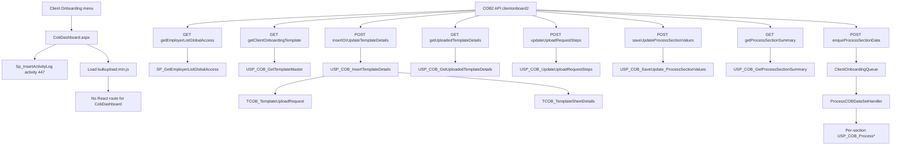
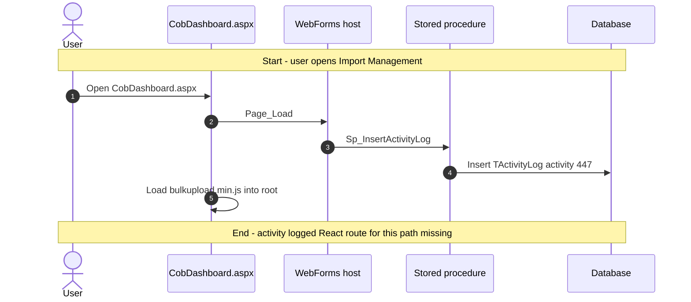
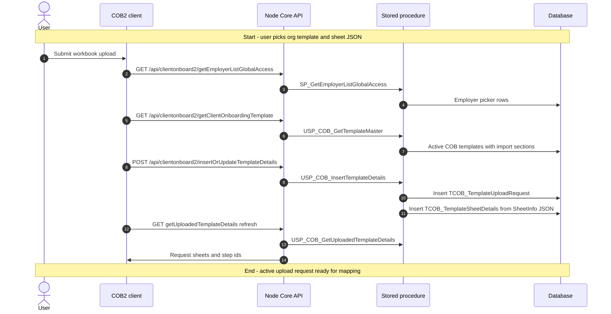
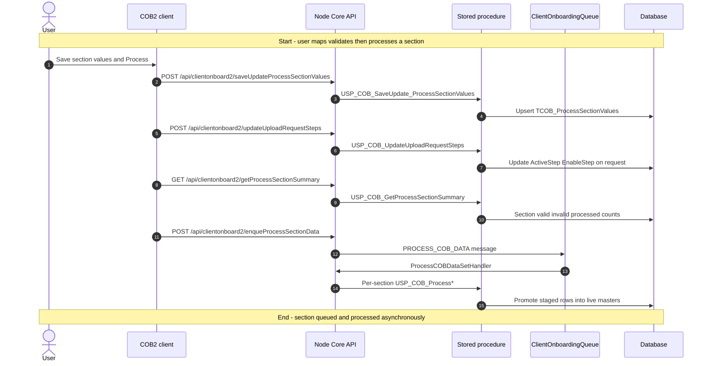
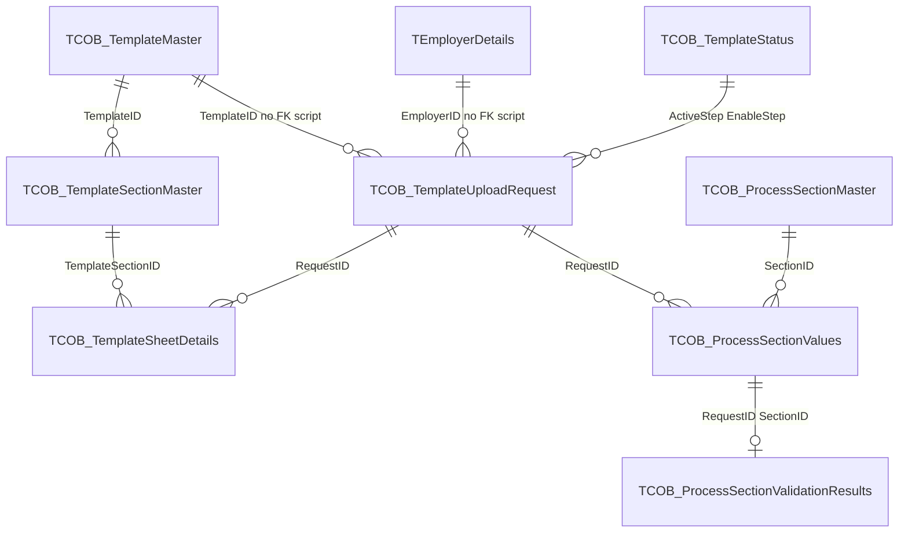

# Import Management

## Overview

An operations user opens **Client Onboarding → Import Management** (`CobDashboard.aspx`, MenuId 1249) to manage COB2 workbook imports for a selected organisation: pick a licensed template, upload workbook sheets, map fields, validate section rows, then enqueue per-section processing into live masters. Data Catalog attributes `TCOB_TemplateUploadRequest`, `TCOB_TemplateSheetDetails`, `TCOB_ProcessSectionValues`, and related staging tables to this leaf. The Core Node surface for that work is Authorize-protected `/api/clientonboard2/*` (`ClientOnboardingRoutes.js`).

In the checked-in `BulkUpload_React` tree, `CobDashboard.aspx` only seeds session identity into hidden fields, logs activity type `ClientOnboardingImportManagements` (447), and loads `bulkupload.min.js`. That bundle’s React router mounts only `UploadFiles.aspx`, so this leaf’s host does not render an Import Management SPA from SourceCode as it stands. The workbook API and stored procedures below are the live backend attributed to this menu leaf; the WebForms page itself has no postback for request data.

**Who's involved:**

- **Ops / COB user** — chooses organisation and template, uploads workbook sheet JSON, maps fields, validates, then processes sections.
- **Core Node queue consumer** — `ProcessCOBDataSetHandler` drains `ClientOnboardingQueue` and runs per-section `USP_COB_Process*` procedures after enqueue.

There is no SystemModel-2 page for this screen. Catalog blurbs for the `TCOB_*` import tables live in `TDataCatalog_DML.sql` / Data Catalog UI paths under Client Onboarding → Import Management.

## Workflow

The WebForms host has no postback that binds import grids. Request lifecycle for workbook data is Core Node JWT/`Authorization` traffic under `/api/clientonboard2`.

## Request journey

### Open Import Management host

### Create a workbook upload request (API)

### Advance steps, stage values, enqueue process (API)

## Entry points

| Entry | Purpose | Live? |
|---|---|---|
| `~/HRM/BulkUpload_React/CobDashboard.aspx` | Menu leaf **Import Management** (MenuId 1249). WebForms host + activity log | Yes (host only) |
| React route in `BulkUpload_React/Areas/routes.js` | Only `UPLOAD_FILE` → `UploadFiles.aspx` | No route for CobDashboard |
| `/api/clientonboard2/*` (`ClientOnboardingRoutes.js`) | COB2 workbook import / map / validate / process API | Yes |
| `~/HRM/BulkUpload_React/OtdDefaultMaster.aspx` | Sibling leaf **Setup Data Management**; also logs activity 447 | Out of scope |
| `~/HRM/BulkUpload_React/UploadFiles.aspx` | Prior leaf **Upload Files** (COB1 SSIS upload) | Out of scope |

## Code → database call chain

| Entry | Method | Database |
|---|---|---|
| Page load, `CobDashboard.aspx.cs:25` | `CommonUtil.LogActivity` (`Common.cs:52`) → `LogUserActivity.LogActivity` → `ActivityHelper.LogActivity` (`ActivityHelper.cs:32`) | `Sp_InsertActivityLog`. Activity type `ClientOnboardingImportManagements` = 447 (`Enums.cs:390`) |
| API, `ClientOnboardingController.getEmployerListGlobalAccess` | `ClientOnboardingBLL` → `ClientOnboardingDAL.getEmployerListGlobalAccess:52` | `SP_GetEmployerListGlobalAccess` |
| API, `getClientOnboardingTemplate:114` | BLL → `ClientOnboardingDAL.getClientOnboardingTemplate:19` | `USP_COB_GetTemplateMaster` |
| API, `insertOrUpdateTemplateDetails` | BLL → `ClientOnboardingDAL.insertOrUpdateTemplateDetails:78` | `USP_COB_InsertTemplateDetails` |
| API, `getUploadedTemplateDetails:248` | BLL → `ClientOnboardingDAL.getUploadedTemplateDetails:111` | `USP_COB_GetUploadedTemplateDetails` |
| API, `updateUploadRequestSteps` | BLL → `ClientOnboardingDAL.updateUploadRequestSteps:451` | `USP_COB_UpdateUploadRequestSteps` |
| API, `saveUpdateProcessSectionValues` | BLL → `ClientOnboardingDAL` save path | `USP_COB_SaveUpdate_ProcessSectionValues` |
| API, `getProcessSectionSummary` | BLL → `ClientOnboardingDAL.getProcessSectionSummary:484` | `USP_COB_GetProcessSectionSummary` |
| API, `enqueProcessSectionData:1022` | BLL `enqueProcessSectionData:938` → queue only (no SP on enqueue) | Queue → `ProcessCOBDataSetHandler` → dynamic per-section `USP_COB_Process*` via `getProcessStoredProcedures` |

Mapping-field and validation endpoints (`insertUpdateTemplateMappedFields`, `replaceTemplateMappedFieldValues`, `validateProcessMaster`, `upsertProcessSectionValidationResult`, …) follow the same controller → BLL → DAL pattern onto matching `USP_COB_*` procedures; they are not every row in this table.

## API endpoints

No WebForms postback binds Import Management request data. Primary traffic is Core Node under `/api/clientonboard2` (`routeIndex.js` mounts `ClientOnboardingRoutes.js`). `assertEmployerAccess()` guards most routes; `getEmployerListGlobalAccess` is Authorize-only so global-access users can pick any organisation.

| Verb | Route | Parameters | Purpose | Source |
|---|---|---|---|---|
| GET | `/api/clientonboard2/getEmployerListGlobalAccess` | `employeeId` (query) | Organisation picker | `ClientOnboardingRoutes.js:45` |
| GET | `/api/clientonboard2/getClientOnboardingTemplate` | (none beyond auth) | Template master list | `ClientOnboardingRoutes.js:28` |
| POST | `/api/clientonboard2/insertOrUpdateTemplateDetails` | body `templateId`, `requestTemplateName`, `employerId`, `sheetInfo`, `actionFlag` | Create/update upload request + sheets | `ClientOnboardingRoutes.js:52` |
| GET | `/api/clientonboard2/getUploadedTemplateDetails` | query `templateId`, `employerId` | Active request sheets | `ClientOnboardingRoutes.js:62` |
| POST | `/api/clientonboard2/insertUpdateTemplateMappedFields` | body mapping fields | Field map | `ClientOnboardingRoutes.js:72` |
| POST | `/api/clientonboard2/insertTemplateMappedFieldValues` | body field values | Mapped values | `ClientOnboardingRoutes.js:101` |
| POST | `/api/clientonboard2/saveUpdateProcessSectionValues` | body `requestId`, section JSON | Stage section rows | `ClientOnboardingRoutes.js:162` |
| POST | `/api/clientonboard2/updateUploadRequestSteps` | body step names | Advance wizard steps | `ClientOnboardingRoutes.js:192` |
| GET | `/api/clientonboard2/getProcessSectionSummary` | query `employerId`, `requestId` | Section status grid | `ClientOnboardingRoutes.js:202` |
| POST | `/api/clientonboard2/enqueProcessSectionData` | body `requestId`, `sectionId`, `employerId`, `loggedInEmployeeId` | Queue process | `ClientOnboardingRoutes.js:211` |
| POST | `/api/clientonboard2/validateProcessMaster` | body validation payload | Validate section master | `ClientOnboardingRoutes.js:182` |

OTD / Config Manager / planner / data-catalog routes also sit under `/clientonboard2` but belong to sibling leaves.

## Stored procedures & tables involved

| Object | File | Purpose | Wiki |
|---|---|---|---|
| `Sp_InsertActivityLog` | `STOREPROCEDURE/Sp_InsertActivityLog.sql` | Page-access log | `TActivityLog` |
| `SP_GetEmployerListGlobalAccess` | `STOREPROCEDURE/SP_GetEmployerListGlobalAccess.sql` | Global or family employer list | `TEmployerDetails` |
| `USP_COB_GetTemplateMaster` | `STOREPROCEDURE/USP_COB_GetTemplateMaster.sql` | Active templates with importable sections | `TCOB_TemplateMaster` |
| `USP_COB_InsertTemplateDetails` | `STOREPROCEDURE/USP_COB_InsertTemplateDetails.sql` | Create/update request + sheet rows | `TCOB_TemplateUploadRequest` |
| `USP_COB_GetUploadedTemplateDetails` | `STOREPROCEDURE/USP_COB_GetUploadedTemplateDetails.sql` | List sheets for active request | `TCOB_TemplateSheetDetails` |
| `USP_COB_UpdateUploadRequestSteps` | `STOREPROCEDURE/USP_COB_UpdateUploadRequestSteps.sql` | Set ActiveStep / EnableStep | `TCOB_TemplateStatus` |
| `USP_COB_SaveUpdate_ProcessSectionValues` | `STOREPROCEDURE/USP_COB_SaveUpdate_ProcessSectionValues.sql` | Upsert staged section JSON | `TCOB_ProcessSectionValues` |
| `USP_COB_GetProcessSectionSummary` | `STOREPROCEDURE/USP_COB_GetProcessSectionSummary.sql` | Section counts and status | `TCOB_ProcessSectionValidationResults` |
| `USP_COB_Process*` (family) | matching `STOREPROCEDURE/` scripts | Queue-driven promote to live masters | section masters |
| `TCOB_TemplateUploadRequest` | `TABLES/` / catalog | Upload request header | Data Catalog Import Management |
| `TCOB_TemplateSheetDetails` | catalogued | Sheet payload per request | Data Catalog |
| `TCOB_ProcessSectionValues` | catalogued | Staged section rows + status | Data Catalog |
| `TCOB_TemplateMaster`, `TCOB_TemplateSectionMaster`, `TCOB_ProcessSectionMaster` | catalogued | Template / section config | Config Manager + Import Management |

## Table relationships

Declared FKs on COB import tables are sparse in-repo. The diagram shows joins the insert and summary procedures use.

## Known gaps

- **No React route for `CobDashboard.aspx`** in `BulkUpload_React/Areas/routes.js` or the checked-in `BuildJS/bulkupload.min.js` (only `UploadFiles.aspx`). Opening the menu leaf logs activity 447 and leaves `#root` empty unless a different bundle is deployed outside this tree.
- **No SystemModel-2 page** for Import Management / COB2 workbook UI.
- **COB2 SPA source is not in `BulkUpload_React`** — DashBoard_React comments still point at an external `ClientOnboarding/WebApp` path that is not present in this workspace.
- **`OtdDefaultMaster.aspx` also logs activity 447** while the live menu maps that page to **Setup Data Management**, not Import Management.
- **`USP_COB_GetProcessSectionSummary.sql` starts with `USE [HRM-CL-Prod]`** — hardcoded database name in the Liquibase tree.
- **Per-section process SPs are selected dynamically** from `getProcessStoredProcedures` / process section master; enqueue itself writes no table.
- **Menu naming drift** — older DML used "Manage Imports" / MenuId 1228; live employer-0 leaf is **Import Management** MenuId 1249 → `CobDashboard.aspx`.

## Reference

Confidence is **medium** for the Core `/clientonboard2` DAL paths and the listed STOREPROCEDURE scripts; **low** for any browser UI on this leaf because the BulkUpload React host does not mount CobDashboard. Foreign keys are only those implied by joins.

### SourceCode

- `HRMS.Web/HRMS.Web/HRM/BulkUpload_React/CobDashboard.aspx`
- `HRMS.Web/HRMS.Web/HRM/BulkUpload_React/CobDashboard.aspx.cs`
- `HRMS.Web/HRMS.Web/HRM/BulkUpload_React/Areas/routes.js`
- `HRMS.Web/HRMS.Web/HRM/BulkUpload_React/Common/routeConstants.js`
- `HRMS.Web/HRMS.Web/HRM/BulkUpload_React/BuildJS/bulkupload.min.js`
- `HRMS.CoreAPI/HRMS.Core.WebAPI.Node/Routes/ClientOnboardingRoutes.js`
- `HRMS.CoreAPI/HRMS.Core.WebAPI.Node/Routes/routeIndex.js`
- `HRMS.CoreAPI/HRMS.Core.WebAPI.Node/Controllers/ClientOnboardingController.js`
- `HRMS.CoreAPI/HRMS.Core.WebAPI.Node/Core/BusinessLogicLayer/ClientOnboardingBLL.js`
- `HRMS.CoreAPI/HRMS.Core.WebAPI.Node/Core/DataAccessLayer/ClientOnboardingDAL.js`
- `HRMS.CoreAPI/HRMS.Core.WebAPI.Node/Utils/ClientOnboarding/ProcessCOBDataSetHandler.js`
- `HRMS.Shared/HRMS.Common/Common.cs`
- `HRMS.Shared/HRMS.DataContract/Common/Enums.cs`
- `HRMS.Shared/TDG.ActivityAuditLog/DAL/ActivityHelper.cs`

### TDG HRMS DB

- `HRMS-DATABASE/HRMS/DML/TDataCatalog_DML.sql` (Import Management UIPath rows)
- `HRMS-DATABASE/HRMS/STOREPROCEDURE/USP_COB_GetTemplateMaster.sql`
- `HRMS-DATABASE/HRMS/STOREPROCEDURE/USP_COB_InsertTemplateDetails.sql`
- `HRMS-DATABASE/HRMS/STOREPROCEDURE/USP_COB_GetUploadedTemplateDetails.sql`
- `HRMS-DATABASE/HRMS/STOREPROCEDURE/USP_COB_UpdateUploadRequestSteps.sql`
- `HRMS-DATABASE/HRMS/STOREPROCEDURE/USP_COB_SaveUpdate_ProcessSectionValues.sql`
- `HRMS-DATABASE/HRMS/STOREPROCEDURE/USP_COB_GetProcessSectionSummary.sql`
- `HRMS-DATABASE/HRMS/STOREPROCEDURE/SP_GetEmployerListGlobalAccess.sql`
- `HRMS-DATABASE/HRMS/STOREPROCEDURE/Sp_InsertActivityLog.sql`
