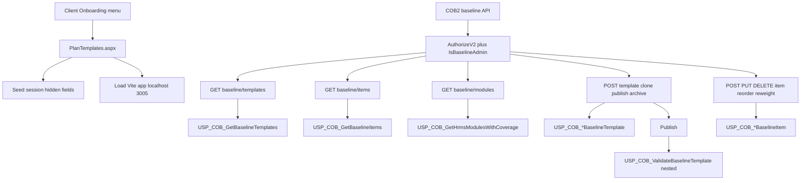
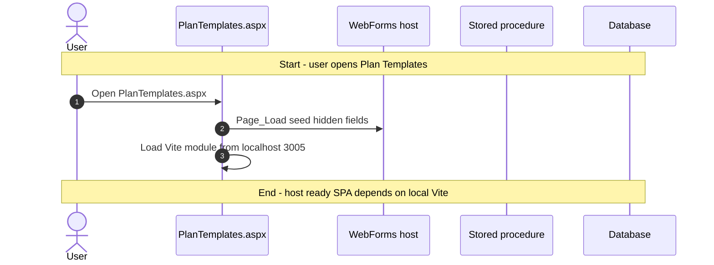
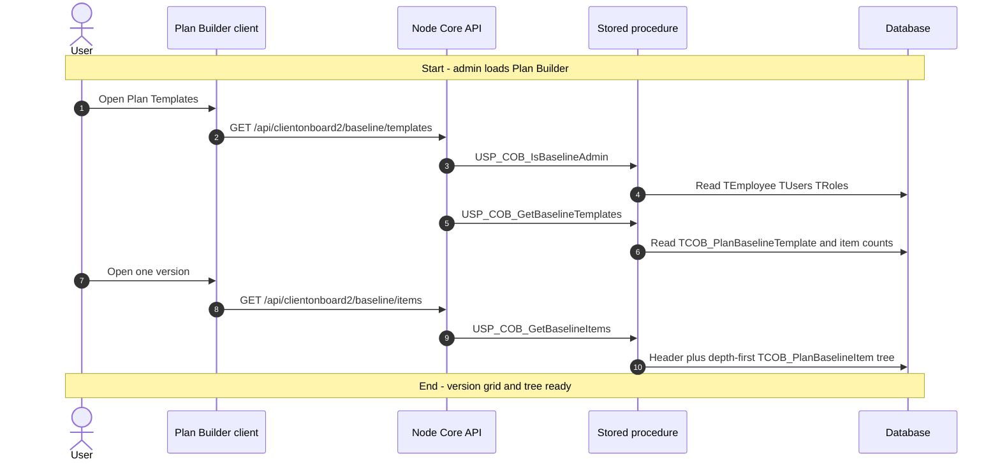
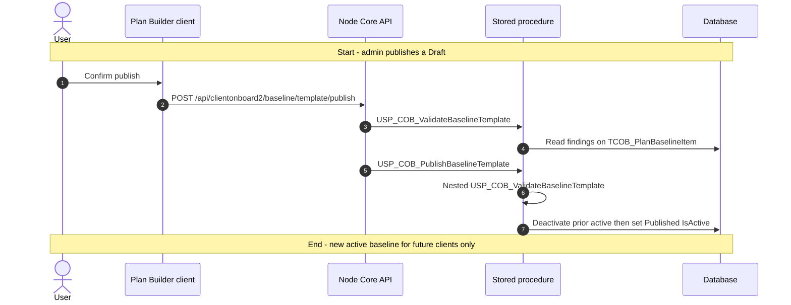
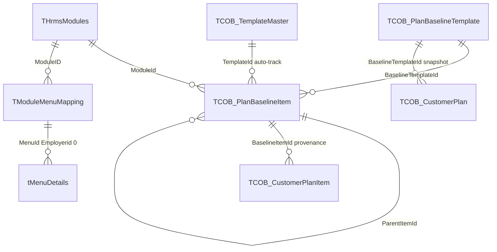

# Plan Templates

## Overview

An ADMINISTRATOR opens **Client Onboarding → Plan Templates** (`PlanTemplates.aspx`, MenuId **1352**, page title Onboarding Plan Builder) to author the org-wide onboarding **baseline** — versioned templates of Module / Section / Activity / Task rows that later instantiate into client plans. The WebForms host only seeds session identity into hidden fields. Checked-in `PlanTemplates.aspx` loads a Vite React app from `http://localhost:3005` (local-dev PlaceHolder); there is no `BuildJS/bulkupload.min.js` block on this page. Screen traffic is Core Node `/api/clientonboard2/baseline/*` with a stricter auth chain than other COB routes (`AuthorizeV2` + `requireBaselineAdmin`). There is no WebForms postback for baseline grids.

Live employerid=0 left-nav order under Client Onboarding places this leaf after Setup Data Management and before Client Plan Config. `tMenuDetails` (employer 0) maps MenuId **1352** / MenuName **Plan Templates** to NavigateURL `HRM\BulkUpload_React\PlanTemplates.aspx`.

**Who's involved:**

- **Baseline admin (ADMINISTRATOR RoleType)** — lists versions, clones or creates Drafts, edits the tree, validates, publishes (activates), archives, or hard-deletes unused Drafts.
- **Client Plan Config / instantiate callers** — consume the active Published baseline via `USP_COB_CreateCustomerPlanFromBaseline` (out of scope for this leaf’s UI).

There is no SystemModel-2 page for this screen. Schema and procs live under `HRMS-DATABASE/HRMS/DDL/001_COB_Baseline_*` and `STOREPROCEDURE/USP_COB_*Baseline*`.

## Workflow

The WebForms host has no postback that binds Plan Builder grids. Request lifecycle is Core Node JWT traffic under `/api/clientonboard2/baseline`.

## Request journey

### Open Plan Templates host

### List templates and open a Draft tree (API)

### Publish a Draft (API)

## Entry points

| Entry | Purpose | Live? |
|---|---|---|
| `~/HRM/BulkUpload_React/PlanTemplates.aspx` | Menu leaf **Plan Templates** (MenuId 1352). WebForms host + session seed | Yes (host); SPA needs Vite `:3005` as checked in |
| React Plan Builder SPA | Referenced in proc comments (`PlanBuilderPage.jsx`); not present under `BulkUpload_React` in this workspace | Outside SourceCode tree |
| `/api/clientonboard2/baseline/*` (`BaselineRoutes.js` via `routeIndex.js:102`) | Template lifecycle + item CRUD; `AuthorizeV2` + ADMINISTRATOR gate | Yes |
| `USP_COB_CreateCustomerPlanFromBaseline` | Instantiates client plans from active baseline | Related, Client Plan Config / license flows |

## Code → database call chain

| Entry | Method | Database |
|---|---|---|
| Middleware, `baselineAdminMiddleware.js:87` | `getEmployeeRoles` → `BaselineDAL.getEmployeeRoles:32` | `USP_COB_IsBaselineAdmin` |
| API, `BaselineController.getBaselineTemplates:88` | BLL `getBaselineTemplates:29` → DAL `getBaselineTemplates:52` | `USP_COB_GetBaselineTemplates` |
| API, `getBaselineItems:98` | BLL `getBaselineItems:33` → DAL `getBaselineItems:68` | `USP_COB_GetBaselineItems` |
| API, `getModuleCoverage:108` | BLL `getModuleCoverage:39` → DAL `getModuleCoverage:88` | `USP_COB_GetHrmsModulesWithCoverage` |
| API, `getModulePath:119` | BLL `getModulePath:43` → DAL `getModulePath:106` | `USP_COB_GetModulePath` |
| API, `getTemplateMasters:130` | BLL `getTemplateMasters:47` → DAL `getTemplateMasters:123` | `USP_COB_GetTemplateMastersForAutoTrack` |
| API, `validateBaselineTemplate:141` | BLL `validateBaselineTemplate:55` → DAL `validateBaselineTemplate:138` | `USP_COB_ValidateBaselineTemplate` |
| API, `createBaselineTemplate:151` | BLL `createBaselineTemplate:65` → DAL `createBaselineTemplate:157` | `USP_COB_CreateBaselineTemplate` |
| API, `cloneBaselineTemplate:168` | BLL `cloneBaselineTemplate:70` → DAL `cloneBaselineTemplate:174` | `USP_COB_CloneBaselineTemplate` |
| API, `publishBaselineTemplate:184` | BLL `publishBaselineTemplate:87` (pre-validate then) → DAL `publishBaselineTemplate:200` | `USP_COB_PublishBaselineTemplate` (nests `USP_COB_ValidateBaselineTemplate`) |
| API, `archiveBaselineTemplate:199` | BLL `archiveBaselineTemplate:114` → DAL `archiveBaselineTemplate:229` | `USP_COB_ArchiveBaselineTemplate` |
| API, `deleteBaselineTemplate:214` | BLL `deleteBaselineTemplate:126` → DAL `deleteBaselineTemplate:251` | `USP_COB_DeleteBaselineTemplate` |
| API, `addBaselineItem:228` | BLL `addBaselineItem:133` → DAL `addBaselineItem:273` | `USP_COB_AddBaselineItem` |
| API, `updateBaselineItem:253` | BLL `updateBaselineItem:140` → DAL `updateBaselineItem:307` | `USP_COB_UpdateBaselineItem` |
| API, `removeBaselineItem:278` | BLL `removeBaselineItem:145` → DAL `removeBaselineItem:336` | `USP_COB_RemoveBaselineItem` |
| API, `reorderBaselineItems:291` | BLL `reorderBaselineItems:159` → DAL `reorderBaselineItems:353` | `USP_COB_ReorderBaselineItems` |
| API, `reweightBaselineItems:306` | BLL `reweightBaselineItems:166` → DAL `reweightBaselineItems:371` | `USP_COB_ReweightBaselineItems` |

## API endpoints

No WebForms postback binds Plan Templates grids. Primary traffic is Core Node under `/api/clientonboard2/baseline` (`routeIndex.js` mounts `BaselineRoutes.js`). Every route uses `AuthorizeV2` then `requireBaselineAdmin` (ADMINISTRATOR RoleType from `USP_COB_IsBaselineAdmin`; super-user EID `-1` allowed).

| Verb | Route | Parameters | Purpose | Source |
|---|---|---|---|---|
| GET | `/api/clientonboard2/baseline/templates` | — | List versions + counts | `BaselineRoutes.js:54` |
| GET | `/api/clientonboard2/baseline/items` | query `baselineTemplateId` | Header + tree | `BaselineRoutes.js:55` |
| GET | `/api/clientonboard2/baseline/modules` | optional `baselineTemplateId` | Module coverage | `BaselineRoutes.js:56` |
| GET | `/api/clientonboard2/baseline/module/path` | query `moduleId` | Default NavigateURL | `BaselineRoutes.js:58` |
| GET | `/api/clientonboard2/baseline/upload-templates` | optional `baselineTemplateId` | Auto-track picker | `BaselineRoutes.js:59` |
| GET | `/api/clientonboard2/baseline/validate` | query `baselineTemplateId` | Pre-publish findings | `BaselineRoutes.js:60` |
| POST | `/api/clientonboard2/baseline/template` | body name, description | Empty Draft | `BaselineRoutes.js:63` |
| POST | `/api/clientonboard2/baseline/template/clone` | body source id, name | New Draft from version | `BaselineRoutes.js:64` |
| POST | `/api/clientonboard2/baseline/template/publish` | body id, rowVersion | Activate Published | `BaselineRoutes.js:65` |
| POST | `/api/clientonboard2/baseline/template/archive` | body id, rowVersion | Retire version | `BaselineRoutes.js:66` |
| DELETE | `/api/clientonboard2/baseline/template/:id` | path id; body rowVersion | Hard-delete Draft | `BaselineRoutes.js:69` |
| POST | `/api/clientonboard2/baseline/item` | body item fields | Add Draft row | `BaselineRoutes.js:72` |
| PUT | `/api/clientonboard2/baseline/item` | body fields + clear flags | Edit Draft row | `BaselineRoutes.js:73` |
| DELETE | `/api/clientonboard2/baseline/item/:id` | path id | Soft-remove subtree | `BaselineRoutes.js:74` |
| PUT | `/api/clientonboard2/baseline/items/reorder` | body order JSON | SortOrder / reparent | `BaselineRoutes.js:75` |
| PUT | `/api/clientonboard2/baseline/items/reweight` | body weights JSON | Task weights | `BaselineRoutes.js:76` |

## Stored procedures & tables involved

| Object | File | Purpose | Wiki |
|---|---|---|---|
| `USP_COB_IsBaselineAdmin` | `STOREPROCEDURE/USP_COB_IsBaselineAdmin.sql` | Role rows for admin gate | [USP_COB_IsBaselineAdmin](/docs/database/hrms/USP_COB_IsBaselineAdmin) |
| `USP_COB_GetBaselineTemplates` | `STOREPROCEDURE/USP_COB_GetBaselineTemplates.sql` | Version list | [USP_COB_GetBaselineTemplates](/docs/database/hrms/USP_COB_GetBaselineTemplates) |
| `USP_COB_GetBaselineItems` | `STOREPROCEDURE/USP_COB_GetBaselineItems.sql` | Header + DFS tree | [USP_COB_GetBaselineItems](/docs/database/hrms/USP_COB_GetBaselineItems) |
| `USP_COB_GetHrmsModulesWithCoverage` | `STOREPROCEDURE/USP_COB_GetHrmsModulesWithCoverage.sql` | Module gap panel | [USP_COB_GetHrmsModulesWithCoverage](/docs/database/hrms/USP_COB_GetHrmsModulesWithCoverage) |
| `USP_COB_GetModulePath` | `STOREPROCEDURE/USP_COB_GetModulePath.sql` | Default menu NavigateURL | [USP_COB_GetModulePath](/docs/database/hrms/USP_COB_GetModulePath) |
| `USP_COB_GetTemplateMastersForAutoTrack` | `STOREPROCEDURE/USP_COB_GetTemplateMastersForAutoTrack.sql` | Auto-track template picker | [USP_COB_GetTemplateMastersForAutoTrack](/docs/database/hrms/USP_COB_GetTemplateMastersForAutoTrack) |
| `USP_COB_ValidateBaselineTemplate` | `STOREPROCEDURE/USP_COB_ValidateBaselineTemplate.sql` | Blocking/advisory findings | [USP_COB_ValidateBaselineTemplate](/docs/database/hrms/USP_COB_ValidateBaselineTemplate) |
| `USP_COB_CreateBaselineTemplate` | `STOREPROCEDURE/USP_COB_CreateBaselineTemplate.sql` | Empty Draft | [USP_COB_CreateBaselineTemplate](/docs/database/hrms/USP_COB_CreateBaselineTemplate) |
| `USP_COB_CloneBaselineTemplate` | `STOREPROCEDURE/USP_COB_CloneBaselineTemplate.sql` | Draft copy of a version | [USP_COB_CloneBaselineTemplate](/docs/database/hrms/USP_COB_CloneBaselineTemplate) |
| `USP_COB_PublishBaselineTemplate` | `STOREPROCEDURE/USP_COB_PublishBaselineTemplate.sql` | Activate; nests Validate | [USP_COB_PublishBaselineTemplate](/docs/database/hrms/USP_COB_PublishBaselineTemplate) |
| `USP_COB_ArchiveBaselineTemplate` | `STOREPROCEDURE/USP_COB_ArchiveBaselineTemplate.sql` | Retire non-active version | [USP_COB_ArchiveBaselineTemplate](/docs/database/hrms/USP_COB_ArchiveBaselineTemplate) |
| `USP_COB_DeleteBaselineTemplate` | `STOREPROCEDURE/USP_COB_DeleteBaselineTemplate.sql` | Hard-delete Draft | [USP_COB_DeleteBaselineTemplate](/docs/database/hrms/USP_COB_DeleteBaselineTemplate) |
| `USP_COB_AddBaselineItem` | `STOREPROCEDURE/USP_COB_AddBaselineItem.sql` | Add Draft item | [USP_COB_AddBaselineItem](/docs/database/hrms/USP_COB_AddBaselineItem) |
| `USP_COB_UpdateBaselineItem` | `STOREPROCEDURE/USP_COB_UpdateBaselineItem.sql` | Field edit (not weight/order) | [USP_COB_UpdateBaselineItem](/docs/database/hrms/USP_COB_UpdateBaselineItem) |
| `USP_COB_RemoveBaselineItem` | `STOREPROCEDURE/USP_COB_RemoveBaselineItem.sql` | Soft-delete subtree | [USP_COB_RemoveBaselineItem](/docs/database/hrms/USP_COB_RemoveBaselineItem) |
| `USP_COB_ReorderBaselineItems` | `STOREPROCEDURE/USP_COB_ReorderBaselineItems.sql` | SortOrder / ParentItemId | [USP_COB_ReorderBaselineItems](/docs/database/hrms/USP_COB_ReorderBaselineItems) |
| `USP_COB_ReweightBaselineItems` | `STOREPROCEDURE/USP_COB_ReweightBaselineItems.sql` | Task weight batch | [USP_COB_ReweightBaselineItems](/docs/database/hrms/USP_COB_ReweightBaselineItems) |
| `TCOB_PlanBaselineTemplate` | baseline DDL | Version header Draft/Published/Archived | schema scripts |
| `TCOB_PlanBaselineItem` | baseline DDL | Tree rows Module→Task | schema scripts |
| `THrmsModules` | HRMS master | Coverage + ModuleId | — |
| `TCOB_TemplateMaster` | COB config | Auto-track TemplateId | Config Manager |
| `TModuleMenuMapping` / `tMenuDetails` | menu | Module default path | — |
| `TCOB_CustomerPlan` / `TCOB_CustomerPlanItem` | plan DDL | In-use guards; instantiate consumers | Client Plan Config |

Nested (one level): `USP_COB_PublishBaselineTemplate` → `USP_COB_ValidateBaselineTemplate` only. Other baseline procs call no nested procedures.

## Table relationships

## Known gaps

- **Checked-in host points at Vite `:3005`** — `PlanTemplates.aspx` has a LOCAL DEV ONLY PlaceHolder importing `http://localhost:3005/index.js`; no production `BuildJS` bundle is wired on this page in SourceCode.
- **Plan Builder SPA source is not in `BulkUpload_React`** — API and procs are live; `PlanBuilderPage.jsx` is referenced in SQL comments but not present in this workspace.
- **No SystemModel-2 page** for Plan Templates / Plan Builder.
- **No activity log on Page_Load** — unlike Upload Files / Import Management hosts; no `Sp_InsertActivityLog` call.
- **Auth stricter than sibling COB APIs** — real JWT verify + ADMINISTRATOR only; non-admin tokens get 403; SPA must send a verifiable Bearer token (RAD open item on Authorization localStorage shape).
- **Publish does not re-baseline existing clients** — active baseline affects new instantiations only; existing `TCOB_CustomerPlan` rows keep their snapshot `BaselineTemplateId`.
- **No checked-in DML row** for MenuId 1352 NavigateURL in the Liquibase tree; live DEV `tMenuDetails` (employer 0) confirms the mapping.

## Reference

Confidence is **medium** for the Core `/clientonboard2/baseline` DAL paths and the listed `USP_COB_*Baseline*` scripts; **low** for the browser UI because the checked-in host depends on a local Vite server and the Plan Builder SPA is outside this tree.

### SourceCode

- `HRMS.Web/HRMS.Web/HRM/BulkUpload_React/PlanTemplates.aspx`
- `HRMS.Web/HRMS.Web/HRM/BulkUpload_React/PlanTemplates.aspx.cs`
- `HRMS.CoreAPI/HRMS.Core.WebAPI.Node/Routes/BaselineRoutes.js`
- `HRMS.CoreAPI/HRMS.Core.WebAPI.Node/Routes/routeIndex.js`
- `HRMS.CoreAPI/HRMS.Core.WebAPI.Node/Controllers/BaselineController.js`
- `HRMS.CoreAPI/HRMS.Core.WebAPI.Node/Core/BusinessLogicLayer/BaselineBLL.js`
- `HRMS.CoreAPI/HRMS.Core.WebAPI.Node/Core/DataAccessLayer/BaselineDAL.js`
- `HRMS.CoreAPI/HRMS.Core.WebAPI.Node/Middlewares/baselineAdminMiddleware.js`
- `HRMS.CoreAPI/HRMS.Core.WebAPI.Node/Middlewares/authMiddleware_V2.js`

### TDG HRMS DB

- Live DEV `dbo.tMenuDetails` MenuId 1352 (employer 0) — MenuName Plan Templates, NavigateURL `HRM\BulkUpload_React\PlanTemplates.aspx`
- `HRMS-DATABASE/HRMS/STOREPROCEDURE/USP_COB_IsBaselineAdmin.sql`
- `HRMS-DATABASE/HRMS/STOREPROCEDURE/USP_COB_GetBaselineTemplates.sql`
- `HRMS-DATABASE/HRMS/STOREPROCEDURE/USP_COB_GetBaselineItems.sql`
- `HRMS-DATABASE/HRMS/STOREPROCEDURE/USP_COB_GetHrmsModulesWithCoverage.sql`
- `HRMS-DATABASE/HRMS/STOREPROCEDURE/USP_COB_GetModulePath.sql`
- `HRMS-DATABASE/HRMS/STOREPROCEDURE/USP_COB_GetTemplateMastersForAutoTrack.sql`
- `HRMS-DATABASE/HRMS/STOREPROCEDURE/USP_COB_ValidateBaselineTemplate.sql`
- `HRMS-DATABASE/HRMS/STOREPROCEDURE/USP_COB_CreateBaselineTemplate.sql`
- `HRMS-DATABASE/HRMS/STOREPROCEDURE/USP_COB_CloneBaselineTemplate.sql`
- `HRMS-DATABASE/HRMS/STOREPROCEDURE/USP_COB_PublishBaselineTemplate.sql`
- `HRMS-DATABASE/HRMS/STOREPROCEDURE/USP_COB_ArchiveBaselineTemplate.sql`
- `HRMS-DATABASE/HRMS/STOREPROCEDURE/USP_COB_DeleteBaselineTemplate.sql`
- `HRMS-DATABASE/HRMS/STOREPROCEDURE/USP_COB_AddBaselineItem.sql`
- `HRMS-DATABASE/HRMS/STOREPROCEDURE/USP_COB_UpdateBaselineItem.sql`
- `HRMS-DATABASE/HRMS/STOREPROCEDURE/USP_COB_RemoveBaselineItem.sql`
- `HRMS-DATABASE/HRMS/STOREPROCEDURE/USP_COB_ReorderBaselineItems.sql`
- `HRMS-DATABASE/HRMS/STOREPROCEDURE/USP_COB_ReweightBaselineItems.sql`
- `HRMS-DATABASE/HRMS/DDL/001_COB_Baseline_Lifecycle_Columns.sql`
