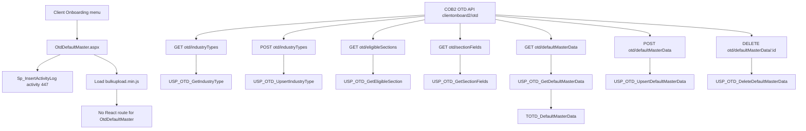
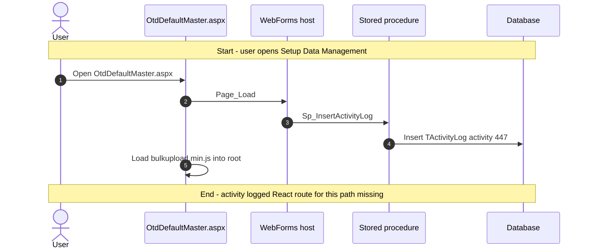
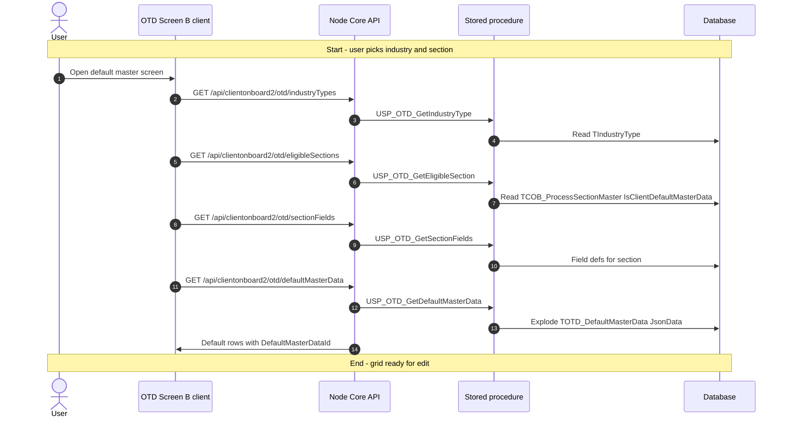
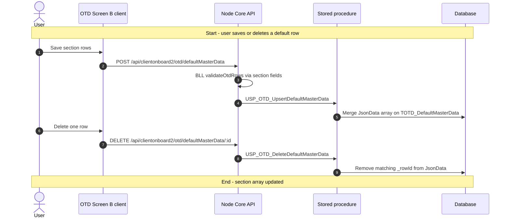
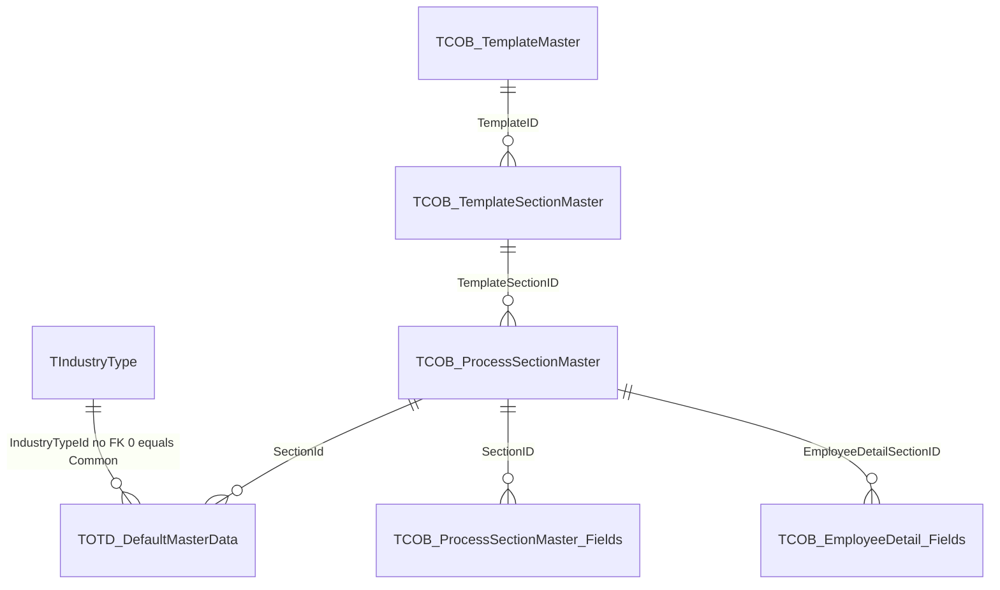

# Setup Data Management

## Overview

An operations user opens **Client Onboarding → Setup Data Management** (`OtdDefaultMaster.aspx`, MenuId 1339) to maintain industry-type (OTD) default master rows used when seeding a new organisation. The WebForms host only seeds session identity into hidden fields, logs activity type `ClientOnboardingImportManagements` (447 — same enum as Import Management), and loads `bulkupload.min.js`. Screen B traffic is Core Node `/api/clientonboard2/otd/*` (Authorize). There is no WebForms postback for default-master grids.

Live employerid=0 left-nav order under Client Onboarding places this leaf after Config Manager and before Plan Templates. `tMenuDetails` (employer 0) maps MenuId **1339** / MenuName **Setup Data Management** to NavigateURL `/HRM/BulkUpload_React/OtdDefaultMaster.aspx`.

**Who's involved:**

- **Ops / COB user** — picks industry (or Common / industry-independent rows), chooses an eligible section, edits default rows, saves or deletes.
- **License / Add Organization callers** — consume the same OTD store via seed/clone APIs when applying defaults to a live employer (out of scope for this leaf's UI).

There is no SystemModel-2 page for this screen. Schema and procs live under `HRMS-DATABASE/HRMS/DDL/159568/` and `STOREPROCEDURE/159568/`.

## Workflow

The WebForms host has no postback that binds OTD grids. Request lifecycle for Screen B data is Core Node JWT/`Authorization` traffic under `/api/clientonboard2/otd`.

## Request journey

### Open Setup Data Management host

### Load industries, sections, fields, and default rows (API)

### Save or delete a default row (API)

## Entry points

| Entry | Purpose | Live? |
|---|---|---|
| `~/HRM/BulkUpload_React/OtdDefaultMaster.aspx` | Menu leaf **Setup Data Management** (MenuId 1339). WebForms host + activity log | Yes (host only) |
| React route in `BulkUpload_React/Areas/routes.js` | Only `UPLOAD_FILE` → `UploadFiles.aspx` | No route for OtdDefaultMaster |
| `/api/clientonboard2/otd/*` (`ClientOnboardingRoutes.js`) | Industry types, eligible sections, field defs, default master CRUD | Yes |
| `/api/clientonboard2/otd/seed` | Seed Master Data on License / Add Organization | Related, out of scope for this leaf UI |
| `/api/clientonboard2/otd/clone/*` | Org Data Clone RAD | Out of scope |
| `~/HRM/BulkUpload_React/CobDashboard.aspx` | Sibling **Import Management**; also logs activity 447 | Out of scope |

## Code → database call chain

| Entry | Method | Database |
|---|---|---|
| Page load, `OtdDefaultMaster.aspx.cs:25` | `CommonUtil.LogActivity` (`Common.cs:52`) → `LogUserActivity.LogActivity` → `ActivityHelper.LogActivity` (`ActivityHelper.cs:32`) | `Sp_InsertActivityLog`. Activity type `ClientOnboardingImportManagements` = 447 (`Enums.cs:390`) |
| API, `ClientOnboardingController.getIndustryType:1750` | BLL `getIndustryType:2097` → `ClientOnboardingDAL.getIndustryType:1084` | `USP_OTD_GetIndustryType` |
| API, `upsertIndustryType:1768` | BLL `upsertIndustryType:2101` → DAL `upsertIndustryType:1101` | `USP_OTD_UpsertIndustryType` |
| API, `getEligibleSection:1789` | BLL `getEligibleSection:2107` → DAL `getEligibleSection:1123` | `USP_OTD_GetEligibleSection` |
| API, `getSectionFields:1813` | BLL `getSectionFields:2111` → DAL `getSectionFields:1139` | `USP_OTD_GetSectionFields` |
| API, `getOtdDefaultMasterData:1830` | BLL `getOtdDefaultMasterData:2116` → DAL `getDefaultMasterData:1155` | `USP_OTD_GetDefaultMasterData` |
| API, `upsertOtdDefaultMasterData:1860` | BLL `upsertOtdDefaultMasterData:2124` (validates then) → DAL `upsertDefaultMasterData:1175` | `USP_OTD_UpsertDefaultMasterData` |
| API, `deleteOtdDefaultMasterData:1897` | BLL `deleteOtdDefaultMasterData:2153` → DAL `deleteDefaultMasterData:1198` | `USP_OTD_DeleteDefaultMasterData` |

## API endpoints

No WebForms postback binds Setup Data Management grids. Primary traffic is Core Node under `/api/clientonboard2/otd` (`routeIndex.js` mounts `ClientOnboardingRoutes.js`). These OTD Screen B routes are Authorize-only (no `assertEmployerAccess` on the industry/section/default-master handlers).

| Verb | Route | Parameters | Purpose | Source |
|---|---|---|---|---|
| GET | `/api/clientonboard2/otd/industryTypes` | query `onlyActive`, `includeCommon` | Industry picker | `ClientOnboardingRoutes.js:450` |
| POST | `/api/clientonboard2/otd/industryTypes` | body `industryTypeId`, `industryType`, `description`, `isActive`, `userId` | Create/update industry | `ClientOnboardingRoutes.js:451` |
| GET | `/api/clientonboard2/otd/eligibleSections` | query `isIndustryScoped` (tri-state) | Section picker | `ClientOnboardingRoutes.js:454` |
| GET | `/api/clientonboard2/otd/sectionFields` | query `sectionId` | Grid columns + validation | `ClientOnboardingRoutes.js:455` |
| GET | `/api/clientonboard2/otd/defaultMasterData` | query `industryTypeId` (0/omit = Common), `sectionId` | List default rows | `ClientOnboardingRoutes.js:458` |
| POST | `/api/clientonboard2/otd/defaultMasterData` | body `industryTypeId`, `sectionId`, `rows`, `userId` | Upsert rows (HTTP 200 envelope on validation failure) | `ClientOnboardingRoutes.js:459` |
| DELETE | `/api/clientonboard2/otd/defaultMasterData/:id` | path id; `userId` body/query | Remove one `_rowId` | `ClientOnboardingRoutes.js:460` |

`POST /otd/seed` and `/otd/clone/*` sit under the same router prefix but belong to License seeding and Org Data Clone, not this menu leaf's Screen B.

## Stored procedures & tables involved

| Object | File | Purpose | Wiki |
|---|---|---|---|
| `Sp_InsertActivityLog` | `STOREPROCEDURE/Sp_InsertActivityLog.sql` | Page-access log | [Sp_InsertActivityLog](/docs/database/hrms/Sp_InsertActivityLog) |
| `USP_OTD_GetIndustryType` | `STOREPROCEDURE/159568/USP_OTD_GetIndustryType.sql` | List industries | [USP_OTD_GetIndustryType](/docs/database/hrms/USP_OTD_GetIndustryType) |
| `USP_OTD_UpsertIndustryType` | `STOREPROCEDURE/159568/USP_OTD_UpsertIndustryType.sql` | Insert/update industry | [USP_OTD_UpsertIndustryType](/docs/database/hrms/USP_OTD_UpsertIndustryType) |
| `USP_OTD_GetEligibleSection` | `STOREPROCEDURE/159568/USP_OTD_GetEligibleSection.sql` | Sections with `IsClientDefaultMasterData` | [USP_OTD_GetEligibleSection](/docs/database/hrms/USP_OTD_GetEligibleSection) |
| `USP_OTD_GetSectionFields` | `STOREPROCEDURE/159568/USP_OTD_GetSectionFields.sql` | Field defs for one section | [USP_OTD_GetSectionFields](/docs/database/hrms/USP_OTD_GetSectionFields) |
| `USP_OTD_GetDefaultMasterData` | `STOREPROCEDURE/159568/USP_OTD_GetDefaultMasterData.sql` | Explode section JSON array | [USP_OTD_GetDefaultMasterData](/docs/database/hrms/USP_OTD_GetDefaultMasterData) |
| `USP_OTD_UpsertDefaultMasterData` | `STOREPROCEDURE/159568/USP_OTD_UpsertDefaultMasterData.sql` | Merge posted rows into JSON array | [USP_OTD_UpsertDefaultMasterData](/docs/database/hrms/USP_OTD_UpsertDefaultMasterData) |
| `USP_OTD_DeleteDefaultMasterData` | `STOREPROCEDURE/159568/USP_OTD_DeleteDefaultMasterData.sql` | Remove one `_rowId` | [USP_OTD_DeleteDefaultMasterData](/docs/database/hrms/USP_OTD_DeleteDefaultMasterData) |
| `TIndustryType` | `DDL/159568/001_DDL_IndustryTypeDefault_Schema.sql` | Industry catalog | schema script |
| `TOTD_DefaultMasterData` | same DDL | One JSON array per industry+section | schema script |
| `TCOB_ProcessSectionMaster` | COB config | Eligible sections + `IsIndustryScoped` | Config Manager |
| `TCOB_ProcessSectionMaster_Fields` / `TCOB_EmployeeDetail_Fields` | COB config | Field metadata for Screen B | Config Manager |
| `SEQ_TOTD_DefaultMasterDataRowId` | same DDL | Global `_rowId` sequence | schema script |

Screen B procs call no nested procedures. Seed path `USP_OTD_ProcessDefaultMasterData` → `USP_COB_MasterProcessor` is License/Add Organization, not this leaf.

## Table relationships

Declared FKs from `TOTD_DefaultMasterData.IndustryTypeId` to `TIndustryType` are intentionally absent (`IndustryTypeId` 0 means Common). Joins below are those Screen B procs use.

## Known gaps

- **No React route for `OtdDefaultMaster.aspx`** in `BulkUpload_React/Areas/routes.js` or the checked-in `BuildJS/bulkupload.min.js` (only `UploadFiles.aspx`). Opening the menu leaf logs activity 447 and leaves `#root` empty unless a different bundle is deployed outside this tree.
- **No SystemModel-2 page** for Setup Data Management / OTD Screen B UI.
- **Activity type collision** — host logs `ClientOnboardingImportManagements` (447), the same value Import Management uses on `CobDashboard.aspx`.
- **OTD SPA source is not in `BulkUpload_React`** — API and procs are live; the React Screen B client is not present in this workspace's BulkUpload tree.
- **Seed and Org Data Clone** share the `/otd` prefix but are not this menu leaf; document them on License / Cross Client / clone guides.
- **No checked-in DML row** for MenuId 1339 NavigateURL in the Liquibase tree; live DEV `tMenuDetails` (employer 0) confirms the mapping.

## Reference

Confidence is **medium** for the Core `/clientonboard2/otd` DAL paths and the listed `STOREPROCEDURE/159568` scripts; **low** for any browser UI on this leaf because the BulkUpload React host does not mount OtdDefaultMaster. Foreign keys are only those implied by joins and the OTD schema comments.

### SourceCode

- `HRMS.Web/HRMS.Web/HRM/BulkUpload_React/OtdDefaultMaster.aspx`
- `HRMS.Web/HRMS.Web/HRM/BulkUpload_React/OtdDefaultMaster.aspx.cs`
- `HRMS.Web/HRMS.Web/HRM/BulkUpload_React/Areas/routes.js`
- `HRMS.CoreAPI/HRMS.Core.WebAPI.Node/Routes/ClientOnboardingRoutes.js`
- `HRMS.CoreAPI/HRMS.Core.WebAPI.Node/Routes/routeIndex.js`
- `HRMS.CoreAPI/HRMS.Core.WebAPI.Node/Controllers/ClientOnboardingController.js`
- `HRMS.CoreAPI/HRMS.Core.WebAPI.Node/Core/BusinessLogicLayer/ClientOnboardingBLL.js`
- `HRMS.CoreAPI/HRMS.Core.WebAPI.Node/Core/DataAccessLayer/ClientOnboardingDAL.js`
- `HRMS.Shared/HRMS.Common/Common.cs`
- `HRMS.Shared/HRMS.DataContract/Common/Enums.cs`
- `HRMS.Shared/TDG.ActivityAuditLog/DAL/ActivityHelper.cs`

### TDG HRMS DB

- Live DEV `dbo.tMenuDetails` MenuId 1339 (employer 0) — MenuName Setup Data Management, NavigateURL `/HRM/BulkUpload_React/OtdDefaultMaster.aspx`
- `HRMS-DATABASE/HRMS/DDL/159568/001_DDL_IndustryTypeDefault_Schema.sql`
- `HRMS-DATABASE/HRMS/STOREPROCEDURE/159568/USP_OTD_GetIndustryType.sql`
- `HRMS-DATABASE/HRMS/STOREPROCEDURE/159568/USP_OTD_UpsertIndustryType.sql`
- `HRMS-DATABASE/HRMS/STOREPROCEDURE/159568/USP_OTD_GetEligibleSection.sql`
- `HRMS-DATABASE/HRMS/STOREPROCEDURE/159568/USP_OTD_GetSectionFields.sql`
- `HRMS-DATABASE/HRMS/STOREPROCEDURE/159568/USP_OTD_GetDefaultMasterData.sql`
- `HRMS-DATABASE/HRMS/STOREPROCEDURE/159568/USP_OTD_UpsertDefaultMasterData.sql`
- `HRMS-DATABASE/HRMS/STOREPROCEDURE/159568/USP_OTD_DeleteDefaultMasterData.sql`
- `HRMS-DATABASE/HRMS/STOREPROCEDURE/Sp_InsertActivityLog.sql`
