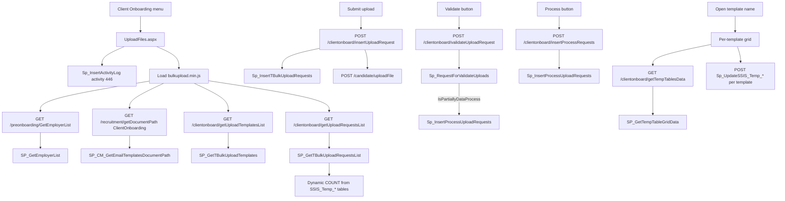
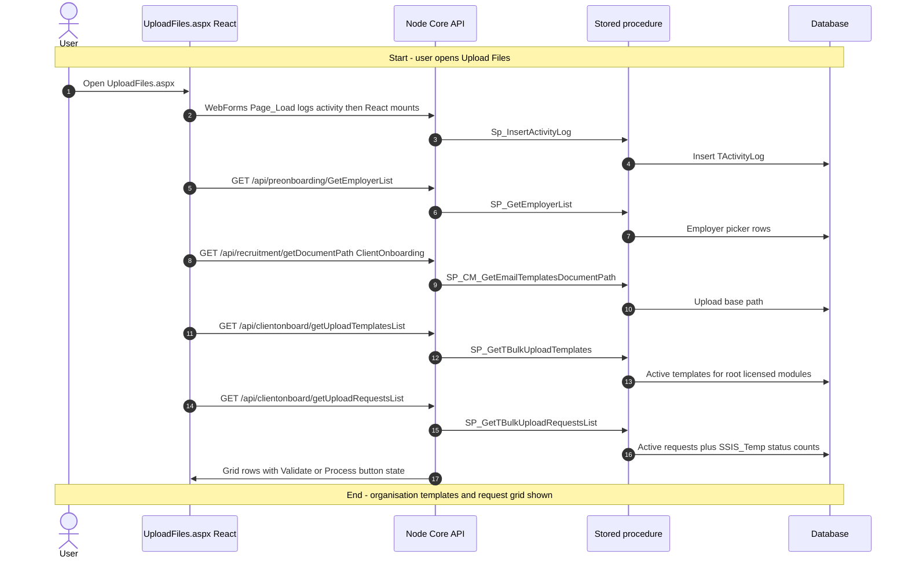
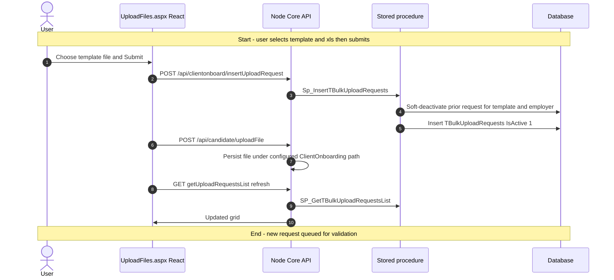
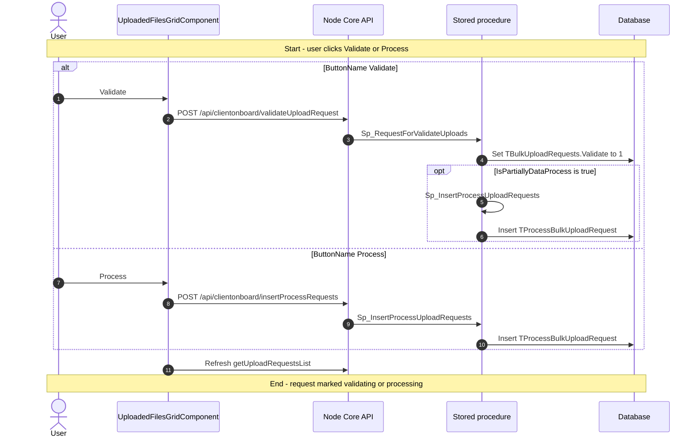
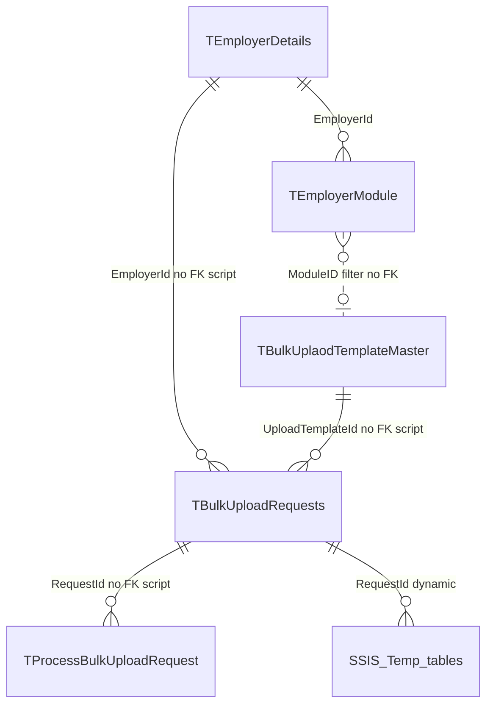

# Upload Files

## Overview

An operations user opens **Client Onboarding → Upload Files** (`UploadFiles.aspx`, MenuId 1186) to queue Excel bulk-load requests for a selected organisation. The page title in React is "Process to bulk upload data". The WebForms host only seeds session identity into hidden fields, logs activity type `ClientOnboardingUploadFiles` (446), and loads `bulkupload.min.js`. All list, upload, validate, and process traffic goes through Core Node `/api/clientonboard/*` (Authorize). There is no WebForms postback for request data.

Live employerid=0 left-nav order under Client Onboarding starts with this leaf, then Import Management, Config Manager, Setup Data Management, Plan Templates, Client Plan Config, Audit Trail, Cross Client Dashboard, Default Access Right Management, and Data Catalog. Older DML still mentions Bulk Workflow Update; that leaf is not in the current `TDynamicMenuHierarchy` XML for employer 0.

**Who's involved:**

- **Ops / COB user** — picks organisation and template, uploads `.xls`, validates, fixes invalid staging rows in per-template grids, then processes.
- **SSIS / background process** — consumes `TBulkUploadRequests` / `TProcessBulkUploadRequest` after Validate or Process (outside this React save path).

There is no SystemModel-2 page for this screen. Catalog blurbs for `TBulkUploadRequests`, `TBulkUplaodTemplateMaster`, and `TProcessBulkUploadRequest` live in `llm-wiki/reference/tables/hrms.md`.

## Workflow

This page is a React SPA hosted in WebForms. Request lifecycle uses JWT/`Authorization` from the BulkUpload React helpers. No WebForms postback binds the grids.

## Request journey

### Load page — employers, templates, request list

### Submit a new upload request

### Validate or process a request

## Entry points

| Entry | Purpose | Live? |
|---|---|---|
| `~/HRM/BulkUpload_React/UploadFiles.aspx` | Menu leaf **Upload Files** (MenuId 1186). Host for the React upload SPA | Yes |
| React route `RouteConstants.UPLOAD_FILE` | Same path; mounts `UploadFileContainer` → `UploadFileComponent` | Yes |
| `~/HRM/BulkUpload_React/CobDashboard.aspx` | Sibling leaf **Import Management** | Out of scope |
| `~/HRM/BulkUpload_React/WorkflowTemplate.aspx` | Legacy Bulk Workflow Update host; not in current employer-0 menu XML | Out of scope |

## Code → database call chain

| Entry | Method | Database |
|---|---|---|
| Page load, `UploadFiles.aspx.cs:26` | `CommonUtil.LogActivity` → `ActivityHelper.LogActivity` (`ActivityHelper.cs:32`) | `Sp_InsertActivityLog`. Activity type `ClientOnboardingUploadFiles` = 446 (`Enums.cs:389`) |
| Mount, `UploadFileComponent.js:98` | `GET_EMPLOYER_LIST` → `preOnBoardingDAL.GetEmployerList` (`preOnBoardingDAL.js:717`) | `SP_GetEmployerList` |
| Mount, `UploadFileComponent.js:181` | `GET_DOCUMENT_PATH('ClientOnboarding')` → `recruitmentDAL.GetDocumentPath` (`recruitmentDAL.js:1013`) | `SP_CM_GetEmailTemplatesDocumentPath` |
| Mount / org change, `UploadFileComponent.js:112` | `GET_UPLOAD_TEMPLATES_LIST` → `bulkUploadController.GetUploadTemplatesList:17` → `bulkUploadDAL.GetUploadTemplatesList:27` | `SP_GetTBulkUploadTemplates` |
| Mount / poll / refresh, `UploadFileComponent.js:153` | `GET_UPLOADED_REQUEST_LIST` → `GetUploadRequestsList:8` → `bulkUploadDAL:15` | `SP_GetTBulkUploadRequestsList` (dynamic SQL against `SSIS_Temp_*`) |
| Submit, `UploadFileComponent.js:347` | `INSERT_UPLOAD_REQUEST` → `InsertUploadRequest:26` → `bulkUploadDAL:39` | `Sp_InsertTBulkUploadRequests` |
| Submit file bytes, `UploadFileComponent.js:285` | `UPLOAD_FILE` → candidate upload handler | File system only (no COB SP) |
| Validate, `UploadedFilesGridComponent.js:183` | `VALIDATE_UPLOAD_REQUEST` → `ValidateUploadRequest:36` → `bulkUploadDAL:61` | `Sp_RequestForValidateUploads`. Nested `Sp_InsertProcessUploadRequests` when `IsPartiallyDataProcess` = 1 |
| Process, `UploadedFilesGridComponent.js:197` | `INSERT_PROCESS_REQUEST` → `InsertProcessRequests:90` → `bulkUploadDAL:168` | `Sp_InsertProcessUploadRequests` |
| Drill-down grids (many `*GridComponent.js`) | `GET_TEMP_TABLE_DATA` → `GetTempTablesData:45` → `bulkUploadDAL:79` | `SP_GetTempTableGridData` (dynamic `SELECT` per `DBTempTableName`) |
| Row edits in drill-down grids | Matching `update*` POSTs on `/clientonboard/*` → `bulkUploadDAL` | Many `Sp_UpdateSSIS_Temp_*` (not individually documented here) |

## API endpoints

No WebForms postback binds upload request data. Primary traffic is Core Node under `/api/clientonboard` (`routeIndex.js` mounts `BulkUploadRoutes.js`). Ancillary employer list and document path use other routers.

| Verb | Route | Parameters | Purpose | Source |
|---|---|---|---|---|
| GET | `/api/preonboarding/GetEmployerList` | `employeeId` | Organisation picker | Pre-onboarding routes |
| GET | `/api/recruitment/getDocumentPath` | `documentType=ClientOnboarding` | Upload base path | Recruitment routes |
| GET | `/api/clientonboard/getUploadTemplatesList` | `employerId` | Template dropdown | `BulkUploadRoutes.js:9` |
| GET | `/api/clientonboard/getUploadRequestsList` | `employerId` | Request grid | `BulkUploadRoutes.js:8` |
| POST | `/api/clientonboard/insertUploadRequest` | body template, path, partial flag | Queue request | `BulkUploadRoutes.js:10` |
| POST | `/api/candidate/uploadFile` | multipart file + path | Persist `.xls` | Candidate routes |
| POST | `/api/clientonboard/validateUploadRequest` | body `requestId` | Mark validate | `BulkUploadRoutes.js:11` |
| POST | `/api/clientonboard/insertProcessRequests` | body `requestId`, `employerId` | Queue process | `BulkUploadRoutes.js:17` |
| GET | `/api/clientonboard/getTempTablesData` | `RequestId`, `uploadTemplateId` | Staging grid rows | `BulkUploadRoutes.js:12` |
| POST | `/api/clientonboard/update*` (many) | body row fields | Edit `SSIS_Temp_*` rows | `BulkUploadRoutes.js:14+` |

`assertEmployerAccess()` guards most GETs and several POSTs; `insertUploadRequest` is Authorize-only without that middleware in `BulkUploadRoutes.js`.

## Stored procedures & tables involved

| Object | File | Purpose | Wiki |
|---|---|---|---|
| `Sp_InsertActivityLog` | `STOREPROCEDURE/Sp_InsertActivityLog.sql` | Page-access log | `TActivityLog` |
| `SP_GetEmployerList` | matching script | Employer picker | `TEmployerDetails` |
| `SP_CM_GetEmailTemplatesDocumentPath` | matching script | Document base path by type | catalogued path settings |
| `SP_GetTBulkUploadTemplates` | `STOREPROCEDURE/SP_GetTBulkUploadTemplates.sql` | Licensed active templates for root | `TBulkUplaodTemplateMaster` |
| `SP_GetTBulkUploadRequestsList` | `STOREPROCEDURE/SP_GetTBulkUploadRequestsList.sql` | Request grid + staging counts | `TBulkUploadRequests`, `TProcessBulkUploadRequest` |
| `Sp_InsertTBulkUploadRequests` | `STOREPROCEDURE/Sp_InsertTBulkUploadRequests.sql` | Soft-deactivate prior + insert request | `TBulkUploadRequests` |
| `Sp_RequestForValidateUploads` | `STOREPROCEDURE/Sp_RequestForValidateUploads.sql` | Set Validate; optional nested process insert | `TBulkUploadRequests` |
| `Sp_InsertProcessUploadRequests` | `STOREPROCEDURE/Sp_InsertProcessUploadRequests.sql` | Insert process queue row | `TProcessBulkUploadRequest` |
| `SP_GetTempTableGridData` | `STOREPROCEDURE/SP_GetTempTableGridData.sql` | Dynamic select from staging temp tables | `TBulkUplaodTemplateMaster` + `SSIS_Temp_*` |
| `Sp_UpdateSSIS_Temp_*` (family) | matching `STOREPROCEDURE/` scripts | Per-template staging row edits | SSIS staging tables |
| `TBulkUploadRequests` | `TABLES/TBulkUploadRequests.sql` | Upload request header | catalogued |
| `TBulkUplaodTemplateMaster` | `TABLES/TBulkUplaodTemplateMaster.sql` | Template master (typo `Uplaod` in object name) | catalogued |
| `TProcessBulkUploadRequest` | `TABLES/TProcessBulkUploadRequest.sql` | Process queue | catalogued |
| `TEmployerDetails`, `TEmployerModule` | matching `TABLES/` scripts | Root employer and licence modules for template filter | catalogued |

Actual promotion from `SSIS_Temp_*` into live masters is performed by SSIS / jobs after Validate or Process, not by these React POST handlers.

## Table relationships

Declared FKs on the COB upload tables are sparse. The diagram shows joins the list and insert procedures use.

## Known gaps

- **No SystemModel-2 page** for Upload Files / Client Onboarding upload.
- **`TABLES/TBulkUploadRequests.sql` omits `IsPartiallyDataProcess`** that `Sp_InsertTBulkUploadRequests` and `Sp_RequestForValidateUploads` use.
- **`TABLES/TBulkUplaodTemplateMaster.sql` omits `ModuleID` and `IsActive`** that `SP_GetTBulkUploadTemplates` filters on.
- **`SP_GetTBulkUploadTemplates.sql` starts with `USE [HRM-CL-Prod]`** — hardcoded database name in the Liquibase tree.
- **`SP_GetTBulkUploadRequestsList` and `SP_GetTempTableGridData` build dynamic SQL** from template table-name strings (`EXEC (@NSQL)` / `sp_executesql`).
- **Template-name whitelist in the list SP** must be updated when new COB templates ship; missing names hide requests from the grid.
- **Dozens of `Sp_UpdateSSIS_Temp_*` edit paths** are in scope for the drill-down UI but not given individual database pages in this pass.
- **SSIS package that loads Excel into `SSIS_Temp_*` and promotes to actual tables** is outside this React call chain.
- **Menu naming drift** — older DML used "Manage Imports"; live MenuId 1249 is **Import Management**. Bulk Workflow Update is gone from employer-0 XML.

## Reference

Confidence is **medium** for the React host and Core `/clientonboard` DAL paths; high for the six primary STOREPROCEDURE scripts listed. Foreign keys are only those implied by joins; COB request tables have no FK scripts in-repo. Per-template update SPs were inventoried from `bulkUploadDAL.js` but not fully explained.

### SourceCode

- `HRMS.Web/HRMS.Web/HRM/BulkUpload_React/UploadFiles.aspx`
- `HRMS.Web/HRMS.Web/HRM/BulkUpload_React/UploadFiles.aspx.cs`
- `HRMS.Web/HRMS.Web/HRM/BulkUpload_React/Areas/Upload/Containers/UploadFileContainer.js`
- `HRMS.Web/HRMS.Web/HRM/BulkUpload_React/Areas/Upload/Components/UploadFileComponent.js`
- `HRMS.Web/HRMS.Web/HRM/BulkUpload_React/Areas/Upload/Components/UploadedFilesGridComponent.js`
- `HRMS.Web/HRMS.Web/HRM/BulkUpload_React/Areas/routes.js`
- `HRMS.Web/HRMS.Web/HRM/BulkUpload_React/Common/apiURLConstants.js`
- `HRMS.Web/HRMS.Web/HRM/BulkUpload_React/Common/routeConstants.js`
- `HRMS.CoreAPI/HRMS.Core.WebAPI.Node/Routes/BulkUploadRoutes.js`
- `HRMS.CoreAPI/HRMS.Core.WebAPI.Node/Routes/routeIndex.js`
- `HRMS.CoreAPI/HRMS.Core.WebAPI.Node/Controllers/bulkUploadController.js`
- `HRMS.CoreAPI/HRMS.Core.WebAPI.Node/Core/DataAccessLayer/bulkUploadDAL.js`
- `HRMS.CoreAPI/HRMS.Core.WebAPI.Node/Core/DataAccessLayer/preOnBoardingDAL.js`
- `HRMS.CoreAPI/HRMS.Core.WebAPI.Node/Core/DataAccessLayer/recruitmentDAL.js`
- `HRMS.Shared/HRMS.DataContract/Common/Enums.cs`
- `HRMS.Shared/TDG.ActivityAuditLog/DAL/ActivityHelper.cs`

### TDG HRMS DB

- `llm-wiki/reference/tables/hrms.md`
- `HRMS-DATABASE/HRMS/STOREPROCEDURE/SP_GetTBulkUploadRequestsList.sql`
- `HRMS-DATABASE/HRMS/STOREPROCEDURE/SP_GetTBulkUploadTemplates.sql`
- `HRMS-DATABASE/HRMS/STOREPROCEDURE/Sp_InsertTBulkUploadRequests.sql`
- `HRMS-DATABASE/HRMS/STOREPROCEDURE/Sp_RequestForValidateUploads.sql`
- `HRMS-DATABASE/HRMS/STOREPROCEDURE/Sp_InsertProcessUploadRequests.sql`
- `HRMS-DATABASE/HRMS/STOREPROCEDURE/SP_GetTempTableGridData.sql`
- `HRMS-DATABASE/HRMS/TABLES/TBulkUploadRequests.sql`
- `HRMS-DATABASE/HRMS/TABLES/TBulkUplaodTemplateMaster.sql`
- `HRMS-DATABASE/HRMS/TABLES/TProcessBulkUploadRequest.sql`
