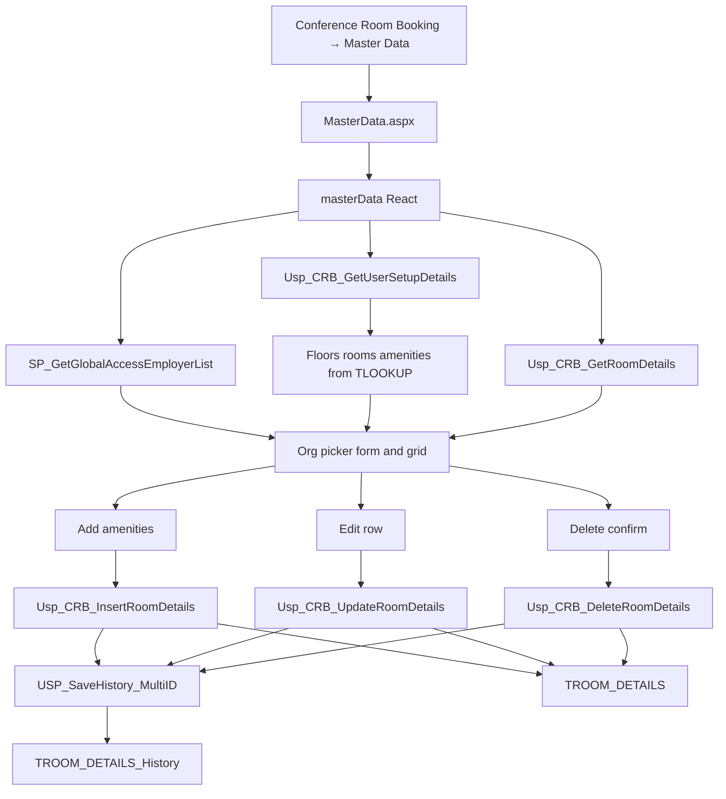
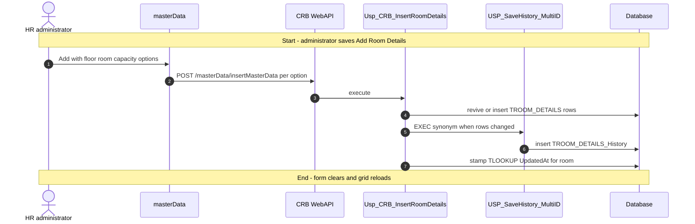
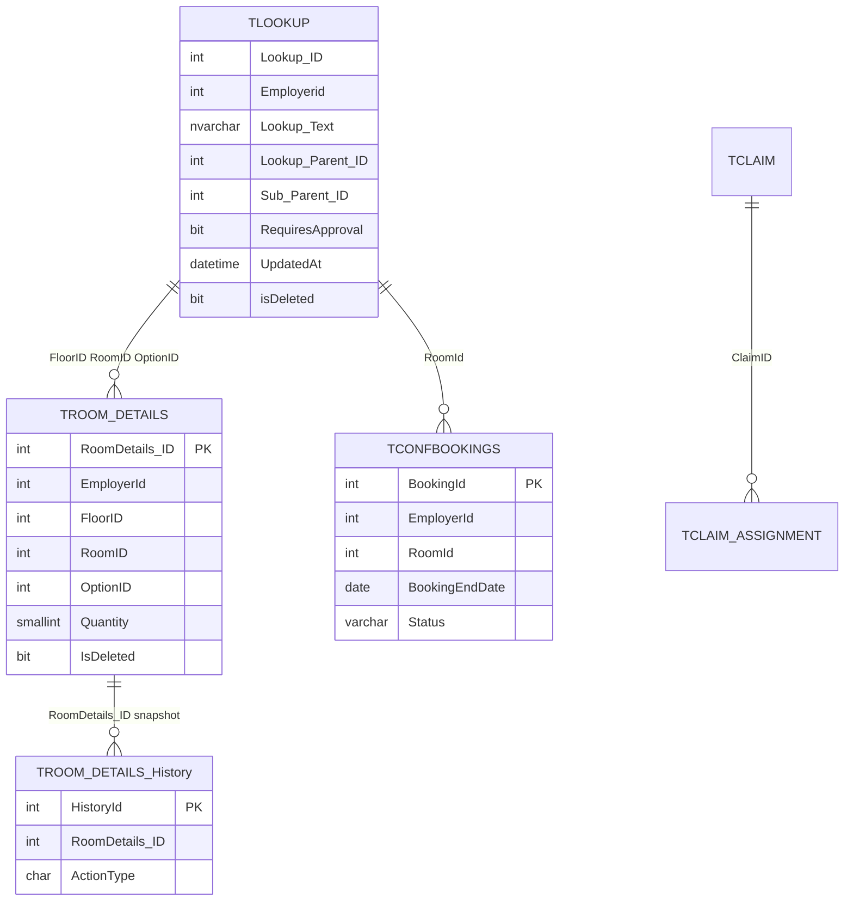

# Master Data

## Overview

An HR administrator (or other role with claim `CRB002`) configures conference-room master rows — floor, room, seating capacity, and available amenity options — under **Conference Room Booking → Master Data** (`~/HRM/ConferenceRoomBooking/MasterData.aspx`). The WebForms host logs activity `ConferenceRoomBookingMasterData`, stamps session employee context into hidden fields, and loads the `conferenceRoomBooking.min.js` React bundle.

On load the screen loads organisation options (`SP_GetGlobalAccessEmployerList` on the core connection), role/employee claims plus employer lookups (`Usp_CRB_GetUserSetupDetails`), and the room-details grid (`Usp_CRB_GetRoomDetails`). Floors come from lookup parent `100`; amenity checkboxes from parent `300`; rooms are children filtered by the selected floor’s `SubParentId`. Add posts one insert per selected amenity; edit posts update; delete soft-deletes through the delete procedure. Insert/update/delete procedures nest `USP_SaveHistory_MultiID` into `TROOM_DETAILS_History` (and optionally `TLOOKUP_History` when the room approval flag changes).

This screen is distinct from **Admin Configuration → Conference Room Booking Options Setup**, which maintains the underlying `TLOOKUP` floors, rooms, and amenity types. Master Data attaches quantities and amenity options to an already-defined room.

**Who's involved:**

- **HR administrator / CRB master-data user** — maintains room amenity and seating rows for the selected organisation. Needs claim `CRB002` (`CNST_VIEW_MASTER_DATA`). Global-access users can switch organisation via the org dropdown.
- **Employee / booker** — does not open this screen. Booking flows later read `TROOM_DETAILS` and `TLOOKUP` for capacity and amenities.

## Workflow

## Request journey

### HR administrator — add room amenities

## Entry points

`~/HRM/ConferenceRoomBooking/MasterData.aspx` is the live host. `Page_Load` logs `ActivityDescription.ConferenceRoomBookingMasterData` and copies `LoggedInEmployee` into hidden fields (`hdnEmpId`, `hdnEmployerId`, `hdnEmpRoleId`, and related). The React bundle mounts at `#root` via `BuildJS/conferenceRoomBooking.min.js`. Client route `RouteConstants.MASTER_DATA` wraps the component with claim `CRB002`.

Breadcrumb on the page: **Home → Conference Room Booking → Master Data → Master Data Setup**.

| UI page | Purpose |
|---|---|
| `HRM/ConferenceRoomBooking/MasterData.aspx` | WebForms host and session stamp |
| `Areas/MasterData/Containers/masterData.js` | Org picker, form, grid, add/edit/delete |
| `Areas/routes.js` | React route + claim gate |

## Code → database call chain

Active `apiURLConstants.js` exports unversioned `/masterData/...` and `/employee/...` / `/common/...` paths (V1). Controllers below are the V1 files mounted from `routeIndex.js`.

| Entry | Method | Stored procedure |
|---|---|---|
| Page load (org list) | `getGlobalAccessEmployers` (`masterData.js:372`) → `GetGlobalAccessEmployerList` (`commonController.js:40`) → `GetGlobalAccessEmployerList` (`commonDAL.js:66`) | `SP_GetGlobalAccessEmployerList` (core connection) |
| Page load / org change | `setupUserDetails` (`masterData.js:379`) → `GetUserSetupDetails` (`employeeController.js:8`) → `GetUserSetupDetails` (`employeeDAL.js:15`) | `Usp_CRB_GetUserSetupDetails` |
| Page load / after save or delete / org change | `getMasterData` (`masterData.js:286`) → `GetAllMasterDataList` (`masterDataController.js:6`) → `GetAllMasterDataList` (`masterDataDAL.js:16`) | `Usp_CRB_GetRoomDetails` |
| Add | `manageMasterData` (`masterData.js:255`) → `InsertMasterData` (`masterDataController.js:18`) → `InsertMasterData` (`masterDataDAL.js:31`) | `Usp_CRB_InsertRoomDetails` (then nested `USP_SaveHistory_MultiID`) |
| Update | `manageMasterData` (`masterData.js:273`) → `UpdateMasterData` (`masterDataController.js:30`) → `UpdateMasterData` (`masterDataDAL.js:49`) | `Usp_CRB_UpdateRoomDetails` (then nested `USP_SaveHistory_MultiID`) |
| Delete | `handleDialogClick` (`masterData.js:348`) → `DeleteMasterData` (`masterDataController.js:42`) → `DeleteMasterData` (`masterDataDAL.js:68`) | `Usp_CRB_DeleteRoomDetails` (then nested `USP_SaveHistory_MultiID`) |

## API endpoints

Not WebForms postback. The React host calls the Conference Room Booking Node API (`API_URL` + paths below). Authorize middleware applies on these routes.

| Verb | Route | Parameters | Purpose | Source |
|---|---|---|---|---|
| GET | `/common/getGlobalAccessEmployerList` | query `employerId` (UI passes employee id into this query name) | Organisation dropdown | `commonRoutes.js:10`, `commonController.js:40` |
| GET | `/employee/getUserSetupDetails` | query `roleId`, `employerId`, `EmpId` | Claims + lookups for floors/rooms/amenities | `employeeRoutes.js:7`, `employeeController.js:8` |
| GET | `/masterData/getAllMasterDataList` | query `EID` | Room-details grid | `masterDataRoutes.js:7`, `masterDataController.js:6` |
| POST | `/masterData/insertMasterData` | body `EmployerId`, `FloorId`, `RoomId`, `OptionId`, `Quantity` | Insert one amenity row | `masterDataRoutes.js:8`, `masterDataController.js:18` |
| PUT | `/masterData/updateMasterData` | query `Id`, body same as insert | Update amenity / quantity | `masterDataRoutes.js:9`, `masterDataController.js:30` |
| DELETE | `/masterData/deleteMasterData` | query `Id` | Soft-delete room-detail row(s) | `masterDataRoutes.js:10`, `masterDataController.js:42` |

## Stored procedures & tables involved

| Object | File path | Purpose | llm-wiki |
|---|---|---|---|
| [`Usp_CRB_GetRoomDetails`](/docs/database/hrms-crbbooking/Usp_CRB_GetRoomDetails) | `HRMS-DATABASE/HRMS-CRBBOOKING/STOREPROCEDURE/Usp_CRB_GetRoomDetails.sql` | Aggregated active room amenities for one employer | `content/llm-wiki/reference/tables/crbbooking.md` |
| [`Usp_CRB_InsertRoomDetails`](/docs/database/hrms-crbbooking/Usp_CRB_InsertRoomDetails) | `HRMS-DATABASE/HRMS-CRBBOOKING/STOREPROCEDURE/Usp_CRB_InsertRoomDetails.sql` | Insert/revive amenity rows; optional room flag; history | same |
| [`Usp_CRB_UpdateRoomDetails`](/docs/database/hrms-crbbooking/Usp_CRB_UpdateRoomDetails) | `HRMS-DATABASE/HRMS-CRBBOOKING/STOREPROCEDURE/Usp_CRB_UpdateRoomDetails.sql` | Sync amenity set for a room; concurrency via `UpdatedAt` | same |
| [`Usp_CRB_DeleteRoomDetails`](/docs/database/hrms-crbbooking/Usp_CRB_DeleteRoomDetails) | `HRMS-DATABASE/HRMS-CRBBOOKING/STOREPROCEDURE/Usp_CRB_DeleteRoomDetails.sql` | Soft-delete amenities for a floor/room; block if upcoming bookings | same |
| [`Usp_CRB_GetUserSetupDetails`](/docs/database/hrms-crbbooking/Usp_CRB_GetUserSetupDetails) | `HRMS-DATABASE/HRMS-CRBBOOKING/STOREPROCEDURE/Usp_CRB_GetUserSetupDetails.sql` | Claims, lookups, root employer, room pick lists | same |
| [`USP_SaveHistory_MultiID`](/docs/database/hrms/USP_SaveHistory_MultiID) | `HRMS-DATABASE/HRMS/STOREPROCEDURE/USP_SaveHistory_MultiID.sql` (CRB synonym) | Snapshot into history tables | — |
| [`SP_GetGlobalAccessEmployerList`](/docs/database/hrms/SP_GetGlobalAccessEmployerList) | `HRMS-DATABASE/HRMS/STOREPROCEDURE/SP_GetGlobalAccessEmployerList.sql` | Employers for global-access picker | existing DB page |

Primary tables: `TROOM_DETAILS`, `TROOM_DETAILS_History`, `TLOOKUP` (floors parent `100`, rooms parent `200`, amenities parent `300`), `TCLAIM` / `TCLAIM_ASSIGNMENT`. Delete also reads `TCONFBOOKINGS`. Global access also reads core `TUsers` / `TUserEmployee` / `TEmployerDetails`.

## Table relationships

`TROOM_DETAILS` stores one amenity (`OptionID`) quantity per employer/floor/room. Floor and room ids point at `TLOOKUP` rows (no declared FK). History is written by `USP_SaveHistory_MultiID`, not by an FK. Bookings reference the room lookup id in `TCONFBOOKINGS`.

Declared FKs are absent; the diagram follows the joins and write targets in the procedures above.

## Known gaps

- Active UI constants use unversioned `/masterData/...` (V1). Commented V2/V3 blocks exist in `apiURLConstants.js`, and `routeIndex.js` also mounts `/V2/masterData` and `/V3/masterData`. This guide documents the live V1 export.
- `Usp_CRB_GetRoomDetails` returns `AvailableAmenities` / `SeatingCapacity`, while the grid binds `Facility` / `Quantity`. Edit also reads `Facility`. Column-name drift between SP and UI.
- `Usp_CRB_DeleteRoomDetails` expects `@pEmployerid`, `@pFloorID`, `@pRoomID`, but V1 `masterDataDAL.DeleteMasterData` passes only `@pRoomDetailsID`. Insert/update SPs expect comma-separated `@pOptionID` and (for update) required `@pUpdatedAt`; V1 DAL still sends a single int `OptionId` and no `UpdatedAt`. Runtime may fail or ignore concurrency unless another layer bridges the gap.
- Org-list helper is named `GET_GLOBAL_ACESS_EMPLOYERLIST` and builds query `employerId`, but the UI passes **employee** id; the SP parameter is `@EmployeeId`.
- Floors/rooms/amenities themselves are created in Admin Configuration CRB Options Setup, not on this screen.
- SystemModel-2 has no workflow page for this screen. Nested history procedure is documented one level deep; deeper dynamic SQL inside `USP_SaveHistory_MultiID` was not expanded further.

## Reference

Confidence is medium: the React → V1 CRB WebAPI → procedure names are clear in source, but SP signatures and result columns have drifted from the V1 DAL/UI bindings.

### SourceCode

- `HRMS.Web/HRMS.Web/HRM/ConferenceRoomBooking/MasterData.aspx`
- `HRMS.Web/HRMS.Web/HRM/ConferenceRoomBooking/MasterData.aspx.cs`
- `HRMS.Web/HRMS.Web/HRM/ConferenceRoomBooking/Areas/MasterData/Containers/masterData.js`
- `HRMS.Web/HRMS.Web/HRM/ConferenceRoomBooking/Areas/routes.js`
- `HRMS.Web/HRMS.Web/HRM/ConferenceRoomBooking/Common/apiURLConstants.js`
- `HRMS.Web/HRMS.Web/HRM/ConferenceRoomBooking/Common/claimConstants.js`
- `HRMS.Web/HRMS.Web/HRM/ConferenceRoomBooking/Common/AppConstants.js`
- `HRMS.ConferenceRoomBooking/HRMS.ConferenceRoomBooking.WebAPI.Node/Routes/routeIndex.js`
- `HRMS.ConferenceRoomBooking/HRMS.ConferenceRoomBooking.WebAPI.Node/Routes/masterDataRoutes.js`
- `HRMS.ConferenceRoomBooking/HRMS.ConferenceRoomBooking.WebAPI.Node/Routes/employeeRoutes.js`
- `HRMS.ConferenceRoomBooking/HRMS.ConferenceRoomBooking.WebAPI.Node/Routes/commonRoutes.js`
- `HRMS.ConferenceRoomBooking/HRMS.ConferenceRoomBooking.WebAPI.Node/Controllers/masterDataController.js`
- `HRMS.ConferenceRoomBooking/HRMS.ConferenceRoomBooking.WebAPI.Node/Controllers/employeeController.js`
- `HRMS.ConferenceRoomBooking/HRMS.ConferenceRoomBooking.WebAPI.Node/Controllers/commonController.js`
- `HRMS.ConferenceRoomBooking/HRMS.ConferenceRoomBooking.WebAPI.Node/Core/DataAccessLayer/masterDataDAL.js`
- `HRMS.ConferenceRoomBooking/HRMS.ConferenceRoomBooking.WebAPI.Node/Core/DataAccessLayer/employeeDAL.js`
- `HRMS.ConferenceRoomBooking/HRMS.ConferenceRoomBooking.WebAPI.Node/Core/DataAccessLayer/commonDAL.js`

### TDG HRMS DB

- `HRMS-DATABASE/HRMS-CRBBOOKING/STOREPROCEDURE/Usp_CRB_GetRoomDetails.sql`
- `HRMS-DATABASE/HRMS-CRBBOOKING/STOREPROCEDURE/Usp_CRB_InsertRoomDetails.sql`
- `HRMS-DATABASE/HRMS-CRBBOOKING/STOREPROCEDURE/Usp_CRB_UpdateRoomDetails.sql`
- `HRMS-DATABASE/HRMS-CRBBOOKING/STOREPROCEDURE/Usp_CRB_DeleteRoomDetails.sql`
- `HRMS-DATABASE/HRMS-CRBBOOKING/STOREPROCEDURE/Usp_CRB_GetUserSetupDetails.sql`
- `HRMS-DATABASE/HRMS-CRBBOOKING/SYNONYMS/USP_SaveHistory_MultiID.sql`
- `HRMS-DATABASE/HRMS/STOREPROCEDURE/USP_SaveHistory_MultiID.sql`
- `HRMS-DATABASE/HRMS/STOREPROCEDURE/SP_GetGlobalAccessEmployerList.sql`
- `HRMS-DATABASE/HRMS-CRBBOOKING/TABLES/TROOM_DETAILS.sql`
- `HRMS-DATABASE/HRMS-CRBBOOKING/TABLES/TLOOKUP.sql`
- `content/llm-wiki/reference/tables/crbbooking.md`
