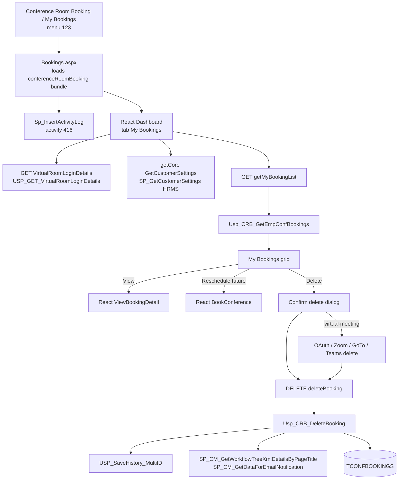
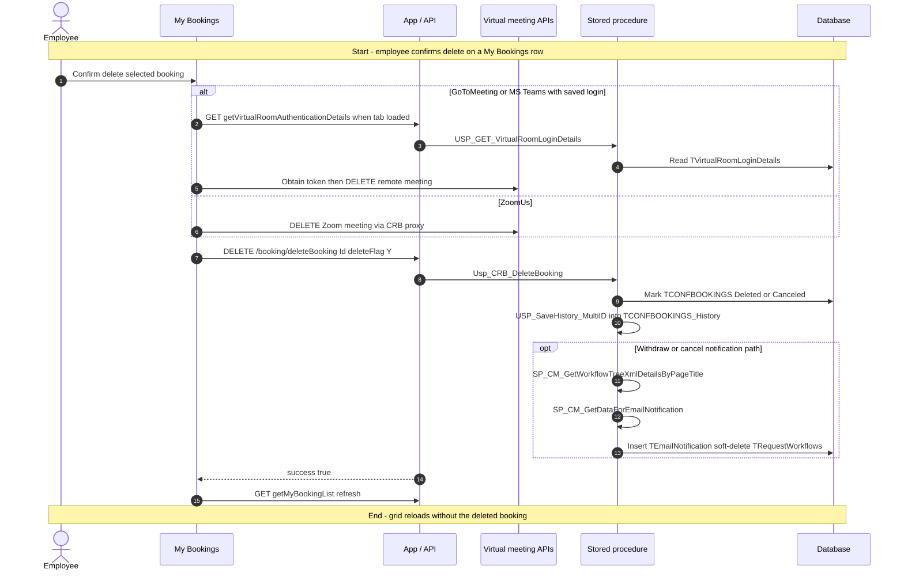
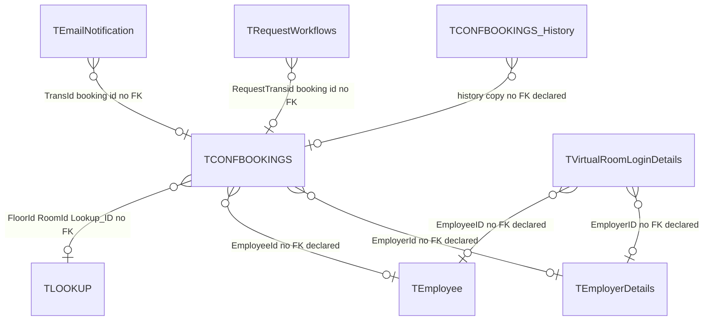

# My Bookings

## Overview

An employee opens **Conference Room Booking → My Bookings** (menu node **123**) and lands on `Bookings.aspx`, which seeds hidden session fields, logs activity **416**, and loads the webpack Conference Room Booking React app. The React host mounts **Dashboard**, whose default tab is **My Bookings** (`MyBookings.js`). That grid lists the signed-in employee’s conference bookings for the current employer, with actions to view detail, reschedule (navigate to Book Conference), or delete.

List and delete traffic goes to the Conference Room Booking Web API against the CRB database (`HRM_CRBooking_Prod` / `HRMS-CRBBOOKING`). Virtual-meeting delete also loads saved GoToMeeting / MS Teams credentials from CRB and may call Core customer settings plus external Zoom / GoTo / Graph APIs before the CRB delete. This screen does **not** create bookings itself; **Book Conference** is a separate React route.

**Who's involved:**

- **Employee** — views, reschedules (via Book Conference), or deletes their own bookings.
- **Administrator / all-bookings viewer** — not this tab; **All Bookings** is a sibling tab on the same ASPX (out of scope for this guide).

There is no SystemModel-2 domain page for My Bookings. Booking rows live in `TCONFBOOKINGS` (plus series/approval columns from later DDL).

## Workflow

## Request journey

### Delete a booking from My Bookings

## Entry points

> The live host is WebForms `HRM/ConferenceRoomBooking/Bookings.aspx`. Booking list/delete are not ASPX postbacks. They use the Conference Room Booking Web API (`process.env.API_URL`). Customer Zoom/GoTo/Teams secrets use Core (`process.env.API_URI_CORE`). My Bookings is the default Dashboard tab (`eventKey={1}`), not a separate ASPX.

| Entry point | Purpose | Live? |
|---|---|---|
| `~/HRM/ConferenceRoomBooking/Bookings.aspx` (menu **123**) | Host page; seeds employee/employer/customer hidden fields; loads React | Yes |
| React `CRB_DASHBOARD` → Dashboard → **My Bookings** tab | Employee booking grid and actions | Yes |
| `CommonUtil.LogActivity(ConferenceRoomBookings)` on `Page_Load` | Activity type **416** | Yes |
| React routes `VIEW_BOOKING_DETAIL`, `BOOK_CONFERENCE` | View / reschedule / new book navigation from this tab | Yes (other screens) |
| V2 / V3 `/V2/booking/...` and `/V3/booking/...` routes | Parallel API versions still mounted | Not used by active Version-1 `apiURLConstants.js` |

## Code → database call chain

The React UI calls `APIHelper` → Conference Room Booking Node Web API (list/delete/virtual-room) or `APIHelper.getCore` → Core Node Web API (customer settings). List goes Controller → BLL → DAL. Delete goes Controller → DAL (no BLL). Virtual-room login details go Controller → DAL.

| Step | Entry point | App code | Stored procedure |
|---|---|---|---|
| Activity on open | `Bookings.aspx.cs:21` | `CommonUtil.LogActivity` → `ActivityHelper.LogActivity` | `Sp_InsertActivityLog` (HRMS; activity **416**) |
| Load My Bookings grid | `MyBookings.js:112` (`get` at `:118`) | `bookingController.GetMyBookingList` (`bookingController.js:32`) → `bookingBLL.GetMyBookingList` (`bookingBLL.js:46`) → `bookingDAL.GetMyBookingList` (`bookingDAL.js:86`) | `Usp_CRB_GetEmpConfBookings` |
| Virtual room credentials | `MyBookings.js:397` | `employeeController.getVirtualRoomAuthenticationDetails` (`employeeController.js:71`) → `employeeDAL.getVirtualRoomAuthenticationDetails` (`employeeDAL.js:151`) | `USP_GET_VirtualRoomLoginDetails` |
| Customer Zoom / GoTo / Teams secrets | `MyBookings.js:350` | Core `dashBoard` `GetCustomerSettings` → `dashBoardDAL.GetCustomerSettings` | `SP_GetCustomerSettings` (HRMS Core) |
| Delete booking row | `MyBookings.js:628` (`delete` at `:632`) | `bookingController.DeleteBooking` (`bookingController.js:93`) → `bookingDAL.DeleteBooking` (`bookingDAL.js:150`) | `Usp_CRB_DeleteBooking` (nested `USP_SaveHistory_MultiID`, `SP_CM_GetWorkflowTreeXmlDetailsByPageTitle`, `SP_CM_GetDataForEmailNotification`) |

## API endpoints

This screen is not a WebForms postback for booking data. The ASPX only loads the React shell. Active front-end constants use Version-1 unversioned paths mounted at `/booking` and `/employee` (V2/V3 mirrors exist but are commented out in `apiURLConstants.js`). Customer settings use Core `API_URI_CORE`. External GoTo / MS Graph / Zoom calls are not CRB stored procedures.

| Method | Path | Purpose | Caller | Handler |
|---|---|---|---|---|
| GET | `/booking/getMyBookingList?EmployerId=&EmployeeId=` | Employee booking list | `MyBookings.js` `getMyBookings` | `bookingController.GetMyBookingList` |
| DELETE | `/booking/deleteBooking?Id=&deleteFlag=` | Soft-delete / cancel booking (`deleteFlag` `Y` from UI) | `MyBookings.js` `deleteMeetingFromServer` | `bookingController.DeleteBooking` |
| GET | `/employee/getVirtualRoomAuthenticationDetails?employerId=&employeeId=` | Saved virtual-meeting logins for delete | `MyBookings.js` `getVirtualRoomLoginDetails` | `employeeController.getVirtualRoomAuthenticationDetails` |
| GET | `/dashBoard/GetCustomerSettings?CustomerId=` (Core) | Decrypt GoTo / Azure / Zoom tokens | `MyBookings.js` `getMeetingAuthDetails` via `getCore` | Core `DashBoardController.GetCustomerSettings` |
| POST | `/recruitment/getAccessTokens` (Core proxy) | OAuth token exchange for GoTo / Teams | `MyBookings.js` `getToken` via `postCore` | Core recruitment access-token handler |
| GET | `/deleteZoomMeeting?...` | Zoom meeting delete proxy | `MyBookings.js` `deleteZoomMeeting` | CRB Zoom helper route |

## Stored procedures & tables involved

Inventory paths are under `HRMS-DATABASE/HRMS-CRBBOOKING/` unless noted. Procedure pages for CRB objects are under `/docs/database/hrms-crbbooking/`. Shared HRMS / Core objects keep the `hrms` slug.

| Object | File | Purpose | Database page |
|---|---|---|---|
| `Usp_CRB_GetEmpConfBookings` | `STOREPROCEDURE/Usp_CRB_GetEmpConfBookings.sql` | Series-root bookings for employee/employer | [Usp_CRB_GetEmpConfBookings](/docs/database/hrms-crbbooking/Usp_CRB_GetEmpConfBookings) |
| `Usp_CRB_DeleteBooking` | `STOREPROCEDURE/Usp_CRB_DeleteBooking.sql` | Mark booking Deleted/Canceled; history; optional notification | [Usp_CRB_DeleteBooking](/docs/database/hrms-crbbooking/Usp_CRB_DeleteBooking) |
| `USP_GET_VirtualRoomLoginDetails` | `STOREPROCEDURE/USP_GET_VirtualRoomLoginDetails.sql` | Active virtual-room login rows | [USP_GET_VirtualRoomLoginDetails](/docs/database/hrms-crbbooking/USP_GET_VirtualRoomLoginDetails) |
| `USP_SaveHistory_MultiID` | `HRMS/STOREPROCEDURE/USP_SaveHistory_MultiID.sql` (synonym in CRB) | Nested history after delete/cancel | [USP_SaveHistory_MultiID](/docs/database/hrms/USP_SaveHistory_MultiID) |
| `SP_CM_GetWorkflowTreeXmlDetailsByPageTitle` | synonym / shared CM script in CRB | Nested workflow id for cancel/withdraw mail | [SP_CM_GetWorkflowTreeXmlDetailsByPageTitle](/docs/database/hrms/SP_CM_GetWorkflowTreeXmlDetailsByPageTitle) |
| `SP_CM_GetDataForEmailNotification` | synonym / shared CM script in CRB | Nested email notification row shape | [SP_CM_GetDataForEmailNotification](/docs/database/hrms/SP_CM_GetDataForEmailNotification) |
| `Sp_OpenEncryptionKeys` / `SP_CloseEncryptionKey` | synonyms in CRB | Nested open/close around list | [Sp_OpenEncryptionKeys](/docs/database/hrms/Sp_OpenEncryptionKeys), [SP_CloseEncryptionKey](/docs/database/hrms/SP_CloseEncryptionKey) |
| `Fn_GetEmployeeName` | synonym in CRB | Nested display name on list | [Fn_GetEmployeeName](/docs/database/hrms/Fn_GetEmployeeName) |
| `SP_GetCustomerSettings` | `HRMS/STOREPROCEDURE/...` via Core | Customer virtual-meeting secrets | [SP_GetCustomerSettings](/docs/database/hrms/SP_GetCustomerSettings) |
| `Sp_InsertActivityLog` | `HRMS/STOREPROCEDURE/Sp_InsertActivityLog.sql` | Page-open activity **416** | [Sp_InsertActivityLog](/docs/database/hrms/Sp_InsertActivityLog) |

Tables these procedures read or write in CRB: `TCONFBOOKINGS`, `TCONFBOOKINGS_History`, `TLOOKUP` (floor/room text), `TEmployerDetails`, `TVirtualRoomLoginDetails`, `TRequestWorkflows`, `TEmailNotification`. Nested helpers may also touch HRMS employee/encryption objects via synonyms.

Direct nested callees (one level) with existing pages: `Sp_OpenEncryptionKeys`, `SP_CloseEncryptionKey`, `Fn_GetEmployeeName`, `USP_SaveHistory_MultiID`, `SP_CM_GetWorkflowTreeXmlDetailsByPageTitle`, `SP_CM_GetDataForEmailNotification`, `SP_GetCustomerSettings`, `Sp_InsertActivityLog`.

## Table relationships

No foreign keys are declared on the baseline `TCONFBOOKINGS` or `TVirtualRoomLoginDetails` table scripts. Columns the procedures join without a foreign key are labeled **no FK declared**.

`TCONFBOOKINGS.SeriesId` / `PendingRequestId` / approval columns come from later DDL (`164723`, `134849`), not the baseline `CREATE TABLE` script. List filters to series roots (`ConfBookings_ID = SeriesId`).

## Known gaps

- SourceCode `docs/SystemModels/SystemModel-2` has no My Bookings domain page.
- Left-nav label is **My Bookings**; React breadcrumb uses **My Booking** (singular).
- `Bookings.aspx` hosts both **My Bookings** and **All Bookings** tabs; menu **123** does not open a My-Bookings-only page.
- Active `apiURLConstants.js` exports Version-1 unversioned paths. V2/V3 constant blocks are commented; V2/V3 routes remain mounted on the API.
- UI `DELETE_BOOKING` always passes `deleteFlag` `Y` and does not send `@pEmployeeId` or `@pApplyTo`. Series cancel / ModifiedBy behaviour in `Usp_CRB_DeleteBooking` therefore often runs with null employee and without `Series` apply-to from this screen.
- Reschedule only navigates to Book Conference; it does not call insert/update SPs from `MyBookings.js`.
- View detail navigates to `ViewBookingDetail` (separate screen / `Usp_CRB_GetConfBookingDetails`), not documented here.
- Virtual-meeting delete depends on Core customer tokens and external APIs; failures still fall through to `deleteMeetingFromServer` in several branches.
- Several CRB scripts begin with `USE [HRM_CRBooking_Prod]`.
- Page-open `Sp_InsertActivityLog` for activity **416** runs through shared HRMS logging.

## Reference

High confidence on the React → CRB API → DAL → CRB procedure chain for list and delete. Nested history, workflow, encryption, and Core customer-settings helpers resolve through CRB synonyms or Core HRMS connections.

### SourceCode

- `HRMS.Web/HRMS.Web/HRM/ConferenceRoomBooking/Bookings.aspx` and `Bookings.aspx.cs`
- `HRMS.Web/HRMS.Web/HRM/ConferenceRoomBooking/Areas/Dashboard/Containers/dashboard.js`
- `HRMS.Web/HRMS.Web/HRM/ConferenceRoomBooking/Areas/Dashboard/Components/MyBookings.js`
- `HRMS.Web/HRMS.Web/HRM/ConferenceRoomBooking/Common/apiURLConstants.js`, `apiHelper.js`, `routeConstants.js`
- `HRMS.ConferenceRoomBooking/HRMS.ConferenceRoomBooking.WebAPI.Node/Routes/bookingRoutes.js`, `employeeRoutes.js`
- `HRMS.ConferenceRoomBooking/HRMS.ConferenceRoomBooking.WebAPI.Node/Controllers/bookingController.js`, `employeeController.js`
- `HRMS.ConferenceRoomBooking/HRMS.ConferenceRoomBooking.WebAPI.Node/Core/BusinessLogicLayer/bookingBLL.js`
- `HRMS.ConferenceRoomBooking/HRMS.ConferenceRoomBooking.WebAPI.Node/Core/DataAccessLayer/bookingDAL.js`, `employeeDAL.js`
- `HRMS.Shared/HRMS.DataContract/Common/Enums.cs` (`ConferenceRoomBookings = 416`)
- `HRMS.Shared/HRMS.Common/Common.cs`, `TDG.ActivityAuditLog/DAL/ActivityHelper.cs`
- Core `HRMS.Core.WebAPI.Node` `DashBoardRoutes` / `dashBoardDAL.GetCustomerSettings` for customer secrets

### TDG HRMS DB

- `HRMS-DATABASE/HRMS-CRBBOOKING/TABLES/TCONFBOOKINGS.sql`, `TVirtualRoomLoginDetails.sql`
- `HRMS-DATABASE/HRMS-CRBBOOKING/DDL/164723/TCONFBOOKINGS_SeriesColumns.sql`, `DDL/134849/TCONFBOOKINGS_ApprovalColumns.sql`
- `HRMS-DATABASE/HRMS-CRBBOOKING/SYNONYMS/` for encryption, employee name, history, and CM email/workflow helpers
- Procedure scripts listed in the table above
- `HRMS-DATABASE/HRMS/DML/Tmenudetails DML.sql` (My Bookings node **123**)
