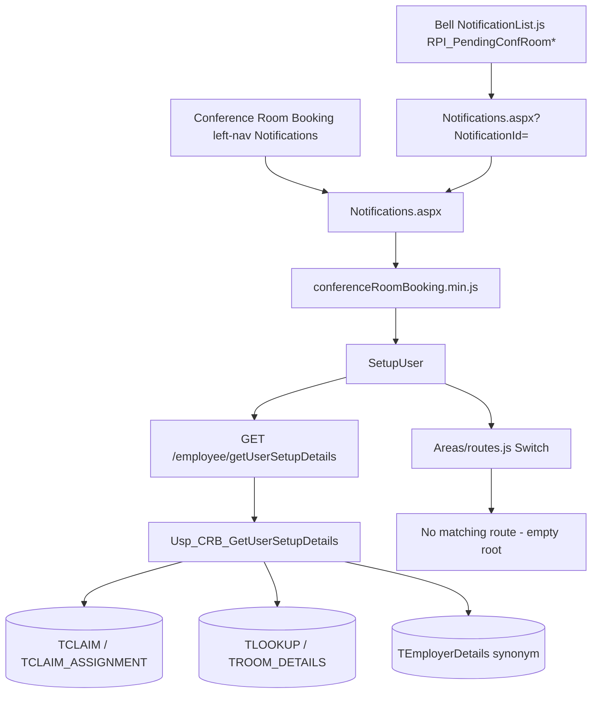
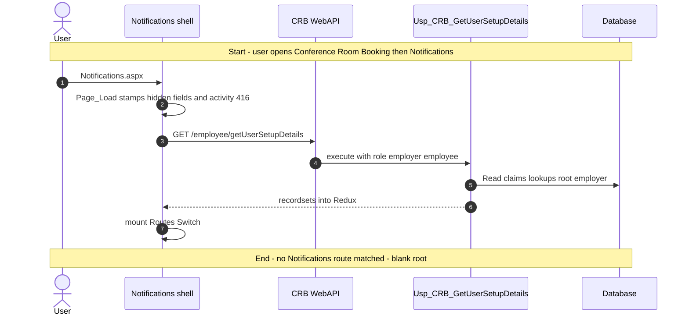
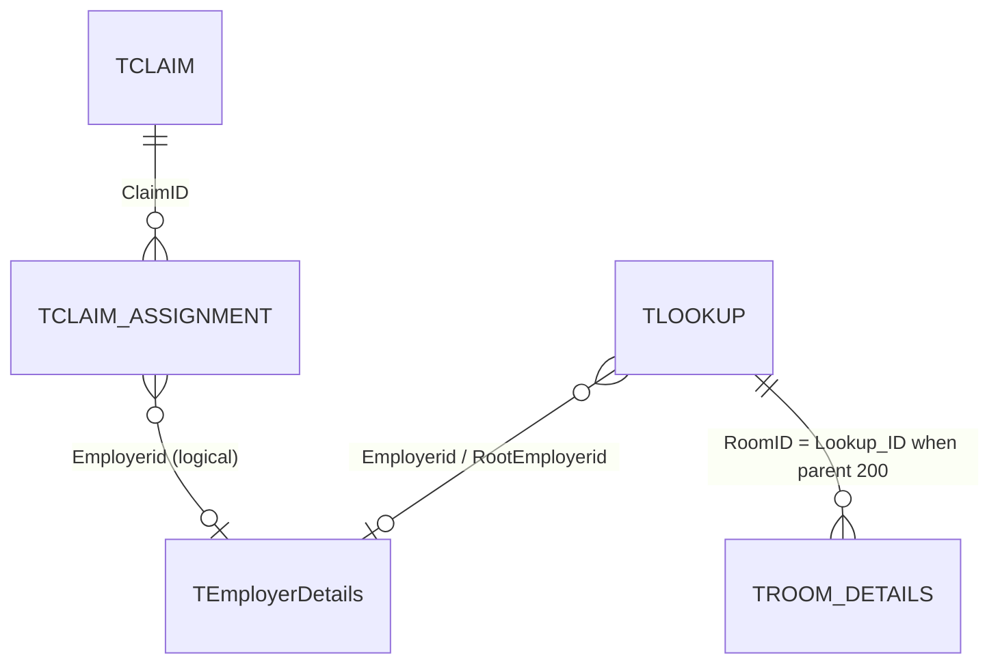

# Notifications

## Overview

A manager or booker opens **Conference Room Booking → Notifications** expecting a pending-approval inbox for conference-room booking / reschedule / cancellation work. The live host is `~/HRM/ConferenceRoomBooking/Notifications.aspx`. `Page_Load` stamps session employee/employer/role into hidden fields, optionally copies `FilterType` / `displayType` query values, logs activity `ConferenceRoomBookings` (**416**), and loads the shared webpack bundle `BuildJS/conferenceRoomBooking.min.js`.

What runs after that is only the CRB React bootstrap (`SetupUser`). It calls `GET /employee/getUserSetupDetails` → `Usp_CRB_GetUserSetupDetails` to load claims and lookups into Redux, then mounts `Areas/routes.js`. **There is no React route for `Notifications.aspx`.** After the loader finishes the `Switch` matches nothing, so the page shows an empty `#root` (no pending grid, no accordion, no approve/reject).

Home-page bell deep links in `NotificationList.js` still navigate here with `?NotificationId=RPI_PendingConfRoomBookingApproval` (and related `RPI_*` names). The ASPX code-behind does **not** read `NotificationId`, and no SPA component reads it either. Count eligibility for those RPI types is driven elsewhere by `SP_CM_GetNotificationCnt` (HRMS) when the Conference Room Booking module is licensed; that procedure is not called by this page.

Sibling left-nav items **My Bookings** and **Master Data** are separate pages. Pending booking approval data exists in CRB as `Usp_CRB_GetPendingApprovalDetails` (and related approve/reject procedures), but **this Notifications shell does not call them**.

**Who's involved:**

- **Approver / booker** — reaches this menu or a bell deep link; today they only get the blank shell after claims bootstrap.
- **Administrator** — CRB claims for other screens are still loaded here via `Usp_CRB_GetUserSetupDetails`, but no Notifications UI consumes them.

## Workflow

## Request journey

This page does not load or decide a booking approval. The only request journey that completes is the shared CRB user-setup bootstrap, then routing fails open to a blank shell.

## Entry points

> The live host is `HRM/ConferenceRoomBooking/Notifications.aspx`. It does not post back for notification data. The only CRB API call from this shell is user-setup. Bell targets the same ASPX with `NotificationId` query values that the host and SPA ignore.

| UI page / entry | Purpose |
|---|---|
| `HRM/ConferenceRoomBooking/Notifications.aspx` | WebForms shell. `Page_Load` stamps hidden fields, reads `FilterType` / `displayType` only, logs `ActivityDescription.ConferenceRoomBookings`, loads `conferenceRoomBooking.min.js` |
| `setupUser.js` | Bootstrap. Calls getUserSetupDetails, then mounts `Routes` |
| `Areas/routes.js` | React Router paths for Bookings, Book Conference, View Booking Detail, Master Data, Manage Reference Data, Manage Permissions — **not** Notifications |
| `NotificationList.js` bell | Deep link `Notifications.aspx?NotificationId=` for `RPI_PendingConfRoomBookingApproval`, `RPI_PendingConfRoomRescheduleApproval`, `RPI_ConfRoomBookingCancellation`, `RPI_PendingCRBApproval` |

## Code → database call chain

There is **no write** and **no pending-inbox read** on this page. Only activity audit (HRMS) and CRB user-setup.

| Entry point | DAL/BLL method (`file:line`) | Stored procedure |
|---|---|---|
| Page load | `Notifications.aspx.cs` `Page_Load` (`Notifications.aspx.cs:19-37`) → `CommonUtil.LogActivity` (`Common.cs:52-74`) → `ActivityHelper` | `Sp_InsertActivityLog` (HRMS; activity **416**) |
| React bootstrap | `SetupUser.componentWillMount` (`setupUser.js:18-34`) → `GET_USER_SETUP_DETAILS` (`apiURLConstants.js:105`) → `employeeController.GetUserSetupDetails` (`employeeController.js:8-15`) → `employeeDAL.GetUserSetupDetails` (`employeeDAL.js:15-24`) | `Usp_CRB_GetUserSetupDetails` |
| Route mount | `Routes.render` (`routes.js:21-32`) | none (no matching path for Notifications.aspx) |

## API endpoints

No WebForms postback data access for an inbox. Active front-end constants use the unversioned CRB Web API path mounted at `/employee` in `routeIndex.js` (`process.env.API_URL`).

| Verb | Route | Parameters | Purpose | Source |
|---|---|---|---|---|
| `GET` | `/employee/getUserSetupDetails` | `roleId`, `employerId`, `EmpId` (query from hidden fields) | Claims + lookups + root employer for Redux | `employeeRoutes.js:7`, `employeeController.js:8`, `employeeDAL.js:15` |

V2/V3 `/V2/employee/...` and `/V3/employee/...` mirrors exist on the API but the active `apiURLConstants.js` export used by this shell is the unversioned path above.

## Stored procedures & tables involved

> Inventory for the CRB procedure is under `HRMS-DATABASE/HRMS-CRBBOOKING/`. Activity logging and home-page counts live in HRMS. There is no SystemModel-2 domain page for this inbox. Table blurbs for CRB objects are in `llm-wiki/reference/tables/crbbooking.md`.

| Object | Path | Role | llm-wiki |
|---|---|---|---|
| `Usp_CRB_GetUserSetupDetails` | `HRMS-DATABASE/HRMS-CRBBOOKING/STOREPROCEDURE/Usp_CRB_GetUserSetupDetails.sql` | Role/employee claims, employer lookups, root employer, room/virtual-room pick lists | `reference/tables/crbbooking.md` |
| `Sp_InsertActivityLog` | `HRMS-DATABASE/HRMS/STOREPROCEDURE/` | Activity **416** on ASPX open | — |
| `SP_CM_GetNotificationCnt` | `HRMS-DATABASE/HRMS/STOREPROCEDURE/SP_CM_GetNotificationCnt.sql` | Bell/home counts allow `RPI_PendingConfRoom*` when CRB module is on — **not called by this page** | — |
| `Usp_CRB_GetPendingApprovalDetails` | `HRMS-DATABASE/HRMS-CRBBOOKING/STOREPROCEDURE/Usp_CRB_GetPendingApprovalDetails.sql` | Pending booking/reschedule rows for a manager — **exists but not wired to this page** | — |
| `TCLAIM` / `TCLAIM_ASSIGNMENT` | `HRMS-CRBBOOKING/TABLES/` | Claims returned in first result set | `reference/tables/crbbooking.md` |
| `TLOOKUP` / `TROOM_DETAILS` | `HRMS-CRBBOOKING/TABLES/` | Lookup tree and seating capacity outer apply | `reference/tables/crbbooking.md` |
| `TEmployerDetails` | CRB synonym → HRMS | `RootEmployerId` third result set | HRMS employer catalog |

## Table relationships

Diagram matches what `Usp_CRB_GetUserSetupDetails` reads for this shell. Declared FKs in CRB scripts are sparse.

`Usp_CRB_GetUserSetupDetails` unions role-scoped and employee-scoped `TCLAIM_ASSIGNMENT` rows, then reads non-deleted `TLOOKUP` for the employer (with optional seating capacity from `TROOM_DETAILS`), then returns `RootEmployerId` from `TEmployerDetails` and two room pick-list result sets under parents **Select Room** and **Virtual Room**.

## Known gaps

- **No Notifications React route.** `routes.js` never registers `Notifications.aspx`, so the left-nav and bell land on a blank shell after setup.
- **`NotificationId` is unused.** Bell appends `RPI_PendingConfRoomBookingApproval`, `RPI_PendingConfRoomRescheduleApproval`, `RPI_ConfRoomBookingCancellation`, or `RPI_PendingCRBApproval`; ASPX only maps `FilterType` / `displayType`, and no SPA reads the query.
- **No pending inbox API call.** `Usp_CRB_GetPendingApprovalDetails` (and approve/reject SPs) exist in CRB but have no controller/route/UI caller from this page.
- **Activity id shared with Bookings.** Both `Notifications.aspx` and `Bookings.aspx` log `ActivityDescription.ConferenceRoomBookings` (**416**).
- **`RouteConstants.MANAGE_PERMISSIONS` is referenced in `routes.js` but missing from `routeConstants.js`** (separate Manage Permissions gap; irrelevant to the blank Notifications path except that the same routes module is mounted).
- **Home-page counts are not this page.** `SP_CM_GetNotificationCnt` may surface CRB RPI types in the bell; opening those links still hits this unfinished shell.

## Reference

Confidence is **medium** for the live shell → SetupUser → `Usp_CRB_GetUserSetupDetails` chain (file:line verified). Product inbox behaviour is unfinished in source; pending-approval procedures are documented only as gaps, not as this page’s call chain.

### SourceCode

- `HRMS.Web/HRMS.Web/HRM/ConferenceRoomBooking/Notifications.aspx` (+ `.cs`)
- `HRMS.Web/HRMS.Web/HRM/ConferenceRoomBooking/setupUser.js`
- `HRMS.Web/HRMS.Web/HRM/ConferenceRoomBooking/Areas/routes.js`
- `HRMS.Web/HRMS.Web/HRM/ConferenceRoomBooking/Common/apiURLConstants.js`
- `HRMS.Web/HRMS.Web/HRM/ConferenceRoomBooking/Common/apiHelper.js`
- `HRMS.Web/HRMS.Web/HRM/ChatBot/Areas/Notification/Components/NotificationList.js` (bell deep links)
- `HRMS.ConferenceRoomBooking/HRMS.ConferenceRoomBooking.WebAPI.Node/Routes/employeeRoutes.js`, `routeIndex.js`
- `HRMS.ConferenceRoomBooking/HRMS.ConferenceRoomBooking.WebAPI.Node/Controllers/employeeController.js`
- `HRMS.ConferenceRoomBooking/HRMS.ConferenceRoomBooking.WebAPI.Node/Core/DataAccessLayer/employeeDAL.js`
- `HRMS.Shared/HRMS.Common/Common.cs` (`LogActivity`)
- `HRMS.Shared/HRMS.DataContract/Common/Enums.cs` (`ConferenceRoomBookings = 416`)

### TDG HRMS DB

- `llm-wiki/reference/tables/crbbooking.md`
- `HRMS-DATABASE/HRMS-CRBBOOKING/STOREPROCEDURE/Usp_CRB_GetUserSetupDetails.sql`
- `HRMS-DATABASE/HRMS-CRBBOOKING/STOREPROCEDURE/Usp_CRB_GetPendingApprovalDetails.sql` (unwired)
- `HRMS-DATABASE/HRMS/STOREPROCEDURE/SP_CM_GetNotificationCnt.sql` (bell allow-list only)
- `HRMS-DATABASE/HRMS/DML/CRB_TNotificationFlatConfig_134849.sql`
