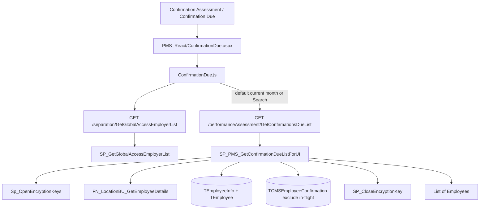
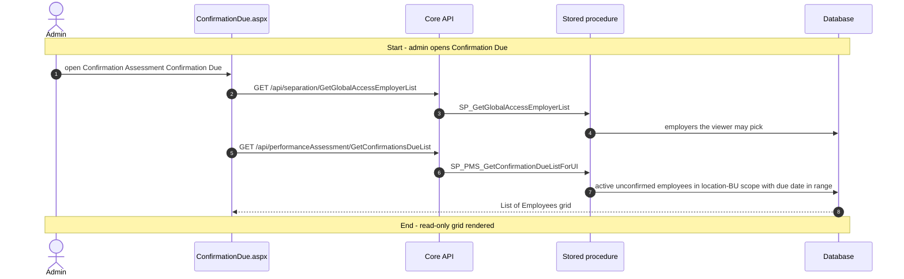
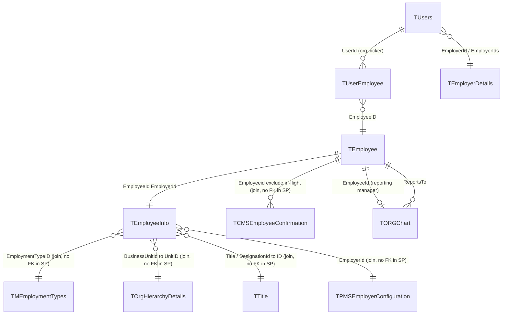

# Confirmation Due

## Overview

An HR or confirmation admin opens **Confirmation Assessment → Confirmation Due** to see active employees whose confirmation due date falls in a chosen From/To range for an organisation, and who are still eligible to start a confirmation assessment. The left-nav leaf points at `~/HRM/PMS_React/ConfirmationDue.aspx` (`HRMS-DATABASE/HRMS/DML/PMSRelease-React/MenuDetails.sql`; menu value `610`). The host stamps session employee/employer and business-unit label into hidden fields, logs activity `ConfirmationDue` (379), and loads the PMS React bundle. The container `ConfirmationDue` loads organisations, defaults From/To to the current calendar month, and loads the due list. Search reloads the grid after date validation; Reset clears dates and rows. There is no initiate, save, or postback on this screen — read-only grid with quick search, column filter, and export.

**Who's involved:**

- **HR / confirmation admin** — picks organisation and date range; views employees due for confirmation in that window.
- **Employee** — not a user of this leaf; they appear as rows when `TEmployeeInfo.ConfirmationDueDate` is in range, employment type is not confirmed, no in-flight confirmation form exists, and `TEmployee.IsAllowedForInitiateConfirmation = 1`.
- **Manager** — not a dedicated actor here; functional and reporting managers are display columns only.

This is **not** Appraisal Due (`SP_PMS_GetAppraisalCycleDueList_UI` / Performance Assessment). It is **not** Initiate Confirmation’s due picker (`Sp_CMS_GetConfirmationDueList` via `GetConfirmationDueList`). Sibling left-nav items under Confirmation Assessment (Notifications, Employee Assessments, Confirmation Status, Initiate Confirmation) share the PMS React host pattern but are separate menu pages. Probation → confirmed lifecycle flags live in `llm-wiki/domain/employee-lifecycle.md` §3.

## Workflow

On first paint the SPA defaults From/To to the start and end of the current month and calls the due-list API for the session employer. Changing organisation reloads the list when both dates are set; otherwise it clears the grid. Search requires both dates and From ≤ To. Reset clears dates, cancels in-flight list request ids, and empties the grid.

## Request journey

The primary request that paints the employee grid is **GetConfirmationsDueList** after date selection (including the default current-month load). Organisation load is a setup request for the same screen.

## Entry points

| Entry point | Purpose | Live? |
|---|---|---|
| `HRM/PMS_React/ConfirmationDue.aspx` | Left-nav host after React menu DML. Injects `hdnConfirmationDueEmpId` / `hdnConfirmationDueEmployerId` / `hdnConfirmationDueBusinessUnitLabel`. Logs `ActivityDescription.ConfirmationDue` (379). | Yes — menu leaf |
| `Areas/ConfirmationDue/Containers/ConfirmationDue.js` | React page — org picker, From/To dates, Search/Reset, list GET | Yes |
| `Areas/ConfirmationDue/Components/ConfirmationDueListGrid.js` | `HrmsDataGrid` wrapper (quick search, filter, export) | Yes |
| `Areas/routes.js` route `CONFIRMATION_DUE` | SPA route for `/HRM/PMS_React/ConfirmationDue.aspx` | Yes |
| `HRM/PerformanceAssessment/ConfirmationDue.aspx` | Legacy WebForms + RadGrid; code-behind calls confirmation-due BLL | Superseded by menu DML; not the left-nav URL |

Menu seed historically used `~/HRM/PerformanceAssessment/ConfirmationDue.aspx`. `DML/PMSRelease-React/MenuDetails.sql` updates NavigateURL to `~/HRM/PMS_React/ConfirmationDue.aspx`. Hierarchy node text remains **Confirmation Due** value `610`.

## Code → database call chain

| Entry | HTTP | Controller | DAL | Stored procedure |
|---|---|---|---|---|
| Page load — org picker `ConfirmationDue.js:63` | `GET /api/separation/GetGlobalAccessEmployerList` (`separationRoutes.js:57`) | `GetGlobalAccessEmployerList` (`separationController.js:958`) | `GetGlobalAccessEmployerList` (`separationDAL.js:989`, execute `separationDAL.js:994`) | `SP_GetGlobalAccessEmployerList` |
| Page load / Search / org change — due list `ConfirmationDue.js:125` | `GET /api/performanceAssessment/GetConfirmationsDueList` (`performanceAssessmentRoutes.js:44`) | `GetConfirmationsDueList` (`performanceAssessmentController.js:469`) | `GetConfirmationsDueList` (`performanceAssessmentDAL.js:550`, execute `performanceAssessmentDAL.js:559`) | `SP_PMS_GetConfirmationDueListForUI` |

`apiURLConstants.js:40` and `:43-44` build the relative paths. `APIHelper` prefixes them with `process.env.API_URL` (Core API `/api`). The SPA org helper uses the **separation** route; a twin `GET /performanceAssessment/GetGlobalAccessEmployerList` exists (`performanceAssessmentRoutes.js:362`) but is unused by this page.

Grid columns bind `EmployeeName`, `EmployeeDesignation`, `BusinessUnit`, `EmploymentType`, `OrganizationName`, `FunctionalManager`, `ReportingManager`, `ConfirmationDueDate` from the due-list result set. The BU column header uses the stamped business-unit label.

## API endpoints

No WebForms postback DAL on the React host. `ConfirmationDue.aspx.cs` only stamps session fields and logs activity on load. There is no POST/PUT/DELETE for this leaf.

| Method | Path | Purpose |
|---|---|---|
| GET | `/api/separation/GetGlobalAccessEmployerList?employeeId=` | Organisations the viewer may select |
| GET | `/api/performanceAssessment/GetConfirmationsDueList?employerId=&fromDate=&toDate=&employeeId=` | Active unconfirmed employees with `ConfirmationDueDate` in range, scoped by the viewer's location/BU access |

`fromDate` / `toDate` are sent as `YYYY-MM-DD`. Do not confuse with `GET /api/performanceAssessment/GetConfirmationDueList` (singular), which powers Initiate Confirmation via `Sp_CMS_GetConfirmationDueList`.

## Stored procedures & tables involved

| Procedure / function | Role on this page |
|---|---|
| `SP_GetGlobalAccessEmployerList` | Org picker rows (global-access employer list or own employer) |
| `SP_PMS_GetConfirmationDueListForUI` | Due-list rows; joins location-BU scope; filters due-date range and confirmation eligibility |
| `Sp_OpenEncryptionKeys` | Nested — open encryption before name resolution |
| `SP_CloseEncryptionKey` | Nested — close encryption after select |
| `FN_LocationBU_GetEmployeeDetails` | Nested — employees the viewer may see for the selected employer |
| `Fn_GetEmployeeName` | Nested — employee, functional manager, and reporting manager display names |
| `Fn_GetEmployeeDesignationByDesignationID` | Nested — designation title(s) from `TTitle` via `DesignationId` |

| Table | How used |
|---|---|
| `TEmployeeInfo` | `ConfirmationDueDate` filter; employment number, BU, title, employment type, managers, designation id; `confirmationdate` null check |
| `TEmployee` | Active flag (`IsActive = 'Y'`); `IsAllowedForInitiateConfirmation = 1` |
| `TMEmploymentTypes` | Unconfirmed employment types (`IsConfirmed = 'N'`, `EmploymentType != 'Confirmed'`) |
| `TCMSEmployeeConfirmation` | Exclude employees with `FormStatus` in `Pending` / `Submitted` / `Approved` |
| `TORGChart` | Reporting manager (`ReportsTo`) |
| `TOrgHierarchyDetails` | Business unit name |
| `TTitle` | Title text (Designation column from `te.Title`) |
| `TPMSEmployerConfiguration` | Organisation name on the grid |
| `TUsers` / `TUserEmployee` / `TEmployerDetails` | Org picker via `SP_GetGlobalAccessEmployerList` |

Older / sibling names `SP_PMS_GetConfirmationDueList`, `Sp_CMS_GetConfirmationDueList`, and `Sp_GetCMSConfirmationDueList` are not on this React call chain.

## Table relationships

## Known gaps

- **No SystemModel-2 workflow page** for Confirmation Due — behaviour above is from SourceCode + procedure scripts. Domain context for confirmation flags is `llm-wiki/domain/employee-lifecycle.md` §3 only.
- **SPA org API is `/separation/…`, not `/performanceAssessment/…`.** Both hit `SP_GetGlobalAccessEmployerList`; only the separation URL is wired in `apiURLConstants.js:40`.
- **Legacy WebForms page remains** under `HRM/PerformanceAssessment/ConfirmationDue.aspx`. Live left-nav is the PMS_React host.
- **Read-only.** No initiate confirmation, notify, or edit from this grid. Initiate Confirmation is a sibling menu item with a different SP (`Sp_CMS_GetConfirmationDueList`).
- **Failed GETs only `console.log`.** Org/list errors leave empty or stale UI without a user-facing message (Search/Reset do show alertify for missing or inverted dates).
- **Grid shows `EmployeeDesignation` from `DesignationId`**, while the procedure also builds a parallel `Designation` column from `te.Title` that the React columns do not bind.
- **`Sp_OpenEncryptionKeys` / `SP_CloseEncryptionKey`** run around the select even though display names go through `Fn_GetEmployeeName`; no encrypted columns are selected directly in this script.

## Reference

### SourceCode

- `HRMS.Web/HRMS.Web/HRM/PMS_React/ConfirmationDue.aspx` (+ `.cs`)
- `HRMS.Web/HRMS.Web/HRM/PMS_React/Areas/ConfirmationDue/Containers/ConfirmationDue.js`
- `HRMS.Web/HRMS.Web/HRM/PMS_React/Areas/ConfirmationDue/Components/ConfirmationDueListGrid.js`
- `HRMS.Web/HRMS.Web/HRM/PMS_React/Areas/routes.js`
- `HRMS.Web/HRMS.Web/HRM/PMS_React/Common/apiURLConstants.js`, `routeConstants.js`
- `HRMS.CoreAPI/HRMS.Core.WebAPI.Node/Routes/routeIndex.js`, `performanceAssessmentRoutes.js`, `separationRoutes.js`
- `HRMS.CoreAPI/HRMS.Core.WebAPI.Node/Controllers/performanceAssessmentController.js`, `separationController.js`
- `HRMS.CoreAPI/HRMS.Core.WebAPI.Node/Core/DataAccessLayer/performanceAssessmentDAL.js`, `separationDAL.js`
- `HRMS.Shared/HRMS.DataContract/Common/Enums.cs` (`ConfirmationDue = 379`)

### TDG HRMS DB

- `HRMS-DATABASE/HRMS/DML/PMSRelease-React/MenuDetails.sql`
- `HRMS-DATABASE/HRMS/STOREPROCEDURE/SP_PMS_GetConfirmationDueListForUI.sql`
- `HRMS-DATABASE/HRMS/STOREPROCEDURE/SP_GetGlobalAccessEmployerList.sql`
- `HRMS-DATABASE/HRMS/FUNCTIONS/FN_LocationBU_GetEmployeeDetails.sql`, `Fn_GetEmployeeName.sql`, `Fn_GetEmployeeDesignationByDesignationID.sql`
- `apps/backstage/content/llm-wiki/domain/employee-lifecycle.md` (§3 Confirmation)
- `apps/backstage/content/llm-wiki/reference/tables/hrms.md` (`TCMSEmployeeConfirmation`)
