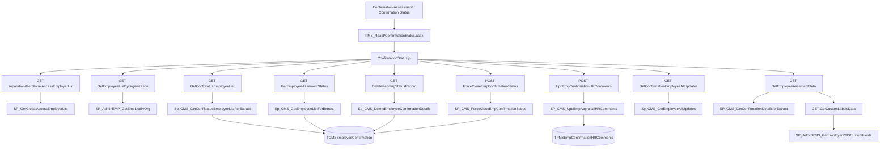
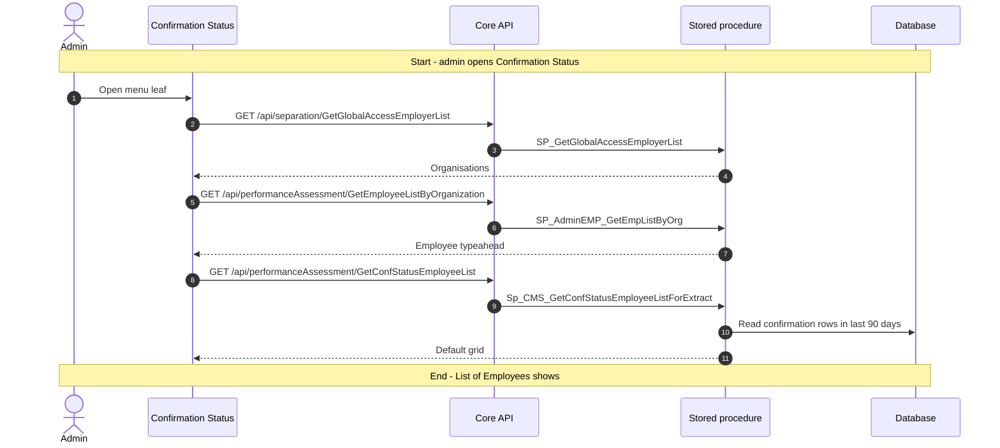
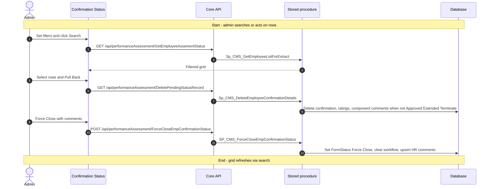
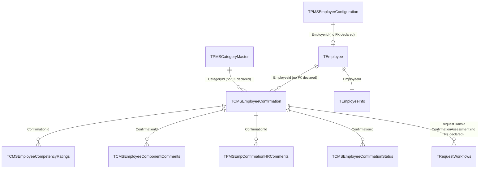

# Confirmation Status

## Overview

An HR or PMS admin opens **Confirmation Assessment → Confirmation Status** to monitor probation confirmation assessments already in flight for an organisation. The left-nav leaf points at `~/HRM/PMS_React/ConfirmationStatus.aspx` (`HRMS-DATABASE/HRMS/DML/PMSRelease-React/MenuDetails.sql`). That host stamps session employee, employer, business-unit label, HR-admin flag, and employer logo into hidden fields, logs activity `ConfirmationStatus`, and loads the PMS React bundle. The container `ConfirmationStatus` loads organisations, an employee typeahead for the selected org, and the default status grid (last 90 days of confirmation rows visible to the caller). The user can filter by employee, form status, and date range; pull back selected pending rows; edit HR comments or force-close a row (HR admin only); open the assessment extract dialog; and see the request-update timeline.

**Who's involved:**

- **HR / PMS admin** — searches and acts on confirmation status rows for organisations they can access.
- **Manager / employee** — not the primary audience of this leaf; they work assessments under Employee Confirmation Assessment. This screen can still load for a non-HR role with a narrower grid and without Edit / Force Close columns.

## Workflow

## Request journey

### Open the status grid

### Search, pull back, or force close

## Entry points

> The left-nav item is retargeted by `HRMS-DATABASE/HRMS/DML/PMSRelease-React/MenuDetails.sql`, which sets `tmenudetails.NavigateURL` from `~/HRM/PerformanceAssessment/ConfirmationStatus.aspx` to `~/HRM/PMS_React/ConfirmationStatus.aspx`. The React host mounts `ConfirmationStatus` via `Areas/routes.js`. The WebForms page `HRM/PerformanceAssessment/ConfirmationStatus.aspx` is still in the project. It is not the URL that DML writes onto the menu after the React cutover.

| Entry point | Purpose | Live? |
|---|---|---|
| `HRM/PMS_React/ConfirmationStatus.aspx` | Host page. Puts employee, employer, BU label, IsHrAdmin, logo into hidden fields | Yes. Menu target |
| `Areas/ConfirmationStatus/Containers/ConfirmationStatus.js` | Filters, grid actions, dialogs | Yes |
| `Areas/routes.js` | Lazy route for `CONFIRMATION_STATUS` | Yes |
| `HRM/PerformanceAssessment/ConfirmationStatus.aspx` | Legacy WebForms status page | Compiled, not the menu URL after the DML |

## Code → database call chain

Every `/api/performanceAssessment` and `/api/separation` route below is registered with `Authorize`. The React container calls `APIHelper` + `apiURLConstants.js` directly (no separate facade module).

| UI | API | DAL (`file:line`) | Procedure |
|---|---|---|---|
| Organisation dropdown `ConfirmationStatus.js:335` | `GET /api/separation/GetGlobalAccessEmployerList` | `separationDAL.js:989` via `separationController.js:958` | `SP_GetGlobalAccessEmployerList` |
| Employee typeahead `ConfirmationStatus.js:252` | `GET .../GetEmployeeListByOrganization` | `performanceAssessmentDAL.js:4048` via `performanceAssessmentController.js:2570` | `SP_AdminEMP_GetEmpListByOrg` |
| Default grid `ConfirmationStatus.js:228` | `GET .../GetConfStatusEmployeeList` | `performanceAssessmentDAL.js:567` via `performanceAssessmentController.js:484` | `Sp_CMS_GetConfStatusEmployeeListForExtract` |
| Search `ConfirmationStatus.js:309` | `GET .../GetEmployeeAssementStatus` | `performanceAssessmentDAL.js:582` via `performanceAssessmentController.js:496` | `Sp_CMS_GetEmployeeListForExtract` |
| Pull Back `ConfirmationStatus.js:475` | `GET .../DeletePendingStatusRecord` | `performanceAssessmentDAL.js:606` via `performanceAssessmentController.js:512` | `Sp_CMS_DeleteEmployeeConfirmationDetails` |
| Edit HR comments `ConfirmationStatus.js:545` | `POST .../UpdEmpConfirmationHRComments` | `performanceAssessmentDAL.js:655` via `performanceAssessmentController.js:551` | `SP_CMS_UpdEmpAppraisalHRComments` |
| Force Close `ConfirmationStatus.js:522` | `POST .../ForceCloseEmpConfirmationStatus` | `performanceAssessmentDAL.js:639` via `performanceAssessmentController.js:535` | `SP_CMS_ForceCloseEmpConfirmationStatus` |
| See All Updates `ConfirmationSeeAllUpdatesDialog.js:49` | `GET .../GetConfirmationEmployeeAllUpdates` | `performanceAssessmentDAL.js:671` via `performanceAssessmentController.js:567` | `Sp_CMS_GetEmployeeAllUpdates` |
| View dialog `ViewConfirmations.js:82` | `GET .../GetEmployeeAssementData` | `performanceAssessmentDAL.js:622` via `performanceAssessmentController.js:521` | `SP_CMS_GetConfirmationDetailsforExtract` |
| View dialog labels `ViewConfirmations.js:86` | `GET .../GetCustomLabelsData` | `performanceAssessmentDAL.js:3615` | `SP_AdminPMS_GetEmployerPMSCustomFields` |

`Sp_CMS_GetConfStatusEmployeeListForExtract`, `Sp_CMS_GetEmployeeListForExtract`, and `Sp_CMS_GetEmployeeAllUpdates` open and close encryption keys and call `Fn_GetEmployeeName` (and location/BU helpers on the list procs). `SP_CMS_GetConfirmationDetailsforExtract` nests `Sp_AdminPMS_GetMesureValueForConfirmation` and `Sp_AdminCMS_GetConfirmationReviewLevel`. `Sp_CMS_DeleteEmployeeConfirmationDetails` uses `Split` on the comma-separated confirmation ids.

## API endpoints

Routes are under `/api`. Query and body fields below are what the controller reads. Handlers return JSON arrays or recordsets; they do not use WebForms postback. `Authorize` is on each route.

| Verb | Route | Parameters | Purpose | Source |
|---|---|---|---|---|
| GET | `/api/separation/GetGlobalAccessEmployerList` | query `employeeId` | Organisations the caller can administer | `separationRoutes.js:57` |
| GET | `/api/performanceAssessment/GetEmployeeListByOrganization` | query `employerId`, `employeeId` | Employee typeahead for the selected org | `performanceAssessmentController.js:2570` |
| GET | `/api/performanceAssessment/GetConfStatusEmployeeList` | query `employerId`, `employeeId` | Default status grid (90-day window) | `performanceAssessmentController.js:484` |
| GET | `/api/performanceAssessment/GetEmployeeAssementStatus` | query `employerId`, `employeeName`, `formStatus`, `fromdate`, `todate`, `employeeId` | Filtered status grid | `performanceAssessmentController.js:496` |
| GET | `/api/performanceAssessment/DeletePendingStatusRecord` | query `confirmationid` (comma-separated) | Pull back selected confirmation rows | `performanceAssessmentController.js:512` |
| POST | `/api/performanceAssessment/UpdEmpConfirmationHRComments` | body `confirmationId`, `employeeId`, `hrComments`, `createdBy` | Upsert HR comments | `performanceAssessmentController.js:551` |
| POST | `/api/performanceAssessment/ForceCloseEmpConfirmationStatus` | body `confirmationId`, `employeeId`, `hrComments`, `createdBy` | Force-close assessment and clear workflow | `performanceAssessmentController.js:535` |
| GET | `/api/performanceAssessment/GetConfirmationEmployeeAllUpdates` | query `confirmationId` | Request-update timeline | `performanceAssessmentController.js:567` |
| GET | `/api/performanceAssessment/GetEmployeeAssementData` | query `employerid`, `confirmationId`, `loggedInEmployeeId` | Multi-recordset view extract | `performanceAssessmentController.js:521` |
| GET | `/api/performanceAssessment/GetCustomLabelsData` | query `employerId` | CMS custom labels for the view dialog | `performanceAssessmentDAL.js:3615` |

There is no ASP.NET postback path on the React host for search or actions. Legacy `HRM/PerformanceAssessment/ConfirmationStatus.aspx` still has code-behind postbacks; the menu no longer targets it after the React DML.

## Stored procedures & tables involved

| Object | Kind | Role on this screen | Page |
|---|---|---|---|
| `Sp_CMS_GetConfStatusEmployeeListForExtract` | procedure | Default grid | `/docs/database/hrms/Sp_CMS_GetConfStatusEmployeeListForExtract` |
| `Sp_CMS_GetEmployeeListForExtract` | procedure | Filtered search grid | `/docs/database/hrms/Sp_CMS_GetEmployeeListForExtract` |
| `Sp_CMS_DeleteEmployeeConfirmationDetails` | procedure | Pull Back | `/docs/database/hrms/Sp_CMS_DeleteEmployeeConfirmationDetails` |
| `SP_CMS_ForceCloseEmpConfirmationStatus` | procedure | Force Close | `/docs/database/hrms/SP_CMS_ForceCloseEmpConfirmationStatus` |
| `SP_CMS_UpdEmpAppraisalHRComments` | procedure | Edit HR comments | `/docs/database/hrms/SP_CMS_UpdEmpAppraisalHRComments` |
| `Sp_CMS_GetEmployeeAllUpdates` | procedure | See All Updates | `/docs/database/hrms/Sp_CMS_GetEmployeeAllUpdates` |
| `SP_CMS_GetConfirmationDetailsforExtract` | procedure | View dialog multi-table extract | `/docs/database/hrms/SP_CMS_GetConfirmationDetailsforExtract` |
| `SP_GetGlobalAccessEmployerList` | procedure | Organisation dropdown | `/docs/database/hrms/SP_GetGlobalAccessEmployerList` |
| `SP_AdminEMP_GetEmpListByOrg` | procedure | Employee typeahead | `/docs/database/hrms/SP_AdminEMP_GetEmpListByOrg` |
| `SP_AdminPMS_GetEmployerPMSCustomFields` | procedure | View dialog labels | `/docs/database/hrms/SP_AdminPMS_GetEmployerPMSCustomFields` |
| `Sp_AdminPMS_GetMesureValueForConfirmation` | procedure | Nested from view extract (measure score method) | `/docs/database/hrms/Sp_AdminPMS_GetMesureValueForConfirmation` |
| `Sp_AdminCMS_GetConfirmationReviewLevel` | procedure | Nested from view extract (component visibility) | `/docs/database/hrms/Sp_AdminCMS_GetConfirmationReviewLevel` |
| `TCMSEmployeeConfirmation` | table | Confirmation header / FormStatus | — |
| `TCMSEmployeeCompetencyRatings` | table | Ratings lines; deleted on pull back | — |
| `TCMSEmployeeComponentComments` | table | Additional component answers; deleted on pull back | — |
| `TPMSEmpConfirmationHRComments` | table | HR comments upsert | — |
| `TRequestWorkflows` | table | Approval queue; cleared on force close | — |
| `TCMSEmployeeConfirmationStatus` | table | Per-level status / extension reasons | — |
| `TPMSEmployerConfiguration` | table | Self-assessment and display flags | — |
| `TEmployee` / `TEmployeeInfo` | table | Employee identity and employment fields | — |

Catalog notes for `TCMSEmployeeConfirmation` and related CMS tables are in `llm-wiki/reference/tables/hrms.md`. Workflow routing for `ConfirmationAssessment` is described in `llm-wiki/domain/approval-workflow.md`.

## Table relationships

Most CMS confirmation tables have no declared FK constraints; relationships above follow column usage in the status and extract procedures.

## Known gaps

- Pull Back (`Sp_CMS_DeleteEmployeeConfirmationDetails`) deletes confirmation, ratings, and component comments but does **not** delete matching `TRequestWorkflows` rows for `ConfirmationAssessment`. Force Close does clear those workflow rows. Orphan workflow rows after pull-back are possible if any existed.
- Default grid uses a hard-coded last-90-days `CreateDate` window in `Sp_CMS_GetConfStatusEmployeeListForExtract`. Filtered search via `Sp_CMS_GetEmployeeListForExtract` does not use that same window; behaviour depends on the optional date and status parameters.
- Status filter values in the UI (`Approved`, `Extended`, `Force Close`, `Pending`, `Submitted`, `Recommended for Termination`) are labels mapped in React; the procedure receives the raw `formStatus` string. Display formatting for termination-at-level strings is partly done in the API normaliser and partly in `ConfirmationStatus.js`.
- Legacy WebForms `HRM/PerformanceAssessment/ConfirmationStatus.aspx` remains in SourceCode alongside the React host; only the React URL is what menu DML writes after PMS React cutover.
- `See All Updates` synthesises a "Pending with Level 1" row in the client when the procedure omits level-1 pending after employee submit (`ConfirmationSeeAllUpdatesDialog.js`).
- Nested encryption helpers (`Sp_OpenEncryptionKeys`, `SP_CloseEncryptionKey`) and name/location functions are shared infrastructure; this guide links their existing database pages rather than re-documenting them.

## Reference

- `HRMS.Web/HRMS.Web/HRM/PMS_React/ConfirmationStatus.aspx`
- `HRMS.Web/HRMS.Web/HRM/PMS_React/ConfirmationStatus.aspx.cs`
- `HRMS.Web/HRMS.Web/HRM/PMS_React/Areas/ConfirmationStatus/Containers/ConfirmationStatus.js`
- `HRMS.Web/HRMS.Web/HRM/PMS_React/Areas/ConfirmationStatus/Components/ViewConfirmations.js`
- `HRMS.Web/HRMS.Web/HRM/PMS_React/Areas/ConfirmationStatus/Components/ConfirmationSeeAllUpdatesDialog.js`
- `HRMS.Web/HRMS.Web/HRM/PMS_React/Areas/routes.js`
- `HRMS.Web/HRMS.Web/HRM/PMS_React/Common/apiURLConstants.js`
- `HRMS.CoreAPI/HRMS.Core.WebAPI.Node/Routes/performanceAssessmentRoutes.js`
- `HRMS.CoreAPI/HRMS.Core.WebAPI.Node/Controllers/performanceAssessmentController.js`
- `HRMS.CoreAPI/HRMS.Core.WebAPI.Node/Core/DataAccessLayer/performanceAssessmentDAL.js`
- `HRMS.CoreAPI/HRMS.Core.WebAPI.Node/Core/DataAccessLayer/separationDAL.js`
- `HRMS-DATABASE/HRMS/DML/PMSRelease-React/MenuDetails.sql`
- `HRMS-DATABASE/HRMS/STOREPROCEDURE/Sp_CMS_GetConfStatusEmployeeListForExtract.sql`
- `HRMS-DATABASE/HRMS/STOREPROCEDURE/Sp_CMS_GetEmployeeListForExtract.sql`
- `HRMS-DATABASE/HRMS/STOREPROCEDURE/Sp_CMS_DeleteEmployeeConfirmationDetails.sql`
- `HRMS-DATABASE/HRMS/STOREPROCEDURE/SP_CMS_ForceCloseEmpConfirmationStatus.sql`
- `HRMS-DATABASE/HRMS/STOREPROCEDURE/SP_CMS_UpdEmpAppraisalHRComments.sql`
- `HRMS-DATABASE/HRMS/STOREPROCEDURE/Sp_CMS_GetEmployeeAllUpdates.sql`
- `HRMS-DATABASE/HRMS/STOREPROCEDURE/SP_CMS_GetConfirmationDetailsforExtract.sql`
- `llm-wiki/reference/tables/hrms.md`
- `llm-wiki/domain/approval-workflow.md`
- Related setup guide: `/docs/guides/admin-configuration/confirmation-management`
