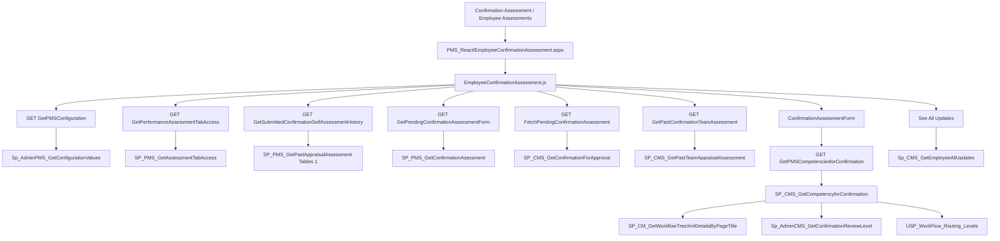
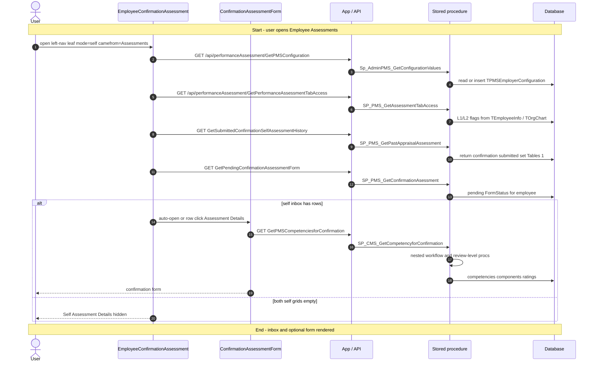
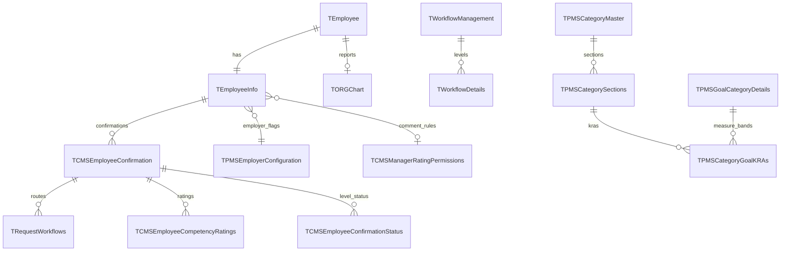

# Employee Assessments

## Overview

**Confirmation Assessment → Employee Assessments** is the employee/manager inbox for confirmation forms (probation confirmation), not performance appraisal. The left-nav leaf points at `~/HRM/PMS_React/EmployeeConfirmationAssessment.aspx?mode=self&&camefrom=Assessments` (`HRMS-DATABASE/HRMS/DML/PMSRelease-React/MenuDetails.sql`). That host injects session employee/employer ids and resolved `mode` / `TabName` / `src`, then mounts React `EmployeeConfirmationAssessment`.

The shell shows Self Assessment and (when the user is an L1/L2 manager and config allows) Team Assessment tabs. Each tab has submitted and pending grids. Opening a row (or auto-open on Self with `camefrom=Assessments`) loads `ConfirmationAssessmentForm` under Assessment Details. Horn Action opens See All Updates via `ConfirmationSeeAllUpdatesDialog`.

**Who's involved:**

- **Employee** — Self tab: pending confirmation self-assessment and submitted confirmation history; fills/submits when `IsConfSelfAssesmentRequired` is on.
- **Manager / approver** — Team tab: pending confirmations under them and past team assessments; rates/approves/extends/terminates per workflow.
- **Admin / HR** — not a user of this leaf; they initiate confirmations and configure CMS under Admin Configuration → Confirmation Management.

## Workflow

## Request journey

## Entry points

| Entry point | Purpose | Live? |
|---|---|---|
| `HRM/PMS_React/EmployeeConfirmationAssessment.aspx` | Left-nav host. Hidden fields for emp/employer/BU label/role/target/mode/tab/nav. Logs `ActivityDescription.EmployeeConfirmationAssessment` (376). | Yes — menu leaf |
| `Areas/EmployeeConfirmationAssessment/Containers/EmployeeConfirmationAssessment.js` | React inbox shell — tabs, grids, deep-link, form host | Yes |
| `Areas/EmployeeConfirmationAssessment/Components/ConfirmationAssessmentForm.js` | In-page confirmation form (Employee Info + competencies/KRAs/components) | Yes |
| `Areas/ConfirmationStatus/Components/ConfirmationSeeAllUpdatesDialog.js` | Shared See All Updates dialog | Yes |
| `Areas/routes.js` path `employeeconfirmationassessment.aspx` | SPA route for the React host | Yes |
| `HRM/PerformanceAssessment/EmployeeConfirmationAssessment.aspx` | Legacy WebForms page (BLL/DAL direct) | Superseded by menu DML; not the left-nav URL |

Menu DML historically used `~/HRM/PerformanceAssessment/EmployeeConfirmationAssessment.aspx?mode=self&&camefrom=Assessments`. `DML/PMSRelease-React/MenuDetails.sql` updates NavigateURL to the PMS_React host. Deep links from Confirmation Assessment Team/Self grids use `mode=ALL|SELF`, `src=CTeam|CSelf`, and encrypted `id` / `cid`.

## Code → database call chain

| Entry | HTTP | Controller | DAL | Stored procedure |
|---|---|---|---|---|
| Page load — PMS flags `EmployeeConfirmationAssessment.js:456` | `GET /api/performanceAssessment/GetPMSConfiguration` (`performanceAssessmentRoutes.js:179`) | `GetPMSConfiguration` (`performanceAssessmentController.js:1654`) | `GetPMSConfiguration` (`performanceAssessmentDAL.js:2045`, execute `:2051`) | `Sp_AdminPMS_GetConfigurationValues` |
| Page load — Team tab access `EmployeeConfirmationAssessment.js:487` | `GET /api/performanceAssessment/GetPerformanceAssessmentTabAccess` (`performanceAssessmentRoutes.js:12`) | `GetPerformanceAssessmentTabAccess` (`performanceAssessmentController.js:127`) | `GetPerformanceAssessmentTabAccess` (`performanceAssessmentDAL.js:37` / `:4829`, execute `:44` / `:4834`) | `SP_PMS_GetAssessmentTabAccess` |
| Self — submitted history `EmployeeConfirmationAssessment.js:364` | `GET /api/performanceAssessment/GetSubmittedConfirmationSelfAssessmentHistory` (`performanceAssessmentRoutes.js:62`) | `GetSubmittedConfirmationSelfAssessmentHistory` (`performanceAssessmentController.js:671`) | `GetSubmittedConfirmationSelfAssessmentHistory` (`performanceAssessmentDAL.js:874`, execute `:879`) | `SP_PMS_GetPastAppraisalAssessment` → API returns `recordsets[1]` |
| Self — pending form `EmployeeConfirmationAssessment.js:378` | `GET /api/performanceAssessment/GetPendingConfirmationAssessmentForm` (`performanceAssessmentRoutes.js:61`) | `GetPendingConfirmationAssessmentForm` (`performanceAssessmentController.js:657`) | `GetPendingConfirmationAssessmentForm` (`performanceAssessmentDAL.js:857`, execute `:865`) | `SP_PMS_GetConfirmationAsessment` |
| Team — pending under manager `EmployeeConfirmationAssessment.js:395` | `GET /api/performanceAssessment/FetchPendingConfirmationAssessment` (`performanceAssessmentRoutes.js:15`) | `FetchPendingConfirmationAssessment` (`performanceAssessmentController.js:154`) | `FetchPendingConfirmationAssessment` (`performanceAssessmentDAL.js:80`, execute `:88`) | `SP_CMS_GetConfirmationForApproval` |
| Team — past assessments `EmployeeConfirmationAssessment.js:412` | `GET /api/performanceAssessment/GetPastConfirmationTeamAssessment` (`performanceAssessmentRoutes.js:63`) | `GetPastConfirmationTeamAssessment` (`performanceAssessmentController.js:681`) | `GetPastConfirmationTeamAssessment` (`performanceAssessmentDAL.js:891`, execute `:896`) | `SP_CMS_GetPastTeamAppraisalAssessment` |
| Form load `ConfirmationAssessmentForm.js:1105` | `GET /api/performanceAssessment/GetPMSCompetenciesforConfirmation` (`performanceAssessmentRoutes.js:64`) | `GetPMSCompetenciesforConfirmation` (`performanceAssessmentController.js:692`) | `GetPMSCompetenciesforConfirmation` (`performanceAssessmentDAL.js:907`, execute `:914`) | `SP_CMS_GetCompetencyforConfirmation` → nested `SP_CM_GetWorkflowTreeXmlDetailsByPageTitle`, `Sp_AdminCMS_GetConfirmationReviewLevel`, `USP_WorkFlow_Routing_Levels` |
| Measure-based ratings `ConfirmationAssessmentForm.js:1143` | `GET /api/performanceAssessment/GetConfirmationMeasures` (`performanceAssessmentRoutes.js:353`) | `GetConfirmationMeasures` (`performanceAssessmentController.js:3404`) | `GetConfirmationMeasures` (`performanceAssessmentDAL.js:6287`, execute `:6292`) | `Sp_AdminPMS_GetMesureValueForConfirmation` |
| Approver status options `ConfirmationAssessmentForm.js:1413` | `GET /api/performanceAssessment/GetConfirmationStatusForApprover` (`performanceAssessmentRoutes.js:66`) | `GetConfirmationStatusForApprover` (`performanceAssessmentController.js:730`) | `GetConfirmationStatusForApprover` (`performanceAssessmentDAL.js:1024`, execute `:1032`) | `Sp_CMS_GetConfirmationStatusForApprover` |
| Manager comments optional `ConfirmationAssessmentForm.js:1466` | `GET /api/performanceAssessment/GetManagerRatingPermissionsById` (`performanceAssessmentRoutes.js:68`) | `GetManagerRatingPermissionsById` (`performanceAssessmentController.js:750`) | `GetManagerRatingPermissionsById` (`performanceAssessmentDAL.js:1054`, execute `:1059`) | `SP_CMS_GetManagerRatingPermissionsById` |
| See All Updates dialog `:49` | `GET /api/performanceAssessment/GetConfirmationEmployeeAllUpdates` (`performanceAssessmentRoutes.js:51`) | `GetConfirmationEmployeeAllUpdates` (`performanceAssessmentController.js:567`) | `GetConfirmationEmployeeAllUpdates` (`performanceAssessmentDAL.js:671`, execute `:676`) | `Sp_CMS_GetEmployeeAllUpdates` |

`APIUrlConstants.js:87-106,54-55,192,329` builds the relative paths. `APIHelper` prefixes them with `process.env.API_URL` (Core API `/api`).

Employee Info on the form also calls `GET /recruitment/getEmployeeFullInformation` → `SP_CM_GetEmployeeFullInformation` (shared recruitment endpoint, not performanceAssessmentRoutes).

## API endpoints

No WebForms postback on the React host. Activity logging in `EmployeeConfirmationAssessment.aspx.cs:31` runs on page load only. Form save/accept/reject/extend use additional POSTs (`UpdEmpConfirmationRatings`, `AcceptAssessmentByManager`, `UpdateConfirmationDueDate`, letter generation, attachment upload) documented here only as write paths — not expanded in the call-chain table above.

| Method | Path | Purpose |
|---|---|---|
| GET | `/api/performanceAssessment/GetPMSConfiguration?employerId=` | Confirmation/PMS flags (`IsConfSelfAssesmentRequired`, team visibility, auto-save, …) |
| GET | `/api/performanceAssessment/GetPerformanceAssessmentTabAccess?employeeId=` | `IsL1` / `IsL2` for Team tab |
| GET | `/api/performanceAssessment/GetSubmittedConfirmationSelfAssessmentHistory?employeeId=` | Submitted Self Assessments grid |
| GET | `/api/performanceAssessment/GetPendingConfirmationAssessmentForm?employeeId=&employerIds=` | Pending Confirmation Assessment (self) |
| GET | `/api/performanceAssessment/FetchPendingConfirmationAssessment?employeeId=&employerIds=` | Pending Confirmations Under Manager |
| GET | `/api/performanceAssessment/GetPastConfirmationTeamAssessment?employeeId=` | Submitted Team Assessments |
| GET | `/api/performanceAssessment/GetPMSCompetenciesforConfirmation?employeeId=&loggedInEmployeeId=&confirmationId=` | Form competencies, additional components, rating scale |
| GET | `/api/performanceAssessment/GetConfirmationMeasures?categoryId=` | Measure-based dropdown bands when ScoreMethod is `M` |
| GET | `/api/performanceAssessment/GetConfirmationStatusForApprover?...` | Confirmation status choices for current routing level |
| GET | `/api/performanceAssessment/GetManagerRatingPermissionsById?employeeId=` | Whether manager comments are optional |
| GET | `/api/performanceAssessment/GetConfirmationEmployeeAllUpdates?confirmationId=` | See All Updates timeline |
| GET | `/api/recruitment/getEmployeeFullInformation?employeeId=` | Employee Info panel |
| POST | `/api/performanceAssessment/UpdEmpConfirmationRatings` | Save / submit ratings and components |
| POST | `/api/performanceAssessment/AcceptAssessmentByManager` | Manager accept path |
| POST | `/mobileAPI/assessment/RejectAssessmentByManager` | Manager reject path |

## Stored procedures & tables involved

| Procedure | Role on this page |
|---|---|
| `Sp_AdminPMS_GetConfigurationValues` | Employer PMS/CMS flags; may insert default config row |
| `SP_PMS_GetAssessmentTabAccess` | Functional-manager / reports-to flags for Team tab |
| `SP_PMS_GetPastAppraisalAssessment` | Multi-result; confirmation submitted-self is Tables[1] |
| `SP_PMS_GetConfirmationAsessment` | Pending self confirmation rows when self-assessment required |
| `SP_CMS_GetConfirmationForApproval` | Pending team confirmations for `@ManagerId` |
| `SP_CMS_GetPastTeamAppraisalAssessment` | Completed workflow rows where user was a manager |
| `SP_CMS_GetCompetencyforConfirmation` | Form payload; nests workflow tree, review levels, routing |
| `Sp_AdminPMS_GetMesureValueForConfirmation` | Measure criteria bands for category |
| `Sp_CMS_GetConfirmationStatusForApprover` | Status list for approver routing level |
| `SP_CMS_GetManagerRatingPermissionsById` | Count of mandatory-comment permission rows |
| `Sp_CMS_GetEmployeeAllUpdates` | Timeline for See All Updates |
| `SP_CM_GetEmployeeFullInformation` | Employee Info (recruitment API) |
| `Sp_GetCMSNOticePeriodDays` | Notice-period day options on form |

| Table | How used |
|---|---|
| `TCMSEmployeeConfirmation` | Confirmation form header / status / managers |
| `TRequestWorkflows` | Pending and completed ConfirmationAssessment routing |
| `TEmployee` / `TEmployeeInfo` | Active employee, DOJ, managers, confirmation dates |
| `TORGChart` | Reporting manager |
| `TPMSEmployerConfiguration` | Self-assessment required and related CMS flags |
| `TCMSEmployeeCompetencyRatings` | Saved competency ratings on form |
| `TCMSConfirmationViewManagerPermissions` | Who may view HR comments on past grids |
| `TCMSManagerRatingPermissions` | Manager comment mandatory/optional |
| `TWorkflowManagement` / `TWorkflowDetails` | Confirmation Assessment workflow definition |
| `TPMSCategoryMaster` / `TPMSCategorySections` / `TPMSCategoryGoalKRAs` / `TPMSGoalCategoryDetails` | Measure-based bands |
| `TOrgHierarchyDetails` | Business unit name on pending self grid |
| `TMEmploymentTypes` | `IsConfirmed` on tab-access result |

## Table relationships

## Known gaps

- Left-nav lands on Self (`mode=self`); Team grids load only when the user switches tab or arrives via Team deep-link (`mode=ALL` / `src=CTeam`).
- When `IsConfSelfAssesmentRequired` is false, Self Assessment Details stay closed and Team path treats forms as direct-to-manager.
- `SP_PMS_GetPastAppraisalAssessment` also returns performance appraisal history in Tables[0]; this page only consumes Tables[1].
- Failed inbox GETs only `console.log` and clear the list — empty grids with no error banner.
- Form write paths (save, accept, reject, extend, letter PDF, attachments) are many additional SPs/endpoints; this guide’s call chain focuses on load/open.
- Legacy WebForms `HRM/PerformanceAssessment/EmployeeConfirmationAssessment.aspx` still exists alongside the React host.
- No llm-wiki domain page specifically for this employee leaf.

## Reference

- `HRMS.Web/HRMS.Web/HRM/PMS_React/EmployeeConfirmationAssessment.aspx`
- `HRMS.Web/HRMS.Web/HRM/PMS_React/EmployeeConfirmationAssessment.aspx.cs`
- `HRMS.Web/HRMS.Web/HRM/PMS_React/Areas/EmployeeConfirmationAssessment/Containers/EmployeeConfirmationAssessment.js`
- `HRMS.Web/HRMS.Web/HRM/PMS_React/Areas/EmployeeConfirmationAssessment/Components/ConfirmationAssessmentForm.js`
- `HRMS.Web/HRMS.Web/HRM/PMS_React/Areas/ConfirmationStatus/Components/ConfirmationSeeAllUpdatesDialog.js`
- `HRMS.Web/HRMS.Web/HRM/PMS_React/Common/apiURLConstants.js`
- `HRMS.Web/HRMS.Web/HRM/PMS_React/Areas/routes.js`
- `HRMS.CoreAPI/HRMS.Core.WebAPI.Node/Routes/performanceAssessmentRoutes.js`
- `HRMS.CoreAPI/HRMS.Core.WebAPI.Node/Controllers/performanceAssessmentController.js`
- `HRMS.CoreAPI/HRMS.Core.WebAPI.Node/Core/DataAccessLayer/performanceAssessmentDAL.js`
- `HRMS-DATABASE/HRMS/STOREPROCEDURE/Sp_AdminPMS_GetConfigurationValues.sql`
- `HRMS-DATABASE/HRMS/STOREPROCEDURE/SP_PMS_GetAssessmentTabAccess.sql`
- `HRMS-DATABASE/HRMS/STOREPROCEDURE/SP_PMS_GetPastAppraisalAssessment.sql`
- `HRMS-DATABASE/HRMS/STOREPROCEDURE/SP_PMS_GetConfirmationAsessment.sql`
- `HRMS-DATABASE/HRMS/STOREPROCEDURE/SP_CMS_GetConfirmationForApproval.sql`
- `HRMS-DATABASE/HRMS/STOREPROCEDURE/SP_CMS_GetPastTeamAppraisalAssessment.sql`
- `HRMS-DATABASE/HRMS/STOREPROCEDURE/SP_CMS_GetCompetencyforConfirmation.sql`
- `HRMS-DATABASE/HRMS/STOREPROCEDURE/Sp_AdminPMS_GetMesureValueForConfirmation.sql`
- `HRMS-DATABASE/HRMS/STOREPROCEDURE/Sp_CMS_GetConfirmationStatusForApprover.sql`
- `HRMS-DATABASE/HRMS/STOREPROCEDURE/SP_CMS_GetManagerRatingPermissionsById.sql`
- `HRMS-DATABASE/HRMS/STOREPROCEDURE/Sp_CMS_GetEmployeeAllUpdates.sql`
- `HRMS-DATABASE/HRMS/DML/PMSRelease-React/MenuDetails.sql`
- `HRMS.Shared/HRMS.DataContract/Common/Enums.cs` (`EmployeeConfirmationAssessment = 376`)
