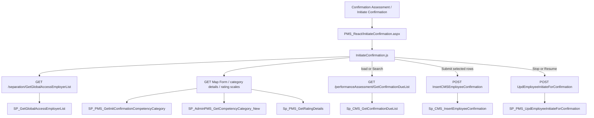
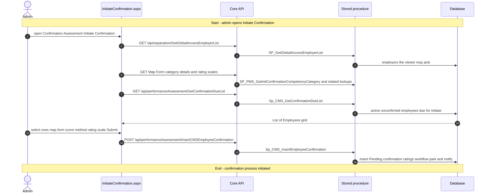
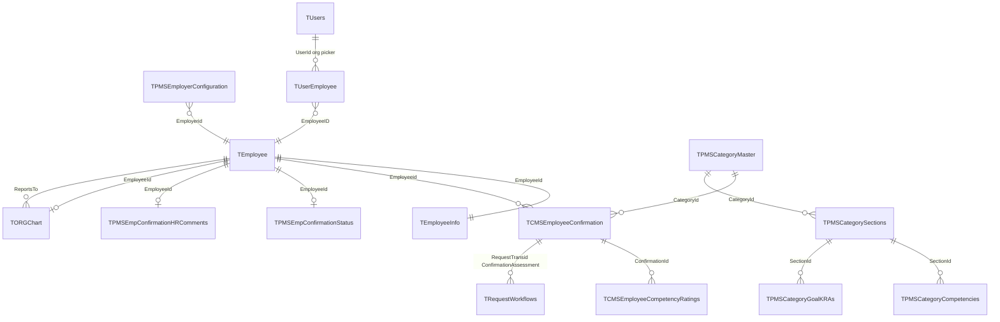

# Initiate Confirmation

## Overview

An HR or confirmation admin opens **Confirmation Assessment → Initiate Confirmation** to pick active employees who are due for confirmation, map a confirmation form / score method / rating scale, and submit to start the confirmation assessment. The left-nav leaf points at `~/HRM/PMS_React/InitiateConfirmation.aspx` (`HRMS-DATABASE/HRMS/DML/PMSRelease-React/MenuDetails.sql`; menu value `609`). The host stamps session employee/employer and business-unit label into hidden fields, logs activity `InitiateConfirmation` (378), and loads the PMS React bundle. The container `InitiateConfirmation` loads organisations, Map Form / rating lookups, and the initiate due list; Search filters by employee name or employment number; Submit posts pipe-delimited confirmation details; Stop/Resume updates the allow-initiate flag with HR comments.

**Who's involved:**

- **HR / confirmation admin** — picks organisation and employees; maps form, score method, and (when Rating Based) rating scale; submits initiation; can Stop or Resume initiation with comments.
- **Employee** — not a user of this leaf; they appear as rows when due for confirmation and eligible (`IsAllowedForInitiateConfirmation`, no in-flight confirmation form). After initiate they work the form under Employee Assessments.
- **Manager** — not a dedicated actor here; functional and reporting managers are display columns. When self-assessment is off, insert seeds workflow routing to L1 managers.

This is **not** Confirmation Due’s read-only list (`SP_PMS_GetConfirmationDueListForUI` / `GetConfirmationsDueList`). Initiate uses `Sp_CMS_GetConfirmationDueList` via `GetConfirmationDueList` (singular). Sibling left-nav items under Confirmation Assessment share the PMS React host pattern but are separate menu pages.

## Workflow

On first paint the SPA loads orgs for the session employee, Map Form options and rating scales for the default employer, and the full due list for that employer. Changing organisation reloads lookups and the list. Search resolves the employee Autocomplete to employment number or name text and reloads the list. Reset clears selection and reloads the unfiltered list. Submit validates Map Form, Score Method, and Map Rating Scale (Rating Based only) per checked row, then posts `EmployeeID~categoryId~ratingScaleId~scoreMethod` segments joined by `|`.

## Request journey

The primary write that starts confirmation is **InsertCMSEmployeeConfirmation** after the admin selects employees and maps form fields. Load/search and Stop/Resume are supporting requests on the same screen.

## Entry points

| Entry point | Purpose | Live? |
|---|---|---|
| `HRM/PMS_React/InitiateConfirmation.aspx` | Left-nav host after React menu DML. Injects `hdnInitiateConfirmationEmpId` / `hdnInitiateConfirmationEmployerId` / `hdnInitiateConfirmationBusinessUnitLabel`. Logs `ActivityDescription.InitiateConfirmation` (378). | Yes — menu leaf |
| `Areas/InitiateConfirmation/Containers/InitiateConfirmation.js` | React page — org picker, employee search, Map Form / Score Method / Map Rating Scale, Submit, Stop/Resume | Yes |
| `Areas/InitiateConfirmation/Components/InitiateConfirmationListGrid.js` | Grid wrapper | Yes |
| `Areas/InitiateConfirmation/Components/InitiateConfirmationCommentDialog.js` | Stop/Resume comment dialog | Yes |
| `Areas/routes.js` route `INITIATE_CONFIRMATION` | SPA route for `/HRM/PMS_React/InitiateConfirmation.aspx` | Yes |
| `HRM/PerformanceAssessment/InitiateConfirmation.aspx` | Legacy WebForms + RadGrid; code-behind BLL | Superseded by menu DML; not the left-nav URL |

Menu seed historically used `~/HRM/PerformanceAssessment/InitiateConfirmation.aspx`. `DML/PMSRelease-React/MenuDetails.sql` updates NavigateURL to `~/HRM/PMS_React/InitiateConfirmation.aspx`. Hierarchy node text remains **Initiate Confirmation** value `609`.

## Code → database call chain

| Entry | HTTP | Controller | DAL | Stored procedure |
|---|---|---|---|---|
| Page load — org picker `InitiateConfirmation.js:675` | `GET /api/separation/GetGlobalAccessEmployerList` (`separationRoutes.js:57`) | `GetGlobalAccessEmployerList` (`separationController.js:958`) | `GetGlobalAccessEmployerList` (`separationDAL.js:989`, execute `separationDAL.js:994`) | `SP_GetGlobalAccessEmployerList` |
| Page load / org change — Map Form `InitiateConfirmation.js:551` | `GET /api/performanceAssessment/GetInitConfirmationCompetencyCategory` (`performanceAssessmentRoutes.js:39`) | `GetInitConfirmationCompetencyCategory` (`performanceAssessmentController.js:411`) | `GetInitConfirmationCompetencyCategory` (`performanceAssessmentDAL.js:474`, execute `performanceAssessmentDAL.js:479`) | `SP_PMS_GetInitConfirmationCompetencyCategory` |
| Page load / org change — category details `InitiateConfirmation.js:557` | `GET /api/performanceAssessment/GetPMSCompetencyCategories_New` (`performanceAssessmentRoutes.js:40`) | `GetPMSCompetencyCategories_New` (`performanceAssessmentController.js:421`) | `GetPMSCompetencyCategories_New` (`performanceAssessmentDAL.js:488`, execute `performanceAssessmentDAL.js:494`) | `SP_AdminPMS_GetCompetencyCategory_New` |
| Page load / org change — rating scales `InitiateConfirmation.js:563` (retry Active `A` at `:624`) | `GET /api/performanceAssessment/GetRatingScale` (`performanceAssessmentRoutes.js:18`) | `GetRatingScale` (`performanceAssessmentController.js:195`) | `GetRatingScale` (`performanceAssessmentDAL.js:141`, execute `performanceAssessmentDAL.js:149`) | `Sp_PMS_GetRatingDetails` |
| Page load / Search / Reset / after write — due list `InitiateConfirmation.js:516` | `GET /api/performanceAssessment/GetConfirmationDueList` (`performanceAssessmentRoutes.js:38`) | `GetConfirmationDueList` (`performanceAssessmentController.js:397`) | `GetConfirmationDueList` (`performanceAssessmentDAL.js:457`, execute `performanceAssessmentDAL.js:466`) | `Sp_CMS_GetConfirmationDueList` |
| Stop / Resume comment save `InitiateConfirmation.js:824` | `POST /api/performanceAssessment/UpdEmployeeInitiateForConfirmation` (`performanceAssessmentRoutes.js:43`) | `UpdEmployeeInitiateForConfirmation` (`performanceAssessmentController.js:453`) | `UpdEmployeeInitiateForConfirmation` (`performanceAssessmentDAL.js:534`, execute `performanceAssessmentDAL.js:542`) | `SP_PMS_UpdEmployeeInitiateForConfirmation` |
| Submit initiate `InitiateConfirmation.js:927` | `POST /api/performanceAssessment/InsertCMSEmployeeConfirmation` (`performanceAssessmentRoutes.js:36`) | `InsertCMSEmployeeConfirmation` (`performanceAssessmentController.js:388`) | `InsertCMSEmployeeConfirmation` (`performanceAssessmentDAL.js:432`, execute `performanceAssessmentDAL.js:444`) | `Sp_CMS_InsertEmployeeConfirmation` |

`apiURLConstants.js:40`, `:60-65`, `:71-72`, and `:306` build the relative paths. `APIHelper` prefixes them with `process.env.API_URL` (Core API `/api`). The SPA org helper uses the **separation** route; a twin `GET /performanceAssessment/GetGlobalAccessEmployerList` exists (`performanceAssessmentRoutes.js:362`) but is unused by this page.

Grid columns bind employee identity, BU (stamped label), employment type, DOJ, confirmation due date, location / work location, managers, designation, extended days, confirmation status, HR comments, plus Map Form / Score Method / Map Rating Scale / Action cells.

## API endpoints

No WebForms postback DAL on the React host. `InitiateConfirmation.aspx.cs` only stamps session fields and logs activity on load.

| Method | Path | Purpose |
|---|---|---|
| GET | `/api/separation/GetGlobalAccessEmployerList?employeeId=` | Organisations the viewer may select |
| GET | `/api/performanceAssessment/GetInitConfirmationCompetencyCategory?employerId=` | Map Form options (`FormType = 'C'`) |
| GET | `/api/performanceAssessment/GetPMSCompetencyCategories_New?employerId=&activeType=` | Category details for score-method / measure bind (`activeType` `B`, then scales may retry `A`) |
| GET | `/api/performanceAssessment/GetRatingScale?employerId=&activeFlag=` | Map Rating Scale master list (`Sp_PMS_GetRatingDetails`) |
| GET | `/api/performanceAssessment/GetConfirmationDueList?employerId=&employeeName=&employeeId=` | Employees due for initiate (filter by name/number; scope via viewer `employeeId`) |
| POST | `/api/performanceAssessment/UpdEmployeeInitiateForConfirmation` | Stop / Resume allow-initiate + HR comments |
| POST | `/api/performanceAssessment/InsertCMSEmployeeConfirmation` | Body `{ CreatedBy, ConfirmationDetails }` — pipe-delimited initiate payload |

Do not confuse with `GET /api/performanceAssessment/GetConfirmationsDueList` (plural), which powers Confirmation Due via `SP_PMS_GetConfirmationDueListForUI`.

## Stored procedures & tables involved

| Procedure / function | Role on this page |
|---|---|
| `SP_GetGlobalAccessEmployerList` | Org picker rows |
| `SP_PMS_GetInitConfirmationCompetencyCategory` | Map Form dropdown (`tpmscategorymaster` confirmation forms) |
| `SP_AdminPMS_GetCompetencyCategory_New` | Category detail fields for KRA / measure / score options |
| `Sp_PMS_GetRatingDetails` | Rating scale options (`ActiveType` B then optional A) |
| `Sp_CMS_GetConfirmationDueList` | Initiate due-list rows; location-BU scope; name filter |
| `SP_PMS_UpdEmployeeInitiateForConfirmation` | Stop / Resume `IsAllowedForInitiateConfirmation` + status / HR comments |
| `Sp_CMS_InsertEmployeeConfirmation` | Insert Pending confirmation, competency ratings, optional workflow / notify |
| `Sp_OpenEncryptionKeys` / `SP_CloseEncryptionKey` | Nested from due list — open/close encryption around name resolution |
| `FN_LocationBU_GetEmployeeDetails` | Nested — employees the viewer may see for the selected employer |
| `Fn_GetEmployeeName` / `FN_GetEmployeeOrgName` | Nested — employee and manager display names |
| `FN_GetEmployeeDepartentOrBusinessUnit` | Nested — organisation unit / BU name |
| `SP_CM_GetWorkflowTreeXmlDetailsByPageTitle` | Nested from insert when self-assessment is off — ConfirmationAssessment workflow |
| `USP_WorkFlow_Routing_Levels` | Nested from insert — L1 managers for direct-to-manager path |
| `Split` | Nested from insert — split `|` confirmation detail segments |

| Table | How used |
|---|---|
| `TEmployee` / `TEmployeeInfo` | Due list eligibility; `IsAllowedForInitiateConfirmation`; managers; DOJ / due date |
| `TMEmploymentTypes` | Unconfirmed employment types; Employment Type column |
| `TCMSEmployeeConfirmation` | Exclude in-flight; insert Pending on submit; revised `NewCategoryId` |
| `TCMSEmployeeCompetencyRatings` | Insert rating rows from category competencies / KRAs |
| `TPMSCategoryMaster` / `tpmscategorymaster` | Map Form options (`FormType = 'C'`) |
| `TPMSCategorySections` / `TPMSCategoryCompetencies` / `TPMSCategoryGoalKRAs` | Seed ratings on initiate |
| `TPMSEmpConfirmationStatus` / `TPMSEmpConfirmationHRComments` | Stop/Resume status and comments; due-list ConfEmpStatus / HRComments |
| `TPMSEmployerConfiguration` | Org join on due list; `IsConfSelfAssesmentRequired` / `IsNotifyConfInitiation` on insert |
| `TORGChart` / `TLocation` / `TTitle` | Reporting manager, locations, designation |
| `tResignationDetails` / `TSeparationType` / `TRequestWorkflows` | Active-Resigned detection on due list; workflow rows on insert |
| `TEmailNotification` / `TEmailTemplates` / `TModulePages` | Optional initiation notification |
| `TPMS_ParkWhatsAppAssessmentMapping` | Park WhatsApp assessment mapping on initiate |
| `TUsers` / `TUserEmployee` / `TEmployerDetails` | Org picker via `SP_GetGlobalAccessEmployerList` |

## Table relationships

## Known gaps

- **No SystemModel-2 workflow page** for Initiate Confirmation — behaviour above is from SourceCode + procedure scripts. Domain context for confirmation flags is `llm-wiki/domain/employee-lifecycle.md` §3 only.
- **SPA org API is `/separation/…`, not `/performanceAssessment/…`.** Both hit `SP_GetGlobalAccessEmployerList`; only the separation URL is wired in `apiURLConstants.js:40`.
- **Form preview UI is gated off** (`SHOW_INITIATE_CONFIRMATION_PREVIEW_ICON = false`). Preview handlers and `PreviewConfirmationForm` / `GetPMSCompetencySections` remain in code but are not shown on the live leaf.
- **Legacy WebForms page remains** under `HRM/PerformanceAssessment/InitiateConfirmation.aspx`. Live left-nav is the PMS_React host.
- **Failed GETs mostly `console.log`.** List/lookup errors clear or leave empty options without a user-facing message; Submit / Stop/Resume use alertify.
- **`Sp_CMS_InsertEmployeeConfirmation.sql` still starts with `DROP PROCEDURE`** before `CREATE` — inventory/deploy risk if that script is applied as written; runtime object is the created procedure.
- **Active-Resigned rows** cannot be selected; Stop/Resume and Map Form remain available for documentation of hold state.

## Reference

### SourceCode

- `HRMS.Web/HRMS.Web/HRM/PMS_React/InitiateConfirmation.aspx` (+ `.cs`)
- `HRMS.Web/HRMS.Web/HRM/PMS_React/Areas/InitiateConfirmation/Containers/InitiateConfirmation.js`
- `HRMS.Web/HRMS.Web/HRM/PMS_React/Areas/InitiateConfirmation/Components/InitiateConfirmationListGrid.js`
- `HRMS.Web/HRMS.Web/HRM/PMS_React/Areas/InitiateConfirmation/Components/InitiateConfirmationCommentDialog.js`
- `HRMS.Web/HRMS.Web/HRM/PMS_React/Areas/routes.js`, `Common/routeConstants.js`
- `HRMS.Web/HRMS.Web/HRM/PMS_React/Common/apiURLConstants.js`, `apiHelper.js`
- `HRMS.CoreAPI/HRMS.Core.WebAPI.Node/Routes/routeIndex.js`, `performanceAssessmentRoutes.js`, `separationRoutes.js`
- `HRMS.CoreAPI/HRMS.Core.WebAPI.Node/Controllers/performanceAssessmentController.js`, `separationController.js`
- `HRMS.CoreAPI/HRMS.Core.WebAPI.Node/Core/DataAccessLayer/performanceAssessmentDAL.js`, `separationDAL.js`
- `HRMS.Shared/HRMS.DataContract/Common/Enums.cs` (`InitiateConfirmation = 378`)

### TDG HRMS DB

- `HRMS-DATABASE/HRMS/DML/PMSRelease-React/MenuDetails.sql`
- `HRMS-DATABASE/HRMS/STOREPROCEDURE/Sp_CMS_GetConfirmationDueList.sql`
- `HRMS-DATABASE/HRMS/STOREPROCEDURE/SP_PMS_GetInitConfirmationCompetencyCategory.sql`
- `HRMS-DATABASE/HRMS/STOREPROCEDURE/SP_AdminPMS_GetCompetencyCategory_New.sql`
- `HRMS-DATABASE/HRMS/STOREPROCEDURE/Sp_PMS_GetRatingDetails.sql`
- `HRMS-DATABASE/HRMS/STOREPROCEDURE/SP_PMS_UpdEmployeeInitiateForConfirmation.sql`
- `HRMS-DATABASE/HRMS/STOREPROCEDURE/Sp_CMS_InsertEmployeeConfirmation.sql`
- `HRMS-DATABASE/HRMS/STOREPROCEDURE/SP_GetGlobalAccessEmployerList.sql`
- `apps/backstage/content/llm-wiki/domain/employee-lifecycle.md` (§3 Confirmation)
