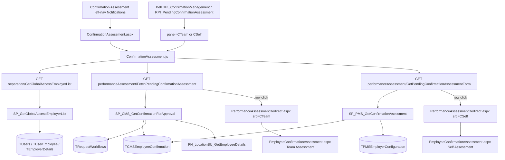
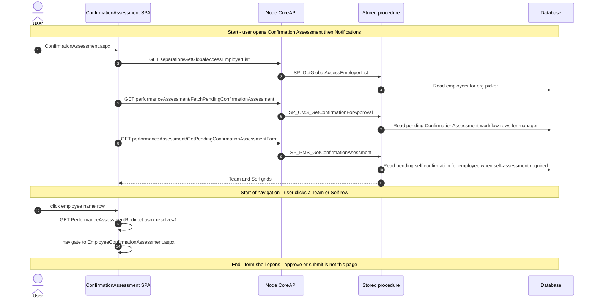
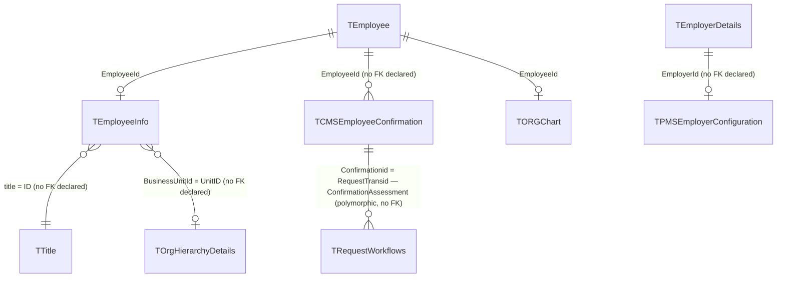

# Notifications

## Overview

A manager or employee opens **Confirmation Assessment → Notifications** when probation confirmation work is waiting on them. The page is a read-only inbox with two accordion grids. **Confirmation Assessment Form - Team** lists confirmation requests pending this person's approval. **Confirmation Assessment Form - Self** lists the logged-in employee's own pending self-assessment when the employer requires confirmation self-assessment. Empty panels stay hidden. When both lists are empty the page shows **No pending notifications.**

This shell does not save ratings or approve/reject. Clicking a row leaves for **Employee Confirmation Assessment** (`EmployeeConfirmationAssessment.aspx`) with Team or Self context. Organization multi-select (global-access employers) reloads both grids without a Search click.

**Who's involved:**

- **Approver (Team)** — the current `TRequestWorkflows` manager for `RequestType = ConfirmationAssessment`. They open a team row to work the form on Employee Assessments.
- **Employee (Self)** — sees their own `FormStatus = Pending` confirmation when `TPMSEmployerConfiguration.IsConfSelfAssesmentRequired = 1`.
- **Employee role on Team** — if `IsShowConfTeamAssessmentForEmployeeRole` is true and the session role is `employee`, the Team click is blocked with a warning (parity with legacy `rgPendingConfirmationUnderMngr_ItemCommand`).

Bell deep links use `?mode=self&camefrom=Notification&panel=CTeam|CSelf` (`NotificationList.js`). The SPA expands `panel` when that grid has rows; it does not read `camefrom` or `mode` from the query string (identity comes from hidden fields on the ASPX).

Probation → confirmed lifecycle and the polymorphic workflow map are in `llm-wiki/domain/employee-lifecycle.md` and `llm-wiki/domain/approval-workflow.md`. CMS table one-liners are in `llm-wiki/reference/tables/hrms.md`. This guide is the live React → Node → SP call chain for the Notifications menu item only.

Sibling left-nav items **Employee Assessments**, **Confirmation Status**, **Initiate Confirmation**, and **Confirmation Due** are separate pages. Filling and approving the form happens on Employee Assessments, not here.

## Workflow

## Request journey

This page does not create or decide a confirmation request. The action that **starts** here is opening a pending row so the user can continue on Employee Confirmation Assessment. Loading the inbox is shown first so the read path is visible.

## Entry points

> The live shell is `HRM/PMS_React/ConfirmationAssessment.aspx`, routed to `Areas/ConfirmationAssessment/Containers/ConfirmationAssessment.js`. Legacy WebForms `HRM/PerformanceAssessment/ConfirmationAssessment.aspx` (and `ucPendingConfirmationAssessment_ForMe` / `ucConfirmationAssessment_ForMe`) still exist beside it; the left-nav and home-page bell target the PMS_React path.

| UI page / API endpoint | Purpose |
|---|---|
| `HRM/PMS_React/ConfirmationAssessment.aspx` | WebForms shell. `Page_Load` stamps employee/employer/role into hidden fields, logs `ActivityDescription.ConfirmationAssessment`, loads `BuildJS/PMS_React.min.js` |
| `Areas/ConfirmationAssessment/Containers/ConfirmationAssessment.js` | Inbox SPA. Org multi-select, Team / Self grids, expand from `?panel=`, row → redirect bridge |
| `HRM/PMS_React/PerformanceAssessmentRedirect.aspx` | Encrypts `mode` / `TabName` / `id` for Team (`src=CTeam`) or Self (`src=CSelf`); `resolve=1` returns JSON `{ url }` |
| `HRM/PMS_React/EmployeeConfirmationAssessment.aspx` | Destination form / assessment shell (not this menu item) |
| `?mode=self&camefrom=Notification&panel=CTeam\|CSelf` | Bell deep link from `NotificationList.js` (`RPI_ConfirmationManagement` → CTeam, `RPI_PendingConfirmationAssessment` → CSelf) |

## Code → database call chain

There is **no write** on this page. Org list reuses the Separation route. Team / Self lists go through `performanceAssessment` Node DAL (parity with .NET `PerformanceAssessmentDAL`).

| Entry point | DAL/BLL method (`file:line`) | Stored procedure |
|---|---|---|
| Page load | `ConfirmationAssessment.aspx.cs` `Page_Load` (`ConfirmationAssessment.aspx.cs:14-25`) | none |
| Organisation picker | `GetOrganizations` → `GET_GLOBAL_ACCESS_EMPLOYER_LIST` (`ConfirmationAssessment.js:52-53`); `SeparationController.GetGlobalAccessEmployerList` (`separationController.js:958`); `separationDAL.GetGlobalAccessEmployerList` (`separationDAL.js:989-994`) | `SP_GetGlobalAccessEmployerList` |
| Team grid | `getPerformanceAssessmentNotifications` CTeam (`ConfirmationAssessment.js:104-109`); `FetchPendingConfirmationAssessment` (`performanceAssessmentController.js:154-161`); `performanceAssessmentDAL.FetchPendingConfirmationAssessment` (`performanceAssessmentDAL.js:80-88`). .NET parity: `PerformanceAssessmentDAL.FetchPendingConfirmationAssessment` (`PerformanceAssessmentDAL.cs:40-47`) | `SP_CMS_GetConfirmationForApproval` |
| Self grid | CSelf (`ConfirmationAssessment.js:111-116`); `GetPendingConfirmationAssessmentForm` (`performanceAssessmentController.js:658-667`); `performanceAssessmentDAL.GetPendingConfirmationAssessmentForm` (`performanceAssessmentDAL.js:857-866`). .NET parity: `PerformanceAssessmentDAL.GetPendingConfirmationAssessmentForm` (`PerformanceAssessmentDAL.cs:501-508`) | `SP_PMS_GetConfirmationAsessment` |
| Team row click | `rgPendingConfirmationUnderMngr_ItemCommand` (`ConfirmationAssessment.js:293-301`) → `redirectTo` → `PerformanceAssessmentRedirect` `src=CTeam` (`PerformanceAssessmentRedirect.aspx.cs:165-184`) | none (encrypt + navigate) |
| Self row click | `radGridConfirmationAssessment_ItemCommand` (`ConfirmationAssessment.js:305-310`) → `src=CSelf` (`PerformanceAssessmentRedirect.aspx.cs:187-199`) | none (encrypt + navigate) |

## API endpoints

No WebForms postback data access. All reads are Node CoreAPI under `/performanceAssessment` or `/separation`.

| Verb | Route | Parameters | Purpose | Source |
|---|---|---|---|---|
| `GET` | `separation/GetGlobalAccessEmployerList` | `employeeId` (query; also set from JWT via `setLoggedInEmployeeId`) | Org multi-select options | `separationRoutes.js:57`, `separationController.js:958`, `separationDAL.js:989` |
| `GET` | `performanceAssessment/FetchPendingConfirmationAssessment` | `employeeId` (query, required); `employerIds` (query, optional CSV) | Team pending confirmation rows for manager | `performanceAssessmentRoutes.js:15`, `performanceAssessmentController.js:154` |
| `GET` | `performanceAssessment/GetPendingConfirmationAssessmentForm` | `employeeId` (query, required); `employerIds` (query, optional CSV) | Self pending confirmation rows | `performanceAssessmentRoutes.js:61`, `performanceAssessmentController.js:658` |
| `GET` | `PerformanceAssessmentRedirect.aspx?resolve=1&src=…` | `src` (`CTeam`\|`CSelf`); `eid`; `cid`; Team also `IsDirectToManagerConf`, `IsApprover`, optional `ApprovalLevel` / `isSubmitted` | JSON `{ url }` with encrypted query for Employee Confirmation Assessment | `PerformanceAssessmentRedirect.aspx.cs:28-58,165-199` |

Mounted at `routeIndex.js:60` (`/performanceAssessment`) and the Separation router for the org list.

## Stored procedures & tables involved

> There is no dedicated `llm-wiki/domain` page for this inbox alone. Confirmation as a lifecycle stage is in `llm-wiki/domain/employee-lifecycle.md`. Pending routing uses `RequestType = ConfirmationAssessment` on `TRequestWorkflows` as documented in `llm-wiki/domain/approval-workflow.md` / `llm-wiki/reference/event-catalog.md`.

| Object | Path | Role | llm-wiki |
|---|---|---|---|
| `SP_GetGlobalAccessEmployerList` | `HRMS-DATABASE/HRMS/STOREPROCEDURE/SP_GetGlobalAccessEmployerList.sql` | Employers for the header multi-select | — |
| `SP_CMS_GetConfirmationForApproval` | `…/SP_CMS_GetConfirmationForApproval.sql` | Team queue: pending workflow rows where `ManagerId` is the viewer | `domain/approval-workflow.md` |
| `SP_PMS_GetConfirmationAsessment` | `…/SP_PMS_GetConfirmationAsessment.sql` | Self queue: viewer's pending confirmation when self-assessment is required (name spelling is `Asessment` in SQL) | `domain/employee-lifecycle.md` |
| `FN_LocationBU_GetEmployeeDetails` | `HRMS-DATABASE/HRMS/FUNCTIONS/FN_LocationBU_GetEmployeeDetails.sql` | Scopes Team candidates to the manager's location/BU access | — |
| `Fn_GetEmployeeName` | `…/FUNCTIONS/Fn_GetEmployeeName.sql` | Display names on both list procedures | — |
| `FN_GetRoleName` | `…/FUNCTIONS/FN_GetRoleName.sql` | Called by Self SP (role is selected; HR/Admin branch is commented out) | — |
| `Split` | `…/FUNCTIONS/Split.sql` | CSV split for `@Employerids` | — |
| `Sp_OpenEncryptionKeys` / `SP_CloseEncryptionKey` | `…/STOREPROCEDURE/` | Open/close encryption keys around Self SP body | — |
| `TCMSEmployeeConfirmation` | `HRMS-DATABASE/HRMS/TABLES/` | Confirmation header (`Confirmationid`, `FormStatus`, managers) | `reference/tables/hrms.md` |
| `TRequestWorkflows` | `…/TABLES/` | Pending `ConfirmationAssessment` routing (`ApproveStatus = 'P'`) | `domain/approval-workflow.md` |
| `TEmployee` / `TEmployeeInfo` | `…/TABLES/` | Active employee, due date, confirmation date null filter | `domain/employee-lifecycle.md` |
| `TPMSEmployerConfiguration` | `…/TABLES/` | Org name on Team; `IsConfSelfAssesmentRequired` / `IsShowConfTeamAssessmentForEmployeeRole` | — |
| `TORGChart` / `TTitle` / `TOrgHierarchyDetails` | `…/TABLES/` | Reporting manager, designation, business-unit label | — |

## Table relationships

Inbox reads hang off `TCMSEmployeeConfirmation` and the polymorphic workflow row. Declared FKs are sparse; the diagram matches `llm-wiki/domain/approval-workflow.md` for the ConfirmationAssessment edge.

`SP_CMS_GetConfirmationForApproval` joins `TCMSEmployeeConfirmation` to `TRequestWorkflows` where `RequestType = 'ConfirmationAssessment'` and `ApproveStatus = 'P'`, filtered to `@ManagerId`. `SP_PMS_GetConfirmationAsessment` filters the same confirmation table to `@EmployeeId`, `FormStatus = 'Pending'`, and `IsConfSelfAssesmentRequired = 1`.

## Known gaps

- **`camefrom=Notification` and `mode=self` are unused by the SPA.** The bell always appends them; `ConfirmationAssessment.js` only reads `panel`. Mode for the destination form is set again on row click (`ALL` / `SELF`).
- **No approve/reject on this page.** Decision writes live on Employee Confirmation Assessment (`ConfirmationAssessmentForm.js` and related `performanceAssessment` POSTs), not under this submenu.
- **Legacy WebForms sibling** `HRM/PerformanceAssessment/ConfirmationAssessment.aspx` and user controls still ship; left-nav / bell use PMS_React.
- **Self SP name misspelling** `SP_PMS_GetConfirmationAsessment` is intentional in SQL and Node (`execute("SP_PMS_GetConfirmationAsessment")`).
- **Self SP opens encryption keys and resolves role, but the HR/Administrator branch is commented out** — only the employee-scoped Pending query runs.
- **Team role gate** depends on `IsShowConfTeamAssessmentForEmployeeRole` from the Team result set plus session `hdnConfirmationAssessmentUserRole`; a pure Employee role with that flag set cannot open Team rows.
- **Sibling `SP_CMS_GetConfirmationForApprovalAll`** exists in the DB and Node (`FetchAllPendingConfirmationAssessment`) but this Notifications page never calls it.
- Nested callee database pages already existed; their Callers tables may still say "No page yet" for these two procedures until a later refresh of those pages.

## Reference

Confidence is **high** for the live PMS_React inbox → Node DAL → stored-procedure chain (file:line on both GETs and the redirect bridge). Form submit / workflow approve paths are out of scope and belong under Employee Assessments.

### SourceCode

- `HRMS.Web/HRMS.Web/HRM/PMS_React/ConfirmationAssessment.aspx` (+ `.cs`)
- `HRMS.Web/HRMS.Web/HRM/PMS_React/Areas/ConfirmationAssessment/Containers/ConfirmationAssessment.js`
- `HRMS.Web/HRMS.Web/HRM/PMS_React/Areas/PerformanceAssessment/Components/PendingNotificationGrid.js`
- `HRMS.Web/HRMS.Web/HRM/PMS_React/Common/apiURLConstants.js`
- `HRMS.Web/HRMS.Web/HRM/PMS_React/PerformanceAssessmentRedirect.aspx.cs`
- `HRMS.Web/HRMS.Web/HRM/ChatBot/Areas/Notification/Components/NotificationList.js` (bell deep links)
- `HRMS.CoreAPI/HRMS.Core.WebAPI.Node/Routes/performanceAssessmentRoutes.js`, `separationRoutes.js`, `routeIndex.js`
- `HRMS.CoreAPI/HRMS.Core.WebAPI.Node/Controllers/performanceAssessmentController.js`, `separationController.js`
- `HRMS.CoreAPI/HRMS.Core.WebAPI.Node/Core/DataAccessLayer/performanceAssessmentDAL.js`, `separationDAL.js`
- `HRMS.Shared/HRMS.DataAccessLayer/ConfirmationAndPerformance/PerformanceAssessmentDAL.cs` (.NET parity)
- Legacy: `HRMS.Web/HRMS.Web/HRM/PerformanceAssessment/ConfirmationAssessment.aspx`, `ucPendingConfirmationAssessment_ForMe.ascx.cs`, `ucConfirmationAssessment_ForMe.ascx.cs`

### TDG HRMS DB

- `llm-wiki/domain/employee-lifecycle.md`
- `llm-wiki/domain/approval-workflow.md`
- `llm-wiki/reference/event-catalog.md`
- `llm-wiki/reference/tables/hrms.md` (`TCMSEmployeeConfirmation*`)
- `HRMS-DATABASE/HRMS/STOREPROCEDURE/SP_CMS_GetConfirmationForApproval.sql`
- `HRMS-DATABASE/HRMS/STOREPROCEDURE/SP_PMS_GetConfirmationAsessment.sql`
- `HRMS-DATABASE/HRMS/STOREPROCEDURE/SP_GetGlobalAccessEmployerList.sql`
