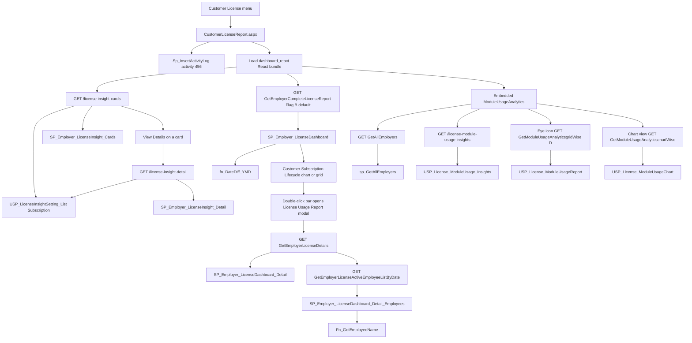
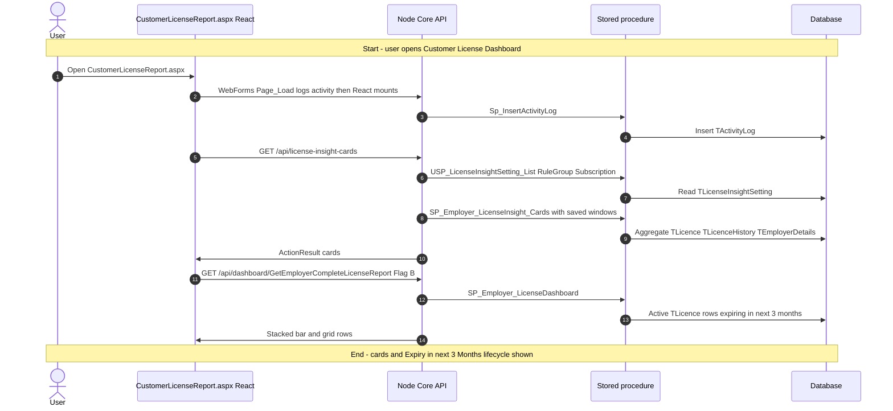
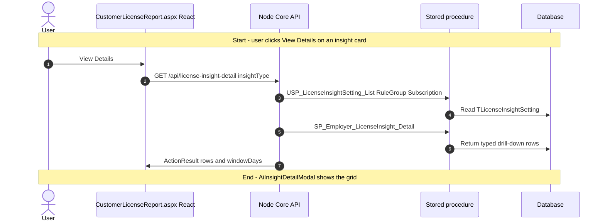
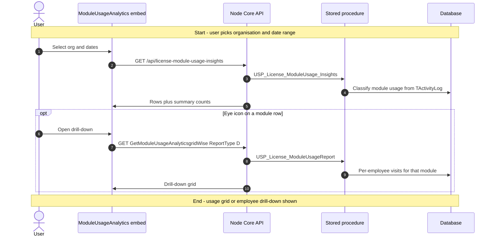
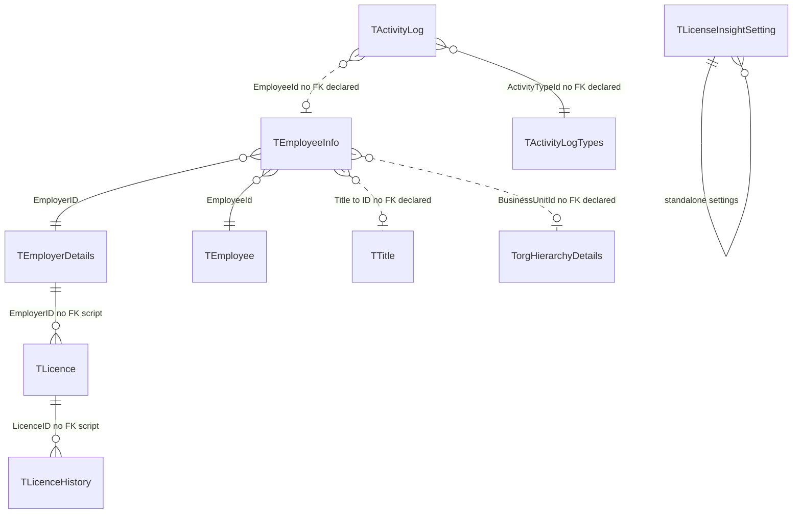

# Customer License Dashboard

## Overview

A license operations user opens **Customer License → Customer License Dashboard** to see every customer's subscription lifecycle, the four AI insight cards (high expiry risk, recently expired, reactivated, active growth), and module usage analytics for selected organisations. The left-nav leaf maps to `~/HRM/DashBoard_React/CustomerLicenseReport.aspx`. The page title in the ASPX is "Customer License Report"; the React H1 and breadcrumb say **Customer License Dashboard**.

The host is a WebForms shell that seeds session identity into hidden fields and loads `dashboard_react.*.min.js`. All grids, charts, and cards are Axios GETs to Core Node (`/api/dashboard/*` and `/api/license-*`). The code-behind does not bind report data; it only logs activity type `CustomerLicenseDashboard` (456) and picks the React bundle file.

`CustomerLicenseTabularReport.aspx` sits in the same folder but has no matching code-behind in this checkout, is not registered under `TDynamicMenuHierarchy` for this leaf, and is not a route in `Areas/routes.js`. Sibling menu leaf **Dashboard Insights Configuration** is a separate page (`InsightConfiguration.aspx`) and is out of scope here. Embedded **Module Usage Analytics** on this dashboard is in scope; the standalone `ModuleUsageAnalytics.aspx` / `ModuleWiseUsabilityReport.aspx` hosts are not.

There is no `docs/SystemModels/SystemModel-2` page for this screen. Table blurbs for insight settings live in `llm-wiki/reference/tables/hrms.md`. `TLicence` / `TLicenceHistory` are used heavily by the SPs but have no catalog rows and no `TABLES/` scripts in the Liquibase tree.

## Workflow

This page is a React SPA hosted in WebForms. List and drill-down calls use JWT/`Authorization` from the shared Dashboard React helpers. No WebForms postback binds the charts.

## Request journey

Reads only. There is no save path on this leaf (configuration writes live on **Dashboard Insights Configuration**).

### Load dashboard — cards and default lifecycle

### View insight card details

### Module usage search and drill-down

## Entry points

| Entry | Purpose |
|---|---|
| `~/HRM/DashBoard_React/CustomerLicenseReport.aspx` | Menu leaf **Customer License Dashboard** (MenuId 1252). Host for the React dashboard. |
| React route `RouteConstants.CUSTOMERLICENSEREPORT_CONFIG` | Same path; mounts `CustomerLicenseReport` container. |
| `~/HRM/DashBoard_React/CustomerLicenseTabularReport.aspx` | Orphan ASPX in the same folder. Not this menu leaf. |
| `~/HRM/DashBoard_React/InsightConfiguration.aspx` | Sibling submenu **Dashboard Insights Configuration**. Not documented here. |

## Code → database call chain

| Entry | Method | Database |
|---|---|---|
| Page load, `CustomerLicenseReport.aspx.cs:29` | `CommonUtil.LogActivity` → activity helpers | `Sp_InsertActivityLog`. Activity type `CustomerLicenseDashboard` = 456 (`Enums.cs`). |
| Mount, `CustomerLicenseReport.js:59-60` | `getInsightCards` → `APIHelper.get(GET_LICENSE_INSIGHT_CARDS)` → `InsightCards/Controller.List:11` → `Service.listInsightCards:69` | `USP_LicenseInsightSetting_List` (`LicenseInsightSettingDAL.js:31`) then `SP_Employer_LicenseInsight_Cards` (`LicenseInsightCardsDAL.js:31`). |
| Mount / radio change, `CustomerLicenseReport.js:128` | `getCompleteLicenseDetails` → `GET_CUSTOMER_LICENSE_COMPLETE_DETAILS` → `dashboardController.GetEmployerCompleteLicenseReport:2891` → `dashBoardDAL.GetEmployerCompleteLicenseReport:4958` | `SP_Employer_LicenseDashboard`. Nested `fn_DateDiff_YMD`. |
| Card View Details, `CustomerLicenseReport.js:92` | `GET_LICENSE_INSIGHT_DETAIL` → `InsightDetail/Controller.List:11` → `Service.listInsightDetail:103` | `USP_LicenseInsightSetting_List` then `SP_Employer_LicenseInsight_Detail` (`LicenseInsightDetailDAL.js:46`). |
| Lifecycle modal, `CustomerLicenseDetailReport.js:74` | `GET_EMPLOYEE_LICENSE_DETAILS` → `GetEmployerLicenseDetails:3767` → `dashBoardDAL:5024` | `SP_Employer_LicenseDashboard_Detail`. |
| Modal day drill, `CustomerLicenseDetailReport.js:131` | `GET_CUSTOMER_LICENSE_ACTIVE_EMPLOYEE_LIST_BY_DATE` → `GetEmployerLicenseActiveEmployeeListByDate:3833` → `dashBoardDAL:5180` | `SP_Employer_LicenseDashboard_Detail_Employees`. Nested `Fn_GetEmployeeName`. |
| Module Usage org list, `ModuleUsageAnalytics.js:34` | `GET_ALL_CUSTOMER_LIST()` → `GetAllEmployers:844` → `dashBoardDAL:882` | `sp_GetAllEmployers` (`superId` undefined → 0). |
| Module Usage grid, `ModuleUsageAnalytics.js:213` | `GET_LICENSE_MODULE_USAGE_INSIGHTS` → `ModuleUsageInsights/Controller.List:17` → `Service.listModuleUsageInsights:62` | `USP_License_ModuleUsage_Insights` (`ModuleUsageInsightsDAL.js:31`). |
| Module Usage eye drill, `ModuleUsageAnalytics.js:247` | `GET_MODULE_USAGE_ANALYTICS_GRID_WISE('D',…)` → `GetModuleUsageAnalyticsgridWise:3775` → `dashBoardDAL:5044` | `USP_License_ModuleUsageReport`. Nested `Fn_GetEmployeeName` on ReportType `D`. |
| Module Usage chart, `ModuleUsageAnalyticsChart.js:33` / `:87` | `GET_MODULE_USAGE_ANALYTICS_CHART_WISE` → `GetModuleUsageAnalyticschartWise:3784` → `dashBoardDAL:5067` | `USP_License_ModuleUsageChart` (dynamic SQL via `EXECUTE(@SQL)`). |

## API endpoints

No WebForms postback binds report data. All report traffic is GET to Core Node under `/api` (Authorize on the license feature routers and most dashboard routes; `GetEmployerLicenseDetails` and the module-usage dashboard routes are registered without `Authorize` in `DashBoardRoutes.js`).

| Verb | Route | Parameters | Purpose | Source |
|---|---|---|---|---|
| GET | `/api/license-insight-cards` | none | Four subscription insight cards. | `InsightCards/routes.js:23` |
| GET | `/api/license-insight-detail` | `insightType` one of `ExpiryRisk`, `Expired`, `Reactivated`, `Growth` | Card drill-down rows. | `InsightDetail/routes.js` |
| GET | `/api/dashboard/GetEmployerCompleteLicenseReport` | `Flag` `A`/`B`/`C`, `EmployerID`, `FromDate`, `ToDate` | Lifecycle chart/grid. Default open uses `Flag=B`. | `DashBoardRoutes.js:257` |
| GET | `/api/dashboard/GetEmployerLicenseDetails` | `EmployerID`, `FromDate`, `ToDate` | Per-day license vs headcount in the modal. | `DashBoardRoutes.js:383` |
| GET | `/api/dashboard/GetEmployerLicenseActiveEmployeeListByDate` | `employerId`, `date` | Active employees for one report day. | `DashBoardRoutes.js:386` |
| GET | `/api/dashboard/GetAllEmployers` | `superId` (optional) | Organisation tree for Module Usage. | `DashBoardRoutes.js:62` |
| GET | `/api/license-module-usage-insights` | `fromDate`, `toDate`, `employerIds` | Module usage grid with AI insight columns. | `routeIndex.js:246` |
| GET | `/api/dashboard/GetModuleUsageAnalyticsgridWise` | `ReportType`, `FromDate`, `ToDate`, `EmployerIDs`, `Module` | Employee drill-down (`ReportType=D`). | `DashBoardRoutes.js:384` |
| GET | `/api/dashboard/GetModuleUsageAnalyticschartWise` | `ReportType` `U`/`V`, `FromDate`, `ToDate`, `EmployerIDs` | Module usage chart. | `DashBoardRoutes.js:385` |

## Stored procedures & tables involved

| Object | File | Purpose | Wiki |
|---|---|---|---|
| `Sp_InsertActivityLog` | `STOREPROCEDURE/Sp_InsertActivityLog.sql` | Page-access log. | `TActivityLog` |
| `USP_LicenseInsightSetting_List` | `STOREPROCEDURE/USP_LicenseInsightSetting_List.sql` | Saved windows/thresholds for cards and detail. | `TLicenseInsightSetting` |
| `SP_Employer_LicenseInsight_Cards` | `STOREPROCEDURE/SP_Employer_LicenseInsight_Cards.sql` | Four card metrics. | `TLicenseInsightSetting` |
| `SP_Employer_LicenseInsight_Detail` | `STOREPROCEDURE/SP_Employer_LicenseInsight_Detail.sql` | Per-card customer rows. | `TLicenseInsightSetting` |
| `SP_Employer_LicenseDashboard` | `STOREPROCEDURE/SP_Employer_LicenseDashboard.sql` | Lifecycle series by flag. | — (`TLicence` not catalogued) |
| `fn_DateDiff_YMD` | `FUNCTIONS/fn_DateDiff_YMD.sql` | Passed/remaining/expired duration text. | — |
| `SP_Employer_LicenseDashboard_Detail` | `STOREPROCEDURE/SP_Employer_LicenseDashboard_Detail.sql` | Daily purchased/buffer/active counts. | — |
| `SP_Employer_LicenseDashboard_Detail_Employees` | `STOREPROCEDURE/SP_Employer_LicenseDashboard_Detail_Employees.sql` | Active employee list for one day. | — |
| `Fn_GetEmployeeName` | `FUNCTIONS/Fn_GetEmployeeName.sql` | Display name on employee grids. | — |
| `sp_GetAllEmployers` | `STOREPROCEDURE/sp_GetAllEmployers.sql` | Licensed active employers for the picker. | `TEmployerDetails` |
| `USP_License_ModuleUsage_Insights` | `STOREPROCEDURE/USP_License_ModuleUsage_Insights.sql` | Module usage + insight codes. | `TActivityLog`, `TLicenseInsightSetting` |
| `USP_License_ModuleUsageReport` | `STOREPROCEDURE/USP_License_ModuleUsageReport.sql` | Summary or employee-level usage. | `TActivityLog` |
| `USP_License_ModuleUsageChart` | `STOREPROCEDURE/USP_License_ModuleUsageChart.sql` | Pivoted module chart. | `TActivityLog` |
| `TLicence`, `TLicenceHistory` | (no `TABLES/` script in repo) | Subscription periods and post-image history. | Missing from `llm-wiki/reference/tables/hrms.md` |
| `TLicenseInsightSetting` | `TABLES/TLicenseInsightSetting.sql` | Configurable rule values. | catalogued |
| `TEmployerDetails`, `TEmployee`, `TEmployeeInfo`, `TActivityLog`, `TActivityLogTypes`, `TTitle`, `TorgHierarchyDetails` | matching `TABLES/` scripts | Org, headcount, and activity joins. | mostly catalogued |

Notification generators (`USP_LicenseInsight_*`) and `TLicenseInsight` are scheduler/job paths, not this page.

## Table relationships

Declared FKs from `CREATE TABLE` scripts are sparse for license objects. The diagram shows joins the dashboard procedures actually use; undeclared links are dotted.

## Known gaps

- **No SystemModel-2 page** for Customer License Dashboard.
- **`TLicence` / `TLicenceHistory` undocumented** in `llm-wiki/reference/tables/hrms.md` and absent from `HRMS-DATABASE/HRMS/TABLES/`.
- **`CustomerLicenseTabularReport.aspx`** has no code-behind in this tree and is not the menu leaf.
- **Service comments still say `TLicenseInsightConfig`** for some window fallbacks, but the live SPs and DAL read `TLicenseInsightSetting`.
- **`SP_Employer_LicenseDashboard_Detail_Employees`** assigns `@RootEmployerId` then filters `ED.RootEmployerID = @EmployerID`, so a non-root employer id returns no rows.
- **Several `/dashboard` license GETs omit `Authorize`** in `DashBoardRoutes.js` (`GetEmployerLicenseDetails`, module-usage grid/chart, active-employee list).
- **`USP_License_ModuleUsageChart` builds dynamic SQL** with concatenated module names and `EXECUTE(@SQL)`.
- **Insight Configuration save path** is a sibling menu item, not this page.
- **Scheduler insight notifications** (`USP_LicenseInsight_Run` / `Dispatch`) do not run from this UI.

## Reference

Confidence is **high** for the React host, Core API Features/License and dashBoardDAL paths, and the STOREPROCEDURE/FUNCTION scripts listed above. Foreign keys are only those found on table scripts; license subscription tables have no scripts in-repo.

### SourceCode

- `HRMS.Web/HRMS.Web/HRM/DashBoard_React/CustomerLicenseReport.aspx`
- `HRMS.Web/HRMS.Web/HRM/DashBoard_React/CustomerLicenseReport.aspx.cs`
- `HRMS.Web/HRMS.Web/HRM/DashBoard_React/CustomerLicenseTabularReport.aspx`
- `HRMS.Web/HRMS.Web/HRM/DashBoard_React/Areas/CustomerLicenseReport/Container/CustomerLicenseReport.js`
- `HRMS.Web/HRMS.Web/HRM/DashBoard_React/Areas/CustomerLicenseReport/Components/CustomerLicenseDetailReport.js`
- `HRMS.Web/HRMS.Web/HRM/DashBoard_React/Areas/CustomerLicenseReport/Container/ModuleUsageAnalytics.js`
- `HRMS.Web/HRMS.Web/HRM/DashBoard_React/Areas/CustomerLicenseReport/Components/ModuleUsageAnalyticsChart.js`
- `HRMS.Web/HRMS.Web/HRM/DashBoard_React/Common/apiURLConstants.js`
- `HRMS.Web/HRMS.Web/HRM/DashBoard_React/Areas/routes.js`
- `HRMS.CoreAPI/HRMS.Core.WebAPI.Node/Features/License/InsightCards/`
- `HRMS.CoreAPI/HRMS.Core.WebAPI.Node/Features/License/InsightDetail/`
- `HRMS.CoreAPI/HRMS.Core.WebAPI.Node/Features/License/ModuleUsageInsights/`
- `HRMS.CoreAPI/HRMS.Core.WebAPI.Node/Features/License/InsightSetting/LicenseInsightSettingDAL.js`
- `HRMS.CoreAPI/HRMS.Core.WebAPI.Node/Core/DataAccessLayer/dashBoardDAL.js`
- `HRMS.CoreAPI/HRMS.Core.WebAPI.Node/Controllers/dashboardController.js`
- `HRMS.CoreAPI/HRMS.Core.WebAPI.Node/Routes/DashBoardRoutes.js`
- `HRMS.CoreAPI/HRMS.Core.WebAPI.Node/Routes/routeIndex.js`
- `HRMS.Shared/HRMS.DataContract/Common/Enums.cs`

### TDG HRMS DB

- `llm-wiki/reference/tables/hrms.md`
- `HRMS-DATABASE/HRMS/STOREPROCEDURE/SP_Employer_LicenseDashboard.sql`
- `HRMS-DATABASE/HRMS/STOREPROCEDURE/SP_Employer_LicenseDashboard_Detail.sql`
- `HRMS-DATABASE/HRMS/STOREPROCEDURE/SP_Employer_LicenseDashboard_Detail_Employees.sql`
- `HRMS-DATABASE/HRMS/STOREPROCEDURE/SP_Employer_LicenseInsight_Cards.sql`
- `HRMS-DATABASE/HRMS/STOREPROCEDURE/SP_Employer_LicenseInsight_Detail.sql`
- `HRMS-DATABASE/HRMS/STOREPROCEDURE/USP_LicenseInsightSetting_List.sql`
- `HRMS-DATABASE/HRMS/STOREPROCEDURE/USP_License_ModuleUsage_Insights.sql`
- `HRMS-DATABASE/HRMS/STOREPROCEDURE/USP_License_ModuleUsageReport.sql`
- `HRMS-DATABASE/HRMS/STOREPROCEDURE/USP_License_ModuleUsageChart.sql`
- `HRMS-DATABASE/HRMS/STOREPROCEDURE/sp_GetAllEmployers.sql`
- `HRMS-DATABASE/HRMS/FUNCTIONS/fn_DateDiff_YMD.sql`
- `HRMS-DATABASE/HRMS/DML/Customer License Dashboard/TMenuDetails DML.sql`
