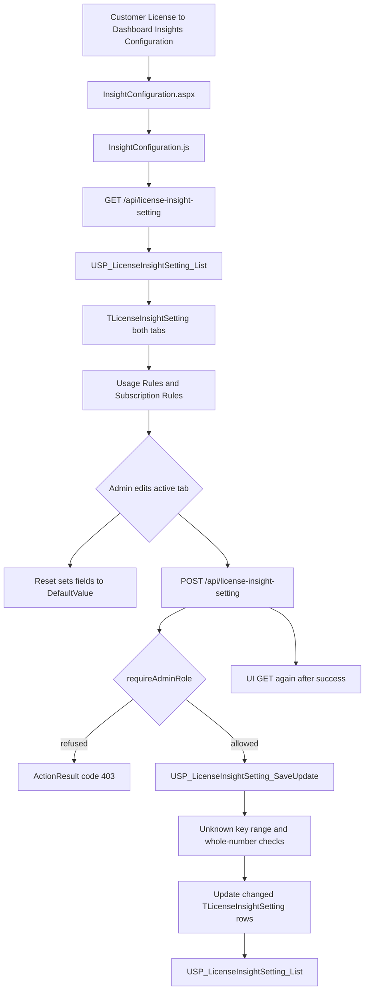
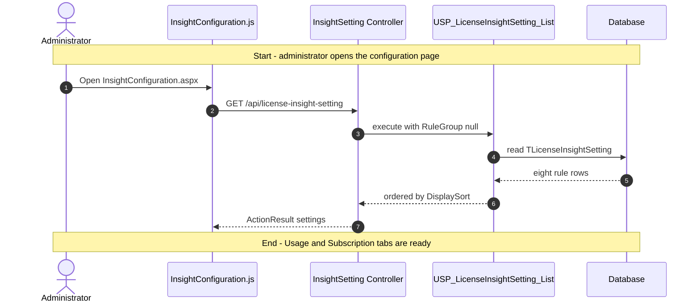
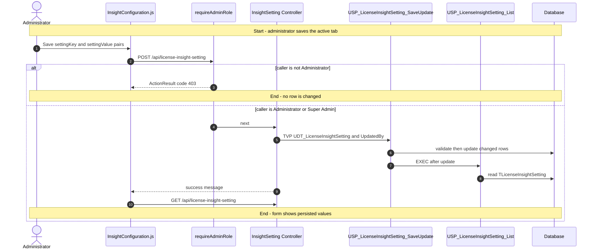
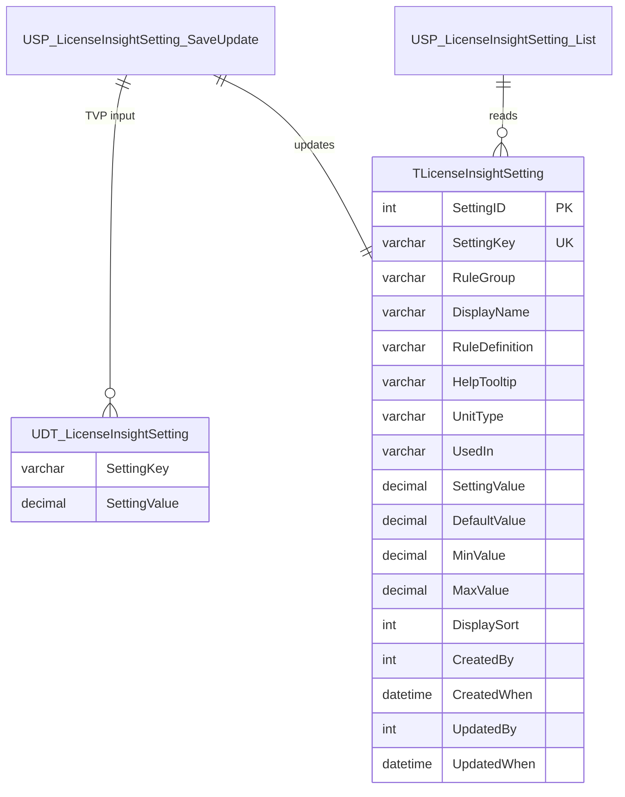

# Dashboard Insights Configuration

## Overview

An Administrator opens **Customer License → Dashboard Insights Configuration** (`~/HRM/DashBoard_React/InsightConfiguration.aspx`) to edit the eight AI insight rule thresholds that drive Customer License dashboard cards. The WebForms shell only injects session identity into hidden fields and loads the React bundle. All list and save work is Core API.

The screen has two tabs — **Usage Rules** and **Subscription Rules** — built from `RuleGroup` on `TLicenseInsightSetting`. One `GET` loads both tabs. Save posts only the active tab. Reset restores the active tab’s fields to each rule’s `DefaultValue` in the browser; nothing is written until Save. Non-Admin users can view the form. Save is blocked in the UI and again by `requireAdminRole` on `POST`.

SystemModel-2 has no page for this screen. The table catalog entry is `llm-wiki/reference/tables/hrms.md` (`TLicenseInsightSetting`).

**Who's involved:**

- **Administrator** — edits and saves Usage or Subscription thresholds.
- **Non-Admin signed-in user** — can open the page and read rules; Save stays disabled and the API refuses the post.

## Workflow

Client validation in `InsightRulesTab.validateRuleValue` mirrors the SaveUpdate failure modes (required, numeric, whole-number for non-Percent, min/max). The procedure still re-validates and raises `RAISERROR` for unknown keys, out-of-range values, and fractional non-Percent values.

## Request journey

### Administrator — load insight rules

### Administrator — save the active tab

## Entry points

| UI page | Purpose |
|---|---|
| `HRM/DashBoard_React/InsightConfiguration.aspx` | Host page. Title in the page directive is Dashboard Insight Configuration. URL `~/HRM/DashBoard_React/InsightConfiguration.aspx` |
| React route `RouteConstants.INSIGHT_CONFIGURATION` | Lazy route to `InsightConfiguration` container (`Areas/routes.js`) |

`InsightConfiguration.aspx.cs` `Page_Load` only copies `LoggedInUser` into hidden fields and resolves `dashboard_react.*.min.js`. It does not call audit or activity logging.

## Code → database call chain

| Entry | Method | Stored procedure |
|---|---|---|
| First paint and Retry | `loadSettings` (`InsightConfiguration.js:69`) → `APIHelper.get` (`apiHelper.js:71`) → `Controller.List` (`Controller.js:11`) → `listInsightSettings` (`Service.js:42`) → `LicenseInsightSettingDAL.list` (`LicenseInsightSettingDAL.js:25`) | `USP_LicenseInsightSetting_List` |
| Save active tab | `handleSave` (`InsightConfiguration.js:157`) → `APIHelper.post` (`apiHelper.js:145`) → `requireAdminRole` (`routes.js:41`) → `Controller.SaveUpdate` (`Controller.js:46`) → `saveInsightSettings` (`Service.js:60`) → `LicenseInsightSettingDAL.saveUpdate` (`LicenseInsightSettingDAL.js:41`) | `USP_LicenseInsightSetting_SaveUpdate` |
| Nested after successful save | end of `USP_LicenseInsightSetting_SaveUpdate.sql` | `USP_LicenseInsightSetting_List` |

`requireAdminRole` resolves role via `EmployeeRepository.getEmployeeInfo` (Sequelize `TEmployee` findByPk). That path is not a stored procedure. Super Admin (`EID = -1`) skips the role lookup.

URL constants are `GET_LICENSE_INSIGHT_SETTINGS` and `SAVE_LICENSE_INSIGHT_SETTINGS` (`apiURLConstants.js:420–421`). The feature router mounts at `/license-insight-setting` (`routeIndex.js:242`) under `/api` (`app.js:31`).

## API endpoints

This page does not use WebForms postbacks for rules. List and save are Core API.

| Verb | Route | Parameters | Purpose | Source |
|---|---|---|---|---|
| `GET` | `/api/license-insight-setting` | optional query `ruleGroup` = `Usage` or `Subscription`. Omit for both tabs. `Authorize` runs first | Return insight rules for the screen | `InsightSetting/routes.js:91`, `Controller.js:11`, `LicenseInsightSettingDAL.js:31` executes `USP_LicenseInsightSetting_List` |
| `POST` | `/api/license-insight-setting` | body `settings[]` with `settingKey` and numeric `settingValue`. `Authorize` then `requireAdminRole`. `UpdatedBy` comes from `req.EID`, not the body | Persist the active tab all-or-nothing | `InsightSetting/routes.js:126`, `Controller.js:46`, `LicenseInsightSettingDAL.js:56` executes `USP_LicenseInsightSetting_SaveUpdate` |

Business failures return HTTP 200 with `ActionResult` (`isSuccess` false, `code` 400 or 403). SQL `RAISERROR` number 50000 is mapped to code 400 with the procedure message (`Service.js:64–65`).

Sibling Customer License APIs (`/api/license-insight-cards`, `/api/license-insight-detail`, `/api/license-module-usage-insights`) consume the saved thresholds. This aspx does not call them.

## Stored procedures & tables involved

| Object | File | Purpose | Wiki |
|---|---|---|---|
| [USP_LicenseInsightSetting_List](/docs/database/hrms/USP_LicenseInsightSetting_List) | `HRMS-DATABASE/HRMS/STOREPROCEDURE/USP_LicenseInsightSetting_List.sql` | List rules for one group or both, with `IsModified` and `DecimalPlaces` | `llm-wiki/reference/tables/hrms.md` |
| [USP_LicenseInsightSetting_SaveUpdate](/docs/database/hrms/USP_LicenseInsightSetting_SaveUpdate) | `HRMS-DATABASE/HRMS/STOREPROCEDURE/USP_LicenseInsightSetting_SaveUpdate.sql` | Validate TVP rows then update changed settings; re-lists via List | `llm-wiki/reference/tables/hrms.md` |
| `UDT_LicenseInsightSetting` | `HRMS-DATABASE/HRMS/UDT/UDT_LicenseInsightSetting.sql` | TVP columns `SettingKey`, `SettingValue` for SaveUpdate | — |
| `TLicenseInsightSetting` | `HRMS-DATABASE/HRMS/TABLES/TLicenseInsightSetting.sql` | Eight admin-configurable insight rules | `llm-wiki/reference/tables/hrms.md` |

Seed / refresh DML lives under `HRMS-DATABASE/HRMS/DML/Customer License Dashboard/TLicenseInsightSetting DML.sql`.

## Table relationships

`TABLES/TLicenseInsightSetting.sql` declares a clustered primary key on `SettingID` and a unique key on `SettingKey`. It declares no foreign key to employee or employer tables. `UpdatedBy` / `CreatedBy` are integers with no FK script in this database folder.

## Known gaps

- `InsightConfiguration.aspx.cs` leaves activity logging off on purpose. Enabling it needs a new `TActivityType` row (IDENTITY PK), which is a DBA change.
- `USP_LicenseInsightSetting_SaveUpdate` ends with `EXEC USP_LicenseInsightSetting_List`, but `LicenseInsightSettingDAL.saveUpdate` discards that result set. The React screen always refetches with GET after a successful save.
- Reset only mutates React state. Defaults are not written until the administrator clicks Save.
- `APIHelper` can leave a network-level failure promise unsettled; the screen wraps calls in `withTimeout` (30s) to avoid an endless spinner.
- Role for Save is resolved from Sequelize `TEmployee` / `Users.Role`, not from a JWT role claim. Super Admin (`EID = -1`) bypasses that lookup.
- SystemModel-2 does not name `InsightConfiguration.aspx` or `TLicenseInsightSetting`.
- No database page was written for `UDT_LicenseInsightSetting` (type, not a procedure).

## Reference

Confidence is high for the React → Core API → `USP_LicenseInsightSetting_*` path. Role gating and the unused List result after Save are verified in the same files.

### SourceCode

- `docs/SystemModels/SystemModel-2/` was searched. No page covers Dashboard Insights Configuration or `TLicenseInsightSetting`.
- `HRMS.Web/HRMS.Web/HRM/DashBoard_React/InsightConfiguration.aspx`
- `HRMS.Web/HRMS.Web/HRM/DashBoard_React/InsightConfiguration.aspx.cs`
- `HRMS.Web/HRMS.Web/HRM/DashBoard_React/Areas/CustomerLicenseReport/Container/InsightConfiguration.js`
- `HRMS.Web/HRMS.Web/HRM/DashBoard_React/Areas/CustomerLicenseReport/Components/InsightRulesTab.js`
- `HRMS.Web/HRMS.Web/HRM/DashBoard_React/Areas/routes.js`
- `HRMS.Web/HRMS.Web/HRM/DashBoard_React/Common/routeConstants.js`
- `HRMS.Web/HRMS.Web/HRM/DashBoard_React/Common/apiURLConstants.js`
- `HRMS.Web/HRMS.Web/HRM/DashBoard_React/Common/apiHelper.js`
- `HRMS.CoreAPI/HRMS.Core.WebAPI.Node/app.js`
- `HRMS.CoreAPI/HRMS.Core.WebAPI.Node/Routes/routeIndex.js`
- `HRMS.CoreAPI/HRMS.Core.WebAPI.Node/Features/License/InsightSetting/routes.js`
- `HRMS.CoreAPI/HRMS.Core.WebAPI.Node/Features/License/InsightSetting/Controller.js`
- `HRMS.CoreAPI/HRMS.Core.WebAPI.Node/Features/License/InsightSetting/Service.js`
- `HRMS.CoreAPI/HRMS.Core.WebAPI.Node/Features/License/InsightSetting/LicenseInsightSettingDAL.js`
- `HRMS.CoreAPI/HRMS.Core.WebAPI.Node/ORM/Repositories/EmployeeRepository.js`

### TDG HRMS DB

- `llm-wiki/reference/tables/hrms.md` (`TLicenseInsightSetting`)
- `HRMS-DATABASE/HRMS/TABLES/TLicenseInsightSetting.sql`
- `HRMS-DATABASE/HRMS/UDT/UDT_LicenseInsightSetting.sql`
- `HRMS-DATABASE/HRMS/STOREPROCEDURE/USP_LicenseInsightSetting_List.sql`
- `HRMS-DATABASE/HRMS/STOREPROCEDURE/USP_LicenseInsightSetting_SaveUpdate.sql`
- `HRMS-DATABASE/HRMS/DML/Customer License Dashboard/TLicenseInsightSetting DML.sql`
