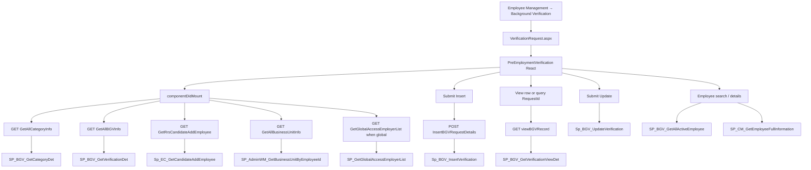
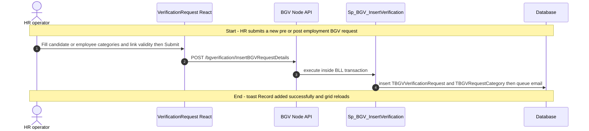
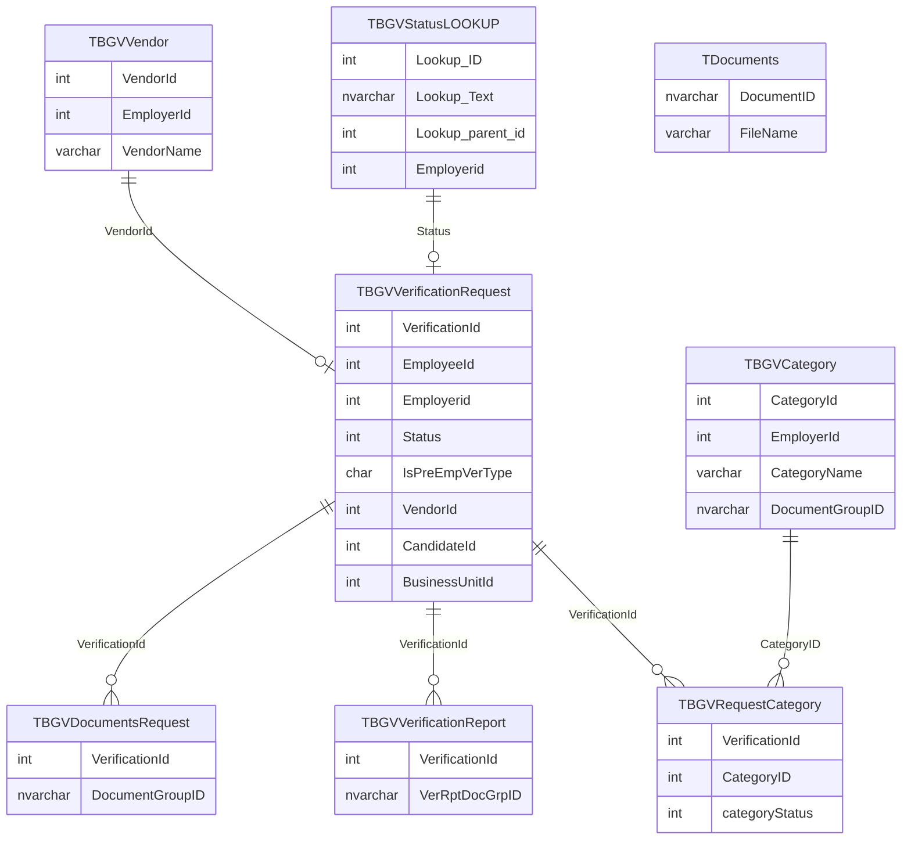

# Background Verification

## Overview

An HR user opens **Employee Management → Background Verification** to create and progress pre-employment or on-board (post-employment) background verification requests. The live host is `~/HRM/BackgroundVerification/VerificationRequest.aspx`. The WebForms page logs activity `EmployeeBackgroundVerification`, decrypts optional query-string `RequestId` / `Action` / `RequstMode`, and injects session values into hidden inputs. Client routing mounts `ValidationRequest` → `PreEmploymentVerification` for that aspx path.

On load the React form loads verification categories, the request grid (pre vs post), RRS candidates (pre), business units, and optionally a global-access organisation list. The user creates a request (candidate or employee, categories, link validity) or opens a row to change status, vendor dates, category statuses, and verification report documents. Status transitions are enforced in `Sp_BGV_UpdateVerification`, not the central approval engine.

A related host `BGVDownloadUpload.aspx` handles candidate/employee document upload outside this guide’s primary page.

**Who's involved:**

- **HR / BGV operator** — creates requests, advances status, assigns vendors, uploads verification reports.
- **Candidate / employee** — receives document-request emails and uses the separate download/upload page; does not use this admin screen.
- **Vendor** — recorded on the request; not a UI actor on this page.

## Workflow

Active UI constants are Version-1 paths under `/api` (not `/v2` or `/v3`). The Background Verification Node API mounts those routes.

## Request journey

Update follows the same UI → `UpdateBGVRequestDetails` → `Sp_BGV_UpdateVerification` path. The SP returns `ErrorCode` / `ErrorMessage` when status or vendor dates are out of order; success returns `ErrorCode = 0`.

## Entry points

| Entry | Purpose |
|---|---|
| `~/HRM/BackgroundVerification/VerificationRequest.aspx` | Left-nav host. `Page_Load` logs activity and sets hidden session fields. |
| Query `RequestId` / `Action` / `RequstMode` (encrypted) | Deep-link into an existing request; `Action` `pre` vs other selects pre vs post list reload. |
| `Areas/routes.js` → `ValidationRequest` | React route for `RouteConstants.BACKGROUND_VERIFICATION`. |
| `Areas/VerificationRequest/Components/preEmploymentVerification.js` | Form, grid, status/vendor/report actions. |
| `~/HRM/BackgroundVerification/BGVDownloadUpload.aspx` | Related document download/upload host (separate page). |

There is no WebForms postback for save or load. All data goes through the Background Verification Node API under `/api`.

## Code → database call chain

BGV API mounts routes at `/api` (`app.js` → `Routes/routeIndex.js`). Active UI constants omit the `/v2` prefix.

| Entry | Method | Stored procedure / SQL |
|---|---|---|
| Page load categories | `getCategoryList` (`preEmploymentVerification.js:191`) → `GetAllCategoryInfo` (`categoryController`) → `GetAllCategoryInfo` (`categoryDAL.js:17`) | `SP_BGV_GetCategoryDet` |
| Page load / refresh grid | `getRequestListGridData` (`preEmploymentVerification.js:198`) → `GetAllBGVInfo` (`bgverificationController.js:26`) → `GetAllBGVInfo` (`bgverificationDAL.js:69`) | `SP_BGV_GetVerificationDet` |
| Page load candidates | `getCandidateList` (`preEmploymentVerification.js:167`) → `GetRrsCandidateAddEmployee` (`employeeDAL.js:71`) | `Sp_EC_GetCandidateAddEmployee` |
| Page load business units | `getBusinessUnitList` (`preEmploymentVerification.js:134`) → `GetAllBusinessUnitInfo` (`employeeDAL.js:108`) | `SP_AdminWM_GetBusinessUnitByEmployeeId` |
| Global org list | `populateOrganization` (`preEmploymentVerification.js:175`) → `GetGlobalAccessEmployerList` (`employeeDAL.js:54`) | `SP_GetGlobalAccessEmployerList` |
| Insert request | `submitHandler` Insert (`preEmploymentVerification.js:227`) → `InsertBGVRequestDetails` (`bgverificationBLL.js:17`) → `InsertBGVRequestDetails` (`bgverificationDAL.js:16`) | `Sp_BGV_InsertVerification` (nested `SP_SendEmail`) |
| View / edit row | `viewBGVData` (`preEmploymentVerification.js:794`) → `ViewBGVRecord` (`bgverificationController.js:35`) → `ViewBGVRecord` (`bgverificationDAL.js:86`) | `SP_BGV_GetVerificationViewDet` |
| Update request | `submitHandler` Update (`preEmploymentVerification.js:250`) → `UpdateBGVRequestDetails` (`bgverificationController.js:17`) → `UpdateBGVRequestDetails` (`bgverificationDAL.js:43`) | `Sp_BGV_UpdateVerification` (nested `SP_SendEmail` when extending link) |
| Employee search list | `getEmployerDetails` (`preEmploymentVerification.js:959`) → `GetAllEmployeeInfo` (`employeeDAL.js:36`) | `SP_BGV_GetAllActiveEmployee` |
| Employee / candidate details | `GET_EMPLOYEE_DETAILS` (`preEmploymentVerification.js:563`) → `GetEmployeeFullInformation` (`employeeDAL.js:17`); `GET_CANDIDATE_DETAILS` (`:692`) → `GetRrsCandidate` (`employeeDAL.js:88`) | `SP_CM_GetEmployeeFullInformation`; `Sp_RRS_GetCandidate` |
| Report upload / delete | `uploadDocument` / `deleteDocument` (`preEmploymentVerification.js:982`, `:972`) → `InsertBGVReport` / `DeleteBGVBGVReport` | `Sp_BGV_InsertVerificationReportInfo`; `Sp_BGV_DeleteVerificationReportInfo` |
| Template document download | `downloadDocumentHandler` (`preEmploymentVerification.js:1020`) → `GET /document/download` | `SP_GET_DOCUMENT_INFO` |

Document binary upload uses `SP_DOCUMENT_INS` via `/document/upload` (shared upload control). Candidate document upload CRUD on `BGVDownloadUpload.aspx` uses `Sp_BGV_*Document*` procedures and is outside this page’s primary chain.

## API endpoints

No WebForms postback for verification CRUD. The React page calls the Background Verification Node API (Version-1 constants).

| Verb | Route | Parameters | Purpose | Source |
|---|---|---|---|---|
| GET | `/category/GetAllCategoryInfo` | query `employerId` | Active BGV categories and template docs | `categoryRoutes.js` |
| GET | `/bgverification/GetAllBGVInfo` | `employerId`, `isPreEmpVerType`, `activeInactiveEmp`, `loginEmployeeId` | Request grid | `bgverificationController.js:26` |
| GET | `/bgverification/viewBGVRecord` | `verificationId` | Multi-result view for one request | `bgverificationController.js:35` |
| POST | `/bgverification/InsertBGVRequestDetails` | body employee/employer, names, email, categories, link, candidate/BU | Create request | `bgverificationController.js:8` |
| POST | `/bgverification/UpdateBGVRequestDetails` | body verification status, dates, vendor, category statuses, doc groups | Update / extend | `bgverificationController.js:17` |
| POST | `/bgverification/InsertBGVReport` | body `VerificationId`, `VerRptDocGrpID`, `CreatedBy` | Attach report document id | `bgverificationController.js:44` |
| POST | `/bgverification/DeleteBGVBGVReport` | body `VerRptDocGrpID` | Remove report row | `bgverificationController.js:62` |
| GET | `/employee/GetAllEmployeeInfo` | `employerId`, `employeeId` | Active employees for search | `employeeDAL.js:36` |
| GET | `/employee/getEmployeeFullInformation` | `employeeId` | Fill post-employment person fields | `employeeDAL.js:17` |
| GET | `/employee/GetGlobalAccessEmployerList` | `employeeId` | Organisation dropdown | `employeeDAL.js:54` |
| GET | `/employee/GetRrsCandidateAddEmployee` | `employerId` | Pre-employment candidate list | `employeeDAL.js:71` |
| GET | `/employee/GetRrsCandidate` | `candidateId`, `employerId` | Candidate details | `employeeDAL.js:88` |
| GET | `/employee/GetAllBusinessUnitInfo` | `employerId`, `employeeId` | Business unit dropdown | `employeeDAL.js:108` |
| GET | `/document/download` | `documentId` | Open template/report file | `documentDAL.js` → `SP_GET_DOCUMENT_INFO` |

## Stored procedures & tables involved

| Object | File | Purpose |
|---|---|---|
| [`SP_BGV_GetCategoryDet`](/docs/database/hrms/SP_BGV_GetCategoryDet) | `HRMS-DATABASE/HRMS/STOREPROCEDURE/SP_BGV_GetCategoryDet.sql` | Active categories and template document names |
| [`SP_BGV_GetVerificationDet`](/docs/database/hrms/SP_BGV_GetVerificationDet) | `HRMS-DATABASE/HRMS/STOREPROCEDURE/SP_BGV_GetVerificationDet.sql` | Pre/post request grid |
| [`SP_BGV_GetVerificationViewDet`](/docs/database/hrms/SP_BGV_GetVerificationViewDet) | `HRMS-DATABASE/HRMS/STOREPROCEDURE/SP_BGV_GetVerificationViewDet.sql` | One request, categories, next statuses, vendors |
| [`Sp_BGV_InsertVerification`](/docs/database/hrms/Sp_BGV_InsertVerification) | `HRMS-DATABASE/HRMS/STOREPROCEDURE/Sp_BGV_InsertVerification.sql` | Create request, categories, email queue |
| [`Sp_BGV_UpdateVerification`](/docs/database/hrms/Sp_BGV_UpdateVerification) | `HRMS-DATABASE/HRMS/STOREPROCEDURE/Sp_BGV_UpdateVerification.sql` | Status/vendor/date updates and link extend |
| [`SP_BGV_GetAllActiveEmployee`](/docs/database/hrms/SP_BGV_GetAllActiveEmployee) | `HRMS-DATABASE/HRMS/STOREPROCEDURE/SP_BGV_GetAllActiveEmployee.sql` | Employee search list |
| [`SP_CM_GetEmployeeFullInformation`](/docs/database/hrms/SP_CM_GetEmployeeFullInformation) | `HRMS-DATABASE/HRMS/STOREPROCEDURE/SP_CM_GetEmployeeFullInformation.sql` | Employee detail fill |
| [`Sp_EC_GetCandidateAddEmployee`](/docs/database/hrms/Sp_EC_GetCandidateAddEmployee) | `HRMS-DATABASE/HRMS/STOREPROCEDURE/Sp_EC_GetCandidateAddEmployee.sql` | Joining-notified candidates |
| [`Sp_RRS_GetCandidate`](/docs/database/hrms/Sp_RRS_GetCandidate) | `HRMS-DATABASE/HRMS/STOREPROCEDURE/Sp_RRS_GetCandidate.sql` | Candidate detail |
| [`SP_AdminWM_GetBusinessUnitByEmployeeId`](/docs/database/hrms/SP_AdminWM_GetBusinessUnitByEmployeeId) | `HRMS-DATABASE/HRMS/STOREPROCEDURE/SP_AdminWM_GetBusinessUnitByEmployeeId.sql` | BU list for the operator |
| [`SP_GetGlobalAccessEmployerList`](/docs/database/hrms/SP_GetGlobalAccessEmployerList) | `HRMS-DATABASE/HRMS/STOREPROCEDURE/SP_GetGlobalAccessEmployerList.sql` | Global organisation list |
| [`Sp_BGV_InsertVerificationReportInfo`](/docs/database/hrms/Sp_BGV_InsertVerificationReportInfo) | `HRMS-DATABASE/HRMS/STOREPROCEDURE/Sp_BGV_InsertVerificationReportInfo.sql` | Insert report document link |
| [`Sp_BGV_DeleteVerificationReportInfo`](/docs/database/hrms/Sp_BGV_DeleteVerificationReportInfo) | `HRMS-DATABASE/HRMS/STOREPROCEDURE/Sp_BGV_DeleteVerificationReportInfo.sql` | Delete report document link |
| [`SP_GET_DOCUMENT_INFO`](/docs/database/hrms/SP_GET_DOCUMENT_INFO) | `HRMS-DATABASE/HRMS/STOREPROCEDURE/SP_GET_DOCUMENT_INFO.sql` | Document metadata for download |
| [`SP_SendEmail`](/docs/database/hrms/SP_SendEmail) | `HRMS-DATABASE/HRMS/STOREPROCEDURE/SP_SendEmail.sql` | Nested email queue on insert/extend |

Primary tables: `TBGVVerificationRequest`, `TBGVRequestCategory`, `TBGVCategory`, `TBGVStatusLOOKUP`, `TBGVVendor`, `TBGVDocumentsRequest`, `TBGVVerificationReport`, `TDocuments`, `TDocumentGroup`, `TEmailNotification`, `TEmail`, `TEmployee`, `TEmployeeInfo`, `TEmployerDetails`, `TRRSCandidate`.

## Table relationships

## Known gaps

- Markup reuses `name="hdnVRId"` for both `hdnVRId` and `hdnAction`; `Action` is still read by `id="hdnAction"`.
- Query-string constant is spelled `RequstMode` (missing `e`).
- Version-2/3 API constants are commented out; live UI uses Version-1 `/bgverification/*` paths.
- `UpdateBGVRequestDetails` in the controller calls the DAL directly (no BLL transaction), while Insert uses BLL transaction.
- `Sp_BGV_UpdateVerification` returns soft `ErrorCode=1` rows for date-order failures; callers must interpret the recordset.
- Full `TBGVStatusLOOKUP` seed per tenant is not in the DB repo; status names come from SP string literals.
- `BGVDownloadUpload.aspx` and category document upload SPs are adjacent but not the left-nav Verification Request page.
- SystemModel-2 domain note exists (`llm-wiki/domain/background-verification.md`); this guide is the Backstage feature page for the admin UI.

## Reference

Confidence is medium because the VerificationRequest React host, BGV Node API controller/DAL, and HRMS BGV procedure scripts were read end-to-end. Candidate portal upload UX and every RRS candidate column were not exhaustively traced.

### SourceCode

- `HRMS.Web/HRMS.Web/HRM/BackgroundVerification/VerificationRequest.aspx`
- `HRMS.Web/HRMS.Web/HRM/BackgroundVerification/VerificationRequest.aspx.cs`
- `HRMS.Web/HRMS.Web/HRM/BackgroundVerification/Common/routeConstants.js`
- `HRMS.Web/HRMS.Web/HRM/BackgroundVerification/Common/apiURLConstants.js`
- `HRMS.Web/HRMS.Web/HRM/BackgroundVerification/Areas/routes.js`
- `HRMS.Web/HRMS.Web/HRM/BackgroundVerification/Areas/VerificationRequest/Containers/VerificationRequest.js`
- `HRMS.Web/HRMS.Web/HRM/BackgroundVerification/Areas/VerificationRequest/Components/preEmploymentVerification.js`
- `HRMS.BackgroundVerification/HRMS.BackgroundVerification.WebAPI.Node/Routes/routeIndex.js`
- `HRMS.BackgroundVerification/HRMS.BackgroundVerification.WebAPI.Node/Routes/bgverificationRoutes.js`
- `HRMS.BackgroundVerification/HRMS.BackgroundVerification.WebAPI.Node/Controllers/bgverificationController.js`
- `HRMS.BackgroundVerification/HRMS.BackgroundVerification.WebAPI.Node/Core/DataAccessLayer/bgverificationDAL.js`
- `HRMS.BackgroundVerification/HRMS.BackgroundVerification.WebAPI.Node/Core/DataAccessLayer/categoryDAL.js`
- `HRMS.BackgroundVerification/HRMS.BackgroundVerification.WebAPI.Node/Core/DataAccessLayer/employeeDAL.js`
- `HRMS.BackgroundVerification/HRMS.BackgroundVerification.WebAPI.Node/Core/DataAccessLayer/documentDAL.js`
- `HRMS.BackgroundVerification/HRMS.BackgroundVerification.WebAPI.Node/Core/BusinessLogicLayer/bgverificationBLL.js`

### TDG HRMS DB

- `HRMS-DATABASE/HRMS/STOREPROCEDURE/Sp_BGV_InsertVerification.sql`
- `HRMS-DATABASE/HRMS/STOREPROCEDURE/Sp_BGV_UpdateVerification.sql`
- `HRMS-DATABASE/HRMS/STOREPROCEDURE/SP_BGV_GetVerificationDet.sql`
- `HRMS-DATABASE/HRMS/STOREPROCEDURE/SP_BGV_GetVerificationViewDet.sql`
- `HRMS-DATABASE/HRMS/STOREPROCEDURE/SP_BGV_GetCategoryDet.sql`
- `HRMS-DATABASE/HRMS/STOREPROCEDURE/SP_BGV_GetAllActiveEmployee.sql`
- `HRMS-DATABASE/HRMS/STOREPROCEDURE/Sp_BGV_InsertVerificationReportInfo.sql`
- `HRMS-DATABASE/HRMS/STOREPROCEDURE/Sp_BGV_DeleteVerificationReportInfo.sql`
- `HRMS-DATABASE/HRMS/STOREPROCEDURE/SP_CM_GetEmployeeFullInformation.sql`
- `HRMS-DATABASE/HRMS/STOREPROCEDURE/Sp_EC_GetCandidateAddEmployee.sql`
- `HRMS-DATABASE/HRMS/STOREPROCEDURE/Sp_RRS_GetCandidate.sql`
- `HRMS-DATABASE/HRMS/STOREPROCEDURE/SP_AdminWM_GetBusinessUnitByEmployeeId.sql`
- `HRMS-DATABASE/HRMS/STOREPROCEDURE/SP_GetGlobalAccessEmployerList.sql`
- `HRMS-DATABASE/HRMS/STOREPROCEDURE/SP_GET_DOCUMENT_INFO.sql`
- `HRMS-DATABASE/HRMS/STOREPROCEDURE/SP_SendEmail.sql`
- `HRMS-DATABASE/HRMS/TABLES/TBGVVerificationRequest.sql`
- `HRMS-DATABASE/HRMS/TABLES/TBGVRequestCategory.sql`
- `HRMS-DATABASE/HRMS/TABLES/TBGVCategory.sql`
- `HRMS-DATABASE/HRMS/TABLES/TBGVStatusLOOKUP.sql`
- `HRMS-DATABASE/HRMS/TABLES/TBGVVendor.sql`
