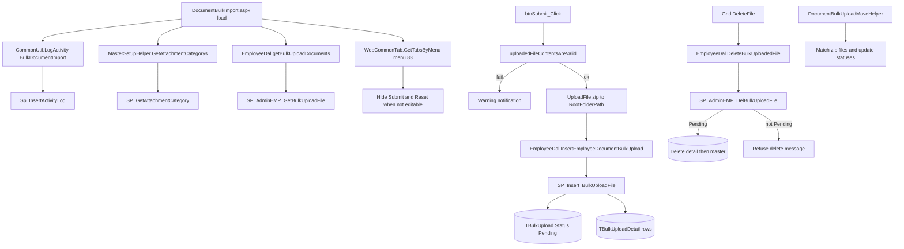
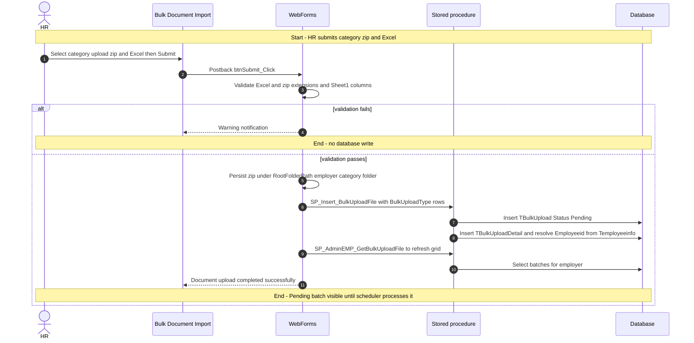
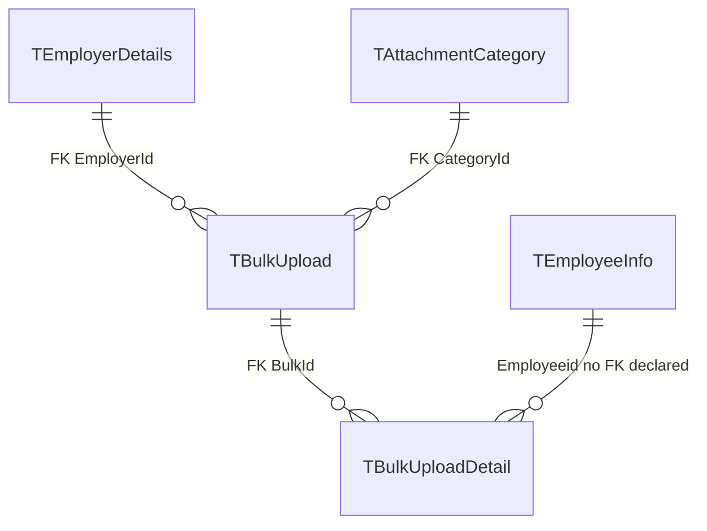

# Bulk Document Import

## Overview

An HR user opens **Employee Management → Bulk Document Import** (`DocumentBulkImport.aspx`, menu id 83) to queue many employee attachment files at once. They pick an attachment category, upload a zip/7z of the files (max 10 MB) and an Excel sheet listing `EmployeeNumber`, `EmployeeName`, and `FileDisplayName (with Extension)`, optionally add comments, and click Submit. The page validates the Excel, persists the zip under the configured root folder, and inserts one `TBulkUpload` batch (`Status` `Pending`) plus one `TBulkUploadDetail` row per Excel line. The grid then shows that batch; Pending rows can be deleted. Opening a batch status opens `EmployeeBulkUploadDetails.aspx` for the detail rows.

Actual file move onto employee document storage is **not** done on this postback. A separate scheduler (`DocumentBulkUploadMoveHelper`) later reads pending batches, matches zip entries to detail display names, and updates detail/master status. Submit on this screen only queues the work.

**Who's involved:**

- **HR / admin** — selects organisation (global-access users), category, files, and submits or deletes Pending batches; needs editable tab grant for menu 83.
- **Scheduler** — `DocumentBulkUploadMoveScheduler` processes Pending batches after submit (outside this page).

There is no SystemModel-2 page for this screen. Table one-liners for `TBulkUpload` / `TBulkUploadDetail` / `TAttachmentCategory` live in `llm-wiki/reference/tables/hrms.md`. Data catalog text ties the same tables to this menu and the document bulk-upload move scheduler.

## Workflow

## Request journey

## Entry points

The breadcrumb on the page is Home / Employee Management / Bulk Document Import. The page class is `HRMS.Web.DocumentBulkImport`. Menu enum is `MenuPage.DOCUMENT_BLUK_IMPORT` (83). Activity type is `ActivityDescription.BulkDocumentImport` (358).

| Entry point | Purpose | Live? |
|---|---|---|
| `HRM/Employee/DocumentBulkImport.aspx` (`~/HRM/Employee/DocumentBulkImport.aspx`) | Queue bulk document zip + Excel batches; list, export, and delete Pending batches | Yes |
| `HRM/Employee/EmployeeBulkUploadDetails.aspx` | Detail popup for one batch (`bulkUploadID` encrypted query string from ViewFile) | Yes (opened from this grid) |

No React screen and no `PageMethod` or Core API route implement this form. Organisation change on `ucGlobalAccessEmployer` redirects back to the same aspx URL.

## Code → database call chain

| Entry | Method | Stored procedure |
|---|---|---|
| Load | `CommonUtil.LogActivity` from `DocumentBulkImport.aspx.cs:45` → `ActivityHelper.LogActivity` (`ActivityHelper.cs:32`) | `Sp_InsertActivityLog` |
| Load / after submit / after delete / grid need-data | `EmployeeDal.getBulkUploadDocuments` (`EmployeeDAL.cs:1468`) from `DocumentBulkImport.aspx.cs:476` | `SP_AdminEMP_GetBulkUploadFile` |
| Load category combo | `MasterSetupHelper.GetAttachmentCategorys` (`MasterSetupHelper.cs:37`) → `CommonDAL.GetAttachmentCategorys` (`CommonDAL.cs:402`) from `DocumentBulkImport.aspx.cs:464` | `SP_GetAttachmentCategory` |
| Org combo (global access control) | `WebCommon.GetGlobalAccessEmployerList` (`Web.Common.cs:547`) → `DBHelper.GetGlobalAccessEmployerList` (`DBHelper.cs:3195`) from `ucGlobalAccessEmployer.ascx.cs:251` | `SP_GetGlobalAccessEmployerList` |
| Submit / Reset visibility | `WebCommonTab.GetTabsByMenu` (`Web.Common.Tab.cs:59`) from `DocumentBulkImport.aspx.cs:245` | Session only (`TAB_BY_ROLE` / `TAB_BY_USER`) — no procedure on this postback |
| Submit | `EmployeeDal.InsertEmployeeDocumentBulkUpload` (`EmployeeDAL.cs:1425`) from `DocumentBulkImport.aspx.cs:95` | `SP_Insert_BulkUploadFile` (hard-coded string; TVP `BulkUploadType`) |
| Grid DeleteFile | `EmployeeDal.DeleteBulkUploadedFile` (`EmployeeDAL.cs:1456`) from `DocumentBulkImport.aspx.cs:158` | `SP_AdminEMP_DelBulkUploadFile` |

`SP_Insert_BulkUploadFile`, `SP_AdminEMP_GetBulkUploadFile`, and `SP_AdminEMP_DelBulkUploadFile` call no nested procedures or functions. Employee id resolution on insert is an inline subquery against `Temployeeinfo`.

## API endpoints

The screen is a WebForms postback. It does not expose an HTTP API for submit, list, or delete.

| Verb | Route | Parameters | Purpose | Source |
|---|---|---|---|---|
| — | — | — | No Core API / PageMethod for this feature | WebForms postbacks only (`btnSubmit_Click`, grid `ItemCommand`, template download) |

Template download is a file response from `HRMSConstants.URLs.URL_DOCUMENT_TEMPLATE` (`lbTemplateDownload_Click`). Zip/Excel bytes are written to disk under `RootFolderPath` / session temp paths, not through an API.

## Stored procedures & tables involved

Delete and get use `ConstantStoredProcedure.SP_Delete_BulkUploadFile` / `SP_Get_BulkUploadFile`, which resolve to `SP_AdminEMP_DelBulkUploadFile` and `SP_AdminEMP_GetBulkUploadFile` (`DBConstant.cs:1242–1243`). Insert uses the literal name `SP_Insert_BulkUploadFile`. Sibling scripts `SP_Delete_BulkUploadFile.sql` and `SP_Get_BulkUploadFile.sql` exist; this page’s DAL does not call those names. The scheduler’s pending-master path uses `SP_Get_BulkUploadFile` instead.

| Object | Script | Purpose |
|---|---|---|
| `SP_Insert_BulkUploadFile` | `HRMS-DATABASE/HRMS/STOREPROCEDURE/SP_Insert_BulkUploadFile.sql` | Insert Pending batch and detail rows from TVP |
| `SP_AdminEMP_GetBulkUploadFile` | `HRMS-DATABASE/HRMS/STOREPROCEDURE/SP_AdminEMP_GetBulkUploadFile.sql` | List batches for employer, or detail rows for one BulkId |
| `SP_AdminEMP_DelBulkUploadFile` | `HRMS-DATABASE/HRMS/STOREPROCEDURE/SP_AdminEMP_DelBulkUploadFile.sql` | Hard-delete Pending batch and its details |
| `SP_GetAttachmentCategory` | `HRMS-DATABASE/HRMS/STOREPROCEDURE/SP_GetAttachmentCategory.sql` | Category combo for the employer |
| `Sp_InsertActivityLog` | `HRMS-DATABASE/HRMS/STOREPROCEDURE/Sp_InsertActivityLog.sql` | Activity row on page open |
| `SP_GetGlobalAccessEmployerList` | `HRMS-DATABASE/HRMS/STOREPROCEDURE/SP_GetGlobalAccessEmployerList.sql` | Organisation combo for global-access users |
| `BulkUploadType` | `HRMS-DATABASE/HRMS/UDT/BulkUploadType.sql` | TVP columns `EmploymentNumber`, `EmpName`, `DisplayName` |

`TBulkUpload`, `TBulkUploadDetail`, and `TAttachmentCategory` are summarized in `llm-wiki/reference/tables/hrms.md`.

## Table relationships

`TBulkUpload.CategoryId` FK → `TAttachmentCategory.ID`. `TBulkUpload.EmployerId` FK → `TEmployerDetails.Employerid`. `TBulkUploadDetail.BulkId` FK → `TBulkUpload.Bulkid`. `TBulkUploadDetail.Employeeid` has no FK declared; insert resolves it from `Temployeeinfo` by employment number and employer.

## Known gaps

- No SystemModel-2 page names this screen in the SourceCode tree that was searched.
- Submit only queues `Pending`; file placement onto employee documents is done later by `DocumentBulkUploadMoveHelper` / `DocumentBulkUploadMoveScheduler`, not by this aspx.
- Excel validation requires columns `EmployeeNumber`, `EmployeeName`, and `FileDisplayName (with Extension)`, while TVP `BulkUploadType` expects `EmploymentNumber`, `EmpName`, and `DisplayName`. The page passes the Excel `DataTable` through without renaming columns.
- Menu enum spelling is `DOCUMENT_BLUK_IMPORT`; URL constant is `URL_DOCUMENT_BULK_IMPLORT`.
- Sibling procedures `SP_Get_BulkUploadFile` and `SP_Delete_BulkUploadFile` remain in the database tree. The page uses the `SP_AdminEMP_*` names for get/delete; the scheduler pending-master path uses `SP_Get_BulkUploadFile`.
- A separate Bulk Upload Scheduler path (`BulkDocumentImportTemplate` → `Sp_InsertSSIS_Temp_BulkDocumentImportTemplate` / `SP_Validate_BulkDocumentImportDetails` / `uspProcessBulkDocumentImportData`) is a different feature surface and is not called from `DocumentBulkImport.aspx`.
- Tab permission reads session caches only on this page; those caches are loaded elsewhere at login.

## Reference

Confidence is medium. The postback → DAL → inventoried procedure names and table FKs agree. Gaps above are the Excel/TVP column-name mismatch, async scheduler completion path, and sibling `SP_Get_BulkUploadFile` / `SP_Delete_BulkUploadFile` scripts.

### SourceCode

- `HRMS.Web/HRMS.Web/HRM/Employee/DocumentBulkImport.aspx`
- `HRMS.Web/HRMS.Web/HRM/Employee/DocumentBulkImport.aspx.cs`
- `HRMS.Web/HRMS.Web/HRM/Employee/EmployeeBulkUploadDetails.aspx.cs`
- `HRMS.Shared/HRMS.DataAccessLayer/Employee/EmployeeDAL.cs`
- `HRMS.Shared/HRMS.DataAccessLayer/CommonDAL.cs`
- `HRMS.Shared/HRMS.DataAccessLayer/DBConstant.cs`
- `HRMS.Shared/HRMS.DataAccessLayer/DBHelper.cs`
- `HRMS.Shared/HRMS.BusinessLayer/MasterSetupHelper.cs`
- `HRMS.Shared/HRMS.Common/Common.cs`
- `HRMS.Shared/TDG.ActivityAuditLog/DAL/ActivityHelper.cs`
- `HRMS.Web/HRMS.Web/Common/Web.Common.cs`
- `HRMS.Web/HRMS.Web/Common/Web.Common.Tab.cs`
- `HRMS.Web/HRMS.Web/HRM/CustomControls/ucGlobalAccessEmployer.ascx.cs`
- `HRMS.Scheduler/HRMS.BusinessLayer.Scheduler/DocumentBulkUploadMoveHelper.cs`

### TDG HRMS DB

- `HRMS-DATABASE/HRMS/STOREPROCEDURE/SP_Insert_BulkUploadFile.sql`
- `HRMS-DATABASE/HRMS/STOREPROCEDURE/SP_AdminEMP_GetBulkUploadFile.sql`
- `HRMS-DATABASE/HRMS/STOREPROCEDURE/SP_AdminEMP_DelBulkUploadFile.sql`
- `HRMS-DATABASE/HRMS/STOREPROCEDURE/SP_GetAttachmentCategory.sql`
- `HRMS-DATABASE/HRMS/STOREPROCEDURE/Sp_InsertActivityLog.sql`
- `HRMS-DATABASE/HRMS/STOREPROCEDURE/SP_GetGlobalAccessEmployerList.sql`
- `HRMS-DATABASE/HRMS/STOREPROCEDURE/SP_Get_BulkUploadFile.sql` (scheduler sibling; not the page get name)
- `HRMS-DATABASE/HRMS/STOREPROCEDURE/SP_Delete_BulkUploadFile.sql` (sibling; not the page delete name)
- `HRMS-DATABASE/HRMS/UDT/BulkUploadType.sql`
- `HRMS-DATABASE/HRMS/TABLES/TBulkUpload.sql`
- `HRMS-DATABASE/HRMS/TABLES/TBulkUploadDetail.sql`
- `HRMS-DATABASE/HRMS/TABLES/TAttachmentCategory.sql`
- `llm-wiki/reference/tables/hrms.md`
