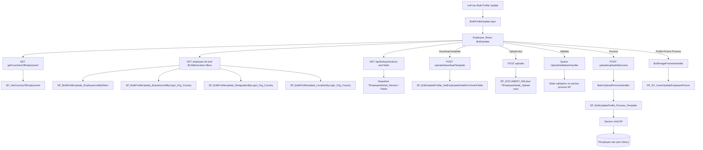
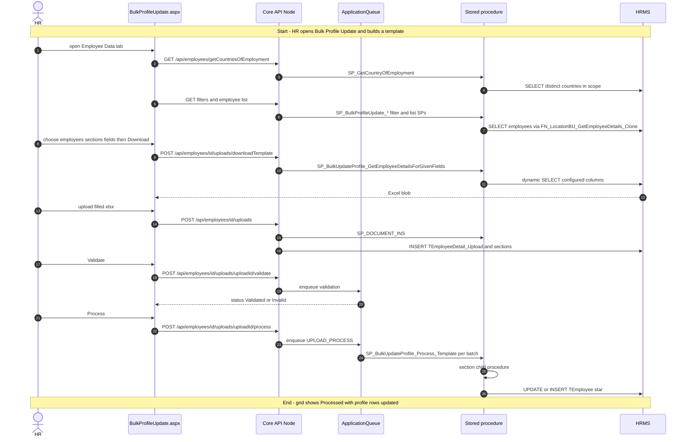
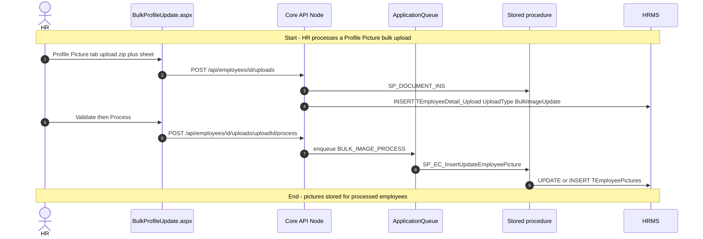
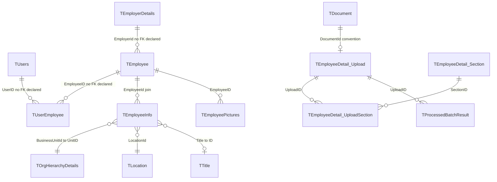

# Bulk Profile Update

## Overview

An HR user needs to change the same My Details fields for many employees at once. They open **Employee Management → Bulk Profile Update** (`BulkProfileUpdate.aspx`), which hosts the Employee_React SPA. On the **Employee Data** tab they pick a country of employment, filter people by business unit / designation / work location, choose sections and fields, then download an Excel template (optionally prefilled with existing values). They edit the sheet offline, upload it, wait for queue validation, fix invalid rows on the result screen, and finally **Process**. Process runs in batches through `SP_BulkUpdateProfile_Process_Template`, which dispatches per section into the live `TEmployee*` tables (and history helpers). The **Profile Picture** tab follows the same upload/validate/process shape but writes pictures via `SP_EC_InsertUpdateEmployeePicture` instead of the section template SP.

**Who's involved:**

- **HR / admin with Bulk Profile Update access** — builds the template, uploads, validates, processes.
- **Employees in scope** — rows in the sheet; visibility is limited by the uploader’s location/BU mapping (`FN_LocationBU_GetEmployeeDetails_Clone`).
- **Queue workers** — Node ApplicationQueue validates and processes uploads asynchronously after the API returns 202.

There is no dedicated `llm-wiki/domain` page for Bulk Profile Update. Profile satellite tables and history patterns are covered under employee lifecycle prose where present; upload staging lives in `TEmployeeDetail_Upload` / `TEmployeeDetail_UploadSection`.

## Workflow

## Request journey

The request that changes employee data is **Process** on a validated Employee Data upload. Download/upload/validate prepare staging rows; they do not write profile tables.

## Entry points

| UI page / route | Purpose |
|---|---|
| `/HRM/Employee_React/BulkProfileUpdate.aspx` | Left-nav **Bulk Profile Update**. WebForms shell sets session hidden fields; React mounts on `#root`. |
| `/HRM/Employee_React/BulkProfileUpdate.aspx/:resultId` | Valid/invalid result grid for one upload (`ValidInvalidRecords`). |
| Employee_React route `ROUTES.BulkProfileUpdate` | `BulkProfileUpdateLayout` → `BulkUpdatePage` → `TemplateBuilder` (Employee Data / Profile Picture tabs). |

Page code-behind only logs activity and binds the logged-in user; there is **no WebForms postback** data path. All work is Core API over JWT.

## Code → database call chain

| Entry point | Handler / service (`file:line`) | Stored procedure / persistence |
|---|---|---|
| Page load activity | `BulkProfileUpdate.aspx.cs:22` `CommonUtil.LogActivity` | activity log (not profile write) |
| Initial countries | `BulkUpdateProvider.js:203` → `EmployeeRepository.getCountriesOfEmployment` (`Core/Repositories/EmployeeRepository.js:65`) | `SP_GetCountryOfEmployment` |
| Employee picker list | `BulkUpdateProvider.js:265` → `EmployeeListHandler.js:21` | `SP_BulkProfileUpdate_EmployeeListByFilters` |
| BU filter | `BulkUpdateProvider.js:267` → `EmployeeBusinessUnitFiltersHandler.js:21` | `SP_BulkProfileUpdate_BusinessUnitByLogin_Org_Country` |
| Designation filter | `BulkUpdateProvider.js:268` → `EmployeeDesignationFiltersHandler.js:21` | `SP_BulkProfileUpdate_DesignationByLogin_Org_Country` |
| Work location filter | `BulkUpdateProvider.js:269` → `EmployeeWorkLocationFiltersHandler.js:21` | `SP_BulkProfileUpdate_LocationByLogin_Org_Country` |
| Sections list | `EmployeeHttpClient.js:30` → `SectionsQueryHandler` → `SectionRepository.getSectionsByCategory` | Sequelize `TEmployeeDetail_Section` (no SP) |
| Fields list | `_helpers.js:71` → `FieldsQueryHandler` → `FieldRepository.getSystemFields` | Sequelize `TEmployeeDetail_Fields` (no SP) |
| Download / preview template | `DownloadBulkProfileUpdateComponent.js:252` → `DownloadTemplateQueryHandler` → `BulkProfileTemplateBuilder._getEmployeesInformationBySection` (`BulkProfileTemplateBuilder.js:320`) | `SP_BulkUpdateProfile_GetEmployeeDetailsForGivenFields` (when existing data requested) |
| Upload template | `UploadFile.js:84` → `UploadTemplateCommandHandler` → `BulkTemplateInsert._createDocument` (`BulkTemplateInsert.js:103`) then Sequelize create | `SP_DOCUMENT_INS` + `TEmployeeDetail_Upload` / `_UploadSection` |
| List uploads | `UploadedFilesGridNew.js:131` → `UploadsQueryHandler` | Sequelize upload models (no SP) |
| Validate / revalidate | `UploadedFilesGridNew.js:350` / `ValidInvalidRecords.js:1031` → queue / `RevalidateUploadHandler` | Node validators; optional IFSC/education master helpers; **no** `Process_Template` |
| Process Employee Data | `UploadedFilesGridNew.js:406` → `UploadProcessHandler` → queue `batchUploadProcessHandler` → `UploadRepository.processBatch` (`UploadRepository.js:579`) | `SP_BulkUpdateProfile_Process_Template` → section child SP |
| Process Profile Picture | same process route → `BulkImageProcessHandler.js:210` | `SP_EC_InsertUpdateEmployeePicture` |
| Delete upload | `UploadedFilesGridNew.js:326` → `DeleteUploadHandler` | Sequelize soft/hard delete on upload rows |

`SP_BulkUpdateProfile_Process_Template` section dispatch (`TEmployeeDetail_Section.SECTION`):

| Section | Child procedure |
|---|---|
| Personal Details | `SP_BulkUpdateProfile_UpdateEmployeeDetails` |
| Skill Details | `SP_BulkUpdateProfile_ProcessEmployeesSkillsInformation` |
| Domain Details | `SP_BulkUpdateProfile_ProcessEmployeesDomainInformation` |
| Passport Details | `SP_BulkUpdateProfile_UpdateEmployeePassportInformation` |
| Visa Details | `SP_BulkUpdateProfile_UpdateEmployeeVisaInformation` |
| Past Employment Details | `SP_BulkUpdateProfile_ProcessEmployeesPastEmploymentInformation` |
| Bank Details | `SP_BulkUpdateProfile_ProcessEmployeesBankDetailInformation` |
| Education Details | `SP_BulkUpdateProfile_ProcessEmployeesEducationInformation` |
| Nomination Details | `SP_BulkUpdateProfile_ProcessEmployeesNominationInformation` |
| Family Details | `SP_BulkUpdateProfile_ProcessEmployeesFamilyInformation` |
| Contact Details | `SP_BulkUpdateProfile_ProcessEmployeesContactInformation` |
| Emergency Contact Details | `SP_BulkUpdateProfile_ProcessEmployeesEmergencyContactInformation` |
| Certification Details | `SP_BulkUpdateProfile_ProcessEmployeesCertificationInformation` |
| Current Employment Details | `SP_BulkUpdateProfile_UpdateCurrentEmploymentDetails` |

## API endpoints

Routes mount under `/api/employees` (BulkProfileUpdate feature router + EmployeeRoutes) and `/api/lookup`. No ASP.NET postback.

| Verb | Route | Parameters | Purpose | Source |
|---|---|---|---|---|
| `GET` | `/api/employees/getCountriesOfEmployment` | query `employerId`, `employeeId` (required) | Countries in scope | `EmployeeRoutes.js:58` |
| `GET` | `/api/employees/getSameBusinessUnitEmployees` | query `employeeId`, `employerId`, `countryId` (required); `businessUnit`, `designation`, `workLocation` optional | Employee multi-select | `EmployeeRoutes.js:35` |
| `GET` | `/api/employees/getEmployeesFilter` | query `employeeId`, `employerId`, `countryId` | BU filter options | `BulkProfileUpdate/routes.js:306` |
| `GET` | `/api/employees/getDesignationFilter` | same | Designation options | `routes.js:333` |
| `GET` | `/api/employees/getWorkLocationFilter` | same | Work location options | `routes.js:360` |
| `GET` | `/api/lookup/sections` | query `categoryId` | Section checklist | `Lookup/router.js` |
| `GET` | `/api/lookup/fields` | query `employerId`, `sectionId`, `countryId` | Field checklist | `FieldsQueryHandler.js:29` |
| `POST` | `/api/employees/:employeeId/uploads/downloadTemplate` | path `employeeId`; body employees, section, country, flags | Excel download | `routes.js:53` |
| `POST` | `/api/employees/:employeeId/uploads` | path `employeeId`; multipart `file`, optional `imgZipFile`, form fields | Upload template | `routes.js:80` |
| `GET` | `/api/employees/:employeeId/uploads` | path + query `employerId`, `include`, `uploadType` | Upload history grid | `routes.js:279` |
| `GET` | `/api/employees/:employeeId/uploads/:uploadId` | path ids | One upload status | `routes.js:112` |
| `DELETE` | `/api/employees/:employeeId/uploads/:uploadId` | path ids | Delete upload | `routes.js:133` |
| `GET` | `/api/employees/:employeeId/uploads/:uploadId/result` | path ids | Validation result payload | `routes.js:156` |
| `POST` | `/api/employees/:employeeId/uploads/:uploadId/validate` | path ids | Enqueue validation | `routes.js:177` |
| `PUT` | `/api/employees/:employeeId/uploads/:uploadId/revalidate` | path ids; JSON body rows | Revalidate edited rows | `routes.js:205` |
| `POST` | `/api/employees/:employeeId/uploads/:uploadId/process` | path ids | Enqueue process | `routes.js:228` |
| `POST` | `/api/employees/:employeeId/uploads/:uploadId/retry` | path ids | Retry process | `routes.js:249` |
| `GET` | `/api/employees/:employeeId/uploads/:uploadId/preview/:image` | path ids + image | Picture preview blob | `routes.js:207` |
| `GET` | `/api/employees/bank-details/validate-ifsc/:ifsc` | path `ifsc` | IFSC proxy (revalidate UI) | shared employee bank route |

## Stored procedures & tables involved

| Object | File path | Purpose | llm-wiki |
|---|---|---|---|
| `SP_GetCountryOfEmployment` | `HRMS-DATABASE/HRMS/STOREPROCEDURE/SP_GetCountryOfEmployment.sql` | Distinct countries for employees in login scope | — |
| `SP_BulkProfileUpdate_EmployeeListByFilters` | `…/SP_BulkProfileUpdate_EmployeeListByFilters.sql` | Employee picker rows | — |
| `SP_BulkProfileUpdate_BusinessUnitByLogin_Org_Country` | same folder | BU filter values | — |
| `SP_BulkProfileUpdate_DesignationByLogin_Org_Country` | same folder | Designation filter values | — |
| `SP_BulkProfileUpdate_LocationByLogin_Org_Country` | same folder | Location filter values | — |
| `FN_LocationBU_GetEmployeeDetails_Clone` | `HRMS-DATABASE/HRMS/FUNCTIONS/FN_LocationBU_GetEmployeeDetails_Clone.sql` | Location/BU-scoped employee set for filters | — |
| `SP_BulkUpdateProfile_GetEmployeeDetailsForGivenFields` | `STOREPROCEDURE/` | Prefill template columns | — |
| `SP_DOCUMENT_INS` | `STOREPROCEDURE/` | Document metadata for uploaded xlsx | — |
| `SP_BulkUpdateProfile_Process_Template` | `STOREPROCEDURE/` | Batch process dispatcher | — |
| Section child `SP_BulkUpdateProfile_*` | `STOREPROCEDURE/` | Per-section live writes | — |
| `SP_EC_InsertUpdateEmployeePicture` | `STOREPROCEDURE/` | Profile picture binary | — |
| `TEmployeeDetail_Upload` / `_UploadSection` | `TABLES/` | Upload staging + JSON rows | — |
| `TEmployee` / `TEmployeeInfo` / satellite `TEmployee*` | `TABLES/` | Live profile | employee lifecycle tables where documented |
| `TEmployeePictures` / `TParameters` | `TABLES/` | Picture + ImageDate parameter | — |
| `TProcessedBatchResult` | `TABLES/` | Batch idempotency for process | — |

## Table relationships

Declared FKs are sparse on upload/staging tables. Edges below follow the scripts and procedure joins used by this feature (many “no FK declared”).

## Known gaps

- `docs/SystemModels/SystemModel-2/` has no workflow page naming Bulk Profile Update in the tree searched.
- Sections/fields load via Sequelize ORM, not stored procedures; only SP-backed hops are listed as database pages.
- Validation and revalidation run in Node (`ValidationEngine`, section validators, IFSC/education helpers). Process may call `USP_SaveBank` / education master inserts from Node before the template SP — those are side paths, not `Process_Template` children.
- Legacy `Queue/UploadProcessHandler.js` still contains an alternate `processUploadUsingSP` signature; live process uses `BatchUploadProcessHandler` → `UploadRepository.processBatch`.
- Left-nav also lists **Employee Bulk Update** as a separate submenu; this guide covers **Bulk Profile Update** only (`BulkProfileUpdate.aspx`).
- `llm-wiki` domain pages were not present in this workspace mirror for bulk-profile-specific lifecycle prose.

## Reference

Confidence is high for the Employee Data download → upload → validate → process chain and the filter SPs. Picture process and ORM-only lookups are included from the same SPA.

### SourceCode

- `HRMS.Web/HRMS.Web/HRM/Employee_React/BulkProfileUpdate.aspx`
- `HRMS.Web/HRMS.Web/HRM/Employee_React/BulkProfileUpdate.aspx.cs`
- `HRMS.Web/HRMS.Web/HRM/Employee_React/routes.js`
- `HRMS.Web/HRMS.Web/HRM/Employee_React/Areas/BulkUpdate/`
- `HRMS.Web/HRMS.Web/HRM/Employee_React/Common/HttpClients/EmployeeHttpClient.js`
- `HRMS.CoreAPI/HRMS.Core.WebAPI.Node/Features/Employee/BulkProfileUpdate/`
- `HRMS.CoreAPI/HRMS.Core.WebAPI.Node/Features/Lookup/Handlers/SectionsQueryHandler.js`
- `HRMS.CoreAPI/HRMS.Core.WebAPI.Node/Features/Lookup/Handlers/FieldsQueryHandler.js`
- `HRMS.CoreAPI/HRMS.Core.WebAPI.Node/Routes/EmployeeRoutes.js`
- `HRMS.CoreAPI/HRMS.Core.WebAPI.Node/Core/Repositories/EmployeeRepository.js`
- `HRMS.CoreAPI/HRMS.Core.WebAPI.Node/ORM/Repositories/UploadRepository.js`

### TDG HRMS DB

- `HRMS-DATABASE/HRMS/STOREPROCEDURE/SP_GetCountryOfEmployment.sql`
- `HRMS-DATABASE/HRMS/STOREPROCEDURE/SP_BulkProfileUpdate_EmployeeListByFilters.sql`
- `HRMS-DATABASE/HRMS/STOREPROCEDURE/SP_BulkProfileUpdate_BusinessUnitByLogin_Org_Country.sql`
- `HRMS-DATABASE/HRMS/STOREPROCEDURE/SP_BulkProfileUpdate_DesignationByLogin_Org_Country.sql`
- `HRMS-DATABASE/HRMS/STOREPROCEDURE/SP_BulkProfileUpdate_LocationByLogin_Org_Country.sql`
- `HRMS-DATABASE/HRMS/STOREPROCEDURE/SP_BulkUpdateProfile_GetEmployeeDetailsForGivenFields.sql`
- `HRMS-DATABASE/HRMS/STOREPROCEDURE/SP_BulkUpdateProfile_Process_Template.sql`
- `HRMS-DATABASE/HRMS/STOREPROCEDURE/SP_BulkUpdateProfile_UpdateEmployeeDetails.sql` (and sibling section process SPs)
- `HRMS-DATABASE/HRMS/STOREPROCEDURE/SP_DOCUMENT_INS.sql`
- `HRMS-DATABASE/HRMS/STOREPROCEDURE/SP_EC_InsertUpdateEmployeePicture.sql`
- `HRMS-DATABASE/HRMS/FUNCTIONS/FN_LocationBU_GetEmployeeDetails_Clone.sql`
