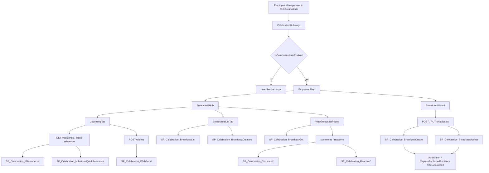
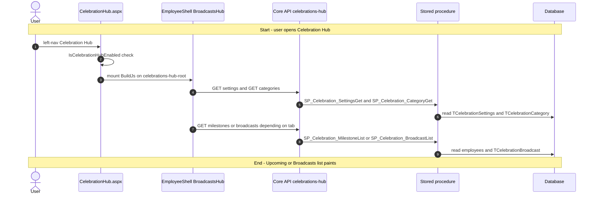
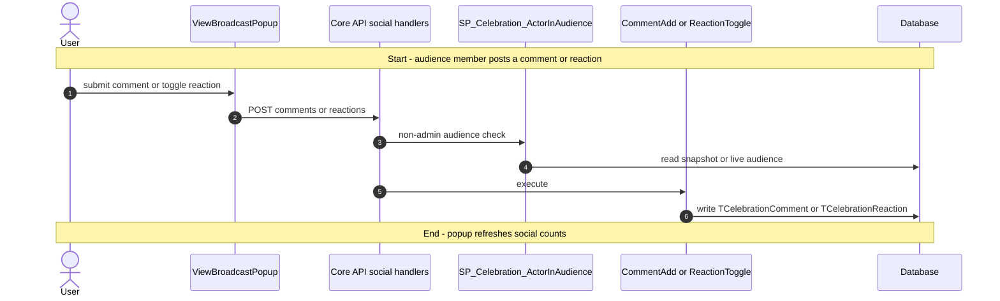
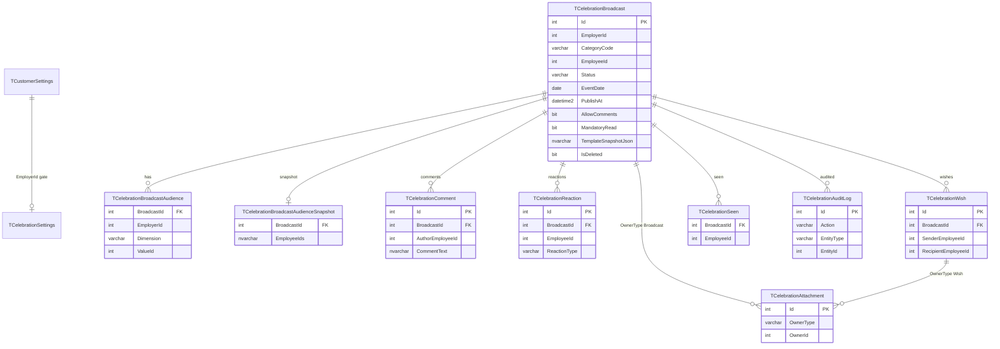

# Celebration Hub

## Overview

An employee or HR user opens **Employee Management → Celebration Hub** (`~/HRM/Employee/CelebrationHub.aspx`) to work with organisation celebrations: upcoming birthdays and work anniversaries, create or edit broadcasts (News, Announcement, milestone posts), view a published card with comments and reactions, send a personal wish, and inspect mandatory-read audience when that mode is on. The WebForms host only gates on `TCustomerSettings.IsCelebrationHubEnabled` for the signed-in employer and mounts the EmployeeManagement React bundle on `#celebrations-hub-root`. All list and mutation traffic goes to Core API `/api/celebrations-hub` (file download can also use `/api/employees/celebrations-hub/files/:id` because IIS blocks the hub prefix for static file forwards).

React `EmployeeShell` defaults to the hub list (`BroadcastsHub`: Upcoming + Broadcasts tabs). `?view=create` or `?view=edit&id=` opens `BroadcastWizard`. This page is not Celebration Hub Settings (`CelebrationHubSettings.aspx` under Admin Configuration).

**Who's involved:**

- **Employee / creator** — browses upcoming milestones, creates or edits broadcasts, comments, reacts, sends wishes.
- **HR / admin actor** — same shell; API `resolveActor` can grant broader delete and limited-edit actions when the role is admin.
- **HR administrator (settings)** — configures categories, templates, and behaviour on Celebration Hub Settings (separate guide).

SystemModel-2 has no page for this screen. Celebration tables live under `HRMS-DATABASE/HRMS/DDL/161632/`. There is no llm-wiki domain `erDiagram` to reuse.

## Workflow



Opening the hub also loads settings and categories (read-only for this shell) so Upcoming and action menus honour enabled categories and auto-posting banners.

## Request journey

### Employee — open Celebration Hub



### Employee — create and publish a broadcast

```mermaid
sequenceDiagram
  autonumber
  actor User
  participant Wizard as BroadcastWizard
  participant API as Core API celebrations-hub
  participant Create as SP_Celebration_BroadcastCreate
  participant Audit as SP_Celebration_AuditInsert
  participant Cap as SP_Celebration_CapturePublishedAudience
  participant Get as SP_Celebration_BroadcastGet
  participant DB as Database

  Note over User,DB: Start - user saves a new broadcast as Published
  User->>Wizard: Create broadcast and Publish
  Wizard->>API: POST files for attachments or avatar
  API->>DB: SP_Celebration_FileInsert metadata
  Wizard->>API: POST broadcasts/duplicate-check when milestone
  API->>DB: SP_Celebration_BroadcastDuplicateCheck
  Wizard->>API: POST broadcasts
  API->>Create: execute
  Create->>DB: insert TCelebrationBroadcast and audience
  Create->>Audit: Broadcast.Create
  Audit->>DB: insert TCelebrationAuditLog
  Create->>Cap: when status Published
  Cap->>DB: write audience snapshot
  Create->>Get: return detail
  Note over User,DB: End - published broadcast detail returned
```

### Employee — comment or react on a published card



## Entry points

| UI page | Purpose |
|---|---|
| `HRM/Employee/CelebrationHub.aspx` | Employee-facing Celebration Hub host. URL `~/HRM/Employee/CelebrationHub.aspx` (menu id `1359`) |
| React `EmployeeShell` at `celebrationsPaths.employee` | Same aspx. `?view=list` (default), `?view=create`, `?view=edit&id=` |
| Sibling `CelebrationHubSettings.aspx` | Admin Configuration settings — not this guide |

The host has no `WebMethod` and no postback save. The React app posts to Core API with the auth header from `@hrms/sdk`.

## Code → database call chain

| Entry | Method | Stored procedure |
|---|---|---|
| Gate on open | `Page_Load` (`CelebrationHub.aspx.cs:11`) → `DBHelper.IsCelebrationHubEnabled` (`DBHelper.cs:3439`) | Raw `SELECT` on `TCustomerSettings` (no SP) |
| Mount React | `main.tsx` celebrations path → `App.tsx` route → `EmployeeShell` (`EmployeeShell.tsx:22`) | — |
| Load settings | `useCelebSettings` → `fetchSettings` (`settings.ts:23`) → `getSettings` (`settings/handlers.js:53`) | `SP_Celebration_SettingsGet` |
| Org timezone overlay | `loadSettings` / `getSettings` → `resolveOrgIanaZone` | Raw `SELECT` on `TEmployerDetails` (no SP) |
| Load categories | `useCelebCategories` → `fetchCategories` (`settings.ts:59`) → `getCategories` (`categories/handlers.js:7`) | `SP_Celebration_CategoryGet` |
| Upcoming milestones | `useCelebMilestones` → `fetchMilestones` (`milestones.ts:16`) → `listMilestones` (`milestones/handlers.js:14`) | `SP_Celebration_MilestoneList` |
| Quick reference sidebar | `useCelebQuickReference` → `fetchQuickReference` (`milestones.ts:40`) → `quickReference` (`milestones/handlers.js:44`) | `SP_Celebration_MilestoneQuickReference` (nests `SP_Celebration_MilestoneList`) |
| Notification opt-outs | `NotificationOptOutDialog` → `fetchNotificationOptOuts` (`milestones.ts:72`) → `listNotificationOptOuts` (`milestones/handlers.js:114`) | `SP_Celebration_ListNotificationOptOuts` |
| Broadcasts list | `useCelebBroadcasts` → `fetchBroadcasts` (`broadcasts.ts:72`) → `listBroadcasts` (`broadcasts/handlers.js:366`) | `SP_Celebration_BroadcastList` |
| Creator filter options | `fetchBroadcastCreators` (`broadcasts.ts:117`) → `listBroadcastCreators` (`broadcasts/handlers.js:427`) | `SP_Celebration_BroadcastCreators` |
| Broadcast detail | `fetchBroadcast` (`broadcasts.ts:133`) → `getBroadcast` (`broadcasts/handlers.js:445`) | `SP_Celebration_BroadcastGet` |
| Duplicate check | `checkBroadcastDuplicate` (`broadcasts.ts:142`) → `duplicateCheck` (`broadcasts/handlers.js:478`) | `SP_Celebration_BroadcastDuplicateCheck` |
| Create broadcast | `createBroadcast` (`broadcasts.ts:161`) → `createBroadcast` (`broadcasts/handlers.js:584`) | `SP_Celebration_BroadcastCreate` |
| Update broadcast | `updateBroadcast` (`broadcasts.ts:167`) → `updateBroadcast` (`broadcasts/handlers.js:807`) | `SP_Celebration_BroadcastUpdate` |
| Limited edit | `limitedEditBroadcast` (`broadcasts.ts:180`) → `limitedEdit` (`broadcasts/handlers.js:886`) | `SP_Celebration_BroadcastLimitedEdit` |
| Delete broadcast | `deleteBroadcast` (`broadcasts.ts:194`) → `deleteBroadcast` (`broadcasts/handlers.js:926`) | `SP_Celebration_BroadcastDelete` |
| Read audience | `fetchReadAudience` (`broadcasts.ts:352`) → `listReadAudience` (`broadcasts/handlers.js:968`) | `SP_Celebration_ReadAudienceList` |
| Employee search / event date | `searchCelebrationEmployees` / `fetchEmployeeEventDate` (`milestones.ts`) → `milestones/handlers.js` | `SP_Celebration_EmployeeSearch` / `SP_Celebration_EmployeeEventDate` |
| Templates for wizard | `useCelebTemplates` → `fetchTemplates` (`templates.ts:36`) → `listTemplates` (`templates/handlers.js:136`) | `SP_Celebration_TemplateList` |
| Upload / list / delete / stream files | `broadcasts.ts` / `client.ts` → `files/handlers.js` | `SP_Celebration_FileInsert` / `FileList` / `FileGet` / `FileDelete` / `FileBind` |
| Comments | `fetchBroadcastComments` / `add` / `update` / `delete` (`broadcasts.ts`) → `social/handlers.js` | `SP_Celebration_CommentList` / `CommentAdd` / `CommentUpdate` / `CommentDelete`; gate `SP_Celebration_ActorInAudience` |
| Reactions | `fetchBroadcastReactions` / `toggleBroadcastReaction` → `social/handlers.js` | `SP_Celebration_ReactionList` / `ReactionToggle`; gate `SP_Celebration_ActorInAudience` |
| Send wish | `sendWish` (`broadcasts.ts:388`) → `sendWish` (`wishes/handlers.js:109`) | `SP_Celebration_WishSend` then optional `SP_Celebration_FileBind` |
| Audience dimension lookups | `fetchAudienceLookups` (`lookups.ts:166`) | Core `/api/entity/*` and `/api/dashBoard/GetEmploymentTypeList` (not Celebration SPs) |

Create/update that publish call nested `SP_Celebration_AuditInsert`, optionally `SP_Celebration_CapturePublishedAudience`, then `SP_Celebration_BroadcastGet`. Display-name helpers use `Fn_GetEmployeeName`; milestone dates use `Fn_Celebration_NextEventDate`; audience snapshots use `Fn_Celebration_SnapshotEmployeeIds` / `Fn_Celebration_EmployeeInSnapshot`.

## API endpoints

This aspx does not post back. The React shell calls Core API under `/api/celebrations-hub` (mounted in `Features/CelebrationsHub/router.js`, behind `guards` and `requireActor`). File bytes for Office links also expose `GET /api/employees/celebrations-hub/files/:id`.

| Verb | Route | Parameters | Purpose | Source |
|---|---|---|---|---|
| `GET` | `/api/celebrations-hub/settings` | query `employerId` | Behaviour / auto-post flags for UI | `router.js:37` |
| `GET` | `/api/celebrations-hub/categories` | query `employerId` | Enabled categories | `router.js:42` |
| `GET` | `/api/celebrations-hub/templates` | query `employerId` | Wizard template picker | `router.js:47` |
| `GET` | `/api/celebrations-hub/milestones` | query employer, category, search | Upcoming cards | `router.js:69` |
| `GET` | `/api/celebrations-hub/milestones/quick-reference` | query `employerId` | Sidebar quick list | `router.js:68` |
| `GET` | `/api/celebrations-hub/employees/search` | query employer, search, category | Wizard employee picker | `router.js:70` |
| `GET` | `/api/celebrations-hub/employees/notification-opt-outs` | query `employerId` | Opt-out dialog | `router.js:71` |
| `GET` | `/api/celebrations-hub/employees/:id/event-date` | query employer, categoryCode | Milestone event date | `router.js:72` |
| `GET` | `/api/celebrations-hub/broadcasts` | query filters, page, pageSize | Broadcasts tab | `router.js:74` |
| `GET` | `/api/celebrations-hub/broadcasts/creators` | query `employerId` | Created-by filter | `router.js:75` |
| `POST` | `/api/celebrations-hub/broadcasts/duplicate-check` | body category, employee, eventDate | Milestone uniqueness | `router.js:77` |
| `POST` | `/api/celebrations-hub/broadcasts` | body write payload | Create | `router.js:78` |
| `GET` | `/api/celebrations-hub/broadcasts/:id` | query `employerId` | Detail / edit load | `router.js:82` |
| `PUT` | `/api/celebrations-hub/broadcasts/:id` | body write payload, rowVer | Update | `router.js:83` |
| `PUT` | `/api/celebrations-hub/broadcasts/:id/limited-edit` | body allowComments, rowVer | Published comment toggle | `router.js:79` |
| `DELETE` | `/api/celebrations-hub/broadcasts/:id` | query `employerId` | Soft-delete when allowed | `router.js:84` |
| `GET` | `/api/celebrations-hub/broadcasts/:id/read-audience` | query bucket, search | Mandatory-read lists | `router.js:80` |
| `GET`/`POST` | `/api/celebrations-hub/broadcasts/:id/comments` | query/body as documented | List / add comments | `router.js:86-87` |
| `PUT`/`DELETE` | `/api/celebrations-hub/comments/:id` | body/query | Update / delete comment | `router.js:90-91` |
| `GET`/`POST` | `/api/celebrations-hub/broadcasts/:id/reactions` | query/body reactionType | List / toggle | `router.js:88-89` |
| `POST` | `/api/celebrations-hub/wishes` | body wish fields | Send wish | `router.js:100` |
| `POST`/`GET`/`DELETE` | `/api/celebrations-hub/files`… | multipart or owner filters | Stage / list / delete / stream | `router.js:53-66`, public `GET files/:id` |

Feed, dashboard-ticker, and jobs routes exist on the same router but are not mounted by this Celebration Hub aspx (dashboard / scheduler consumers).

## Stored procedures & tables involved

| Object | File | Purpose | Wiki |
|---|---|---|---|
| [SP_Celebration_SettingsGet](/docs/database/hrms/SP_Celebration_SettingsGet) | `STOREPROCEDURE/161632/SP_Celebration_SettingsGet.sql` | Read settings for UI gates | — |
| [SP_Celebration_CategoryGet](/docs/database/hrms/SP_Celebration_CategoryGet) | `…/SP_Celebration_CategoryGet.sql` | Category enablement | — |
| [SP_Celebration_MilestoneList](/docs/database/hrms/SP_Celebration_MilestoneList) | `…/SP_Celebration_MilestoneList.sql` | Upcoming milestone cards | — |
| [SP_Celebration_MilestoneQuickReference](/docs/database/hrms/SP_Celebration_MilestoneQuickReference) | `…/SP_Celebration_MilestoneQuickReference.sql` | Sidebar; nests MilestoneList | — |
| [SP_Celebration_ListNotificationOptOuts](/docs/database/hrms/SP_Celebration_ListNotificationOptOuts) | `…/SP_Celebration_ListNotificationOptOuts.sql` | Email opt-outs | — |
| [SP_Celebration_EmployeeSearch](/docs/database/hrms/SP_Celebration_EmployeeSearch) | `…/SP_Celebration_EmployeeSearch.sql` | Wizard employee search | — |
| [SP_Celebration_EmployeeEventDate](/docs/database/hrms/SP_Celebration_EmployeeEventDate) | `…/SP_Celebration_EmployeeEventDate.sql` | Next event date | — |
| [SP_Celebration_BroadcastList](/docs/database/hrms/SP_Celebration_BroadcastList) | `…/SP_Celebration_BroadcastList.sql` | Paged broadcasts | — |
| [SP_Celebration_BroadcastCreators](/docs/database/hrms/SP_Celebration_BroadcastCreators) | `…/SP_Celebration_BroadcastCreators.sql` | Creator filter values | — |
| [SP_Celebration_BroadcastGet](/docs/database/hrms/SP_Celebration_BroadcastGet) | `…/SP_Celebration_BroadcastGet.sql` | Detail (+ nested reload) | — |
| [SP_Celebration_BroadcastDuplicateCheck](/docs/database/hrms/SP_Celebration_BroadcastDuplicateCheck) | `…/SP_Celebration_BroadcastDuplicateCheck.sql` | Milestone uniqueness | — |
| [SP_Celebration_BroadcastCreate](/docs/database/hrms/SP_Celebration_BroadcastCreate) | `…/SP_Celebration_BroadcastCreate.sql` | Insert broadcast | — |
| [SP_Celebration_BroadcastUpdate](/docs/database/hrms/SP_Celebration_BroadcastUpdate) | `…/SP_Celebration_BroadcastUpdate.sql` | Update broadcast | — |
| [SP_Celebration_BroadcastLimitedEdit](/docs/database/hrms/SP_Celebration_BroadcastLimitedEdit) | `…/SP_Celebration_BroadcastLimitedEdit.sql` | Published allowComments | — |
| [SP_Celebration_BroadcastDelete](/docs/database/hrms/SP_Celebration_BroadcastDelete) | `…/SP_Celebration_BroadcastDelete.sql` | Soft-delete | — |
| [SP_Celebration_ReadAudienceList](/docs/database/hrms/SP_Celebration_ReadAudienceList) | `…/SP_Celebration_ReadAudienceList.sql` | Mandatory-read buckets | — |
| [SP_Celebration_TemplateList](/docs/database/hrms/SP_Celebration_TemplateList) | `…/SP_Celebration_TemplateList.sql` | Wizard templates | — |
| [SP_Celebration_FileInsert](/docs/database/hrms/SP_Celebration_FileInsert) / [FileGet](/docs/database/hrms/SP_Celebration_FileGet) / [FileList](/docs/database/hrms/SP_Celebration_FileList) / [FileDelete](/docs/database/hrms/SP_Celebration_FileDelete) / [FileBind](/docs/database/hrms/SP_Celebration_FileBind) | `…/SP_Celebration_File*.sql` | Attachment metadata | — |
| [SP_Celebration_CommentList](/docs/database/hrms/SP_Celebration_CommentList) / [CommentAdd](/docs/database/hrms/SP_Celebration_CommentAdd) / [CommentUpdate](/docs/database/hrms/SP_Celebration_CommentUpdate) / [CommentDelete](/docs/database/hrms/SP_Celebration_CommentDelete) | `…/SP_Celebration_Comment*.sql` | Comments | — |
| [SP_Celebration_ReactionList](/docs/database/hrms/SP_Celebration_ReactionList) / [ReactionToggle](/docs/database/hrms/SP_Celebration_ReactionToggle) | `…/SP_Celebration_Reaction*.sql` | Reactions | — |
| [SP_Celebration_ActorInAudience](/docs/database/hrms/SP_Celebration_ActorInAudience) | `…/SP_Celebration_ActorInAudience.sql` | Social write gate | — |
| [SP_Celebration_WishSend](/docs/database/hrms/SP_Celebration_WishSend) | `…/SP_Celebration_WishSend.sql` | Personal wish | — |
| [SP_Celebration_AuditInsert](/docs/database/hrms/SP_Celebration_AuditInsert) | `…/SP_Celebration_AuditInsert.sql` | Nested audit | — |
| [SP_Celebration_CapturePublishedAudience](/docs/database/hrms/SP_Celebration_CapturePublishedAudience) | `…/SP_Celebration_CapturePublishedAudience.sql` | Nested snapshot on publish | — |
| [Fn_Celebration_NextEventDate](/docs/database/hrms/Fn_Celebration_NextEventDate) / [Fn_Celebration_SnapshotEmployeeIds](/docs/database/hrms/Fn_Celebration_SnapshotEmployeeIds) / [Fn_Celebration_EmployeeInSnapshot](/docs/database/hrms/Fn_Celebration_EmployeeInSnapshot) / [Fn_GetEmployeeName](/docs/database/hrms/Fn_GetEmployeeName) | `FUNCTIONS/` | Nested helpers | — |

Primary tables: `TCelebrationBroadcast`, `TCelebrationBroadcastAudience`, `TCelebrationBroadcastAudienceSnapshot`, `TCelebrationComment`, `TCelebrationReaction`, `TCelebrationWish`, `TCelebrationSeen`, `TCelebrationAttachment`, `TCelebrationSettings`, `TCelebrationCategory`, `TCelebrationTemplate`, `TCelebrationAuditLog`. Feature gate reads `TCustomerSettings`. Milestone cards also read `TEmployee` / `TEmployeeInfo`.

## Table relationships



FK-style links in DDL are sparse; many join keys are application-enforced (`EmployerId` + `BroadcastId`). Audience snapshot stores packed employee ids rather than a row-per-employee child table.

## Known gaps

- SystemModel-2 does not name `CelebrationHub.aspx` or the employee Celebration Hub flow.
- `llm-wiki` has no dedicated Celebration Hub table pages for the `TCelebration*` set.
- Host `Page_Load` does not call activity/audit trail SPs (gate only).
- Feed (`SP_Celebration_FeedList`), dashboard ticker, publish poller, and auto-schedule jobs share the CelebrationsHub API/SQL surface but are not driven by this aspx.
- Audience dimension lookups for the wizard use non-Celebration entity/dashboard APIs; those SPs are out of scope here.
- Existing Backstage database pages for every direct Celebration SP and one nested level used by this page were left unchanged (already present under `/docs/database/hrms/`).

## Reference

Confidence is high for the React → Core API → `SP_Celebration_*` path from `CelebrationHub.aspx` through `EmployeeShell` / `BroadcastsHub` / `BroadcastWizard`. SystemModel-2 and llm-wiki do not document this feature.

### SourceCode

- `docs/SystemModels/SystemModel-2/` was searched. No page covers Celebration Hub.
- `HRMS.Web/HRMS.Web/HRM/Employee/CelebrationHub.aspx`
- `HRMS.Web/HRMS.Web/HRM/Employee/CelebrationHub.aspx.cs`
- `HRMS.Web/HRMS.Web/HRM/EmployeeManagement/src/main.tsx`
- `HRMS.Web/HRMS.Web/HRM/EmployeeManagement/src/App.tsx`
- `HRMS.Web/HRMS.Web/HRM/EmployeeManagement/src/routes/celebrationsPaths.ts`
- `HRMS.Web/HRMS.Web/HRM/EmployeeManagement/src/features/celebrations-hub/broadcasts/EmployeeShell.tsx`
- `HRMS.Web/HRMS.Web/HRM/EmployeeManagement/src/features/celebrations-hub/broadcasts/BroadcastsHub.tsx`
- `HRMS.Web/HRMS.Web/HRM/EmployeeManagement/src/features/celebrations-hub/broadcasts/BroadcastWizard.tsx`
- `HRMS.Web/HRMS.Web/HRM/EmployeeManagement/src/features/celebrations-hub/api/broadcasts.ts`
- `HRMS.Web/HRMS.Web/HRM/EmployeeManagement/src/features/celebrations-hub/api/milestones.ts`
- `HRMS.Web/HRMS.Web/HRM/EmployeeManagement/src/features/celebrations-hub/api/settings.ts`
- `HRMS.Web/HRMS.Web/HRM/EmployeeManagement/src/features/celebrations-hub/api/lookups.ts`
- `HRMS.Shared/HRMS.DataAccessLayer/DBHelper.cs`
- `HRMS.CoreAPI/HRMS.Core.WebAPI.Node/Features/CelebrationsHub/router.js`
- `HRMS.CoreAPI/HRMS.Core.WebAPI.Node/Features/CelebrationsHub/broadcasts/handlers.js`
- `HRMS.CoreAPI/HRMS.Core.WebAPI.Node/Features/CelebrationsHub/milestones/handlers.js`
- `HRMS.CoreAPI/HRMS.Core.WebAPI.Node/Features/CelebrationsHub/social/handlers.js`
- `HRMS.CoreAPI/HRMS.Core.WebAPI.Node/Features/CelebrationsHub/wishes/handlers.js`
- `HRMS.CoreAPI/HRMS.Core.WebAPI.Node/Features/CelebrationsHub/files/handlers.js`
- `HRMS.CoreAPI/HRMS.Core.WebAPI.Node/Features/Employee/router.js` (file forward)

### TDG HRMS DB

- `HRMS-DATABASE/HRMS/DML/161632/DML_Menu_Creation.sql` (menu id `1359`)
- `HRMS-DATABASE/HRMS/DDL/161632/TCelebrationBroadcast.sql` and sibling `TCelebration*` DDL
- `HRMS-DATABASE/HRMS/STOREPROCEDURE/161632/SP_Celebration_*.sql`
- Sibling guide: `/docs/guides/admin-configuration/celebration-hub-settings`
