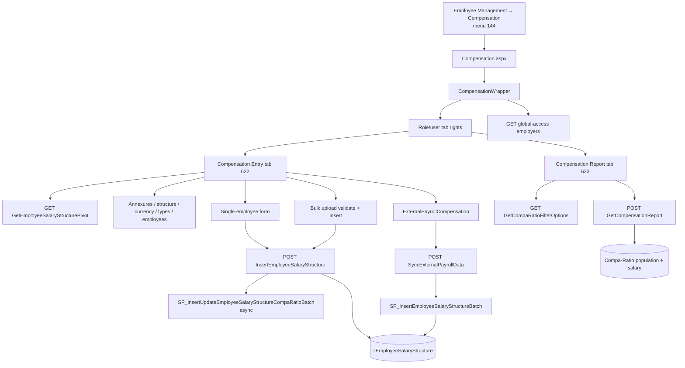
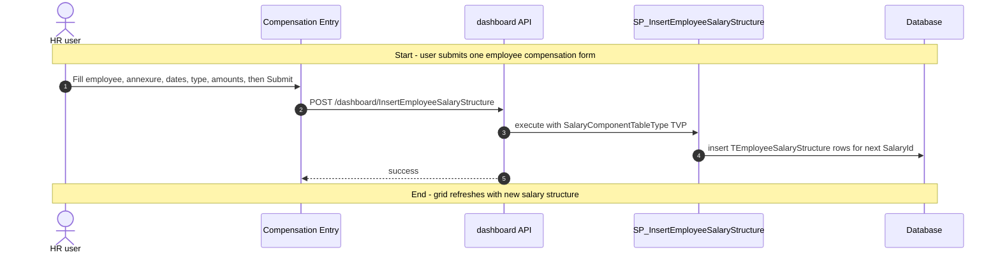
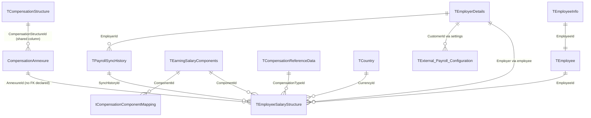

# Compensation

## Overview

An HR user opens **Employee Management → Compensation** to maintain employee salary structures for an organisation they can access. The live left-nav target is menu id **144** with `NavigateURL` `~/HRM/Employee/Compensation.aspx` (`TMenuDetails`). That ASPX binds session hidden fields and loads the DashBoard React bundle into `#root`. The React route `COMPENSATION_ENTRY` mounts `CompensationWrapper`, which shows permission-gated sub-tabs **Compensation Entry** (tab `622`) and **Compensation Report** (tab `623`).

On **Compensation Entry**, the user picks an organisation, loads the current salary grid (pivot), and either edits one employee’s structure (annexure, effective date, payout month, compensation type, currency, component amounts) or bulk-uploads a spreadsheet. Saving posts salary rows into `TEmployeeSalaryStructure`. After a successful save, Node fire-and-forgets a Compa-Ratio snapshot batch. When external payroll is enabled for the customer, an accordion can sync Hive payroll data into the same salary tables. **Compensation Report** runs filtered Compa-Ratio group/employee result sets for grid view or Excel/PDF export.

`Compensation_New.aspx` is a React shell sibling; it is **not** the menu NavigateURL. Admin structure/annexure masters live under **Admin Configuration → Setup Compensation** (separate guide).

**Who's involved:**

- **HR / compensation admin** — enters and edits employee compensation; may run payroll sync and the report.
- **Role / user tab grants** — decide whether Entry, Report, or both are visible and editable under menu 144.
- **Employee (subject)** — salary rows are written for them; they do not open this screen for self-service here.

## Workflow

## Request journey

Bulk upload follows the same insert API after `USP_ValidateCompensationBulkUploadEmployees`. Node may then call `SP_InsertUpdateEmployeeSalaryStructureCompaRatioBatch` without awaiting it.

## Entry points

Menu NavigateURL confirmed in DEV `TMenuDetails` for MenuId **144**: `~/HRM/Employee/Compensation.aspx` (not `Compensation_New.aspx`).

| Entry | Purpose |
|---|---|
| `~/HRM/Employee/Compensation.aspx` | Live host. Session fields + `dashboard_react.*.min.js` into `#root`. |
| `Compensation_New.aspx` | Alternate React host; not registered as the menu URL. |
| `Areas/Dashboard/Components/CompensationWrapper.js` | Org picker, tabs 622/623, breadcrumb Employee Management / Compensation. |
| `EmployeeCompensation.js` → `CompensationEntry.js` | Entry grid, form, bulk upload, history, external payroll panel. |
| `CompaRatio/CompaRatioReport.js` | Report tab filters, grid, export. |
| `routeConstants.COMPENSATION_ENTRY` | `/HRM/Employee/Compensation.aspx`. |

Legacy WebForms markup remains under a hidden `display:none` block on `Compensation.aspx`; runtime UI is the React mount. No business postback is used for Entry/Report actions.

## Code → database call chain

| UI | API | DAL (`file:line`) | Stored procedure |
|---|---|---|---|
| Org list (`CompensationWrapper.js:58`) | `GET /dashBoard/GetGlobalAccessEmployerList` | `GetGlobalAccessEmployerList` (`dashBoardDAL.js:824`) | `SP_GetGlobalAccessEmployerList` |
| Role tabs (`useTabPermission.js:26`) | `GET /dashboard/GetPermissionRoleTabDetails` | `GetPermissionRoleTabDetails` (`dashBoardDAL.js:853`) | `Sp_AdminRoleM_GetTabRoleDet` |
| User tabs (`useTabPermission.js:28`) | `GET /dashboard/GetPermissionUserTabDetailsByuserId` | `GetPermissionUserTabDetailsByuserId` (`dashBoardDAL.js:838`) | `Sp_GetTabUserDetails` |
| Annexure pivot (`CompensationEntry.js:234`) | `POST /dashboard/GetAllCompensationAnnexureTest` | `GetAllCompensationAnnexureTest` (`dashBoardDAL.js:2959`) | `SP_GetUniqueCompensationAnnexure` |
| Currency (`CompensationEntry.js:455`) | `GET /dashboard/GetAllCurrency` | `GetAllCurrency` (`dashBoardDAL.js:2933`) | `SP_CM_GetCurrency` |
| Compensation types (`CompensationEntry.js:471`) | `GET /dashboard/GetCompensationReferencedata` | `GetCompensationReferenceData` (`dashBoardDAL.js:5164`) | `SP_GetCompensationReferenceData` |
| External payroll flag (`CompensationEntry.js:487`) | `GET /dashboard/getExternalPayrollConfigDetails` | `GetExternalPayrollConfigDetails` (`dashBoardDAL.js:4086`) | `SP_GetPayrollSubmitDetails` |
| Annexure list (`CompensationEntry.js:527`) | `POST /dashboard/GetAllCompensationAnnexure` | `GetAllCompensationAnnexure` (`dashBoardDAL.js:2744`) | `SP_GetAllCompensationAnnexure` |
| Default structure (`CompensationEntry.js:528`) | `GET /dashboard/GetCompensationStructureByName` | `GetCompensationStructureByName` (`dashBoardDAL.js:5284`) | `SP_GetCompensationStructureByName` → nested `SP_InsertDefaultUpdateCompensationStructureComponents` |
| Earnings components (`CompensationEntry.js:547`) | `POST /recruitment/compensationGetAllEarningSalaryComponent` | recruitment DAL | `SP_CompensationGetAllEarningSalaryComponent` |
| Salary grid (`CompensationEntry.js:579`) | `GET /dashboard/GetEmployeeSalaryStructurePivot` | `GetEmployeeSalaryStructurePivot` (`dashBoardDAL.js:6062`) | `SP_GetEmployeeSalaryStructure_Pivot` |
| Employee picker (`CompensationEntry.js:644`) | `GET /dashBoard/GetEmployeeListByOrgAndEmployeeId` | `GetEmployeeListByOrgAndEmployeeId` (`dashBoardDAL.js:4039`) | `Sp_employeeListByEmployerAndEmployee` |
| Grid column config (`CompensationEntry.js:688`) | `GET /leave/getGridConfig` | `leaveDAL.GetGridConfig` | `SP_GetGridConfig` |
| Detail rows (`CompensationEntry.js:715`) | `GET /dashboard/GetEmployeeSalaryStructure` | `GetEmployeeSalaryStructure` (`dashBoardDAL.js:5445`) | `SP_GetEmployeeSalaryStructure` |
| Candidate structure (`CompensationEntry.js:717`) | `GET /dashboard/GetRecruitmentCandidateSalaryStructure` | `GetRecruitmentCandidateSalaryStructure` (`dashBoardDAL.js:5151`) | `Get_RecruitmentCandidate_SalaryStructure` |
| Employee header (`CompensationEntry.js:863`) | `GET /dashboard/GetEmployeeDetailsForCompensation` | `GetEmployeeDetailsForCompensation` (`dashBoardDAL.js:5137`) | `SP_GetEmployeeDetailsForCompensation` |
| Bulk validate (`CompensationEntry.js:1160`) | `POST /dashboard/ValidateCompensationBulkUploadEmployees` | `ValidateCompensationBulkUploadEmployees` (`dashBoardDAL.js:5481`) | `USP_ValidateCompensationBulkUploadEmployees` |
| Save / bulk save (`CompensationEntry.js:1494`, `:1325`) | `POST /dashboard/InsertEmployeeSalaryStructure` | `InsertEmployeeSalaryStructure` (`dashBoardDAL.js:5304`) | `SP_InsertEmployeeSalaryStructure` (+ async `SP_InsertUpdateEmployeeSalaryStructureCompaRatioBatch`) |
| Annexure by employee (`CompensationEntry.js:2598`) | `GET /recruitment/getCompAnnexureAccBUIdLocEmpId` | `GetCompAnnexureAccBUIdLocEmpId` (`recruitmentDAL.js:10998`) | `SP_GetCompensationAnnexureAccBUIdLocationEmployeeid` |
| History (`CompensationEntry.js:2771`) | `POST /dashboard/GetCompensationHistory` | `GetCompensationHistory` (`dashBoardDAL.js:5513`) | `SP_GetEmployeeSalaryStructure_History` |
| Mapping check (`ExternalPayrollCompensation.js:176`) | `GET /dashboard/GetCompensationComponentMapping` | `GetCompensationComponentMapping` (`dashBoardDAL.js:5562`) | `SP_GetCompensationComponentMapping` |
| Sync history (`ExternalPayrollCompensation.js:63`) | `GET /dashboard/GetPayrollSyncHistory` | `GetPayrollSyncHistory` (`dashBoardDAL.js:6023`) | `SP_GetPayrollSyncHistory` |
| Start sync (`ExternalPayrollCompensation.js:108`) | `POST /dashboard/SyncExternalPayrollData` | `SyncExternalPayrollData` (`dashBoardDAL.js:5740`) | `USP_InsertPayrollSyncHistory`, `SP_InsertEmployeeSalaryStructureBatch`, `SP_UpdatePayrollSyncHistory` (+ Hive HTTP) |
| Sync detail download (`ExternalPayrollCompensation.js:123`) | `GET /dashboard/GetSyncProcessDetails` | failure/success detail DAL | `SP_GetPayrollSyncFailureDetails` / `SP_GetPayrollSyncSuccessDetails` |
| Stop sync (`ExternalPayrollCompensation.js:163`) | `POST /dashboard/UpdateSyncProcessStatus` | `UpdatePayrollSyncHistory` (`dashBoardDAL.js:5669`) | `SP_UpdatePayrollSyncHistory` |
| Report filters (`useCompaRatioFilters.js:50`) | `GET /dashboard/GetCompaRatioFilterOptions` | `GetCompaRatioFilterOptions` (`dashBoardDAL.js:6342`) | `SP_GetCompaRatioFilterOptions` |
| Report grid/export (`CompaRatioReport.js:195`) | `POST /dashboard/GetCompensationReport` | `GetCompensationReport` (`dashBoardDAL.js:6264`) | `SP_GetCompensationReport` |

## API endpoints

No WebForms postback for Entry/Report business actions. Live routers are `DashBoardRoutes.js`, `RecruitmentRoutes.js`, and leave grid-config under `/api`.

| Verb | Route | Parameters | Purpose | Source |
|---|---|---|---|---|
| GET | `/dashBoard/GetGlobalAccessEmployerList` | `employeeId` query | Organisation dropdown | `DashBoardRoutes.js` |
| GET | `/dashboard/GetPermissionRoleTabDetails` | `EmployerId`, `RoleId` | Role tab rights for menu 144 | `DashBoardRoutes.js:61` |
| GET | `/dashboard/GetPermissionUserTabDetailsByuserId` | `EmployerId`, `UserId` | User tab rights | `DashBoardRoutes.js:60` |
| POST | `/dashboard/GetAllCompensationAnnexureTest` | body `employerId` | Annexure/component pivot | `DashBoardRoutes.js:141` |
| GET | `/dashboard/GetAllCurrency` | none | Currency list | `DashBoardRoutes.js:136` |
| GET | `/dashboard/GetCompensationReferenceData` | `employerId` | Compensation types | `DashBoardRoutes.js:305` |
| GET | `/dashboard/getExternalPayrollConfigDetails` | `customerId` | External payroll enabled / URLs | `DashBoardRoutes.js:237` |
| POST | `/dashboard/GetAllCompensationAnnexure` | body `employerId` | Annexure dropdown | `DashBoardRoutes.js:140` |
| GET | `/dashboard/GetCompensationStructureByName` | `employerId`, `compensationStructureName` | Default structure bootstrap | `DashBoardRoutes.js:335` |
| POST | `/recruitment/compensationGetAllEarningSalaryComponent` | body employer/structure/annexure | Component definitions | `RecruitmentRoutes.js:409` |
| GET | `/dashboard/GetEmployeeSalaryStructurePivot` | `employerId`, `loggedInEmployeeId` | Entry grid | `DashBoardRoutes.js:403` |
| GET | `/dashBoard/GetEmployeeListByOrgAndEmployeeId` | `EmployerId`, `EmployeeId` | Employee picker | dashboard routes |
| GET | `/leave/getGridConfig` | `employeeId`, `PageName` | Column layout | leave routes |
| GET | `/dashboard/GetEmployeeSalaryStructure` | `employerId`, optional employee | Latest component rows | `DashBoardRoutes.js:342` |
| GET | `/dashboard/GetRecruitmentCandidateSalaryStructure` | `employeeId`, `employerId` | Candidate annexure rows | `DashBoardRoutes.js:389` |
| GET | `/dashboard/GetEmployeeDetailsForCompensation` | `employeeId` | Name, BU, designation | `DashBoardRoutes.js:372` |
| POST | `/dashboard/ValidateCompensationBulkUploadEmployees` | body EmpIds, AnnexureId | Bulk eligibility | `DashBoardRoutes.js:390` |
| POST | `/dashboard/InsertEmployeeSalaryStructure` | body array of salary payloads | Insert salary structure | `DashBoardRoutes.js:349` |
| GET | `/recruitment/getCompAnnexureAccBUIdLocEmpId` | employerId, employeeId, CompensationEffectiveDate | Eligible annexures | `RecruitmentRoutes.js:408` |
| POST | `/dashboard/GetCompensationHistory` | employerId, employeeId, LoggedInEmployeeId | History panel | `DashBoardRoutes.js:392` |
| GET | `/dashboard/GetCompensationComponentMapping` | `employerId` | Mapping prerequisite for sync | `DashBoardRoutes.js:396` |
| GET | `/dashboard/GetPayrollSyncHistory` | `employerId` | Sync history | `DashBoardRoutes.js:400` |
| POST | `/dashboard/SyncExternalPayrollData` | employerId, custid, loggedInEmployeeId, employeeIds, … | Start Hive sync | `DashBoardRoutes.js:398` |
| GET | `/dashboard/GetSyncProcessDetails` | status, syncHistoryId | Success/fail file | `DashBoardRoutes.js:401` |
| POST | `/dashboard/UpdateSyncProcessStatus` | syncHistoryId, status, FailureSummary | Cancel sync | `DashBoardRoutes.js:402` |
| GET | `/dashboard/GetCompaRatioFilterOptions` | employerId, loggedInEmployeeId, screenCode | Report filters | `DashBoardRoutes.js:414` |
| POST | `/dashboard/GetCompensationReport` | employerId, filters, resultMode GRID/EXPORT | Report data | `DashBoardRoutes.js:411` |

## Stored procedures & tables involved

Direct procedures this screen executes, plus one nested level. Existing database pages are linked; new pages are listed the same way.

| Object | Script | Role on this screen |
|---|---|---|
| [SP_GetGlobalAccessEmployerList](/docs/database/hrms/SP_GetGlobalAccessEmployerList) | existing page | Organisation dropdown |
| [Sp_AdminRoleM_GetTabRoleDet](/docs/database/hrms/Sp_AdminRoleM_GetTabRoleDet) | existing page | Role tab visibility |
| [Sp_GetTabUserDetails](/docs/database/hrms/Sp_GetTabUserDetails) | existing page | User tab visibility |
| [SP_GetUniqueCompensationAnnexure](/docs/database/hrms/SP_GetUniqueCompensationAnnexure) | `STOREPROCEDURE/SP_GetUniqueCompensationAnnexure.sql` | Annexure/component pivot |
| [SP_CM_GetCurrency](/docs/database/hrms/SP_CM_GetCurrency) | `STOREPROCEDURE/SP_CM_GetCurrency.sql` | Currency list from `TCountry` |
| [SP_GetCompensationReferenceData](/docs/database/hrms/SP_GetCompensationReferenceData) | matching script | Compensation types; uses `fn_getEmployeeName` |
| [SP_GetPayrollSubmitDetails](/docs/database/hrms/SP_GetPayrollSubmitDetails) | matching script | External payroll config; nested `Fn_DecryptData` when credentials requested |
| [SP_GetAllCompensationAnnexure](/docs/database/hrms/SP_GetAllCompensationAnnexure) | matching script | Annexure list from `CompensationAnnexure` |
| [SP_GetCompensationStructureByName](/docs/database/hrms/SP_GetCompensationStructureByName) | matching script | Default structure; may create via nested procedure |
| [SP_InsertDefaultUpdateCompensationStructureComponents](/docs/database/hrms/SP_InsertDefaultUpdateCompensationStructureComponents) | nested from by-name get | Seeds `DefaultCompensationStructure` |
| [SP_CompensationGetAllEarningSalaryComponent](/docs/database/hrms/SP_CompensationGetAllEarningSalaryComponent) | matching script | Earning component definitions |
| [SP_GetEmployeeSalaryStructure_Pivot](/docs/database/hrms/SP_GetEmployeeSalaryStructure_Pivot) | matching script | Entry grid; nested `FN_LocationBU_GetEmployeeDetails`, `Fn_DecryptData`, dynamic SQL |
| [Sp_employeeListByEmployerAndEmployee](/docs/database/hrms/Sp_employeeListByEmployerAndEmployee) | matching script | Employee picker; nested open/close encryption keys + location/BU function |
| [SP_GetGridConfig](/docs/database/hrms/SP_GetGridConfig) | matching script | `TGridColumnConfig` for `CompensationDetails_Grid` |
| [SP_GetEmployeeSalaryStructure](/docs/database/hrms/SP_GetEmployeeSalaryStructure) | `STOREPROCEDURE/sp_GetEmployeeSalaryStructure.sql` | Latest component-level salary rows |
| [Get_RecruitmentCandidate_SalaryStructure](/docs/database/hrms/Get_RecruitmentCandidate_SalaryStructure) | matching script | Candidate salary/annexure rows |
| [SP_GetEmployeeDetailsForCompensation](/docs/database/hrms/SP_GetEmployeeDetailsForCompensation) | matching script | Employee name/BU/designation |
| [USP_ValidateCompensationBulkUploadEmployees](/docs/database/hrms/USP_ValidateCompensationBulkUploadEmployees) | matching script | Bulk annexure eligibility |
| [SP_InsertEmployeeSalaryStructure](/docs/database/hrms/SP_InsertEmployeeSalaryStructure) | matching script | Insert into `TEmployeeSalaryStructure` |
| [SP_InsertUpdateEmployeeSalaryStructureCompaRatioBatch](/docs/database/hrms/SP_InsertUpdateEmployeeSalaryStructureCompaRatioBatch) | nested from Node after insert | Freeze Compa-Ratio / category on saved SalaryIds |
| [SP_GetCompensationAnnexureAccBUIdLocationEmployeeid](/docs/database/hrms/SP_GetCompensationAnnexureAccBUIdLocationEmployeeid) | matching script | Annexures matching employee BU/location/date |
| [SP_GetEmployeeSalaryStructure_History](/docs/database/hrms/SP_GetEmployeeSalaryStructure_History) | matching script | Historical salary rows |
| [SP_GetCompensationComponentMapping](/docs/database/hrms/SP_GetCompensationComponentMapping) | matching script | Mapping prerequisite; uses `FN_GetEmployeeOrgName` |
| [SP_GetPayrollSyncHistory](/docs/database/hrms/SP_GetPayrollSyncHistory) | matching script | Sync history; uses `Fn_GetEmployeeName` |
| [USP_InsertPayrollSyncHistory](/docs/database/hrms/USP_InsertPayrollSyncHistory) | matching script | Create/upsert sync history row |
| [SP_UpdatePayrollSyncHistory](/docs/database/hrms/SP_UpdatePayrollSyncHistory) | matching script | Cancel / fail sync status |
| [SP_InsertEmployeeSalaryStructureBatch](/docs/database/hrms/SP_InsertEmployeeSalaryStructureBatch) | matching script | Batch insert during Hive sync |
| [SP_GetPayrollSyncFailureDetails](/docs/database/hrms/SP_GetPayrollSyncFailureDetails) | matching script | Failed sync records |
| [SP_GetPayrollSyncSuccessDetails](/docs/database/hrms/SP_GetPayrollSyncSuccessDetails) | matching script | Successful sync records |
| [SP_GetCompaRatioFilterOptions](/docs/database/hrms/SP_GetCompaRatioFilterOptions) | `STOREPROCEDURE/SP_GetCompaRatioFilterOption.sql` | Report filter options |
| [SP_GetCompensationReport](/docs/database/hrms/SP_GetCompensationReport) | matching script | Report GRID/EXPORT result sets |
| [Fn_DecryptData](/docs/database/hrms/Fn_DecryptData) | existing page | Nested name/credential decrypt |
| [Fn_GetEmployeeName](/docs/database/hrms/Fn_GetEmployeeName) | existing page | Nested name formatting |
| [FN_GetEmployeeOrgName](/docs/database/hrms/FN_GetEmployeeOrgName) | existing page | Nested name formatting on mapping get |
| [FN_LocationBU_GetEmployeeDetails](/docs/database/hrms/FN_LocationBU_GetEmployeeDetails) | existing page | Access-scoped employee set |
| [FN_LocationBU_GetAllActiveInActive_EmployeeDetails](/docs/database/hrms/FN_LocationBU_GetAllActiveInActive_EmployeeDetails) | existing page | Report population scope |
| [Sp_OpenEncryptionKeys](/docs/database/hrms/Sp_OpenEncryptionKeys) | existing page | Nested from employee list |
| [SP_CloseEncryptionKey](/docs/database/hrms/SP_CloseEncryptionKey) | existing page | Nested from employee list |
| [FN_GetCompaRatioConfig](/docs/database/hrms/FN_GetCompaRatioConfig) | nested from report/batch/filters | Employer Compa-Ratio config |
| [FN_GetCompaRatioEmployeePopulation](/docs/database/hrms/FN_GetCompaRatioEmployeePopulation) | nested | Population for ratios |
| [FN_GetCompaRatioEmployeeSkills](/docs/database/hrms/FN_GetCompaRatioEmployeeSkills) | nested | Skill set for matching |
| [FN_GetCompaRatioExperienceBands](/docs/database/hrms/FN_GetCompaRatioExperienceBands) | nested | Experience / skill-exp bands |
| [FN_GetCompaRatioCategoryCode](/docs/database/hrms/FN_GetCompaRatioCategoryCode) | nested | Category code from CTC vs band |
| [FN_GetCompaRatioBadgeText](/docs/database/hrms/FN_GetCompaRatioBadgeText) | nested | Badge label text |
| [FN_SplitIntegerIds](/docs/database/hrms/FN_SplitIntegerIds) | nested | CSV id list splitter |
| [SP_InsertUpdateCompensationUserPreference](/docs/database/hrms/SP_InsertUpdateCompensationUserPreference) | nested from report | Persist Include Inactive preference |

Primary write table: `TEmployeeSalaryStructure`. Lookups and masters: `CompensationAnnexure`, `TCompensationStructure`, `TEarningSalaryComponents`, `TCompensationReferenceData`, `TExternal_Payroll_Configuration`, `TPayrollSyncHistory`, `tCompensationComponentMapping`, Compa-Ratio config/population helpers.

## Table relationships

Declared FKs are sparse. Edges follow columns the Entry/Report/Sync procedures join or write.

## Known gaps

- Live menu URL is `Compensation.aspx`; `Compensation_New.aspx` is an unused alternate host in source.
- Hidden classic WebForms upload UI remains in the ASPX but is not the active path once React mounts.
- `SP_InsertUpdateEmployeeSalaryStructureCompaRatioBatch` after save is fire-and-forget; snapshot failures do not fail the compensation save.
- `SP_GetEmployeeSalaryStructure_Pivot` uses `sp_executesql` dynamic SQL (listed as unresolved on its database page).
- External payroll sync mixes SQL (`USP_InsertPayrollSyncHistory`, batch insert) with Hive HTTP; component lists for mapping are not from an SP.
- Admin **Setup Compensation** masters (structures, annexures, mappings) are a different menu; this guide only covers Employee Management → Compensation.
- SystemModel-2 has no workflow page for this screen.

## Reference

Confidence is medium. The call chain was read from menu DEV rows, the ASPX host, `CompensationWrapper` / `CompensationEntry` / `ExternalPayrollCompensation` / `CompaRatioReport`, Core API dashboard/recruitment/leave routes and DAL, and matching `HRMS/STOREPROCEDURE` scripts. Nested walks stop at one level as requested.

### SourceCode

- `HRMS.Web/HRMS.Web/HRM/Employee/Compensation.aspx` and `.aspx.cs`
- `HRMS.Web/HRMS.Web/HRM/Employee/Compensation_New.aspx` (not menu-registered)
- `HRMS.Web/HRMS.Web/HRM/DashBoard_React/Areas/Dashboard/Components/CompensationWrapper.js`
- `CompensationEntry.js`, `EmployeeCompensation.js`, `ExternalPayrollCompensation.js`, `CompensationConstantsClient.js`
- `CompaRatio/CompaRatioReport.js`, `CompaRatio/useCompaRatioFilters.js`
- `HRMS.CoreAPI/HRMS.Core.WebAPI.Node/Routes/DashBoardRoutes.js`, `RecruitmentRoutes.js`
- `HRMS.CoreAPI/HRMS.Core.WebAPI.Node/Core/DataAccessLayer/dashBoardDAL.js`, `recruitmentDAL.js`, `leaveDAL.js`
- `docs/SystemModels/SystemModel-2/` has no page for this screen

### TDG HRMS DB

- DEV `TMenuDetails` MenuId 144 NavigateURL `~/HRM/Employee/Compensation.aspx`
- `HRMS-DATABASE/HRMS/STOREPROCEDURE/` scripts named in the procedure table
- Related Admin guide: `content/guides/admin-configuration/setup-compensation.md`
