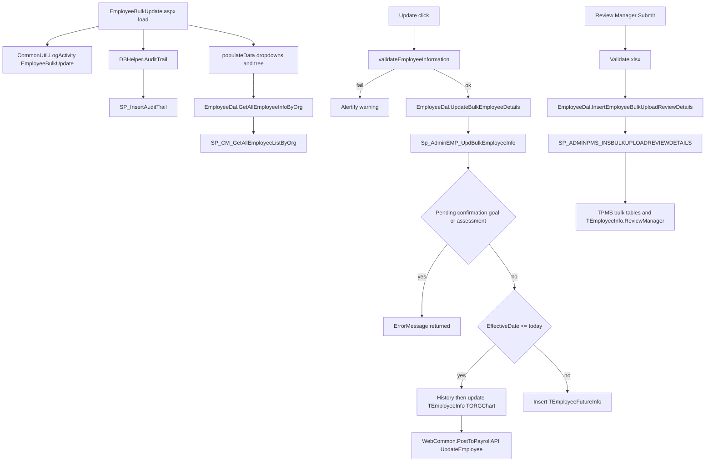
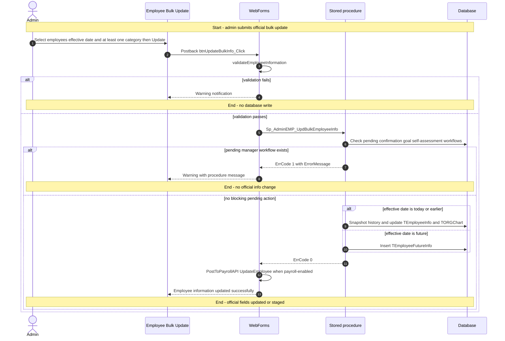
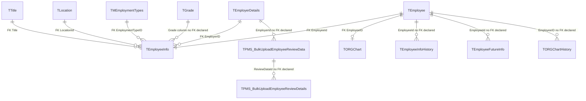

# Employee Bulk Update

## Overview

An HR or admin user opens **Employee Management → Employee Bulk Update** to change the same official fields for many employees at once. On the first tab they pick one or more employees, set an effective date (within ±29 days of today), and choose at least one category — business unit, designation, base location, shift, reports-to, functional manager, calendar, or grade — then click **Update**. When the effective date is today or earlier, the database updates live `TEmployeeInfo` / `TORGChart` (after history snapshots) and may rebuild leave balances when business unit, location, or grade changes. When the date is in the future, rows go to `TEmployeeFutureInfo` instead. Updates are blocked if a selected employee still has a pending confirmation, goal-setting, or self-assessment workflow for the managers being changed.

The second tab, **Review Manager Bulk Update**, uploads an `.xlsx` with `EmploymentNumber` and `ReviewEmploymentNumber` columns. That path inserts bulk-upload tracking rows and sets `TEmployeeInfo.ReviewManager` from the mapped review employee ids. After a successful official-info update, payroll-enabled tenants also post `UpdateEmployee` for each selected employee.

There is no SystemModel-2 page for this screen. Employment and reporting tables used here are catalogued in `llm-wiki/reference/tables/hrms.md` (`TEmployeeInfo`, `TORGChart`, `TEmployeeFutureInfo`, `TPMS_BulkUploadEmployeeReviewData`). Lifecycle history mirrors appear in `llm-wiki/domain/employee-lifecycle.md`.

## Workflow

## Request journey

## Entry points

The breadcrumb on the page is Home / Employee Management / Employee Bulk Update. The page class is `HRMS.Web.EmployeeBulkUpdate`.

| Entry point | Purpose | Live? |
|---|---|---|
| `HRM/Employee/EmployeeBulkUpdate.aspx` (`~/HRM/Employee/EmployeeBulkUpdate.aspx`) | Bulk-update official employee fields; bulk-assign review managers from Excel | Yes |

No React screen and no `PageMethod` implement this form. Two RadTab pages share the same aspx: **Employee Bulk Update** and **Review Manager Bulk Update**.

## Code → database call chain

| Entry | Method | Stored procedure |
|---|---|---|
| Load | `CommonUtil.LogActivity` from `EmployeeBulkUpdate.aspx.cs:73` → `ActivityHelper.LogActivity` (`ActivityHelper.cs:32`) | `Sp_InsertActivityLog` |
| Load | `DBHelper.AuditTrail` (`DBHelper.cs:218`) from `EmployeeBulkUpdate.aspx.cs:79` | `SP_InsertAuditTrail` |
| Load / org combo | `WebCommon.GetGlobalAccessEmployerList` → `DBHelper.GetGlobalAccessEmployerList` (`DBHelper.cs:3195`) via `ucGlobalAccessEmployer` | `SP_GetGlobalAccessEmployerList` |
| Load employees combo | `EmployeeDal.GetAllEmployeeInfoByOrg` (`EmployeeDAL.cs:252`) from `EmployeeBulkUpdate.aspx.cs:519` | `SP_CM_GetAllEmployeeListByOrg` |
| Load designation | `CommonDAL.GetTitleList` (`CommonDAL.cs:461`) from `EmployeeBulkUpdate.aspx.cs:497` | `SP_CM_GetTitle` |
| Load org tree | `CommonDAL.GetOrgStructureXml` (`CommonDAL.cs:504`) from `EmployeeBulkUpdate.aspx.cs:505` | `sp_GetOrganisationHierarchy` |
| Load location | `CommonDAL.GetLocationsByEmployeeId` (`CommonDAL.cs:360`) from `EmployeeBulkUpdate.aspx.cs:560` | `SP_AdminWM_GetLocationByEmployeeId` |
| Load shift | `AttendanceManagementDAL.GetEmployeeShiftCreation` (`AttendanceManagementDAL.cs:166`) from `EmployeeBulkUpdate.aspx.cs:568` | `SP_AdminAM_GetEmpShiftCreation` |
| Load grade | `EmployeeDal.GetGradeDetails` (`EmployeeDAL.cs:1217`) from `EmployeeBulkUpdate.aspx.cs:716` | `SP_SEP_GetGradeDetails` |
| Load reports-to / functional manager | `EmployeeDal.GetEmployeeList` (`EmployeeDAL.cs:1385`) from `EmployeeBulkUpdate.aspx.cs:529` / `:538` | `SP_AdminEMP_GetEmpListByOrg` |
| Load calendar | `SetupMasterDAL.GetCalendarMasterDetails` (`SetupMasterDAL.cs:20`) from `EmployeeBulkUpdate.aspx.cs:547` | `SP_AdminMstr_GetCalendar` |
| Load employee context | `CommonDAL.GetEmployeeFullInformation` (`CommonDAL.cs:300`) from `EmployeeBulkUpdate.aspx.cs:693` / `:695` | `SP_CM_GetEmployeeFullInformation` |
| Load / designation→grade | `DBHelper.GetCustomerSettings` (`DBHelper.cs:3427`) from `EmployeeBulkUpdate.aspx.cs:156` / `:707` | `SP_GetCustomerSettings` |
| Designation change grade map | `SetupMasterDAL.GetAllTitleList` (`SetupMasterDAL.cs:697`) from `EmployeeBulkUpdate.aspx.cs:161` | `SP_AdminMstr_GetAllTitle` |
| Update | `EmployeeDal.UpdateBulkEmployeeDetails` (`EmployeeDAL.cs:1400`) from `EmployeeBulkUpdate.aspx.cs:623` | `Sp_AdminEMP_UpdBulkEmployeeInfo` |
| Review upload | `EmployeeDal.InsertEmployeeBulkUploadReviewDetails` (`EmployeeDAL.cs:1483`) from `EmployeeBulkUpdate.aspx.cs:228` | `SP_ADMINPMS_INSBULKUPLOADREVIEWDETAILS` |
| Review grid | `PerformanceManagementDAL.GetEmployeeReviewDetails` (`PerformanceManagementDAL.cs:2423`) from `EmployeeBulkUpdate.aspx.cs:250` | `Sp_PMS_GetEmployeeReviewDetails` |
| Editability | `WebCommonTab.GetTabsByMenu` from `EmployeeBulkUpdate.aspx.cs:479` | Session only (`TAB_BY_ROLE` / `TAB_BY_USER`) — no procedure on this postback |

`Sp_AdminEMP_UpdBulkEmployeeInfo` calls `dbo.Split` and `dbo.Fn_GetEmployeeName`. `SP_CM_GetAllEmployeeListByOrg` and `Sp_PMS_GetEmployeeReviewDetails` open/close encryption keys; the all-employee list also uses `FN_LocationBU_GetEmployeeDetails` and `Fn_GetEmployeeName`.

## API endpoints

The screen is a WebForms postback. It does not expose an HTTP API for bulk update or review-manager upload.

After a successful official-info update, `WebCommon.PostToPayrollAPI` (`Web.Common.cs:468`) runs only when `IsValidPayrollUser()` is true. That path posts one payroll event per selected employee id.

| Verb | Route | Parameters | Purpose | Source |
|---|---|---|---|---|
| POST | `{payroll host}/api/Payroll/PostData` | Employer id, employee id, logged-in employee id, event `UpdateEmployee` | Tell payroll that employee official info changed | `WebAPIClient.cs:128` and `WebAPIClient.cs:148` |

Template download for the review tab streams a local Excel template file; it does not call a stored procedure.

## Stored procedures & tables involved

The DAL constant for official bulk update is `sp_UpdateBulkEmployeeInfo` → `"Sp_AdminEMP_UpdBulkEmployeeInfo"` (`DBConstant.cs:1241`). An older inventoried `sp_UpdateBulkEmployeeInfo.sql` still exists; this page does not call that procedure name.

| Object | Script | Purpose |
|---|---|---|
| `Sp_AdminEMP_UpdBulkEmployeeInfo` | `HRMS-DATABASE/HRMS/STOREPROCEDURE/Sp_AdminEMP_UpdBulkEmployeeInfo.sql` | Apply bulk official-info changes or stage future rows |
| `SP_ADMINPMS_INSBULKUPLOADREVIEWDETAILS` | `HRMS-DATABASE/HRMS/STOREPROCEDURE/SP_ADMINPMS_INSBULKUPLOADREVIEWDETAILS.sql` | Persist review-manager Excel upload and set `ReviewManager` |
| `Sp_PMS_GetEmployeeReviewDetails` | `HRMS-DATABASE/HRMS/STOREPROCEDURE/Sp_PMS_GetEmployeeReviewDetails.sql` | List prior review bulk-upload files for the employer |
| `SP_CM_GetAllEmployeeListByOrg` | `HRMS-DATABASE/HRMS/STOREPROCEDURE/SP_CM_GetAllEmployeeListByOrg.sql` | Employees available for multi-select |
| `SP_CM_GetTitle` | `HRMS-DATABASE/HRMS/STOREPROCEDURE/SP_CM_GetTitle.sql` | Designation combo |
| `SP_AdminWM_GetLocationByEmployeeId` | `HRMS-DATABASE/HRMS/STOREPROCEDURE/SP_AdminWM_GetLocationByEmployeeId.sql` | Base location combo scoped by user/role location rights |
| `SP_AdminAM_GetEmpShiftCreation` | `HRMS-DATABASE/HRMS/STOREPROCEDURE/SP_AdminAM_GetEmpShiftCreation.sql` | Active shifts for the employer |
| `SP_SEP_GetGradeDetails` | `HRMS-DATABASE/HRMS/STOREPROCEDURE/SP_SEP_GetGradeDetails.sql` | Active grades for the employer |
| `SP_AdminEMP_GetEmpListByOrg` | `HRMS-DATABASE/HRMS/STOREPROCEDURE/SP_AdminEMP_GetEmpListByOrg.sql` | Reports-to / functional manager lists |
| `SP_AdminMstr_GetCalendar` | `HRMS-DATABASE/HRMS/STOREPROCEDURE/SP_AdminMstr_GetCalendar.sql` | Calendar master rows (page filters to active) |
| `SP_CM_GetEmployeeFullInformation` | `HRMS-DATABASE/HRMS/STOREPROCEDURE/SP_CM_GetEmployeeFullInformation.sql` | Logged-in / query-string employee context for org-scoped dropdowns |
| `SP_AdminMstr_GetAllTitle` | `HRMS-DATABASE/HRMS/STOREPROCEDURE/SP_AdminMstr_GetAllTitle.sql` | Title→grade mapping when grade is enabled |
| `SP_GetCustomerSettings` | `HRMS-DATABASE/HRMS/STOREPROCEDURE/SP_GetCustomerSettings.sql` | Grade enablement and shift-roster visibility flags |
| `sp_GetOrganisationHierarchy` | `HRMS-DATABASE/HRMS/STOREPROCEDURE/sp_GetOrganisationHierarchy.sql` | Business-unit tree XML |
| `SP_InsertAuditTrail` | `HRMS-DATABASE/HRMS/STOREPROCEDURE/SP_InsertAuditTrail.sql` | Page-open audit row |
| `Sp_InsertActivityLog` | `HRMS-DATABASE/HRMS/STOREPROCEDURE/Sp_InsertActivityLog.sql` | Activity row for opening Employee Bulk Update |
| `SP_GetGlobalAccessEmployerList` | `HRMS-DATABASE/HRMS/STOREPROCEDURE/SP_GetGlobalAccessEmployerList.sql` | Organisation combo for global-access users |

Primary write tables: `TEmployeeInfo`, `TEmployeeInfoHistory`, `TORGChart`, `TORGChartHistory`, `TEmployeeFutureInfo`, leave balance tables when reapply runs, plus `TPMS_BulkUploadEmployeeReviewData` / `TPMS_BulkUploadEmployeeReviewDetails` on the review tab. Catalog blurbs live in `llm-wiki/reference/tables/hrms.md`.

## Table relationships

Declared foreign keys from table scripts are labeled as such. Soft reporting and review-manager columns have no FK in those scripts.

## Known gaps

- `docs/SystemModels/SystemModel-2/` has no page naming this screen in the SourceCode tree that was searched.
- Inventoried legacy `sp_UpdateBulkEmployeeInfo.sql` remains alongside the live `Sp_AdminEMP_UpdBulkEmployeeInfo` used by `DBConstant.sp_UpdateBulkEmployeeInfo`.
- `Sp_AdminEMP_UpdBulkEmployeeInfo.sql` and `SP_CM_GetEmployeeFullInformation.sql` begin with `USE [HRM-CL-Prod]`. Liquibase deploy context should not rely on that database name.
- Validation message text for the review Excel says columns must be `EmployeeNumber` and `ReviewEmploymentNumber`, but the code checks `EmploymentNumber` / `ReviewEmploymentNumber`.
- Shift combo is hidden when customer setting `IsShowShiftRoaster` is true (`EmployeeBulkUpdate.aspx.cs:708`); naming is roster vs roaster.
- Tab permission for non-editable users hides only `btnUpdateBulkInfo`; review-tab submit visibility is not gated the same way in `hidePageControls`.
- Pending-workflow blocking in `Sp_AdminEMP_UpdBulkEmployeeInfo` only runs when reporting or functional manager inputs are non-zero; other category-only updates skip that check.
- No `llm-wiki/domain` page documents the bulk-update or review-manager Excel flows beyond table catalog rows.

## Reference

Confidence is medium. The postback, DAL procedure names, and inventoried scripts agree. Gaps above are legacy procedure naming, hardcoded `USE` database names, Excel column copy mismatch, and missing SystemModel-2 coverage.

### SourceCode

- `HRMS.Web/HRMS.Web/HRM/Employee/EmployeeBulkUpdate.aspx`
- `HRMS.Web/HRMS.Web/HRM/Employee/EmployeeBulkUpdate.aspx.cs`
- `HRMS.Shared/HRMS.DataAccessLayer/Employee/EmployeeDAL.cs`
- `HRMS.Shared/HRMS.DataAccessLayer/ConfirmationAndPerformance/PerformanceManagementDAL.cs`
- `HRMS.Shared/HRMS.DataAccessLayer/CommonDAL.cs`
- `HRMS.Shared/HRMS.DataAccessLayer/Masters/SetupMasterDAL.cs`
- `HRMS.Shared/HRMS.DataAccessLayer/LeaveAttendanceARWFH/AttendanceManagementDAL.cs`
- `HRMS.Shared/HRMS.DataAccessLayer/DBConstant.cs`
- `HRMS.Shared/HRMS.DataAccessLayer/DBHelper.cs`
- `HRMS.Shared/HRMS.Common/Common.cs`
- `HRMS.Shared/TDG.ActivityAuditLog/DAL/ActivityHelper.cs`
- `HRMS.Web/HRMS.Web/Common/Web.Common.cs`
- `HRMS.Web/HRMS.Web/Common/WebAPIClient.cs`
- `HRMS.Web/HRMS.Web/HRM/CustomControls/ucGlobalAccessEmployer.ascx.cs`

### TDG HRMS DB

- `HRMS-DATABASE/HRMS/STOREPROCEDURE/Sp_AdminEMP_UpdBulkEmployeeInfo.sql`
- `HRMS-DATABASE/HRMS/STOREPROCEDURE/sp_UpdateBulkEmployeeInfo.sql` (legacy; not called by this page)
- `HRMS-DATABASE/HRMS/STOREPROCEDURE/SP_ADMINPMS_INSBULKUPLOADREVIEWDETAILS.sql`
- `HRMS-DATABASE/HRMS/STOREPROCEDURE/Sp_PMS_GetEmployeeReviewDetails.sql`
- `HRMS-DATABASE/HRMS/STOREPROCEDURE/SP_CM_GetAllEmployeeListByOrg.sql`
- `HRMS-DATABASE/HRMS/STOREPROCEDURE/SP_CM_GetTitle.sql`
- `HRMS-DATABASE/HRMS/STOREPROCEDURE/SP_AdminWM_GetLocationByEmployeeId.sql`
- `HRMS-DATABASE/HRMS/STOREPROCEDURE/SP_AdminAM_GetEmpShiftCreation.sql`
- `HRMS-DATABASE/HRMS/STOREPROCEDURE/SP_SEP_GetGradeDetails.sql`
- `HRMS-DATABASE/HRMS/STOREPROCEDURE/SP_CM_GetEmployeeFullInformation.sql`
- `HRMS-DATABASE/HRMS/TABLES/TEmployeeInfo.sql`
- `HRMS-DATABASE/HRMS/TABLES/TORGChart.sql`
- `HRMS-DATABASE/HRMS/TABLES/TEmployeeFutureInfo.sql`
- `HRMS-DATABASE/HRMS/TABLES/TPMS_BulkUploadEmployeeReviewData.sql`
- `HRMS-DATABASE/HRMS/TABLES/TPMS_BulkUploadEmployeeReviewDetails.sql`
- `llm-wiki/domain/employee-lifecycle.md`
- `llm-wiki/reference/tables/hrms.md`
