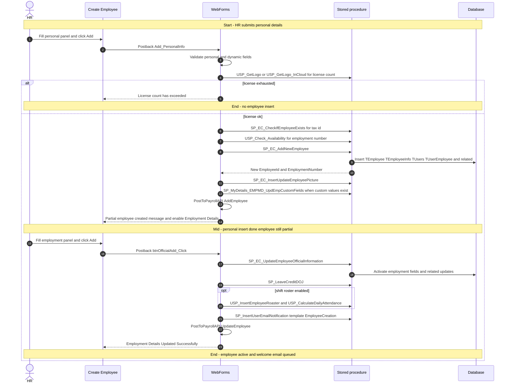
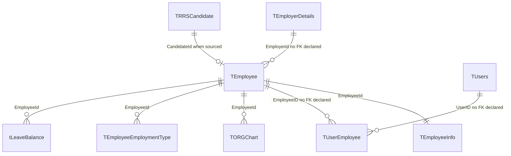

# Employee Creation

## Overview

HR opens **Employee Management → Employee Creation** (`~/HRM/Employee/Employee.aspx`) to create a person in two steps. On the **Create Employee** tab they enter personal details (and optionally an employment number), then click **Add**. The page validates license headcount, duplicate tax id / employment number, and personal fields, then `SP_EC_AddNewEmployee` inserts a partially active employee (`IsActive` `P`), employment-info stub, user login, and related rows. The UI then unlocks **Employment Details**. Saving employment details calls `SP_EC_UpdateEmployeeOfficialInformation`, credits leave on DOJ, optionally writes shift roster / budget-source rows, posts to payroll, and queues the EmployeeCreation welcome email.

The same page hosts **Bulk Employee Creation** / **Import Data** tabs and a **Pending Employee Creation** grid (`SP_GetPartialEmployeeDet`) for partial employees. This guide follows the Create Employee path only. There is no SystemModel-2 page naming this screen in the SourceCode tree that was searched.

## Workflow

```mermaid
flowchart TD
  Open["Employee.aspx load"] --> Activity["CommonUtil.LogActivity EmployeeCreation"]
  Open --> Audit["DBHelper.AuditTrail"]
  Audit --> AuditSP["SP_InsertAuditTrail"]
  Open --> Pending["ucCreateEmployeeList SP_GetPartialEmployeeDet"]
  Open --> Lookups["Employment type title gender marital grade"]
  Open --> Ajax["AJAX CheckInCheckOutAPI Customer CheckPermission"]
  Personal["Add personal info"] --> License["USP_GetLogo or USP_GetLogo_InCloud"]
  Personal --> DupTax["SP_EC_CheckIfEmployeeExists"]
  Personal --> Avail["USP_Check_Availability"]
  Personal --> Create["SP_EC_AddNewEmployee"]
  Create --> Pic["SP_EC_InsertUpdateEmployeePicture"]
  Create --> Custom["SP_MyDetails_EMPMD_UpdEmpCustomFields"]
  Create --> PayrollAdd["PostToPayrollAPI AddEmployee"]
  Official["Add employment details"] --> OfficialSP["SP_EC_UpdateEmployeeOfficialInformation"]
  Official --> Leave["SP_LeaveCreditDOJ"]
  Official --> Roster["USP_InsertEmployeeRoaster optional"]
  Official --> Email["SP_InsertUserEmailNotification EmployeeCreation"]
  Official --> PayrollUpd["PostToPayrollAPI UpdateEmployee"]
```

## Request journey

## Entry points

Breadcrumb on the page is Home / Employee Management / Employee Creation. Page class is `HRMS.Web.Employee`. Title attribute is Employee Creation.

| Entry point | Purpose | Live? |
|---|---|---|
| `HRM/Employee/Employee.aspx` (`~/HRM/Employee/Employee.aspx`) | Create Employee tab (also Bulk / Import tabs and pending list) | Yes |
| `~/HRM/Employee/Employee.aspx?TabName=Create Employee` | Land on Create Employee | Yes |
| `~/HRM/Employee/Employee.aspx?EmployeId={id}&TabName=Create Employee` | Resume a pending / partial employee | Yes |
| `~/HRM/Employee/Employee.aspx?action=Add&HR=1` | Redirect constant used after some flows | Yes |
| Query `CandidateId` / `CandidateSourceId` or `CandidateType` | Prefill from recruitment or pre-onboarding | Yes |

No React create screen owns this menu leaf. Bulk Employee Creation is a sibling tab on the same aspx and is out of scope for this guide.

## Code → database call chain

| Entry | Method | Stored procedure |
|---|---|---|
| Load | `CommonUtil.LogActivity` from `Employee.aspx.cs:390` | `Sp_InsertActivityLog` |
| Load | `DBHelper.AuditTrail` from `Employee.aspx.cs:409` | `SP_InsertAuditTrail` |
| Load / org change | `ucCreateEmployeeList.GetPendingEmployeeCreationList` → `EmployeeHelper.GetPendingCreateEmployeeList` (`EmployeeHelper.cs:300`) from `Employee.aspx.cs:426` | `SP_GetPartialEmployeeDet` |
| Load | `DBHelper.GetCustomerSettings` from `Employee.aspx.cs:467` | `SP_GetCustomerSettings` |
| Load | `EmployeeBll.GetRRSDonorSettingDetails` from `Employee.aspx.cs:468` | `SP_GetRRSDonorDetailsSettings` |
| Load lookups | `EmployerBll.GetEmploymentTypeList` / `EmployeeBll.GetPersonalTitles` / `GetGenderList` / `GetMaritalStatus` / `GetGradeDetails` | `SP_CM_GetEmploymentTypeList`, `SP_EC_GetPersonalTitle`, `SP_EC_GetGender`, `SP_CM_GetMaritalStatus`, `SP_SEP_GetGradeDetails` |
| Client ready | jQuery POST to CheckInCheckOutAPI `Customer/CheckPermission` (`Employee.aspx:137`) | External API (not an HRMS SP) |
| Generate employment number | `DashboardDAL.GetGenerateEmploymentNumber` (`DashboardDAL.cs:29`) from `Employee.aspx.cs:847` | `USP_Generate_Employment_Number` |
| Add personal | `DBHelper.GetLogoDetails` / `GetLogoInCloudDetails` from `Employee.aspx.cs:883` / `910` | `USP_GetLogo` / `USP_GetLogo_InCloud` |
| Add personal | `EmployeeBll.CheckIfEmpExists` → `EmployeeDal.CheckIfEmpExists` (`EmployeeDAL.cs:670`) from `Employee.aspx.cs:2184` | `SP_EC_CheckIfEmployeeExists` |
| Add personal | `DashboardDAL.CheckAvailability` (`DashboardDAL.cs:45`) from `Employee.aspx.cs:927` | `USP_Check_Availability` |
| Add personal | `EmployeeBll.AddNewEmployee` → `EmployeeDal.AddNewEmployee` (`EmployeeDAL.cs:684`) from `Employee.aspx.cs:956` | `SP_EC_AddNewEmployee` |
| After create | `EmployeeBll.InsertUpdateEmployeePicture` (`EmployeeDAL.cs:817`) from `Employee.aspx.cs:2172` / `2193` | `SP_EC_InsertUpdateEmployeePicture` |
| After create | `MyDetailsBll.AddEmpCustomFieldInfo` → `SP_MyDetails_EMPMD_UpdEmpCustomFields` from `Employee.aspx.cs:743` | `SP_MyDetails_EMPMD_UpdEmpCustomFields` |
| After create | `WebCommon.PostToPayrollAPI` … `AddEmployee` from `Employee.aspx.cs:2219` | Payroll HTTP API |
| Donor budget grid | `AddCandidateBll.GetBudgetSourceDetails` from `Employee.aspx.cs:992` | `USP_Create_Employee_Get_RRS_Details` |
| Update personal | `EmployeeBll.UpdateEmployeePersonalInformation` (`EmployeeDAL.cs:861`) from `Employee.aspx.cs:1104` | `SP_EC_UpdateEmployeePersonalInformation` |
| Add employment | Budget validation / save from `Employee.aspx.cs:1387` / `1404` | `USP_Employee_BudgetSource_Validation` / `USP_Create_Employee_BudgetSource_Save` |
| Add employment | Future auto-present from `Employee.aspx.cs:1412` | `Sp_InsertUpdateEmployeeInfoFutureDetails` |
| Add employment | `EmployeeBll.UpdateEmployeeOfficialInformation` (`EmployeeDAL.cs:1093`) from `Employee.aspx.cs:1417` | `SP_EC_UpdateEmployeeOfficialInformation` |
| Add employment | `LeaveManagementDAL.CreditLeaveOnDOJ` from `Employee.aspx.cs:1418` | `SP_LeaveCreditDOJ` |
| Add employment | `EmployeeBll.InsertEmployeeShiftGroupDetails` / `RecalculateEmployeeAttendance` from `Employee.aspx.cs:1448` | `USP_InsertEmployeeRoaster` / `USP_CalculateDailyAttendance` |
| Add employment | `EmployeeBll.SendEmailtoUser` (`EmployeeDAL.cs:2199`) from `Employee.aspx.cs:1515` | `SP_InsertUserEmailNotification` |
| Add employment | `WebCommon.PostToPayrollAPI` … `UpdateEmployee` from `Employee.aspx.cs:1500` | Payroll HTTP API |
| Resume pending | `EmployeeBll.GetEmployeeFullInformation` (`EmployeeDAL.cs:357`) | `SP_CM_GetEmployeeFullInformation` |

`SP_EC_AddNewEmployee` nests `USP_GetLogo`, `USP_Licence_Validation`, `UFN_Generate_EmploymentNumber`, encryption helpers, optional recruitment activity / milestone procs, and `SP_UpdateDailyRegisterNew`.

## API endpoints

Create and employment-detail saves are WebForms postbacks (`Add_PersonalInfo`, `btnUpdatePersonalInformation_Click`, `btnOfficialAdd_Click`). They do not expose a Core Node create API for this menu leaf.

| Verb | Route | Parameters | Purpose | Source |
|---|---|---|---|---|
| POST | `{CheckInCheckOutAPI}/Customer/CheckPermission` | `CustomerId` | Show or hide manual employment-number field | `Employee.aspx:137` |
| POST | `{payroll host}/api/Payroll/PostData` | Employer, employee, actor, event `AddEmployee` or `UpdateEmployee` | Notify payroll after personal create / employment save | `Employee.aspx.cs:2219`, `Employee.aspx.cs:1500` |
| POST | TimePort post helper | First name, last name, email | `WebCommon.PostToTimePortAPI` after employment save | `Employee.aspx.cs:1501` |

Optional WebAPI routes `api/Employee/CheckAvailability` and generate-employment-number exist on `AttendanceController` for other clients; this page calls `DashboardDAL` directly on postback.

## Stored procedures & tables involved

| Object | Script | Purpose |
|---|---|---|
| `SP_EC_AddNewEmployee` | `HRMS-DATABASE/HRMS/STOREPROCEDURE/SP_EC_AddNewEmployee.sql` | Insert partial employee, employment info, user, and related rows |
| `SP_EC_UpdateEmployeeOfficialInformation` | `…/SP_EC_UpdateEmployeeOfficialInformation.sql` | Complete employment details and activate |
| `SP_EC_UpdateEmployeePersonalInformation` | `…/SP_EC_UpdateEmployeePersonalInformation.sql` | Update personal fields after create |
| `SP_EC_InsertUpdateEmployeePicture` | `…/SP_EC_InsertUpdateEmployeePicture.sql` | Store employee photo bytes |
| `SP_EC_CheckIfEmployeeExists` | `…/SP_EC_CheckIfEmployeeExists.sql` | Duplicate tax-id check |
| `USP_Generate_Employment_Number` | `…/USP_Generate_Employment_Number.sql` | Preview next employment number |
| `USP_Check_Availability` | `…/USP_Check_Availability.sql` | Validate employment number availability |
| `USP_GetLogo` / `USP_GetLogo_InCloud` | matching STOREPROCEDURE scripts | License headcount before create |
| `SP_GetPartialEmployeeDet` | `…/SP_GetPartialEmployeeDet.sql` | Pending partial-employee grid |
| `SP_LeaveCreditDOJ` | `…/SP_LeaveCreditDOJ.sql` | Credit leave when employment is saved |
| `USP_InsertEmployeeRoaster` | `…/USP_InsertEmployeeRoaster.sql` | Shift roster rows when roster is enabled |
| `USP_CalculateDailyAttendance` | `…/USP_CalculateDailyAttendance.sql` | Recalculate attendance after roster |
| `SP_InsertUserEmailNotification` | `…/SP_InsertUserEmailNotification.sql` | Queue EmployeeCreation email |
| `SP_GetRRSDonorDetailsSettings` | `…/SP_GetRRSDonorDetailsSettings.sql` | Donor / budget-source UI flag |
| `USP_Create_Employee_Get_RRS_Details` | `…/USP_Create_Employee_Get_RRS_Details.sql` | Budget source rows from candidate |
| `USP_Employee_BudgetSource_Validation` / `USP_Create_Employee_BudgetSource_Save` | matching scripts | Validate and save budget source |
| `Sp_InsertUpdateEmployeeInfoFutureDetails` | matching script | Future-dated auto-present |
| `SP_MyDetails_EMPMD_UpdEmpCustomFields` | matching script | Persist create-time custom fields |
| Lookups / audit / activity | `SP_CM_GetEmploymentTypeList`, `SP_EC_GetPersonalTitle`, `SP_EC_GetGender`, `SP_CM_GetMaritalStatus`, `SP_SEP_GetGradeDetails`, `SP_CM_GetEmployeeFullInformation`, `SP_GetCustomerSettings`, `SP_InsertAuditTrail`, `Sp_InsertActivityLog`, `SP_GetGlobalAccessEmployerList` | Combos, resume, org picker, audit |

Primary tables written on create: `TEmployee`, `TEmployeeInfo`, `TUsers`, `TUserEmployee`, `TORGChart`, `TEmployeeEmploymentType`, leave-balance tables, optional recruitment / notification tables. Employment save updates `TEmployeeInfo` and related employment columns.

## Table relationships

Declared FKs are sparse on these scripts. The diagram below shows create-time edges used by convention and the few declared keys that matter for this screen.

## Known gaps

- `docs/SystemModels/SystemModel-2/` has no page naming Employee Creation in the SourceCode tree that was searched.
- Employment-number permission for the text field goes through CheckInCheckOutAPI, not `DashboardDAL.CheckPermission` / `SP_GetCustomerSettings`.
- `SP_EC_InsertUpdateEmployeePicture` constant in `DBConstant.cs` has a trailing space in the procedure name string.
- Bulk Employee Creation and Import Data tabs share this aspx but are not traced here.
- `SP_EC_AddNewEmployee` is large (license, encryption, recruitment join, WhatsApp / email side effects). Nested behavior beyond one level is summarized, not fully expanded.
- Payroll and TimePort posts are HTTP side effects outside Liquibase inventory.
- Some lookup / master binds (locations, calendars, shift groups, reporting managers) load through shared helpers not fully listed in the call-chain table.

## Reference

Confidence is medium. Postback handlers, DAL constants, and inventoried SQL scripts agree for the Create Employee happy path. Gaps are the external CheckPermission API, bulk/import tabs, and the breadth of nested recruitment side effects inside `SP_EC_AddNewEmployee`.

### SourceCode

- `HRMS.Web/HRMS.Web/HRM/Employee/Employee.aspx`
- `HRMS.Web/HRMS.Web/HRM/Employee/Employee.aspx.cs`
- `HRMS.Web/HRMS.Web/HRM/Employee/ucCreateEmployeeList.ascx.cs`
- `HRMS.Shared/HRMS.BusinessLayer/Employee/EmployeeBLL.cs`
- `HRMS.Shared/HRMS.DataAccessLayer/Employee/EmployeeDAL.cs`
- `HRMS.Shared/HRMS.DataAccessLayer/EmployeeHelper.cs`
- `HRMS.Shared/HRMS.DataAccessLayer/DashboardDAL.cs`
- `HRMS.Shared/HRMS.DataAccessLayer/DBConstant.cs`
- `HRMS.Shared/HRMS.DataAccessLayer/DBHelper.cs`
- `HRMS.Shared/HRMS.DataAccessLayer/LeaveAttendanceARWFH/LeaveManagementDAL.cs`
- `HRMS.Shared/HRMS.DataAccessLayer/MyDetailsDAL/MyDetailsDAL.cs`
- `HRMS.Shared/HRMS.DataAccessLayer/Recruitment/AddCandidateDAL.cs`

### TDG HRMS DB

- `HRMS-DATABASE/HRMS/STOREPROCEDURE/SP_EC_AddNewEmployee.sql`
- `HRMS-DATABASE/HRMS/STOREPROCEDURE/SP_EC_UpdateEmployeeOfficialInformation.sql`
- `HRMS-DATABASE/HRMS/STOREPROCEDURE/SP_EC_UpdateEmployeePersonalInformation.sql`
- `HRMS-DATABASE/HRMS/STOREPROCEDURE/SP_EC_InsertUpdateEmployeePicture.sql`
- `HRMS-DATABASE/HRMS/STOREPROCEDURE/SP_EC_CheckIfEmployeeExists.sql`
- `HRMS-DATABASE/HRMS/STOREPROCEDURE/USP_Generate_Employment_Number.sql`
- `HRMS-DATABASE/HRMS/STOREPROCEDURE/USP_Check_Availability.sql`
- `HRMS-DATABASE/HRMS/STOREPROCEDURE/SP_GetPartialEmployeeDet.sql`
- `HRMS-DATABASE/HRMS/STOREPROCEDURE/USP_GetLogo.sql`
- `HRMS-DATABASE/HRMS/STOREPROCEDURE/USP_GetLogo_InCloud.sql`
- `HRMS-DATABASE/HRMS/STOREPROCEDURE/SP_LeaveCreditDOJ.sql`
- `HRMS-DATABASE/HRMS/STOREPROCEDURE/USP_InsertEmployeeRoaster.sql`
- `HRMS-DATABASE/HRMS/STOREPROCEDURE/SP_InsertUserEmailNotification.sql`
- `HRMS-DATABASE/HRMS/TABLES/TEmployee.sql`
- `HRMS-DATABASE/HRMS/TABLES/TEmployeeInfo.sql`
- `HRMS-DATABASE/HRMS/TABLES/TUsers.sql`
- `HRMS-DATABASE/HRMS/TABLES/TUserEmployee.sql`
