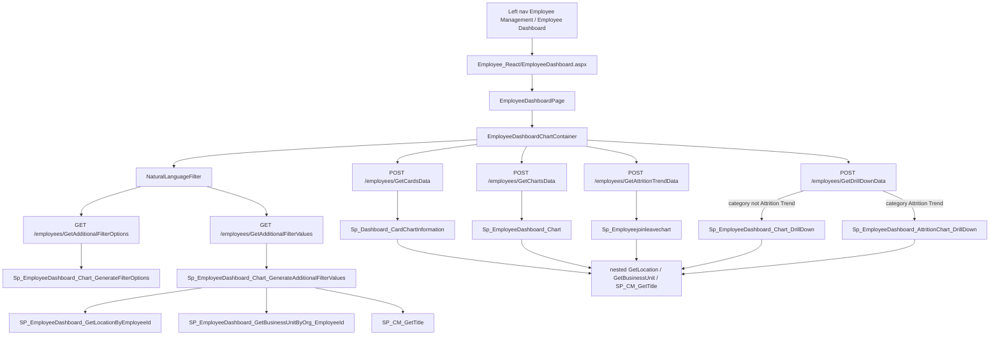
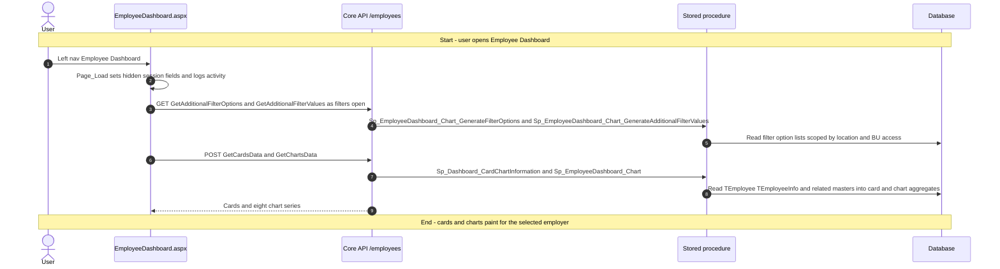
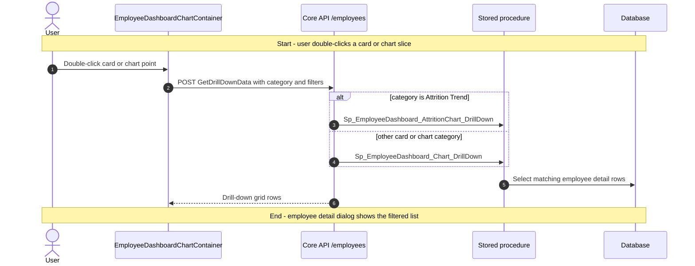
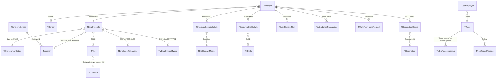

# Employee Dashboard

## Overview

An HR or manager opens **Employee Management → Employee Dashboard** to see workforce headcount at a glance for one organisation. The screen is read-only analytics: summary cards (active headcount, gender split, on leave, WFH, new hires, leaving today, average tenure), distribution charts (business unit, role, base location, domain, skill, employment type, company experience, designation), and an attrition join/leave trend with its own date range. Filters narrow every card and chart by attributes such as gender, designation, skill, domain, business unit, locations, employment status, and DOJ or LWD ranges. Double-clicking a card or chart slice opens a drill-down grid of the matching employees. Nothing on this page creates or updates an employee record.

**Who's involved:**

- **HR / administrator / manager** with menu access — primary audience. Sees employees in locations and business units allowed by their user and role page mappings.
- **Global-access users** — can switch organisation via the Employee React shell; chart and card calls use the selected employer id.

Live left-nav menu id `1184` navigates to `~/HRM/Employee_React/EmployeeDashboard.aspx` (`HRMS-DATABASE/HRMS/DML/109958/DML_Menu_Creation.sql`). There is no dedicated llm-wiki domain page for this dashboard. Employee master rows sit in the lifecycle described by `llm-wiki/domain/employee-lifecycle.md` (`TEmployee` / `TEmployeeInfo` and related history).

## Workflow

Chart layout save uses `HrmsChartContainer` / `GlobalConfigButton` configuration persistence from `@hrms/hrms-components` (not traced to an Employee Dashboard stored procedure in this guide).

## Request journey

Opening the dashboard loads filter option lists, then cards and charts for the selected employer. Drill-down is a second request type on the same screen.

### Open Employee Dashboard

### Drill down a card or chart

## Entry points

Live menu target (authoritative):

- Left nav **Employee Management → Employee Dashboard** opens `HRMS.Web/HRMS.Web/HRM/Employee_React/EmployeeDashboard.aspx` (`Tmenudetails` NavigateURL for menu id `1184`).
- `EmployeeDashboard.aspx.cs` `Page_Load` (lines 21-39) logs `ActivityDescription.EmployeeDashboard` and copies `LoggedInUser` session fields into hidden inputs.
- React route `ROUTES.EmployeeDashboard` is `/HRM/Employee_React/EmployeeDashboard.aspx` (`Employee_React/routes.js` lines 21 and 103-104). `EmployeeDashboardPage.js` lines 8-9 mount `EmployeeDashboardChartContainer` under menu item **Employee Management** / page **Employee Dashboard**.
- Core API `Routes/routeIndex.js` mounts `EmployeeRoutes.js` at `/employees`. Dashboard actions are `EmployeesController.js` → `EmployeeRepository.js`.

Sibling / legacy (not the left-nav target):

- `HRM/Employee/Employee_Dashboard.aspx` declares `CodeBehind="Employee_Dashboard.aspx.cs"` and loads `DashBoard_React/BuildJS/dashboard_react.min.js`, but the code-behind file is missing from the tree and menu `1184` does not point here.

## Code → database call chain

Paths under `HRMS.Web/HRMS.Web` unless noted. Procedure links are database pages.

| What the page does | UI | HTTP client | Controller | Repository execute |
|---|---|---|---|---|
| Filter field list | `NaturalLanguageFilter.js` 165 | `EmployeeHttpClient.js` 354 `getAdditionalFilterOptions` | `EmployeesController.js` 337 | `EmployeeRepository.js` 398 `Sp_EmployeeDashboard_Chart_GenerateFilterOptions` |
| Filter value list | `NaturalLanguageFilter.js` 226 | `EmployeeHttpClient.js` 348 `getAdditionalFilterValues` | `EmployeesController.js` 311 | `EmployeeRepository.js` 376 `Sp_EmployeeDashboard_Chart_GenerateAdditionalFilterValues` |
| Summary cards | `SearchBar.js` 91 | `EmployeeHttpClient.js` 332 `getCardsData` | `EmployeesController.js` 64 | `EmployeeRepository.js` 147 `Sp_Dashboard_CardChartInformation` |
| Distribution charts | `SearchBar.js` 128 | `EmployeeHttpClient.js` 336 `getChartsData` | `EmployeesController.js` 114 | `EmployeeRepository.js` 197 `Sp_EmployeeDashboard_Chart` |
| Attrition trend | `ChartByAttritionTrend.js` 172 | `EmployeeHttpClient.js` 340 `getAttritionTrendData` | `EmployeesController.js` 171 | `EmployeeRepository.js` 339 `Sp_Employeejoinleavechart` |
| Card / chart drill-down | `EmployeeDashboardChartContainer.js` 96 | `EmployeeHttpClient.js` 344 `getDrillDownData` | `EmployeesController.js` 223 → 280 | `EmployeeRepository.js` 230 `Sp_EmployeeDashboard_Chart_DrillDown` |
| Attrition drill-down | `ChartByAttritionTrend.js` 229 (`category` Attrition Trend) | same | `EmployeesController.js` 252-278 | `EmployeeRepository.js` 286 `Sp_EmployeeDashboard_AttritionChart_DrillDown` |

`EmployeeHttpClient.js` also exposes `getLocations` / `getBusinessUnits` (`/employees/GetLocations`, `/employees/GetBusinessUnits`) mapped to `SP_EmployeeDashboard_GetLocationByEmployeeId` and `SP_EmployeeDashboard_GetBusinessUnitByOrg_EmployeeId`, but the Employee Dashboard containers do not call those methods. Those procedures still run nested inside the card, chart, filter-value, attrition, and drill-down procedures above.

## API endpoints

No WebForms postback. All data is Core API under `/employees` (`EmployeeRoutes.js` 62-69). Controllers prefer `req.EID` for employee id when present.

| Verb | Route | Params | Required | Where |
|---|---|---|---|---|
| GET | `/employees/GetAdditionalFilterOptions` | `filterType`, `type` | `filterType` sent by filter dialog | `EmployeeRoutes.js` 69, `EmployeesController.js` 337 |
| GET | `/employees/GetAdditionalFilterValues` | `employerId`, `employeeId`, `locationIds`, `businessUnitIds`, `filterType`, `filterOption`, `type` | Employer, employee, filter type/option sent | `EmployeeRoutes.js` 68, `EmployeesController.js` 311 |
| POST | `/employees/GetCardsData` | JSON body of employerId plus filter arrays/dates | `employerId` required for useful results; employee from `req.EID` or body | `EmployeeRoutes.js` 64, `EmployeesController.js` 64 |
| POST | `/employees/GetChartsData` | same filter body as cards | same | `EmployeeRoutes.js` 65, `EmployeesController.js` 114 |
| POST | `/employees/GetAttritionTrendData` | filter body plus `fromDate`, `toDate` | Dates sent by attrition chart (default last 6 months) | `EmployeeRoutes.js` 66, `EmployeesController.js` 171 |
| POST | `/employees/GetDrillDownData` | filter body plus `category`, `subCategory`, `excludeSubCategory`, `type`, optional attrition `fromDate`/`toDate` | Category and type sent | `EmployeeRoutes.js` 67, `EmployeesController.js` 223 |
| GET | `/employees/GetLocations` | `employeeId`, `employerId` | Available on client; unused by this page's UI | `EmployeeRoutes.js` 62 |
| GET | `/employees/GetBusinessUnits` | `employeeId`, `employerId` | Available on client; unused by this page's UI | `EmployeeRoutes.js` 63 |

## Stored procedures & tables involved

| Object | Path | Purpose |
|---|---|---|
| [Sp_Dashboard_CardChartInformation](/docs/database/hrms/Sp_Dashboard_CardChartInformation) | `HRMS-DATABASE/HRMS/STOREPROCEDURE/Sp_Dashboard_CardChartInformation.sql` | Card metrics (headcount, gender, leave, WFH, hires, leavers, averages) |
| [Sp_EmployeeDashboard_Chart](/docs/database/hrms/Sp_EmployeeDashboard_Chart) | `…/Sp_EmployeeDashboard_Chart.sql` | Eight distribution result sets for charts |
| [Sp_EmployeeDashboard_Chart_DrillDown](/docs/database/hrms/Sp_EmployeeDashboard_Chart_DrillDown) | `…/Sp_EmployeeDashboard_Chart_DrillDown.sql` | Employee rows for a card or chart slice |
| [Sp_Employeejoinleavechart](/docs/database/hrms/Sp_Employeejoinleavechart) | `…/Sp_Employeejoinleavechart.sql` | Join / leave / attrition series over a date range |
| [Sp_EmployeeDashboard_AttritionChart_DrillDown](/docs/database/hrms/Sp_EmployeeDashboard_AttritionChart_DrillDown) | `…/Sp_EmployeeDashboard_AttritionChart_DrillDown.sql` | Employee rows for an attrition period slice |
| [Sp_EmployeeDashboard_Chart_GenerateFilterOptions](/docs/database/hrms/Sp_EmployeeDashboard_Chart_GenerateFilterOptions) | `…/Sp_EmployeeDashboard_Chart_GenerateFilterOptions.sql` | Static filter field names by filter type |
| [Sp_EmployeeDashboard_Chart_GenerateAdditionalFilterValues](/docs/database/hrms/Sp_EmployeeDashboard_Chart_GenerateAdditionalFilterValues) | `…/Sp_EmployeeDashboard_Chart_GenerateAdditionalFilterValues.sql` | Dropdown values for a chosen filter field |
| [SP_EmployeeDashboard_GetLocationByEmployeeId](/docs/database/hrms/SP_EmployeeDashboard_GetLocationByEmployeeId) | `…/SP_EmployeeDashboard_GetLocationByEmployeeId.sql` | Nested (and unused direct API) location scope |
| [SP_EmployeeDashboard_GetBusinessUnitByOrg_EmployeeId](/docs/database/hrms/SP_EmployeeDashboard_GetBusinessUnitByOrg_EmployeeId) | `…/SP_EmployeeDashboard_GetBusinessUnitByOrg_EmployeeId.sql` | Nested (and unused direct API) business-unit scope |
| [SP_CM_GetTitle](/docs/database/hrms/SP_CM_GetTitle) | `…/SP_CM_GetTitle.sql` | Nested active designation titles for the employer |

Primary tables read across these procedures: `TEmployee`, `TEmployeeInfo`, `TGender`, `TOrgHierarchyDetails`, `TLocation`, `TEmployerDetails`, `TMEmploymentTypes`, `TEmploymentTypeClubWith`, `TEmployeeRoleMaster`, `TEmployeeDomainDetails`, `TSkillDomainMaster`, `TEmployeeSkillDetails`, `TMSkills`, `TTitle`, `TResignationDetails`, `TResignation`, `TDailyRegisterNew`, `TAttendanceTransaction`, `TWorkFromHomeRequest`, `TUsers`, `TUserEmployee`, `TUSerPagesMapping`, `TRolePagesMapping`, `TCountry`. Cross-database lookup on `TravelNExpense.dbo.TLOOKUP` for designation level in `SP_CM_GetTitle`.

## Table relationships

Derived from the dashboard procedure bodies (no dedicated llm-wiki ER for this feature). Declared FKs are sparse; edges below are the joins the SPs use.

## Known gaps

- Request named `HRM/Employee/Employee_Dashboard.aspx` (`~/HRM/Employee/Employee_Dashboard.aspx`), but live menu `1184` and `EmployeeDashboardPage.js` use `HRM/Employee_React/EmployeeDashboard.aspx`. The legacy ASPX has no `Employee_Dashboard.aspx.cs` in source and loads the generic `DashBoard_React` bundle.
- `GlobalConfigButton` / `HrmsChartContainer` layout persistence is outside the `/employees` call chain traced here; no Employee Dashboard SP was identified for chart layout save.
- `/employees/GetLocations` and `/employees/GetBusinessUnits` exist on the HTTP client and repository but are not called by Employee Dashboard containers (scope still applied via nested EXEC inside the aggregate SPs).
- Large drill-down and card procedures (1000+ lines) are summarized at the aggregate level; category-specific branches inside `Sp_EmployeeDashboard_Chart_DrillDown` are not enumerated line-by-line.
- No llm-wiki domain page specific to Employee Dashboard analytics.

## Reference

Confidence is medium: entry points, API routes, and procedure names are code-verified; table relationships are join-derived from procedure bodies rather than a reviewed domain ER.

### SourceCode

- `HRMS.Web/HRMS.Web/HRM/Employee_React/EmployeeDashboard.aspx`
- `HRMS.Web/HRMS.Web/HRM/Employee_React/EmployeeDashboard.aspx.cs`
- `HRMS.Web/HRMS.Web/HRM/Employee_React/routes.js`
- `HRMS.Web/HRMS.Web/HRM/Employee_React/Areas/EmployeeDashboard/EmployeeDashboardPage.js`
- `HRMS.Web/HRMS.Web/HRM/Employee_React/Areas/EmployeeDashboard/containers/EmployeeDashboardChartContainer.js`
- `HRMS.Web/HRMS.Web/HRM/Employee_React/Areas/EmployeeDashboard/containers/SearchBar.js`
- `HRMS.Web/HRMS.Web/HRM/Employee_React/Areas/EmployeeDashboard/containers/NaturalLanguageFilter.js`
- `HRMS.Web/HRMS.Web/HRM/Employee_React/Areas/EmployeeDashboard/components/ChartByAttritionTrend.js`
- `HRMS.Web/HRMS.Web/HRM/Employee_React/Common/HttpClients/EmployeeHttpClient.js`
- `HRMS.CoreAPI/HRMS.Core.WebAPI.Node/Routes/EmployeeRoutes.js`
- `HRMS.CoreAPI/HRMS.Core.WebAPI.Node/Controllers/EmployeesController.js`
- `HRMS.CoreAPI/HRMS.Core.WebAPI.Node/Core/Repositories/EmployeeRepository.js`
- `HRMS.Web/HRMS.Web/HRM/Employee/Employee_Dashboard.aspx` (legacy sibling)

### TDG HRMS DB

- `HRMS-DATABASE/HRMS/DML/109958/DML_Menu_Creation.sql`
- `HRMS-DATABASE/HRMS/STOREPROCEDURE/Sp_Dashboard_CardChartInformation.sql`
- `HRMS-DATABASE/HRMS/STOREPROCEDURE/Sp_EmployeeDashboard_Chart.sql`
- `HRMS-DATABASE/HRMS/STOREPROCEDURE/Sp_EmployeeDashboard_Chart_DrillDown.sql`
- `HRMS-DATABASE/HRMS/STOREPROCEDURE/Sp_Employeejoinleavechart.sql`
- `HRMS-DATABASE/HRMS/STOREPROCEDURE/Sp_EmployeeDashboard_AttritionChart_DrillDown.sql`
- `HRMS-DATABASE/HRMS/STOREPROCEDURE/Sp_EmployeeDashboard_Chart_GenerateFilterOptions.sql`
- `HRMS-DATABASE/HRMS/STOREPROCEDURE/Sp_EmployeeDashboard_Chart_GenerateAdditionalFilterValues.sql`
- `HRMS-DATABASE/HRMS/STOREPROCEDURE/SP_EmployeeDashboard_GetLocationByEmployeeId.sql`
- `HRMS-DATABASE/HRMS/STOREPROCEDURE/SP_EmployeeDashboard_GetBusinessUnitByOrg_EmployeeId.sql`
- `HRMS-DATABASE/HRMS/STOREPROCEDURE/SP_CM_GetTitle.sql`
- `llm-wiki/domain/employee-lifecycle.md` (employee master context only)
